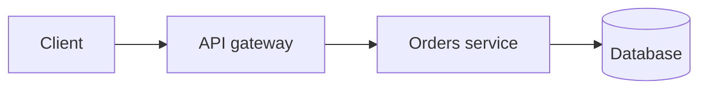

# AGENTS.md — how to add and maintain questions

This file is the rulebook for anyone (human or AI agent) adding content to this repo. Read it fully before you write a question. The goal: **every answer is something a candidate can read, understand, and say out loud in an interview.**

- [1. What this repo is](#1-what-this-repo-is)
- [2. Hard rules](#2-hard-rules)
- [3. Workflow: adding questions](#3-workflow-adding-questions)
- [4. Data model](#4-data-model)
- [5. Anatomy of a good answer](#5-anatomy-of-a-good-answer)
- [6. Writing style](#6-writing-style)
- [7. Code examples](#7-code-examples)
- [8. Mermaid diagrams](#8-mermaid-diagrams)
- [9. Technical Lead questions](#9-technical-lead-questions)
- [10. Audio compatibility](#10-audio-compatibility)
- [11. Topic outlines and coverage](#11-topic-outlines-and-coverage)
- [12. Validate, review, commit](#12-validate-review-commit)
- [13. Reference: commands and files](#13-reference-commands-and-files)
- [14. Feedback loop: fix what the reader reported](#14-feedback-loop-fix-what-the-reader-reported)
- [15. Problems: code in many languages, with a guide](#15-problems-code-in-many-languages-with-a-guide)
- [16. Handoff: project state, known issues and backlog](#16-handoff-project-state-known-issues-and-backlog)

## 1. What this repo is

An interview-preparation question bank for a Technical Lead (React/TypeScript, Go, Node.js, Kubernetes, microservices, Azure, GitLab CI/CD, Datadog). It has two faces:

| Face | What it is | Who uses it |
| --- | --- | --- |
| **GitHub Markdown** | `README.md` index and `questions/<topic>.md` pages | Reading on GitHub / any Markdown viewer |
| **Study app** | React UI in `app/web` with search, favorites, themes and a text-to-speech player | Reading and listening locally (`npm start`) |

Both are generated from one source of truth: **`data/<topic>.json`**.

```
data/<topic>.json      source of truth (edit this, or import into it)
questions/*.md         GENERATED Markdown pages (never edit by hand)
README.md              entry point; the topic table is GENERATED between markers
app/build.js           JSON -> Markdown
app/import.js          Markdown file -> JSON (the easy way to author)
app/validate.js        quality checks (questions and problems)
app/feedback.js        list/resolve feedback left in the app
app/problems-test.js   runs every code file in problems/ and checks its output
feedback/<topic>.json  notes and feedback entries written in the app
problems/              code problems: guide + tested solutions in many languages
tools/piper/           optional local text-to-speech (not content)
app/server.js          local API + serves the UI
app/web/               the React + TypeScript UI
```

## 2. Hard rules

1. **Never hand-edit `questions/*.md`** or the table between `<!-- TOPICS:START -->` and `<!-- TOPICS:END -->` in `README.md`. They are generated by `npm run build`.
2. **Never change or reuse an existing `id`, and never reset `favorite`.** People star questions in the app. Appending is always safe; editing wording in place is safe; deleting a question needs a reason.
3. **Commit the JSON and the regenerated Markdown together.** Run `npm run build` before committing.
4. **Run `npm run validate` before committing.** Fix all errors. Fix warnings unless you have a good reason.
5. **No unverified claims.** If a fact is version-specific (Go 1.22 loop variables, React 19 `use`, Kubernetes 1.29 sidecars) say the version. If you are unsure, leave it out or look it up.
6. **Keep the repo dependency-light.** `app/build.js`, `app/import.js`, `app/validate.js`, `app/server.js` are zero-dependency Node. UI dependencies live only in `app/web/package.json`.
7. **Do not commit** `node_modules/`, `app/web/dist/`, secrets, or the author's personal data (resume contents, phone numbers).
8. **Answers must be original explanations.** Do not paste text from books, blogs or documentation. Short quoted API names are fine.

## 3. Workflow: adding questions

Authoring in Markdown is much easier than editing JSON (no escaping of quotes or newlines). Use the importer.

### Step 0: read the feedback
```sh
npm run feedback
```
The reader may have left notes asking for more detail, a code fix, a correction. Handle those first (section 14).

### Step 1: plan the outline
Decide the topic, then list the questions before writing them. Group by level and by theme (see [section 11](#11-topic-outlines-and-coverage)). Check `data/<topic>.json` so you do not duplicate an existing question (search by keywords).

### Step 2: write a Markdown file
Anywhere outside the repo (for example your scratch directory), one file per batch of 10–25 questions:

````markdown
## What is the difference between `let`, `const` and `var`?
level: basic
module: Functions & Scope
tags: variables, scope

**Short answer:** `var` is function scoped and hoisted. `let` and `const` are block scoped…

#### Example

```js
const items = [1, 2, 3];
```

**Interview tip:** …
````

Format rules for the file:
- One `## Question` per question. The text after `## ` is the question.
- Directly below it, `level:` (`basic`, `intermediate` or `advanced`), `module:` (see section 4) and `tags:` (comma separated). Then a blank line, then the answer in Markdown.
- Inside answers use only `####` headings (or bold). `##` inside a code fence is fine.
- Order matters: within each level the file order is the reading order. Put prerequisites first.

### Step 3: import
```sh
npm run import -- /path/to/batch.md --topic "React"            # add new, update existing (matched by question text)
npm run import -- /path/to/batch.md --topic "React" --replace   # file order becomes topic order; others are removed
```
New questions get the next id (`react-014`). Existing questions keep their id and `favorite`. The Markdown pages and README table are rebuilt automatically. A new topic is created if it does not exist.

### Step 4: validate and review
```sh
npm run validate                 # all topics
npm run validate -- react        # one topic
npm run validate -- golang --go  # also compile-checks standalone Go examples
```
Then open the app (`npm start`) and read the new questions as a user would: do the code blocks, tables and diagrams render? Does the audio sound natural in *Explain* style? (Section 10.)

### Step 5: commit
```sh
git add data questions README.md
git commit -m "Add 20 React hooks questions"
```
Use a short imperative subject that says what and how many. Never commit `app/web/dist`.

### Editing existing questions
Edit the JSON directly or use the app's Edit button (it has a live preview). To rewrite many answers, put them in an import file with the **same question text** and run the importer without `--replace`: the answers are updated in place.

## 4. Data model

```json
{
  "id": "react-014",
  "question": "Why do list items need a stable `key`?",
  "answer": "**Short answer:** …Markdown…",
  "level": "basic",
  "module": "Core Concepts",
  "tags": ["lists", "reconciliation"],
  "favorite": false
}
```

| Field | Rules |
| --- | --- |
| `id` | `<topic-slug>-NNN`, three digits, unique, immutable. Created by the importer. |
| `question` | A real interview question, phrased as an interviewer would ask. End with `?`. Unique within the topic. Inline code in backticks is fine. |
| `answer` | Markdown following [section 5](#5-anatomy-of-a-good-answer). |
| `level` | `basic`, `intermediate`, `advanced` (definitions below). |
| `module` | The theme inside the topic, so readers can browse by module (for example `Concurrency`, `Hooks`, `Networking`). 6–12 modules per topic, reused consistently, `Title Case`, no module with a single question. Questions without one appear under "Other". |
| `tags` | 1–4 lowercase, hyphenated keywords (`event-loop`, `tech-lead`, `go-1.22`). Reuse existing tags before inventing new ones. |
| `favorite` | `false` for new questions. Users toggle it. |

**Levels**

| Level | Meaning | Typical audience |
| --- | --- | --- |
| `basic` | Core concepts and everyday syntax. Anyone claiming the skill must know it. | Fresher to 2 years |
| `intermediate` | Day-to-day production work: patterns, debugging, testing, performance basics, design trade-offs. | 2–6 years |
| `advanced` | Internals, edge cases, large-scale design, performance tuning, leading decisions. | Senior / lead |

Order inside the topic file: **basic, then the Technical Lead section, then intermediate, then advanced** (the app and pages group by level, the file order sets the order inside each group).

## 5. Anatomy of a good answer

Every answer follows this shape. Skip a part only when it truly does not apply.

1. **`**Short answer:**`** — one to three plain sentences the candidate could say aloud. *This must be the first paragraph.* (The *Brief* audio mode reads only this and the interview tip.)
2. **Explanation** — why it works that way, in plain words. Use an everyday analogy when it helps.
3. **Example** — a small, correct code block with comments and the output in a comment (`// prints: 3`).
4. **Diagram** — only when a flow, lifecycle or structure is easier to see (section 8).
5. **Comparison table** — when comparing 2+ options (columns: option, what it is, when to use).
6. **Gotchas / common mistakes** — what people get wrong, with ❌ bad and ✅ good code.
7. **`**Interview tip:**`** — how to phrase it, a follow-up question to expect, or a real-world angle.

Target 150–450 words of prose plus code. Design and internals questions may be longer. Never pad.

Use these bold lead-ins **exactly**, at the start of a paragraph, because the audio narrator turns them into natural speech: `**Short answer:**`, `**Interview tip:**`, `**Gotcha:**` (or `**Gotchas**`), `**Common mistakes**`, `**Example**`, `**Remember**`, `**Rules of thumb**`.

## 6. Writing style

The reader is preparing for interviews and wants to **understand**, not memorise.

**Do**
- Use **simple English** and short sentences. Explain jargon the first time you use it.
- Prefer "the goroutine waits" over "the goroutine parks on the sudog queue" (unless the question is about internals; then explain the term).
- Use concrete, realistic names (`orders`, `userID`, `PaymentService`), not `foo/bar`, unless it is language trivia.
- State trade-offs: "when would you *not* do this?" Interviewers for senior roles care more about judgement than definitions.
- Connect to production reality: debugging, performance, monitoring, team practices.
- Say the version when behaviour depends on it.
- Keep one idea per question. Split big topics into several questions.

**Do not**
- Write walls of text. Use short paragraphs, lists, tables.
- Use raw HTML (it is ignored by the audio player and by GitHub in places).
- Use headings above `####` inside an answer.
- Copy documentation text, or use marketing words ("powerful", "seamless", "robust").
- Use em-dash chains or long nested sentences; they read badly aloud.
- Leave "TODO" or placeholder text.

## 7. Code examples

- Must be **correct and runnable** (or an obviously marked fragment). Mentally compile every example. Run it if the toolchain exists. Go examples are compiled by `npm run validate -- golang --go`.
- Small: under about 30 lines. Show the smallest code that makes the point.
- Comment the *why*, not the obvious. Show output with `// prints: …`.
- Mark wrong code `// ❌ bad` and the fix `// ✅ good`.
- Always tag the fence language: `js`, `ts`, `tsx`, `go`, `yaml`, `bash`, `dockerfile`, `sql`, `json`, `proto`, `text`.
- Per language:
  - **JavaScript/TypeScript**: modern syntax (`const`, arrow functions, `async/await`); TypeScript where types are the point; React examples in `tsx` function components.
  - **Go**: full `package main` when practical; `gofmt` style; handle errors.
  - **Kubernetes/YAML**: valid manifests with `apiVersion`, `kind`, `metadata`; realistic names; no real secrets.
  - **Shell**: show the command, then the expected output in a comment or a separate `text` block.
- Never include real credentials, tokens, or private hostnames.

## 8. Mermaid diagrams

GitHub and the app render ` ```mermaid ` blocks. Use one when it makes a **flow, lifecycle, sequence or structure** clearer. Do not add one for decoration.

- Use `flowchart LR|TD`, `sequenceDiagram`, `stateDiagram-v2` (these render reliably). `classDiagram`, `erDiagram` and `gitGraph` are allowed where the topic needs them (design, databases, git). Avoid exotic diagram types.
- 5–12 nodes. Short labels. One idea per diagram. Add a one-line sentence under it explaining how to read it.
- Quote any label that contains `()`, `:`, `/`, `[]` or other punctuation: `A["ctx.Done()"]`.
- A subgraph with a multi-word title needs an id: `subgraph H["Slice header"]` (not `subgraph Slice header`).
- Dotted edge labels need spaces: `A -. cancels .-> B`.
- Do not use HTML or custom CSS. `<br/>` inside a quoted label is acceptable.
- Keep it readable in **both light and dark themes**: no hard-coded colours.



`npm run validate` catches the common syntax mistakes. It cannot render, so look at the diagram in the app.

## 9. Technical Lead questions

The candidate leads a team. After the basics of every topic, add a **Technical Lead** section (10–15 questions): the things a lead is asked beyond "how does X work".

- Title prefix: `[Tech Lead]`. Tag: `tech-lead`. Level: usually `intermediate`; `advanced` for architecture and strategy.
- Themes: performance and load; debugging and incident response; reliability and failure modes; observability; security; scaling and cost; testing strategy; CI/CD and release safety; migration and upgrade strategy; team practices (code review, standards, mentoring); decision-making and trade-offs.
- Answer as a process: *how would you approach it*, *what do you measure*, *what do you decide and why*, *how do you communicate it*.

## 10. Audio compatibility

The app reads answers aloud (browser text-to-speech). It parses each answer into top-level blocks, and the reader can start playback from any block. To keep it sounding good:

- Start with `**Short answer:**` and end with `**Interview tip:**` when useful.
- Keep prose in normal paragraphs and lists. Lists are read as sentences (the *Explain* style reads the first five items).
- Code, diagrams and long tables are **not read**; the narrator says "have a look at the example on screen". Therefore **the prose must make sense without the code**: describe what the example shows.
- Avoid symbols-only meaning ("a -> b" is read "a to b", but "O(n log n)" or regex are not). Spell out important formulas in words.
- Put essential information in sentences, not only in table cells or code comments.
- Avoid very long sentences (they are split at about 200 characters).

The *Explain* style also removes `(bracketed asides)`; do not put essential facts only inside brackets.

## 11. Topic outlines and coverage

Target shape for a "complete" topic: **50–130 questions**, roughly 25% basic, 25% Tech Lead, 30% intermediate, 20% advanced. Write in this order: basics and core principles, Tech Lead, intermediate, advanced.

| Topic | File | Status |
| --- | --- | --- |
| Golang | `data/golang.json` | Complete (126) |
| JavaScript | `data/javascript.json` | Complete (66); extend with more output puzzles |
| Node.js | `data/nodejs.json` | Complete (65) |
| React | `data/react.json` | Complete (57); extend with forms and testing depth |
| TypeScript | `data/typescript.json` | Complete (74); type claims verified with `tsc` |
| Kubernetes | `data/kubernetes.json` | Complete (57); extend with AKS and service mesh |
| Microservices | `data/microservices.json` | Complete (55) |
| Databases | `data/databases.json` | Complete (76) |
| System Design | `data/system-design.json` | Complete (67) |
| DevOps & CI/CD | `data/devops-ci-cd.json` | Complete (65) |
| Git & Version Control | `data/git-version-control.json` | Complete (68); commands were run in throwaway repos |
| Azure & Cloud | `data/azure-cloud.json` | Complete (71) |
| Networking & Security | `data/networking-security.json` | Complete (73) |
| AI Engineering | `data/ai-engineering.json` | Complete (72); revisit facts that change fast (providers, protocols) |
| Design Principles | `data/design-principles.json` | Complete (83) |
| Leadership & Behavioral | `data/leadership-behavioral.json` | Complete (63) |
| Problems (code library) | `problems/` | Sorting, binary search, two sum done; see section 15.9 for the planned list |
| SDLC & Agile | `data/sdlc-agile.json` | Complete (20); extend with more Scrum and estimation depth |
| Planned | | Python, .NET/C#, more code problems (linked list, trees, graphs, DP, LRU cache) |

Every topic also has a curated list in `resources/<topic>.json` (official docs, tutorials, references). Add one when you create a topic; verify links with `npm run resources:check`.

**Outline template for a new language/framework topic**

1. *Basic*: what it is and how it runs, syntax essentials, types/values, functions, scope, objects/data structures, errors, modules, tooling.
2. *Tech Lead*: performance method, profiling, memory, load, error strategy, crash triage, observability, security, testing and CI standards, upgrades.
3. *Intermediate*: idioms and patterns, async/concurrency, testing, HTTP/data access, project structure, configuration, dependency management.
4. *Advanced*: internals and runtime behaviour, performance tuning, tricky edge cases, design exercises, classic interview puzzles.

## 12. Validate, review, commit

`npm run validate` fails on **errors** and prints **warnings**:

| Check | Severity |
| --- | --- |
| Invalid JSON, missing fields, bad `level`, duplicate id/question, empty answer | error |
| Unclosed code fence, headings above `####` in an answer | error |
| Mermaid block that does not start with a diagram type; subgraph title with spaces and no id | error |
| Standalone Go example fails `go vet` (with `--go`) | error |
| No `**Short answer:**` first, no `**Interview tip:**`, very short/long answer, no tags | warning |
| Code fence without language, raw HTML, long Mermaid diagram | warning |

**Self-review checklist**
- [ ] Would a candidate who reads only the **Short answer** sound competent?
- [ ] Is every code example correct, minimal and commented? Did I run it?
- [ ] Are the facts right, and the versions named where they matter?
- [ ] Is the language simple? Could a tired reader follow it at 11 pm?
- [ ] Is there a trade-off or "when not to" for design questions?
- [ ] Does the diagram (if any) render in the app in light and dark themes?
- [ ] Does it sound good when read aloud in *Explain* style?
- [ ] No duplicated question, no copied text, no secrets.

## 13. Reference: commands and files

| Command | What it does |
| --- | --- |
| `npm run setup` | Install and build the UI (once) |
| `npm start` | Run the study app on http://localhost:3000 (`PORT=4000 npm start` to change) |
| `npm run dev` | UI hot-reload on :5173 (needs `npm start` running for the API) |
| `npm run build` | Regenerate `questions/*.md` and the README topic table |
| `npm run import -- file.md --topic "Name" [--replace]` | Import a Markdown batch into `data/` |
| `npm run validate [-- topic…] [problems] [--strict] [--go]` | Quality checks |
| `npm run feedback [-- show <id> \| resolve <id> "note" \| --all \| --notes]` | Work through reader feedback |
| `npm run problems:test [-- <problem>[/<approach>]] [--lang go,java]` | Run every solution and compare with `expected.txt` |
| `npm run tts:setup [-- <voice-id>]` | Optional: install Piper TTS (English only by default) |

**About the person preparing:** Technical Lead at Thales (avionics in-flight entertainment, FlytEDGE). Stack: React/TypeScript, Go, Node.js/NestJS, Python, .NET, Kubernetes, Docker, Azure, GitLab CI/CD, Datadog, PostgreSQL/MS SQL. Where it feels natural, connect questions to microservices, cloud-native delivery, observability and leading a team. Do not copy personal details from their resume into the repo.


## 14. Feedback loop: fix what the reader reported

The study app has a **Notes** panel on every question. The reader can leave:

- a **note**: private study note. **Never act on notes** (they are for the reader).
- **feedback for the author**: a request to fix or improve, with a type (`more-detail`, `code-issue`, `incorrect`, `unclear`, `missing`, `other`). It can be about one question or about the **whole topic** (`question` is `null`).

Entries are stored in `feedback/<topic>.json`. **Start every content session by reading them:**

```sh
npm run feedback                       # open feedback, grouped by topic
npm run feedback -- --topic react      # one topic
npm run feedback -- show <id>          # the entry plus the question's current answer
```

For each open item:

1. Read it and the current answer (`show <id>`).
2. Decide whether the reader is right. Check facts and run the code. If the report is wrong or unclear, do not change the answer; resolve it with a short explanation of why.
3. Fix it. Edit the question with an import file whose question text matches (the importer updates in place) or edit the JSON. Keep ids and favorites.
4. For **code issues** run the example. For Go: `npm run validate -- golang --go`. For problems: `npm run problems:test -- <problem>`.
5. Resolve it with a one-line description of what changed:

```sh
npm run feedback -- resolve <id> "Added a handler-based example and fixed the loop variable"
```

For **topic-level** feedback (for example "too few questions on testing"), add the missing questions, then resolve it and say which questions you added.

Resolved entries stay in the file as history. Commit `feedback/` together with the content you changed.

## 15. Problems: code in many languages, with a guide

Interview questions explain ideas. **Problems** are the hands-on side: a popular problem (sorting, binary search, two sum, LRU cache…) with a written guide *and* tested code in many languages. They live in `problems/`.

### 15.1 What a reader needs from a problem

A good problem entry serves four real situations:

| Situation | What they need | Where it is |
| --- | --- | --- |
| "I'm asked this in an interview tomorrow." | The exact question, how to clarify it, a step-by-step script, the follow-ups | `overview.md`: *How interviewers ask it*, *How to answer*, *Follow-up questions* |
| "I need working code in my language." | Correct, idiomatic, tested code in the language they use | the solution files, one per language |
| "I don't understand why it works." | Intuition, a worked trace, complexity explained, a line-by-line code explanation | `notes.md` of each approach |
| "Where would I use this at work?" | Real systems, built-ins, when to hand-write vs call the library, pitfalls | `overview.md`: *Real-life scenarios*, *Built-ins*, *Common mistakes* |

### 15.2 Layout

```
problems/
  languages.json                  language registry (file names, how to run, which are core)
  sorting/                        one folder per problem (slug: lowercase, hyphens)
    problem.json                  metadata
    overview.md                   the guide to the problem as a whole
    bubble-sort/                  one folder per approach, simple to optimal
      variant.json                title, summary, complexity, stable, inPlace, order
      notes.md                    explanation of this approach
      expected.txt                the exact output every solution must print
      solution.js  solution.ts  solution.py  solution.go  Main.java  Program.cs  solution.cpp   (+ optional extras)
    quick-sort/ ...
    README.md                     GENERATED (never edit): guide + all code, readable on GitHub
README.md                         GENERATED index of problems
```

`npm run build` generates `problems/README.md` and each `problems/<slug>/README.md` (the guide plus every approach with all languages in collapsible sections), and the README table.

### 15.3 problem.json

```json
{
  "title": "Sorting",
  "summary": "Put items in order: the building block behind search, ranking, deduplication and merging.",
  "level": "basic",
  "tags": ["sorting", "arrays", "complexity"],
  "order": 1,
  "related": ["golang-054", "javascript-012"]
}
```
`related` lists ids of questions in the Q&A bank that go with this problem (they must exist). Use 3–8.

### 15.4 variant.json

```json
{
  "title": "Quick sort",
  "summary": "Pick a pivot, partition around it, recurse on both sides.",
  "order": 5,
  "complexity": { "best": "O(n log n)", "average": "O(n log n)", "worst": "O(n²)", "space": "O(log n)" },
  "stable": false,
  "inPlace": true
}
```
Order approaches from the simplest to the best, so the reader climbs the ladder the way an interview does (brute force first, then improvements).

### 15.5 overview.md (the guide to the problem)

Use `##` headings. Write these sections, in this order. Every section is **required** (validate warns when one is missing).

1. **`## How interviewers ask it`** — the question in real wording (2–3 variations), what to clarify (input size, duplicates, negative numbers, memory limits, stability, "can I mutate the input?"), and what a good answer must cover.
2. **`## Real-life scenarios`** — a table: *Scenario* | *What is actually used* | *Why*. Ground it in systems the reader knows (database `ORDER BY`, a paginated product list, leaderboards, merging log files, UI table sorting, top-K feeds, external sort for huge files). Name the production algorithm (for example Timsort in Python/Java objects, introsort in C++/.NET, pdqsort in Go 1.19+). Say the version if it matters.
3. **`## Approaches compared`** — a table of all approaches: time (best/average/worst), space, stable, in place, and a "use when" column. Add a Mermaid diagram if the relationship between approaches is easier to see (for example divide and conquer).
4. **`## How to choose`** — a short decision guide (a flowchart or a table: *data is small / nearly sorted / huge / needs stability / integers in a small range* → *use this*).
5. **`## Built-ins and the standard library`** — a table per language: the call to use in production (`Array.prototype.sort`, `sorted()`, `sort.Slice`, `Arrays.sort`, `List.Sort`, `std::sort`), which algorithm it is, whether it is stable, and the **pitfall** (JavaScript's default sort compares strings; `sort.Slice` is not stable; comparing floats and NaN).
6. **`## Common mistakes`** — bugs people actually write (off-by-one in loops, mutating while iterating, comparator that is not a strict weak ordering, integer overflow in midpoint, recursion depth).
7. **`## How to answer in an interview`** — a numbered script: clarify, give examples and edge cases, state the simple approach and its cost, improve it, code it, test it aloud, state complexity, mention trade-offs. Include the *phrases* to say.
8. **`## Follow-up questions`** — 5–8 questions the interviewer asks next, each with a 1–2 sentence answer (stability? sort 10 GB with 1 GB RAM? nearly sorted data? top-K? sort by two keys? parallelise it?).
9. **`## Practice`** — 3–5 related problems to try next.

### 15.6 notes.md (one approach)

Use `##` headings, in this order. All sections are **required**.

1. **`## Intuition`** — the idea in plain words with an everyday analogy (sorting playing cards). No jargon before it is explained.
2. **`## Walkthrough`** — a worked example traced step by step on a small input (a table of the array after each pass, or a Mermaid diagram). The reader should be able to reproduce it on paper.
3. **`## Complexity`** — *explain* each bound, do not just state it: why best case is that, what the worst-case input looks like, where the space goes. Add a table.
4. **`## Code explanation`** — map the steps to the code. Number the key lines in the code comments (`// 1. pick pivot`) and explain each number here. Then a short table *Language differences* (for example slices vs arrays, in-place vs returning a new list, integer division, recursion limits, how each language swaps two values).
5. **`## Edge cases and tests`** — the test inputs used by every solution (empty, one item, duplicates, already sorted, reverse sorted, negatives) and what each one checks.
6. **`## When to use it (and when not)`** — honest trade-offs.
7. **`## Interview notes`** — what to say out loud, the likely follow-up, the mistake to avoid.
8. **`## Real-life usage`** — where this exact approach really appears (or why it never does, and what is used instead).

Mermaid is encouraged in *Walkthrough*. Follow section 8 rules.

### 15.7 The code files

**Required languages** (`"core": true` in `languages.json`): **JavaScript, TypeScript, Python, Go, Java, C#, C++**. Optional extras exist (Swift, Ruby, PHP, Rust, Kotlin); add them when useful. A problem is not done until every required language is present and passing.

**Contract** (so the same `expected.txt` works for every language):

- Each file is a **complete, runnable program** with no dependencies beyond the standard library.
- It defines the algorithm as a function with a clear name (`quickSort` / `quick_sort` / `QuickSort` following each language's convention) and a small `main` that runs the **same fixed test inputs** in the same order.
- It prints **one line per test case**: the result's values separated by single spaces (booleans `true`/`false`, no brackets or commas). Nothing else is printed.
- `expected.txt` holds exactly those lines. The runner compares output ignoring trailing whitespace.
- Do not read input, use randomness or the clock, or print timing. Output must be deterministic.
- Do **not** mutate shared test data between cases; copy the input when the approach is in place.

**Quality rules** (this is the code readers will copy):

- Idiomatic for the language (naming, error handling, types), not a transliteration of another language. Use the built-in swap/destructuring/tuple features where they are normal.
- Comments explain **why**, and number the key steps to match the *Code explanation* section. Do not comment the obvious.
- Correct on all edge cases listed in the notes: empty, single element, duplicates, negatives, already sorted, reverse sorted.
- Beware per-language traps: integer overflow in `(lo + hi) / 2` (use `lo + (hi - lo) / 2`), recursion depth, mutating the caller's array, default sort comparators, unsigned types.
- Keep each file under about 80 lines. Simple first; optimise only when it is the point of the approach.
- Java: public class `Main` in `Main.java` (run with the source launcher). C#: top-level statements or a `Program` class in `Program.cs` (net8). TypeScript: runs with `node --experimental-strip-types`, so use only erasable type syntax (no enums, no parameter properties). C++: C++17, compiled with `clang++`.

**Practical tips** (learned from the first problems):

- An approach folder is only discovered when it has a **`variant.json`**. Without it the runner reports nothing for that folder.
- `expected.txt` belongs to **one approach**. Different approaches may legitimately print different results for the same input (for example, which duplicate a binary search lands on). Give each approach its own `expected.txt` and say so in its `notes.md`.
- To keep the seven languages in step, keep the test cases in **one table** (a scratch script or spreadsheet) and generate the shared harness from it. Hand-write only the algorithm in each language. This avoids drift between files.
- Per-language traps: C++ `size() - 1` on an empty `std::vector` underflows (cast to `int`); in C# top-level statements must come before local functions and type declarations; Java needs `public class Main`; Go `for` loops over ranges copy values; Python integers never overflow, so say which languages do.
- When a problem has several valid answers, define **one deterministic rule** (for example "smallest first index, then smallest second index"), state it in the notes, and make **every approach** follow it, so one `expected.txt` works across all languages.
- Integer convention: assume values fit in 32 bits and use 64-bit types for sums and products (`long` in Java/C#, `long long` in C++; Java literals need `L`). Say so in the notes. Do not use a "1e9 + 1e9 overflows" example: 2e9 fits in int32 (the limit is about 2.147e9).
- `expected.txt` ends with a newline. Escape pipes inside Markdown table cells (`\|`).
- A walkthrough may trace an input that is not one of the shared test cases, as long as it says so.
- Go files must be `gofmt`-formatted (`gofmt -w file.go`); the runner fails unformatted files. A multi-agent tip: do not touch `problems/README.md`, it is generated.
- Number the key steps in comments (`// 1.`, `// 2.`) and match them to the numbered list in *Code explanation*.
- Never edit the generated `problems/<slug>/README.md`; `npm run build` rewrites it.
- `related` ids come from `data/*.json`. Search the `question` text of the questions, not a title field.

**Verify** every file by running it:

```sh
npm run problems:test -- sorting               # everything in the problem
npm run problems:test -- sorting/quick-sort    # one approach
npm run problems:test -- sorting --lang go,java
```
The runner skips languages whose toolchain is missing (it prints `SKIP`). Do not mark a problem finished while a required language only passes because it was skipped; say so in your report.

### 15.8 Checklist before finishing a problem

- [ ] `overview.md` has all nine sections, real-life scenarios are concrete, built-ins are accurate for current versions.
- [ ] Every approach has `variant.json`, `notes.md` (eight sections), `expected.txt` and all required languages.
- [ ] `npm run problems:test -- <problem>` passes for every installed toolchain.
- [ ] `npm run validate -- problems` has no errors, and warnings are explained or fixed.
- [ ] `related` points to real question ids.
- [ ] `npm run build` regenerated `problems/README.md` and the README table; open the problem in the app and read it.
- [ ] Explanations are in simple English and make sense when read aloud.

### 15.9 Planned problems

Add them one at a time, simplest ideas first. Each is a full problem as above.

| Group | Problems |
| --- | --- |
| Foundations | Sorting (all common algorithms), binary search and variants, linear search, two sum and hashing, anagrams, palindromes, FizzBuzz-style warm-ups |
| Techniques | Two pointers, sliding window, prefix sums, recursion and backtracking (permutations, subsets, N-Queens), divide and conquer |
| Data structures | Linked list (reverse, cycle detection, merge), stack and queue (valid parentheses, min stack), hash map patterns, heap and top-K, trie, union-find |
| Trees and graphs | Tree traversals, BST operations, BFS/DFS, shortest path (Dijkstra), topological sort |
| Dynamic programming | Fibonacci to memoisation, knapsack, longest common subsequence, coin change, edit distance |
| Design | LRU/LFU cache, rate limiter, parking lot / elevator (object design), pub/sub |

## 16. Handoff: project state, known issues and backlog

Read this first when you pick the project up again.

### State (last updated at the end of the first long build session)

- **17 topics, about 1,160 questions** (see the table in section 11), each with a Technical Lead section, modules and a curated `resources/<topic>.json`. **3 code problems** (sorting, binary search, two sum) with 105 solutions that all pass `npm run problems:test`.
- **App features:** rendered Markdown with code highlighting and Mermaid (diagrams are cached so they never flash), search/filter/group by level or module, favorites, notes and feedback for agents (`npm run feedback`), resources dialog and "Further reading", opt-in reading progress, view options (hide topics/modules, move or hide panels, edge arrows, swipe on phones), compact reader header/footer, and a text-to-speech player (browser voices or optional Piper) with reading styles, quiz mode, sleep timer, lock-screen controls, "Play all", and audio for problem guides.
- **Quality gates:** `npm run validate` (0 errors expected; ~127 style warnings are normal, mostly "no Interview tip"), `npm run problems:test`, `npm run resources:check`. All Mermaid diagrams were rendered once in the app (all passed); re-check after adding many.
- Everything is committed and pushed to `main`. The generated Markdown (`questions/`, `problems/*/README.md`, README tables) must be committed with the sources: run `npm run build` first.

### Running it

```sh
npm run setup     # once
npm start         # http://localhost:3000 (PORT=4000 npm start); stale app/Piper processes are stopped first
npm run tts:setup # optional: Piper with ONE English voice (about 60 MB)
```

### Dashboard, Interview prep and study sets

- Home (`app/web/src/Dashboard.tsx`) is the default view. Interview prep lives in `app/web/src/interview/`: `skills.ts` (skills dictionary mapping resume/JD wording to a bank topic, modules and keywords), `analyze.ts` (plan, rounds, study set, AI prompt), `readFile.ts` (text and PDF via lazy `pdfjs-dist`), `InterviewView.tsx`. Study sets are browser-only (`studySets.ts`, key `ip.sets.v1`).
- **When you add a topic or module, add or extend its skill in `skills.ts`** so the planner can pick its questions. Test with the sample resume and job description (`SAMPLE_RESUME`, `SAMPLE_JD`); never put a real resume in the repo.

### Known issues and limits

- **Phones and voices:** the Piper voice runs on the computer that runs `npm start`. On a phone the app falls back to the browser voice, which some phones pause when the screen locks. Making Piper reachable from a phone on the home network (serve the app on the LAN, keep the Piper port internal) is the main audio backlog item.
- **Progress is browser-only** (`localStorage`, key `ip.progress.v1`), behind the `ProgressStorage` adapter in `app/web/src/progress.ts`; add a server adapter to sync across devices.
- **Facts to double-check** (flagged by the writing agents as written from memory; verify against current docs before relying on them): Node permission-model flags and type-stripping versions; Kubernetes feature versions (native sidecars, nftables kube-proxy, in-place resize), Ingress-NGINX retirement timing; kubenet retirement, Managed Redis naming and Functions plan names on Azure; PostgreSQL 18 `uuidv7()` and several SQL Server edition/feature claims; the OWASP Top 10 and LLM Top 10 category lists; provider-specific LLM features and the MCP spec; Kaniko status and tool versions in the DevOps topic; Git reftable version, `filter-repo` options, GitLab-specific behaviours; the React Compiler/`useEffectEvent` versions. The Raft, multi-region RPO/RTO and Kafka exactly-once wording in the microservices topic were also flagged.
- Diagrams and audio were verified by automated checks and by reading, not by listening to every answer. Spot-check new content in the app (light and dark theme).
- `pnpm-lock.yaml` in the repo root is an empty file created by some other tool; it is intentionally not tracked.

### Backlog (ideas, roughly by value)

1. Piper (or another local neural voice) usable from a phone; optional server-side progress.
2. More topics: Python, .NET/C#, more on Scrum/estimation, a security deep dive on authentication flows.
3. More code problems: linked list, stack/queue, trees, graphs (BFS/DFS), dynamic programming, LRU cache, heap/top-K (see section 15.9).
4. Spaced repetition using the optional read counter (suggest what to revisit).
5. Feedback and notes on code problems (they exist for questions and topics only).
6. A CI job that runs `npm run validate`, `npm run problems:test` and `npm run resources:check` on push.
7. Export/import of progress and favorites.

### Lessons for agents working in this repo

- **Background writers:** one agent per topic file. Several agents may run at once; if an import fails with a JSON parse error from another topic's file, wait a few seconds and retry. Never run state-changing git commands from a writing agent; the lead validates, rebuilds and commits.
- **Verify, do not trust:** run the code in examples, parse YAML, compile Go with `--go`, check type errors with `tsc`, render diagrams in the app, run Git examples in throwaway repos (never inside this repo).
- **Account limits:** long parallel runs can hit a spending/rate limit. Agent work is saved on disk; resume an agent with `SendMessage` to continue instead of starting over, and mark partial topics "In progress" in section 11.
- **Do not commit half-generated state:** the importer rebuilds `questions/*.md` and the README table; commit those together with the data they came from.
- **User preferences:** keep the UI simple (filters, audio bar and extras appear only when needed); audio is a core feature (people who cannot read along must be able to listen); content must stand on its own without seeing the code (it is read aloud).

