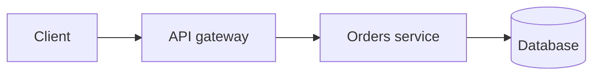

# AGENTS.md — how to add and maintain questions

This file is the rulebook for anyone (human or AI agent) adding content to this repo. Read it fully before you write a question. The goal: **every answer is something a candidate can read, understand, and say out loud in an interview.**

- [1. What this repo is](#1-what-this-repo-is)
- [2. Hard rules](#2-hard-rules)
- [3. Workflow: adding questions](#3-workflow-adding-questions)
- [4. Data model](#4-data-model)
- [5. Anatomy of a good answer](#5-anatomy-of-a-good-answer)
- [6. Writing style](#6-writing-style)
- [7. Code examples](#7-code-examples)
- [8. Mermaid diagrams](#8-mermaid-diagrams)
- [9. Technical Lead questions](#9-technical-lead-questions)
- [10. Audio compatibility](#10-audio-compatibility)
- [11. Topic outlines and coverage](#11-topic-outlines-and-coverage)
- [12. Validate, review, commit](#12-validate-review-commit)
- [13. Reference: commands and files](#13-reference-commands-and-files)

## 1. What this repo is

An interview-preparation question bank for a Technical Lead (React/TypeScript, Go, Node.js, Kubernetes, microservices, Azure, GitLab CI/CD, Datadog). It has two faces:

| Face | What it is | Who uses it |
| --- | --- | --- |
| **GitHub Markdown** | `README.md` index and `questions/<topic>.md` pages | Reading on GitHub / any Markdown viewer |
| **Study app** | React UI in `app/web` with search, favorites, themes and a text-to-speech player | Reading and listening locally (`npm start`) |

Both are generated from one source of truth: **`data/<topic>.json`**.

```
data/<topic>.json      source of truth (edit this, or import into it)
questions/*.md         GENERATED Markdown pages (never edit by hand)
README.md              entry point; the topic table is GENERATED between markers
app/build.js           JSON -> Markdown
app/import.js          Markdown file -> JSON (the easy way to author)
app/validate.js        quality checks
app/server.js          local API + serves the UI
app/web/               the React + TypeScript UI
```

## 2. Hard rules

1. **Never hand-edit `questions/*.md`** or the table between `<!-- TOPICS:START -->` and `<!-- TOPICS:END -->` in `README.md`. They are generated by `npm run build`.
2. **Never change or reuse an existing `id`, and never reset `favorite`.** People star questions in the app. Appending is always safe; editing wording in place is safe; deleting a question needs a reason.
3. **Commit the JSON and the regenerated Markdown together.** Run `npm run build` before committing.
4. **Run `npm run validate` before committing.** Fix all errors. Fix warnings unless you have a good reason.
5. **No unverified claims.** If a fact is version-specific (Go 1.22 loop variables, React 19 `use`, Kubernetes 1.29 sidecars) say the version. If you are unsure, leave it out or look it up.
6. **Keep the repo dependency-light.** `app/build.js`, `app/import.js`, `app/validate.js`, `app/server.js` are zero-dependency Node. UI dependencies live only in `app/web/package.json`.
7. **Do not commit** `node_modules/`, `app/web/dist/`, secrets, or the author's personal data (resume contents, phone numbers).
8. **Answers must be original explanations.** Do not paste text from books, blogs or documentation. Short quoted API names are fine.

## 3. Workflow: adding questions

Authoring in Markdown is much easier than editing JSON (no escaping of quotes or newlines). Use the importer.

### Step 1: plan the outline
Decide the topic, then list the questions before writing them. Group by level and by theme (see [section 11](#11-topic-outlines-and-coverage)). Check `data/<topic>.json` so you do not duplicate an existing question (search by keywords).

### Step 2: write a Markdown file
Anywhere outside the repo (for example your scratch directory), one file per batch of 10–25 questions:

````markdown
## What is the difference between `let`, `const` and `var`?
level: basic
tags: variables, scope

**Short answer:** `var` is function scoped and hoisted. `let` and `const` are block scoped…

#### Example

```js
const items = [1, 2, 3];
```

**Interview tip:** …
````

Format rules for the file:
- One `## Question` per question. The text after `## ` is the question.
- Directly below it, `level:` (`basic`, `intermediate` or `advanced`) and `tags:` (comma separated). Then a blank line, then the answer in Markdown.
- Inside answers use only `####` headings (or bold). `##` inside a code fence is fine.
- Order matters: within each level the file order is the reading order. Put prerequisites first.

### Step 3: import
```sh
npm run import -- /path/to/batch.md --topic "React"            # add new, update existing (matched by question text)
npm run import -- /path/to/batch.md --topic "React" --replace   # file order becomes topic order; others are removed
```
New questions get the next id (`react-014`). Existing questions keep their id and `favorite`. The Markdown pages and README table are rebuilt automatically. A new topic is created if it does not exist.

### Step 4: validate and review
```sh
npm run validate                 # all topics
npm run validate -- react        # one topic
npm run validate -- golang --go  # also compile-checks standalone Go examples
```
Then open the app (`npm start`) and read the new questions as a user would: do the code blocks, tables and diagrams render? Does the audio sound natural in *Explain* style? (Section 10.)

### Step 5: commit
```sh
git add data questions README.md
git commit -m "Add 20 React hooks questions"
```
Use a short imperative subject that says what and how many. Never commit `app/web/dist`.

### Editing existing questions
Edit the JSON directly or use the app's Edit button (it has a live preview). To rewrite many answers, put them in an import file with the **same question text** and run the importer without `--replace`: the answers are updated in place.

## 4. Data model

```json
{
  "id": "react-014",
  "question": "Why do list items need a stable `key`?",
  "answer": "**Short answer:** …Markdown…",
  "level": "basic",
  "tags": ["lists", "reconciliation"],
  "favorite": false
}
```

| Field | Rules |
| --- | --- |
| `id` | `<topic-slug>-NNN`, three digits, unique, immutable. Created by the importer. |
| `question` | A real interview question, phrased as an interviewer would ask. End with `?`. Unique within the topic. Inline code in backticks is fine. |
| `answer` | Markdown following [section 5](#5-anatomy-of-a-good-answer). |
| `level` | `basic`, `intermediate`, `advanced` (definitions below). |
| `tags` | 1–4 lowercase, hyphenated keywords (`event-loop`, `tech-lead`, `go-1.22`). Reuse existing tags before inventing new ones. |
| `favorite` | `false` for new questions. Users toggle it. |

**Levels**

| Level | Meaning | Typical audience |
| --- | --- | --- |
| `basic` | Core concepts and everyday syntax. Anyone claiming the skill must know it. | Fresher to 2 years |
| `intermediate` | Day-to-day production work: patterns, debugging, testing, performance basics, design trade-offs. | 2–6 years |
| `advanced` | Internals, edge cases, large-scale design, performance tuning, leading decisions. | Senior / lead |

Order inside the topic file: **basic, then the Technical Lead section, then intermediate, then advanced** (the app and pages group by level, the file order sets the order inside each group).

## 5. Anatomy of a good answer

Every answer follows this shape. Skip a part only when it truly does not apply.

1. **`**Short answer:**`** — one to three plain sentences the candidate could say aloud. *This must be the first paragraph.* (The *Brief* audio mode reads only this and the interview tip.)
2. **Explanation** — why it works that way, in plain words. Use an everyday analogy when it helps.
3. **Example** — a small, correct code block with comments and the output in a comment (`// prints: 3`).
4. **Diagram** — only when a flow, lifecycle or structure is easier to see (section 8).
5. **Comparison table** — when comparing 2+ options (columns: option, what it is, when to use).
6. **Gotchas / common mistakes** — what people get wrong, with ❌ bad and ✅ good code.
7. **`**Interview tip:**`** — how to phrase it, a follow-up question to expect, or a real-world angle.

Target 150–450 words of prose plus code. Design and internals questions may be longer. Never pad.

Use these bold lead-ins **exactly**, at the start of a paragraph, because the audio narrator turns them into natural speech: `**Short answer:**`, `**Interview tip:**`, `**Gotcha:**` (or `**Gotchas**`), `**Common mistakes**`, `**Example**`, `**Remember**`, `**Rules of thumb**`.

## 6. Writing style

The reader is preparing for interviews and wants to **understand**, not memorise.

**Do**
- Use **simple English** and short sentences. Explain jargon the first time you use it.
- Prefer "the goroutine waits" over "the goroutine parks on the sudog queue" (unless the question is about internals; then explain the term).
- Use concrete, realistic names (`orders`, `userID`, `PaymentService`), not `foo/bar`, unless it is language trivia.
- State trade-offs: "when would you *not* do this?" Interviewers for senior roles care more about judgement than definitions.
- Connect to production reality: debugging, performance, monitoring, team practices.
- Say the version when behaviour depends on it.
- Keep one idea per question. Split big topics into several questions.

**Do not**
- Write walls of text. Use short paragraphs, lists, tables.
- Use raw HTML (it is ignored by the audio player and by GitHub in places).
- Use headings above `####` inside an answer.
- Copy documentation text, or use marketing words ("powerful", "seamless", "robust").
- Use em-dash chains or long nested sentences; they read badly aloud.
- Leave "TODO" or placeholder text.

## 7. Code examples

- Must be **correct and runnable** (or an obviously marked fragment). Mentally compile every example. Run it if the toolchain exists. Go examples are compiled by `npm run validate -- golang --go`.
- Small: under about 30 lines. Show the smallest code that makes the point.
- Comment the *why*, not the obvious. Show output with `// prints: …`.
- Mark wrong code `// ❌ bad` and the fix `// ✅ good`.
- Always tag the fence language: `js`, `ts`, `tsx`, `go`, `yaml`, `bash`, `dockerfile`, `sql`, `json`, `proto`, `text`.
- Per language:
  - **JavaScript/TypeScript**: modern syntax (`const`, arrow functions, `async/await`); TypeScript where types are the point; React examples in `tsx` function components.
  - **Go**: full `package main` when practical; `gofmt` style; handle errors.
  - **Kubernetes/YAML**: valid manifests with `apiVersion`, `kind`, `metadata`; realistic names; no real secrets.
  - **Shell**: show the command, then the expected output in a comment or a separate `text` block.
- Never include real credentials, tokens, or private hostnames.

## 8. Mermaid diagrams

GitHub and the app render ` ```mermaid ` blocks. Use one when it makes a **flow, lifecycle, sequence or structure** clearer. Do not add one for decoration.

- Use `flowchart LR|TD`, `sequenceDiagram`, `stateDiagram-v2` (these render reliably). Avoid exotic diagram types.
- 5–12 nodes. Short labels. One idea per diagram. Add a one-line sentence under it explaining how to read it.
- Quote any label that contains `()`, `:`, `/`, `[]` or other punctuation: `A["ctx.Done()"]`.
- A subgraph with a multi-word title needs an id: `subgraph H["Slice header"]` (not `subgraph Slice header`).
- Dotted edge labels need spaces: `A -. cancels .-> B`.
- Do not use HTML or custom CSS. `<br/>` inside a quoted label is acceptable.
- Keep it readable in **both light and dark themes**: no hard-coded colours.



`npm run validate` catches the common syntax mistakes. It cannot render, so look at the diagram in the app.

## 9. Technical Lead questions

The candidate leads a team. After the basics of every topic, add a **Technical Lead** section (10–15 questions): the things a lead is asked beyond "how does X work".

- Title prefix: `[Tech Lead]`. Tag: `tech-lead`. Level: usually `intermediate`; `advanced` for architecture and strategy.
- Themes: performance and load; debugging and incident response; reliability and failure modes; observability; security; scaling and cost; testing strategy; CI/CD and release safety; migration and upgrade strategy; team practices (code review, standards, mentoring); decision-making and trade-offs.
- Answer as a process: *how would you approach it*, *what do you measure*, *what do you decide and why*, *how do you communicate it*.

## 10. Audio compatibility

The app reads answers aloud (browser text-to-speech). It parses each answer into top-level blocks, and the reader can start playback from any block. To keep it sounding good:

- Start with `**Short answer:**` and end with `**Interview tip:**` when useful.
- Keep prose in normal paragraphs and lists. Lists are read as sentences (the *Explain* style reads the first five items).
- Code, diagrams and long tables are **not read**; the narrator says "have a look at the example on screen". Therefore **the prose must make sense without the code**: describe what the example shows.
- Avoid symbols-only meaning ("a -> b" is read "a to b", but "O(n log n)" or regex are not). Spell out important formulas in words.
- Put essential information in sentences, not only in table cells or code comments.
- Avoid very long sentences (they are split at about 200 characters).

The *Explain* style also removes `(bracketed asides)`; do not put essential facts only inside brackets.

## 11. Topic outlines and coverage

Target shape for a "complete" topic: **50–130 questions**, roughly 25% basic, 25% Tech Lead, 30% intermediate, 20% advanced. Write in this order: basics and core principles, Tech Lead, intermediate, advanced.

| Topic | File | Status |
| --- | --- | --- |
| Golang | `data/golang.json` | Complete (126) |
| JavaScript | `data/javascript.json` | Core principles complete; extend with more output puzzles |
| React | `data/react.json` | Core complete; extend with testing and forms |
| Kubernetes | `data/kubernetes.json` | Core complete; extend with AKS and service mesh |
| Microservices | `data/microservices.json` | Core complete; extend with system design cases |
| Node.js | `data/nodejs.json` | Short answers only; needs the detailed format |
| TypeScript, Azure, Docker, SQL/PostgreSQL, Python, .NET, system design, behavioural/leadership | not started | Planned |
| Data structures and algorithms | not started | Planned later: structure by pattern (arrays, hashing, two pointers, trees, graphs, DP) with complexity tables and diagrams |

**Outline template for a new language/framework topic**

1. *Basic*: what it is and how it runs, syntax essentials, types/values, functions, scope, objects/data structures, errors, modules, tooling.
2. *Tech Lead*: performance method, profiling, memory, load, error strategy, crash triage, observability, security, testing and CI standards, upgrades.
3. *Intermediate*: idioms and patterns, async/concurrency, testing, HTTP/data access, project structure, configuration, dependency management.
4. *Advanced*: internals and runtime behaviour, performance tuning, tricky edge cases, design exercises, classic interview puzzles.

## 12. Validate, review, commit

`npm run validate` fails on **errors** and prints **warnings**:

| Check | Severity |
| --- | --- |
| Invalid JSON, missing fields, bad `level`, duplicate id/question, empty answer | error |
| Unclosed code fence, headings above `####` in an answer | error |
| Mermaid block that does not start with a diagram type; subgraph title with spaces and no id | error |
| Standalone Go example fails `go vet` (with `--go`) | error |
| No `**Short answer:**` first, no `**Interview tip:**`, very short/long answer, no tags | warning |
| Code fence without language, raw HTML, long Mermaid diagram | warning |

**Self-review checklist**
- [ ] Would a candidate who reads only the **Short answer** sound competent?
- [ ] Is every code example correct, minimal and commented? Did I run it?
- [ ] Are the facts right, and the versions named where they matter?
- [ ] Is the language simple? Could a tired reader follow it at 11 pm?
- [ ] Is there a trade-off or "when not to" for design questions?
- [ ] Does the diagram (if any) render in the app in light and dark themes?
- [ ] Does it sound good when read aloud in *Explain* style?
- [ ] No duplicated question, no copied text, no secrets.

## 13. Reference: commands and files

| Command | What it does |
| --- | --- |
| `npm run setup` | Install and build the UI (once) |
| `npm start` | Run the study app on http://localhost:3000 (`PORT=4000 npm start` to change) |
| `npm run dev` | UI hot-reload on :5173 (needs `npm start` running for the API) |
| `npm run build` | Regenerate `questions/*.md` and the README topic table |
| `npm run import -- file.md --topic "Name" [--replace]` | Import a Markdown batch into `data/` |
| `npm run validate [-- topic…] [--strict] [--go]` | Quality checks |

**About the person preparing:** Technical Lead at Thales (avionics in-flight entertainment, FlytEDGE). Stack: React/TypeScript, Go, Node.js/NestJS, Python, .NET, Kubernetes, Docker, Azure, GitLab CI/CD, Datadog, PostgreSQL/MS SQL. Where it feels natural, connect questions to microservices, cloud-native delivery, observability and leading a team. Do not copy personal details from their resume into the repo.
