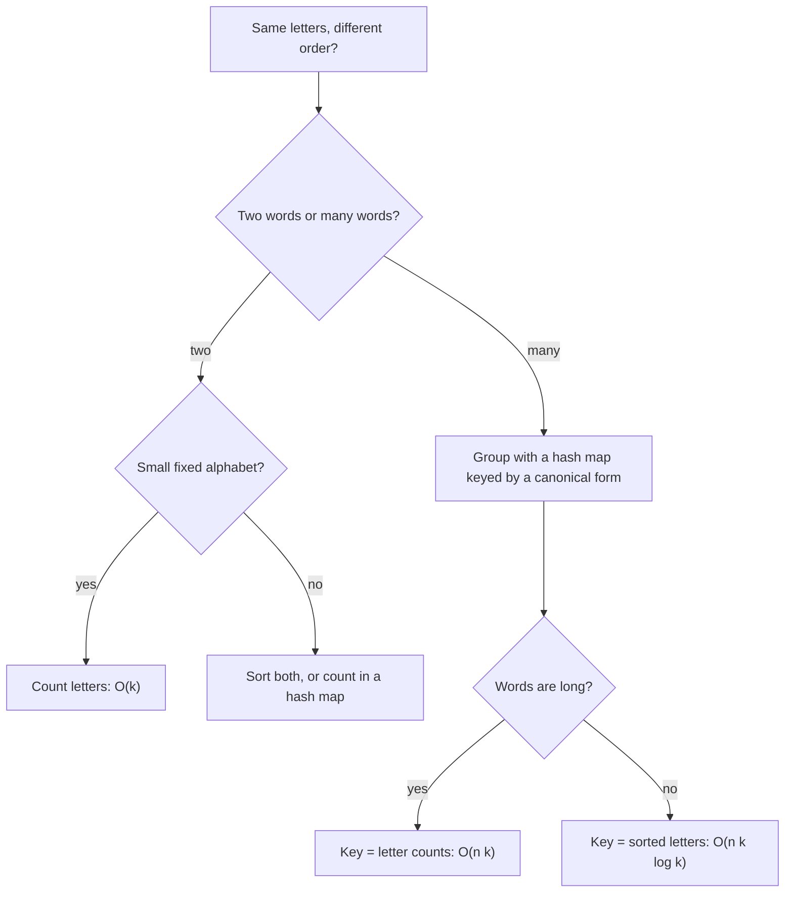
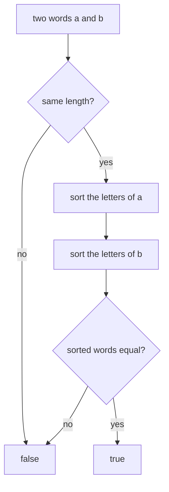
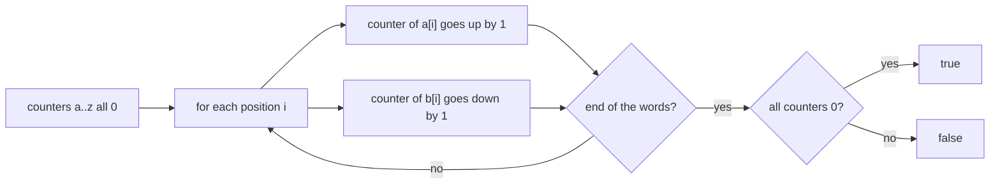
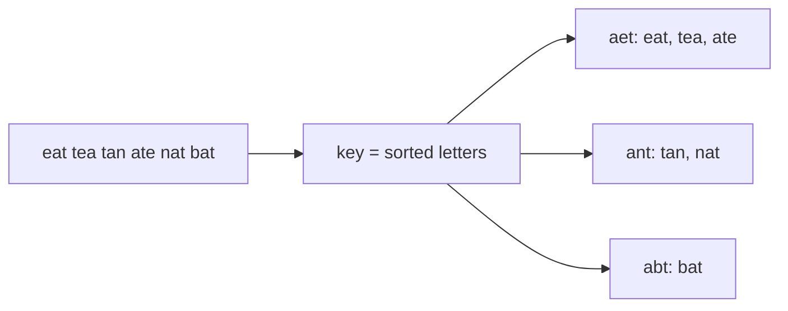
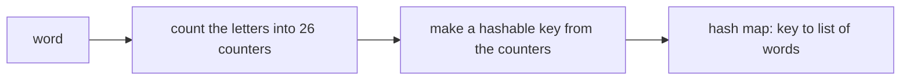

# Anagrams

[← All problems](../README.md)

> Decide whether two words use the same letters, and group a list of words into anagram families: a classic lesson in choosing a good hash key.

**Level:** basic · **Tags:** hashing, hash-map, strings, sorting, counting

**Related interview questions:**

- [JavaScript: What are `Map`, `Set`, `WeakMap` and `WeakSet`, and when do you use them?](../../questions/javascript.md)
- [Golang: How do maps work in Go, and what are the common mistakes?](../../questions/golang.md)
- [Golang: How are slices, maps and strings implemented internally?](../../questions/golang.md)
- [Golang: How are strings, bytes and runes related in Go?](../../questions/golang.md)
- [Networking & Security: What is the difference between hashing, encryption, signing and encoding?](../../questions/networking-security.md)
- [System Design: What is consistent hashing, and why is it used for distributing data and cache keys?](../../questions/system-design.md)
- [Golang: When should you use `sync.Map`, and what are better alternatives for concurrent maps?](../../questions/golang.md)

## How interviewers ask it

**An anagram** of a word is another word made from exactly the same letters, used the same number of times, in a different order. "Listen" and "silent" are anagrams. "Rat" and "car" are not.

**The classic wordings:**

- *Valid anagram.* "Given two strings `s` and `t`, return true if `t` is an anagram of `s`, and false otherwise."
- *Group anagrams.* "Given a list of words, group the words that are anagrams of each other. The groups can be in any order."

The first is a warm-up that tests whether you reach for sorting or counting. The second is the real test: it asks whether you can choose a good **key** for a hash map, a key that is the same for every word in a family and different for every other family.

**Common variations:**

- *Find all anagrams of a pattern inside a long text.* (a sliding window with a letter counter)
- *Is a permutation of the string a palindrome?* (at most one letter with an odd count)
- *Ransom note.* "Can the note be built from the letters of a magazine?" (counts, with one-way subtraction)
- *Anagrams with Unicode, uppercase and spaces.* (normalise first, or count with a hash map instead of an array of 26)
- *Minimum number of changes to make two strings anagrams.* (sum of count differences)
- *Largest group*, or *count the groups* in a big dictionary file.

**What to clarify before you code:**

| Question to ask | Why it matters |
| --- | --- |
| Only lowercase letters a to z, or any characters? | An array of 26 counters works only for a small fixed alphabet. Unicode needs a hash map. |
| Is case relevant? Do spaces and punctuation count? | "Dormitory" and "dirty room" are anagrams only if you ignore the space. |
| Can the words be empty? Are two empty words anagrams? | Usually yes: they have the same (empty) set of letters. |
| How many words, and how long is each? | Decides between sorting (k log k per word) and counting (k per word). |
| Does the order of the groups or of the words inside a group matter? | A hash map has no useful order, so you need a rule if the output must be fixed. |
| Are duplicates in the input kept? | "eat" twice should usually appear twice in its group. |

A good answer states both ideas (sort or count), explains why the key must be identical for all anagrams, gives the cost in terms of the number of words and their length, and mentions the alphabet assumption.

**The output rule in this repo.** The two-word programs print `true` or `false` per pair. The grouping programs print one line per list of words. Inside a line, each group has its words sorted alphabetically, and the groups are sorted by their first word. Groups are separated by a vertical bar, and words in a group by single spaces. An empty list prints the word `empty`. The grouping function itself returns the groups in whatever order the hash map gives. The test code sorts them before printing, because a hash map has no fixed order in most languages.

## Real-life scenarios

| Scenario | What is actually used | Why |
| --- | --- | --- |
| Word games and helpers (Scrabble, crosswords, anagram solvers) | A dictionary indexed by the sorted letters of each word | One lookup gives every word that can be made from a rack of letters. |
| Normalising data to find duplicates (the same tags or ingredients in a different order) | A canonical key, such as a sorted list or a counted multiset, as a hash key or a database column | Records that mean the same thing then get the same key. |
| `GROUP BY` on a computed key in SQL or a data pipeline | The key is the normalised form of the row | Grouping by a good key is the same idea as grouping anagrams. |
| Plagiarism and similarity checks, bag-of-words comparison | Counts of words or characters (a frequency vector) | Counts ignore order, which is exactly what an anagram does. |
| Sliding-window search in strings (find any permutation of a pattern in a text) | A letter counter that is updated as the window moves | Adding one letter and removing one is a constant-time update. |
| DNA and protein analysis (k-mer counts) | Frequency tables of short fragments | Sequences are compared by what they contain, not by where it sits. |
| Compressors and Huffman coding | A frequency table of symbols | The first step is always counting how often each symbol occurs. |
| Caches keyed by a request, with equivalent requests in different forms | A canonical form of the request as the cache key | Two requests that mean the same thing must hit the same entry. |

The shared idea: to test "same up to reordering", turn each item into a **canonical form** (sorted letters or counts), then compare or group by that form.

## Approaches compared

Let `k` be the length of a word and `n` the number of words.

| Approach | Problem | Time | Extra space | Alphabet | Use when |
| --- | --- | --- | --- | --- | --- |
| 1. Sort and compare | Two words | O(k log k) | O(k) for the sorted copies | Any characters | Short words, any alphabet, shortest code. |
| 2. Frequency count | Two words | O(k) | O(1) with 26 counters | Fixed small alphabet (use a hash map for Unicode) | The best answer for two lowercase words. |
| 3. Group, sorted-letters key | List of words | O(n k log k) | O(n k) | Any characters | The standard answer; short and clear. |
| 4. Group, letter-count key | List of words | O(n k) | O(n k) | Fixed small alphabet | Long words, when sorting each one is the bottleneck. |



Read it from the top: decide how many words you have, then how big the alphabet is, then how long the words are.

## How to choose

| Situation | Use |
| --- | --- |
| Two lowercase words, interview setting | Frequency count; mention sorting as the simpler alternative. |
| Two words with Unicode, accents or mixed case | Normalise first (case folding, Unicode normalisation), then count with a hash map. |
| Group a list of words, short words | Sorted-letters key in a hash map. |
| Group many long words | Letter-count key, to avoid sorting each word. |
| Huge dictionary that does not fit in memory | Compute the key per word and partition by a hash of the key (or sort externally by key). |
| You need a fixed output order | Sort the groups and the words yourself after grouping. A hash map has no useful order. |

## Built-ins and the standard library

| Language | Useful tools | Pitfall |
| --- | --- | --- |
| JavaScript / TypeScript | `[...word].sort().join('')`, `Map`, `Array.prototype.every` | The default `sort()` converts items to strings and compares UTF-16 codes: fine for letters, wrong for numbers. A `Map` key that is an array compares by reference, so build a string key such as `counts.join(',')`. Spread (`[...word]`) splits by code point, while `charCodeAt` works on UTF-16 units. |
| Python | `sorted(word)`, `collections.Counter`, `defaultdict(list)` | `Counter(a) == Counter(b)` is the one-line anagram test for any characters. A list is unhashable and cannot be a dict key, but a tuple can. |
| Go | `slices.Sort`, `sort.Strings`, a `[26]int` array, `map[[26]int][]string` | Arrays are comparable and can be map keys; slices cannot. Strings are bytes, so non-ASCII text needs runes. Map iteration order is random on purpose. |
| Java | `Arrays.sort(char[])`, `HashMap.computeIfAbsent`, `Arrays.toString(int[])` | An `int[]` uses identity for `equals` and `hashCode`, so it is useless as a key; convert it to a `String` or `List<Integer>`. `char` is a UTF-16 unit, not always a whole character. |
| C# | `Array.Sort(char[])`, `Dictionary`, `string.Join`, LINQ `OrderBy` | An `int[]` is compared by reference in a `Dictionary`. Use a string key. `string.Compare` is culture-sensitive; use `StringComparer.Ordinal` for a fixed order. |
| C++ | `std::sort`, `std::array<int, 26>`, `std::unordered_map`, `std::is_permutation` | There is no standard hash for arrays or vectors, so build a string key (or use an ordered `std::map`). `std::is_permutation(a.begin(), a.end(), b.begin(), b.end())` is a built-in anagram test, but it is O(k squared) in the worst case. |

**Hand-write or use a library?** For two words, a counter library (`Counter`) is the production answer. For grouping, the hash map with a good key is what everyone writes.

## Common mistakes

- **Forgetting the length check.** Without it, "ab" and "abb" can pass in a counting loop that only looks at the shorter word.
- **Counting only one direction.** Adding counts for the first word and checking they are non-negative for the second works only together with the length check.
- **Letters outside a to z.** `word[i] - 'a'` becomes negative or too large for uppercase letters, digits or spaces, and crashes or corrupts memory in C++. Validate, or use a hash map.
- **Using an array or list as a hash key in the wrong language.** In JavaScript, Java and C# two arrays with equal contents are different keys. In Python a list cannot be a key at all. Convert to a string or a tuple.
- **Sorting a character array incorrectly.** Using the default JavaScript sort on numbers gives `10` before `9`. For letters it is fine.
- **Expecting a fixed order from a hash map.** Output order differs between languages and between runs (Go randomises it on purpose). Sort the result if the order matters.
- **Mutating the input.** Sorting the original string's array in place is not possible for immutable strings in many languages. Work on a copy.
- **Sorted key collisions with separators.** If you build a count key by writing numbers next to each other (for example `"11"`), counts 1 and 1 collide with a count of 11. Use a separator such as a comma.
- **Case and spaces.** "Listen" and "Silent" are not equal as written. Decide whether to lower-case and strip spaces.
- **Using an unstable key such as the hash code of a list that you later change.** Keys must not be modified after insertion.

## How to answer in an interview

1. **Clarify.** "Only lowercase letters? Is case or whitespace relevant? Can the words be empty?"
2. **Give examples.** "Listen and silent are anagrams. Rat and car are not. An empty word and an empty word are anagrams."
3. **State the idea.** "Two words are anagrams when they use the same letters the same number of times. So I need a form of a word that does not depend on the order of the letters."
4. **Simple approach.** "Sort the letters of both and compare. O(k log k)."
5. **Better approach.** "Count the letters in one pass. For a fixed alphabet of 26 letters, that is O(k) time and O(1) space."
6. **For grouping,** "I use a hash map from a canonical key to a list of words. The key is the sorted letters, or the 26 counts."
7. **Code it,** with the length check first. Use a string or tuple as the key.
8. **Test aloud.** The empty list, one word, words with no anagram partner, duplicates and a mixed list.
9. **State complexity.** "For n words of length k, sorting keys gives O(n k log k). Count keys give O(n k)."
10. **Mention Unicode.** "For a larger alphabet I would count with a hash map and normalise the text first."

## Follow-up questions

- **What if the strings contain Unicode?** An array of 26 counters no longer works. Use a hash map from character to count. Also normalise the text (for example, composed and decomposed forms of an accented letter are different byte sequences) and decide how to treat case.
- **Why is the count key faster than the sorted key?** Sorting costs k log k per word; counting costs k plus a fixed 26 to build or compare the key. For short words the difference is small, for very long words it matters.
- **How do you find all anagrams of a pattern inside a text?** Slide a window of the pattern's length over the text. Keep a counter for the window: add the new letter, remove the old one, and compare with the pattern's counter. Track how many letters already match to make each step O(1).
- **Can you do the anagram test without extra memory?** For a fixed alphabet, the 26 counters are O(1) memory. Sorting in place also uses O(1) extra space if you may change the strings.
- **Is the sorted key unique for a family?** Yes: two words have the same sorted string exactly when they have the same letter counts. That is why it is a correct key.
- **What if the output order must be fixed?** Sort the words in each group and then the groups by their first word, as this repo does. Or use an ordered map keyed by the canonical form.
- **How would you group a billion words?** Compute the key for each word in a streaming pass, and write each word to a file chosen by a hash of its key (partitioning). Then group each file in memory. This is how a map-reduce job does it.
- **What are the attacks on hash maps here?** If inputs are untrusted, an attacker can craft many keys that collide, slowing every operation (hash flooding). Many runtimes randomise their hash seed to defend against it.
- **How would you check a permutation of a palindrome?** Count the letters; at most one letter may have an odd count.

## Practice

- Valid anagram, and group anagrams.
- Find all anagrams in a string (sliding window and counters).
- Ransom note, and first unique character in a string.
- Palindrome permutation, and longest palindrome that can be built from letters.
- Minimum steps to make two strings anagrams.
- Sort characters by frequency.
- Isomorphic strings and word pattern (a different kind of "same shape" key).

## Further reading

Where to read more at the source. Official docs and references come first.

**Official docs**

- [Python: collections.Counter](https://docs.python.org/3/library/collections.html#collections.Counter) — A multiset of counts; Counter(a) == Counter(b) checks anagrams for any characters. _(beginner)_
- [MDN: Array.prototype.sort](https://developer.mozilla.org/en-US/docs/Web/JavaScript/Reference/Global_Objects/Array/sort) — The default sort compares strings, which matters when sorting numbers. _(beginner)_
- [Java: HashMap](https://docs.oracle.com/en/java/javase/21/docs/api/java.base/java/util/HashMap.html) — The Java hash map, computeIfAbsent and key equality rules. _(beginner)_

**Reference**

- [Anagram (Wikipedia)](https://en.wikipedia.org/wiki/Anagram) — What an anagram is, with history and examples. _(beginner)_
- [Hash table (Wikipedia)](https://en.wikipedia.org/wiki/Hash_table) — How hashing, collisions and load factor work. _(beginner)_
- [Counting sort (Wikipedia)](https://en.wikipedia.org/wiki/Counting_sort) — The counting idea behind the frequency array, and when it beats comparison sorting. _(intermediate)_

**Article**

- [Go maps in action](https://go.dev/blog/maps) — How Go maps work, including which key types are allowed (arrays are, slices are not). _(intermediate)_

**Tool**

- [LeetCode: Valid Anagram](https://leetcode.com/problems/valid-anagram/) — The two-word anagram check, with the Unicode follow-up. _(beginner)_
- [LeetCode: Group Anagrams](https://leetcode.com/problems/group-anagrams/) — The grouping problem solved with a hash map. _(beginner)_

## Approaches

| Approach | Best | Average | Worst | Space | Stable | In place | Languages |
| --- | --- | --- | --- | --- | --- | --- | --- |
| [Sort the letters and compare](#sort-the-letters-and-compare) | O(1) | O(k log k) | O(k log k) | O(k) | – | – | JavaScript, TypeScript, Python, Go, Java, C#, C++ |
| [Frequency count array](#frequency-count-array) | O(1) | O(k) | O(k) | O(1) | – | – | JavaScript, TypeScript, Python, Go, Java, C#, C++ |
| [Group with a hash map: sorted-letters key](#group-with-a-hash-map-sorted-letters-key) | O(n k log k) | O(n k log k) | O(n k log k) | O(n k) | – | – | JavaScript, TypeScript, Python, Go, Java, C#, C++ |
| [Group with a hash map: letter-count key](#group-with-a-hash-map-letter-count-key) | O(n k) | O(n k) | O(n k) | O(n k) | – | – | JavaScript, TypeScript, Python, Go, Java, C#, C++ |

## Sort the letters and compare

> Sort the letters of both words; they are anagrams when the sorted strings are equal.

### Intuition

If two words are made of the same letters, then after putting the letters in alphabetical order the two words become identical. Sort the letters of "listen" and you get "eilnst". Sort the letters of "silent" and you also get "eilnst". Sort the letters of "rat" and you get "art", and of "car" you get "acr": different, so those are not anagrams.

This is like emptying two bags of letter tiles onto a table and arranging each pile in alphabetical order. If the two rows look the same, the bags held the same tiles.

Before sorting, a quick check helps: if the words have different lengths they cannot be anagrams, so we can return at once.

This approach is the shortest to write and works for any alphabet, not only a to z. It costs more than counting because sorting takes more than one pass.

### Walkthrough

Input: `listen` and `silent` (the first test case).

| Step | Action | Result |
| --- | --- | --- |
| 1 | Lengths are 6 and 6 | Continue |
| 2 | Sort the letters of `listen` | `e i l n s t` |
| 3 | Sort the letters of `silent` | `e i l n s t` |
| 4 | Compare the two sorted words | Equal, so the answer is `true` |

Second input: `rat` and `car`. The lengths are equal. The sorted letters are `a r t` and `a c r`. They differ at the second letter, so the answer is `false`.

Third input: `ab` and `a`. The lengths are 2 and 1, so the answer is `false` at once, and nothing is sorted.



Read it as: a cheap length check first, then the two sorts, then one comparison.

### Complexity

Let `k` be the length of the words.

| | Value | Why |
| --- | --- | --- |
| Time, best | O(1) | If the lengths differ we return without touching the letters. |
| Time, average and worst | O(k log k) | Sorting k letters with a comparison sort costs k log k. The comparison afterwards is O(k). |
| Space | O(k) | The sorted copies. Strings cannot be sorted in place in most languages because they are immutable, so we copy them into an array first. |

Since letters come from a small alphabet, a counting sort would sort in O(k). That is what the next approach does, without building the sorted word at all.

### Code explanation

1. **Length check.** Different lengths means "no". It also prevents comparing sorted words of different sizes.
2. **Sort the letters of each word.** First copy the letters into something sortable (an array of characters or bytes), because strings are immutable in JavaScript, Python, Go, Java and C#. In C++ the function takes the words by value, so it is allowed to sort its own copies.
3. **Compare.** Equal sorted words mean equal letters.

| Language | How the letters are sorted | Note |
| --- | --- | --- |
| JavaScript / TypeScript | `[...word].sort().join('')` | The spread makes an array of characters. The default sort compares UTF-16 codes, which is correct for letters. For numbers you would need a comparator. |
| Python | `sorted(word)` | Returns a new list of characters. Comparing two lists is a normal `==`. |
| Go | `slices.Sort` on a `[]byte` | `slices` is in the standard library since Go 1.21. Bytes are right for ASCII. For Unicode, sort runes. |
| Java | `Arrays.sort(char[])` | `Arrays.equals` compares the arrays element by element. Using `==` on arrays would compare references. |
| C# | `Array.Sort(char[])` then `new string(...)` | Strings compare by value with `==`. |
| C++ | `std::sort` on the string | The parameters are copies on purpose. Use `const&` plus a copy inside if you want to be explicit. |

### Edge cases and tests

Twenty pairs, each printing `true` or `false`. Both two-word approaches share the same expected output.

| Pair | Output | What it checks |
| --- | --- | --- |
| `listen`, `silent` | `true` | The standard example. |
| `anagram`, `nagaram` | `true` | Repeated letters (three a's). |
| `rat`, `car` | `false` | Same length, different letters. |
| `a`, `a` | `true` | Identical single letters. |
| empty, empty | `true` | Two empty words are anagrams (the output is a line, `true`, not a blank line). |
| `ab`, `a` | `false` | Different lengths. |
| `aab`, `abb` | `false` | Same length and same set of letters, different counts. |
| `abc`, `cba` | `true` | Fully reversed. |
| `aabbcc`, `abcabc` | `true` | Every letter appears twice. |
| `hello`, `world` | `false` | Overlapping letters, not equal. |
| `a`, `b` | `false` | Single different letters. |
| `night`, `thing` | `true` | A common pair. |
| `abcd`, `abce` | `false` | Differ only in the last letter. |
| `conversation`, `voicesranton` | `true` | A longer pair. |
| `dormitory`, `dirtyroom` | `true` | A famous pair. |
| `schoolmaster`, `theclassroom` | `true` | A famous pair. |
| `restful`, `fluster` | `true` | A common pair. |
| the alphabet, the reversed alphabet | `true` | All 26 letters. |
| `zz`, `z` | `false` | Different lengths with the same letter. |
| `zzzz`, `zzzy` | `false` | Same length, one letter differs. |

### When to use it (and when not)

**Use it** when the code should be as short as possible, when the alphabet is large or unknown (any character that can be sorted), and when words are short.

**Do not use it** for very long strings or inside a hot loop when you can count: sorting does more work than needed. Also, if you must compare one word against millions of others, compute the sorted form once and reuse it as a key, as the grouping approaches do.

### Interview notes

- Say: "Anagrams have the same letters, so their sorted forms are identical."
- Mention the quick length check first.
- State the cost: "O(k log k) time and O(k) space for the copies."
- Likely follow-up: "Can you do it in O(k)?" Count the letters with an array of 26.
- Mistake to avoid: comparing arrays with `==` in Java (reference comparison) or forgetting that JavaScript strings cannot be sorted in place.

### Real-life usage

The sorted form is used as an index key in word-game helpers and dictionaries of anagrams. Any time you need "the same items regardless of order" you can sort and compare: comparing two lists of tags, two sets of permissions or two ingredient lists. In databases, a sorted or canonical form of a row is the usual key for finding duplicates.

### Code

Every example prints the same output and is tested (`npm run problems:test`).

<details><summary>JavaScript</summary>

```js
// Anagrams, approach 1: sort the letters of both words and compare. Two words are anagrams exactly when their sorted letters match.
// Assumes lowercase letters a to z only.
function isAnagram(a, b) {
  if (a.length !== b.length) return false; // 1. different lengths can never be anagrams
  const sortLetters = (word) => [...word].sort().join(''); // 2. the default sort compares UTF-16 codes: fine for letters, wrong for numbers
  return sortLetters(a) === sortLetters(b); // 3. same letters in the same multiset means the same sorted string
}

const cases = [
  ["listen", "silent"],
  ["anagram", "nagaram"],
  ["rat", "car"],
  ["a", "a"],
  ["", ""],
  ["ab", "a"],
  ["aab", "abb"],
  ["abc", "cba"],
  ["aabbcc", "abcabc"],
  ["hello", "world"],
  ["a", "b"],
  ["night", "thing"],
  ["abcd", "abce"],
  ["conversation", "voicesranton"],
  ["dormitory", "dirtyroom"],
  ["schoolmaster", "theclassroom"],
  ["restful", "fluster"],
  ["abcdefghijklmnopqrstuvwxyz", "zyxwvutsrqponmlkjihgfedcba"],
  ["zz", "z"],
  ["zzzz", "zzzy"],
];

for (const [a, b] of cases) console.log(String(isAnagram(a, b)));
```

</details>

<details><summary>TypeScript</summary>

```ts
// Anagrams, approach 1: sort the letters of both words and compare. Two words are anagrams exactly when their sorted letters match.
// Assumes lowercase letters a to z only.
function isAnagram(a: string, b: string): boolean {
  if (a.length !== b.length) return false; // 1. different lengths can never be anagrams
  const sortLetters = (word: string): string => [...word].sort().join(''); // 2. the default sort compares UTF-16 codes: fine for letters
  return sortLetters(a) === sortLetters(b); // 3. same letters in the same multiset means the same sorted string
}

const cases: [string, string][] = [
  ["listen", "silent"],
  ["anagram", "nagaram"],
  ["rat", "car"],
  ["a", "a"],
  ["", ""],
  ["ab", "a"],
  ["aab", "abb"],
  ["abc", "cba"],
  ["aabbcc", "abcabc"],
  ["hello", "world"],
  ["a", "b"],
  ["night", "thing"],
  ["abcd", "abce"],
  ["conversation", "voicesranton"],
  ["dormitory", "dirtyroom"],
  ["schoolmaster", "theclassroom"],
  ["restful", "fluster"],
  ["abcdefghijklmnopqrstuvwxyz", "zyxwvutsrqponmlkjihgfedcba"],
  ["zz", "z"],
  ["zzzz", "zzzy"],
];

for (const [a, b] of cases) console.log(String(isAnagram(a, b)));
```

</details>

<details><summary>Python</summary>

```python
"""Anagrams, approach 1: sort the letters of both words and compare.

Two words are anagrams exactly when their sorted letters match. Assumes lowercase letters a to z only.
"""


def is_anagram(a, b):
    if len(a) != len(b):  # 1. different lengths can never be anagrams
        return False
    return sorted(a) == sorted(b)  # 2. sorted() returns a new list of letters; 3. equal lists mean equal letters

CASES = [
    ("listen", "silent"),
    ("anagram", "nagaram"),
    ("rat", "car"),
    ("a", "a"),
    ("", ""),
    ("ab", "a"),
    ("aab", "abb"),
    ("abc", "cba"),
    ("aabbcc", "abcabc"),
    ("hello", "world"),
    ("a", "b"),
    ("night", "thing"),
    ("abcd", "abce"),
    ("conversation", "voicesranton"),
    ("dormitory", "dirtyroom"),
    ("schoolmaster", "theclassroom"),
    ("restful", "fluster"),
    ("abcdefghijklmnopqrstuvwxyz", "zyxwvutsrqponmlkjihgfedcba"),
    ("zz", "z"),
    ("zzzz", "zzzy"),
]

for a, b in CASES:
    print("true" if is_anagram(a, b) else "false")
```

</details>

<details><summary>Go</summary>

```go
// Anagrams, approach 1: sort the letters of both words and compare. Two words are anagrams exactly when their sorted letters match.
// Assumes lowercase letters a to z only.
package main

import (
	"fmt"
	"slices"
)

func sortLetters(word string) string {
	letters := []byte(word) // 2. copy the bytes (strings are immutable), then sort the copy
	slices.Sort(letters)
	return string(letters)
}

func isAnagram(a, b string) bool {
	if len(a) != len(b) { // 1. different lengths can never be anagrams
		return false
	}
	return sortLetters(a) == sortLetters(b) // 3. same letters means the same sorted string
}

func main() {
	cases := [][2]string{
		{"listen", "silent"},
		{"anagram", "nagaram"},
		{"rat", "car"},
		{"a", "a"},
		{"", ""},
		{"ab", "a"},
		{"aab", "abb"},
		{"abc", "cba"},
		{"aabbcc", "abcabc"},
		{"hello", "world"},
		{"a", "b"},
		{"night", "thing"},
		{"abcd", "abce"},
		{"conversation", "voicesranton"},
		{"dormitory", "dirtyroom"},
		{"schoolmaster", "theclassroom"},
		{"restful", "fluster"},
		{"abcdefghijklmnopqrstuvwxyz", "zyxwvutsrqponmlkjihgfedcba"},
		{"zz", "z"},
		{"zzzz", "zzzy"},
	}
	for _, c := range cases {
		fmt.Println(isAnagram(c[0], c[1]))
	}
}
```

</details>

<details><summary>Java</summary>

```java
// Anagrams, approach 1: sort the letters of both words and compare. Two words are anagrams exactly when their sorted letters match.
// Assumes lowercase letters a to z only.
import java.util.Arrays;

public class Main {
    static boolean isAnagram(String a, String b) {
        if (a.length() != b.length()) return false; // 1. different lengths can never be anagrams
        char[] first = a.toCharArray(); // 2. copy into arrays (strings are immutable), then sort the copies
        char[] second = b.toCharArray();
        Arrays.sort(first);
        Arrays.sort(second);
        return Arrays.equals(first, second); // 3. same letters means equal sorted arrays
    }

    public static void main(String[] args) {
        String[][] cases = {
            {"listen", "silent"},
            {"anagram", "nagaram"},
            {"rat", "car"},
            {"a", "a"},
            {"", ""},
            {"ab", "a"},
            {"aab", "abb"},
            {"abc", "cba"},
            {"aabbcc", "abcabc"},
            {"hello", "world"},
            {"a", "b"},
            {"night", "thing"},
            {"abcd", "abce"},
            {"conversation", "voicesranton"},
            {"dormitory", "dirtyroom"},
            {"schoolmaster", "theclassroom"},
            {"restful", "fluster"},
            {"abcdefghijklmnopqrstuvwxyz", "zyxwvutsrqponmlkjihgfedcba"},
            {"zz", "z"},
            {"zzzz", "zzzy"},
        };
        for (String[] c : cases) System.out.println(isAnagram(c[0], c[1]));
    }
}
```

</details>

<details><summary>C#</summary>

```csharp
// Anagrams, approach 1: sort the letters of both words and compare. Two words are anagrams exactly when their sorted letters match.
// Assumes lowercase letters a to z only.
static string SortLetters(string word)
{
    char[] letters = word.ToCharArray(); // 2. copy into an array (strings are immutable), then sort the copy
    Array.Sort(letters);
    return new string(letters);
}

static bool IsAnagram(string a, string b)
{
    if (a.Length != b.Length) return false; // 1. different lengths can never be anagrams
    return SortLetters(a) == SortLetters(b); // 3. same letters means the same sorted string
}

(string, string)[] cases =
{
    ("listen", "silent"),
    ("anagram", "nagaram"),
    ("rat", "car"),
    ("a", "a"),
    ("", ""),
    ("ab", "a"),
    ("aab", "abb"),
    ("abc", "cba"),
    ("aabbcc", "abcabc"),
    ("hello", "world"),
    ("a", "b"),
    ("night", "thing"),
    ("abcd", "abce"),
    ("conversation", "voicesranton"),
    ("dormitory", "dirtyroom"),
    ("schoolmaster", "theclassroom"),
    ("restful", "fluster"),
    ("abcdefghijklmnopqrstuvwxyz", "zyxwvutsrqponmlkjihgfedcba"),
    ("zz", "z"),
    ("zzzz", "zzzy"),
};

foreach (var (a, b) in cases) Console.WriteLine(IsAnagram(a, b) ? "true" : "false");
```

</details>

<details><summary>C++</summary>

```cpp
// Anagrams, approach 1: sort the letters of both words and compare. Two words are anagrams exactly when their sorted letters match.
// Assumes lowercase letters a to z only.
#include <algorithm>
#include <iostream>
#include <string>
#include <utility>
#include <vector>

bool isAnagram(std::string a, std::string b) { // both strings are copies, so sorting does not change the caller's words
    if (a.size() != b.size()) return false; // 1. different lengths can never be anagrams
    std::sort(a.begin(), a.end()); // 2. sort the letters of each word
    std::sort(b.begin(), b.end());
    return a == b; // 3. same letters means the same sorted string
}

int main() {
    std::vector<std::pair<std::string, std::string>> cases = {
        {"listen", "silent"},
        {"anagram", "nagaram"},
        {"rat", "car"},
        {"a", "a"},
        {"", ""},
        {"ab", "a"},
        {"aab", "abb"},
        {"abc", "cba"},
        {"aabbcc", "abcabc"},
        {"hello", "world"},
        {"a", "b"},
        {"night", "thing"},
        {"abcd", "abce"},
        {"conversation", "voicesranton"},
        {"dormitory", "dirtyroom"},
        {"schoolmaster", "theclassroom"},
        {"restful", "fluster"},
        {"abcdefghijklmnopqrstuvwxyz", "zyxwvutsrqponmlkjihgfedcba"},
        {"zz", "z"},
        {"zzzz", "zzzy"},
    };
    for (const auto& [a, b] : cases) std::cout << (isAnagram(a, b) ? "true" : "false") << "\n";
}
```

</details>

### Expected output

```text
true
true
false
true
true
false
false
true
true
false
false
true
false
true
true
true
true
true
false
false
```

## Frequency count array

> Count each letter with one array: add for the first word, subtract for the second, and check for all zeros.

### Intuition

Sorting puts the letters in order, but we do not care about the order at all. We only care **how many times each letter appears**. So skip the sorting and count.

Picture a scoreboard with 26 slots, one for each letter of the alphabet, all showing zero. Walk through the first word and add one to the slot of each letter. Walk through the second word and subtract one from the slot of each letter. If the two words use the same letters the same number of times, every addition is cancelled by a subtraction, and the whole scoreboard is back to zero. If any slot is not zero, the words differ.

We can do both words in the same loop because we already checked that they have the same length. One pass, one small array of fixed size: O(k) time, O(1) space.

The array index of a letter is its distance from `a`: `a` is 0, `b` is 1, and `z` is 25. In code that is the letter minus `'a'`.

### Walkthrough

Input: `anagram` and `nagaram`. The table shows the counters for the letters that appear. Each row handles position `i` in both words: the letter from the first word adds one, and the letter from the second subtracts one.

| i | Letter of a | Letter of b | a | n | g | r | m |
| --- | --- | --- | --- | --- | --- | --- | --- |
| start | | | 0 | 0 | 0 | 0 | 0 |
| 0 | a | n | +1 | -1 | 0 | 0 | 0 |
| 1 | n | a | 0 | 0 | 0 | 0 | 0 |
| 2 | a | g | +1 | 0 | -1 | 0 | 0 |
| 3 | g | a | 0 | 0 | 0 | 0 | 0 |
| 4 | r | r | 0 | 0 | 0 | 0 | 0 |
| 5 | a | a | 0 | 0 | 0 | 0 | 0 |
| 6 | m | m | 0 | 0 | 0 | 0 | 0 |

All counters are zero at the end, so the answer is `true`. Look at a failing example, `aab` and `abb`: after the loop the counter of `a` is +1 and the counter of `b` is -1, so the answer is `false`.



Read it as: two updates per position, and one check at the end.

### Complexity

Let `k` be the length of the words.

| | Value | Why |
| --- | --- | --- |
| Time, best | O(1) | Different lengths are rejected before the loop. |
| Time, average and worst | O(k) | One pass over the words, then a check of 26 counters, which is a constant. |
| Space | O(1) | The array of 26 counters does not grow with the input. |

For an alphabet of size `s` the space is O(s) and the final check costs O(s). With a hash map instead of an array the same idea works for any characters, and the space is the number of distinct characters.

### Code explanation

1. **Length check.** Different lengths can never be anagrams. It also makes it safe to index `b[i]` with the same `i` as `a[i]`.
2. **A counter for each letter.** An array of 26 integers, all zero at the start. Index 0 is `a`, index 25 is `z`.
3. **Add and subtract in one loop.** A letter of the first word adds one; the letter at the same position of the second word subtracts one. The two words are not compared position by position; only their totals matter.
4. **Check for all zeros.** Any non-zero counter means one word has more of that letter than the other.

An optional early exit: while subtracting, if a counter becomes negative you could return `false` at once. Adding first and subtracting second in two separate loops makes this possible. The version here keeps one loop for simplicity.

| Language | Counter array | Note |
| --- | --- | --- |
| JavaScript / TypeScript | `new Array(26).fill(0)` | `charCodeAt(i) - 97` gives the index (97 is the code of `a`). Without `fill(0)` the slots are `undefined` and the sums become `NaN`. |
| Python | `[0] * 26` and `ord(x) - ord('a')` | `zip(a, b)` walks both words together. `collections.Counter(a) == collections.Counter(b)` is the shorter, more general production form. |
| Go | `var counts [26]int` | An array is a value type; `counts == [26]int{}` compares the whole array at once. Indexing with a byte minus `'a'` works because bytes are numbers. |
| Java | `new int[26]` | `charAt(i) - 'a'` is an `int`. A character outside a to z gives an index out of range and throws. |
| C# | `new int[26]` | LINQ's `All` checks every counter. |
| C++ | `std::array<int, 26>` with `{}` | `counts[a[i] - 'a']` with a character outside a to z is an out-of-bounds write: undefined behaviour. Validate if the input is not trusted. |

### Edge cases and tests

The same twenty pairs and the same expected output as the sort approach (see its notes for the table). The ones that stress counting most:

| Pair | Output | What it checks |
| --- | --- | --- |
| `aab`, `abb` | `false` | Same letters, different counts: counters end at +1 and -1. |
| `anagram`, `nagaram` | `true` | Repeated letters cancel out. |
| empty, empty | `true` | The loop does not run and every counter is zero. |
| `ab`, `a` | `false` | The length check protects the indexing. |
| the alphabet, the reversed alphabet | `true` | All 26 counters are used. |
| `zzzz`, `zzzy` | `false` | The last counter (`z`) ends at +1 and `y` at -1. |

### When to use it (and when not)

**Use it** for two words over a small fixed alphabet, as the best answer in an interview, and inside loops that compare many pairs.

**Do not use it** unchanged for Unicode text or for mixed case without normalising: the array of 26 will not fit. Use a hash map from character to count, and normalise the text first.

### Interview notes

- Say: "I only care about how many times each letter occurs, not their order, so I count instead of sorting."
- Describe the trick: "One array of 26 counters: plus one for the first word, minus one for the second. All zeros means anagram."
- State the cost: "O(k) time and O(1) space because the alphabet has a fixed size."
- Likely follow-up: "What about Unicode?" A hash map instead of the array.
- Mistake to avoid: skipping the length check, or indexing with a character outside the alphabet.

### Real-life usage

Frequency counting is behind many production tools: word-game solvers, plagiarism checks that compare bags of words, compression (Huffman coding starts with a frequency table), and sliding-window search for permutations of a pattern in a text, where the counters are updated as the window moves. The same "increment and decrement a counter array" pattern is used in rate counters and histogram-based comparisons.

### Code

Every example prints the same output and is tested (`npm run problems:test`).

<details><summary>JavaScript</summary>

```js
// Anagrams, approach 2: count the letters. Add one for each letter of a, subtract one for each letter of b.
// The words are anagrams exactly when every count ends at zero. Assumes lowercase letters a to z only.
function isAnagram(a, b) {
  if (a.length !== b.length) return false; // 1. different lengths can never be anagrams
  const counts = new Array(26).fill(0); // 2. one counter per letter: counts[0] is 'a', counts[25] is 'z'
  for (let i = 0; i < a.length; i++) {
    counts[a.charCodeAt(i) - 97]++; // 3. a letter of a adds one
    counts[b.charCodeAt(i) - 97]--; //    a letter of b takes one away
  }
  return counts.every((count) => count === 0); // 4. all zero means the two words use the same letters
}

const cases = [
  ["listen", "silent"],
  ["anagram", "nagaram"],
  ["rat", "car"],
  ["a", "a"],
  ["", ""],
  ["ab", "a"],
  ["aab", "abb"],
  ["abc", "cba"],
  ["aabbcc", "abcabc"],
  ["hello", "world"],
  ["a", "b"],
  ["night", "thing"],
  ["abcd", "abce"],
  ["conversation", "voicesranton"],
  ["dormitory", "dirtyroom"],
  ["schoolmaster", "theclassroom"],
  ["restful", "fluster"],
  ["abcdefghijklmnopqrstuvwxyz", "zyxwvutsrqponmlkjihgfedcba"],
  ["zz", "z"],
  ["zzzz", "zzzy"],
];

for (const [a, b] of cases) console.log(String(isAnagram(a, b)));
```

</details>

<details><summary>TypeScript</summary>

```ts
// Anagrams, approach 2: count the letters. Add one for each letter of a, subtract one for each letter of b.
// The words are anagrams exactly when every count ends at zero. Assumes lowercase letters a to z only.
function isAnagram(a: string, b: string): boolean {
  if (a.length !== b.length) return false; // 1. different lengths can never be anagrams
  const counts: number[] = new Array(26).fill(0); // 2. one counter per letter: counts[0] is 'a', counts[25] is 'z'
  for (let i = 0; i < a.length; i++) {
    counts[a.charCodeAt(i) - 97]++; // 3. a letter of a adds one
    counts[b.charCodeAt(i) - 97]--; //    a letter of b takes one away
  }
  return counts.every((count) => count === 0); // 4. all zero means the two words use the same letters
}

const cases: [string, string][] = [
  ["listen", "silent"],
  ["anagram", "nagaram"],
  ["rat", "car"],
  ["a", "a"],
  ["", ""],
  ["ab", "a"],
  ["aab", "abb"],
  ["abc", "cba"],
  ["aabbcc", "abcabc"],
  ["hello", "world"],
  ["a", "b"],
  ["night", "thing"],
  ["abcd", "abce"],
  ["conversation", "voicesranton"],
  ["dormitory", "dirtyroom"],
  ["schoolmaster", "theclassroom"],
  ["restful", "fluster"],
  ["abcdefghijklmnopqrstuvwxyz", "zyxwvutsrqponmlkjihgfedcba"],
  ["zz", "z"],
  ["zzzz", "zzzy"],
];

for (const [a, b] of cases) console.log(String(isAnagram(a, b)));
```

</details>

<details><summary>Python</summary>

```python
"""Anagrams, approach 2: count the letters. Add one for each letter of a, subtract one for each letter of b.

The words are anagrams exactly when every count ends at zero. Assumes lowercase letters a to z only.
(In real code, collections.Counter(a) == collections.Counter(b) does the same and also works for any characters.)
"""


def is_anagram(a, b):
    if len(a) != len(b):  # 1. different lengths can never be anagrams
        return False
    counts = [0] * 26  # 2. one counter per letter: counts[0] is 'a', counts[25] is 'z'
    for x, y in zip(a, b):
        counts[ord(x) - ord("a")] += 1  # 3. a letter of a adds one
        counts[ord(y) - ord("a")] -= 1  #    a letter of b takes one away
    return not any(counts)  # 4. all zero means the two words use the same letters

CASES = [
    ("listen", "silent"),
    ("anagram", "nagaram"),
    ("rat", "car"),
    ("a", "a"),
    ("", ""),
    ("ab", "a"),
    ("aab", "abb"),
    ("abc", "cba"),
    ("aabbcc", "abcabc"),
    ("hello", "world"),
    ("a", "b"),
    ("night", "thing"),
    ("abcd", "abce"),
    ("conversation", "voicesranton"),
    ("dormitory", "dirtyroom"),
    ("schoolmaster", "theclassroom"),
    ("restful", "fluster"),
    ("abcdefghijklmnopqrstuvwxyz", "zyxwvutsrqponmlkjihgfedcba"),
    ("zz", "z"),
    ("zzzz", "zzzy"),
]

for a, b in CASES:
    print("true" if is_anagram(a, b) else "false")
```

</details>

<details><summary>Go</summary>

```go
// Anagrams, approach 2: count the letters. Add one for each letter of a, subtract one for each letter of b.
// The words are anagrams exactly when every count ends at zero. Assumes lowercase letters a to z only.
package main

import "fmt"

func isAnagram(a, b string) bool {
	if len(a) != len(b) { // 1. different lengths can never be anagrams
		return false
	}
	var counts [26]int // 2. one counter per letter: counts[0] is 'a'; an array's zero value is all zeros
	for i := 0; i < len(a); i++ {
		counts[a[i]-'a']++ // 3. a letter of a adds one
		counts[b[i]-'a']-- //    a letter of b takes one away
	}
	return counts == [26]int{} // 4. arrays are comparable in Go: all zero means the same letters
}

func main() {
	cases := [][2]string{
		{"listen", "silent"},
		{"anagram", "nagaram"},
		{"rat", "car"},
		{"a", "a"},
		{"", ""},
		{"ab", "a"},
		{"aab", "abb"},
		{"abc", "cba"},
		{"aabbcc", "abcabc"},
		{"hello", "world"},
		{"a", "b"},
		{"night", "thing"},
		{"abcd", "abce"},
		{"conversation", "voicesranton"},
		{"dormitory", "dirtyroom"},
		{"schoolmaster", "theclassroom"},
		{"restful", "fluster"},
		{"abcdefghijklmnopqrstuvwxyz", "zyxwvutsrqponmlkjihgfedcba"},
		{"zz", "z"},
		{"zzzz", "zzzy"},
	}
	for _, c := range cases {
		fmt.Println(isAnagram(c[0], c[1]))
	}
}
```

</details>

<details><summary>Java</summary>

```java
// Anagrams, approach 2: count the letters. Add one for each letter of a, subtract one for each letter of b.
// The words are anagrams exactly when every count ends at zero. Assumes lowercase letters a to z only.
import java.util.Arrays;

public class Main {
    static boolean isAnagram(String a, String b) {
        if (a.length() != b.length()) return false; // 1. different lengths can never be anagrams
        int[] counts = new int[26]; // 2. one counter per letter: counts[0] is 'a'; ints start at zero
        for (int i = 0; i < a.length(); i++) {
            counts[a.charAt(i) - 'a']++; // 3. a letter of a adds one
            counts[b.charAt(i) - 'a']--; //    a letter of b takes one away
        }
        return Arrays.stream(counts).allMatch(count -> count == 0); // 4. all zero means the same letters
    }

    public static void main(String[] args) {
        String[][] cases = {
            {"listen", "silent"},
            {"anagram", "nagaram"},
            {"rat", "car"},
            {"a", "a"},
            {"", ""},
            {"ab", "a"},
            {"aab", "abb"},
            {"abc", "cba"},
            {"aabbcc", "abcabc"},
            {"hello", "world"},
            {"a", "b"},
            {"night", "thing"},
            {"abcd", "abce"},
            {"conversation", "voicesranton"},
            {"dormitory", "dirtyroom"},
            {"schoolmaster", "theclassroom"},
            {"restful", "fluster"},
            {"abcdefghijklmnopqrstuvwxyz", "zyxwvutsrqponmlkjihgfedcba"},
            {"zz", "z"},
            {"zzzz", "zzzy"},
        };
        for (String[] c : cases) System.out.println(isAnagram(c[0], c[1]));
    }
}
```

</details>

<details><summary>C#</summary>

```csharp
// Anagrams, approach 2: count the letters. Add one for each letter of a, subtract one for each letter of b.
// The words are anagrams exactly when every count ends at zero. Assumes lowercase letters a to z only.
static bool IsAnagram(string a, string b)
{
    if (a.Length != b.Length) return false; // 1. different lengths can never be anagrams
    var counts = new int[26]; // 2. one counter per letter: counts[0] is 'a'; ints start at zero
    for (int i = 0; i < a.Length; i++)
    {
        counts[a[i] - 'a']++; // 3. a letter of a adds one
        counts[b[i] - 'a']--; //    a letter of b takes one away
    }
    return counts.All(count => count == 0); // 4. all zero means the same letters
}

(string, string)[] cases =
{
    ("listen", "silent"),
    ("anagram", "nagaram"),
    ("rat", "car"),
    ("a", "a"),
    ("", ""),
    ("ab", "a"),
    ("aab", "abb"),
    ("abc", "cba"),
    ("aabbcc", "abcabc"),
    ("hello", "world"),
    ("a", "b"),
    ("night", "thing"),
    ("abcd", "abce"),
    ("conversation", "voicesranton"),
    ("dormitory", "dirtyroom"),
    ("schoolmaster", "theclassroom"),
    ("restful", "fluster"),
    ("abcdefghijklmnopqrstuvwxyz", "zyxwvutsrqponmlkjihgfedcba"),
    ("zz", "z"),
    ("zzzz", "zzzy"),
};

foreach (var (a, b) in cases) Console.WriteLine(IsAnagram(a, b) ? "true" : "false");
```

</details>

<details><summary>C++</summary>

```cpp
// Anagrams, approach 2: count the letters. Add one for each letter of a, subtract one for each letter of b.
// The words are anagrams exactly when every count ends at zero. Assumes lowercase letters a to z only.
#include <algorithm>
#include <array>
#include <iostream>
#include <string>
#include <utility>
#include <vector>

bool isAnagram(const std::string& a, const std::string& b) {
    if (a.size() != b.size()) return false; // 1. different lengths can never be anagrams
    std::array<int, 26> counts{}; // 2. one counter per letter: counts[0] is 'a'; {} sets every counter to zero
    for (std::size_t i = 0; i < a.size(); i++) {
        counts[a[i] - 'a']++; // 3. a letter of a adds one
        counts[b[i] - 'a']--; //    a letter of b takes one away
    }
    return std::all_of(counts.begin(), counts.end(), [](int count) { return count == 0; }); // 4. all zero means the same letters
}

int main() {
    std::vector<std::pair<std::string, std::string>> cases = {
        {"listen", "silent"},
        {"anagram", "nagaram"},
        {"rat", "car"},
        {"a", "a"},
        {"", ""},
        {"ab", "a"},
        {"aab", "abb"},
        {"abc", "cba"},
        {"aabbcc", "abcabc"},
        {"hello", "world"},
        {"a", "b"},
        {"night", "thing"},
        {"abcd", "abce"},
        {"conversation", "voicesranton"},
        {"dormitory", "dirtyroom"},
        {"schoolmaster", "theclassroom"},
        {"restful", "fluster"},
        {"abcdefghijklmnopqrstuvwxyz", "zyxwvutsrqponmlkjihgfedcba"},
        {"zz", "z"},
        {"zzzz", "zzzy"},
    };
    for (const auto& [a, b] : cases) std::cout << (isAnagram(a, b) ? "true" : "false") << "\n";
}
```

</details>

### Expected output

```text
true
true
false
true
true
false
false
true
true
false
false
true
false
true
true
true
true
true
false
false
```

## Group with a hash map: sorted-letters key

> Use the sorted letters of each word as the hash map key, so all anagrams land in the same group.

### Intuition

Now we have a whole list of words and want to put anagrams together. Comparing every pair of words would take far too long. A better idea: give every word a **label** that is the same for all its anagrams and different for all other words. Then we only have to put words with the same label into the same box.

Sorting the letters gives such a label. "eat", "tea" and "ate" all become "aet". "tan" and "nat" both become "ant". "bat" becomes "abt". The label is called a **key**. A **hash map** is the right tool for "put things with the same label in the same box": it finds the box for a key in one step, and a missing box is created on the spot.

Think of a post office sorting letters into pigeonholes by postcode. The postcode is the key. You never compare two letters with each other, you only look at where each one belongs.

A word that has no anagram partner ends up alone in its group. That is fine: the answer for "bat" is a group with one word.

### Walkthrough

Input: `eat tea tan ate nat bat` (the first grouping test). For each word we compute the key and add the word to that key's group.

| Step | Word | Key (sorted letters) | Map after |
| --- | --- | --- | --- |
| 1 | eat | aet | aet: [eat] |
| 2 | tea | aet | aet: [eat, tea] |
| 3 | tan | ant | aet: [eat, tea], ant: [tan] |
| 4 | ate | aet | aet: [eat, tea, ate], ant: [tan] |
| 5 | nat | ant | aet: [eat, tea, ate], ant: [tan, nat] |
| 6 | bat | abt | aet: [eat, tea, ate], ant: [tan, nat], abt: [bat] |

The groups are the three lists. The map gives them in no promised order, so the test program sorts the words inside every group and then sorts the groups by their first word. The printed line is `ate eat tea | bat | nat tan`.



Read it as: every word is sent through the key function, and the key decides which group it joins.

### Complexity

Let `n` be the number of words and `k` the length of the longest word.

| | Value | Why |
| --- | --- | --- |
| Time | O(n k log k) | For each of the n words we sort k letters (k log k), then do one hash map operation. Hashing a key of length k costs O(k), which is smaller than the sort. |
| Space | O(n k) | The map holds every word once, and the keys together are about n times k characters. |

The test program adds an extra sort of the output, which is not part of the algorithm.

### Code explanation

1. **Build the key.** Sort the letters of the word and turn them back into a string. A string is a good hash key in every language.
2. **Find or create the group.** If the key is new, start an empty list. JavaScript, Java and C# need an explicit check (or `computeIfAbsent`); Python's `defaultdict`, Go's nil slice and C++'s `operator[]` do it automatically.
3. **Add the word to its group.**
4. **Return the groups.** These are the map's values. Their order is not meaningful: a hash map does not keep a useful order, and Go randomises it on purpose.

| Language | Map | Note |
| --- | --- | --- |
| JavaScript / TypeScript | `Map<string, string[]>` | The `Map` keeps insertion order, so the groups come out in the order of first appearance, but the harness sorts them anyway. In TypeScript, `groups.get(key) ?? []` handles the missing key. |
| Python | `defaultdict(list)` | `"".join(sorted(word))` builds the key. |
| Go | `map[string][]string` | `append` on a nil slice works, so no check is needed. Sorting the bytes with `slices.Sort` is enough for ASCII. |
| Java | `HashMap<String, List<String>>` | `computeIfAbsent(key, k -> new ArrayList<>())` creates the list when needed. The function returns a mutable list of mutable lists, so the caller may sort them. |
| C# | `Dictionary<string, List<string>>` | `TryGetValue` then create. `new string(char[])` turns the sorted letters back into a string. |
| C++ | `std::unordered_map<std::string, std::vector<std::string>>` | `operator[]` creates the empty vector. The result is built by moving each group out of the map. |

### Edge cases and tests

Eleven word lists. Each line shows the groups with words sorted inside the group and groups sorted by their first word. Both grouping approaches share the same expected output.

| Words | Output | What it checks |
| --- | --- | --- |
| `eat tea tan ate nat bat` | `ate eat tea \| bat \| nat tan` | The standard example. |
| empty list | `empty` | No words, no groups. |
| `a` | `a` | A single word. |
| `ab ba` | `ab ba` | One group of two. |
| `abc def` | `abc \| def` | No anagrams at all: each word is its own group. |
| `listen silent enlist google gogole inlets banana` | `banana \| enlist inlets listen silent \| gogole google` | A mix of a large group, a pair and a single word. |
| `eat eat tea` | `eat eat tea` | Duplicate words are kept. |
| `z y x` | `x \| y \| z` | Groups are sorted by their first word, not by the input order. |
| `aa a aaa a` | `a a \| aa \| aaa` | Same letter, different lengths: lengths decide the key. |
| `cab abc bca xyz zyx yxz aab aba baa` | `aab aba baa \| abc bca cab \| xyz yxz zyx` | Three groups of three. |
| `dormitory dirtyroom` | `dirtyroom dormitory` | Longer words. |

### When to use it (and when not)

**Use it** as the default for grouping anagrams: the code is short, it works for any characters that can be sorted, and the key is easy to understand and debug (you can print it).

**Do not use it** for very long words when speed matters: the next approach avoids the sort. Also be careful when the result order matters: sort it yourself.

### Interview notes

- Say: "I need one label that all anagrams share. The sorted letters are such a label. Then a hash map from label to list of words does the grouping."
- Mention that the label must be exactly equal for anagrams and different for non-anagrams: two words have equal sorted letters if and only if they are anagrams.
- State the cost: "O(n k log k)", defining n and k.
- Likely follow-up: "Can you avoid sorting each word?" Use the 26 letter counts as the key.
- Mistake to avoid: using the sorted array itself as a key in a language where arrays compare by reference. Convert it to a string.

### Real-life usage

Indexing by a canonical form is how anagram dictionaries and word-game helpers work, and it is the general pattern for deduplicating or grouping records that are "the same up to order": a database `GROUP BY` on a normalised column, a search index entry per canonical term, or a cache key built from the sorted parts of a request.

### Code

Every example prints the same output and is tested (`npm run problems:test`).

<details><summary>JavaScript</summary>

```js
// Anagrams, approach 3: group a list of words with a hash map. The key is the word's letters sorted:
// all anagrams share the same key. Assumes lowercase words.
function groupAnagrams(words) {
  const groups = new Map(); // sorted letters -> the words that have those letters
  for (const word of words) {
    const key = [...word].sort().join(''); // 1. "eat", "tea" and "ate" all become "aet"
    if (!groups.has(key)) groups.set(key, []); // 2. first word with this key starts a group
    groups.get(key).push(word); // 3. add the word to its group
  }
  return [...groups.values()]; // 4. the groups are the map values; their order is not meaningful
}

const cases = [
  "eat tea tan ate nat bat",
  "",
  "a",
  "ab ba",
  "abc def",
  "listen silent enlist google gogole inlets banana",
  "eat eat tea",
  "z y x",
  "aa a aaa a",
  "cab abc bca xyz zyx yxz aab aba baa",
  "dormitory dirtyroom",
];

// The hash map has no useful order, so sort each group and then the groups to get one fixed output.
for (const text of cases) {
  const words = text.split(' ').filter(Boolean);
  const groups = groupAnagrams(words).map((group) => [...group].sort());
  groups.sort((x, y) => (x[0] < y[0] ? -1 : 1));
  console.log(groups.length ? groups.map((group) => group.join(' ')).join(' | ') : 'empty');
}
```

</details>

<details><summary>TypeScript</summary>

```ts
// Anagrams, approach 3: group a list of words with a hash map. The key is the word's letters sorted:
// all anagrams share the same key. Assumes lowercase words.
function groupAnagrams(words: string[]): string[][] {
  const groups = new Map<string, string[]>(); // sorted letters -> the words that have those letters
  for (const word of words) {
    const key = [...word].sort().join(''); // 1. "eat", "tea" and "ate" all become "aet"
    const group = groups.get(key) ?? []; // 2. the first word with this key starts a group
    group.push(word); // 3. add the word to its group
    groups.set(key, group);
  }
  return [...groups.values()]; // 4. the groups are the map values; their order is not meaningful
}

const cases: string[] = [
  "eat tea tan ate nat bat",
  "",
  "a",
  "ab ba",
  "abc def",
  "listen silent enlist google gogole inlets banana",
  "eat eat tea",
  "z y x",
  "aa a aaa a",
  "cab abc bca xyz zyx yxz aab aba baa",
  "dormitory dirtyroom",
];

// The hash map has no useful order, so sort each group and then the groups to get one fixed output.
for (const text of cases) {
  const words = text.split(' ').filter(Boolean);
  const groups = groupAnagrams(words).map((group) => [...group].sort());
  groups.sort((x, y) => (x[0] < y[0] ? -1 : 1));
  console.log(groups.length ? groups.map((group) => group.join(' ')).join(' | ') : 'empty');
}
```

</details>

<details><summary>Python</summary>

```python
"""Anagrams, approach 3: group a list of words with a hash map. The key is the word's letters sorted:
all anagrams share the same key. Assumes lowercase words.
"""
from collections import defaultdict


def group_anagrams(words):
    groups = defaultdict(list)  # sorted letters -> the words that have those letters
    for word in words:
        key = "".join(sorted(word))  # 1. "eat", "tea" and "ate" all become "aet"
        groups[key].append(word)  # 2. defaultdict starts a new group; 3. add the word to its group
    return list(groups.values())  # 4. the groups are the dict values

CASES = [
    "eat tea tan ate nat bat",
    "",
    "a",
    "ab ba",
    "abc def",
    "listen silent enlist google gogole inlets banana",
    "eat eat tea",
    "z y x",
    "aa a aaa a",
    "cab abc bca xyz zyx yxz aab aba baa",
    "dormitory dirtyroom",
]

# The dict has no useful order for the caller, so sort each group and then the groups to get one fixed output.
for text in CASES:
    groups = sorted((sorted(group) for group in group_anagrams(text.split())), key=lambda group: group[0])
    print(" | ".join(" ".join(group) for group in groups) if groups else "empty")
```

</details>

<details><summary>Go</summary>

```go
// Anagrams, approach 3: group a list of words with a hash map. The key is the word's letters sorted:
// all anagrams share the same key. Assumes lowercase words.
package main

import (
	"fmt"
	"slices"
	"sort"
	"strings"
)

func groupAnagrams(words []string) [][]string {
	groups := make(map[string][]string) // sorted letters -> the words that have those letters
	for _, word := range words {
		letters := []byte(word)
		slices.Sort(letters)
		key := string(letters)                  // 1. "eat", "tea" and "ate" all become "aet"
		groups[key] = append(groups[key], word) // 2. a missing key gives a nil slice, so append starts a group; 3. add the word
	}
	result := make([][]string, 0, len(groups))
	for _, group := range groups { // 4. map iteration order is random in Go, so the order of groups is not meaningful
		result = append(result, group)
	}
	return result
}

func main() {
	cases := []string{
		"eat tea tan ate nat bat",
		"",
		"a",
		"ab ba",
		"abc def",
		"listen silent enlist google gogole inlets banana",
		"eat eat tea",
		"z y x",
		"aa a aaa a",
		"cab abc bca xyz zyx yxz aab aba baa",
		"dormitory dirtyroom",
	}
	for _, text := range cases {
		// Map iteration order is random in Go, so sort each group and then the groups to get one fixed output.
		groups := groupAnagrams(strings.Fields(text))
		for _, group := range groups {
			sort.Strings(group)
		}
		sort.Slice(groups, func(i, j int) bool { return groups[i][0] < groups[j][0] })
		if len(groups) == 0 {
			fmt.Println("empty")
			continue
		}
		parts := make([]string, len(groups))
		for i, group := range groups {
			parts[i] = strings.Join(group, " ")
		}
		fmt.Println(strings.Join(parts, " | "))
	}
}
```

</details>

<details><summary>Java</summary>

```java
// Anagrams, approach 3: group a list of words with a hash map. The key is the word's letters sorted:
// all anagrams share the same key. Assumes lowercase words.
import java.util.ArrayList;
import java.util.Arrays;
import java.util.Collections;
import java.util.Comparator;
import java.util.HashMap;
import java.util.List;
import java.util.Map;
import java.util.stream.Collectors;

public class Main {
    static List<List<String>> groupAnagrams(String[] words) {
        Map<String, List<String>> groups = new HashMap<>(); // sorted letters -> the words that have those letters
        for (String word : words) {
            char[] letters = word.toCharArray();
            Arrays.sort(letters);
            String key = new String(letters); // 1. "eat", "tea" and "ate" all become "aet"
            groups.computeIfAbsent(key, k -> new ArrayList<>()).add(word); // 2. start a group if needed, 3. add the word
        }
        return new ArrayList<>(groups.values()); // 4. the groups are the map values; their order is not meaningful
    }

    public static void main(String[] args) {
        String[] cases = {
            "eat tea tan ate nat bat",
            "",
            "a",
            "ab ba",
            "abc def",
            "listen silent enlist google gogole inlets banana",
            "eat eat tea",
            "z y x",
            "aa a aaa a",
            "cab abc bca xyz zyx yxz aab aba baa",
            "dormitory dirtyroom",
        };
        for (String text : cases) {
            String[] words = text.isEmpty() ? new String[0] : text.split(" ");
            // The hash map has no useful order, so sort each group and then the groups to get one fixed output.
            List<List<String>> groups = groupAnagrams(words);
            for (List<String> group : groups) Collections.sort(group);
            groups.sort(Comparator.comparing(group -> group.get(0)));
            System.out.println(groups.isEmpty() ? "empty" : groups.stream().map(group -> String.join(" ", group)).collect(Collectors.joining(" | ")));
        }
    }
}
```

</details>

<details><summary>C#</summary>

```csharp
// Anagrams, approach 3: group a list of words with a hash map. The key is the word's letters sorted:
// all anagrams share the same key. Assumes lowercase words.
static List<List<string>> GroupAnagrams(string[] words)
{
    var groups = new Dictionary<string, List<string>>(); // sorted letters -> the words that have those letters
    foreach (string word in words)
    {
        char[] letters = word.ToCharArray();
        Array.Sort(letters);
        string key = new string(letters); // 1. "eat", "tea" and "ate" all become "aet"
        if (!groups.TryGetValue(key, out var group)) // 2. the first word with this key starts a group
        {
            group = new List<string>();
            groups[key] = group;
        }
        group.Add(word); // 3. add the word to its group
    }
    return groups.Values.ToList(); // 4. the groups are the dictionary values; their order is not meaningful
}

string[] cases =
{
    "eat tea tan ate nat bat",
    "",
    "a",
    "ab ba",
    "abc def",
    "listen silent enlist google gogole inlets banana",
    "eat eat tea",
    "z y x",
    "aa a aaa a",
    "cab abc bca xyz zyx yxz aab aba baa",
    "dormitory dirtyroom",
};

foreach (string text in cases)
{
    // The dictionary has no useful order, so sort each group and then the groups to get one fixed output.
    var groups = GroupAnagrams(text.Split(' ', StringSplitOptions.RemoveEmptyEntries));
    foreach (var group in groups) group.Sort(StringComparer.Ordinal);
    groups.Sort((x, y) => string.CompareOrdinal(x[0], y[0]));
    Console.WriteLine(groups.Count == 0 ? "empty" : string.Join(" | ", groups.Select(group => string.Join(" ", group))));
}
```

</details>

<details><summary>C++</summary>

```cpp
// Anagrams, approach 3: group a list of words with a hash map. The key is the word's letters sorted:
// all anagrams share the same key. Assumes lowercase words.
#include <algorithm>
#include <iostream>
#include <sstream>
#include <string>
#include <unordered_map>
#include <utility>
#include <vector>

std::vector<std::vector<std::string>> groupAnagrams(const std::vector<std::string>& words) {
    std::unordered_map<std::string, std::vector<std::string>> groups; // sorted letters -> the words that have those letters
    for (const std::string& word : words) {
        std::string key = word;
        std::sort(key.begin(), key.end()); // 1. "eat", "tea" and "ate" all become "aet"
        groups[key].push_back(word); // 2. operator[] starts an empty group if needed; 3. add the word
    }
    std::vector<std::vector<std::string>> result;
    for (auto& entry : groups) result.push_back(std::move(entry.second)); // 4. the order of groups is not meaningful
    return result;
}

int main() {
    std::vector<std::string> cases = {
        "eat tea tan ate nat bat",
        "",
        "a",
        "ab ba",
        "abc def",
        "listen silent enlist google gogole inlets banana",
        "eat eat tea",
        "z y x",
        "aa a aaa a",
        "cab abc bca xyz zyx yxz aab aba baa",
        "dormitory dirtyroom",
    };
    for (const auto& text : cases) {
        std::vector<std::string> words;
        std::istringstream in(text);
        for (std::string w; in >> w;) words.push_back(w);
        // The hash map has no useful order, so sort each group and then the groups to get one fixed output.
        auto groups = groupAnagrams(words);
        for (auto& group : groups) std::sort(group.begin(), group.end());
        std::sort(groups.begin(), groups.end(), [](const auto& x, const auto& y) { return x[0] < y[0]; });
        std::string line;
        for (const auto& group : groups) {
            std::string part;
            for (const auto& w : group) part += (part.empty() ? "" : " ") + w;
            line += (line.empty() ? "" : " | ") + part;
        }
        std::cout << (line.empty() ? "empty" : line) << "\n";
    }
}
```

</details>

### Expected output

```text
ate eat tea | bat | nat tan
empty
a
ab ba
abc | def
banana | enlist inlets listen silent | gogole google
eat eat tea
x | y | z
a a | aa | aaa
aab aba baa | abc bca cab | xyz yxz zyx
dirtyroom dormitory
```

## Group with a hash map: letter-count key

> Use the 26 letter counts as the key, which avoids sorting each word.

### Intuition

The sorted-letters key works, but sorting every word is more work than the key deserves. What the key really has to capture is **how many times each letter occurs**. A short list of 26 numbers, the count of `a`, the count of `b` and so on, captures that exactly, and two words are anagrams exactly when their lists are equal.

Counting the letters of a word takes one pass, which is faster than sorting them. So we use the 26 counts as the hash map key instead of the sorted word. For short words the difference is small. For very long words the counting key is clearly better: O(k) per word instead of O(k log k).

There is one practical catch. In most languages you cannot use an array of numbers directly as a key, because arrays are compared by identity, not by content (or are not hashable at all). Go and Python are the exceptions: a Go `[26]int` array and a Python tuple are fine as keys. In the other languages we turn the counts into a string such as `1,0,0,0,1,...`. The separator matters, as the mistakes section of the guide explains.

### Walkthrough

Input: `eat tea tan ate nat bat`. For clarity only the letters that occur are shown in the keys (the real key has 26 numbers, with zeros for the other letters).

| Step | Word | Counts (non-zero only) | Group after |
| --- | --- | --- | --- |
| 1 | eat | a1 e1 t1 | [eat] |
| 2 | tea | a1 e1 t1 (same key) | [eat, tea] |
| 3 | tan | a1 n1 t1 | new group [tan] |
| 4 | ate | a1 e1 t1 (same key) | [eat, tea, ate] |
| 5 | nat | a1 n1 t1 (same key as tan) | [tan, nat] |
| 6 | bat | a1 b1 t1 | new group [bat] |

The same three groups as with the sorted key: `ate eat tea | bat | nat tan` after the test program sorts the output.

How the key is built for the word `tea`:

| Letter | a | b | c | d | e | ... | t | ... | z |
| --- | --- | --- | --- | --- | --- | --- | --- | --- | --- |
| Count | 1 | 0 | 0 | 0 | 1 | ... | 1 | ... | 0 |



Read it as: count, turn into a key, and drop the word into that key's group.

### Complexity

Let `n` be the number of words and `k` the length of the longest word.

| | Value | Why |
| --- | --- | --- |
| Time | O(n k) | For each word we count its k letters and build a key of 26 numbers, which is a fixed amount of work per word. Then one hash map operation costs time proportional to the key's size, a constant for a fixed alphabet. |
| Space | O(n k) | The map holds every word once. Each key is 26 numbers, a constant per group. |

For an alphabet of size `s`, the time becomes O(n (k + s)). It is better than sorting only when `s` is smaller than `k log k`. For 26 letters and words of a few characters, sorting can even be faster in practice. This is a good point to make in an interview: the better big-O is not always the faster code.

### Code explanation

1. **Count the letters.** One array of 26 counters per word, all zero at the start.
2. **Make a hashable key.** Go uses the array itself (arrays are comparable). Python uses a tuple. JavaScript, Java, C# and C++ join the counts into text with a separator, because an array or vector would not be compared by content.
3. **Add the word to its group.** Same as the sorted-key version.
4. **Return the groups.** The order is not meaningful.

| Language | Key type | Note |
| --- | --- | --- |
| JavaScript / TypeScript | `counts.join(',')` | A string key. Without the comma, counts 1 and 11 next to other digits could collide. |
| Python | `tuple(counts)` | Tuples are hashable when their items are. A list is not hashable. |
| Go | `[26]int` | Arrays of comparable types are comparable, so they can be map keys. Slices cannot. |
| Java | `Arrays.toString(counts)` | An `int[]` uses identity for `equals` and `hashCode`, so the key must be text. |
| C# | `string.Join(",", counts)` | An `int[]` is a reference key in a `Dictionary`, so use text. |
| C++ | A string built with `std::to_string(count) + '#'` | There is no `std::hash` for arrays. A `std::map` with `std::array<int, 26>` as key would also work, at O(log n) per operation. |

### Edge cases and tests

The same eleven word lists and the same expected output as the sorted-key approach (see its notes). The ones that stress the count key most:

| Words | Output | What it checks |
| --- | --- | --- |
| `aa a aaa a` | `a a \| aa \| aaa` | Different counts of the same letter must give different keys (2 versus 1 versus 3). |
| `eat eat tea` | `eat eat tea` | Equal words produce equal keys. |
| `abc def` | `abc \| def` | Totally different letters give different keys. |
| `listen silent enlist google gogole inlets banana` | `banana \| enlist inlets listen silent \| gogole google` | Repeated letters (two o's, two g's, three a's) are counted correctly. |
| empty list | `empty` | The loop does not run. |

### When to use it (and when not)

**Use it** when words are long, the alphabet is small and fixed, and the grouping runs on a lot of data. It is also the key to use in a sliding-window problem, where the counts are updated incrementally.

**Do not use it** for a large or open alphabet (for Unicode the key would have thousands of mostly zero numbers, so use a sparse map or the sorted key). Do not use it when short words make the constant 26 dominate.

### Interview notes

- Say: "Two words are anagrams exactly when their letter counts are equal, so the counts can be the key. Building it is O(k), cheaper than sorting."
- Mention the key type: "I need a hashable key, so I use a tuple in Python, an array in Go and a joined string elsewhere."
- Mention the separator: "I put a comma between the counts so that different counts cannot produce the same text."
- Likely follow-up: "What is the complexity?" O(n k) time, O(n k) space.
- Mistake to avoid: using an `int[]` or a `List` of counts as a key in Java, JavaScript or C# without converting it to a string.

### Real-life usage

Count vectors are the standard way to compare "bags" of items: bag-of-words text comparison, histograms, fingerprints of documents and sequences, and "same multiset" checks in deduplication. In production a hash of the count vector is also used when the vector itself is too large to store as a key.

### Code

Every example prints the same output and is tested (`npm run problems:test`).

<details><summary>JavaScript</summary>

```js
// Anagrams, approach 4: group a list of words with a hash map. The key is the word's letter counts, not its sorted letters.
// Counting is O(k) per word instead of O(k log k) for sorting. Assumes lowercase words.
function groupAnagrams(words) {
  const groups = new Map(); // letter counts -> the words that have those counts
  for (const word of words) {
    const counts = new Array(26).fill(0); // 1. count how many times each letter appears
    for (const ch of word) counts[ch.charCodeAt(0) - 97]++;
    const key = counts.join(','); // 2. "eat" and "tea" both give 1,0,0,0,1,...,1,... (a text key, because arrays compare by reference)
    if (!groups.has(key)) groups.set(key, []);
    groups.get(key).push(word); // 3. add the word to its group
  }
  return [...groups.values()]; // 4. the groups are the map values; their order is not meaningful
}

const cases = [
  "eat tea tan ate nat bat",
  "",
  "a",
  "ab ba",
  "abc def",
  "listen silent enlist google gogole inlets banana",
  "eat eat tea",
  "z y x",
  "aa a aaa a",
  "cab abc bca xyz zyx yxz aab aba baa",
  "dormitory dirtyroom",
];

// The hash map has no useful order, so sort each group and then the groups to get one fixed output.
for (const text of cases) {
  const words = text.split(' ').filter(Boolean);
  const groups = groupAnagrams(words).map((group) => [...group].sort());
  groups.sort((x, y) => (x[0] < y[0] ? -1 : 1));
  console.log(groups.length ? groups.map((group) => group.join(' ')).join(' | ') : 'empty');
}
```

</details>

<details><summary>TypeScript</summary>

```ts
// Anagrams, approach 4: group a list of words with a hash map. The key is the word's letter counts, not its sorted letters.
// Counting is O(k) per word instead of O(k log k) for sorting. Assumes lowercase words.
function groupAnagrams(words: string[]): string[][] {
  const groups = new Map<string, string[]>(); // letter counts -> the words that have those counts
  for (const word of words) {
    const counts: number[] = new Array(26).fill(0); // 1. count how many times each letter appears
    for (const ch of word) counts[ch.charCodeAt(0) - 97]++;
    const key = counts.join(','); // 2. "eat" and "tea" give the same text (arrays compare by reference, so we need text)
    const group = groups.get(key) ?? [];
    group.push(word); // 3. add the word to its group
    groups.set(key, group);
  }
  return [...groups.values()]; // 4. the groups are the map values; their order is not meaningful
}

const cases: string[] = [
  "eat tea tan ate nat bat",
  "",
  "a",
  "ab ba",
  "abc def",
  "listen silent enlist google gogole inlets banana",
  "eat eat tea",
  "z y x",
  "aa a aaa a",
  "cab abc bca xyz zyx yxz aab aba baa",
  "dormitory dirtyroom",
];

// The hash map has no useful order, so sort each group and then the groups to get one fixed output.
for (const text of cases) {
  const words = text.split(' ').filter(Boolean);
  const groups = groupAnagrams(words).map((group) => [...group].sort());
  groups.sort((x, y) => (x[0] < y[0] ? -1 : 1));
  console.log(groups.length ? groups.map((group) => group.join(' ')).join(' | ') : 'empty');
}
```

</details>

<details><summary>Python</summary>

```python
"""Anagrams, approach 4: group a list of words with a hash map. The key is the word's letter counts, not its sorted letters.

Counting is O(k) per word instead of O(k log k) for sorting. Assumes lowercase words.
"""
from collections import defaultdict


def group_anagrams(words):
    groups = defaultdict(list)  # letter counts -> the words that have those counts
    for word in words:
        counts = [0] * 26  # 1. count how many times each letter appears
        for ch in word:
            counts[ord(ch) - ord("a")] += 1
        groups[tuple(counts)].append(word)  # 2. a tuple is hashable (a list is not); 3. add the word to its group
    return list(groups.values())  # 4. the groups are the dict values

CASES = [
    "eat tea tan ate nat bat",
    "",
    "a",
    "ab ba",
    "abc def",
    "listen silent enlist google gogole inlets banana",
    "eat eat tea",
    "z y x",
    "aa a aaa a",
    "cab abc bca xyz zyx yxz aab aba baa",
    "dormitory dirtyroom",
]

# The dict has no useful order for the caller, so sort each group and then the groups to get one fixed output.
for text in CASES:
    groups = sorted((sorted(group) for group in group_anagrams(text.split())), key=lambda group: group[0])
    print(" | ".join(" ".join(group) for group in groups) if groups else "empty")
```

</details>

<details><summary>Go</summary>

```go
// Anagrams, approach 4: group a list of words with a hash map. The key is the word's letter counts, not its sorted letters.
// Counting is O(k) per word instead of O(k log k) for sorting. Assumes lowercase words.
package main

import (
	"fmt"
	"sort"
	"strings"
)

func groupAnagrams(words []string) [][]string {
	groups := make(map[[26]int][]string) // letter counts -> the words that have those counts
	for _, word := range words {
		var counts [26]int // 1. count how many times each letter appears
		for i := 0; i < len(word); i++ {
			counts[word[i]-'a']++
		}
		groups[counts] = append(groups[counts], word) // 2. arrays are comparable in Go, so [26]int is a valid map key; 3. add the word
	}
	result := make([][]string, 0, len(groups))
	for _, group := range groups { // 4. map iteration order is random in Go, so the order of groups is not meaningful
		result = append(result, group)
	}
	return result
}

func main() {
	cases := []string{
		"eat tea tan ate nat bat",
		"",
		"a",
		"ab ba",
		"abc def",
		"listen silent enlist google gogole inlets banana",
		"eat eat tea",
		"z y x",
		"aa a aaa a",
		"cab abc bca xyz zyx yxz aab aba baa",
		"dormitory dirtyroom",
	}
	for _, text := range cases {
		// Map iteration order is random in Go, so sort each group and then the groups to get one fixed output.
		groups := groupAnagrams(strings.Fields(text))
		for _, group := range groups {
			sort.Strings(group)
		}
		sort.Slice(groups, func(i, j int) bool { return groups[i][0] < groups[j][0] })
		if len(groups) == 0 {
			fmt.Println("empty")
			continue
		}
		parts := make([]string, len(groups))
		for i, group := range groups {
			parts[i] = strings.Join(group, " ")
		}
		fmt.Println(strings.Join(parts, " | "))
	}
}
```

</details>

<details><summary>Java</summary>

```java
// Anagrams, approach 4: group a list of words with a hash map. The key is the word's letter counts, not its sorted letters.
// Counting is O(k) per word instead of O(k log k) for sorting. Assumes lowercase words.
import java.util.ArrayList;
import java.util.Arrays;
import java.util.Collections;
import java.util.Comparator;
import java.util.HashMap;
import java.util.List;
import java.util.Map;
import java.util.stream.Collectors;

public class Main {
    static List<List<String>> groupAnagrams(String[] words) {
        Map<String, List<String>> groups = new HashMap<>(); // letter counts -> the words that have those counts
        for (String word : words) {
            int[] counts = new int[26]; // 1. count how many times each letter appears
            for (char ch : word.toCharArray()) counts[ch - 'a']++;
            String key = Arrays.toString(counts); // 2. an int[] uses identity equality, so turn the counts into text
            groups.computeIfAbsent(key, k -> new ArrayList<>()).add(word); // 3. add the word to its group
        }
        return new ArrayList<>(groups.values()); // 4. the groups are the map values; their order is not meaningful
    }

    public static void main(String[] args) {
        String[] cases = {
            "eat tea tan ate nat bat",
            "",
            "a",
            "ab ba",
            "abc def",
            "listen silent enlist google gogole inlets banana",
            "eat eat tea",
            "z y x",
            "aa a aaa a",
            "cab abc bca xyz zyx yxz aab aba baa",
            "dormitory dirtyroom",
        };
        for (String text : cases) {
            String[] words = text.isEmpty() ? new String[0] : text.split(" ");
            // The hash map has no useful order, so sort each group and then the groups to get one fixed output.
            List<List<String>> groups = groupAnagrams(words);
            for (List<String> group : groups) Collections.sort(group);
            groups.sort(Comparator.comparing(group -> group.get(0)));
            System.out.println(groups.isEmpty() ? "empty" : groups.stream().map(group -> String.join(" ", group)).collect(Collectors.joining(" | ")));
        }
    }
}
```

</details>

<details><summary>C#</summary>

```csharp
// Anagrams, approach 4: group a list of words with a hash map. The key is the word's letter counts, not its sorted letters.
// Counting is O(k) per word instead of O(k log k) for sorting. Assumes lowercase words.
static List<List<string>> GroupAnagrams(string[] words)
{
    var groups = new Dictionary<string, List<string>>(); // letter counts -> the words that have those counts
    foreach (string word in words)
    {
        var counts = new int[26]; // 1. count how many times each letter appears
        foreach (char ch in word) counts[ch - 'a']++;
        string key = string.Join(",", counts); // 2. an int[] uses reference equality, so turn the counts into text
        if (!groups.TryGetValue(key, out var group))
        {
            group = new List<string>();
            groups[key] = group;
        }
        group.Add(word); // 3. add the word to its group
    }
    return groups.Values.ToList(); // 4. the groups are the dictionary values; their order is not meaningful
}

string[] cases =
{
    "eat tea tan ate nat bat",
    "",
    "a",
    "ab ba",
    "abc def",
    "listen silent enlist google gogole inlets banana",
    "eat eat tea",
    "z y x",
    "aa a aaa a",
    "cab abc bca xyz zyx yxz aab aba baa",
    "dormitory dirtyroom",
};

foreach (string text in cases)
{
    // The dictionary has no useful order, so sort each group and then the groups to get one fixed output.
    var groups = GroupAnagrams(text.Split(' ', StringSplitOptions.RemoveEmptyEntries));
    foreach (var group in groups) group.Sort(StringComparer.Ordinal);
    groups.Sort((x, y) => string.CompareOrdinal(x[0], y[0]));
    Console.WriteLine(groups.Count == 0 ? "empty" : string.Join(" | ", groups.Select(group => string.Join(" ", group))));
}
```

</details>

<details><summary>C++</summary>

```cpp
// Anagrams, approach 4: group a list of words with a hash map. The key is the word's letter counts, not its sorted letters.
// Counting is O(k) per word instead of O(k log k) for sorting. Assumes lowercase words.
#include <algorithm>
#include <iostream>
#include <sstream>
#include <string>
#include <unordered_map>
#include <utility>
#include <vector>

std::vector<std::vector<std::string>> groupAnagrams(const std::vector<std::string>& words) {
    std::unordered_map<std::string, std::vector<std::string>> groups; // letter counts -> the words that have those counts
    for (const std::string& word : words) {
        int counts[26] = {}; // 1. count how many times each letter appears
        for (char ch : word) counts[ch - 'a']++;
        std::string key; // 2. std::unordered_map has no hash for arrays, so turn the counts into text
        for (int count : counts) key += std::to_string(count) + '#';
        groups[key].push_back(word); // 3. add the word to its group
    }
    std::vector<std::vector<std::string>> result;
    for (auto& entry : groups) result.push_back(std::move(entry.second)); // 4. the order of groups is not meaningful
    return result;
}

int main() {
    std::vector<std::string> cases = {
        "eat tea tan ate nat bat",
        "",
        "a",
        "ab ba",
        "abc def",
        "listen silent enlist google gogole inlets banana",
        "eat eat tea",
        "z y x",
        "aa a aaa a",
        "cab abc bca xyz zyx yxz aab aba baa",
        "dormitory dirtyroom",
    };
    for (const auto& text : cases) {
        std::vector<std::string> words;
        std::istringstream in(text);
        for (std::string w; in >> w;) words.push_back(w);
        // The hash map has no useful order, so sort each group and then the groups to get one fixed output.
        auto groups = groupAnagrams(words);
        for (auto& group : groups) std::sort(group.begin(), group.end());
        std::sort(groups.begin(), groups.end(), [](const auto& x, const auto& y) { return x[0] < y[0]; });
        std::string line;
        for (const auto& group : groups) {
            std::string part;
            for (const auto& w : group) part += (part.empty() ? "" : " ") + w;
            line += (line.empty() ? "" : " | ") + part;
        }
        std::cout << (line.empty() ? "empty" : line) << "\n";
    }
}
```

</details>

### Expected output

```text
ate eat tea | bat | nat tan
empty
a
ab ba
abc | def
banana | enlist inlets listen silent | gogole google
eat eat tea
x | y | z
a a | aa | aaa
aab aba baa | abc bca cab | xyz yxz zyx
dirtyroom dormitory
```
