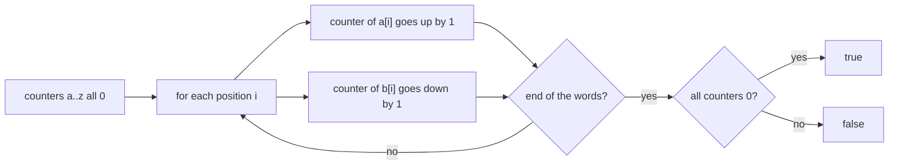

## Intuition

Sorting puts the letters in order, but we do not care about the order at all. We only care **how many times each letter appears**. So skip the sorting and count.

Picture a scoreboard with 26 slots, one for each letter of the alphabet, all showing zero. Walk through the first word and add one to the slot of each letter. Walk through the second word and subtract one from the slot of each letter. If the two words use the same letters the same number of times, every addition is cancelled by a subtraction, and the whole scoreboard is back to zero. If any slot is not zero, the words differ.

We can do both words in the same loop because we already checked that they have the same length. One pass, one small array of fixed size: O(k) time, O(1) space.

The array index of a letter is its distance from `a`: `a` is 0, `b` is 1, and `z` is 25. In code that is the letter minus `'a'`.

## Walkthrough

Input: `anagram` and `nagaram`. The table shows the counters for the letters that appear. Each row handles position `i` in both words: the letter from the first word adds one, and the letter from the second subtracts one.

| i | Letter of a | Letter of b | a | n | g | r | m |
| --- | --- | --- | --- | --- | --- | --- | --- |
| start | | | 0 | 0 | 0 | 0 | 0 |
| 0 | a | n | +1 | -1 | 0 | 0 | 0 |
| 1 | n | a | 0 | 0 | 0 | 0 | 0 |
| 2 | a | g | +1 | 0 | -1 | 0 | 0 |
| 3 | g | a | 0 | 0 | 0 | 0 | 0 |
| 4 | r | r | 0 | 0 | 0 | 0 | 0 |
| 5 | a | a | 0 | 0 | 0 | 0 | 0 |
| 6 | m | m | 0 | 0 | 0 | 0 | 0 |

All counters are zero at the end, so the answer is `true`. Look at a failing example, `aab` and `abb`: after the loop the counter of `a` is +1 and the counter of `b` is -1, so the answer is `false`.

Read it as: two updates per position, and one check at the end.

## Complexity

Let `k` be the length of the words.

| | Value | Why |
| --- | --- | --- |
| Time, best | O(1) | Different lengths are rejected before the loop. |
| Time, average and worst | O(k) | One pass over the words, then a check of 26 counters, which is a constant. |
| Space | O(1) | The array of 26 counters does not grow with the input. |

For an alphabet of size `s` the space is O(s) and the final check costs O(s). With a hash map instead of an array the same idea works for any characters, and the space is the number of distinct characters.

## Code explanation

1. **Length check.** Different lengths can never be anagrams. It also makes it safe to index `b[i]` with the same `i` as `a[i]`.
2. **A counter for each letter.** An array of 26 integers, all zero at the start. Index 0 is `a`, index 25 is `z`.
3. **Add and subtract in one loop.** A letter of the first word adds one; the letter at the same position of the second word subtracts one. The two words are not compared position by position; only their totals matter.
4. **Check for all zeros.** Any non-zero counter means one word has more of that letter than the other.

An optional early exit: while subtracting, if a counter becomes negative you could return `false` at once. Adding first and subtracting second in two separate loops makes this possible. The version here keeps one loop for simplicity.

| Language | Counter array | Note |
| --- | --- | --- |
| JavaScript / TypeScript | `new Array(26).fill(0)` | `charCodeAt(i) - 97` gives the index (97 is the code of `a`). Without `fill(0)` the slots are `undefined` and the sums become `NaN`. |
| Python | `[0] * 26` and `ord(x) - ord('a')` | `zip(a, b)` walks both words together. `collections.Counter(a) == collections.Counter(b)` is the shorter, more general production form. |
| Go | `var counts [26]int` | An array is a value type; `counts == [26]int{}` compares the whole array at once. Indexing with a byte minus `'a'` works because bytes are numbers. |
| Java | `new int[26]` | `charAt(i) - 'a'` is an `int`. A character outside a to z gives an index out of range and throws. |
| C# | `new int[26]` | LINQ's `All` checks every counter. |
| C++ | `std::array<int, 26>` with `{}` | `counts[a[i] - 'a']` with a character outside a to z is an out-of-bounds write: undefined behaviour. Validate if the input is not trusted. |

## Edge cases and tests

The same twenty pairs and the same expected output as the sort approach (see its notes for the table). The ones that stress counting most:

| Pair | Output | What it checks |
| --- | --- | --- |
| `aab`, `abb` | `false` | Same letters, different counts: counters end at +1 and -1. |
| `anagram`, `nagaram` | `true` | Repeated letters cancel out. |
| empty, empty | `true` | The loop does not run and every counter is zero. |
| `ab`, `a` | `false` | The length check protects the indexing. |
| the alphabet, the reversed alphabet | `true` | All 26 counters are used. |
| `zzzz`, `zzzy` | `false` | The last counter (`z`) ends at +1 and `y` at -1. |

## When to use it (and when not)

**Use it** for two words over a small fixed alphabet, as the best answer in an interview, and inside loops that compare many pairs.

**Do not use it** unchanged for Unicode text or for mixed case without normalising: the array of 26 will not fit. Use a hash map from character to count, and normalise the text first.

## Interview notes

- Say: "I only care about how many times each letter occurs, not their order, so I count instead of sorting."
- Describe the trick: "One array of 26 counters: plus one for the first word, minus one for the second. All zeros means anagram."
- State the cost: "O(k) time and O(1) space because the alphabet has a fixed size."
- Likely follow-up: "What about Unicode?" A hash map instead of the array.
- Mistake to avoid: skipping the length check, or indexing with a character outside the alphabet.

## Real-life usage

Frequency counting is behind many production tools: word-game solvers, plagiarism checks that compare bags of words, compression (Huffman coding starts with a frequency table), and sliding-window search for permutations of a pattern in a text, where the counters are updated as the window moves. The same "increment and decrement a counter array" pattern is used in rate counters and histogram-based comparisons.
