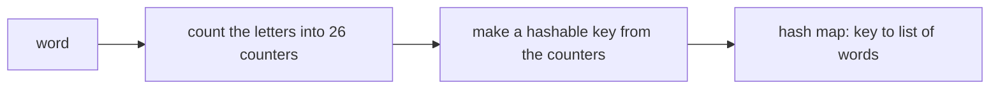

## Intuition

The sorted-letters key works, but sorting every word is more work than the key deserves. What the key really has to capture is **how many times each letter occurs**. A short list of 26 numbers, the count of `a`, the count of `b` and so on, captures that exactly, and two words are anagrams exactly when their lists are equal.

Counting the letters of a word takes one pass, which is faster than sorting them. So we use the 26 counts as the hash map key instead of the sorted word. For short words the difference is small. For very long words the counting key is clearly better: O(k) per word instead of O(k log k).

There is one practical catch. In most languages you cannot use an array of numbers directly as a key, because arrays are compared by identity, not by content (or are not hashable at all). Go and Python are the exceptions: a Go `[26]int` array and a Python tuple are fine as keys. In the other languages we turn the counts into a string such as `1,0,0,0,1,...`. The separator matters, as the mistakes section of the guide explains.

## Walkthrough

Input: `eat tea tan ate nat bat`. For clarity only the letters that occur are shown in the keys (the real key has 26 numbers, with zeros for the other letters).

| Step | Word | Counts (non-zero only) | Group after |
| --- | --- | --- | --- |
| 1 | eat | a1 e1 t1 | [eat] |
| 2 | tea | a1 e1 t1 (same key) | [eat, tea] |
| 3 | tan | a1 n1 t1 | new group [tan] |
| 4 | ate | a1 e1 t1 (same key) | [eat, tea, ate] |
| 5 | nat | a1 n1 t1 (same key as tan) | [tan, nat] |
| 6 | bat | a1 b1 t1 | new group [bat] |

The same three groups as with the sorted key: `ate eat tea | bat | nat tan` after the test program sorts the output.

How the key is built for the word `tea`:

| Letter | a | b | c | d | e | ... | t | ... | z |
| --- | --- | --- | --- | --- | --- | --- | --- | --- | --- |
| Count | 1 | 0 | 0 | 0 | 1 | ... | 1 | ... | 0 |

Read it as: count, turn into a key, and drop the word into that key's group.

## Complexity

Let `n` be the number of words and `k` the length of the longest word.

| | Value | Why |
| --- | --- | --- |
| Time | O(n k) | For each word we count its k letters and build a key of 26 numbers, which is a fixed amount of work per word. Then one hash map operation costs time proportional to the key's size, a constant for a fixed alphabet. |
| Space | O(n k) | The map holds every word once. Each key is 26 numbers, a constant per group. |

For an alphabet of size `s`, the time becomes O(n (k + s)). It is better than sorting only when `s` is smaller than `k log k`. For 26 letters and words of a few characters, sorting can even be faster in practice. This is a good point to make in an interview: the better big-O is not always the faster code.

## Code explanation

1. **Count the letters.** One array of 26 counters per word, all zero at the start.
2. **Make a hashable key.** Go uses the array itself (arrays are comparable). Python uses a tuple. JavaScript, Java, C# and C++ join the counts into text with a separator, because an array or vector would not be compared by content.
3. **Add the word to its group.** Same as the sorted-key version.
4. **Return the groups.** The order is not meaningful.

| Language | Key type | Note |
| --- | --- | --- |
| JavaScript / TypeScript | `counts.join(',')` | A string key. Without the comma, counts 1 and 11 next to other digits could collide. |
| Python | `tuple(counts)` | Tuples are hashable when their items are. A list is not hashable. |
| Go | `[26]int` | Arrays of comparable types are comparable, so they can be map keys. Slices cannot. |
| Java | `Arrays.toString(counts)` | An `int[]` uses identity for `equals` and `hashCode`, so the key must be text. |
| C# | `string.Join(",", counts)` | An `int[]` is a reference key in a `Dictionary`, so use text. |
| C++ | A string built with `std::to_string(count) + '#'` | There is no `std::hash` for arrays. A `std::map` with `std::array<int, 26>` as key would also work, at O(log n) per operation. |

## Edge cases and tests

The same eleven word lists and the same expected output as the sorted-key approach (see its notes). The ones that stress the count key most:

| Words | Output | What it checks |
| --- | --- | --- |
| `aa a aaa a` | `a a \| aa \| aaa` | Different counts of the same letter must give different keys (2 versus 1 versus 3). |
| `eat eat tea` | `eat eat tea` | Equal words produce equal keys. |
| `abc def` | `abc \| def` | Totally different letters give different keys. |
| `listen silent enlist google gogole inlets banana` | `banana \| enlist inlets listen silent \| gogole google` | Repeated letters (two o's, two g's, three a's) are counted correctly. |
| empty list | `empty` | The loop does not run. |

## When to use it (and when not)

**Use it** when words are long, the alphabet is small and fixed, and the grouping runs on a lot of data. It is also the key to use in a sliding-window problem, where the counts are updated incrementally.

**Do not use it** for a large or open alphabet (for Unicode the key would have thousands of mostly zero numbers, so use a sparse map or the sorted key). Do not use it when short words make the constant 26 dominate.

## Interview notes

- Say: "Two words are anagrams exactly when their letter counts are equal, so the counts can be the key. Building it is O(k), cheaper than sorting."
- Mention the key type: "I need a hashable key, so I use a tuple in Python, an array in Go and a joined string elsewhere."
- Mention the separator: "I put a comma between the counts so that different counts cannot produce the same text."
- Likely follow-up: "What is the complexity?" O(n k) time, O(n k) space.
- Mistake to avoid: using an `int[]` or a `List` of counts as a key in Java, JavaScript or C# without converting it to a string.

## Real-life usage

Count vectors are the standard way to compare "bags" of items: bag-of-words text comparison, histograms, fingerprints of documents and sequences, and "same multiset" checks in deduplication. In production a hash of the count vector is also used when the vector itself is too large to store as a key.
