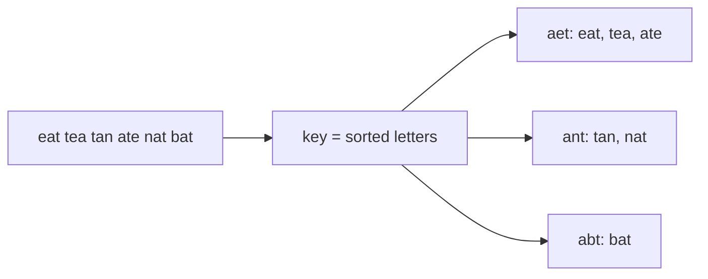

## Intuition

Now we have a whole list of words and want to put anagrams together. Comparing every pair of words would take far too long. A better idea: give every word a **label** that is the same for all its anagrams and different for all other words. Then we only have to put words with the same label into the same box.

Sorting the letters gives such a label. "eat", "tea" and "ate" all become "aet". "tan" and "nat" both become "ant". "bat" becomes "abt". The label is called a **key**. A **hash map** is the right tool for "put things with the same label in the same box": it finds the box for a key in one step, and a missing box is created on the spot.

Think of a post office sorting letters into pigeonholes by postcode. The postcode is the key. You never compare two letters with each other, you only look at where each one belongs.

A word that has no anagram partner ends up alone in its group. That is fine: the answer for "bat" is a group with one word.

## Walkthrough

Input: `eat tea tan ate nat bat` (the first grouping test). For each word we compute the key and add the word to that key's group.

| Step | Word | Key (sorted letters) | Map after |
| --- | --- | --- | --- |
| 1 | eat | aet | aet: [eat] |
| 2 | tea | aet | aet: [eat, tea] |
| 3 | tan | ant | aet: [eat, tea], ant: [tan] |
| 4 | ate | aet | aet: [eat, tea, ate], ant: [tan] |
| 5 | nat | ant | aet: [eat, tea, ate], ant: [tan, nat] |
| 6 | bat | abt | aet: [eat, tea, ate], ant: [tan, nat], abt: [bat] |

The groups are the three lists. The map gives them in no promised order, so the test program sorts the words inside every group and then sorts the groups by their first word. The printed line is `ate eat tea | bat | nat tan`.

Read it as: every word is sent through the key function, and the key decides which group it joins.

## Complexity

Let `n` be the number of words and `k` the length of the longest word.

| | Value | Why |
| --- | --- | --- |
| Time | O(n k log k) | For each of the n words we sort k letters (k log k), then do one hash map operation. Hashing a key of length k costs O(k), which is smaller than the sort. |
| Space | O(n k) | The map holds every word once, and the keys together are about n times k characters. |

The test program adds an extra sort of the output, which is not part of the algorithm.

## Code explanation

1. **Build the key.** Sort the letters of the word and turn them back into a string. A string is a good hash key in every language.
2. **Find or create the group.** If the key is new, start an empty list. JavaScript, Java and C# need an explicit check (or `computeIfAbsent`); Python's `defaultdict`, Go's nil slice and C++'s `operator[]` do it automatically.
3. **Add the word to its group.**
4. **Return the groups.** These are the map's values. Their order is not meaningful: a hash map does not keep a useful order, and Go randomises it on purpose.

| Language | Map | Note |
| --- | --- | --- |
| JavaScript / TypeScript | `Map<string, string[]>` | The `Map` keeps insertion order, so the groups come out in the order of first appearance, but the harness sorts them anyway. In TypeScript, `groups.get(key) ?? []` handles the missing key. |
| Python | `defaultdict(list)` | `"".join(sorted(word))` builds the key. |
| Go | `map[string][]string` | `append` on a nil slice works, so no check is needed. Sorting the bytes with `slices.Sort` is enough for ASCII. |
| Java | `HashMap<String, List<String>>` | `computeIfAbsent(key, k -> new ArrayList<>())` creates the list when needed. The function returns a mutable list of mutable lists, so the caller may sort them. |
| C# | `Dictionary<string, List<string>>` | `TryGetValue` then create. `new string(char[])` turns the sorted letters back into a string. |
| C++ | `std::unordered_map<std::string, std::vector<std::string>>` | `operator[]` creates the empty vector. The result is built by moving each group out of the map. |

## Edge cases and tests

Eleven word lists. Each line shows the groups with words sorted inside the group and groups sorted by their first word. Both grouping approaches share the same expected output.

| Words | Output | What it checks |
| --- | --- | --- |
| `eat tea tan ate nat bat` | `ate eat tea \| bat \| nat tan` | The standard example. |
| empty list | `empty` | No words, no groups. |
| `a` | `a` | A single word. |
| `ab ba` | `ab ba` | One group of two. |
| `abc def` | `abc \| def` | No anagrams at all: each word is its own group. |
| `listen silent enlist google gogole inlets banana` | `banana \| enlist inlets listen silent \| gogole google` | A mix of a large group, a pair and a single word. |
| `eat eat tea` | `eat eat tea` | Duplicate words are kept. |
| `z y x` | `x \| y \| z` | Groups are sorted by their first word, not by the input order. |
| `aa a aaa a` | `a a \| aa \| aaa` | Same letter, different lengths: lengths decide the key. |
| `cab abc bca xyz zyx yxz aab aba baa` | `aab aba baa \| abc bca cab \| xyz yxz zyx` | Three groups of three. |
| `dormitory dirtyroom` | `dirtyroom dormitory` | Longer words. |

## When to use it (and when not)

**Use it** as the default for grouping anagrams: the code is short, it works for any characters that can be sorted, and the key is easy to understand and debug (you can print it).

**Do not use it** for very long words when speed matters: the next approach avoids the sort. Also be careful when the result order matters: sort it yourself.

## Interview notes

- Say: "I need one label that all anagrams share. The sorted letters are such a label. Then a hash map from label to list of words does the grouping."
- Mention that the label must be exactly equal for anagrams and different for non-anagrams: two words have equal sorted letters if and only if they are anagrams.
- State the cost: "O(n k log k)", defining n and k.
- Likely follow-up: "Can you avoid sorting each word?" Use the 26 letter counts as the key.
- Mistake to avoid: using the sorted array itself as a key in a language where arrays compare by reference. Convert it to a string.

## Real-life usage

Indexing by a canonical form is how anagram dictionaries and word-game helpers work, and it is the general pattern for deduplicating or grouping records that are "the same up to order": a database `GROUP BY` on a normalised column, a search index entry per canonical term, or a cache key built from the sorted parts of a request.
