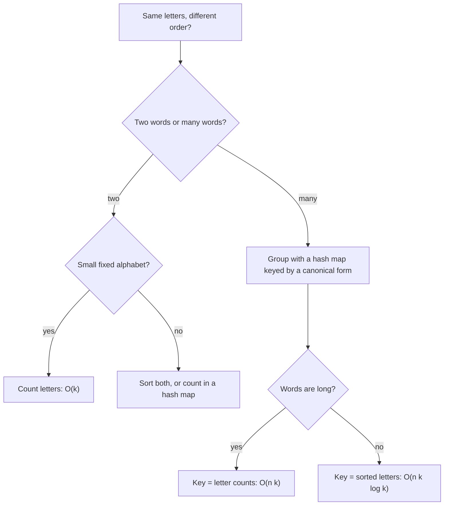

## How interviewers ask it

**An anagram** of a word is another word made from exactly the same letters, used the same number of times, in a different order. "Listen" and "silent" are anagrams. "Rat" and "car" are not.

**The classic wordings:**

- *Valid anagram.* "Given two strings `s` and `t`, return true if `t` is an anagram of `s`, and false otherwise."
- *Group anagrams.* "Given a list of words, group the words that are anagrams of each other. The groups can be in any order."

The first is a warm-up that tests whether you reach for sorting or counting. The second is the real test: it asks whether you can choose a good **key** for a hash map, a key that is the same for every word in a family and different for every other family.

**Common variations:**

- *Find all anagrams of a pattern inside a long text.* (a sliding window with a letter counter)
- *Is a permutation of the string a palindrome?* (at most one letter with an odd count)
- *Ransom note.* "Can the note be built from the letters of a magazine?" (counts, with one-way subtraction)
- *Anagrams with Unicode, uppercase and spaces.* (normalise first, or count with a hash map instead of an array of 26)
- *Minimum number of changes to make two strings anagrams.* (sum of count differences)
- *Largest group*, or *count the groups* in a big dictionary file.

**What to clarify before you code:**

| Question to ask | Why it matters |
| --- | --- |
| Only lowercase letters a to z, or any characters? | An array of 26 counters works only for a small fixed alphabet. Unicode needs a hash map. |
| Is case relevant? Do spaces and punctuation count? | "Dormitory" and "dirty room" are anagrams only if you ignore the space. |
| Can the words be empty? Are two empty words anagrams? | Usually yes: they have the same (empty) set of letters. |
| How many words, and how long is each? | Decides between sorting (k log k per word) and counting (k per word). |
| Does the order of the groups or of the words inside a group matter? | A hash map has no useful order, so you need a rule if the output must be fixed. |
| Are duplicates in the input kept? | "eat" twice should usually appear twice in its group. |

A good answer states both ideas (sort or count), explains why the key must be identical for all anagrams, gives the cost in terms of the number of words and their length, and mentions the alphabet assumption.

**The output rule in this repo.** The two-word programs print `true` or `false` per pair. The grouping programs print one line per list of words. Inside a line, each group has its words sorted alphabetically, and the groups are sorted by their first word. Groups are separated by a vertical bar, and words in a group by single spaces. An empty list prints the word `empty`. The grouping function itself returns the groups in whatever order the hash map gives. The test code sorts them before printing, because a hash map has no fixed order in most languages.

## Real-life scenarios

| Scenario | What is actually used | Why |
| --- | --- | --- |
| Word games and helpers (Scrabble, crosswords, anagram solvers) | A dictionary indexed by the sorted letters of each word | One lookup gives every word that can be made from a rack of letters. |
| Normalising data to find duplicates (the same tags or ingredients in a different order) | A canonical key, such as a sorted list or a counted multiset, as a hash key or a database column | Records that mean the same thing then get the same key. |
| `GROUP BY` on a computed key in SQL or a data pipeline | The key is the normalised form of the row | Grouping by a good key is the same idea as grouping anagrams. |
| Plagiarism and similarity checks, bag-of-words comparison | Counts of words or characters (a frequency vector) | Counts ignore order, which is exactly what an anagram does. |
| Sliding-window search in strings (find any permutation of a pattern in a text) | A letter counter that is updated as the window moves | Adding one letter and removing one is a constant-time update. |
| DNA and protein analysis (k-mer counts) | Frequency tables of short fragments | Sequences are compared by what they contain, not by where it sits. |
| Compressors and Huffman coding | A frequency table of symbols | The first step is always counting how often each symbol occurs. |
| Caches keyed by a request, with equivalent requests in different forms | A canonical form of the request as the cache key | Two requests that mean the same thing must hit the same entry. |

The shared idea: to test "same up to reordering", turn each item into a **canonical form** (sorted letters or counts), then compare or group by that form.

## Approaches compared

Let `k` be the length of a word and `n` the number of words.

| Approach | Problem | Time | Extra space | Alphabet | Use when |
| --- | --- | --- | --- | --- | --- |
| 1. Sort and compare | Two words | O(k log k) | O(k) for the sorted copies | Any characters | Short words, any alphabet, shortest code. |
| 2. Frequency count | Two words | O(k) | O(1) with 26 counters | Fixed small alphabet (use a hash map for Unicode) | The best answer for two lowercase words. |
| 3. Group, sorted-letters key | List of words | O(n k log k) | O(n k) | Any characters | The standard answer; short and clear. |
| 4. Group, letter-count key | List of words | O(n k) | O(n k) | Fixed small alphabet | Long words, when sorting each one is the bottleneck. |

Read it from the top: decide how many words you have, then how big the alphabet is, then how long the words are.

## How to choose

| Situation | Use |
| --- | --- |
| Two lowercase words, interview setting | Frequency count; mention sorting as the simpler alternative. |
| Two words with Unicode, accents or mixed case | Normalise first (case folding, Unicode normalisation), then count with a hash map. |
| Group a list of words, short words | Sorted-letters key in a hash map. |
| Group many long words | Letter-count key, to avoid sorting each word. |
| Huge dictionary that does not fit in memory | Compute the key per word and partition by a hash of the key (or sort externally by key). |
| You need a fixed output order | Sort the groups and the words yourself after grouping. A hash map has no useful order. |

## Built-ins and the standard library

| Language | Useful tools | Pitfall |
| --- | --- | --- |
| JavaScript / TypeScript | `[...word].sort().join('')`, `Map`, `Array.prototype.every` | The default `sort()` converts items to strings and compares UTF-16 codes: fine for letters, wrong for numbers. A `Map` key that is an array compares by reference, so build a string key such as `counts.join(',')`. Spread (`[...word]`) splits by code point, while `charCodeAt` works on UTF-16 units. |
| Python | `sorted(word)`, `collections.Counter`, `defaultdict(list)` | `Counter(a) == Counter(b)` is the one-line anagram test for any characters. A list is unhashable and cannot be a dict key, but a tuple can. |
| Go | `slices.Sort`, `sort.Strings`, a `[26]int` array, `map[[26]int][]string` | Arrays are comparable and can be map keys; slices cannot. Strings are bytes, so non-ASCII text needs runes. Map iteration order is random on purpose. |
| Java | `Arrays.sort(char[])`, `HashMap.computeIfAbsent`, `Arrays.toString(int[])` | An `int[]` uses identity for `equals` and `hashCode`, so it is useless as a key; convert it to a `String` or `List<Integer>`. `char` is a UTF-16 unit, not always a whole character. |
| C# | `Array.Sort(char[])`, `Dictionary`, `string.Join`, LINQ `OrderBy` | An `int[]` is compared by reference in a `Dictionary`. Use a string key. `string.Compare` is culture-sensitive; use `StringComparer.Ordinal` for a fixed order. |
| C++ | `std::sort`, `std::array<int, 26>`, `std::unordered_map`, `std::is_permutation` | There is no standard hash for arrays or vectors, so build a string key (or use an ordered `std::map`). `std::is_permutation(a.begin(), a.end(), b.begin(), b.end())` is a built-in anagram test, but it is O(k squared) in the worst case. |

**Hand-write or use a library?** For two words, a counter library (`Counter`) is the production answer. For grouping, the hash map with a good key is what everyone writes.

## Common mistakes

- **Forgetting the length check.** Without it, "ab" and "abb" can pass in a counting loop that only looks at the shorter word.
- **Counting only one direction.** Adding counts for the first word and checking they are non-negative for the second works only together with the length check.
- **Letters outside a to z.** `word[i] - 'a'` becomes negative or too large for uppercase letters, digits or spaces, and crashes or corrupts memory in C++. Validate, or use a hash map.
- **Using an array or list as a hash key in the wrong language.** In JavaScript, Java and C# two arrays with equal contents are different keys. In Python a list cannot be a key at all. Convert to a string or a tuple.
- **Sorting a character array incorrectly.** Using the default JavaScript sort on numbers gives `10` before `9`. For letters it is fine.
- **Expecting a fixed order from a hash map.** Output order differs between languages and between runs (Go randomises it on purpose). Sort the result if the order matters.
- **Mutating the input.** Sorting the original string's array in place is not possible for immutable strings in many languages. Work on a copy.
- **Sorted key collisions with separators.** If you build a count key by writing numbers next to each other (for example `"11"`), counts 1 and 1 collide with a count of 11. Use a separator such as a comma.
- **Case and spaces.** "Listen" and "Silent" are not equal as written. Decide whether to lower-case and strip spaces.
- **Using an unstable key such as the hash code of a list that you later change.** Keys must not be modified after insertion.

## How to answer in an interview

1. **Clarify.** "Only lowercase letters? Is case or whitespace relevant? Can the words be empty?"
2. **Give examples.** "Listen and silent are anagrams. Rat and car are not. An empty word and an empty word are anagrams."
3. **State the idea.** "Two words are anagrams when they use the same letters the same number of times. So I need a form of a word that does not depend on the order of the letters."
4. **Simple approach.** "Sort the letters of both and compare. O(k log k)."
5. **Better approach.** "Count the letters in one pass. For a fixed alphabet of 26 letters, that is O(k) time and O(1) space."
6. **For grouping,** "I use a hash map from a canonical key to a list of words. The key is the sorted letters, or the 26 counts."
7. **Code it,** with the length check first. Use a string or tuple as the key.
8. **Test aloud.** The empty list, one word, words with no anagram partner, duplicates and a mixed list.
9. **State complexity.** "For n words of length k, sorting keys gives O(n k log k). Count keys give O(n k)."
10. **Mention Unicode.** "For a larger alphabet I would count with a hash map and normalise the text first."

## Follow-up questions

- **What if the strings contain Unicode?** An array of 26 counters no longer works. Use a hash map from character to count. Also normalise the text (for example, composed and decomposed forms of an accented letter are different byte sequences) and decide how to treat case.
- **Why is the count key faster than the sorted key?** Sorting costs k log k per word; counting costs k plus a fixed 26 to build or compare the key. For short words the difference is small, for very long words it matters.
- **How do you find all anagrams of a pattern inside a text?** Slide a window of the pattern's length over the text. Keep a counter for the window: add the new letter, remove the old one, and compare with the pattern's counter. Track how many letters already match to make each step O(1).
- **Can you do the anagram test without extra memory?** For a fixed alphabet, the 26 counters are O(1) memory. Sorting in place also uses O(1) extra space if you may change the strings.
- **Is the sorted key unique for a family?** Yes: two words have the same sorted string exactly when they have the same letter counts. That is why it is a correct key.
- **What if the output order must be fixed?** Sort the words in each group and then the groups by their first word, as this repo does. Or use an ordered map keyed by the canonical form.
- **How would you group a billion words?** Compute the key for each word in a streaming pass, and write each word to a file chosen by a hash of its key (partitioning). Then group each file in memory. This is how a map-reduce job does it.
- **What are the attacks on hash maps here?** If inputs are untrusted, an attacker can craft many keys that collide, slowing every operation (hash flooding). Many runtimes randomise their hash seed to defend against it.
- **How would you check a permutation of a palindrome?** Count the letters; at most one letter may have an odd count.

## Practice

- Valid anagram, and group anagrams.
- Find all anagrams in a string (sliding window and counters).
- Ransom note, and first unique character in a string.
- Palindrome permutation, and longest palindrome that can be built from letters.
- Minimum steps to make two strings anagrams.
- Sort characters by frequency.
- Isomorphic strings and word pattern (a different kind of "same shape" key).
