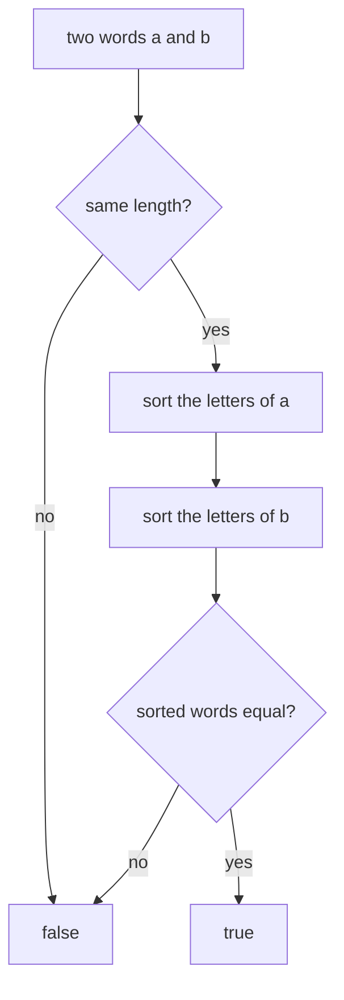

## Intuition

If two words are made of the same letters, then after putting the letters in alphabetical order the two words become identical. Sort the letters of "listen" and you get "eilnst". Sort the letters of "silent" and you also get "eilnst". Sort the letters of "rat" and you get "art", and of "car" you get "acr": different, so those are not anagrams.

This is like emptying two bags of letter tiles onto a table and arranging each pile in alphabetical order. If the two rows look the same, the bags held the same tiles.

Before sorting, a quick check helps: if the words have different lengths they cannot be anagrams, so we can return at once.

This approach is the shortest to write and works for any alphabet, not only a to z. It costs more than counting because sorting takes more than one pass.

## Walkthrough

Input: `listen` and `silent` (the first test case).

| Step | Action | Result |
| --- | --- | --- |
| 1 | Lengths are 6 and 6 | Continue |
| 2 | Sort the letters of `listen` | `e i l n s t` |
| 3 | Sort the letters of `silent` | `e i l n s t` |
| 4 | Compare the two sorted words | Equal, so the answer is `true` |

Second input: `rat` and `car`. The lengths are equal. The sorted letters are `a r t` and `a c r`. They differ at the second letter, so the answer is `false`.

Third input: `ab` and `a`. The lengths are 2 and 1, so the answer is `false` at once, and nothing is sorted.

Read it as: a cheap length check first, then the two sorts, then one comparison.

## Complexity

Let `k` be the length of the words.

| | Value | Why |
| --- | --- | --- |
| Time, best | O(1) | If the lengths differ we return without touching the letters. |
| Time, average and worst | O(k log k) | Sorting k letters with a comparison sort costs k log k. The comparison afterwards is O(k). |
| Space | O(k) | The sorted copies. Strings cannot be sorted in place in most languages because they are immutable, so we copy them into an array first. |

Since letters come from a small alphabet, a counting sort would sort in O(k). That is what the next approach does, without building the sorted word at all.

## Code explanation

1. **Length check.** Different lengths means "no". It also prevents comparing sorted words of different sizes.
2. **Sort the letters of each word.** First copy the letters into something sortable (an array of characters or bytes), because strings are immutable in JavaScript, Python, Go, Java and C#. In C++ the function takes the words by value, so it is allowed to sort its own copies.
3. **Compare.** Equal sorted words mean equal letters.

| Language | How the letters are sorted | Note |
| --- | --- | --- |
| JavaScript / TypeScript | `[...word].sort().join('')` | The spread makes an array of characters. The default sort compares UTF-16 codes, which is correct for letters. For numbers you would need a comparator. |
| Python | `sorted(word)` | Returns a new list of characters. Comparing two lists is a normal `==`. |
| Go | `slices.Sort` on a `[]byte` | `slices` is in the standard library since Go 1.21. Bytes are right for ASCII. For Unicode, sort runes. |
| Java | `Arrays.sort(char[])` | `Arrays.equals` compares the arrays element by element. Using `==` on arrays would compare references. |
| C# | `Array.Sort(char[])` then `new string(...)` | Strings compare by value with `==`. |
| C++ | `std::sort` on the string | The parameters are copies on purpose. Use `const&` plus a copy inside if you want to be explicit. |

## Edge cases and tests

Twenty pairs, each printing `true` or `false`. Both two-word approaches share the same expected output.

| Pair | Output | What it checks |
| --- | --- | --- |
| `listen`, `silent` | `true` | The standard example. |
| `anagram`, `nagaram` | `true` | Repeated letters (three a's). |
| `rat`, `car` | `false` | Same length, different letters. |
| `a`, `a` | `true` | Identical single letters. |
| empty, empty | `true` | Two empty words are anagrams (the output is a line, `true`, not a blank line). |
| `ab`, `a` | `false` | Different lengths. |
| `aab`, `abb` | `false` | Same length and same set of letters, different counts. |
| `abc`, `cba` | `true` | Fully reversed. |
| `aabbcc`, `abcabc` | `true` | Every letter appears twice. |
| `hello`, `world` | `false` | Overlapping letters, not equal. |
| `a`, `b` | `false` | Single different letters. |
| `night`, `thing` | `true` | A common pair. |
| `abcd`, `abce` | `false` | Differ only in the last letter. |
| `conversation`, `voicesranton` | `true` | A longer pair. |
| `dormitory`, `dirtyroom` | `true` | A famous pair. |
| `schoolmaster`, `theclassroom` | `true` | A famous pair. |
| `restful`, `fluster` | `true` | A common pair. |
| the alphabet, the reversed alphabet | `true` | All 26 letters. |
| `zz`, `z` | `false` | Different lengths with the same letter. |
| `zzzz`, `zzzy` | `false` | Same length, one letter differs. |

## When to use it (and when not)

**Use it** when the code should be as short as possible, when the alphabet is large or unknown (any character that can be sorted), and when words are short.

**Do not use it** for very long strings or inside a hot loop when you can count: sorting does more work than needed. Also, if you must compare one word against millions of others, compute the sorted form once and reuse it as a key, as the grouping approaches do.

## Interview notes

- Say: "Anagrams have the same letters, so their sorted forms are identical."
- Mention the quick length check first.
- State the cost: "O(k log k) time and O(k) space for the copies."
- Likely follow-up: "Can you do it in O(k)?" Count the letters with an array of 26.
- Mistake to avoid: comparing arrays with `==` in Java (reference comparison) or forgetting that JavaScript strings cannot be sorted in place.

## Real-life usage

The sorted form is used as an index key in word-game helpers and dictionaries of anagrams. Any time you need "the same items regardless of order" you can sort and compare: comparing two lists of tags, two sets of permissions or two ingredient lists. In databases, a sorted or canonical form of a row is the usual key for finding duplicates.
