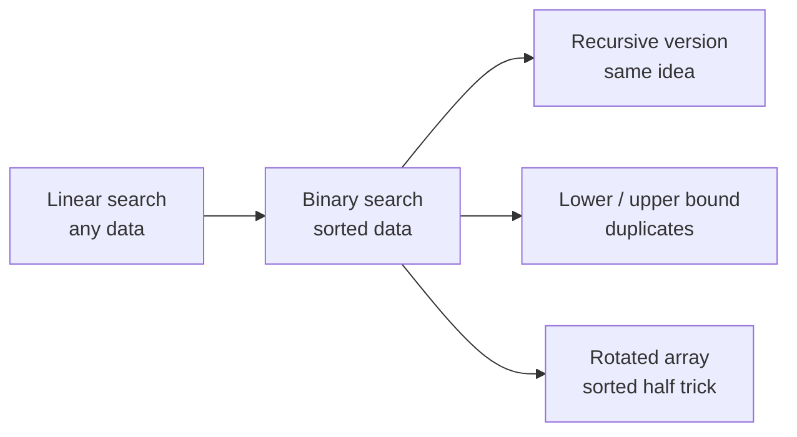
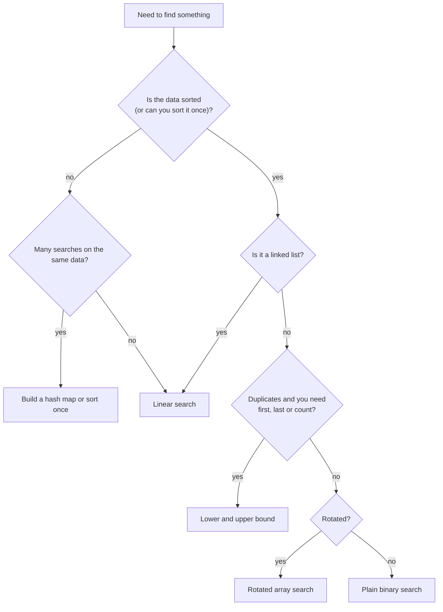
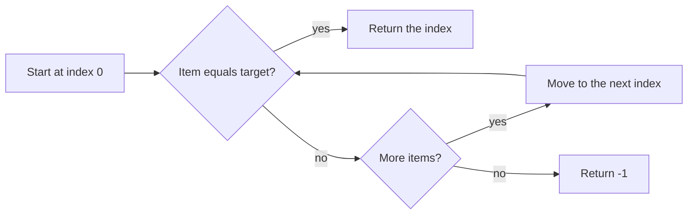
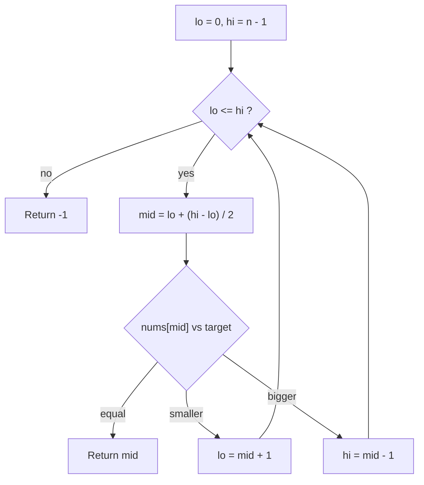
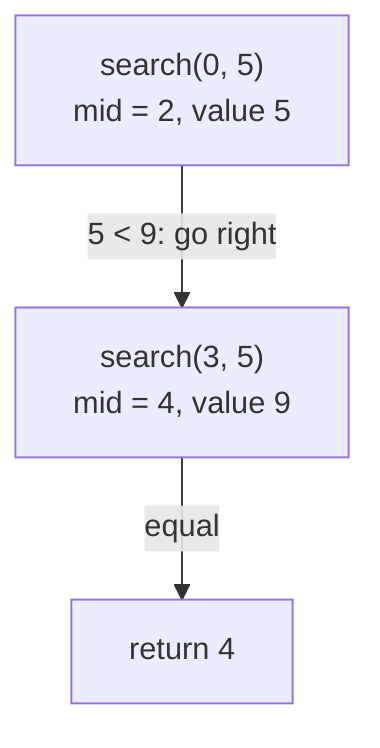
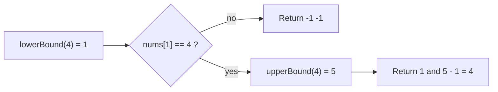
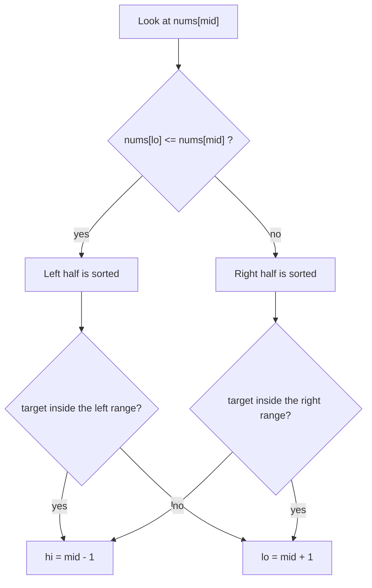

# Binary search

[← All problems](../README.md)

> Find an item in sorted data by halving the search window: the idea behind index lookups, git bisect and many 'search on the answer' problems.

**Level:** basic · **Tags:** searching, binary-search, arrays, sorting, complexity

**Related interview questions:**

- [Golang: What are arrays and slices? Why are slices used almost everywhere?](../../questions/golang.md)
- [Golang: What do `len`, `cap` and slicing (`sa:b`) mean? How does a slice look inside?](../../questions/golang.md)
- [Golang: How does `append` grow a slice, and what are the aliasing gotchas?](../../questions/golang.md)
- [Golang: How do generic constraints work, and what do `slices` and `maps` packages offer (Go 1.21+)?](../../questions/golang.md)
- [Golang: How are slices, maps and strings implemented internally?](../../questions/golang.md)
- [JavaScript: Which array methods should you know, and which ones mutate the array?](../../questions/javascript.md)

## How interviewers ask it

Binary search is one of the most common interview topics because it is short to say and easy to get wrong. It is how you find something in **sorted** data without looking at everything: look at the middle, throw away the half that cannot contain the answer, repeat.

Typical wording:

- "Given a sorted array of integers and a target, return the index of the target, or -1 if it is not there."
- "The array has duplicates. Return the first and the last index of the target." (a lower bound and an upper bound)
- "A sorted array was rotated at some unknown point, for example `[5, 7, 9, 11, 1, 3]`. Find the target in O(log n)."
- Variations you should recognise: the **insert position** (where would the target go to keep the array sorted?), the **square root** of an integer rounded down, the first bad version, the smallest value in a rotated array, and **binary search on the answer** (for example "the smallest speed that finishes the job in time").

What to clarify before you write code:

- Is the array **sorted**? In which order (ascending or descending)?
- Can there be **duplicates**? If yes, which one should I return (any, the first, the last)?
- What do I return when the target is missing (`-1`, or the insert position)?
- How big can the array be? (This decides whether `lo + hi` could overflow.)
- Can the array be empty?

A good answer covers: the idea (halving), the loop invariant, a safe midpoint, correct bounds, the empty and one-element cases, and the complexity: O(log n) time, O(1) space.

## Real-life scenarios

| Scenario | What is actually used | Why |
| --- | --- | --- |
| Database index lookup (`WHERE id = 42`) | A B-tree: each node holds sorted keys, and the engine does a binary-style search inside each node and between levels | Reading 3 or 4 pages instead of the whole table. Without an index you get a full table scan, which is linear search |
| Find the commit that broke the build | `git bisect`: test the middle commit, say good or bad, repeat | 1,000 commits need about 10 builds instead of 1,000 |
| Find a version where a bug first appeared | Binary search on the version number (the "first bad version" problem) | The same idea as git bisect: every version after the first bad one is bad, so "good/bad" is a sorted yes/no list |
| Search sorted logs by timestamp | Binary search for the start time, then read forward | Log files and time-series data are sorted by time, so you can jump straight to "14:03:00" without reading the start of the file |
| Autocomplete and dictionary lookup | Binary search in a sorted word list for the first word with the prefix (lower bound), plus a trie in big systems | You get the whole range of words with that prefix |
| Tune a threshold or rate limit | Binary search on the answer: try a value, test if it works, narrow the range | Works when "too low" and "too high" are cleanly separated, for example the smallest timeout that never fails |
| Debugging by halving | Comment out half the code, config or input and see if the bug remains | Same idea as bisect, by hand. Finds the culprit in about log2(n) experiments |
| Insert into a sorted list | Lower bound gives the insert position (Python `bisect.insort`) | Keeps the list sorted without sorting again |

## Approaches compared

| Approach | Time (best / average / worst) | Space | Needs sorted data | Use when |
| --- | --- | --- | --- | --- |
| Linear search | O(1) / O(n) / O(n) | O(1) | no | Small or unsorted data, one-off search, non-simple conditions |
| Binary search (iterative) | O(1) / O(log n) / O(log n) | O(1) | yes | The default for sorted arrays |
| Binary search (recursive) | O(1) / O(log n) / O(log n) | O(log n) stack | yes | When recursion reads more clearly, or inside tree searches |
| First and last occurrence (lower and upper bound) | O(log n) | O(1) | yes | Duplicates, counting, insert position, range queries |
| Rotated sorted array | O(1) / O(log n) / O(log n) | O(1) | sorted, then rotated, no duplicates | The popular rotated array variant |

How fast is O(log n)? Each step halves the window, so 1,000 items need about 10 steps, 1,000,000 need about 20, and 1,000,000,000 need about 30. Doubling the data adds one step.



Read it left to right: linear search is the baseline, and the others are all binary search with a twist.

## How to choose



Read it from the top. Sorted, array-like data is the entry ticket for binary search.

Two extra rules:
- **Exact lookups by key** (is this user id known?) are usually better served by a hash map: O(1) on average. Binary search wins when you need order: ranges, "the next bigger value", prefix lookups.
- **Binary search on the answer** works when you can test a guess with a yes/no check and the answers are "no, no, no, yes, yes, yes" in order.

## Built-ins and the standard library

In production, call the library. Write it by hand in interviews and for special cases (searching on a condition).

| Language | Call | What it returns | Pitfall |
| --- | --- | --- | --- |
| JavaScript / TypeScript | None for sorted arrays. `indexOf` and `includes` are linear scans. Write your own or use a library such as lodash `_.sortedIndex` | | Do not assume `indexOf` is fast on sorted data. Default `sort()` compares as strings, so sort numbers with `(a, b) => a - b` first |
| Python | `bisect.bisect_left(a, x)`, `bisect.bisect_right(a, x)` (also `bisect.bisect`, `insort`) | The insertion point (lower bound / upper bound). It never raises | You must check yourself: `i < len(a) and a[i] == x`. The `key=` argument exists since Python 3.10 |
| Go | `sort.Search(n, f)`, `sort.SearchInts`, `slices.BinarySearch` (Go 1.21+) | `sort.Search` returns the smallest `i` where `f(i)` is true, or `n`. `slices.BinarySearch` returns `(index, found)` | `sort.Search` takes a predicate, not a target, and `f` must be false then true. It gives a lower bound, so check the item |
| Java | `Arrays.binarySearch(arr, key)`, `Collections.binarySearch(list, key)` | The index if found; otherwise `-(insertionPoint) - 1`, a negative number | The array must be sorted, or the result is undefined. With duplicates any match may be returned. Do not compare the result with `-1` only: use `< 0` |
| C# | `Array.BinarySearch(arr, value)`, `List<T>.BinarySearch(value)` | The index if found; otherwise the bitwise complement `~index` of the next larger element (negative) | Same: test `< 0`, and `~result` gives the insert position. Sorted input required; with duplicates any match may be returned |
| C++ | `std::binary_search` (bool), `std::lower_bound`, `std::upper_bound`, `std::equal_range` (in `<algorithm>`) | `binary_search` returns true or false; the others return iterators | The range must be sorted with the same comparison. On a `std::list` they still work but are not O(log n), since iterators are not random access |

Example of the negative return values on `[1, 3, 5, 7]`, looking for `4`: Java gives `-3` (insert position 2, so `-2 - 1`), C# gives `~2`, which is also `-3`, Python `bisect_left` gives `2`.

## Common mistakes

- **Overflow in the midpoint.** `(lo + hi) / 2` can overflow a 32-bit `int` for arrays above about 1 billion items (a famous bug that lived in the Java standard library for years). Use `lo + (hi - lo) / 2`.
- **Infinite loop.** Writing `lo = mid` or `hi = mid` inside a `lo <= hi` loop. The window may stop shrinking. In the `[lo, hi]` style, always use `mid + 1` and `mid - 1`.
- **Mixing the two styles.** `while (lo <= hi)` goes with `hi = n - 1` and `hi = mid - 1`. `while (lo < hi)` goes with `hi = n` and `hi = mid` (half-open window). Pick one style and keep it consistent.
- **Searching an unsorted array.** The result is just wrong, and nothing warns you. Ask if the data is sorted; sort first if not.
- **Duplicates.** Plain binary search returns some match, not the first. Use lower and upper bound when it matters.
- **Wrong comparison direction.** The array sorted in descending order needs the opposite comparison.
- **Empty array.** With an unsigned size (C++), `size() - 1` wraps to a huge number. Cast to `int` first.
- **Copying the array in recursion** (`nums[mid+1:]` in Python, `slice` in JavaScript). It turns O(log n) into O(n). Pass indexes.
- **Floats and `NaN`.** Comparisons with `NaN` are always false, so binary search can fail silently. Exclude `NaN` first.

## How to answer in an interview

1. **Clarify.** Say: "Is the array sorted? Can it have duplicates? What should I return if the target is missing? Can it be empty?"
2. **Give examples.** "For `[1, 3, 5, 7, 9, 11]` and target 7, I return 3. For 6, I return -1."
3. **State the simple solution.** "A linear scan works in O(n), without using the sorted order."
4. **Improve it.** "Because it is sorted, I can look at the middle. If the middle is too small, everything on its left is too small too, so I drop that half. This repeats, so O(log n)."
5. **State the invariant.** "If the target exists, it is always inside `[lo, hi]`."
6. **Code it.** Write `lo`, `hi`, `while lo <= hi`, the safe midpoint, the three-way comparison, and `return -1`. Say: "I use `lo + (hi - lo) / 2` to avoid overflow."
7. **Test aloud.** Walk through the empty array, one element (found and not found), the first and last index, and a missing value between two items.
8. **Complexity.** "Time O(log n): the window halves each step, so about 30 steps for a billion items. Space O(1) for the loop, or O(log n) for the recursive version."
9. **Trade-offs.** "If I search once on unsorted data, a linear scan is cheaper than sorting. For exact key lookups a hash map is O(1) on average."

## Follow-up questions

- **What if there are duplicates and I need the first one?** Use a lower bound: when `nums[mid] >= target`, keep `mid` as a candidate and move `hi`. The last one is the upper bound minus one.
- **What is the insert position of a missing target?** The lower bound. The loop ends with `lo` at the place where the target would go.
- **How do you search a rotated sorted array?** One half is always sorted. Find it, test whether the target is in its range, and go there or to the other half. Still O(log n) without duplicates.
- **Why not use binary search on a linked list?** You cannot jump to the middle in O(1), so finding the middle costs O(n) every step, and the total is no better than linear.
- **How would you find the square root of an integer?** Binary search on the answer between 0 and x: find the largest `m` where `m * m <= x`. Use `m <= x / m` to avoid overflow.
- **What is "binary search on the answer"?** The answer is a number in a range, and you can check any guess with a yes/no test that is monotonic (no, no, yes, yes). For example the minimum capacity of a truck that ships all packages in D days.
- **How do you search a sorted array of unknown size (an infinite stream)?** Double the upper bound (1, 2, 4, 8, ...) until the value there is at least the target, then binary search inside that range.
- **Does it work on a 2D sorted matrix?** If rows and columns are sorted and each row starts after the last row ended, treat it as one array of `rows * cols` items and map the index back. Otherwise use the "start at a corner" method.

## Practice

- **Search insert position**: return the index where the target is, or would be.
- **Find first and last position of an element** in a sorted array (the fourth approach here).
- **Search in a rotated sorted array** and **find the minimum in a rotated sorted array**.
- **Sqrt(x)** and **first bad version**: binary search on the answer.
- **Koko eating bananas** or **capacity to ship packages within D days**: binary search on the answer with a yes/no check.

## Further reading

Where to read more at the source. Official docs and references come first.

**Official docs**

- [Python: bisect](https://docs.python.org/3/library/bisect.html) — bisect_left, bisect_right and insort in the standard library. _(beginner)_
- [Go: sort.Search](https://pkg.go.dev/sort#Search) — Generic binary search over a predicate, with examples. _(intermediate)_
- [git bisect](https://git-scm.com/docs/git-bisect) — Binary search over commit history to find the one that broke the build. _(beginner)_

**Reference**

- [Binary search (Wikipedia)](https://en.wikipedia.org/wiki/Binary_search_algorithm) — Algorithm, variants, complexity and the history of bugs in implementations. _(beginner)_
- [C++: std::lower_bound](https://en.cppreference.com/w/cpp/algorithm/lower_bound) — Lower and upper bound semantics for sorted ranges. _(intermediate)_

**Tutorial**

- [cp-algorithms: Binary search](https://cp-algorithms.com/num_methods/binary_search.html) — Binary search on the answer, lower and upper bound, and floating point. _(advanced)_

**Course**

- [LeetCode Explore: Binary Search](https://leetcode.com/explore/learn/card/binary-search/) — Guided card with templates and practice problems. _(intermediate)_

## Approaches

| Approach | Best | Average | Worst | Space | Stable | In place | Languages |
| --- | --- | --- | --- | --- | --- | --- | --- |
| [Linear search](#linear-search) | O(1) | O(n) | O(n) | O(1) | – | yes | JavaScript, TypeScript, Python, Go, Java, C#, C++ |
| [Binary search (iterative)](#binary-search-iterative) | O(1) | O(log n) | O(log n) | O(1) | – | yes | JavaScript, TypeScript, Python, Go, Java, C#, C++ |
| [Binary search (recursive)](#binary-search-recursive) | O(1) | O(log n) | O(log n) | O(log n) | – | yes | JavaScript, TypeScript, Python, Go, Java, C#, C++ |
| [First and last occurrence (lower and upper bound)](#first-and-last-occurrence-lower-and-upper-bound) | O(log n) | O(log n) | O(log n) | O(1) | – | yes | JavaScript, TypeScript, Python, Go, Java, C#, C++ |
| [Search in a rotated sorted array](#search-in-a-rotated-sorted-array) | O(1) | O(log n) | O(log n) | O(1) | – | yes | JavaScript, TypeScript, Python, Go, Java, C#, C++ |

## Linear search

> Check the items one by one from the left. Works on any data, sorted or not. The baseline.

### Intuition

Imagine you lose your keys in a messy room. You have no clue where they are, so you check every spot, one after another, until you find them. That is linear search. It makes no assumption about the data, so it works on any list: sorted, shuffled or half empty.

It is the baseline. Every smarter method in this problem (binary search and friends) has to beat it, and every one of them needs something extra, usually that the data is sorted.

### Walkthrough

Array `[1, 3, 5, 7, 9, 11]`, target `7`:

| Step | `i` | `nums[i]` | Same as 7? | What happens |
| --- | --- | --- | --- | --- |
| 1 | 0 | 1 | no | go on |
| 2 | 1 | 3 | no | go on |
| 3 | 2 | 5 | no | go on |
| 4 | 3 | 7 | yes | return 3 |

Target `6` is not in the array. The loop checks all six items, never matches, and returns `-1`.



Read it as a loop: check, move on, stop at a match or at the end.

### Complexity

`n` is the number of items.

| Case | Time | Why |
| --- | --- | --- |
| Best | O(1) | The target is the first item: one check. |
| Average | O(n) | If the target is equally likely anywhere, you check about half the items. Half of n is still "proportional to n". |
| Worst | O(n) | The target is last or missing: you check every item. |
| Space | O(1) | Only the counter `i` is stored. |

What O(n) means in practice: with one billion items you may need one billion checks. Binary search needs about 30 on sorted data.

### Code explanation

1. **Visit items from left to right.** A simple loop over the indexes.
2. **The first match wins.** We return at once, so with duplicates you always get the leftmost index.
3. **Looked at everything.** Falling out of the loop means the target is not there, so return `-1`.

| Language | Difference |
| --- | --- |
| JavaScript / TypeScript | Compare with `===`, so `"7"` does not match `7`. |
| Python | `enumerate` gives index and value together. Python also has `list.index`, but it raises `ValueError` when the item is missing. |
| Go | `for i, v := range nums` copies each value; fine for ints. |
| Java / C# | Arrays have `.length` / `.Length`. Both also have library helpers (`List.indexOf`, `Array.IndexOf`). |
| C++ | The library version is `std::find`, which returns an iterator, not an index. We cast `size()` to `int` to avoid a signed/unsigned comparison. |

### Edge cases and tests

All solutions use the same 13 cases, one result per line:

| Input | Result | What it checks |
| --- | --- | --- |
| `[]`, 5 | -1 | Empty array: the loop never runs. |
| `[7]`, 7 | 0 | Single element, found. |
| `[7]`, 3 | -1 | Single element, not found. |
| `[1,3,5,7,9,11]`, 1 | 0 | Target is the first item. |
| same, 11 | 5 | Target is the last item. |
| same, 7 | 3 | Target in the middle. |
| same, 0 | -1 | Smaller than everything. |
| same, 12 | -1 | Larger than everything. |
| same, 6 | -1 | Missing, but between two values. |
| `[2,4,4,4,4,6,8]`, 4 | 1 | Duplicates: the first one is returned. |
| 20 multiples of 3, 42 | 14 | A longer array. |
| same, 43 | -1 | A longer array, target missing. |
| `[5,5,5,5]`, 5 | 0 | All items equal. |

### When to use it (and when not)

Use it when:
- the data is unsorted and you search only once or twice;
- the list is small (a few dozen items): it is simple and cache friendly, and often as fast as anything else;
- you search for something that is not a simple "equals", such as "the first user who is older than 30 and active".

Do not use it when the data is already sorted and big, or when you search the same data many times. Then sort once (or build a hash map or index) and search faster.

### Interview notes

Say it first: "The simple way is a linear scan, O(n). If the array is sorted I can do better with binary search, O(log n)." This shows you know the baseline and the upgrade.

Likely follow-up: "The array is sorted. Can you do better?" Mistake to avoid: jumping straight to binary search without asking whether the input is sorted.

### Real-life usage

- Looking for an item in a small list in your code (`array.find`, `list.index`, `strings.Contains`).
- A database full table scan when no index exists: the engine reads every row.
- `grep` over a log file: it reads lines one by one.

Linear search is not "bad". For small or unsorted data it is the right tool.

### Code

Every example prints the same output and is tested (`npm run problems:test`).

<details><summary>JavaScript</summary>

```js
// Linear search: look at the items one by one until the target shows up.
// Works on ANY array (sorted or not). It is the baseline to beat.
function linearSearch(nums, target) {
  for (let i = 0; i < nums.length; i++) { // 1. visit items from left to right
    if (nums[i] === target) return i;     // 2. the first match wins
  }
  return -1;                              // 3. looked at everything: not found
}

const cases = [
    [[], 5],
    [[7], 7],
    [[7], 3],
    [[1, 3, 5, 7, 9, 11], 1],
    [[1, 3, 5, 7, 9, 11], 11],
    [[1, 3, 5, 7, 9, 11], 7],
    [[1, 3, 5, 7, 9, 11], 0],
    [[1, 3, 5, 7, 9, 11], 12],
    [[1, 3, 5, 7, 9, 11], 6],
    [[2, 4, 4, 4, 4, 6, 8], 4],
    [[0, 3, 6, 9, 12, 15, 18, 21, 24, 27, 30, 33, 36, 39, 42, 45, 48, 51, 54, 57], 42],
    [[0, 3, 6, 9, 12, 15, 18, 21, 24, 27, 30, 33, 36, 39, 42, 45, 48, 51, 54, 57], 43],
    [[5, 5, 5, 5], 5],
];

for (const [nums, target] of cases) {
  console.log(linearSearch(nums, target));
}
```

</details>

<details><summary>TypeScript</summary>

```ts
// Linear search: look at the items one by one until the target shows up.
// Works on ANY array (sorted or not). It is the baseline to beat.
function linearSearch(nums: number[], target: number): number {
  for (let i = 0; i < nums.length; i++) { // 1. visit items from left to right
    if (nums[i] === target) return i;     // 2. the first match wins
  }
  return -1;                              // 3. looked at everything: not found
}

const cases: Array<[number[], number]> = [
    [[], 5],
    [[7], 7],
    [[7], 3],
    [[1, 3, 5, 7, 9, 11], 1],
    [[1, 3, 5, 7, 9, 11], 11],
    [[1, 3, 5, 7, 9, 11], 7],
    [[1, 3, 5, 7, 9, 11], 0],
    [[1, 3, 5, 7, 9, 11], 12],
    [[1, 3, 5, 7, 9, 11], 6],
    [[2, 4, 4, 4, 4, 6, 8], 4],
    [[0, 3, 6, 9, 12, 15, 18, 21, 24, 27, 30, 33, 36, 39, 42, 45, 48, 51, 54, 57], 42],
    [[0, 3, 6, 9, 12, 15, 18, 21, 24, 27, 30, 33, 36, 39, 42, 45, 48, 51, 54, 57], 43],
    [[5, 5, 5, 5], 5],
];

for (const [nums, target] of cases) {
  console.log(linearSearch(nums, target));
}
```

</details>

<details><summary>Python</summary>

```python
# Linear search: look at the items one by one until the target shows up.
# Works on ANY list (sorted or not). It is the baseline to beat.
def linear_search(nums, target):
    for i, value in enumerate(nums):  # 1. visit items from left to right
        if value == target:           # 2. the first match wins
            return i
    return -1                         # 3. looked at everything: not found


CASES = [
    [[], 5],
    [[7], 7],
    [[7], 3],
    [[1, 3, 5, 7, 9, 11], 1],
    [[1, 3, 5, 7, 9, 11], 11],
    [[1, 3, 5, 7, 9, 11], 7],
    [[1, 3, 5, 7, 9, 11], 0],
    [[1, 3, 5, 7, 9, 11], 12],
    [[1, 3, 5, 7, 9, 11], 6],
    [[2, 4, 4, 4, 4, 6, 8], 4],
    [[0, 3, 6, 9, 12, 15, 18, 21, 24, 27, 30, 33, 36, 39, 42, 45, 48, 51, 54, 57], 42],
    [[0, 3, 6, 9, 12, 15, 18, 21, 24, 27, 30, 33, 36, 39, 42, 45, 48, 51, 54, 57], 43],
    [[5, 5, 5, 5], 5],
]

if __name__ == "__main__":
    for nums, target in CASES:
        print(linear_search(nums, target))
```

</details>

<details><summary>Go</summary>

```go
package main

import "fmt"

// linearSearch looks at the items one by one until the target shows up.
// Works on ANY slice (sorted or not). It is the baseline to beat.
func linearSearch(nums []int, target int) int {
	for i, v := range nums { // 1. visit items from left to right
		if v == target { // 2. the first match wins
			return i
		}
	}
	return -1 // 3. looked at everything: not found
}

func main() {
	cases := []struct {
		nums   []int
		target int
	}{
		{nil, 5},
		{[]int{7}, 7},
		{[]int{7}, 3},
		{[]int{1, 3, 5, 7, 9, 11}, 1},
		{[]int{1, 3, 5, 7, 9, 11}, 11},
		{[]int{1, 3, 5, 7, 9, 11}, 7},
		{[]int{1, 3, 5, 7, 9, 11}, 0},
		{[]int{1, 3, 5, 7, 9, 11}, 12},
		{[]int{1, 3, 5, 7, 9, 11}, 6},
		{[]int{2, 4, 4, 4, 4, 6, 8}, 4},
		{[]int{0, 3, 6, 9, 12, 15, 18, 21, 24, 27, 30, 33, 36, 39, 42, 45, 48, 51, 54, 57}, 42},
		{[]int{0, 3, 6, 9, 12, 15, 18, 21, 24, 27, 30, 33, 36, 39, 42, 45, 48, 51, 54, 57}, 43},
		{[]int{5, 5, 5, 5}, 5},
	}
	for _, c := range cases {
		fmt.Println(linearSearch(c.nums, c.target))
	}
}
```

</details>

<details><summary>Java</summary>

```java
public class Main {
    // Linear search: look at the items one by one until the target shows up.
    // Works on ANY array (sorted or not). It is the baseline to beat.
    static int linearSearch(int[] nums, int target) {
        for (int i = 0; i < nums.length; i++) { // 1. visit items from left to right
            if (nums[i] == target) return i;    // 2. the first match wins
        }
        return -1;                              // 3. looked at everything: not found
    }

    record Case(int[] nums, int target) {}

    public static void main(String[] args) {
        Case[] cases = {
        new Case(new int[]{}, 5),
        new Case(new int[]{7}, 7),
        new Case(new int[]{7}, 3),
        new Case(new int[]{1, 3, 5, 7, 9, 11}, 1),
        new Case(new int[]{1, 3, 5, 7, 9, 11}, 11),
        new Case(new int[]{1, 3, 5, 7, 9, 11}, 7),
        new Case(new int[]{1, 3, 5, 7, 9, 11}, 0),
        new Case(new int[]{1, 3, 5, 7, 9, 11}, 12),
        new Case(new int[]{1, 3, 5, 7, 9, 11}, 6),
        new Case(new int[]{2, 4, 4, 4, 4, 6, 8}, 4),
        new Case(new int[]{0, 3, 6, 9, 12, 15, 18, 21, 24, 27, 30, 33, 36, 39, 42, 45, 48, 51, 54, 57}, 42),
        new Case(new int[]{0, 3, 6, 9, 12, 15, 18, 21, 24, 27, 30, 33, 36, 39, 42, 45, 48, 51, 54, 57}, 43),
        new Case(new int[]{5, 5, 5, 5}, 5),
        };
        for (Case c : cases) {
            System.out.println(linearSearch(c.nums(), c.target()));
        }
    }
}
```

</details>

<details><summary>C#</summary>

```csharp
var cases = new (int[] nums, int target)[]
{
    (new int[]{}, 5),
    (new int[]{7}, 7),
    (new int[]{7}, 3),
    (new int[]{1, 3, 5, 7, 9, 11}, 1),
    (new int[]{1, 3, 5, 7, 9, 11}, 11),
    (new int[]{1, 3, 5, 7, 9, 11}, 7),
    (new int[]{1, 3, 5, 7, 9, 11}, 0),
    (new int[]{1, 3, 5, 7, 9, 11}, 12),
    (new int[]{1, 3, 5, 7, 9, 11}, 6),
    (new int[]{2, 4, 4, 4, 4, 6, 8}, 4),
    (new int[]{0, 3, 6, 9, 12, 15, 18, 21, 24, 27, 30, 33, 36, 39, 42, 45, 48, 51, 54, 57}, 42),
    (new int[]{0, 3, 6, 9, 12, 15, 18, 21, 24, 27, 30, 33, 36, 39, 42, 45, 48, 51, 54, 57}, 43),
    (new int[]{5, 5, 5, 5}, 5),
};

foreach (var (nums, target) in cases)
{
    Console.WriteLine(LinearSearch(nums, target));
}

// Linear search: look at the items one by one until the target shows up.
// Works on ANY array (sorted or not). It is the baseline to beat.
static int LinearSearch(int[] nums, int target)
{
    for (int i = 0; i < nums.Length; i++) // 1. visit items from left to right
    {
        if (nums[i] == target) return i;  // 2. the first match wins
    }
    return -1;                            // 3. looked at everything: not found
}
```

</details>

<details><summary>C++</summary>

```cpp
#include <iostream>
#include <utility>
#include <vector>

// Linear search: look at the items one by one until the target shows up.
// Works on ANY vector (sorted or not). It is the baseline to beat.
int linearSearch(const std::vector<int>& nums, int target) {
    for (int i = 0; i < static_cast<int>(nums.size()); ++i) { // 1. visit items from left to right
        if (nums[i] == target) return i;                      // 2. the first match wins
    }
    return -1;                                                // 3. looked at everything: not found
}

int main() {
    const std::vector<std::pair<std::vector<int>, int>> cases = {
        {{}, 5},
        {{7}, 7},
        {{7}, 3},
        {{1, 3, 5, 7, 9, 11}, 1},
        {{1, 3, 5, 7, 9, 11}, 11},
        {{1, 3, 5, 7, 9, 11}, 7},
        {{1, 3, 5, 7, 9, 11}, 0},
        {{1, 3, 5, 7, 9, 11}, 12},
        {{1, 3, 5, 7, 9, 11}, 6},
        {{2, 4, 4, 4, 4, 6, 8}, 4},
        {{0, 3, 6, 9, 12, 15, 18, 21, 24, 27, 30, 33, 36, 39, 42, 45, 48, 51, 54, 57}, 42},
        {{0, 3, 6, 9, 12, 15, 18, 21, 24, 27, 30, 33, 36, 39, 42, 45, 48, 51, 54, 57}, 43},
        {{5, 5, 5, 5}, 5},
    };
    for (const auto& [nums, target] : cases) {
        std::cout << linearSearch(nums, target) << "\n";
    }
    return 0;
}
```

</details>

### Expected output

```text
-1
0
-1
0
5
3
-1
-1
-1
1
14
-1
0
```

## Binary search (iterative)

> On sorted data, look at the middle item and throw away the half that cannot contain the target. Loop until found or empty.

### Intuition

Think of the number guessing game: "I am thinking of a number from 1 to 100." You do not guess 1, 2, 3. You guess 50. If the answer is "higher", the numbers 1 to 50 are gone in one step. Then you guess 75, and so on. Each guess throws away half of the possibilities.

The same works for a dictionary or a phone book. You open it near the middle, see if your word comes before or after, and keep only that half.

Binary search needs one thing: the data must be **sorted**. Sorting is what lets one comparison rule out a whole half.

The loop invariant (a sentence that is true at the start of every loop round) is: **if the target is in the array, its index is between `lo` and `hi`, both included.** Every step keeps this true while the window gets smaller.

### Walkthrough

Array `[1, 3, 5, 7, 9, 11]` (indexes 0 to 5), target `7`:

| Step | `lo` | `hi` | `mid` | `nums[mid]` | Compare with 7 | Action |
| --- | --- | --- | --- | --- | --- | --- |
| 1 | 0 | 5 | 2 | 5 | smaller | `lo = 3` |
| 2 | 3 | 5 | 4 | 9 | bigger | `hi = 3` |
| 3 | 3 | 3 | 3 | 7 | equal | return 3 |

Target `6` (missing):

| Step | `lo` | `hi` | `mid` | `nums[mid]` | Action |
| --- | --- | --- | --- | --- | --- |
| 1 | 0 | 5 | 2 | 5 | 5 < 6, so `lo = 3` |
| 2 | 3 | 5 | 4 | 9 | 9 > 6, so `hi = 3` |
| 3 | 3 | 3 | 3 | 7 | 7 > 6, so `hi = 2` |
| end | 3 | 2 | | | `lo > hi`: window empty, return -1 |



Read it as a loop. Each round either returns or shrinks the window.

### Complexity

| Case | Time | Why |
| --- | --- | --- |
| Best | O(1) | The target is exactly in the first middle. |
| Average | O(log n) | The window is cut in half each round. |
| Worst | O(log n) | The target is missing or found in the last tiny window. |
| Space | O(1) | Only `lo`, `hi` and `mid`. |

**Why log n?** Start with n items. After one step about n/2 are left, then n/4, n/8 and so on. You stop when one item is left. The number of halvings is the number of times you can divide n by 2 before reaching 1, and that is log base 2 of n.

**What it means in numbers:** n = 1,000 needs about 10 steps. n = 1,000,000 needs about 20. n = 1,000,000,000 needs about 30, because 2 to the power 30 is about 1.07 billion. Doubling the data adds only one extra step. A linear scan of a billion items could take a billion steps.

The cost of sorting is separate. If you must sort first, that is O(n log n), so binary search pays off when you search many times.

### Code explanation

1. **Window `[lo, hi]`.** Both ends are valid indexes (inclusive). With `hi = n - 1` the whole array is the window.
2. **`while lo <= hi`.** A window with `lo == hi` still holds one item that must be checked. When `lo > hi` the window is empty.
3. **Middle without overflow.** `lo + (hi - lo) / 2` never goes above `hi`. The common `(lo + hi) / 2` can overflow a 32-bit int when both are large (this was a real bug in the Java standard library for years). JavaScript and Python do not overflow here, but it is a good habit.
4. **Found.** Return `mid`.
5. **Too small.** `nums[mid] < target`, so `mid` and everything left of it are ruled out: `lo = mid + 1`.
6. **Too big.** `hi = mid - 1` for the same reason on the right.
7. **Empty window.** Return `-1`.

The `+ 1` and `- 1` in steps 5 and 6 matter. Without them the window may never shrink and the loop runs forever.

| Language | Difference |
| --- | --- |
| JavaScript / TypeScript | All numbers are doubles, so `/` gives a fraction: use `Math.floor`. |
| Python | Use `//` for integer division. Ints never overflow. |
| Go | Integer `/` truncates. Empty slice has `len` 0, so `hi` is -1 and the loop is skipped. |
| Java / C# | `int` division truncates. `int` overflows silently (wraps around), so the safe midpoint matters. |
| C++ | `size()` is unsigned; we cast to `int` first, otherwise `size() - 1` on an empty vector becomes a huge number. |

### Edge cases and tests

The same 13 cases as linear search. Results here are one valid index, so the duplicate cases return the index of whichever copy the middle hits first.

| Input | Result | What it checks |
| --- | --- | --- |
| `[]`, 5 | -1 | `hi = -1`: the loop never runs. |
| `[7]`, 7 | 0 | One item, found. |
| `[7]`, 3 | -1 | One item, not found. |
| `[1,3,5,7,9,11]`, 1 | 0 | Target at the first position. |
| same, 11 | 5 | Target at the last position. |
| same, 7 | 3 | Found after three steps (see the trace). |
| same, 0 | -1 | Below the smallest. |
| same, 12 | -1 | Above the largest. |
| same, 6 | -1 | Between two values. |
| `[2,4,4,4,4,6,8]`, 4 | 3 | Duplicates: the middle copy, not the first. |
| 20 multiples of 3, 42 | 14 | Longer array. |
| same, 43 | -1 | Longer array, missing. |
| `[5,5,5,5]`, 5 | 1 | All equal: still some valid index. |

### When to use it (and when not)

Use it when the data is sorted (or can be sorted once) and you search many times, or when the data is large and random access is cheap (arrays).

Do not use it when:
- the data is not sorted (the answer will be wrong, with no error);
- the data is a linked list (no fast access to the middle, so each step costs O(n));
- you search once in a small unsorted list (sorting costs more than scanning);
- you need the first or last of several equal values: see the next approaches.

### Interview notes

Say out loud: "The array is sorted, so I keep a window `[lo, hi]` and look at the middle. I always discard the half that cannot contain the target." Then state the invariant and the complexity: O(log n) time, O(1) space.

Likely follow-up: "What if there are duplicates?" or "Why `lo + (hi - lo) / 2`?" Mistake to avoid: writing `hi = mid` or `lo = mid` in this style of loop. It can loop forever.

### Real-life usage

- Database indexes (B-tree) use the same idea on disk pages.
- `git bisect` finds the commit that broke something by testing the middle commit.
- Dictionary and autocomplete lookups over sorted word lists.
- Library functions: Python `bisect`, Java `Arrays.binarySearch`, C++ `std::lower_bound`, Go `sort.Search`. In production you call these instead of writing your own.

### Code

Every example prints the same output and is tested (`npm run problems:test`).

<details><summary>JavaScript</summary>

```js
// Iterative binary search on a SORTED array (ascending).
// Loop invariant: if target is in the array, its index is inside [lo, hi].
function binarySearch(nums, target) {
  let lo = 0;
  let hi = nums.length - 1;                      // 1. window [lo, hi], both ends included
  while (lo <= hi) {                             // 2. an empty window means "not found"
    const mid = lo + Math.floor((hi - lo) / 2);  // 3. middle, written so it cannot overflow
    if (nums[mid] === target) return mid;        // 4. found it
    if (nums[mid] < target) lo = mid + 1;        // 5. target can only be on the right
    else hi = mid - 1;                           // 6. target can only be on the left
  }
  return -1;                                     // 7. window is empty: not found
}

const cases = [
    [[], 5],
    [[7], 7],
    [[7], 3],
    [[1, 3, 5, 7, 9, 11], 1],
    [[1, 3, 5, 7, 9, 11], 11],
    [[1, 3, 5, 7, 9, 11], 7],
    [[1, 3, 5, 7, 9, 11], 0],
    [[1, 3, 5, 7, 9, 11], 12],
    [[1, 3, 5, 7, 9, 11], 6],
    [[2, 4, 4, 4, 4, 6, 8], 4],
    [[0, 3, 6, 9, 12, 15, 18, 21, 24, 27, 30, 33, 36, 39, 42, 45, 48, 51, 54, 57], 42],
    [[0, 3, 6, 9, 12, 15, 18, 21, 24, 27, 30, 33, 36, 39, 42, 45, 48, 51, 54, 57], 43],
    [[5, 5, 5, 5], 5],
];

for (const [nums, target] of cases) {
  console.log(binarySearch(nums, target));
}
```

</details>

<details><summary>TypeScript</summary>

```ts
// Iterative binary search on a SORTED array (ascending).
// Loop invariant: if target is in the array, its index is inside [lo, hi].
function binarySearch(nums: number[], target: number): number {
  let lo = 0;
  let hi = nums.length - 1;                      // 1. window [lo, hi], both ends included
  while (lo <= hi) {                             // 2. an empty window means "not found"
    const mid = lo + Math.floor((hi - lo) / 2);  // 3. middle, written so it cannot overflow
    if (nums[mid] === target) return mid;        // 4. found it
    if (nums[mid] < target) lo = mid + 1;        // 5. target can only be on the right
    else hi = mid - 1;                           // 6. target can only be on the left
  }
  return -1;                                     // 7. window is empty: not found
}

const cases: Array<[number[], number]> = [
    [[], 5],
    [[7], 7],
    [[7], 3],
    [[1, 3, 5, 7, 9, 11], 1],
    [[1, 3, 5, 7, 9, 11], 11],
    [[1, 3, 5, 7, 9, 11], 7],
    [[1, 3, 5, 7, 9, 11], 0],
    [[1, 3, 5, 7, 9, 11], 12],
    [[1, 3, 5, 7, 9, 11], 6],
    [[2, 4, 4, 4, 4, 6, 8], 4],
    [[0, 3, 6, 9, 12, 15, 18, 21, 24, 27, 30, 33, 36, 39, 42, 45, 48, 51, 54, 57], 42],
    [[0, 3, 6, 9, 12, 15, 18, 21, 24, 27, 30, 33, 36, 39, 42, 45, 48, 51, 54, 57], 43],
    [[5, 5, 5, 5], 5],
];

for (const [nums, target] of cases) {
  console.log(binarySearch(nums, target));
}
```

</details>

<details><summary>Python</summary>

```python
# Iterative binary search on a SORTED list (ascending).
# Loop invariant: if target is in the list, its index is inside [lo, hi].
def binary_search(nums, target):
    lo, hi = 0, len(nums) - 1        # 1. window [lo, hi], both ends included
    while lo <= hi:                  # 2. an empty window means "not found"
        mid = lo + (hi - lo) // 2    # 3. middle (Python ints never overflow; same habit as other languages)
        if nums[mid] == target:      # 4. found it
            return mid
        if nums[mid] < target:       # 5. target can only be on the right
            lo = mid + 1
        else:                        # 6. target can only be on the left
            hi = mid - 1
    return -1                        # 7. window is empty: not found


CASES = [
    [[], 5],
    [[7], 7],
    [[7], 3],
    [[1, 3, 5, 7, 9, 11], 1],
    [[1, 3, 5, 7, 9, 11], 11],
    [[1, 3, 5, 7, 9, 11], 7],
    [[1, 3, 5, 7, 9, 11], 0],
    [[1, 3, 5, 7, 9, 11], 12],
    [[1, 3, 5, 7, 9, 11], 6],
    [[2, 4, 4, 4, 4, 6, 8], 4],
    [[0, 3, 6, 9, 12, 15, 18, 21, 24, 27, 30, 33, 36, 39, 42, 45, 48, 51, 54, 57], 42],
    [[0, 3, 6, 9, 12, 15, 18, 21, 24, 27, 30, 33, 36, 39, 42, 45, 48, 51, 54, 57], 43],
    [[5, 5, 5, 5], 5],
]

if __name__ == "__main__":
    for nums, target in CASES:
        print(binary_search(nums, target))
```

</details>

<details><summary>Go</summary>

```go
package main

import "fmt"

// binarySearch works on a SORTED slice (ascending).
// Loop invariant: if target is in the slice, its index is inside [lo, hi].
func binarySearch(nums []int, target int) int {
	lo, hi := 0, len(nums)-1 // 1. window [lo, hi], both ends included
	for lo <= hi {           // 2. an empty window means "not found"
		mid := lo + (hi-lo)/2 // 3. middle, written so it cannot overflow
		switch {
		case nums[mid] == target: // 4. found it
			return mid
		case nums[mid] < target: // 5. target can only be on the right
			lo = mid + 1
		default: // 6. target can only be on the left
			hi = mid - 1
		}
	}
	return -1 // 7. window is empty: not found
}

func main() {
	cases := []struct {
		nums   []int
		target int
	}{
		{nil, 5},
		{[]int{7}, 7},
		{[]int{7}, 3},
		{[]int{1, 3, 5, 7, 9, 11}, 1},
		{[]int{1, 3, 5, 7, 9, 11}, 11},
		{[]int{1, 3, 5, 7, 9, 11}, 7},
		{[]int{1, 3, 5, 7, 9, 11}, 0},
		{[]int{1, 3, 5, 7, 9, 11}, 12},
		{[]int{1, 3, 5, 7, 9, 11}, 6},
		{[]int{2, 4, 4, 4, 4, 6, 8}, 4},
		{[]int{0, 3, 6, 9, 12, 15, 18, 21, 24, 27, 30, 33, 36, 39, 42, 45, 48, 51, 54, 57}, 42},
		{[]int{0, 3, 6, 9, 12, 15, 18, 21, 24, 27, 30, 33, 36, 39, 42, 45, 48, 51, 54, 57}, 43},
		{[]int{5, 5, 5, 5}, 5},
	}
	for _, c := range cases {
		fmt.Println(binarySearch(c.nums, c.target))
	}
}
```

</details>

<details><summary>Java</summary>

```java
public class Main {
    // Iterative binary search on a SORTED array (ascending).
    // Loop invariant: if target is in the array, its index is inside [lo, hi].
    static int binarySearch(int[] nums, int target) {
        int lo = 0;
        int hi = nums.length - 1;               // 1. window [lo, hi], both ends included
        while (lo <= hi) {                      // 2. an empty window means "not found"
            int mid = lo + (hi - lo) / 2;       // 3. middle, written so it cannot overflow
            if (nums[mid] == target) return mid; // 4. found it
            if (nums[mid] < target) lo = mid + 1; // 5. target can only be on the right
            else hi = mid - 1;                  // 6. target can only be on the left
        }
        return -1;                              // 7. window is empty: not found
    }

    record Case(int[] nums, int target) {}

    public static void main(String[] args) {
        Case[] cases = {
        new Case(new int[]{}, 5),
        new Case(new int[]{7}, 7),
        new Case(new int[]{7}, 3),
        new Case(new int[]{1, 3, 5, 7, 9, 11}, 1),
        new Case(new int[]{1, 3, 5, 7, 9, 11}, 11),
        new Case(new int[]{1, 3, 5, 7, 9, 11}, 7),
        new Case(new int[]{1, 3, 5, 7, 9, 11}, 0),
        new Case(new int[]{1, 3, 5, 7, 9, 11}, 12),
        new Case(new int[]{1, 3, 5, 7, 9, 11}, 6),
        new Case(new int[]{2, 4, 4, 4, 4, 6, 8}, 4),
        new Case(new int[]{0, 3, 6, 9, 12, 15, 18, 21, 24, 27, 30, 33, 36, 39, 42, 45, 48, 51, 54, 57}, 42),
        new Case(new int[]{0, 3, 6, 9, 12, 15, 18, 21, 24, 27, 30, 33, 36, 39, 42, 45, 48, 51, 54, 57}, 43),
        new Case(new int[]{5, 5, 5, 5}, 5),
        };
        for (Case c : cases) {
            System.out.println(binarySearch(c.nums(), c.target()));
        }
    }
}
```

</details>

<details><summary>C#</summary>

```csharp
var cases = new (int[] nums, int target)[]
{
    (new int[]{}, 5),
    (new int[]{7}, 7),
    (new int[]{7}, 3),
    (new int[]{1, 3, 5, 7, 9, 11}, 1),
    (new int[]{1, 3, 5, 7, 9, 11}, 11),
    (new int[]{1, 3, 5, 7, 9, 11}, 7),
    (new int[]{1, 3, 5, 7, 9, 11}, 0),
    (new int[]{1, 3, 5, 7, 9, 11}, 12),
    (new int[]{1, 3, 5, 7, 9, 11}, 6),
    (new int[]{2, 4, 4, 4, 4, 6, 8}, 4),
    (new int[]{0, 3, 6, 9, 12, 15, 18, 21, 24, 27, 30, 33, 36, 39, 42, 45, 48, 51, 54, 57}, 42),
    (new int[]{0, 3, 6, 9, 12, 15, 18, 21, 24, 27, 30, 33, 36, 39, 42, 45, 48, 51, 54, 57}, 43),
    (new int[]{5, 5, 5, 5}, 5),
};

foreach (var (nums, target) in cases)
{
    Console.WriteLine(BinarySearch(nums, target));
}

// Iterative binary search on a SORTED array (ascending).
// Loop invariant: if target is in the array, its index is inside [lo, hi].
static int BinarySearch(int[] nums, int target)
{
    int lo = 0;
    int hi = nums.Length - 1;                // 1. window [lo, hi], both ends included
    while (lo <= hi)                         // 2. an empty window means "not found"
    {
        int mid = lo + (hi - lo) / 2;        // 3. middle, written so it cannot overflow
        if (nums[mid] == target) return mid; // 4. found it
        if (nums[mid] < target) lo = mid + 1; // 5. target can only be on the right
        else hi = mid - 1;                   // 6. target can only be on the left
    }
    return -1;                               // 7. window is empty: not found
}
```

</details>

<details><summary>C++</summary>

```cpp
#include <iostream>
#include <utility>
#include <vector>

// Iterative binary search on a SORTED vector (ascending).
// Loop invariant: if target is in the vector, its index is inside [lo, hi].
int binarySearch(const std::vector<int>& nums, int target) {
    int lo = 0;
    int hi = static_cast<int>(nums.size()) - 1; // 1. window [lo, hi], both ends included
    while (lo <= hi) {                          // 2. an empty window means "not found"
        int mid = lo + (hi - lo) / 2;           // 3. middle, written so it cannot overflow
        if (nums[mid] == target) return mid;    // 4. found it
        if (nums[mid] < target) lo = mid + 1;   // 5. target can only be on the right
        else hi = mid - 1;                      // 6. target can only be on the left
    }
    return -1;                                  // 7. window is empty: not found
}

int main() {
    const std::vector<std::pair<std::vector<int>, int>> cases = {
        {{}, 5},
        {{7}, 7},
        {{7}, 3},
        {{1, 3, 5, 7, 9, 11}, 1},
        {{1, 3, 5, 7, 9, 11}, 11},
        {{1, 3, 5, 7, 9, 11}, 7},
        {{1, 3, 5, 7, 9, 11}, 0},
        {{1, 3, 5, 7, 9, 11}, 12},
        {{1, 3, 5, 7, 9, 11}, 6},
        {{2, 4, 4, 4, 4, 6, 8}, 4},
        {{0, 3, 6, 9, 12, 15, 18, 21, 24, 27, 30, 33, 36, 39, 42, 45, 48, 51, 54, 57}, 42},
        {{0, 3, 6, 9, 12, 15, 18, 21, 24, 27, 30, 33, 36, 39, 42, 45, 48, 51, 54, 57}, 43},
        {{5, 5, 5, 5}, 5},
    };
    for (const auto& [nums, target] : cases) {
        std::cout << binarySearch(nums, target) << "\n";
    }
    return 0;
}
```

</details>

### Expected output

```text
-1
0
-1
0
5
3
-1
-1
-1
3
14
-1
1
```

## Binary search (recursive)

> The same halving idea written as a function that calls itself on the smaller window.

### Intuition

It is the same game as the iterative version (guess the middle, drop half), but told as a story where each step hands the smaller problem to a helper: "Search the left half for me." The helper does the same with a smaller window, until the window is empty or the target is found.

Recursion means a function calling itself on a smaller version of the same problem. Every recursive function needs a **base case** where it stops. Here there are two: the window is empty (not found) or `nums[mid]` equals the target (found).

The invariant is the same: **if the target is in the array, its index is inside `[lo, hi]`.**

### Walkthrough

Array `[1, 3, 5, 7, 9, 11]`, target `9`:

| Call | `lo` | `hi` | `mid` | `nums[mid]` | Result |
| --- | --- | --- | --- | --- | --- |
| `search(0, 5)` | 0 | 5 | 2 | 5 | 5 < 9, call `search(3, 5)` |
| `search(3, 5)` | 3 | 5 | 4 | 9 | found, return 4 |

The answer travels back up: the first call returns what the second call returned.

For a missing target `6` the calls are `(0,5)`, `(3,5)`, `(3,3)`, `(3,2)`. The last one has `lo > hi`, returns `-1`, and that `-1` is passed back up.



Read it as a chain of calls: each call handles a smaller window and returns to the caller.

### Complexity

| Case | Time | Why |
| --- | --- | --- |
| Best | O(1) | Found at the first middle. |
| Average | O(log n) | Window halves every call. |
| Worst | O(log n) | About log2(n) calls: around 30 for a billion items. |
| Space | O(log n) | Each call waits on the call stack until the deeper call returns. |

The time is the same as the iterative version. The extra space is the call stack: about 30 frames for a billion items. That is tiny, so a stack overflow is not a real risk here, but the iterative version avoids even this cost.

Note: some languages (Scheme, some C++ compilers at higher optimisation levels) turn this kind of tail call into a loop. JavaScript, Python, Java, Go and C# do not guarantee it. Do not rely on it.

### Code explanation

1. **Base case: empty window.** `lo > hi` means nothing is left to check: return `-1`.
2. **Middle without overflow.** `lo + (hi - lo) / 2`.
3. **Base case: found.** Return `mid`.
4. **Go right.** The target is bigger, so search `[mid + 1, hi]`. We `return` the result of the call directly.
5. **Go left.** Search `[lo, mid - 1]`.
6. **Public wrapper.** Callers want `binarySearch(nums, target)`, so a small wrapper passes the starting window. The helper carries the extra `lo` and `hi` parameters.

| Language | Difference |
| --- | --- |
| JavaScript / TypeScript | `Math.floor` for the division. Recursion depth is limited by the engine, but 30 levels is nothing. |
| Python | Default recursion limit is 1000 frames: still fine. Slicing the list (`nums[mid+1:]`) would copy data and make it O(n); we pass indexes instead. |
| Go | No tail-call optimisation; the helper is a plain function. |
| Java / C# | Same pattern. Helper methods are `static`. |
| C++ | Pass the vector by `const&` so it is not copied at every call. |

### Edge cases and tests

The same 13 cases and the same expected output as the iterative version, since both do the same comparisons.

| Input | Result | What it checks |
| --- | --- | --- |
| `[]`, 5 | -1 | `search(0, -1)`: base case straight away. |
| `[7]`, 7 / 3 | 0 / -1 | One item: found and not found. |
| `[1,3,5,7,9,11]`, 1 and 11 | 0 and 5 | Target at both ends. |
| same, 7 | 3 | Normal hit. |
| same, 0, 12, 6 | -1 | Below, above and between. |
| `[2,4,4,4,4,6,8]`, 4 | 3 | Duplicates: any valid index. |
| 20 multiples of 3, 42 / 43 | 14 / -1 | Longer array. |
| `[5,5,5,5]`, 5 | 1 | All equal. |

### When to use it (and when not)

Use it when recursion makes the code read closer to the idea (divide and conquer), or when the algorithm is a building block inside a larger recursive routine such as searching a binary search tree.

Prefer the iterative version in production code: same speed, O(1) space, no recursion limits. If an interviewer asks for either, say you know both and why iterative is usually preferred.

### Interview notes

Say: "Base case one, empty window. Base case two, found. Otherwise recurse on the half that can still contain the target." Mention the stack space O(log n).

Likely follow-up: "What is the space complexity?" The answer is O(log n) for the stack, not O(1). Mistake to avoid: passing a sliced copy of the array to each call, which silently makes it O(n).

### Real-life usage

Hand-written recursive binary search is rare in production because loops are as clear. The recursive shape shows up in:
- searching a binary search tree (go left or right at each node);
- divide and conquer algorithms such as merge sort;
- "search on a tree of decisions" problems.

### Code

Every example prints the same output and is tested (`npm run problems:test`).

<details><summary>JavaScript</summary>

```js
// Recursive binary search: the same idea, but each step calls itself on a smaller window.
// Invariant: if target is in the array, its index is inside [lo, hi].
function search(nums, target, lo, hi) {
  if (lo > hi) return -1;                        // 1. empty window: base case, not found
  const mid = lo + Math.floor((hi - lo) / 2);    // 2. middle, written so it cannot overflow
  if (nums[mid] === target) return mid;          // 3. found it: base case
  if (nums[mid] < target) return search(nums, target, mid + 1, hi); // 4. go right
  return search(nums, target, lo, mid - 1);                         // 5. go left
}

function binarySearch(nums, target) {
  return search(nums, target, 0, nums.length - 1); // 6. start with the whole array
}

const cases = [
    [[], 5],
    [[7], 7],
    [[7], 3],
    [[1, 3, 5, 7, 9, 11], 1],
    [[1, 3, 5, 7, 9, 11], 11],
    [[1, 3, 5, 7, 9, 11], 7],
    [[1, 3, 5, 7, 9, 11], 0],
    [[1, 3, 5, 7, 9, 11], 12],
    [[1, 3, 5, 7, 9, 11], 6],
    [[2, 4, 4, 4, 4, 6, 8], 4],
    [[0, 3, 6, 9, 12, 15, 18, 21, 24, 27, 30, 33, 36, 39, 42, 45, 48, 51, 54, 57], 42],
    [[0, 3, 6, 9, 12, 15, 18, 21, 24, 27, 30, 33, 36, 39, 42, 45, 48, 51, 54, 57], 43],
    [[5, 5, 5, 5], 5],
];

for (const [nums, target] of cases) {
  console.log(binarySearch(nums, target));
}
```

</details>

<details><summary>TypeScript</summary>

```ts
// Recursive binary search: the same idea, but each step calls itself on a smaller window.
// Invariant: if target is in the array, its index is inside [lo, hi].
function search(nums: number[], target: number, lo: number, hi: number): number {
  if (lo > hi) return -1;                        // 1. empty window: base case, not found
  const mid = lo + Math.floor((hi - lo) / 2);    // 2. middle, written so it cannot overflow
  if (nums[mid] === target) return mid;          // 3. found it: base case
  if (nums[mid] < target) return search(nums, target, mid + 1, hi); // 4. go right
  return search(nums, target, lo, mid - 1);                         // 5. go left
}

function binarySearch(nums: number[], target: number): number {
  return search(nums, target, 0, nums.length - 1); // 6. start with the whole array
}

const cases: Array<[number[], number]> = [
    [[], 5],
    [[7], 7],
    [[7], 3],
    [[1, 3, 5, 7, 9, 11], 1],
    [[1, 3, 5, 7, 9, 11], 11],
    [[1, 3, 5, 7, 9, 11], 7],
    [[1, 3, 5, 7, 9, 11], 0],
    [[1, 3, 5, 7, 9, 11], 12],
    [[1, 3, 5, 7, 9, 11], 6],
    [[2, 4, 4, 4, 4, 6, 8], 4],
    [[0, 3, 6, 9, 12, 15, 18, 21, 24, 27, 30, 33, 36, 39, 42, 45, 48, 51, 54, 57], 42],
    [[0, 3, 6, 9, 12, 15, 18, 21, 24, 27, 30, 33, 36, 39, 42, 45, 48, 51, 54, 57], 43],
    [[5, 5, 5, 5], 5],
];

for (const [nums, target] of cases) {
  console.log(binarySearch(nums, target));
}
```

</details>

<details><summary>Python</summary>

```python
# Recursive binary search: the same idea, but each step calls itself on a smaller window.
# Invariant: if target is in the list, its index is inside [lo, hi].
def search(nums, target, lo, hi):
    if lo > hi:                      # 1. empty window: base case, not found
        return -1
    mid = lo + (hi - lo) // 2        # 2. middle
    if nums[mid] == target:          # 3. found it: base case
        return mid
    if nums[mid] < target:
        return search(nums, target, mid + 1, hi)  # 4. go right
    return search(nums, target, lo, mid - 1)      # 5. go left


def binary_search(nums, target):
    return search(nums, target, 0, len(nums) - 1)  # 6. start with the whole list


CASES = [
    [[], 5],
    [[7], 7],
    [[7], 3],
    [[1, 3, 5, 7, 9, 11], 1],
    [[1, 3, 5, 7, 9, 11], 11],
    [[1, 3, 5, 7, 9, 11], 7],
    [[1, 3, 5, 7, 9, 11], 0],
    [[1, 3, 5, 7, 9, 11], 12],
    [[1, 3, 5, 7, 9, 11], 6],
    [[2, 4, 4, 4, 4, 6, 8], 4],
    [[0, 3, 6, 9, 12, 15, 18, 21, 24, 27, 30, 33, 36, 39, 42, 45, 48, 51, 54, 57], 42],
    [[0, 3, 6, 9, 12, 15, 18, 21, 24, 27, 30, 33, 36, 39, 42, 45, 48, 51, 54, 57], 43],
    [[5, 5, 5, 5], 5],
]

if __name__ == "__main__":
    for nums, target in CASES:
        print(binary_search(nums, target))
```

</details>

<details><summary>Go</summary>

```go
package main

import "fmt"

// search is the recursive step. Invariant: if target is in the slice, its index is inside [lo, hi].
func search(nums []int, target, lo, hi int) int {
	if lo > hi { // 1. empty window: base case, not found
		return -1
	}
	mid := lo + (hi-lo)/2    // 2. middle, written so it cannot overflow
	if nums[mid] == target { // 3. found it: base case
		return mid
	}
	if nums[mid] < target {
		return search(nums, target, mid+1, hi) // 4. go right
	}
	return search(nums, target, lo, mid-1) // 5. go left
}

func binarySearch(nums []int, target int) int {
	return search(nums, target, 0, len(nums)-1) // 6. start with the whole slice
}

func main() {
	cases := []struct {
		nums   []int
		target int
	}{
		{nil, 5},
		{[]int{7}, 7},
		{[]int{7}, 3},
		{[]int{1, 3, 5, 7, 9, 11}, 1},
		{[]int{1, 3, 5, 7, 9, 11}, 11},
		{[]int{1, 3, 5, 7, 9, 11}, 7},
		{[]int{1, 3, 5, 7, 9, 11}, 0},
		{[]int{1, 3, 5, 7, 9, 11}, 12},
		{[]int{1, 3, 5, 7, 9, 11}, 6},
		{[]int{2, 4, 4, 4, 4, 6, 8}, 4},
		{[]int{0, 3, 6, 9, 12, 15, 18, 21, 24, 27, 30, 33, 36, 39, 42, 45, 48, 51, 54, 57}, 42},
		{[]int{0, 3, 6, 9, 12, 15, 18, 21, 24, 27, 30, 33, 36, 39, 42, 45, 48, 51, 54, 57}, 43},
		{[]int{5, 5, 5, 5}, 5},
	}
	for _, c := range cases {
		fmt.Println(binarySearch(c.nums, c.target))
	}
}
```

</details>

<details><summary>Java</summary>

```java
public class Main {
    // Recursive binary search: the same idea, but each step calls itself on a smaller window.
    // Invariant: if target is in the array, its index is inside [lo, hi].
    static int search(int[] nums, int target, int lo, int hi) {
        if (lo > hi) return -1;                       // 1. empty window: base case, not found
        int mid = lo + (hi - lo) / 2;                 // 2. middle, written so it cannot overflow
        if (nums[mid] == target) return mid;          // 3. found it: base case
        if (nums[mid] < target) return search(nums, target, mid + 1, hi); // 4. go right
        return search(nums, target, lo, mid - 1);                         // 5. go left
    }

    static int binarySearch(int[] nums, int target) {
        return search(nums, target, 0, nums.length - 1); // 6. start with the whole array
    }

    record Case(int[] nums, int target) {}

    public static void main(String[] args) {
        Case[] cases = {
        new Case(new int[]{}, 5),
        new Case(new int[]{7}, 7),
        new Case(new int[]{7}, 3),
        new Case(new int[]{1, 3, 5, 7, 9, 11}, 1),
        new Case(new int[]{1, 3, 5, 7, 9, 11}, 11),
        new Case(new int[]{1, 3, 5, 7, 9, 11}, 7),
        new Case(new int[]{1, 3, 5, 7, 9, 11}, 0),
        new Case(new int[]{1, 3, 5, 7, 9, 11}, 12),
        new Case(new int[]{1, 3, 5, 7, 9, 11}, 6),
        new Case(new int[]{2, 4, 4, 4, 4, 6, 8}, 4),
        new Case(new int[]{0, 3, 6, 9, 12, 15, 18, 21, 24, 27, 30, 33, 36, 39, 42, 45, 48, 51, 54, 57}, 42),
        new Case(new int[]{0, 3, 6, 9, 12, 15, 18, 21, 24, 27, 30, 33, 36, 39, 42, 45, 48, 51, 54, 57}, 43),
        new Case(new int[]{5, 5, 5, 5}, 5),
        };
        for (Case c : cases) {
            System.out.println(binarySearch(c.nums(), c.target()));
        }
    }
}
```

</details>

<details><summary>C#</summary>

```csharp
var cases = new (int[] nums, int target)[]
{
    (new int[]{}, 5),
    (new int[]{7}, 7),
    (new int[]{7}, 3),
    (new int[]{1, 3, 5, 7, 9, 11}, 1),
    (new int[]{1, 3, 5, 7, 9, 11}, 11),
    (new int[]{1, 3, 5, 7, 9, 11}, 7),
    (new int[]{1, 3, 5, 7, 9, 11}, 0),
    (new int[]{1, 3, 5, 7, 9, 11}, 12),
    (new int[]{1, 3, 5, 7, 9, 11}, 6),
    (new int[]{2, 4, 4, 4, 4, 6, 8}, 4),
    (new int[]{0, 3, 6, 9, 12, 15, 18, 21, 24, 27, 30, 33, 36, 39, 42, 45, 48, 51, 54, 57}, 42),
    (new int[]{0, 3, 6, 9, 12, 15, 18, 21, 24, 27, 30, 33, 36, 39, 42, 45, 48, 51, 54, 57}, 43),
    (new int[]{5, 5, 5, 5}, 5),
};

foreach (var (nums, target) in cases)
{
    Console.WriteLine(BinarySearch(nums, target));
}

// Recursive binary search: the same idea, but each step calls itself on a smaller window.
// Invariant: if target is in the array, its index is inside [lo, hi].
static int Search(int[] nums, int target, int lo, int hi)
{
    if (lo > hi) return -1;                       // 1. empty window: base case, not found
    int mid = lo + (hi - lo) / 2;                 // 2. middle, written so it cannot overflow
    if (nums[mid] == target) return mid;          // 3. found it: base case
    if (nums[mid] < target) return Search(nums, target, mid + 1, hi); // 4. go right
    return Search(nums, target, lo, mid - 1);                         // 5. go left
}

static int BinarySearch(int[] nums, int target) =>
    Search(nums, target, 0, nums.Length - 1); // 6. start with the whole array
```

</details>

<details><summary>C++</summary>

```cpp
#include <iostream>
#include <utility>
#include <vector>

// Recursive binary search: the same idea, but each step calls itself on a smaller window.
// Invariant: if target is in the vector, its index is inside [lo, hi].
int search(const std::vector<int>& nums, int target, int lo, int hi) {
    if (lo > hi) return -1;                       // 1. empty window: base case, not found
    int mid = lo + (hi - lo) / 2;                 // 2. middle, written so it cannot overflow
    if (nums[mid] == target) return mid;          // 3. found it: base case
    if (nums[mid] < target) return search(nums, target, mid + 1, hi); // 4. go right
    return search(nums, target, lo, mid - 1);                         // 5. go left
}

int binarySearch(const std::vector<int>& nums, int target) {
    return search(nums, target, 0, static_cast<int>(nums.size()) - 1); // 6. start with the whole vector
}

int main() {
    const std::vector<std::pair<std::vector<int>, int>> cases = {
        {{}, 5},
        {{7}, 7},
        {{7}, 3},
        {{1, 3, 5, 7, 9, 11}, 1},
        {{1, 3, 5, 7, 9, 11}, 11},
        {{1, 3, 5, 7, 9, 11}, 7},
        {{1, 3, 5, 7, 9, 11}, 0},
        {{1, 3, 5, 7, 9, 11}, 12},
        {{1, 3, 5, 7, 9, 11}, 6},
        {{2, 4, 4, 4, 4, 6, 8}, 4},
        {{0, 3, 6, 9, 12, 15, 18, 21, 24, 27, 30, 33, 36, 39, 42, 45, 48, 51, 54, 57}, 42},
        {{0, 3, 6, 9, 12, 15, 18, 21, 24, 27, 30, 33, 36, 39, 42, 45, 48, 51, 54, 57}, 43},
        {{5, 5, 5, 5}, 5},
    };
    for (const auto& [nums, target] : cases) {
        std::cout << binarySearch(nums, target) << "\n";
    }
    return 0;
}
```

</details>

### Expected output

```text
-1
0
-1
0
5
3
-1
-1
-1
3
14
-1
1
```

## First and last occurrence (lower and upper bound)

> With duplicates, find the first and the last index of the target using two boundary searches (lower bound and upper bound).

### Intuition

Classic binary search returns *an* index of the target. With duplicates, `[2, 4, 4, 4, 4, 6, 8]`, which 4 do you get? It depends on where the middle lands. Often you want a precise answer: "the first 4 and the last 4". Think of a library shelf with five copies of the same book: you want to know where the group starts and where it ends.

The trick is to stop asking "is this the target?" and ask a yes/no question that is false for a while and then true forever:

- **Lower bound:** is `nums[i] >= target`? The first `true` is the first occurrence (or where the target would be inserted).
- **Upper bound:** is `nums[i] > target`? The first `true` is one step after the last occurrence.

Then `first = lowerBound(target)` and `last = upperBound(target) - 1`. If `nums[first]` is not the target, it is absent.

Here the window is **half-open**, `[lo, hi)`: `lo` is included, `hi` is not. The invariant: everything left of `lo` answers "no", everything from `hi` onwards answers "yes", so the answer is somewhere in `[lo, hi]`. Since `hi` can be `n`, "not found" ends naturally at `n`.

### Walkthrough

Array `[2, 4, 4, 4, 4, 6, 8]` (n = 7), target `4`.

**Lower bound** (`nums[mid] < 4` means go right, else keep `mid`):

| Step | `lo` | `hi` | `mid` | `nums[mid]` | Action |
| --- | --- | --- | --- | --- | --- |
| 1 | 0 | 7 | 3 | 4 | not < 4: `hi = 3` |
| 2 | 0 | 3 | 1 | 4 | not < 4: `hi = 1` |
| 3 | 0 | 1 | 0 | 2 | 2 < 4: `lo = 1` |
| end | 1 | 1 | | | window empty: lower bound = 1 |

**Upper bound** (`nums[mid] <= 4` means go right):

| Step | `lo` | `hi` | `mid` | `nums[mid]` | Action |
| --- | --- | --- | --- | --- | --- |
| 1 | 0 | 7 | 3 | 4 | 4 <= 4: `lo = 4` |
| 2 | 4 | 7 | 5 | 6 | not <= 4: `hi = 5` |
| 3 | 4 | 5 | 4 | 4 | 4 <= 4: `lo = 5` |
| end | 5 | 5 | | | upper bound = 5 |

Result: first = 1, last = 5 - 1 = 4. Output `1 4`.



Read it left to right: one search for the start, a check, one search for the end.

### Complexity

| Case | Time | Why |
| --- | --- | --- |
| Best / average / worst | O(log n) | Two binary searches, each halves the window. 2 x log n is still O(log n). |
| Space | O(1) | A few integers. |

Compare with a trick people try: find any 4 with normal binary search, then walk left and right with a loop. That is O(log n + k), where k is the number of duplicates. If all items are equal, k = n and it is as slow as a linear scan. The two-boundary method stays O(log n).

### Code explanation

1. **Half-open window.** `hi = n` is one past the end, not a valid index.
2. **`while lo < hi`.** With a half-open window, `lo == hi` means empty.
3. **Safe middle.** `lo + (hi - lo) / 2`. Here `mid < hi` always, so `nums[mid]` is a valid index.
4. **Too small.** `nums[mid] < target`: `mid` cannot be the answer, so `lo = mid + 1`.
5. **Maybe the answer.** Otherwise `mid` could be the first "yes", so keep it: `hi = mid` (not `mid - 1`). This is safe because the window shrinks: `mid < hi`.
6. **Upper bound.** The same loop with `<=` instead of `<`.
7. **Absent check.** If `first == n` or `nums[first] != target`, the target is not there: return `-1 -1`.
8. **Last index.** `upperBound - 1`.

| Language | Difference |
| --- | --- |
| JavaScript / TypeScript | Returns an array `[first, last]`; TypeScript types it as a tuple. |
| Python | Returns a tuple. The standard library has `bisect_left` (lower) and `bisect_right` (upper) that do exactly these two searches. |
| Go | Multiple return values `(int, int)`. `sort.SearchInts` returns the lower bound. |
| Java | Returns `int[]`. `Arrays.binarySearch` does not promise which duplicate it returns, so you cannot use it for this. |
| C# | Returns a named tuple `(int First, int Last)`. |
| C++ | `std::lower_bound` and `std::upper_bound` give iterators; here we write them to see how they work and return `std::pair`. |

### Edge cases and tests

The same 13 inputs, printed as `first last`.

| Input | Result | What it checks |
| --- | --- | --- |
| `[]`, 5 | `-1 -1` | `first == n == 0`. |
| `[7]`, 7 | `0 0` | One copy: first equals last. |
| `[7]`, 3 | `-1 -1` | Absent. |
| `[1,3,5,7,9,11]`, 1 / 11 | `0 0` / `5 5` | Both ends. |
| same, 7 | `3 3` | Single occurrence in the middle. |
| same, 0 / 12 / 6 | `-1 -1` | Below, above, between. |
| `[2,4,4,4,4,6,8]`, 4 | `1 4` | Several duplicates. |
| 20 multiples of 3, 42 / 43 | `14 14` / `-1 -1` | Longer array. |
| `[5,5,5,5]`, 5 | `0 3` | Whole array is the target: window reaches both ends. |

### When to use it (and when not)

Use it when the data may contain duplicates and you need a range: "how many times does 4 appear?" is `upperBound - lowerBound`. It also gives the **insert position** for free: `lowerBound(target)` is where to insert so the array stays sorted (before existing equal items).

Not needed when all values are unique and you only need to know whether the target exists. Use the simple version then.

### Interview notes

Say: "With duplicates I search for a boundary instead of an item: the first index where the value is at least the target, and the first index where it is greater. The last occurrence is one before that." Mention it is O(log n), not O(log n + k).

Likely follow-ups: count occurrences, find the insert position, find the smallest number greater than x. Mistake to avoid: writing `hi = mid - 1` in the boundary loop, which can skip the answer.

### Real-life usage

- C++ `std::lower_bound`, `std::upper_bound`, `std::equal_range`; Python `bisect_left`, `bisect_right`; Go `sort.Search`.
- Range queries on a sorted index: "all orders between two timestamps" is two boundary searches.
- Inserting into a sorted list while keeping it sorted.
- Counting events in a time window over sorted logs.

### Code

Every example prints the same output and is tested (`npm run problems:test`).

<details><summary>JavaScript</summary>

```js
// Lower bound: the first index whose value is >= target (or nums.length if none).
// Upper bound: the first index whose value is > target (or nums.length if none).
// Window is half-open [lo, hi). Invariant: everything before lo is on the "left side",
// everything from hi on is on the "right side", and the answer is in [lo, hi].
function lowerBound(nums, target) {
  let lo = 0;
  let hi = nums.length;                         // 1. hi is one past the end (not a valid index)
  while (lo < hi) {                             // 2. stop when the window is empty
    const mid = lo + Math.floor((hi - lo) / 2); // 3. middle, written so it cannot overflow
    if (nums[mid] < target) lo = mid + 1;       // 4. mid is too small: answer is to the right
    else hi = mid;                              // 5. mid could be the answer: keep it
  }
  return lo;
}

function upperBound(nums, target) {
  let lo = 0;
  let hi = nums.length;
  while (lo < hi) {
    const mid = lo + Math.floor((hi - lo) / 2);
    if (nums[mid] <= target) lo = mid + 1;      // 6. same loop, only "<=" instead of "<"
    else hi = mid;
  }
  return lo;
}

function findRange(nums, target) {
  const first = lowerBound(nums, target);
  if (first === nums.length || nums[first] !== target) return [-1, -1]; // 7. target absent
  return [first, upperBound(nums, target) - 1];                        // 8. last = one before upper bound
}

const cases = [
    [[], 5],
    [[7], 7],
    [[7], 3],
    [[1, 3, 5, 7, 9, 11], 1],
    [[1, 3, 5, 7, 9, 11], 11],
    [[1, 3, 5, 7, 9, 11], 7],
    [[1, 3, 5, 7, 9, 11], 0],
    [[1, 3, 5, 7, 9, 11], 12],
    [[1, 3, 5, 7, 9, 11], 6],
    [[2, 4, 4, 4, 4, 6, 8], 4],
    [[0, 3, 6, 9, 12, 15, 18, 21, 24, 27, 30, 33, 36, 39, 42, 45, 48, 51, 54, 57], 42],
    [[0, 3, 6, 9, 12, 15, 18, 21, 24, 27, 30, 33, 36, 39, 42, 45, 48, 51, 54, 57], 43],
    [[5, 5, 5, 5], 5],
];

for (const [nums, target] of cases) {
  const [first, last] = findRange(nums, target);
  console.log(`${first} ${last}`);
}
```

</details>

<details><summary>TypeScript</summary>

```ts
// Lower bound: the first index whose value is >= target (or nums.length if none).
// Upper bound: the first index whose value is > target (or nums.length if none).
// Window is half-open [lo, hi). Invariant: everything before lo is on the "left side",
// everything from hi on is on the "right side", and the answer is in [lo, hi].
function lowerBound(nums: number[], target: number): number {
  let lo = 0;
  let hi = nums.length;                         // 1. hi is one past the end (not a valid index)
  while (lo < hi) {                             // 2. stop when the window is empty
    const mid = lo + Math.floor((hi - lo) / 2); // 3. middle, written so it cannot overflow
    if (nums[mid] < target) lo = mid + 1;       // 4. mid is too small: answer is to the right
    else hi = mid;                              // 5. mid could be the answer: keep it
  }
  return lo;
}

function upperBound(nums: number[], target: number): number {
  let lo = 0;
  let hi = nums.length;
  while (lo < hi) {
    const mid = lo + Math.floor((hi - lo) / 2);
    if (nums[mid] <= target) lo = mid + 1;      // 6. same loop, only "<=" instead of "<"
    else hi = mid;
  }
  return lo;
}

function findRange(nums: number[], target: number): [number, number] {
  const first = lowerBound(nums, target);
  if (first === nums.length || nums[first] !== target) return [-1, -1]; // 7. target absent
  return [first, upperBound(nums, target) - 1];                        // 8. last = one before upper bound
}

const cases: Array<[number[], number]> = [
    [[], 5],
    [[7], 7],
    [[7], 3],
    [[1, 3, 5, 7, 9, 11], 1],
    [[1, 3, 5, 7, 9, 11], 11],
    [[1, 3, 5, 7, 9, 11], 7],
    [[1, 3, 5, 7, 9, 11], 0],
    [[1, 3, 5, 7, 9, 11], 12],
    [[1, 3, 5, 7, 9, 11], 6],
    [[2, 4, 4, 4, 4, 6, 8], 4],
    [[0, 3, 6, 9, 12, 15, 18, 21, 24, 27, 30, 33, 36, 39, 42, 45, 48, 51, 54, 57], 42],
    [[0, 3, 6, 9, 12, 15, 18, 21, 24, 27, 30, 33, 36, 39, 42, 45, 48, 51, 54, 57], 43],
    [[5, 5, 5, 5], 5],
];

for (const [nums, target] of cases) {
  const [first, last] = findRange(nums, target);
  console.log(`${first} ${last}`);
}
```

</details>

<details><summary>Python</summary>

```python
# Lower bound: the first index whose value is >= target (or len(nums) if none).
# Upper bound: the first index whose value is > target (or len(nums) if none).
# Window is half-open [lo, hi). Invariant: everything before lo is on the "left side",
# everything from hi on is on the "right side", and the answer is in [lo, hi].
def lower_bound(nums, target):
    lo, hi = 0, len(nums)            # 1. hi is one past the end (not a valid index)
    while lo < hi:                   # 2. stop when the window is empty
        mid = lo + (hi - lo) // 2    # 3. middle
        if nums[mid] < target:       # 4. mid is too small: answer is to the right
            lo = mid + 1
        else:                        # 5. mid could be the answer: keep it
            hi = mid
    return lo


def upper_bound(nums, target):
    lo, hi = 0, len(nums)
    while lo < hi:
        mid = lo + (hi - lo) // 2
        if nums[mid] <= target:      # 6. same loop, only "<=" instead of "<"
            lo = mid + 1
        else:
            hi = mid
    return lo


def find_range(nums, target):
    first = lower_bound(nums, target)
    if first == len(nums) or nums[first] != target:  # 7. target absent
        return -1, -1
    return first, upper_bound(nums, target) - 1      # 8. last = one before upper bound


CASES = [
    [[], 5],
    [[7], 7],
    [[7], 3],
    [[1, 3, 5, 7, 9, 11], 1],
    [[1, 3, 5, 7, 9, 11], 11],
    [[1, 3, 5, 7, 9, 11], 7],
    [[1, 3, 5, 7, 9, 11], 0],
    [[1, 3, 5, 7, 9, 11], 12],
    [[1, 3, 5, 7, 9, 11], 6],
    [[2, 4, 4, 4, 4, 6, 8], 4],
    [[0, 3, 6, 9, 12, 15, 18, 21, 24, 27, 30, 33, 36, 39, 42, 45, 48, 51, 54, 57], 42],
    [[0, 3, 6, 9, 12, 15, 18, 21, 24, 27, 30, 33, 36, 39, 42, 45, 48, 51, 54, 57], 43],
    [[5, 5, 5, 5], 5],
]

if __name__ == "__main__":
    for nums, target in CASES:
        first, last = find_range(nums, target)
        print(first, last)
```

</details>

<details><summary>Go</summary>

```go
package main

import "fmt"

// lowerBound returns the first index whose value is >= target (len(nums) if none).
// upperBound returns the first index whose value is > target (len(nums) if none).
// Window is half-open [lo, hi). Invariant: everything before lo is on the "left side",
// everything from hi on is on the "right side", and the answer is in [lo, hi].
func lowerBound(nums []int, target int) int {
	lo, hi := 0, len(nums) // 1. hi is one past the end (not a valid index)
	for lo < hi {          // 2. stop when the window is empty
		mid := lo + (hi-lo)/2   // 3. middle, written so it cannot overflow
		if nums[mid] < target { // 4. mid is too small: answer is to the right
			lo = mid + 1
		} else { // 5. mid could be the answer: keep it
			hi = mid
		}
	}
	return lo
}

func upperBound(nums []int, target int) int {
	lo, hi := 0, len(nums)
	for lo < hi {
		mid := lo + (hi-lo)/2
		if nums[mid] <= target { // 6. same loop, only "<=" instead of "<"
			lo = mid + 1
		} else {
			hi = mid
		}
	}
	return lo
}

func findRange(nums []int, target int) (int, int) {
	first := lowerBound(nums, target)
	if first == len(nums) || nums[first] != target { // 7. target absent
		return -1, -1
	}
	return first, upperBound(nums, target) - 1 // 8. last = one before upper bound
}

func main() {
	cases := []struct {
		nums   []int
		target int
	}{
		{nil, 5},
		{[]int{7}, 7},
		{[]int{7}, 3},
		{[]int{1, 3, 5, 7, 9, 11}, 1},
		{[]int{1, 3, 5, 7, 9, 11}, 11},
		{[]int{1, 3, 5, 7, 9, 11}, 7},
		{[]int{1, 3, 5, 7, 9, 11}, 0},
		{[]int{1, 3, 5, 7, 9, 11}, 12},
		{[]int{1, 3, 5, 7, 9, 11}, 6},
		{[]int{2, 4, 4, 4, 4, 6, 8}, 4},
		{[]int{0, 3, 6, 9, 12, 15, 18, 21, 24, 27, 30, 33, 36, 39, 42, 45, 48, 51, 54, 57}, 42},
		{[]int{0, 3, 6, 9, 12, 15, 18, 21, 24, 27, 30, 33, 36, 39, 42, 45, 48, 51, 54, 57}, 43},
		{[]int{5, 5, 5, 5}, 5},
	}
	for _, c := range cases {
		first, last := findRange(c.nums, c.target)
		fmt.Println(first, last)
	}
}
```

</details>

<details><summary>Java</summary>

```java
public class Main {
    // Lower bound: the first index whose value is >= target (nums.length if none).
    // Upper bound: the first index whose value is > target (nums.length if none).
    // Window is half-open [lo, hi). Invariant: everything before lo is on the "left side",
    // everything from hi on is on the "right side", and the answer is in [lo, hi].
    static int lowerBound(int[] nums, int target) {
        int lo = 0;
        int hi = nums.length;                 // 1. hi is one past the end (not a valid index)
        while (lo < hi) {                     // 2. stop when the window is empty
            int mid = lo + (hi - lo) / 2;     // 3. middle, written so it cannot overflow
            if (nums[mid] < target) lo = mid + 1; // 4. mid is too small: answer is to the right
            else hi = mid;                    // 5. mid could be the answer: keep it
        }
        return lo;
    }

    static int upperBound(int[] nums, int target) {
        int lo = 0;
        int hi = nums.length;
        while (lo < hi) {
            int mid = lo + (hi - lo) / 2;
            if (nums[mid] <= target) lo = mid + 1; // 6. same loop, only "<=" instead of "<"
            else hi = mid;
        }
        return lo;
    }

    static int[] findRange(int[] nums, int target) {
        int first = lowerBound(nums, target);
        if (first == nums.length || nums[first] != target) return new int[] {-1, -1}; // 7. target absent
        return new int[] {first, upperBound(nums, target) - 1};                      // 8. last = one before upper bound
    }

    record Case(int[] nums, int target) {}

    public static void main(String[] args) {
        Case[] cases = {
        new Case(new int[]{}, 5),
        new Case(new int[]{7}, 7),
        new Case(new int[]{7}, 3),
        new Case(new int[]{1, 3, 5, 7, 9, 11}, 1),
        new Case(new int[]{1, 3, 5, 7, 9, 11}, 11),
        new Case(new int[]{1, 3, 5, 7, 9, 11}, 7),
        new Case(new int[]{1, 3, 5, 7, 9, 11}, 0),
        new Case(new int[]{1, 3, 5, 7, 9, 11}, 12),
        new Case(new int[]{1, 3, 5, 7, 9, 11}, 6),
        new Case(new int[]{2, 4, 4, 4, 4, 6, 8}, 4),
        new Case(new int[]{0, 3, 6, 9, 12, 15, 18, 21, 24, 27, 30, 33, 36, 39, 42, 45, 48, 51, 54, 57}, 42),
        new Case(new int[]{0, 3, 6, 9, 12, 15, 18, 21, 24, 27, 30, 33, 36, 39, 42, 45, 48, 51, 54, 57}, 43),
        new Case(new int[]{5, 5, 5, 5}, 5),
        };
        for (Case c : cases) {
            int[] r = findRange(c.nums(), c.target());
            System.out.println(r[0] + " " + r[1]);
        }
    }
}
```

</details>

<details><summary>C#</summary>

```csharp
var cases = new (int[] nums, int target)[]
{
    (new int[]{}, 5),
    (new int[]{7}, 7),
    (new int[]{7}, 3),
    (new int[]{1, 3, 5, 7, 9, 11}, 1),
    (new int[]{1, 3, 5, 7, 9, 11}, 11),
    (new int[]{1, 3, 5, 7, 9, 11}, 7),
    (new int[]{1, 3, 5, 7, 9, 11}, 0),
    (new int[]{1, 3, 5, 7, 9, 11}, 12),
    (new int[]{1, 3, 5, 7, 9, 11}, 6),
    (new int[]{2, 4, 4, 4, 4, 6, 8}, 4),
    (new int[]{0, 3, 6, 9, 12, 15, 18, 21, 24, 27, 30, 33, 36, 39, 42, 45, 48, 51, 54, 57}, 42),
    (new int[]{0, 3, 6, 9, 12, 15, 18, 21, 24, 27, 30, 33, 36, 39, 42, 45, 48, 51, 54, 57}, 43),
    (new int[]{5, 5, 5, 5}, 5),
};

foreach (var (nums, target) in cases)
{
    var (first, last) = FindRange(nums, target);
    Console.WriteLine($"{first} {last}");
}

// Lower bound: the first index whose value is >= target (nums.Length if none).
// Upper bound: the first index whose value is > target (nums.Length if none).
// Window is half-open [lo, hi). Invariant: everything before lo is on the "left side",
// everything from hi on is on the "right side", and the answer is in [lo, hi].
static int LowerBound(int[] nums, int target)
{
    int lo = 0;
    int hi = nums.Length;                 // 1. hi is one past the end (not a valid index)
    while (lo < hi)                       // 2. stop when the window is empty
    {
        int mid = lo + (hi - lo) / 2;     // 3. middle, written so it cannot overflow
        if (nums[mid] < target) lo = mid + 1; // 4. mid is too small: answer is to the right
        else hi = mid;                    // 5. mid could be the answer: keep it
    }
    return lo;
}

static int UpperBound(int[] nums, int target)
{
    int lo = 0;
    int hi = nums.Length;
    while (lo < hi)
    {
        int mid = lo + (hi - lo) / 2;
        if (nums[mid] <= target) lo = mid + 1; // 6. same loop, only "<=" instead of "<"
        else hi = mid;
    }
    return lo;
}

static (int First, int Last) FindRange(int[] nums, int target)
{
    int first = LowerBound(nums, target);
    if (first == nums.Length || nums[first] != target) return (-1, -1); // 7. target absent
    return (first, UpperBound(nums, target) - 1);                      // 8. last = one before upper bound
}
```

</details>

<details><summary>C++</summary>

```cpp
#include <iostream>
#include <utility>
#include <vector>

// Lower bound: the first index whose value is >= target (nums.size() if none).
// Upper bound: the first index whose value is > target (nums.size() if none).
// (The standard library has std::lower_bound / std::upper_bound; we write them to see how they work.)
// Window is half-open [lo, hi). Invariant: everything before lo is on the "left side",
// everything from hi on is on the "right side", and the answer is in [lo, hi].
int lowerBound(const std::vector<int>& nums, int target) {
    int lo = 0;
    int hi = static_cast<int>(nums.size()); // 1. hi is one past the end (not a valid index)
    while (lo < hi) {                       // 2. stop when the window is empty
        int mid = lo + (hi - lo) / 2;       // 3. middle, written so it cannot overflow
        if (nums[mid] < target) lo = mid + 1; // 4. mid is too small: answer is to the right
        else hi = mid;                      // 5. mid could be the answer: keep it
    }
    return lo;
}

int upperBound(const std::vector<int>& nums, int target) {
    int lo = 0;
    int hi = static_cast<int>(nums.size());
    while (lo < hi) {
        int mid = lo + (hi - lo) / 2;
        if (nums[mid] <= target) lo = mid + 1; // 6. same loop, only "<=" instead of "<"
        else hi = mid;
    }
    return lo;
}

std::pair<int, int> findRange(const std::vector<int>& nums, int target) {
    int first = lowerBound(nums, target);
    if (first == static_cast<int>(nums.size()) || nums[first] != target) return {-1, -1}; // 7. target absent
    return {first, upperBound(nums, target) - 1};                                       // 8. last = one before upper bound
}

int main() {
    const std::vector<std::pair<std::vector<int>, int>> cases = {
        {{}, 5},
        {{7}, 7},
        {{7}, 3},
        {{1, 3, 5, 7, 9, 11}, 1},
        {{1, 3, 5, 7, 9, 11}, 11},
        {{1, 3, 5, 7, 9, 11}, 7},
        {{1, 3, 5, 7, 9, 11}, 0},
        {{1, 3, 5, 7, 9, 11}, 12},
        {{1, 3, 5, 7, 9, 11}, 6},
        {{2, 4, 4, 4, 4, 6, 8}, 4},
        {{0, 3, 6, 9, 12, 15, 18, 21, 24, 27, 30, 33, 36, 39, 42, 45, 48, 51, 54, 57}, 42},
        {{0, 3, 6, 9, 12, 15, 18, 21, 24, 27, 30, 33, 36, 39, 42, 45, 48, 51, 54, 57}, 43},
        {{5, 5, 5, 5}, 5},
    };
    for (const auto& [nums, target] : cases) {
        auto [first, last] = findRange(nums, target);
        std::cout << first << " " << last << "\n";
    }
    return 0;
}
```

</details>

### Expected output

```text
-1 -1
0 0
-1 -1
0 0
5 5
3 3
-1 -1
-1 -1
-1 -1
1 4
14 14
-1 -1
0 3
```

## Search in a rotated sorted array

> The sorted array was rotated, for example [5, 7, 9, 11, 1, 3]. One half is always sorted, so you can still halve the window every step.

### Intuition

Take a sorted array and cut it somewhere, then glue the two pieces in swapped order. `[1, 3, 5, 7, 9, 11]` rotated becomes `[5, 7, 9, 11, 1, 3]`. It looks unsorted, so plain binary search fails: the middle value no longer tells you "go left or right".

The key fact: **if you cut a rotated array at any middle, at least one of the two halves is still perfectly sorted.** The rotation point (the drop from 11 to 1) can only be in one half. So each step:

1. Work out which half is sorted.
2. Check if the target lies within the range of that sorted half (a normal comparison against its two ends).
3. If yes, go into that half; if no, go into the other.

Picture a clock face where the numbers were shifted: one side of any line you draw is still in order.

The invariant is the same as before: **if the target exists, its index is in `[lo, hi]`.** This version assumes **no duplicate values**. (With duplicates, `nums[lo] == nums[mid]` does not tell you which half is sorted, and the worst case degrades to O(n).)

### Walkthrough

Array `[5, 7, 9, 11, 1, 3]` (indexes 0 to 5), target `1`:

| Step | `lo` | `hi` | `mid` | `nums[mid]` | Sorted half | Target in it? | Action |
| --- | --- | --- | --- | --- | --- | --- | --- |
| 1 | 0 | 5 | 2 | 9 | left (5 <= 9) | 5 <= 1 < 9? no | `lo = 3` |
| 2 | 3 | 5 | 4 | 1 | | equal | return 4 |

Target `3`:

| Step | `lo` | `hi` | `mid` | `nums[mid]` | Sorted half | Target in it? | Action |
| --- | --- | --- | --- | --- | --- | --- | --- |
| 1 | 0 | 5 | 2 | 9 | left | 5 <= 3 < 9? no | `lo = 3` |
| 2 | 3 | 5 | 4 | 1 | right (11 > 1, so left is not sorted) | 1 < 3 <= 3? yes | `lo = 5` |
| 3 | 5 | 5 | 5 | 3 | | equal | return 5 |



Read it top to bottom: find the sorted half, test the range, then pick a side.

### Complexity

| Case | Time | Why |
| --- | --- | --- |
| Best | O(1) | Target at the first middle. |
| Average / worst | O(log n) | Every step still discards half of the window, because the sorted-half test lets us decide with one range check. |
| Space | O(1) | Only `lo`, `hi`, `mid`. |

The rotation costs nothing extra: it only adds a few comparisons per step, not extra steps.

### Code explanation

1. **Window `[lo, hi]`** with both ends included, as in the classic version.
2. **Safe middle.** `lo + (hi - lo) / 2`.
3. **Found.** Return `mid`.
4. **Left half sorted?** `nums[lo] <= nums[mid]` (use `<=`: with one item `lo == mid`).
5. **Target inside the sorted left half?** `nums[lo] <= target < nums[mid]`. The upper end is strict, because `nums[mid]` was already checked. If yes, `hi = mid - 1`.
6. **Otherwise** the target can only be in the other half: `lo = mid + 1`.
7. **Else the right half is sorted.** Test `nums[mid] < target <= nums[hi]`; if yes `lo = mid + 1`, else `hi = mid - 1`.
8. **Empty window.** Return `-1`.

| Language | Difference |
| --- | --- |
| JavaScript / TypeScript | Chained comparisons are not allowed; write `a <= b && b < c`. |
| Python | Chained comparisons work: `nums[lo] <= target < nums[mid]`. |
| Go | No ternary; plain `if` / `else`. Empty slice gives `hi = -1`. |
| Java / C# / C++ | Same logic. Cast `size()` to `int` in C++ to avoid unsigned wrap-around on empty input. |

### Edge cases and tests

This approach has its own 16 inputs (the rotated array is `[5,7,9,11,1,3]`; "long" is 20 multiples of 3 rotated by 8, so it starts 24, 27, ... 57, 0, 3, ... 21).

| Input | Result | What it checks |
| --- | --- | --- |
| `[]`, 5 | -1 | Empty. |
| `[7]`, 7 / 3 | 0 / -1 | One element. |
| rotated, 1 | 4 | Target right after the rotation point. |
| rotated, 5 | 0 | First element. |
| rotated, 3 | 5 | Last element. |
| rotated, 11 | 3 | Largest value, just before the rotation point. |
| rotated, 0 / 12 / 6 | -1 | Below, above, in a gap. |
| `[1,3,5,7,9,11]` (not rotated), 9 | 4 | Rotation by zero must still work. |
| `[3,1]`, 1 / 3 | 1 / 0 | Two elements, where `lo == mid`. |
| long rotated, 42 | 6 | Longer array. |
| long rotated, 43 | -1 | Missing. |
| long rotated, 0 | 12 | Target just after the rotation point. |

### When to use it (and when not)

Use it when you know the data is a rotated sorted array, for example a ring buffer snapshot or a sorted list that was shifted. It is also a very popular interview problem.

Do not use it when the array has many duplicates (worst case O(n)), or when the data is not a rotation of a sorted array at all. If you can, keep the data sorted and use plain binary search.

### Interview notes

Say: "At least one half is always sorted. I find which one, check whether the target falls in its range, and discard the other half." Draw `[5,7,9,11,1,3]` and mark the sorted half.

Likely follow-ups: find the minimum in a rotated array (same idea, compare `nums[mid]` with `nums[hi]`); handle duplicates (shrink the window by one when `nums[lo] == nums[mid] == nums[hi]`, which makes the worst case O(n)). Mistake to avoid: using `<` instead of `<=` in `nums[lo] <= nums[mid]`, which breaks when the window has one or two items.

### Real-life usage

- Rotated arrays appear in ring buffers, where the oldest entry sits in the middle of the storage.
- Circular logs and time series that wrap around.
- It is mostly an interview problem; in production you normally keep data in plain sorted order or use a database index.

### Code

Every example prints the same output and is tested (`npm run problems:test`).

<details><summary>JavaScript</summary>

```js
// Search in a sorted array that was rotated (for example [5, 7, 9, 11, 1, 3]). No duplicates.
// Key fact: after cutting at mid, at least ONE half is still sorted.
// Invariant: if target is in the array, its index is inside [lo, hi].
function searchRotated(nums, target) {
  let lo = 0;
  let hi = nums.length - 1;                          // 1. window [lo, hi], both ends included
  while (lo <= hi) {
    const mid = lo + Math.floor((hi - lo) / 2);      // 2. middle, written so it cannot overflow
    if (nums[mid] === target) return mid;            // 3. found it
    if (nums[lo] <= nums[mid]) {                     // 4. left half [lo..mid] is sorted
      if (nums[lo] <= target && target < nums[mid]) hi = mid - 1; // 5. target is inside the sorted half
      else lo = mid + 1;                             // 6. otherwise it must be in the other half
    } else {                                         // 7. right half [mid..hi] is sorted
      if (nums[mid] < target && target <= nums[hi]) lo = mid + 1;
      else hi = mid - 1;
    }
  }
  return -1;                                         // 8. window is empty: not found
}

const cases = [
    [[], 5],
    [[7], 7],
    [[7], 3],
    [[5, 7, 9, 11, 1, 3], 1],
    [[5, 7, 9, 11, 1, 3], 5],
    [[5, 7, 9, 11, 1, 3], 3],
    [[5, 7, 9, 11, 1, 3], 11],
    [[5, 7, 9, 11, 1, 3], 0],
    [[5, 7, 9, 11, 1, 3], 12],
    [[5, 7, 9, 11, 1, 3], 6],
    [[1, 3, 5, 7, 9, 11], 9],
    [[3, 1], 1],
    [[3, 1], 3],
    [[24, 27, 30, 33, 36, 39, 42, 45, 48, 51, 54, 57, 0, 3, 6, 9, 12, 15, 18, 21], 42],
    [[24, 27, 30, 33, 36, 39, 42, 45, 48, 51, 54, 57, 0, 3, 6, 9, 12, 15, 18, 21], 43],
    [[24, 27, 30, 33, 36, 39, 42, 45, 48, 51, 54, 57, 0, 3, 6, 9, 12, 15, 18, 21], 0],
];

for (const [nums, target] of cases) {
  console.log(searchRotated(nums, target));
}
```

</details>

<details><summary>TypeScript</summary>

```ts
// Search in a sorted array that was rotated (for example [5, 7, 9, 11, 1, 3]). No duplicates.
// Key fact: after cutting at mid, at least ONE half is still sorted.
// Invariant: if target is in the array, its index is inside [lo, hi].
function searchRotated(nums: number[], target: number): number {
  let lo = 0;
  let hi = nums.length - 1;                          // 1. window [lo, hi], both ends included
  while (lo <= hi) {
    const mid = lo + Math.floor((hi - lo) / 2);      // 2. middle, written so it cannot overflow
    if (nums[mid] === target) return mid;            // 3. found it
    if (nums[lo] <= nums[mid]) {                     // 4. left half [lo..mid] is sorted
      if (nums[lo] <= target && target < nums[mid]) hi = mid - 1; // 5. target is inside the sorted half
      else lo = mid + 1;                             // 6. otherwise it must be in the other half
    } else {                                         // 7. right half [mid..hi] is sorted
      if (nums[mid] < target && target <= nums[hi]) lo = mid + 1;
      else hi = mid - 1;
    }
  }
  return -1;                                         // 8. window is empty: not found
}

const cases: Array<[number[], number]> = [
    [[], 5],
    [[7], 7],
    [[7], 3],
    [[5, 7, 9, 11, 1, 3], 1],
    [[5, 7, 9, 11, 1, 3], 5],
    [[5, 7, 9, 11, 1, 3], 3],
    [[5, 7, 9, 11, 1, 3], 11],
    [[5, 7, 9, 11, 1, 3], 0],
    [[5, 7, 9, 11, 1, 3], 12],
    [[5, 7, 9, 11, 1, 3], 6],
    [[1, 3, 5, 7, 9, 11], 9],
    [[3, 1], 1],
    [[3, 1], 3],
    [[24, 27, 30, 33, 36, 39, 42, 45, 48, 51, 54, 57, 0, 3, 6, 9, 12, 15, 18, 21], 42],
    [[24, 27, 30, 33, 36, 39, 42, 45, 48, 51, 54, 57, 0, 3, 6, 9, 12, 15, 18, 21], 43],
    [[24, 27, 30, 33, 36, 39, 42, 45, 48, 51, 54, 57, 0, 3, 6, 9, 12, 15, 18, 21], 0],
];

for (const [nums, target] of cases) {
  console.log(searchRotated(nums, target));
}
```

</details>

<details><summary>Python</summary>

```python
# Search in a sorted list that was rotated (for example [5, 7, 9, 11, 1, 3]). No duplicates.
# Key fact: after cutting at mid, at least ONE half is still sorted.
# Invariant: if target is in the list, its index is inside [lo, hi].
def search_rotated(nums, target):
    lo, hi = 0, len(nums) - 1                 # 1. window [lo, hi], both ends included
    while lo <= hi:
        mid = lo + (hi - lo) // 2             # 2. middle
        if nums[mid] == target:               # 3. found it
            return mid
        if nums[lo] <= nums[mid]:             # 4. left half [lo..mid] is sorted
            if nums[lo] <= target < nums[mid]:  # 5. target is inside the sorted half
                hi = mid - 1
            else:                             # 6. otherwise it must be in the other half
                lo = mid + 1
        else:                                 # 7. right half [mid..hi] is sorted
            if nums[mid] < target <= nums[hi]:
                lo = mid + 1
            else:
                hi = mid - 1
    return -1                                 # 8. window is empty: not found


CASES = [
    [[], 5],
    [[7], 7],
    [[7], 3],
    [[5, 7, 9, 11, 1, 3], 1],
    [[5, 7, 9, 11, 1, 3], 5],
    [[5, 7, 9, 11, 1, 3], 3],
    [[5, 7, 9, 11, 1, 3], 11],
    [[5, 7, 9, 11, 1, 3], 0],
    [[5, 7, 9, 11, 1, 3], 12],
    [[5, 7, 9, 11, 1, 3], 6],
    [[1, 3, 5, 7, 9, 11], 9],
    [[3, 1], 1],
    [[3, 1], 3],
    [[24, 27, 30, 33, 36, 39, 42, 45, 48, 51, 54, 57, 0, 3, 6, 9, 12, 15, 18, 21], 42],
    [[24, 27, 30, 33, 36, 39, 42, 45, 48, 51, 54, 57, 0, 3, 6, 9, 12, 15, 18, 21], 43],
    [[24, 27, 30, 33, 36, 39, 42, 45, 48, 51, 54, 57, 0, 3, 6, 9, 12, 15, 18, 21], 0],
]

if __name__ == "__main__":
    for nums, target in CASES:
        print(search_rotated(nums, target))
```

</details>

<details><summary>Go</summary>

```go
package main

import "fmt"

// searchRotated searches a sorted slice that was rotated (for example [5 7 9 11 1 3]). No duplicates.
// Key fact: after cutting at mid, at least ONE half is still sorted.
// Invariant: if target is in the slice, its index is inside [lo, hi].
func searchRotated(nums []int, target int) int {
	lo, hi := 0, len(nums)-1 // 1. window [lo, hi], both ends included
	for lo <= hi {
		mid := lo + (hi-lo)/2    // 2. middle, written so it cannot overflow
		if nums[mid] == target { // 3. found it
			return mid
		}
		if nums[lo] <= nums[mid] { // 4. left half [lo..mid] is sorted
			if nums[lo] <= target && target < nums[mid] { // 5. target is inside the sorted half
				hi = mid - 1
			} else { // 6. otherwise it must be in the other half
				lo = mid + 1
			}
		} else { // 7. right half [mid..hi] is sorted
			if nums[mid] < target && target <= nums[hi] {
				lo = mid + 1
			} else {
				hi = mid - 1
			}
		}
	}
	return -1 // 8. window is empty: not found
}

func main() {
	cases := []struct {
		nums   []int
		target int
	}{
		{nil, 5},
		{[]int{7}, 7},
		{[]int{7}, 3},
		{[]int{5, 7, 9, 11, 1, 3}, 1},
		{[]int{5, 7, 9, 11, 1, 3}, 5},
		{[]int{5, 7, 9, 11, 1, 3}, 3},
		{[]int{5, 7, 9, 11, 1, 3}, 11},
		{[]int{5, 7, 9, 11, 1, 3}, 0},
		{[]int{5, 7, 9, 11, 1, 3}, 12},
		{[]int{5, 7, 9, 11, 1, 3}, 6},
		{[]int{1, 3, 5, 7, 9, 11}, 9},
		{[]int{3, 1}, 1},
		{[]int{3, 1}, 3},
		{[]int{24, 27, 30, 33, 36, 39, 42, 45, 48, 51, 54, 57, 0, 3, 6, 9, 12, 15, 18, 21}, 42},
		{[]int{24, 27, 30, 33, 36, 39, 42, 45, 48, 51, 54, 57, 0, 3, 6, 9, 12, 15, 18, 21}, 43},
		{[]int{24, 27, 30, 33, 36, 39, 42, 45, 48, 51, 54, 57, 0, 3, 6, 9, 12, 15, 18, 21}, 0},
	}
	for _, c := range cases {
		fmt.Println(searchRotated(c.nums, c.target))
	}
}
```

</details>

<details><summary>Java</summary>

```java
public class Main {
    // Search in a sorted array that was rotated (for example [5, 7, 9, 11, 1, 3]). No duplicates.
    // Key fact: after cutting at mid, at least ONE half is still sorted.
    // Invariant: if target is in the array, its index is inside [lo, hi].
    static int searchRotated(int[] nums, int target) {
        int lo = 0;
        int hi = nums.length - 1;                    // 1. window [lo, hi], both ends included
        while (lo <= hi) {
            int mid = lo + (hi - lo) / 2;            // 2. middle, written so it cannot overflow
            if (nums[mid] == target) return mid;     // 3. found it
            if (nums[lo] <= nums[mid]) {             // 4. left half [lo..mid] is sorted
                if (nums[lo] <= target && target < nums[mid]) hi = mid - 1; // 5. target is inside the sorted half
                else lo = mid + 1;                   // 6. otherwise it must be in the other half
            } else {                                 // 7. right half [mid..hi] is sorted
                if (nums[mid] < target && target <= nums[hi]) lo = mid + 1;
                else hi = mid - 1;
            }
        }
        return -1;                                   // 8. window is empty: not found
    }

    record Case(int[] nums, int target) {}

    public static void main(String[] args) {
        Case[] cases = {
        new Case(new int[]{}, 5),
        new Case(new int[]{7}, 7),
        new Case(new int[]{7}, 3),
        new Case(new int[]{5, 7, 9, 11, 1, 3}, 1),
        new Case(new int[]{5, 7, 9, 11, 1, 3}, 5),
        new Case(new int[]{5, 7, 9, 11, 1, 3}, 3),
        new Case(new int[]{5, 7, 9, 11, 1, 3}, 11),
        new Case(new int[]{5, 7, 9, 11, 1, 3}, 0),
        new Case(new int[]{5, 7, 9, 11, 1, 3}, 12),
        new Case(new int[]{5, 7, 9, 11, 1, 3}, 6),
        new Case(new int[]{1, 3, 5, 7, 9, 11}, 9),
        new Case(new int[]{3, 1}, 1),
        new Case(new int[]{3, 1}, 3),
        new Case(new int[]{24, 27, 30, 33, 36, 39, 42, 45, 48, 51, 54, 57, 0, 3, 6, 9, 12, 15, 18, 21}, 42),
        new Case(new int[]{24, 27, 30, 33, 36, 39, 42, 45, 48, 51, 54, 57, 0, 3, 6, 9, 12, 15, 18, 21}, 43),
        new Case(new int[]{24, 27, 30, 33, 36, 39, 42, 45, 48, 51, 54, 57, 0, 3, 6, 9, 12, 15, 18, 21}, 0),
        };
        for (Case c : cases) {
            System.out.println(searchRotated(c.nums(), c.target()));
        }
    }
}
```

</details>

<details><summary>C#</summary>

```csharp
var cases = new (int[] nums, int target)[]
{
    (new int[]{}, 5),
    (new int[]{7}, 7),
    (new int[]{7}, 3),
    (new int[]{5, 7, 9, 11, 1, 3}, 1),
    (new int[]{5, 7, 9, 11, 1, 3}, 5),
    (new int[]{5, 7, 9, 11, 1, 3}, 3),
    (new int[]{5, 7, 9, 11, 1, 3}, 11),
    (new int[]{5, 7, 9, 11, 1, 3}, 0),
    (new int[]{5, 7, 9, 11, 1, 3}, 12),
    (new int[]{5, 7, 9, 11, 1, 3}, 6),
    (new int[]{1, 3, 5, 7, 9, 11}, 9),
    (new int[]{3, 1}, 1),
    (new int[]{3, 1}, 3),
    (new int[]{24, 27, 30, 33, 36, 39, 42, 45, 48, 51, 54, 57, 0, 3, 6, 9, 12, 15, 18, 21}, 42),
    (new int[]{24, 27, 30, 33, 36, 39, 42, 45, 48, 51, 54, 57, 0, 3, 6, 9, 12, 15, 18, 21}, 43),
    (new int[]{24, 27, 30, 33, 36, 39, 42, 45, 48, 51, 54, 57, 0, 3, 6, 9, 12, 15, 18, 21}, 0),
};

foreach (var (nums, target) in cases)
{
    Console.WriteLine(SearchRotated(nums, target));
}

// Search in a sorted array that was rotated (for example [5, 7, 9, 11, 1, 3]). No duplicates.
// Key fact: after cutting at mid, at least ONE half is still sorted.
// Invariant: if target is in the array, its index is inside [lo, hi].
static int SearchRotated(int[] nums, int target)
{
    int lo = 0;
    int hi = nums.Length - 1;                    // 1. window [lo, hi], both ends included
    while (lo <= hi)
    {
        int mid = lo + (hi - lo) / 2;            // 2. middle, written so it cannot overflow
        if (nums[mid] == target) return mid;     // 3. found it
        if (nums[lo] <= nums[mid])               // 4. left half [lo..mid] is sorted
        {
            if (nums[lo] <= target && target < nums[mid]) hi = mid - 1; // 5. target is inside the sorted half
            else lo = mid + 1;                   // 6. otherwise it must be in the other half
        }
        else                                     // 7. right half [mid..hi] is sorted
        {
            if (nums[mid] < target && target <= nums[hi]) lo = mid + 1;
            else hi = mid - 1;
        }
    }
    return -1;                                   // 8. window is empty: not found
}
```

</details>

<details><summary>C++</summary>

```cpp
#include <iostream>
#include <utility>
#include <vector>

// Search in a sorted vector that was rotated (for example [5, 7, 9, 11, 1, 3]). No duplicates.
// Key fact: after cutting at mid, at least ONE half is still sorted.
// Invariant: if target is in the vector, its index is inside [lo, hi].
int searchRotated(const std::vector<int>& nums, int target) {
    int lo = 0;
    int hi = static_cast<int>(nums.size()) - 1;  // 1. window [lo, hi], both ends included
    while (lo <= hi) {
        int mid = lo + (hi - lo) / 2;            // 2. middle, written so it cannot overflow
        if (nums[mid] == target) return mid;     // 3. found it
        if (nums[lo] <= nums[mid]) {             // 4. left half [lo..mid] is sorted
            if (nums[lo] <= target && target < nums[mid]) hi = mid - 1; // 5. target is inside the sorted half
            else lo = mid + 1;                   // 6. otherwise it must be in the other half
        } else {                                 // 7. right half [mid..hi] is sorted
            if (nums[mid] < target && target <= nums[hi]) lo = mid + 1;
            else hi = mid - 1;
        }
    }
    return -1;                                   // 8. window is empty: not found
}

int main() {
    const std::vector<std::pair<std::vector<int>, int>> cases = {
        {{}, 5},
        {{7}, 7},
        {{7}, 3},
        {{5, 7, 9, 11, 1, 3}, 1},
        {{5, 7, 9, 11, 1, 3}, 5},
        {{5, 7, 9, 11, 1, 3}, 3},
        {{5, 7, 9, 11, 1, 3}, 11},
        {{5, 7, 9, 11, 1, 3}, 0},
        {{5, 7, 9, 11, 1, 3}, 12},
        {{5, 7, 9, 11, 1, 3}, 6},
        {{1, 3, 5, 7, 9, 11}, 9},
        {{3, 1}, 1},
        {{3, 1}, 3},
        {{24, 27, 30, 33, 36, 39, 42, 45, 48, 51, 54, 57, 0, 3, 6, 9, 12, 15, 18, 21}, 42},
        {{24, 27, 30, 33, 36, 39, 42, 45, 48, 51, 54, 57, 0, 3, 6, 9, 12, 15, 18, 21}, 43},
        {{24, 27, 30, 33, 36, 39, 42, 45, 48, 51, 54, 57, 0, 3, 6, 9, 12, 15, 18, 21}, 0},
    };
    for (const auto& [nums, target] : cases) {
        std::cout << searchRotated(nums, target) << "\n";
    }
    return 0;
}
```

</details>

### Expected output

```text
-1
0
-1
4
0
5
3
-1
-1
-1
4
1
0
6
-1
12
```
