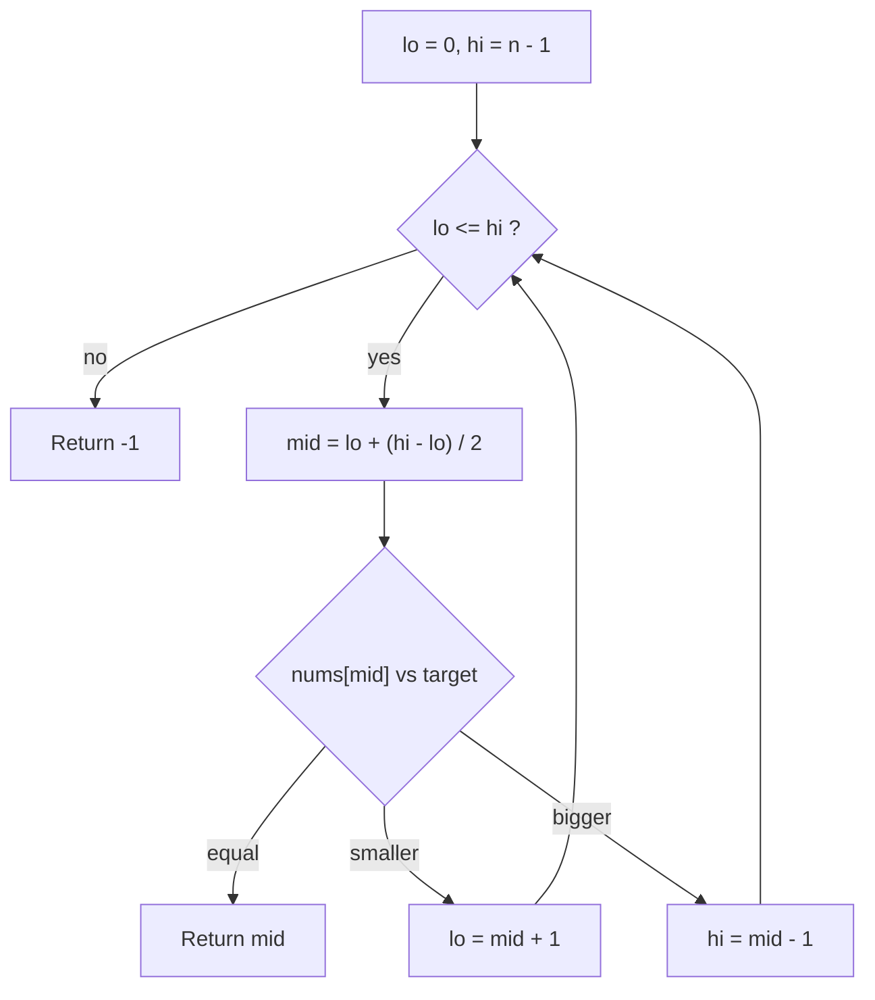

## Intuition

Think of the number guessing game: "I am thinking of a number from 1 to 100." You do not guess 1, 2, 3. You guess 50. If the answer is "higher", the numbers 1 to 50 are gone in one step. Then you guess 75, and so on. Each guess throws away half of the possibilities.

The same works for a dictionary or a phone book. You open it near the middle, see if your word comes before or after, and keep only that half.

Binary search needs one thing: the data must be **sorted**. Sorting is what lets one comparison rule out a whole half.

The loop invariant (a sentence that is true at the start of every loop round) is: **if the target is in the array, its index is between `lo` and `hi`, both included.** Every step keeps this true while the window gets smaller.

## Walkthrough

Array `[1, 3, 5, 7, 9, 11]` (indexes 0 to 5), target `7`:

| Step | `lo` | `hi` | `mid` | `nums[mid]` | Compare with 7 | Action |
| --- | --- | --- | --- | --- | --- | --- |
| 1 | 0 | 5 | 2 | 5 | smaller | `lo = 3` |
| 2 | 3 | 5 | 4 | 9 | bigger | `hi = 3` |
| 3 | 3 | 3 | 3 | 7 | equal | return 3 |

Target `6` (missing):

| Step | `lo` | `hi` | `mid` | `nums[mid]` | Action |
| --- | --- | --- | --- | --- | --- |
| 1 | 0 | 5 | 2 | 5 | 5 < 6, so `lo = 3` |
| 2 | 3 | 5 | 4 | 9 | 9 > 6, so `hi = 3` |
| 3 | 3 | 3 | 3 | 7 | 7 > 6, so `hi = 2` |
| end | 3 | 2 | | | `lo > hi`: window empty, return -1 |

Read it as a loop. Each round either returns or shrinks the window.

## Complexity

| Case | Time | Why |
| --- | --- | --- |
| Best | O(1) | The target is exactly in the first middle. |
| Average | O(log n) | The window is cut in half each round. |
| Worst | O(log n) | The target is missing or found in the last tiny window. |
| Space | O(1) | Only `lo`, `hi` and `mid`. |

**Why log n?** Start with n items. After one step about n/2 are left, then n/4, n/8 and so on. You stop when one item is left. The number of halvings is the number of times you can divide n by 2 before reaching 1, and that is log base 2 of n.

**What it means in numbers:** n = 1,000 needs about 10 steps. n = 1,000,000 needs about 20. n = 1,000,000,000 needs about 30, because 2 to the power 30 is about 1.07 billion. Doubling the data adds only one extra step. A linear scan of a billion items could take a billion steps.

The cost of sorting is separate. If you must sort first, that is O(n log n), so binary search pays off when you search many times.

## Code explanation

1. **Window `[lo, hi]`.** Both ends are valid indexes (inclusive). With `hi = n - 1` the whole array is the window.
2. **`while lo <= hi`.** A window with `lo == hi` still holds one item that must be checked. When `lo > hi` the window is empty.
3. **Middle without overflow.** `lo + (hi - lo) / 2` never goes above `hi`. The common `(lo + hi) / 2` can overflow a 32-bit int when both are large (this was a real bug in the Java standard library for years). JavaScript and Python do not overflow here, but it is a good habit.
4. **Found.** Return `mid`.
5. **Too small.** `nums[mid] < target`, so `mid` and everything left of it are ruled out: `lo = mid + 1`.
6. **Too big.** `hi = mid - 1` for the same reason on the right.
7. **Empty window.** Return `-1`.

The `+ 1` and `- 1` in steps 5 and 6 matter. Without them the window may never shrink and the loop runs forever.

| Language | Difference |
| --- | --- |
| JavaScript / TypeScript | All numbers are doubles, so `/` gives a fraction: use `Math.floor`. |
| Python | Use `//` for integer division. Ints never overflow. |
| Go | Integer `/` truncates. Empty slice has `len` 0, so `hi` is -1 and the loop is skipped. |
| Java / C# | `int` division truncates. `int` overflows silently (wraps around), so the safe midpoint matters. |
| C++ | `size()` is unsigned; we cast to `int` first, otherwise `size() - 1` on an empty vector becomes a huge number. |

## Edge cases and tests

The same 13 cases as linear search. Results here are one valid index, so the duplicate cases return the index of whichever copy the middle hits first.

| Input | Result | What it checks |
| --- | --- | --- |
| `[]`, 5 | -1 | `hi = -1`: the loop never runs. |
| `[7]`, 7 | 0 | One item, found. |
| `[7]`, 3 | -1 | One item, not found. |
| `[1,3,5,7,9,11]`, 1 | 0 | Target at the first position. |
| same, 11 | 5 | Target at the last position. |
| same, 7 | 3 | Found after three steps (see the trace). |
| same, 0 | -1 | Below the smallest. |
| same, 12 | -1 | Above the largest. |
| same, 6 | -1 | Between two values. |
| `[2,4,4,4,4,6,8]`, 4 | 3 | Duplicates: the middle copy, not the first. |
| 20 multiples of 3, 42 | 14 | Longer array. |
| same, 43 | -1 | Longer array, missing. |
| `[5,5,5,5]`, 5 | 1 | All equal: still some valid index. |

## When to use it (and when not)

Use it when the data is sorted (or can be sorted once) and you search many times, or when the data is large and random access is cheap (arrays).

Do not use it when:
- the data is not sorted (the answer will be wrong, with no error);
- the data is a linked list (no fast access to the middle, so each step costs O(n));
- you search once in a small unsorted list (sorting costs more than scanning);
- you need the first or last of several equal values: see the next approaches.

## Interview notes

Say out loud: "The array is sorted, so I keep a window `[lo, hi]` and look at the middle. I always discard the half that cannot contain the target." Then state the invariant and the complexity: O(log n) time, O(1) space.

Likely follow-up: "What if there are duplicates?" or "Why `lo + (hi - lo) / 2`?" Mistake to avoid: writing `hi = mid` or `lo = mid` in this style of loop. It can loop forever.

## Real-life usage

- Database indexes (B-tree) use the same idea on disk pages.
- `git bisect` finds the commit that broke something by testing the middle commit.
- Dictionary and autocomplete lookups over sorted word lists.
- Library functions: Python `bisect`, Java `Arrays.binarySearch`, C++ `std::lower_bound`, Go `sort.Search`. In production you call these instead of writing your own.
