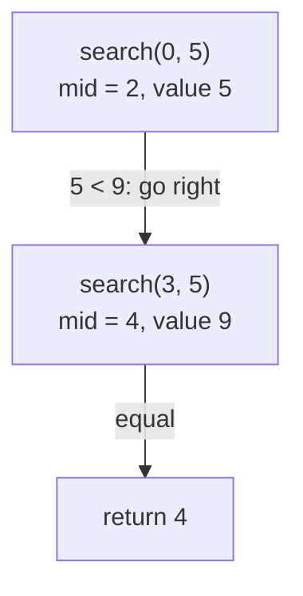

## Intuition

It is the same game as the iterative version (guess the middle, drop half), but told as a story where each step hands the smaller problem to a helper: "Search the left half for me." The helper does the same with a smaller window, until the window is empty or the target is found.

Recursion means a function calling itself on a smaller version of the same problem. Every recursive function needs a **base case** where it stops. Here there are two: the window is empty (not found) or `nums[mid]` equals the target (found).

The invariant is the same: **if the target is in the array, its index is inside `[lo, hi]`.**

## Walkthrough

Array `[1, 3, 5, 7, 9, 11]`, target `9`:

| Call | `lo` | `hi` | `mid` | `nums[mid]` | Result |
| --- | --- | --- | --- | --- | --- |
| `search(0, 5)` | 0 | 5 | 2 | 5 | 5 < 9, call `search(3, 5)` |
| `search(3, 5)` | 3 | 5 | 4 | 9 | found, return 4 |

The answer travels back up: the first call returns what the second call returned.

For a missing target `6` the calls are `(0,5)`, `(3,5)`, `(3,3)`, `(3,2)`. The last one has `lo > hi`, returns `-1`, and that `-1` is passed back up.

Read it as a chain of calls: each call handles a smaller window and returns to the caller.

## Complexity

| Case | Time | Why |
| --- | --- | --- |
| Best | O(1) | Found at the first middle. |
| Average | O(log n) | Window halves every call. |
| Worst | O(log n) | About log2(n) calls: around 30 for a billion items. |
| Space | O(log n) | Each call waits on the call stack until the deeper call returns. |

The time is the same as the iterative version. The extra space is the call stack: about 30 frames for a billion items. That is tiny, so a stack overflow is not a real risk here, but the iterative version avoids even this cost.

Note: some languages (Scheme, some C++ compilers at higher optimisation levels) turn this kind of tail call into a loop. JavaScript, Python, Java, Go and C# do not guarantee it. Do not rely on it.

## Code explanation

1. **Base case: empty window.** `lo > hi` means nothing is left to check: return `-1`.
2. **Middle without overflow.** `lo + (hi - lo) / 2`.
3. **Base case: found.** Return `mid`.
4. **Go right.** The target is bigger, so search `[mid + 1, hi]`. We `return` the result of the call directly.
5. **Go left.** Search `[lo, mid - 1]`.
6. **Public wrapper.** Callers want `binarySearch(nums, target)`, so a small wrapper passes the starting window. The helper carries the extra `lo` and `hi` parameters.

| Language | Difference |
| --- | --- |
| JavaScript / TypeScript | `Math.floor` for the division. Recursion depth is limited by the engine, but 30 levels is nothing. |
| Python | Default recursion limit is 1000 frames: still fine. Slicing the list (`nums[mid+1:]`) would copy data and make it O(n); we pass indexes instead. |
| Go | No tail-call optimisation; the helper is a plain function. |
| Java / C# | Same pattern. Helper methods are `static`. |
| C++ | Pass the vector by `const&` so it is not copied at every call. |

## Edge cases and tests

The same 13 cases and the same expected output as the iterative version, since both do the same comparisons.

| Input | Result | What it checks |
| --- | --- | --- |
| `[]`, 5 | -1 | `search(0, -1)`: base case straight away. |
| `[7]`, 7 / 3 | 0 / -1 | One item: found and not found. |
| `[1,3,5,7,9,11]`, 1 and 11 | 0 and 5 | Target at both ends. |
| same, 7 | 3 | Normal hit. |
| same, 0, 12, 6 | -1 | Below, above and between. |
| `[2,4,4,4,4,6,8]`, 4 | 3 | Duplicates: any valid index. |
| 20 multiples of 3, 42 / 43 | 14 / -1 | Longer array. |
| `[5,5,5,5]`, 5 | 1 | All equal. |

## When to use it (and when not)

Use it when recursion makes the code read closer to the idea (divide and conquer), or when the algorithm is a building block inside a larger recursive routine such as searching a binary search tree.

Prefer the iterative version in production code: same speed, O(1) space, no recursion limits. If an interviewer asks for either, say you know both and why iterative is usually preferred.

## Interview notes

Say: "Base case one, empty window. Base case two, found. Otherwise recurse on the half that can still contain the target." Mention the stack space O(log n).

Likely follow-up: "What is the space complexity?" The answer is O(log n) for the stack, not O(1). Mistake to avoid: passing a sliced copy of the array to each call, which silently makes it O(n).

## Real-life usage

Hand-written recursive binary search is rare in production because loops are as clear. The recursive shape shows up in:
- searching a binary search tree (go left or right at each node);
- divide and conquer algorithms such as merge sort;
- "search on a tree of decisions" problems.
