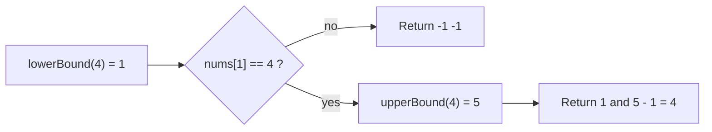

## Intuition

Classic binary search returns *an* index of the target. With duplicates, `[2, 4, 4, 4, 4, 6, 8]`, which 4 do you get? It depends on where the middle lands. Often you want a precise answer: "the first 4 and the last 4". Think of a library shelf with five copies of the same book: you want to know where the group starts and where it ends.

The trick is to stop asking "is this the target?" and ask a yes/no question that is false for a while and then true forever:

- **Lower bound:** is `nums[i] >= target`? The first `true` is the first occurrence (or where the target would be inserted).
- **Upper bound:** is `nums[i] > target`? The first `true` is one step after the last occurrence.

Then `first = lowerBound(target)` and `last = upperBound(target) - 1`. If `nums[first]` is not the target, it is absent.

Here the window is **half-open**, `[lo, hi)`: `lo` is included, `hi` is not. The invariant: everything left of `lo` answers "no", everything from `hi` onwards answers "yes", so the answer is somewhere in `[lo, hi]`. Since `hi` can be `n`, "not found" ends naturally at `n`.

## Walkthrough

Array `[2, 4, 4, 4, 4, 6, 8]` (n = 7), target `4`.

**Lower bound** (`nums[mid] < 4` means go right, else keep `mid`):

| Step | `lo` | `hi` | `mid` | `nums[mid]` | Action |
| --- | --- | --- | --- | --- | --- |
| 1 | 0 | 7 | 3 | 4 | not < 4: `hi = 3` |
| 2 | 0 | 3 | 1 | 4 | not < 4: `hi = 1` |
| 3 | 0 | 1 | 0 | 2 | 2 < 4: `lo = 1` |
| end | 1 | 1 | | | window empty: lower bound = 1 |

**Upper bound** (`nums[mid] <= 4` means go right):

| Step | `lo` | `hi` | `mid` | `nums[mid]` | Action |
| --- | --- | --- | --- | --- | --- |
| 1 | 0 | 7 | 3 | 4 | 4 <= 4: `lo = 4` |
| 2 | 4 | 7 | 5 | 6 | not <= 4: `hi = 5` |
| 3 | 4 | 5 | 4 | 4 | 4 <= 4: `lo = 5` |
| end | 5 | 5 | | | upper bound = 5 |

Result: first = 1, last = 5 - 1 = 4. Output `1 4`.

Read it left to right: one search for the start, a check, one search for the end.

## Complexity

| Case | Time | Why |
| --- | --- | --- |
| Best / average / worst | O(log n) | Two binary searches, each halves the window. 2 x log n is still O(log n). |
| Space | O(1) | A few integers. |

Compare with a trick people try: find any 4 with normal binary search, then walk left and right with a loop. That is O(log n + k), where k is the number of duplicates. If all items are equal, k = n and it is as slow as a linear scan. The two-boundary method stays O(log n).

## Code explanation

1. **Half-open window.** `hi = n` is one past the end, not a valid index.
2. **`while lo < hi`.** With a half-open window, `lo == hi` means empty.
3. **Safe middle.** `lo + (hi - lo) / 2`. Here `mid < hi` always, so `nums[mid]` is a valid index.
4. **Too small.** `nums[mid] < target`: `mid` cannot be the answer, so `lo = mid + 1`.
5. **Maybe the answer.** Otherwise `mid` could be the first "yes", so keep it: `hi = mid` (not `mid - 1`). This is safe because the window shrinks: `mid < hi`.
6. **Upper bound.** The same loop with `<=` instead of `<`.
7. **Absent check.** If `first == n` or `nums[first] != target`, the target is not there: return `-1 -1`.
8. **Last index.** `upperBound - 1`.

| Language | Difference |
| --- | --- |
| JavaScript / TypeScript | Returns an array `[first, last]`; TypeScript types it as a tuple. |
| Python | Returns a tuple. The standard library has `bisect_left` (lower) and `bisect_right` (upper) that do exactly these two searches. |
| Go | Multiple return values `(int, int)`. `sort.SearchInts` returns the lower bound. |
| Java | Returns `int[]`. `Arrays.binarySearch` does not promise which duplicate it returns, so you cannot use it for this. |
| C# | Returns a named tuple `(int First, int Last)`. |
| C++ | `std::lower_bound` and `std::upper_bound` give iterators; here we write them to see how they work and return `std::pair`. |

## Edge cases and tests

The same 13 inputs, printed as `first last`.

| Input | Result | What it checks |
| --- | --- | --- |
| `[]`, 5 | `-1 -1` | `first == n == 0`. |
| `[7]`, 7 | `0 0` | One copy: first equals last. |
| `[7]`, 3 | `-1 -1` | Absent. |
| `[1,3,5,7,9,11]`, 1 / 11 | `0 0` / `5 5` | Both ends. |
| same, 7 | `3 3` | Single occurrence in the middle. |
| same, 0 / 12 / 6 | `-1 -1` | Below, above, between. |
| `[2,4,4,4,4,6,8]`, 4 | `1 4` | Several duplicates. |
| 20 multiples of 3, 42 / 43 | `14 14` / `-1 -1` | Longer array. |
| `[5,5,5,5]`, 5 | `0 3` | Whole array is the target: window reaches both ends. |

## When to use it (and when not)

Use it when the data may contain duplicates and you need a range: "how many times does 4 appear?" is `upperBound - lowerBound`. It also gives the **insert position** for free: `lowerBound(target)` is where to insert so the array stays sorted (before existing equal items).

Not needed when all values are unique and you only need to know whether the target exists. Use the simple version then.

## Interview notes

Say: "With duplicates I search for a boundary instead of an item: the first index where the value is at least the target, and the first index where it is greater. The last occurrence is one before that." Mention it is O(log n), not O(log n + k).

Likely follow-ups: count occurrences, find the insert position, find the smallest number greater than x. Mistake to avoid: writing `hi = mid - 1` in the boundary loop, which can skip the answer.

## Real-life usage

- C++ `std::lower_bound`, `std::upper_bound`, `std::equal_range`; Python `bisect_left`, `bisect_right`; Go `sort.Search`.
- Range queries on a sorted index: "all orders between two timestamps" is two boundary searches.
- Inserting into a sorted list while keeping it sorted.
- Counting events in a time window over sorted logs.
