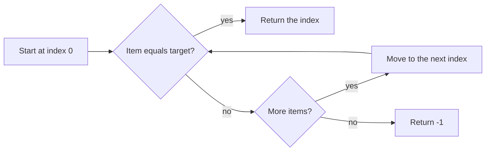

## Intuition

Imagine you lose your keys in a messy room. You have no clue where they are, so you check every spot, one after another, until you find them. That is linear search. It makes no assumption about the data, so it works on any list: sorted, shuffled or half empty.

It is the baseline. Every smarter method in this problem (binary search and friends) has to beat it, and every one of them needs something extra, usually that the data is sorted.

## Walkthrough

Array `[1, 3, 5, 7, 9, 11]`, target `7`:

| Step | `i` | `nums[i]` | Same as 7? | What happens |
| --- | --- | --- | --- | --- |
| 1 | 0 | 1 | no | go on |
| 2 | 1 | 3 | no | go on |
| 3 | 2 | 5 | no | go on |
| 4 | 3 | 7 | yes | return 3 |

Target `6` is not in the array. The loop checks all six items, never matches, and returns `-1`.

Read it as a loop: check, move on, stop at a match or at the end.

## Complexity

`n` is the number of items.

| Case | Time | Why |
| --- | --- | --- |
| Best | O(1) | The target is the first item: one check. |
| Average | O(n) | If the target is equally likely anywhere, you check about half the items. Half of n is still "proportional to n". |
| Worst | O(n) | The target is last or missing: you check every item. |
| Space | O(1) | Only the counter `i` is stored. |

What O(n) means in practice: with one billion items you may need one billion checks. Binary search needs about 30 on sorted data.

## Code explanation

1. **Visit items from left to right.** A simple loop over the indexes.
2. **The first match wins.** We return at once, so with duplicates you always get the leftmost index.
3. **Looked at everything.** Falling out of the loop means the target is not there, so return `-1`.

| Language | Difference |
| --- | --- |
| JavaScript / TypeScript | Compare with `===`, so `"7"` does not match `7`. |
| Python | `enumerate` gives index and value together. Python also has `list.index`, but it raises `ValueError` when the item is missing. |
| Go | `for i, v := range nums` copies each value; fine for ints. |
| Java / C# | Arrays have `.length` / `.Length`. Both also have library helpers (`List.indexOf`, `Array.IndexOf`). |
| C++ | The library version is `std::find`, which returns an iterator, not an index. We cast `size()` to `int` to avoid a signed/unsigned comparison. |

## Edge cases and tests

All solutions use the same 13 cases, one result per line:

| Input | Result | What it checks |
| --- | --- | --- |
| `[]`, 5 | -1 | Empty array: the loop never runs. |
| `[7]`, 7 | 0 | Single element, found. |
| `[7]`, 3 | -1 | Single element, not found. |
| `[1,3,5,7,9,11]`, 1 | 0 | Target is the first item. |
| same, 11 | 5 | Target is the last item. |
| same, 7 | 3 | Target in the middle. |
| same, 0 | -1 | Smaller than everything. |
| same, 12 | -1 | Larger than everything. |
| same, 6 | -1 | Missing, but between two values. |
| `[2,4,4,4,4,6,8]`, 4 | 1 | Duplicates: the first one is returned. |
| 20 multiples of 3, 42 | 14 | A longer array. |
| same, 43 | -1 | A longer array, target missing. |
| `[5,5,5,5]`, 5 | 0 | All items equal. |

## When to use it (and when not)

Use it when:
- the data is unsorted and you search only once or twice;
- the list is small (a few dozen items): it is simple and cache friendly, and often as fast as anything else;
- you search for something that is not a simple "equals", such as "the first user who is older than 30 and active".

Do not use it when the data is already sorted and big, or when you search the same data many times. Then sort once (or build a hash map or index) and search faster.

## Interview notes

Say it first: "The simple way is a linear scan, O(n). If the array is sorted I can do better with binary search, O(log n)." This shows you know the baseline and the upgrade.

Likely follow-up: "The array is sorted. Can you do better?" Mistake to avoid: jumping straight to binary search without asking whether the input is sorted.

## Real-life usage

- Looking for an item in a small list in your code (`array.find`, `list.index`, `strings.Contains`).
- A database full table scan when no index exists: the engine reads every row.
- `grep` over a log file: it reads lines one by one.

Linear search is not "bad". For small or unsorted data it is the right tool.
