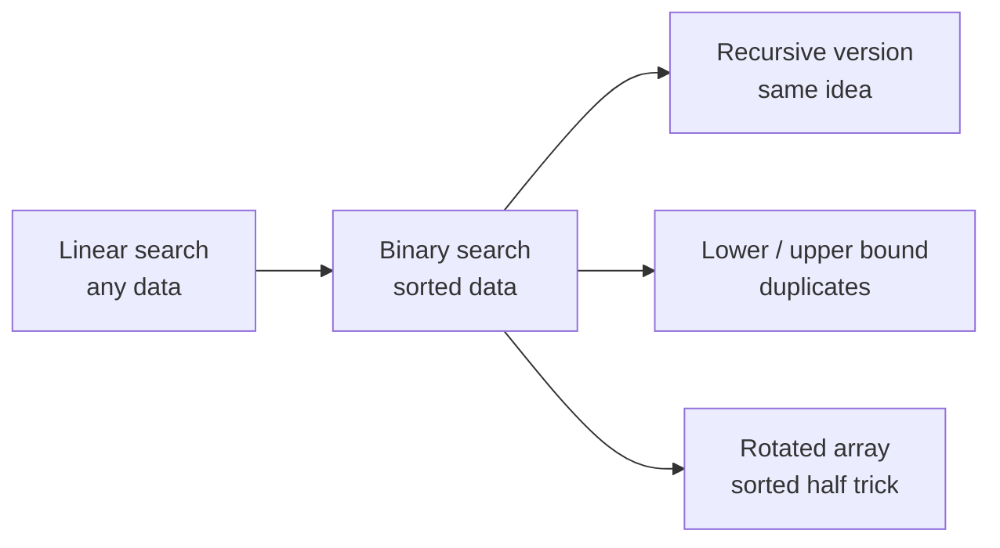
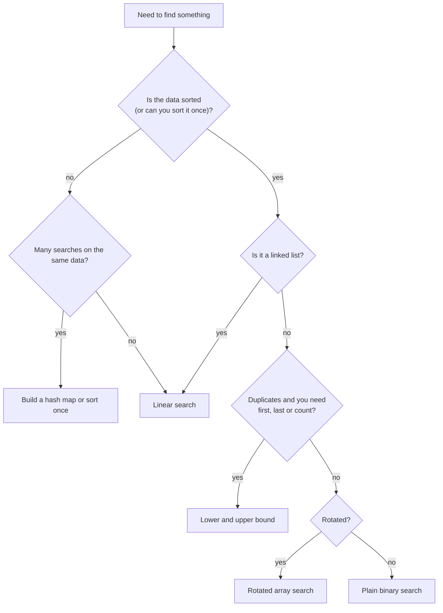

## How interviewers ask it

Binary search is one of the most common interview topics because it is short to say and easy to get wrong. It is how you find something in **sorted** data without looking at everything: look at the middle, throw away the half that cannot contain the answer, repeat.

Typical wording:

- "Given a sorted array of integers and a target, return the index of the target, or -1 if it is not there."
- "The array has duplicates. Return the first and the last index of the target." (a lower bound and an upper bound)
- "A sorted array was rotated at some unknown point, for example `[5, 7, 9, 11, 1, 3]`. Find the target in O(log n)."
- Variations you should recognise: the **insert position** (where would the target go to keep the array sorted?), the **square root** of an integer rounded down, the first bad version, the smallest value in a rotated array, and **binary search on the answer** (for example "the smallest speed that finishes the job in time").

What to clarify before you write code:

- Is the array **sorted**? In which order (ascending or descending)?
- Can there be **duplicates**? If yes, which one should I return (any, the first, the last)?
- What do I return when the target is missing (`-1`, or the insert position)?
- How big can the array be? (This decides whether `lo + hi` could overflow.)
- Can the array be empty?

A good answer covers: the idea (halving), the loop invariant, a safe midpoint, correct bounds, the empty and one-element cases, and the complexity: O(log n) time, O(1) space.

## Real-life scenarios

| Scenario | What is actually used | Why |
| --- | --- | --- |
| Database index lookup (`WHERE id = 42`) | A B-tree: each node holds sorted keys, and the engine does a binary-style search inside each node and between levels | Reading 3 or 4 pages instead of the whole table. Without an index you get a full table scan, which is linear search |
| Find the commit that broke the build | `git bisect`: test the middle commit, say good or bad, repeat | 1,000 commits need about 10 builds instead of 1,000 |
| Find a version where a bug first appeared | Binary search on the version number (the "first bad version" problem) | The same idea as git bisect: every version after the first bad one is bad, so "good/bad" is a sorted yes/no list |
| Search sorted logs by timestamp | Binary search for the start time, then read forward | Log files and time-series data are sorted by time, so you can jump straight to "14:03:00" without reading the start of the file |
| Autocomplete and dictionary lookup | Binary search in a sorted word list for the first word with the prefix (lower bound), plus a trie in big systems | You get the whole range of words with that prefix |
| Tune a threshold or rate limit | Binary search on the answer: try a value, test if it works, narrow the range | Works when "too low" and "too high" are cleanly separated, for example the smallest timeout that never fails |
| Debugging by halving | Comment out half the code, config or input and see if the bug remains | Same idea as bisect, by hand. Finds the culprit in about log2(n) experiments |
| Insert into a sorted list | Lower bound gives the insert position (Python `bisect.insort`) | Keeps the list sorted without sorting again |

## Approaches compared

| Approach | Time (best / average / worst) | Space | Needs sorted data | Use when |
| --- | --- | --- | --- | --- |
| Linear search | O(1) / O(n) / O(n) | O(1) | no | Small or unsorted data, one-off search, non-simple conditions |
| Binary search (iterative) | O(1) / O(log n) / O(log n) | O(1) | yes | The default for sorted arrays |
| Binary search (recursive) | O(1) / O(log n) / O(log n) | O(log n) stack | yes | When recursion reads more clearly, or inside tree searches |
| First and last occurrence (lower and upper bound) | O(log n) | O(1) | yes | Duplicates, counting, insert position, range queries |
| Rotated sorted array | O(1) / O(log n) / O(log n) | O(1) | sorted, then rotated, no duplicates | The popular rotated array variant |

How fast is O(log n)? Each step halves the window, so 1,000 items need about 10 steps, 1,000,000 need about 20, and 1,000,000,000 need about 30. Doubling the data adds one step.

Read it left to right: linear search is the baseline, and the others are all binary search with a twist.

## How to choose

Read it from the top. Sorted, array-like data is the entry ticket for binary search.

Two extra rules:
- **Exact lookups by key** (is this user id known?) are usually better served by a hash map: O(1) on average. Binary search wins when you need order: ranges, "the next bigger value", prefix lookups.
- **Binary search on the answer** works when you can test a guess with a yes/no check and the answers are "no, no, no, yes, yes, yes" in order.

## Built-ins and the standard library

In production, call the library. Write it by hand in interviews and for special cases (searching on a condition).

| Language | Call | What it returns | Pitfall |
| --- | --- | --- | --- |
| JavaScript / TypeScript | None for sorted arrays. `indexOf` and `includes` are linear scans. Write your own or use a library such as lodash `_.sortedIndex` | | Do not assume `indexOf` is fast on sorted data. Default `sort()` compares as strings, so sort numbers with `(a, b) => a - b` first |
| Python | `bisect.bisect_left(a, x)`, `bisect.bisect_right(a, x)` (also `bisect.bisect`, `insort`) | The insertion point (lower bound / upper bound). It never raises | You must check yourself: `i < len(a) and a[i] == x`. The `key=` argument exists since Python 3.10 |
| Go | `sort.Search(n, f)`, `sort.SearchInts`, `slices.BinarySearch` (Go 1.21+) | `sort.Search` returns the smallest `i` where `f(i)` is true, or `n`. `slices.BinarySearch` returns `(index, found)` | `sort.Search` takes a predicate, not a target, and `f` must be false then true. It gives a lower bound, so check the item |
| Java | `Arrays.binarySearch(arr, key)`, `Collections.binarySearch(list, key)` | The index if found; otherwise `-(insertionPoint) - 1`, a negative number | The array must be sorted, or the result is undefined. With duplicates any match may be returned. Do not compare the result with `-1` only: use `< 0` |
| C# | `Array.BinarySearch(arr, value)`, `List<T>.BinarySearch(value)` | The index if found; otherwise the bitwise complement `~index` of the next larger element (negative) | Same: test `< 0`, and `~result` gives the insert position. Sorted input required; with duplicates any match may be returned |
| C++ | `std::binary_search` (bool), `std::lower_bound`, `std::upper_bound`, `std::equal_range` (in `<algorithm>`) | `binary_search` returns true or false; the others return iterators | The range must be sorted with the same comparison. On a `std::list` they still work but are not O(log n), since iterators are not random access |

Example of the negative return values on `[1, 3, 5, 7]`, looking for `4`: Java gives `-3` (insert position 2, so `-2 - 1`), C# gives `~2`, which is also `-3`, Python `bisect_left` gives `2`.

## Common mistakes

- **Overflow in the midpoint.** `(lo + hi) / 2` can overflow a 32-bit `int` for arrays above about 1 billion items (a famous bug that lived in the Java standard library for years). Use `lo + (hi - lo) / 2`.
- **Infinite loop.** Writing `lo = mid` or `hi = mid` inside a `lo <= hi` loop. The window may stop shrinking. In the `[lo, hi]` style, always use `mid + 1` and `mid - 1`.
- **Mixing the two styles.** `while (lo <= hi)` goes with `hi = n - 1` and `hi = mid - 1`. `while (lo < hi)` goes with `hi = n` and `hi = mid` (half-open window). Pick one style and keep it consistent.
- **Searching an unsorted array.** The result is just wrong, and nothing warns you. Ask if the data is sorted; sort first if not.
- **Duplicates.** Plain binary search returns some match, not the first. Use lower and upper bound when it matters.
- **Wrong comparison direction.** The array sorted in descending order needs the opposite comparison.
- **Empty array.** With an unsigned size (C++), `size() - 1` wraps to a huge number. Cast to `int` first.
- **Copying the array in recursion** (`nums[mid+1:]` in Python, `slice` in JavaScript). It turns O(log n) into O(n). Pass indexes.
- **Floats and `NaN`.** Comparisons with `NaN` are always false, so binary search can fail silently. Exclude `NaN` first.

## How to answer in an interview

1. **Clarify.** Say: "Is the array sorted? Can it have duplicates? What should I return if the target is missing? Can it be empty?"
2. **Give examples.** "For `[1, 3, 5, 7, 9, 11]` and target 7, I return 3. For 6, I return -1."
3. **State the simple solution.** "A linear scan works in O(n), without using the sorted order."
4. **Improve it.** "Because it is sorted, I can look at the middle. If the middle is too small, everything on its left is too small too, so I drop that half. This repeats, so O(log n)."
5. **State the invariant.** "If the target exists, it is always inside `[lo, hi]`."
6. **Code it.** Write `lo`, `hi`, `while lo <= hi`, the safe midpoint, the three-way comparison, and `return -1`. Say: "I use `lo + (hi - lo) / 2` to avoid overflow."
7. **Test aloud.** Walk through the empty array, one element (found and not found), the first and last index, and a missing value between two items.
8. **Complexity.** "Time O(log n): the window halves each step, so about 30 steps for a billion items. Space O(1) for the loop, or O(log n) for the recursive version."
9. **Trade-offs.** "If I search once on unsorted data, a linear scan is cheaper than sorting. For exact key lookups a hash map is O(1) on average."

## Follow-up questions

- **What if there are duplicates and I need the first one?** Use a lower bound: when `nums[mid] >= target`, keep `mid` as a candidate and move `hi`. The last one is the upper bound minus one.
- **What is the insert position of a missing target?** The lower bound. The loop ends with `lo` at the place where the target would go.
- **How do you search a rotated sorted array?** One half is always sorted. Find it, test whether the target is in its range, and go there or to the other half. Still O(log n) without duplicates.
- **Why not use binary search on a linked list?** You cannot jump to the middle in O(1), so finding the middle costs O(n) every step, and the total is no better than linear.
- **How would you find the square root of an integer?** Binary search on the answer between 0 and x: find the largest `m` where `m * m <= x`. Use `m <= x / m` to avoid overflow.
- **What is "binary search on the answer"?** The answer is a number in a range, and you can check any guess with a yes/no test that is monotonic (no, no, yes, yes). For example the minimum capacity of a truck that ships all packages in D days.
- **How do you search a sorted array of unknown size (an infinite stream)?** Double the upper bound (1, 2, 4, 8, ...) until the value there is at least the target, then binary search inside that range.
- **Does it work on a 2D sorted matrix?** If rows and columns are sorted and each row starts after the last row ended, treat it as one array of `rows * cols` items and map the index back. Otherwise use the "start at a corner" method.

## Practice

- **Search insert position**: return the index where the target is, or would be.
- **Find first and last position of an element** in a sorted array (the fourth approach here).
- **Search in a rotated sorted array** and **find the minimum in a rotated sorted array**.
- **Sqrt(x)** and **first bad version**: binary search on the answer.
- **Koko eating bananas** or **capacity to ship packages within D days**: binary search on the answer with a yes/no check.
