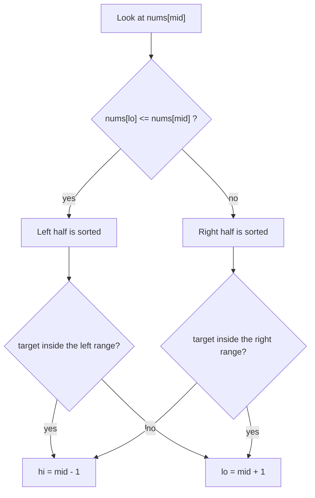

## Intuition

Take a sorted array and cut it somewhere, then glue the two pieces in swapped order. `[1, 3, 5, 7, 9, 11]` rotated becomes `[5, 7, 9, 11, 1, 3]`. It looks unsorted, so plain binary search fails: the middle value no longer tells you "go left or right".

The key fact: **if you cut a rotated array at any middle, at least one of the two halves is still perfectly sorted.** The rotation point (the drop from 11 to 1) can only be in one half. So each step:

1. Work out which half is sorted.
2. Check if the target lies within the range of that sorted half (a normal comparison against its two ends).
3. If yes, go into that half; if no, go into the other.

Picture a clock face where the numbers were shifted: one side of any line you draw is still in order.

The invariant is the same as before: **if the target exists, its index is in `[lo, hi]`.** This version assumes **no duplicate values**. (With duplicates, `nums[lo] == nums[mid]` does not tell you which half is sorted, and the worst case degrades to O(n).)

## Walkthrough

Array `[5, 7, 9, 11, 1, 3]` (indexes 0 to 5), target `1`:

| Step | `lo` | `hi` | `mid` | `nums[mid]` | Sorted half | Target in it? | Action |
| --- | --- | --- | --- | --- | --- | --- | --- |
| 1 | 0 | 5 | 2 | 9 | left (5 <= 9) | 5 <= 1 < 9? no | `lo = 3` |
| 2 | 3 | 5 | 4 | 1 | | equal | return 4 |

Target `3`:

| Step | `lo` | `hi` | `mid` | `nums[mid]` | Sorted half | Target in it? | Action |
| --- | --- | --- | --- | --- | --- | --- | --- |
| 1 | 0 | 5 | 2 | 9 | left | 5 <= 3 < 9? no | `lo = 3` |
| 2 | 3 | 5 | 4 | 1 | right (11 > 1, so left is not sorted) | 1 < 3 <= 3? yes | `lo = 5` |
| 3 | 5 | 5 | 5 | 3 | | equal | return 5 |

Read it top to bottom: find the sorted half, test the range, then pick a side.

## Complexity

| Case | Time | Why |
| --- | --- | --- |
| Best | O(1) | Target at the first middle. |
| Average / worst | O(log n) | Every step still discards half of the window, because the sorted-half test lets us decide with one range check. |
| Space | O(1) | Only `lo`, `hi`, `mid`. |

The rotation costs nothing extra: it only adds a few comparisons per step, not extra steps.

## Code explanation

1. **Window `[lo, hi]`** with both ends included, as in the classic version.
2. **Safe middle.** `lo + (hi - lo) / 2`.
3. **Found.** Return `mid`.
4. **Left half sorted?** `nums[lo] <= nums[mid]` (use `<=`: with one item `lo == mid`).
5. **Target inside the sorted left half?** `nums[lo] <= target < nums[mid]`. The upper end is strict, because `nums[mid]` was already checked. If yes, `hi = mid - 1`.
6. **Otherwise** the target can only be in the other half: `lo = mid + 1`.
7. **Else the right half is sorted.** Test `nums[mid] < target <= nums[hi]`; if yes `lo = mid + 1`, else `hi = mid - 1`.
8. **Empty window.** Return `-1`.

| Language | Difference |
| --- | --- |
| JavaScript / TypeScript | Chained comparisons are not allowed; write `a <= b && b < c`. |
| Python | Chained comparisons work: `nums[lo] <= target < nums[mid]`. |
| Go | No ternary; plain `if` / `else`. Empty slice gives `hi = -1`. |
| Java / C# / C++ | Same logic. Cast `size()` to `int` in C++ to avoid unsigned wrap-around on empty input. |

## Edge cases and tests

This approach has its own 16 inputs (the rotated array is `[5,7,9,11,1,3]`; "long" is 20 multiples of 3 rotated by 8, so it starts 24, 27, ... 57, 0, 3, ... 21).

| Input | Result | What it checks |
| --- | --- | --- |
| `[]`, 5 | -1 | Empty. |
| `[7]`, 7 / 3 | 0 / -1 | One element. |
| rotated, 1 | 4 | Target right after the rotation point. |
| rotated, 5 | 0 | First element. |
| rotated, 3 | 5 | Last element. |
| rotated, 11 | 3 | Largest value, just before the rotation point. |
| rotated, 0 / 12 / 6 | -1 | Below, above, in a gap. |
| `[1,3,5,7,9,11]` (not rotated), 9 | 4 | Rotation by zero must still work. |
| `[3,1]`, 1 / 3 | 1 / 0 | Two elements, where `lo == mid`. |
| long rotated, 42 | 6 | Longer array. |
| long rotated, 43 | -1 | Missing. |
| long rotated, 0 | 12 | Target just after the rotation point. |

## When to use it (and when not)

Use it when you know the data is a rotated sorted array, for example a ring buffer snapshot or a sorted list that was shifted. It is also a very popular interview problem.

Do not use it when the array has many duplicates (worst case O(n)), or when the data is not a rotation of a sorted array at all. If you can, keep the data sorted and use plain binary search.

## Interview notes

Say: "At least one half is always sorted. I find which one, check whether the target falls in its range, and discard the other half." Draw `[5,7,9,11,1,3]` and mark the sorted half.

Likely follow-ups: find the minimum in a rotated array (same idea, compare `nums[mid]` with `nums[hi]`); handle duplicates (shrink the window by one when `nums[lo] == nums[mid] == nums[hi]`, which makes the worst case O(n)). Mistake to avoid: using `<` instead of `<=` in `nums[lo] <= nums[mid]`, which breaks when the window has one or two items.

## Real-life usage

- Rotated arrays appear in ring buffers, where the oldest entry sits in the middle of the storage.
- Circular logs and time series that wrap around.
- It is mostly an interview problem; in production you normally keep data in plain sorted order or use a database index.
