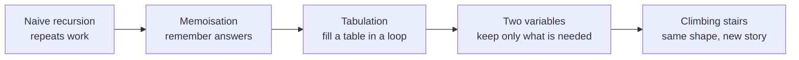
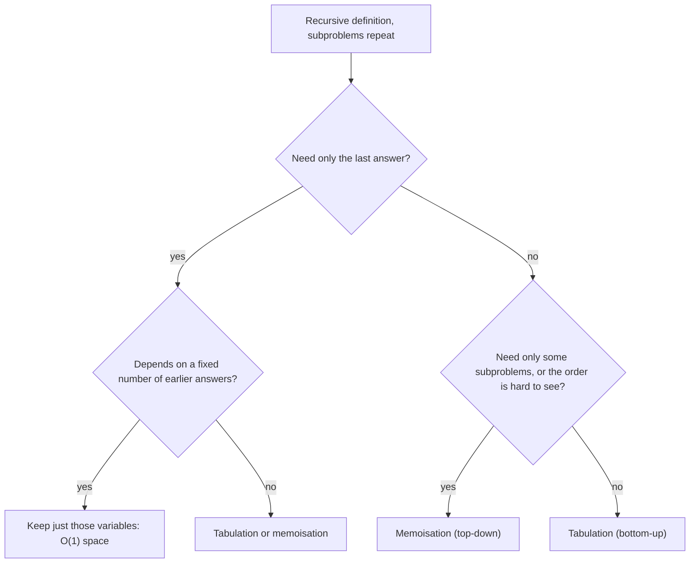
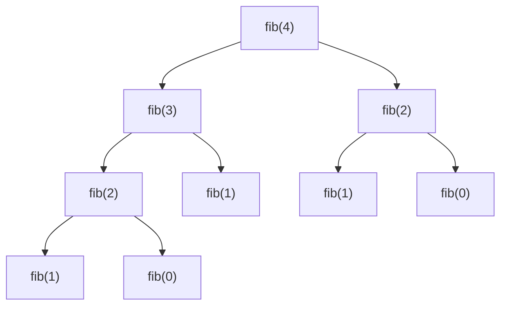
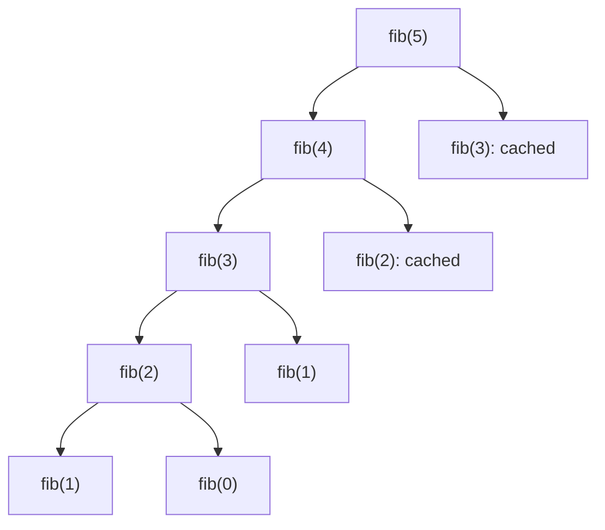
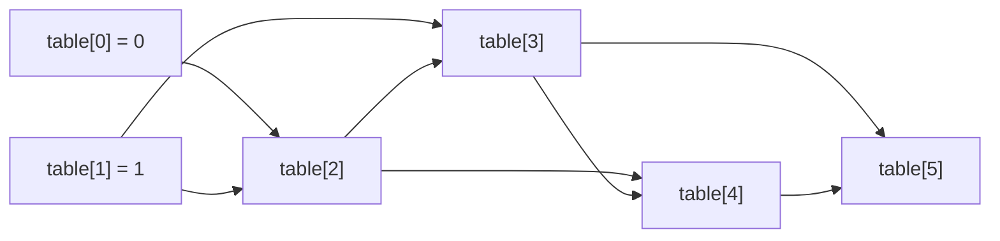
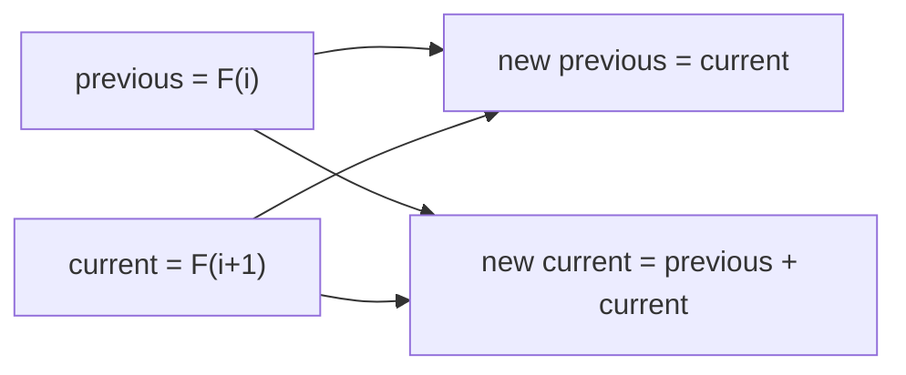
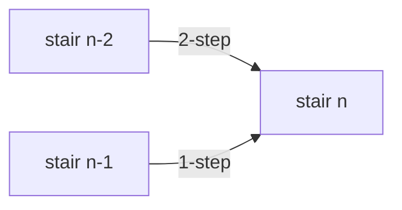

# Fibonacci and dynamic programming

[← All problems](../README.md)

> Use Fibonacci to learn dynamic programming: why naive recursion repeats work, and how memoisation, tabulation and a rolling window fix it. Includes climbing stairs.

**Level:** basic · **Tags:** dynamic-programming, recursion, memoization, fibonacci, complexity

**Related interview questions:**

- [JavaScript: How does memoization work and when should you use it?](../../questions/javascript.md)
- [React: When do `useMemo`, `useCallback` and `React.memo` actually help?](../../questions/react.md)
- [Golang: What is escape analysis? How does Go decide between stack and heap?](../../questions/golang.md)
- [JavaScript: What is the event loop? How do the call stack, task queue and microtasks work?](../../questions/javascript.md)
- [Golang: What are arrays and slices? Why are slices used almost everywhere?](../../questions/golang.md)
- [Golang: How do maps work in Go, and what are the common mistakes?](../../questions/golang.md)

## How interviewers ask it

**The classic wording.** "Write a function that returns the n-th Fibonacci number." The Fibonacci sequence starts with 0 and 1, and every next number is the sum of the two before it: 0, 1, 1, 2, 3, 5, 8, 13, 21, 34, and so on. We write F(0) = 0, F(1) = 1 and F(n) = F(n minus 1) plus F(n minus 2).

The question is rarely about Fibonacci itself. It is a doorway to **dynamic programming**, which means solving a big problem by solving smaller versions of it and remembering the answers so that no small problem is ever solved twice. The interviewer watches whether you notice that the simple recursive solution repeats work, and whether you can fix it.

**The most common disguise: climbing stairs.** "You are climbing a staircase with n steps. Each time you can climb 1 or 2 steps. In how many different ways can you reach the top?" The answer for n stairs is the Fibonacci number F(n plus 1), because the last move was either a 1-step from stair n minus 1 or a 2-step from stair n minus 2. So ways(n) = ways(n minus 1) + ways(n minus 2). The fifth approach in this problem solves exactly this.

**Common variations:**

- *Fast Fibonacci for huge n.* "Compute F(1,000,000) modulo a prime." (matrix power or fast doubling, in O(log n) steps)
- *Tribonacci and k-step stairs.* "You may climb 1, 2 or 3 steps." (sum of the last three or last k answers)
- *Minimum cost climbing stairs.* "Each stair has a cost; find the cheapest way to the top."
- *House robber.* "You cannot rob two neighbouring houses; maximise the money." (the same two-variable rolling window)
- *Decode ways, domino tiling, number of binary strings without two ones in a row.* (each one is a Fibonacci-like recurrence)
- *Print the first n numbers*, or *return a generator that never ends*.

**What to clarify before you code:**

| Question to ask | Why it matters |
| --- | --- |
| Does the sequence start at F(0) = 0 or F(1) = 1? | Some books start with 1, 1. The index shifts by one. |
| What is the range of n? | Decides the approach and the integer type. |
| What happens for negative n? | Usually not allowed. Say so, or return an error. |
| How big can the answer get? | F(47) already passes the 32-bit signed integer limit. F(93) passes the 64-bit one. |
| Is the answer needed modulo a number? | Then you can keep the numbers small and use fast methods for huge n. |
| Called once or many times? | Many calls favour a shared table or cache. |

A good answer starts from the definition, points out that the naive recursion is exponential and why, fixes it with memoisation or a loop, reduces the memory to two variables, and states the cost of each step out loud.

In this repo the programs print one number per test case. The slow naive approach uses only small n (up to 30). The others go up to n equal to 50, where the result no longer fits in 32 bits, so 64-bit integers are required. The climbing stairs program prints the number of ways for n from 0 to 50.

## Real-life scenarios

| Scenario | What is actually used | Why |
| --- | --- | --- |
| Shortest route, cheapest plan, best schedule | Dynamic programming over states (shortest path algorithms, route planners) | The best route to a place is built from the best routes to the places just before it. |
| Spell check and "did you mean" suggestions | Edit distance computed with a table | Each cell is the best answer for two shorter prefixes of the words. |
| `diff` and `git diff` | Longest common subsequence with a table | It finds the largest unchanged part of two files and reports the rest as changes. |
| Text justification, line breaking in word processors and TeX | Dynamic programming over where to break lines | The best layout for the first k words is reused when placing the next line. |
| Speech recognition and gene alignment | The Viterbi algorithm and sequence alignment | Both are tables where each cell depends on a few earlier cells. |
| Caching an expensive pure function (a price calculation, a permission check) | Memoisation: a map from input to result, or `functools.cache` | The same inputs come back often, so recomputing is waste. |
| Build tools such as Make, Bazel, Gradle | A cache of results keyed by inputs | A target that has been built with the same inputs is not built again. |
| React `useMemo` and selector libraries | Memoisation of the last result | The function is not run again if its inputs did not change. |
| Resource and budget planning (knapsack) | Dynamic programming over weight and value | Choose the best set of items under a limit by building on smaller limits. |

Whenever you see a result that is reused because its inputs repeat, you are looking at the idea behind this problem.

## Approaches compared

| Approach | Time | Extra space | Style | Use when |
| --- | --- | --- | --- | --- |
| 1. Naive recursion | O(2^n) | O(n) call stack | Top-down, no memory | Never for real work. It shows the problem. |
| 2. Memoisation | O(n) | O(n) table plus O(n) call stack | Top-down, with a cache | When the recursion is natural and only some subproblems are needed. |
| 3. Tabulation | O(n) | O(n) table | Bottom-up, a loop | When you need all values up to n and want no recursion. |
| 4. Space-optimised | O(n) | O(1) | Bottom-up, two variables | The final answer in an interview. |
| 5. Climbing stairs | O(n) | O(1) | The same idea on a new problem | To show you can recognise the pattern. |



Read it as the ladder every dynamic programming solution climbs: first correct, then remembered, then iterative, then small.

**Two key ideas.** A problem is a good fit for dynamic programming when it has both of these:

- **Overlapping subproblems.** The same smaller problem appears many times. In the naive Fibonacci tree F(2) is computed again and again.
- **Optimal substructure.** The answer for the big problem is built from the answers to smaller ones. For Fibonacci, it is just a sum.

If subproblems do not overlap (for example merge sort splits a list into independent halves), plain divide and conquer is enough and a table does not help.

## How to choose



Start at the top and answer each question. In an interview, start from the recursive idea, add memoisation, convert to a loop, and then shrink the memory.

**How to recognise a dynamic programming problem.** Use this checklist.

1. The question asks for a **count** ("how many ways"), a **best value** ("minimum cost", "longest", "maximum profit") or a **yes or no** ("is it possible to reach this sum?").
2. You make a **sequence of choices**, and each choice leaves a smaller problem of the same kind.
3. A brute-force solution would try all combinations, which is exponential, and the **same sub-situation shows up again and again**.
4. The state can be described by a **few numbers** (an index, a remaining amount, a position in two strings).
5. The best answer for a state uses only the best answers for smaller states (optimal substructure).

Then follow the recipe: define the state in words, write the recurrence (how a state is built from smaller ones), set the base cases, decide the order of filling (smaller states first), and finally check whether you only need the last few states, which lets you drop the table.

## Built-ins and the standard library

Dynamic programming is a technique, not a function. What the languages offer are tools for caching and for big numbers. The table shows what to use and the pitfalls.

| Language | Memoisation tool | Big or checked integers | Pitfall |
| --- | --- | --- | --- |
| JavaScript / TypeScript | A `Map`, or a small `memoize` helper. No built-in. | `BigInt` for exact large integers. | The `number` type is a 64-bit float, exact only up to 2 to the power 53. F(79) and beyond lose precision silently. `BigInt` and `number` cannot be mixed in one expression. |
| Python | `functools.cache` (3.9 and later) or `functools.lru_cache` | Integers have no limit. | The default recursion limit is 1000, so memoised recursion fails for n around a thousand. Use the loop. `lru_cache` keeps arguments alive, so be careful with large inputs. |
| Go | A `map` or a slice, written by hand. | `int64`, and `math/big` for big values. | Signed integer overflow wraps around silently. There is no built-in cache. |
| Java | `HashMap`, or an array | `long`, `BigInteger`, `Math.addExact` (throws on overflow). | Calling `map.computeIfAbsent` recursively on a `HashMap` throws `ConcurrentModificationException` (Java 9 and later). Overflow wraps silently. |
| C# | `Dictionary`, or an array | `long`, `System.Numerics.BigInteger`, `checked` arithmetic. | Arithmetic is unchecked by default, so `int` overflow wraps silently. A very deep recursion ends the process. |
| C++ | `std::unordered_map`, `std::vector` | `long long`, `unsigned long long`. No big integer in the standard library. | Signed overflow is undefined behaviour, not a wrap. Deep recursion can crash. |

**Hand-write or use a library?** Use a built-in cache when you have one and the function is pure (same input, same output, no side effects). Write the table yourself when you need control over memory, or when an interviewer asks you to.

## Common mistakes

- **Using the naive recursion for large n.** F(40) already takes hundreds of millions of calls. F(50) would take tens of billions.
- **Forgetting the base cases.** Without F(0) and F(1), the recursion never stops.
- **Off-by-one in the index.** F(1) = 1 and F(2) = 1. For climbing stairs, ways(1) = 1 and ways(2) = 2, so ways(n) = F(n plus 1).
- **Integer overflow.** F(47) is 2,971,215,073, which is larger than the 32-bit signed integer limit of 2,147,483,647. Use 64-bit integers in Java, C#, C++ and Go. F(93) overflows even 64 bits.
- **JavaScript precision.** Numbers above 2 to the power 53 are not exact. Use `BigInt` beyond F(78).
- **A shared cache that is never cleared, or that is cleared too often.** A global memo that leaks across calls is fine for a pure function, but a bug if the function depends on other input.
- **Mutable default arguments in Python.** `def fib(n, memo={})` works by accident because the dictionary is shared across calls; it hides bugs. Pass the memo in explicitly or use a decorator.
- **Recursion depth.** Memoised recursion still goes n levels deep before it returns. For n around ten thousand or more, use the loop.
- **Allocating a table you do not need.** If each value depends only on the last two, two variables are enough.

## How to answer in an interview

1. **Clarify.** "Does the sequence start at 0? What is the largest n? What happens for negative n? How large can the result be?"
2. **Give examples.** "F(0) is 0, F(1) is 1, F(2) is 1, F(5) is 5, F(10) is 55."
3. **Say the simple approach and its cost.** "I translate the definition into recursion. It is correct, but it recomputes the same values again and again, so the time is exponential, about 1.6 to the power n."
4. **Show why.** Draw the call tree for F(5) and point at the repeated F(3) and F(2).
5. **Improve it with memoisation.** "I store each answer in a map the first time I compute it. Now every value is computed once: O(n) time and O(n) space."
6. **Convert to a loop.** "Bottom-up, I fill a table from F(0) upwards. That removes the recursion and its stack."
7. **Shrink the memory.** "Each value only needs the previous two, so two variables are enough: O(1) space."
8. **Test aloud.** n equal to 0, 1, 2, and a bigger one such as 10. Mention overflow and the integer type you chose.
9. **Connect to the pattern.** "Climbing stairs has the same recurrence, so it is the same code."
10. **Mention the fast method.** "For a huge n there is an O(log n) method using matrix exponentiation or fast doubling."

## Follow-up questions

- **How fast can you compute F(n)?** In O(log n) arithmetic steps using fast doubling or matrix exponentiation. The matrix with rows 1 1 and 1 0 raised to the n-th power contains F(n). With big numbers the cost of the multiplications grows, but for answers modulo a fixed number it is truly logarithmic.
- **Is there a closed formula?** Yes, Binet's formula uses the golden ratio, about 1.618. With floating point numbers it becomes inaccurate for n above about 70, so it is not used for exact answers.
- **Why is the naive recursion exponential?** Each call makes two more calls, and the number of calls for F(n) is about twice F(n plus 1). The sequence grows by the golden ratio each step, so the call count does too.
- **What is the difference between memoisation and tabulation?** Memoisation is top-down: start from the big problem, recurse, and cache. Tabulation is bottom-up: start from the base cases and fill a table in order. Memoisation solves only the subproblems that are needed. Tabulation avoids recursion and is usually faster and easier to optimise for space.
- **When can you drop the table?** When each state depends only on a fixed number of recent states. The window slides along, and the old values are forgotten.
- **What is the answer for climbing stairs with steps of 1, 2 or 3?** ways(n) = ways(n minus 1) + ways(n minus 2) + ways(n minus 3), with ways(0) = 1. Use three variables.
- **How do you compute it modulo 1,000,000,007?** Take the remainder after each addition. The numbers stay small, so no overflow occurs, and fast doubling still applies.
- **What if the stairs have a cost?** Let best(i) be the lowest cost to reach stair i: it is the cost of stair i plus the smaller of best(i minus 1) and best(i minus 2). Same shape, with a minimum instead of a sum.
- **Is dynamic programming just caching?** Caching is the tool. The skill is finding the state and the recurrence so that there are only a small number of distinct subproblems.

## Practice

- Climbing stairs and min cost climbing stairs.
- House robber (I and II).
- N-th Tribonacci number.
- Decode ways (how many ways to read a digit string as letters).
- Coin change (fewest coins, and number of ways).
- Longest increasing subsequence, longest common subsequence, edit distance.
- 0/1 knapsack and partition equal subset sum.
- Unique paths in a grid and minimum path sum.

## Further reading

Where to read more at the source. Official docs and references come first.

**Official docs**

- [Python: functools.cache](https://docs.python.org/3/library/functools.html#functools.cache) — Built-in memoisation for pure functions, and lru_cache for a bounded cache. _(beginner)_
- [MDN: BigInt](https://developer.mozilla.org/en-US/docs/Web/JavaScript/Reference/Global_Objects/BigInt) — Arbitrary-size integers in JavaScript, needed when Fibonacci passes 2^53. _(intermediate)_
- [Java: Math.addExact](https://docs.oracle.com/en/java/javase/21/docs/api/java.base/java/lang/Math.html#addExact(long,long)) — Addition that throws on overflow instead of wrapping silently. _(intermediate)_

**Reference**

- [Dynamic programming (Wikipedia)](https://en.wikipedia.org/wiki/Dynamic_programming) — Overlapping subproblems and optimal substructure, with classic examples. _(intermediate)_
- [Memoization (Wikipedia)](https://en.wikipedia.org/wiki/Memoization) — Caching the results of function calls, and how it differs from tabulation. _(beginner)_
- [Fibonacci sequence (Wikipedia)](https://en.wikipedia.org/wiki/Fibonacci_sequence) — Definition, closed form, growth rate and the fast doubling and matrix methods. _(beginner)_

**Tool**

- [LeetCode: Fibonacci Number](https://leetcode.com/problems/fibonacci-number/) — The plain Fibonacci problem to practise all four approaches. _(beginner)_
- [LeetCode: Climbing Stairs](https://leetcode.com/problems/climbing-stairs/) — The most common first dynamic programming interview problem. _(beginner)_

## Approaches

| Approach | Best | Average | Worst | Space | Stable | In place | Languages |
| --- | --- | --- | --- | --- | --- | --- | --- |
| [Naive recursion](#naive-recursion) | O(2^n) | O(2^n) | O(2^n) | O(n) | – | – | JavaScript, TypeScript, Python, Go, Java, C#, C++ |
| [Memoisation (top-down)](#memoisation-top-down) | O(n) | O(n) | O(n) | O(n) | – | – | JavaScript, TypeScript, Python, Go, Java, C#, C++ |
| [Tabulation (bottom-up)](#tabulation-bottom-up) | O(n) | O(n) | O(n) | O(n) | – | – | JavaScript, TypeScript, Python, Go, Java, C#, C++ |
| [Space-optimised](#space-optimised) | O(n) | O(n) | O(n) | O(1) | – | – | JavaScript, TypeScript, Python, Go, Java, C#, C++ |
| [Interview variant: climbing stairs](#interview-variant-climbing-stairs) | O(n) | O(n) | O(n) | O(1) | – | – | JavaScript, TypeScript, Python, Go, Java, C#, C++ |

## Naive recursion

> Translate the definition directly into a function that calls itself twice. Simple, correct and exponentially slow.

### Intuition

The definition of the Fibonacci numbers is already a recipe: to get F(n), add F(n minus 1) and F(n minus 2). The first two numbers, F(0) = 0 and F(1) = 1, are given. So we can write a function that calls itself, which is called **recursion**.

It works, and it is the clearest code you can write. The problem is hidden in the shape of the calls. To compute F(5) the function asks for F(4) and F(3). To compute F(4) it asks for F(3) and F(2). So F(3) is computed twice, once for F(5) and once for F(4). The same happens deeper down, and the repeats multiply. The function has no memory: each time it is asked for F(3) it works it out again from scratch, like a person who forgets the answer to a question as soon as they have said it.

### Walkthrough

The call tree for F(4). Each box is one call. Look for the repeated boxes.



Read it from the top: fib(4) needs fib(3) and fib(2). The box fib(2) appears twice, in the left and the right branch, and each one is worked out separately. There are 9 calls to compute F(4), though only 5 different values (F(0) to F(4)) are needed.

The values come back up the tree: fib(1) is 1 and fib(0) is 0, so the left fib(2) is 1. Then fib(3) is that 1 plus fib(1) which is 1, giving 2. The right fib(2) is 1 again. Finally fib(4) is 2 plus 1, which is 3.

How many calls are needed as n grows:

| n | F(n) | Number of calls |
| --- | --- | --- |
| 5 | 5 | 15 |
| 10 | 55 | 177 |
| 20 | 6,765 | 21,891 |
| 30 | 832,040 | 2,692,537 |
| 40 | 102,334,155 | 331,160,281 |
| 50 | 12,586,269,025 | about 40 billion |

The number of calls is about twice the answer, so it grows by a factor of about 1.6 with every step of n.

### Complexity

| | Value | Why |
| --- | --- | --- |
| Time | O(2^n) | Each call makes two more calls, so the tree roughly doubles in size per level. A tighter bound is about 1.618 to the power n, the golden ratio, which is the true growth rate of the number of calls. Both are exponential. |
| Space | O(n) | The calls wait on the call stack, one per level, and the deepest chain goes from n down to 1, which is n levels. |

There is no best or worst case: every call for n of 2 or more splits in two, so the cost depends only on n. Adding 10 to n multiplies the time by about 120. If F(30) takes a fraction of a second, F(50) would take hours.

### Code explanation

1. **Base cases.** For n of 0 or 1 the answer is n itself. This stops the recursion, and it covers both F(0) = 0 and F(1) = 1 in one line.
2. **Two smaller problems.** Add the answers for n minus 1 and n minus 2. Both are computed from scratch.

| Language | Return type | Note |
| --- | --- | --- |
| JavaScript / TypeScript | `number` | Exact up to F(78). Beyond that precision is lost silently; use `BigInt`. |
| Python | `int` | Never overflows. The recursion limit of 1000 is not reached here because n is at most 30. |
| Go | `int64` | Wraps around silently on overflow. `int` is 64 bits on modern machines, but `int64` says what we mean. |
| Java | `long` | `int` would overflow at F(47). |
| C# | `long` | Same as Java. Arithmetic is unchecked by default. |
| C++ | `long long` | At least 64 bits. Signed overflow would be undefined behaviour. |

The test inputs stay at n of 30 or less so that the program finishes in a fraction of a second in every language.

### Edge cases and tests

Seventeen values of n, each printing F(n). This approach has its own `expected.txt` because the others also test larger n.

| n | Output | What it checks |
| --- | --- | --- |
| 0 | `0` | The first base case. |
| 1 | `1` | The second base case. |
| 2, 3, 4, 5, 6, 7, 8, 9, 10 | `1 2 3 5 8 13 21 34 55` | The start of the sequence, one by one. |
| 12 | `144` | A value above ten. |
| 15, 20 | `610`, `6765` | Medium values. |
| 25, 27, 30 | `75025`, `196418`, `832040` | The largest inputs: 30 needs about 2.7 million calls. |

### When to use it (and when not)

**Use it** to show the definition and as a reference to test faster versions against, for small n.

**Do not use it** for anything real. The cost doubles with every extra step of n. The next approaches give the same answers in linear time.

### Interview notes

- Say: "This is a direct translation of the definition. It is correct, but it recomputes the same values, so it is exponential."
- Draw the call tree for F(4) or F(5) and point at the repeated calls. This is the moment the interviewer waits for.
- Name the two properties out loud: "The subproblems overlap, and the answer is built from smaller answers, so dynamic programming applies."
- Likely follow-up: "How would you speed it up?" Memoisation.
- Mistake to avoid: saying the time is O(n). It is exponential.

### Real-life usage

Plain recursion is the right tool when the subproblems do not overlap: walking a folder tree, traversing a binary tree, merge sort, quick sort. When they do overlap, as here, real code adds a cache. The naive version of Fibonacci is mostly used in teaching and in benchmarks that measure how fast a language handles function calls.

### Code

Every example prints the same output and is tested (`npm run problems:test`).

<details><summary>JavaScript</summary>

```js
// Fibonacci, approach 1: naive recursion. Direct translation of the definition. Very slow: it repeats the same work.
// F(0) = 0, F(1) = 1, F(n) = F(n - 1) + F(n - 2). Numbers are exact up to F(78), far beyond what this approach can compute.
function fib(n) {
  if (n < 2) return n; // 1. base cases: F(0) = 0 and F(1) = 1
  return fib(n - 1) + fib(n - 2); // 2. two smaller problems, solved from scratch every time
}

const cases = [0, 1, 2, 3, 4, 5, 6, 7, 8, 9, 10, 12, 15, 20, 25, 27, 30];

for (const n of cases) console.log(String(fib(n)));
```

</details>

<details><summary>TypeScript</summary>

```ts
// Fibonacci, approach 1: naive recursion. Direct translation of the definition. Very slow: it repeats the same work.
// F(0) = 0, F(1) = 1, F(n) = F(n - 1) + F(n - 2). Numbers are exact up to F(78), far beyond what this approach can compute.
function fib(n: number): number {
  if (n < 2) return n; // 1. base cases: F(0) = 0 and F(1) = 1
  return fib(n - 1) + fib(n - 2); // 2. two smaller problems, solved from scratch every time
}

const cases: number[] = [0, 1, 2, 3, 4, 5, 6, 7, 8, 9, 10, 12, 15, 20, 25, 27, 30];

for (const n of cases) console.log(String(fib(n)));
```

</details>

<details><summary>Python</summary>

```python
"""Fibonacci, approach 1: naive recursion. Direct translation of the definition. Very slow: it repeats the same work.

F(0) = 0, F(1) = 1, F(n) = F(n - 1) + F(n - 2). Python integers never overflow.
"""


def fib(n):
    if n < 2:  # 1. base cases: F(0) = 0 and F(1) = 1
        return n
    return fib(n - 1) + fib(n - 2)  # 2. two smaller problems, solved from scratch every time

CASES = [0, 1, 2, 3, 4, 5, 6, 7, 8, 9, 10, 12, 15, 20, 25, 27, 30]

for n in CASES:
    print(fib(n))
```

</details>

<details><summary>Go</summary>

```go
// Fibonacci, approach 1: naive recursion. Direct translation of the definition. Very slow: it repeats the same work.
// F(0) = 0, F(1) = 1, F(n) = F(n - 1) + F(n - 2). int64 holds values up to F(92).
package main

import "fmt"

func fib(n int) int64 {
	if n < 2 { // 1. base cases: F(0) = 0 and F(1) = 1
		return int64(n)
	}
	return fib(n-1) + fib(n-2) // 2. two smaller problems, solved from scratch every time
}

func main() {
	cases := []int{0, 1, 2, 3, 4, 5, 6, 7, 8, 9, 10, 12, 15, 20, 25, 27, 30}
	for _, n := range cases {
		fmt.Println(fib(n))
	}
}
```

</details>

<details><summary>Java</summary>

```java
// Fibonacci, approach 1: naive recursion. Direct translation of the definition. Very slow: it repeats the same work.
// F(0) = 0, F(1) = 1, F(n) = F(n - 1) + F(n - 2). long holds values up to F(92); int would overflow at F(47).
public class Main {
    static long fib(int n) {
        if (n < 2) return n; // 1. base cases: F(0) = 0 and F(1) = 1
        return fib(n - 1) + fib(n - 2); // 2. two smaller problems, solved from scratch every time
    }

    public static void main(String[] args) {
        int[] cases = {0, 1, 2, 3, 4, 5, 6, 7, 8, 9, 10, 12, 15, 20, 25, 27, 30};
        for (int n : cases) System.out.println(fib(n));
    }
}
```

</details>

<details><summary>C#</summary>

```csharp
// Fibonacci, approach 1: naive recursion. Direct translation of the definition. Very slow: it repeats the same work.
// F(0) = 0, F(1) = 1, F(n) = F(n - 1) + F(n - 2). long holds values up to F(92); int would overflow at F(47).
static long Fib(int n)
{
    if (n < 2) return n; // 1. base cases: F(0) = 0 and F(1) = 1
    return Fib(n - 1) + Fib(n - 2); // 2. two smaller problems, solved from scratch every time
}

int[] cases = { 0, 1, 2, 3, 4, 5, 6, 7, 8, 9, 10, 12, 15, 20, 25, 27, 30 };

foreach (int n in cases) Console.WriteLine(Fib(n));
```

</details>

<details><summary>C++</summary>

```cpp
// Fibonacci, approach 1: naive recursion. Direct translation of the definition. Very slow: it repeats the same work.
// F(0) = 0, F(1) = 1, F(n) = F(n - 1) + F(n - 2). long long holds values up to F(92); int would overflow at F(47).
#include <iostream>
#include <vector>

long long fib(int n) {
    if (n < 2) return n; // 1. base cases: F(0) = 0 and F(1) = 1
    return fib(n - 1) + fib(n - 2); // 2. two smaller problems, solved from scratch every time
}

int main() {
    std::vector<int> cases = {0, 1, 2, 3, 4, 5, 6, 7, 8, 9, 10, 12, 15, 20, 25, 27, 30};
    for (int n : cases) std::cout << fib(n) << "\n";
}
```

</details>

### Expected output

```text
0
1
1
2
3
5
8
13
21
34
55
144
610
6765
75025
196418
832040
```

## Memoisation (top-down)

> Keep the recursion but remember every answer in a table, so each subproblem is solved once.

### Intuition

The naive version wastes time because it forgets. The fix is simple: keep a notebook. Before computing F(k), look in the notebook. If the answer is there, use it. If not, work it out, write it in the notebook, and then return it. This is called **memoisation** (from the word memo, a note to remember something; it is not a typo for memorisation).

The code keeps the same shape as the naive recursion, which is why it is the easiest way to speed up a recursive solution: you only add a lookup before the work and a store after it. It is **top-down**: you start from the big problem, F(n), and go down to the small ones only when you need them.

After the change, each value F(k) is computed exactly once, and every other call to F(k) is a quick lookup.

### Walkthrough

Input: n = 5. The table shows the order of events. A "hit" means the answer was found in the notebook.

| Step | Call | Notebook before | What happens |
| --- | --- | --- | --- |
| 1 | solve(5) | empty | not known, call solve(4) |
| 2 | solve(4) | empty | not known, call solve(3) |
| 3 | solve(3) | empty | not known, call solve(2) |
| 4 | solve(2) | empty | not known, call solve(1) |
| 5 | solve(1) | empty | base case, returns 1 |
| 6 | solve(0) | empty | base case, returns 0; then F(2) = 1 + 0 = 1 is stored |
| 7 | solve(1) | F(2) | base case, returns 1; then F(3) = 1 + 1 = 2 is stored |
| 8 | solve(2) | F(2), F(3) | hit, returns 1 immediately; then F(4) = 2 + 1 = 3 is stored |
| 9 | solve(3) | F(2), F(3), F(4) | hit, returns 2 immediately; then F(5) = 3 + 2 = 5 is stored |

The answer is 5. In steps 8 and 9 the notebook saved a whole subtree each time. In total there are 9 calls instead of the 15 of the naive version, and for larger n the difference is huge: for n = 30 there are 59 calls instead of 2,692,537. The number of calls is always 2n minus 1 for n of 2 or more.



Read it as the call tree with the cached calls marked. Every boxed call marked cached returns at once, and its subtree is never visited.

### Complexity

| | Value | Why |
| --- | --- | --- |
| Time | O(n) | There are only n plus 1 different subproblems, and each is solved once, with constant work for the addition and the lookup. |
| Space | O(n) | The notebook holds up to n answers, and the recursion goes n levels deep before the first answer comes back. |

A useful rule for any memoised function: **time equals the number of distinct states multiplied by the work per state**. Here that is n times a constant.

### Code explanation

1. **Base cases.** F(0) and F(1) are known and need no storing.
2. **Look in the notebook first.** If the answer for this k is there, return it and skip all the work below.
3. **Solve each subproblem at most once.** The two recursive calls are the same as in the naive version.
4. **Write the answer down.** The next caller who asks for F(k) will find it.

The cache is created inside `fib` and passed along (or captured by an inner function), so each call to `fib` starts with an empty notebook. Keeping it outside would share it across calls, which is faster for many calls and fine for a pure function, but it makes the code depend on hidden state.

| Language | Cache | Note |
| --- | --- | --- |
| JavaScript / TypeScript | `Map<number, number>` | An inner function closes over the map. In TypeScript, `memo.get` returns `number \| undefined`, so we compare with `undefined`, not truthiness (a stored 0 would look false). |
| Python | `dict` | The standard library has `functools.cache`: decorate the naive function and you get the same result in one line. We write the dictionary here to show how it works. |
| Go | `map[int]int64` | A recursive closure must be declared with `var solve func(int) int64` before it is assigned. |
| Java | `HashMap<Integer, Long>` | Do not use `computeIfAbsent` with a recursive call inside it: `HashMap` throws `ConcurrentModificationException` (Java 9 and later). Use `get` and `put` as here. |
| C# | `Dictionary<int, long>` | A local function captures the dictionary. `TryGetValue` combines the check and the read. |
| C++ | `std::unordered_map<int, long long>` | `find` is used instead of `operator[]` for the check, since `operator[]` would insert an empty entry. |

### Edge cases and tests

The same 22 values of n as tabulation and the space-optimised version. They go up to 50, where the result needs more than 32 bits.

| n | Output | What it checks |
| --- | --- | --- |
| 0, 1 | `0`, `1` | The base cases never touch the notebook. |
| 2 | `1` | The first value that is stored. |
| 3 to 10, 12, 15 | `2 3 5 8 13 21 34 55 144 610` | The start of the sequence. |
| 20, 25, 30, 35, 40 | `6765`, `75025`, `832040`, `9227465`, `102334155` | Values the naive version cannot reach in reasonable time at 40. |
| 45 | `1134903170` | Close to the 32-bit limit. |
| 46 | `1836311903` | The last Fibonacci number that fits in a 32-bit signed integer. |
| 47 | `2971215073` | The first one that does not. A 32-bit type would give a wrong result. |
| 50 | `12586269025` | A comfortable test for 64-bit types. |

### When to use it (and when not)

**Use it** when you have a recursive solution that is correct but slow because of repeated subproblems, and you need the speed-up quickly. It is also the best choice when only some of the subproblems are needed, because it never computes the ones nobody asks for.

**Do not use it** for very large n in languages with a small recursion limit, because it still goes n levels deep. Use the loop. Also, a hash map is heavier than an array, so tabulation is usually faster when all subproblems are needed.

### Interview notes

- Say: "I add a notebook to the recursion. Check it first, store the answer last. Now each value is computed once."
- Say the cost as a rule: "Distinct states times the work per state: n times a constant."
- Mention the recursion depth: "It is still n levels deep, so I would use a loop for very large n."
- Likely follow-up: "Can you remove the recursion?" Tabulation.
- Mistake to avoid: a falsy check on the cached value. A stored answer of 0 (F(0)) must not look like "missing". Use `has`, `in`, `ok` or `TryGetValue`.

### Real-life usage

Memoisation is built into many tools: `functools.cache` in Python, selector libraries in Redux, `useMemo` in React, compilers that cache the type of an expression, and build systems that cache outputs by input hash. Anywhere a pure function is called again with the same arguments, a memo table saves the repeated work.

### Code

Every example prints the same output and is tested (`npm run problems:test`).

<details><summary>JavaScript</summary>

```js
// Fibonacci, approach 2: memoisation (top-down dynamic programming). Same recursion, but every answer is remembered.
// Numbers are exact up to F(78); beyond that use BigInt.
function fib(n) {
  const memo = new Map(); // n -> F(n), filled while we recurse
  function solve(k) {
    if (k < 2) return k; // 1. base cases
    if (memo.has(k)) return memo.get(k); // 2. already solved: reuse the answer, skip the whole subtree
    const value = solve(k - 1) + solve(k - 2); // 3. solve each subproblem at most once
    memo.set(k, value); // 4. remember it for the next caller
    return value;
  }
  return solve(n);
}

const cases = [0, 1, 2, 3, 4, 5, 6, 7, 8, 9, 10, 12, 15, 20, 25, 30, 35, 40, 45, 46, 47, 50];

for (const n of cases) console.log(String(fib(n)));
```

</details>

<details><summary>TypeScript</summary>

```ts
// Fibonacci, approach 2: memoisation (top-down dynamic programming). Same recursion, but every answer is remembered.
// Numbers are exact up to F(78); beyond that use BigInt.
function fib(n: number): number {
  const memo = new Map<number, number>(); // n -> F(n), filled while we recurse
  function solve(k: number): number {
    if (k < 2) return k; // 1. base cases
    const known = memo.get(k);
    if (known !== undefined) return known; // 2. already solved: reuse the answer, skip the whole subtree
    const value = solve(k - 1) + solve(k - 2); // 3. solve each subproblem at most once
    memo.set(k, value); // 4. remember it for the next caller
    return value;
  }
  return solve(n);
}

const cases: number[] = [0, 1, 2, 3, 4, 5, 6, 7, 8, 9, 10, 12, 15, 20, 25, 30, 35, 40, 45, 46, 47, 50];

for (const n of cases) console.log(String(fib(n)));
```

</details>

<details><summary>Python</summary>

```python
"""Fibonacci, approach 2: memoisation (top-down dynamic programming). Same recursion, but every answer is remembered.

The standard library can do this for you: put @functools.cache on the naive function.
"""


def fib(n):
    memo = {}  # n -> F(n), filled while we recurse

    def solve(k):
        if k < 2:  # 1. base cases
            return k
        if k in memo:  # 2. already solved: reuse the answer, skip the whole subtree
            return memo[k]
        memo[k] = solve(k - 1) + solve(k - 2)  # 3. solve each subproblem at most once, 4. and remember it
        return memo[k]

    return solve(n)

CASES = [0, 1, 2, 3, 4, 5, 6, 7, 8, 9, 10, 12, 15, 20, 25, 30, 35, 40, 45, 46, 47, 50]

for n in CASES:
    print(fib(n))
```

</details>

<details><summary>Go</summary>

```go
// Fibonacci, approach 2: memoisation (top-down dynamic programming). Same recursion, but every answer is remembered.
package main

import "fmt"

func fib(n int) int64 {
	memo := make(map[int]int64) // n -> F(n), filled while we recurse
	var solve func(k int) int64
	solve = func(k int) int64 {
		if k < 2 { // 1. base cases
			return int64(k)
		}
		if v, ok := memo[k]; ok { // 2. already solved: reuse the answer, skip the whole subtree
			return v
		}
		v := solve(k-1) + solve(k-2) // 3. solve each subproblem at most once
		memo[k] = v                  // 4. remember it for the next caller
		return v
	}
	return solve(n)
}

func main() {
	cases := []int{0, 1, 2, 3, 4, 5, 6, 7, 8, 9, 10, 12, 15, 20, 25, 30, 35, 40, 45, 46, 47, 50}
	for _, n := range cases {
		fmt.Println(fib(n))
	}
}
```

</details>

<details><summary>Java</summary>

```java
// Fibonacci, approach 2: memoisation (top-down dynamic programming). Same recursion, but every answer is remembered.
// long holds values up to F(92); int would overflow at F(47).
import java.util.HashMap;
import java.util.Map;

public class Main {
    static long fib(int n) {
        return solve(n, new HashMap<>());
    }

    static long solve(int k, Map<Integer, Long> memo) {
        if (k < 2) return k; // 1. base cases
        Long known = memo.get(k);
        if (known != null) return known; // 2. already solved: reuse the answer, skip the whole subtree
        long value = solve(k - 1, memo) + solve(k - 2, memo); // 3. solve each subproblem at most once
        memo.put(k, value); // 4. remember it for the next caller
        return value;
    }

    public static void main(String[] args) {
        int[] cases = {0, 1, 2, 3, 4, 5, 6, 7, 8, 9, 10, 12, 15, 20, 25, 30, 35, 40, 45, 46, 47, 50};
        for (int n : cases) System.out.println(fib(n));
    }
}
```

</details>

<details><summary>C#</summary>

```csharp
// Fibonacci, approach 2: memoisation (top-down dynamic programming). Same recursion, but every answer is remembered.
// long holds values up to F(92); int would overflow at F(47).
static long Fib(int n)
{
    var memo = new Dictionary<int, long>(); // n -> F(n), filled while we recurse

    long Solve(int k)
    {
        if (k < 2) return k; // 1. base cases
        if (memo.TryGetValue(k, out long known)) return known; // 2. already solved: reuse the answer
        long value = Solve(k - 1) + Solve(k - 2); // 3. solve each subproblem at most once
        memo[k] = value; // 4. remember it for the next caller
        return value;
    }

    return Solve(n);
}

int[] cases = { 0, 1, 2, 3, 4, 5, 6, 7, 8, 9, 10, 12, 15, 20, 25, 30, 35, 40, 45, 46, 47, 50 };

foreach (int n in cases) Console.WriteLine(Fib(n));
```

</details>

<details><summary>C++</summary>

```cpp
// Fibonacci, approach 2: memoisation (top-down dynamic programming). Same recursion, but every answer is remembered.
// long long holds values up to F(92); int would overflow at F(47).
#include <iostream>
#include <unordered_map>
#include <vector>

static long long solve(int k, std::unordered_map<int, long long>& memo) {
    if (k < 2) return k; // 1. base cases
    auto it = memo.find(k);
    if (it != memo.end()) return it->second; // 2. already solved: reuse the answer, skip the whole subtree
    long long value = solve(k - 1, memo) + solve(k - 2, memo); // 3. solve each subproblem at most once
    memo[k] = value; // 4. remember it for the next caller
    return value;
}

long long fib(int n) {
    std::unordered_map<int, long long> memo;
    return solve(n, memo);
}

int main() {
    std::vector<int> cases = {0, 1, 2, 3, 4, 5, 6, 7, 8, 9, 10, 12, 15, 20, 25, 30, 35, 40, 45, 46, 47, 50};
    for (int n : cases) std::cout << fib(n) << "\n";
}
```

</details>

### Expected output

```text
0
1
1
2
3
5
8
13
21
34
55
144
610
6765
75025
832040
9227465
102334155
1134903170
1836311903
2971215073
12586269025
```

## Tabulation (bottom-up)

> Fill a table from the smallest case upwards with a loop, with no recursion at all.

### Intuition

Memoisation starts at the top and works down, remembering as it goes. **Tabulation** turns this around: start at the bottom and build up. We know F(0) and F(1). From these we can compute F(2). From F(1) and F(2) we compute F(3), and so on. We write each answer into a **table** (an array), and each new cell is computed from cells that were filled earlier.

It is like building a staircase from the ground: each step rests on the two below it. We never need to ask "have I solved this before?", because we solve the problems in an order that guarantees every needed answer is already there. This is called **bottom-up** dynamic programming.

The order of filling matters. Here the order is simply 2, 3, 4, up to n, because F(i) depends only on smaller indexes. In harder problems (a grid, two strings) choosing the order is the real work.

### Walkthrough

Input: n = 8. Fill the table from left to right.

| Index i | 0 | 1 | 2 | 3 | 4 | 5 | 6 | 7 | 8 |
| --- | --- | --- | --- | --- | --- | --- | --- | --- | --- |
| Table[i] | 0 | 1 | 1 | 2 | 3 | 5 | 8 | 13 | 21 |
| Computed as | given | given | 1 + 0 | 1 + 1 | 2 + 1 | 3 + 2 | 5 + 3 | 8 + 5 | 13 + 8 |

The answer is the last cell, 21. Each cell takes one addition, and there are n minus 1 additions.



Read it as: every cell is the sum of the two cells that point to it, and the arrows only go forward, so a left-to-right loop is a valid order.

### Complexity

| | Value | Why |
| --- | --- | --- |
| Time | O(n) | One loop with n minus 1 steps, each a single addition. |
| Space | O(n) | The table has n plus 1 cells. |

There is no recursion, so there is no call stack to overflow, and the loop is fast because arrays are laid out contiguously in memory. It is the most common shape of a dynamic programming solution in production code.

### Code explanation

1. **Tiny inputs.** For n of 0 or 1, the answer is n, and creating a table of size 2 is wasted. It also avoids writing to `table[1]` when the table has only one cell.
2. **Create the table.** It has n plus 1 cells, because the indexes go from 0 to n. Everything is 0 to start with; only `table[1]` is set to 1.
3. **Fill in order.** Each cell is the sum of the two before it. Both are already filled.
4. **Return the last cell.**

| Language | Table | Note |
| --- | --- | --- |
| JavaScript / TypeScript | `new Array(n + 1).fill(0)` | Without `fill`, an array has holes, and adding to a hole gives `NaN`. |
| Python | `[0] * (n + 1)` | A list of integers. Python integers never overflow. |
| Go | `make([]int64, n+1)` | The zero value is 0, so no explicit fill is needed. |
| Java | `new long[n + 1]` | Arrays are zero-filled by default. |
| C# | `new long[n + 1]` | Zero-filled by default as well. |
| C++ | `std::vector<long long> table(n + 1, 0)` | The second argument is the fill value. |

### Edge cases and tests

The same 22 values of n as the memoisation approach.

| n | Output | What it checks |
| --- | --- | --- |
| 0 | `0` | The early return: a table of size 1 would break `table[1] = 1`. |
| 1 | `1` | The early return for the second base case. |
| 2 | `1` | The smallest n that uses the loop. |
| 10, 20, 30 | `55`, `6765`, `832040` | Ordinary values. |
| 46 | `1836311903` | The last Fibonacci number that fits in 32 bits. |
| 47 | `2971215073` | The first one that does not: needs a 64-bit table. |
| 50 | `12586269025` | A comfortable test for 64-bit types. |

### When to use it (and when not)

**Use it** when you need the answers for all sizes up to n (for example to print the whole sequence), when n is large, or when the recursion depth is a concern. It is easy to turn into the space-optimised version.

**Do not use it** when only a few of the subproblems matter and most of the table would be wasted. A memoised recursion computes only what it needs. Also, for Fibonacci itself the table is not needed at all, as the next approach shows.

### Interview notes

- Say: "I fill a table from the smallest case up, so every answer I need is already there."
- Name the three parts: "The state is the index, the recurrence is the sum of the previous two, and the base cases are 0 and 1."
- Say the cost: "Linear time, linear space, no recursion."
- Likely follow-up: "Can you use less memory?" Yes, only the last two values are used.
- Mistake to avoid: a table of size n instead of n plus 1, which fails on the last index.

### Real-life usage

Bottom-up tables are the standard form of dynamic programming in production: edit distance for spell checkers, longest common subsequence in `diff`, the Viterbi algorithm in speech and tagging systems, sequence alignment in bioinformatics, and knapsack-style planners. They are easy for a compiler to optimise and have predictable memory use.

### Code

Every example prints the same output and is tested (`npm run problems:test`).

<details><summary>JavaScript</summary>

```js
// Fibonacci, approach 3: tabulation (bottom-up dynamic programming). Fill a table from the smallest subproblem upwards.
// Numbers are exact up to F(78); beyond that use BigInt.
function fib(n) {
  if (n < 2) return n; // 1. tiny inputs need no table
  const table = new Array(n + 1).fill(0); // 2. table[i] will hold F(i)
  table[1] = 1;
  for (let i = 2; i <= n; i++) {
    table[i] = table[i - 1] + table[i - 2]; // 3. both smaller answers are already in the table
  }
  return table[n]; // 4. the answer is the last cell
}

const cases = [0, 1, 2, 3, 4, 5, 6, 7, 8, 9, 10, 12, 15, 20, 25, 30, 35, 40, 45, 46, 47, 50];

for (const n of cases) console.log(String(fib(n)));
```

</details>

<details><summary>TypeScript</summary>

```ts
// Fibonacci, approach 3: tabulation (bottom-up dynamic programming). Fill a table from the smallest subproblem upwards.
// Numbers are exact up to F(78); beyond that use BigInt.
function fib(n: number): number {
  if (n < 2) return n; // 1. tiny inputs need no table
  const table: number[] = new Array(n + 1).fill(0); // 2. table[i] will hold F(i)
  table[1] = 1;
  for (let i = 2; i <= n; i++) {
    table[i] = table[i - 1] + table[i - 2]; // 3. both smaller answers are already in the table
  }
  return table[n]; // 4. the answer is the last cell
}

const cases: number[] = [0, 1, 2, 3, 4, 5, 6, 7, 8, 9, 10, 12, 15, 20, 25, 30, 35, 40, 45, 46, 47, 50];

for (const n of cases) console.log(String(fib(n)));
```

</details>

<details><summary>Python</summary>

```python
"""Fibonacci, approach 3: tabulation (bottom-up dynamic programming). Fill a table from the smallest subproblem upwards."""


def fib(n):
    if n < 2:  # 1. tiny inputs need no table
        return n
    table = [0] * (n + 1)  # 2. table[i] will hold F(i)
    table[1] = 1
    for i in range(2, n + 1):
        table[i] = table[i - 1] + table[i - 2]  # 3. both smaller answers are already in the table
    return table[n]  # 4. the answer is the last cell

CASES = [0, 1, 2, 3, 4, 5, 6, 7, 8, 9, 10, 12, 15, 20, 25, 30, 35, 40, 45, 46, 47, 50]

for n in CASES:
    print(fib(n))
```

</details>

<details><summary>Go</summary>

```go
// Fibonacci, approach 3: tabulation (bottom-up dynamic programming). Fill a table from the smallest subproblem upwards.
package main

import "fmt"

func fib(n int) int64 {
	if n < 2 { // 1. tiny inputs need no table
		return int64(n)
	}
	table := make([]int64, n+1) // 2. table[i] will hold F(i); the zero value is 0
	table[1] = 1
	for i := 2; i <= n; i++ {
		table[i] = table[i-1] + table[i-2] // 3. both smaller answers are already in the table
	}
	return table[n] // 4. the answer is the last cell
}

func main() {
	cases := []int{0, 1, 2, 3, 4, 5, 6, 7, 8, 9, 10, 12, 15, 20, 25, 30, 35, 40, 45, 46, 47, 50}
	for _, n := range cases {
		fmt.Println(fib(n))
	}
}
```

</details>

<details><summary>Java</summary>

```java
// Fibonacci, approach 3: tabulation (bottom-up dynamic programming). Fill a table from the smallest subproblem upwards.
// long holds values up to F(92); int would overflow at F(47).
public class Main {
    static long fib(int n) {
        if (n < 2) return n; // 1. tiny inputs need no table
        long[] table = new long[n + 1]; // 2. table[i] will hold F(i); the default value is 0
        table[1] = 1;
        for (int i = 2; i <= n; i++) {
            table[i] = table[i - 1] + table[i - 2]; // 3. both smaller answers are already in the table
        }
        return table[n]; // 4. the answer is the last cell
    }

    public static void main(String[] args) {
        int[] cases = {0, 1, 2, 3, 4, 5, 6, 7, 8, 9, 10, 12, 15, 20, 25, 30, 35, 40, 45, 46, 47, 50};
        for (int n : cases) System.out.println(fib(n));
    }
}
```

</details>

<details><summary>C#</summary>

```csharp
// Fibonacci, approach 3: tabulation (bottom-up dynamic programming). Fill a table from the smallest subproblem upwards.
// long holds values up to F(92); int would overflow at F(47).
static long Fib(int n)
{
    if (n < 2) return n; // 1. tiny inputs need no table
    var table = new long[n + 1]; // 2. table[i] will hold F(i); the default value is 0
    table[1] = 1;
    for (int i = 2; i <= n; i++)
    {
        table[i] = table[i - 1] + table[i - 2]; // 3. both smaller answers are already in the table
    }
    return table[n]; // 4. the answer is the last cell
}

int[] cases = { 0, 1, 2, 3, 4, 5, 6, 7, 8, 9, 10, 12, 15, 20, 25, 30, 35, 40, 45, 46, 47, 50 };

foreach (int n in cases) Console.WriteLine(Fib(n));
```

</details>

<details><summary>C++</summary>

```cpp
// Fibonacci, approach 3: tabulation (bottom-up dynamic programming). Fill a table from the smallest subproblem upwards.
// long long holds values up to F(92); int would overflow at F(47).
#include <iostream>
#include <vector>

long long fib(int n) {
    if (n < 2) return n; // 1. tiny inputs need no table
    std::vector<long long> table(n + 1, 0); // 2. table[i] will hold F(i)
    table[1] = 1;
    for (int i = 2; i <= n; i++) {
        table[i] = table[i - 1] + table[i - 2]; // 3. both smaller answers are already in the table
    }
    return table[n]; // 4. the answer is the last cell
}

int main() {
    std::vector<int> cases = {0, 1, 2, 3, 4, 5, 6, 7, 8, 9, 10, 12, 15, 20, 25, 30, 35, 40, 45, 46, 47, 50};
    for (int n : cases) std::cout << fib(n) << "\n";
}
```

</details>

### Expected output

```text
0
1
1
2
3
5
8
13
21
34
55
144
610
6765
75025
832040
9227465
102334155
1134903170
1836311903
2971215073
12586269025
```

## Space-optimised

> Each answer needs only the previous two, so keep two numbers instead of a table.

### Intuition

Look at the table from the tabulation approach. When we compute F(10), do we still need F(3)? No. Each cell depends only on the two cells just before it. Everything older is dead weight. So instead of a whole table, keep only a **window of two numbers** and slide it forward.

Think of two people carrying a ruler along a road: all that matters at any moment is the two marks they hold. After each step the one behind moves ahead of the other. Here the "previous" number takes the value of the "current" one, and the "current" number becomes the sum of both.

This is the last step of the usual dynamic programming ladder: first make it correct, then fast, then small. The idea works whenever each state depends on a fixed number of recent states. The same trick shrinks the grid table in many problems from two dimensions to one row.

### Walkthrough

Input: n = 8. Two variables, `previous` and `current`, start as F(0) and F(1). Each round slides the window.

| Round | previous before | current before | New previous | New current |
| --- | --- | --- | --- | --- |
| start | | | 0 (F0) | 1 (F1) |
| 1 | 0 | 1 | 1 (F1) | 1 (F2) |
| 2 | 1 | 1 | 1 (F2) | 2 (F3) |
| 3 | 1 | 2 | 2 (F3) | 3 (F4) |
| 4 | 2 | 3 | 3 (F4) | 5 (F5) |
| 5 | 3 | 5 | 5 (F5) | 8 (F6) |
| 6 | 5 | 8 | 8 (F6) | 13 (F7) |
| 7 | 8 | 13 | 13 (F7) | 21 (F8) |
| 8 | 13 | 21 | 21 (F8) | 34 (F9) |

After 8 rounds, `previous` is F(8), which is 21. We return `previous`, not `current`. This also makes n = 0 work with no special case: the loop does not run and `previous` is still F(0) = 0.



Read it as one round: the old current becomes the new previous, and the sum of the old pair becomes the new current.

### Complexity

| | Value | Why |
| --- | --- | --- |
| Time | O(n) | One loop with n rounds, each a single addition and two assignments. |
| Space | O(1) | Two variables, whatever the value of n. |

The values themselves grow (F(n) has about 0.7 times n binary digits), so for big numbers an addition is not constant time. For 64-bit integers this does not matter, because the result must fit anyway: F(92) is the largest value that fits in a signed 64-bit integer.

### Code explanation

1. **Slide the window.** The new pair is (current, previous plus current). A simultaneous assignment (tuple or destructuring in JavaScript, Python, Go and C#) updates both without a temporary variable. In Java and C++ a temporary `next` is used, since they have no simultaneous assignment for plain variables. The order matters: if you wrote `previous = current` first and then used `previous` in the sum, the sum would be wrong.
2. **Return `previous`.** After n rounds it holds F(n).

| Language | How both variables change at once | Note |
| --- | --- | --- |
| JavaScript / TypeScript | Array destructuring: `[a, b] = [b, a + b]` | The right side is built before assigning. A line before it must end with a semicolon, because a line starting with `[` can continue the previous line. |
| Python | Tuple assignment: `a, b = b, a + b` | The idiomatic form. |
| Go | Multiple assignment: `a, b = b, a+b` | Evaluated before assigning. |
| Java | A temporary variable `next` | Java has no tuple assignment. |
| C# | Tuple deconstruction: `(a, b) = (b, a + b)` | Available since C# 7. |
| C++ | A temporary variable `next` | `std::tie(a, b) = std::make_pair(b, a + b)` also works but is less clear. |

### Edge cases and tests

The same 22 values of n as the memoisation and tabulation approaches.

| n | Output | What it checks |
| --- | --- | --- |
| 0 | `0` | The loop does not run and `previous` is 0. |
| 1 | `1` | One round: `previous` becomes 1. |
| 2 | `1` | Two rounds. |
| 10, 20, 30, 40 | `55`, `6765`, `832040`, `102334155` | Ordinary values. |
| 45, 46 | `1134903170`, `1836311903` | Just below the 32-bit limit. |
| 47 | `2971215073` | Above the 32-bit limit: needs a 64-bit variable. |
| 50 | `12586269025` | A comfortable test for 64-bit types. |

### When to use it (and when not)

**Use it** as your final answer for Fibonacci and for any recurrence that depends on a fixed number of recent values: climbing stairs, house robber, tribonacci, and the one-row version of many grid problems.

**Do not use it** when you need to rebuild the choices (for example to print which items were chosen in a knapsack): that needs the whole table to trace back. Also not when the state depends on far-away earlier values.

### Interview notes

- Say: "Each value depends only on the previous two, so two variables replace the table: O(1) space."
- Explain the slide: "The old current becomes the new previous, and the sum becomes the new current."
- Mention overflow and the type: "I use a 64-bit integer; F(92) is the largest that fits."
- Likely follow-up: "Can you do better than linear time?" Matrix exponentiation or fast doubling gives O(log n) steps.
- Mistake to avoid: updating one variable before the other without a temporary, which corrupts the sum.

### Real-life usage

Rolling-window computations appear in streaming code: moving averages, running totals, sliding minimum, and online algorithms that process a long input one item at a time with constant memory. In dynamic programming, keeping only the previous row of a table is the standard way to cut memory for edit distance and longest common subsequence from quadratic to linear.

### Code

Every example prints the same output and is tested (`npm run problems:test`).

<details><summary>JavaScript</summary>

```js
// Fibonacci, approach 4: space-optimised dynamic programming. Each answer needs only the previous two, so keep just those.
// Numbers are exact up to F(78); beyond that use BigInt.
function fib(n) {
  let previous = 0; // F(i - 1), starting as F(0)
  let current = 1; // F(i), starting as F(1)
  for (let i = 0; i < n; i++) {
    [previous, current] = [current, previous + current]; // 1. slide the two-number window one step to the right
  }
  return previous; // 2. after n slides, previous holds F(n); this also handles n = 0
}

const cases = [0, 1, 2, 3, 4, 5, 6, 7, 8, 9, 10, 12, 15, 20, 25, 30, 35, 40, 45, 46, 47, 50];

for (const n of cases) console.log(String(fib(n)));
```

</details>

<details><summary>TypeScript</summary>

```ts
// Fibonacci, approach 4: space-optimised dynamic programming. Each answer needs only the previous two, so keep just those.
// Numbers are exact up to F(78); beyond that use BigInt.
function fib(n: number): number {
  let previous = 0; // F(i - 1), starting as F(0)
  let current = 1; // F(i), starting as F(1)
  for (let i = 0; i < n; i++) {
    [previous, current] = [current, previous + current]; // 1. slide the two-number window one step to the right
  }
  return previous; // 2. after n slides, previous holds F(n); this also handles n = 0
}

const cases: number[] = [0, 1, 2, 3, 4, 5, 6, 7, 8, 9, 10, 12, 15, 20, 25, 30, 35, 40, 45, 46, 47, 50];

for (const n of cases) console.log(String(fib(n)));
```

</details>

<details><summary>Python</summary>

```python
"""Fibonacci, approach 4: space-optimised dynamic programming. Each answer needs only the previous two, so keep just those."""


def fib(n):
    previous, current = 0, 1  # F(i - 1) and F(i), starting as F(0) and F(1)
    for _ in range(n):
        previous, current = current, previous + current  # 1. slide the two-number window one step to the right
    return previous  # 2. after n slides, previous holds F(n); this also handles n = 0

CASES = [0, 1, 2, 3, 4, 5, 6, 7, 8, 9, 10, 12, 15, 20, 25, 30, 35, 40, 45, 46, 47, 50]

for n in CASES:
    print(fib(n))
```

</details>

<details><summary>Go</summary>

```go
// Fibonacci, approach 4: space-optimised dynamic programming. Each answer needs only the previous two, so keep just those.
package main

import "fmt"

func fib(n int) int64 {
	var previous, current int64 = 0, 1 // F(i - 1) and F(i), starting as F(0) and F(1)
	for i := 0; i < n; i++ {
		previous, current = current, previous+current // 1. slide the two-number window one step to the right
	}
	return previous // 2. after n slides, previous holds F(n); this also handles n = 0
}

func main() {
	cases := []int{0, 1, 2, 3, 4, 5, 6, 7, 8, 9, 10, 12, 15, 20, 25, 30, 35, 40, 45, 46, 47, 50}
	for _, n := range cases {
		fmt.Println(fib(n))
	}
}
```

</details>

<details><summary>Java</summary>

```java
// Fibonacci, approach 4: space-optimised dynamic programming. Each answer needs only the previous two, so keep just those.
// long holds values up to F(92); int would overflow at F(47).
public class Main {
    static long fib(int n) {
        long previous = 0; // F(i - 1), starting as F(0)
        long current = 1; // F(i), starting as F(1)
        for (int i = 0; i < n; i++) {
            long next = previous + current; // 1. slide the two-number window one step to the right
            previous = current;
            current = next;
        }
        return previous; // 2. after n slides, previous holds F(n); this also handles n = 0
    }

    public static void main(String[] args) {
        int[] cases = {0, 1, 2, 3, 4, 5, 6, 7, 8, 9, 10, 12, 15, 20, 25, 30, 35, 40, 45, 46, 47, 50};
        for (int n : cases) System.out.println(fib(n));
    }
}
```

</details>

<details><summary>C#</summary>

```csharp
// Fibonacci, approach 4: space-optimised dynamic programming. Each answer needs only the previous two, so keep just those.
// long holds values up to F(92); int would overflow at F(47).
static long Fib(int n)
{
    long previous = 0; // F(i - 1), starting as F(0)
    long current = 1; // F(i), starting as F(1)
    for (int i = 0; i < n; i++)
    {
        (previous, current) = (current, previous + current); // 1. slide the two-number window one step to the right
    }
    return previous; // 2. after n slides, previous holds F(n); this also handles n = 0
}

int[] cases = { 0, 1, 2, 3, 4, 5, 6, 7, 8, 9, 10, 12, 15, 20, 25, 30, 35, 40, 45, 46, 47, 50 };

foreach (int n in cases) Console.WriteLine(Fib(n));
```

</details>

<details><summary>C++</summary>

```cpp
// Fibonacci, approach 4: space-optimised dynamic programming. Each answer needs only the previous two, so keep just those.
// long long holds values up to F(92); int would overflow at F(47).
#include <iostream>
#include <vector>

long long fib(int n) {
    long long previous = 0; // F(i - 1), starting as F(0)
    long long current = 1; // F(i), starting as F(1)
    for (int i = 0; i < n; i++) {
        long long next = previous + current; // 1. slide the two-number window one step to the right
        previous = current;
        current = next;
    }
    return previous; // 2. after n slides, previous holds F(n); this also handles n = 0
}

int main() {
    std::vector<int> cases = {0, 1, 2, 3, 4, 5, 6, 7, 8, 9, 10, 12, 15, 20, 25, 30, 35, 40, 45, 46, 47, 50};
    for (int n : cases) std::cout << fib(n) << "\n";
}
```

</details>

### Expected output

```text
0
1
1
2
3
5
8
13
21
34
55
144
610
6765
75025
832040
9227465
102334155
1134903170
1836311903
2971215073
12586269025
```

## Interview variant: climbing stairs

> Count the ways to climb n stairs with 1 or 2 steps: the same recurrence as Fibonacci in disguise.

### Intuition

This is the problem interviewers actually ask. "You are at the bottom of a staircase with n stairs. Each move you may go up one stair or two stairs. How many different sequences of moves reach the top?"

Think about the **last move**. To stand on stair n, you came from stair n minus 1 (with a 1-step) or from stair n minus 2 (with a 2-step). There is no other way. So the number of ways to reach stair n is the number of ways to reach stair n minus 1, plus the number of ways to reach stair n minus 2. That is exactly the Fibonacci rule.

The starting values differ slightly from Fibonacci. There is one way to be at the bottom (do nothing), so ways(0) = 1. There is one way to reach stair 1 (one 1-step), so ways(1) = 1. Then ways(2) = 2 (two 1-steps, or one 2-step), ways(3) = 3, ways(4) = 5. The sequence 1, 1, 2, 3, 5, 8 is Fibonacci shifted by one place: ways(n) = F(n plus 1).

This is the real lesson of the whole problem: the interviewer rarely says "Fibonacci". You must see the recurrence in a story. The recognising steps are: define the state (stairs left, or the stair you stand on), think about the last choice, add up the cases.

### Walkthrough

Input: n = 5. List all sequences to see that the count is 8.

| Ending of the sequence | Ways to reach the stair before | Sequences of moves |
| --- | --- | --- |
| last move is a 1-step from stair 4 | ways(4) = 5 | 1111+1, 112+1, 121+1, 211+1, 22+1 |
| last move is a 2-step from stair 3 | ways(3) = 3 | 111+2, 12+2, 21+2 |

Here "1111+1" means the moves 1, 1, 1, 1 and then a final 1. The total is 5 plus 3, which is 8. The loop reaches the same answer:

| stair | 0 | 1 | 2 | 3 | 4 | 5 |
| --- | --- | --- | --- | --- | --- | --- |
| ways(stair) | 1 | 1 | 2 | 3 | 5 | 8 |



Read it as: only two moves can end on stair n, so the ways to arrive are the sum of the ways to be on those two stairs.

### Complexity

| | Value | Why |
| --- | --- | --- |
| Time | O(n) | One loop from stair 2 to stair n. |
| Space | O(1) | Two variables hold the last two answers. |

The answer grows like the Fibonacci numbers. ways(45) is 1,836,311,903, which still fits a 32-bit integer (this is why some sites limit n to 45). ways(46) is 2,971,215,073, which does not. In this repo all languages use 64-bit integers, and the test goes up to n equal to 50.

### Code explanation

1. **Base values.** `ways(0) = 1` and `ways(1) = 1` seed the window. Starting with 0 stairs as one way keeps the recurrence uniform.
2. **Add the two ways of arriving.** Each new count is the sum of the previous two. The old "current" becomes the new "previous".
3. **Return the current count.** For n of 0 or 1 the loop does not run and the answer is 1, which is correct.

The code is the Fibonacci loop of the previous approach with different starting values. If you already have `fib`, you can also write `climbStairs(n) = fib(n + 1)`, as long as you mention the shift.

| Language | Note |
| --- | --- |
| JavaScript / TypeScript | Array destructuring slides the window. Numbers are exact up to 2 to the power 53, enough for n up to 77. |
| Python | Tuple assignment; no overflow. |
| Go | `int64` and multiple assignment. |
| Java | `long` and a temporary variable. An `int` would overflow at n = 46. |
| C# | `long` and tuple deconstruction. |
| C++ | `long long` and a temporary variable. |

### Edge cases and tests

Fifteen values of n, each printing the number of ways. This approach has its own `expected.txt`, since the answers are shifted by one compared with Fibonacci.

| n | Output | What it checks |
| --- | --- | --- |
| 0 | `1` | One way to stay at the bottom: do nothing. |
| 1 | `1` | Only a 1-step. |
| 2 | `2` | Two 1-steps, or one 2-step. |
| 3, 4, 5, 6, 7, 8 | `3 5 8 13 21 34` | The start of the sequence. |
| 10, 15, 20 | `89`, `987`, `10946` | Medium values. |
| 30 | `1346269` | A value over a million. |
| 45 | `1836311903` | The largest answer that fits in a signed 32-bit integer. |
| 50 | `20365011074` | Needs a 64-bit integer. |

### When to use it (and when not)

**Use it** as the template for counting problems where each step has a small number of choices: climbing stairs with other step sizes, tiling a strip with dominoes, counting binary strings with no two ones in a row, and the number of ways to decode a digit string.

**Do not use it** when the steps can be large and varied, as in coin change: then you need a table over all amounts, because the window is no longer fixed. If n is huge, use matrix exponentiation.

### Interview notes

- Say: "The last move was a 1-step or a 2-step, so the ways to reach stair n are the ways to reach n minus 1 plus the ways to reach n minus 2. That is the Fibonacci rule."
- Name the base cases: "There is one way to reach stair 0 and one way to reach stair 1."
- Offer the generalisation: "With steps of 1, 2 or 3 I add the last three values."
- Likely follow-up: "What if some stairs are broken?" Set ways to 0 for those stairs. "What if each stair has a cost?" Use a minimum instead of a sum.
- Mistake to avoid: starting from ways(1) = 1 and ways(2) = 1, which is shifted by one and gives wrong answers.

### Real-life usage

The same counting recurrence appears when you count the ways to split a payment, the paths through a grid or a state machine, the number of ways to tile a floor, and the ways to parse an ambiguous input. Counting paths in a directed acyclic graph is done by adding up the counts of the nodes that lead into each node, which is this approach in general form.

### Code

Every example prints the same output and is tested (`npm run problems:test`).

<details><summary>JavaScript</summary>

```js
// Climbing stairs: how many different ways can you climb n stairs taking 1 or 2 steps at a time?
// Same recurrence as Fibonacci: ways(n) = ways(n - 1) + ways(n - 2), because the last move was a 1-step or a 2-step.
function climbStairs(n) {
  let waysToPrevious = 1; // 1. ways(0) = 1: standing at the bottom is one way (do nothing)
  let waysToCurrent = 1; // ways(1) = 1: a single 1-step
  for (let stair = 2; stair <= n; stair++) {
    [waysToPrevious, waysToCurrent] = [waysToCurrent, waysToPrevious + waysToCurrent]; // 2. arrive from one or two stairs below
  }
  return waysToCurrent; // 3. ways(n); for n = 0 or 1 the loop does not run and the answer is 1
}

const cases = [0, 1, 2, 3, 4, 5, 6, 7, 8, 10, 15, 20, 30, 45, 50];

for (const n of cases) console.log(String(climbStairs(n)));
```

</details>

<details><summary>TypeScript</summary>

```ts
// Climbing stairs: how many different ways can you climb n stairs taking 1 or 2 steps at a time?
// Same recurrence as Fibonacci: ways(n) = ways(n - 1) + ways(n - 2), because the last move was a 1-step or a 2-step.
function climbStairs(n: number): number {
  let waysToPrevious = 1; // 1. ways(0) = 1: standing at the bottom is one way (do nothing)
  let waysToCurrent = 1; // ways(1) = 1: a single 1-step
  for (let stair = 2; stair <= n; stair++) {
    [waysToPrevious, waysToCurrent] = [waysToCurrent, waysToPrevious + waysToCurrent]; // 2. arrive from one or two stairs below
  }
  return waysToCurrent; // 3. ways(n); for n = 0 or 1 the loop does not run and the answer is 1
}

const cases: number[] = [0, 1, 2, 3, 4, 5, 6, 7, 8, 10, 15, 20, 30, 45, 50];

for (const n of cases) console.log(String(climbStairs(n)));
```

</details>

<details><summary>Python</summary>

```python
"""Climbing stairs: how many different ways can you climb n stairs taking 1 or 2 steps at a time?

Same recurrence as Fibonacci: ways(n) = ways(n - 1) + ways(n - 2), because the last move was a 1-step or a 2-step.
"""


def climb_stairs(n):
    ways_to_previous = 1  # 1. ways(0) = 1: standing at the bottom is one way (do nothing)
    ways_to_current = 1  # ways(1) = 1: a single 1-step
    for _ in range(2, n + 1):
        ways_to_previous, ways_to_current = ways_to_current, ways_to_previous + ways_to_current  # 2. from one or two below
    return ways_to_current  # 3. ways(n); for n = 0 or 1 the loop does not run and the answer is 1

CASES = [0, 1, 2, 3, 4, 5, 6, 7, 8, 10, 15, 20, 30, 45, 50]

for n in CASES:
    print(climb_stairs(n))
```

</details>

<details><summary>Go</summary>

```go
// Climbing stairs: how many different ways can you climb n stairs taking 1 or 2 steps at a time?
// Same recurrence as Fibonacci: ways(n) = ways(n - 1) + ways(n - 2), because the last move was a 1-step or a 2-step.
package main

import "fmt"

func climbStairs(n int) int64 {
	var waysToPrevious, waysToCurrent int64 = 1, 1 // 1. ways(0) = 1 (do nothing) and ways(1) = 1 (one 1-step)
	for stair := 2; stair <= n; stair++ {
		waysToPrevious, waysToCurrent = waysToCurrent, waysToPrevious+waysToCurrent // 2. arrive from one or two stairs below
	}
	return waysToCurrent // 3. ways(n); for n = 0 or 1 the loop does not run and the answer is 1
}

func main() {
	cases := []int{0, 1, 2, 3, 4, 5, 6, 7, 8, 10, 15, 20, 30, 45, 50}
	for _, n := range cases {
		fmt.Println(climbStairs(n))
	}
}
```

</details>

<details><summary>Java</summary>

```java
// Climbing stairs: how many different ways can you climb n stairs taking 1 or 2 steps at a time?
// Same recurrence as Fibonacci: ways(n) = ways(n - 1) + ways(n - 2), because the last move was a 1-step or a 2-step.
// long holds the answer up to n = 91; int would overflow at n = 46.
public class Main {
    static long climbStairs(int n) {
        long waysToPrevious = 1; // 1. ways(0) = 1: standing at the bottom is one way (do nothing)
        long waysToCurrent = 1; // ways(1) = 1: a single 1-step
        for (int stair = 2; stair <= n; stair++) {
            long next = waysToPrevious + waysToCurrent; // 2. arrive from one or two stairs below
            waysToPrevious = waysToCurrent;
            waysToCurrent = next;
        }
        return waysToCurrent; // 3. ways(n); for n = 0 or 1 the loop does not run and the answer is 1
    }

    public static void main(String[] args) {
        int[] cases = {0, 1, 2, 3, 4, 5, 6, 7, 8, 10, 15, 20, 30, 45, 50};
        for (int n : cases) System.out.println(climbStairs(n));
    }
}
```

</details>

<details><summary>C#</summary>

```csharp
// Climbing stairs: how many different ways can you climb n stairs taking 1 or 2 steps at a time?
// Same recurrence as Fibonacci: ways(n) = ways(n - 1) + ways(n - 2), because the last move was a 1-step or a 2-step.
// long holds the answer up to n = 91; int would overflow at n = 46.
static long ClimbStairs(int n)
{
    long waysToPrevious = 1; // 1. ways(0) = 1: standing at the bottom is one way (do nothing)
    long waysToCurrent = 1; // ways(1) = 1: a single 1-step
    for (int stair = 2; stair <= n; stair++)
    {
        (waysToPrevious, waysToCurrent) = (waysToCurrent, waysToPrevious + waysToCurrent); // 2. from one or two below
    }
    return waysToCurrent; // 3. ways(n); for n = 0 or 1 the loop does not run and the answer is 1
}

int[] cases = { 0, 1, 2, 3, 4, 5, 6, 7, 8, 10, 15, 20, 30, 45, 50 };

foreach (int n in cases) Console.WriteLine(ClimbStairs(n));
```

</details>

<details><summary>C++</summary>

```cpp
// Climbing stairs: how many different ways can you climb n stairs taking 1 or 2 steps at a time?
// Same recurrence as Fibonacci: ways(n) = ways(n - 1) + ways(n - 2), because the last move was a 1-step or a 2-step.
// long long holds the answer up to n = 91; int would overflow at n = 46.
#include <iostream>
#include <vector>

long long climbStairs(int n) {
    long long waysToPrevious = 1; // 1. ways(0) = 1: standing at the bottom is one way (do nothing)
    long long waysToCurrent = 1; // ways(1) = 1: a single 1-step
    for (int stair = 2; stair <= n; stair++) {
        long long next = waysToPrevious + waysToCurrent; // 2. arrive from one or two stairs below
        waysToPrevious = waysToCurrent;
        waysToCurrent = next;
    }
    return waysToCurrent; // 3. ways(n); for n = 0 or 1 the loop does not run and the answer is 1
}

int main() {
    std::vector<int> cases = {0, 1, 2, 3, 4, 5, 6, 7, 8, 10, 15, 20, 30, 45, 50};
    for (int n : cases) std::cout << climbStairs(n) << "\n";
}
```

</details>

### Expected output

```text
1
1
2
3
5
8
13
21
34
89
987
10946
1346269
1836311903
20365011074
```
