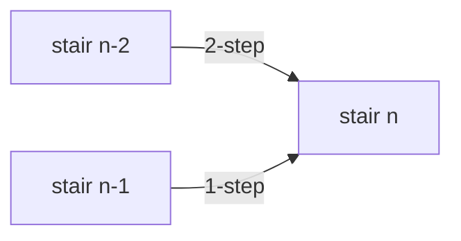

## Intuition

This is the problem interviewers actually ask. "You are at the bottom of a staircase with n stairs. Each move you may go up one stair or two stairs. How many different sequences of moves reach the top?"

Think about the **last move**. To stand on stair n, you came from stair n minus 1 (with a 1-step) or from stair n minus 2 (with a 2-step). There is no other way. So the number of ways to reach stair n is the number of ways to reach stair n minus 1, plus the number of ways to reach stair n minus 2. That is exactly the Fibonacci rule.

The starting values differ slightly from Fibonacci. There is one way to be at the bottom (do nothing), so ways(0) = 1. There is one way to reach stair 1 (one 1-step), so ways(1) = 1. Then ways(2) = 2 (two 1-steps, or one 2-step), ways(3) = 3, ways(4) = 5. The sequence 1, 1, 2, 3, 5, 8 is Fibonacci shifted by one place: ways(n) = F(n plus 1).

This is the real lesson of the whole problem: the interviewer rarely says "Fibonacci". You must see the recurrence in a story. The recognising steps are: define the state (stairs left, or the stair you stand on), think about the last choice, add up the cases.

## Walkthrough

Input: n = 5. List all sequences to see that the count is 8.

| Ending of the sequence | Ways to reach the stair before | Sequences of moves |
| --- | --- | --- |
| last move is a 1-step from stair 4 | ways(4) = 5 | 1111+1, 112+1, 121+1, 211+1, 22+1 |
| last move is a 2-step from stair 3 | ways(3) = 3 | 111+2, 12+2, 21+2 |

Here "1111+1" means the moves 1, 1, 1, 1 and then a final 1. The total is 5 plus 3, which is 8. The loop reaches the same answer:

| stair | 0 | 1 | 2 | 3 | 4 | 5 |
| --- | --- | --- | --- | --- | --- | --- |
| ways(stair) | 1 | 1 | 2 | 3 | 5 | 8 |

Read it as: only two moves can end on stair n, so the ways to arrive are the sum of the ways to be on those two stairs.

## Complexity

| | Value | Why |
| --- | --- | --- |
| Time | O(n) | One loop from stair 2 to stair n. |
| Space | O(1) | Two variables hold the last two answers. |

The answer grows like the Fibonacci numbers. ways(45) is 1,836,311,903, which still fits a 32-bit integer (this is why some sites limit n to 45). ways(46) is 2,971,215,073, which does not. In this repo all languages use 64-bit integers, and the test goes up to n equal to 50.

## Code explanation

1. **Base values.** `ways(0) = 1` and `ways(1) = 1` seed the window. Starting with 0 stairs as one way keeps the recurrence uniform.
2. **Add the two ways of arriving.** Each new count is the sum of the previous two. The old "current" becomes the new "previous".
3. **Return the current count.** For n of 0 or 1 the loop does not run and the answer is 1, which is correct.

The code is the Fibonacci loop of the previous approach with different starting values. If you already have `fib`, you can also write `climbStairs(n) = fib(n + 1)`, as long as you mention the shift.

| Language | Note |
| --- | --- |
| JavaScript / TypeScript | Array destructuring slides the window. Numbers are exact up to 2 to the power 53, enough for n up to 77. |
| Python | Tuple assignment; no overflow. |
| Go | `int64` and multiple assignment. |
| Java | `long` and a temporary variable. An `int` would overflow at n = 46. |
| C# | `long` and tuple deconstruction. |
| C++ | `long long` and a temporary variable. |

## Edge cases and tests

Fifteen values of n, each printing the number of ways. This approach has its own `expected.txt`, since the answers are shifted by one compared with Fibonacci.

| n | Output | What it checks |
| --- | --- | --- |
| 0 | `1` | One way to stay at the bottom: do nothing. |
| 1 | `1` | Only a 1-step. |
| 2 | `2` | Two 1-steps, or one 2-step. |
| 3, 4, 5, 6, 7, 8 | `3 5 8 13 21 34` | The start of the sequence. |
| 10, 15, 20 | `89`, `987`, `10946` | Medium values. |
| 30 | `1346269` | A value over a million. |
| 45 | `1836311903` | The largest answer that fits in a signed 32-bit integer. |
| 50 | `20365011074` | Needs a 64-bit integer. |

## When to use it (and when not)

**Use it** as the template for counting problems where each step has a small number of choices: climbing stairs with other step sizes, tiling a strip with dominoes, counting binary strings with no two ones in a row, and the number of ways to decode a digit string.

**Do not use it** when the steps can be large and varied, as in coin change: then you need a table over all amounts, because the window is no longer fixed. If n is huge, use matrix exponentiation.

## Interview notes

- Say: "The last move was a 1-step or a 2-step, so the ways to reach stair n are the ways to reach n minus 1 plus the ways to reach n minus 2. That is the Fibonacci rule."
- Name the base cases: "There is one way to reach stair 0 and one way to reach stair 1."
- Offer the generalisation: "With steps of 1, 2 or 3 I add the last three values."
- Likely follow-up: "What if some stairs are broken?" Set ways to 0 for those stairs. "What if each stair has a cost?" Use a minimum instead of a sum.
- Mistake to avoid: starting from ways(1) = 1 and ways(2) = 1, which is shifted by one and gives wrong answers.

## Real-life usage

The same counting recurrence appears when you count the ways to split a payment, the paths through a grid or a state machine, the number of ways to tile a floor, and the ways to parse an ambiguous input. Counting paths in a directed acyclic graph is done by adding up the counts of the nodes that lead into each node, which is this approach in general form.
