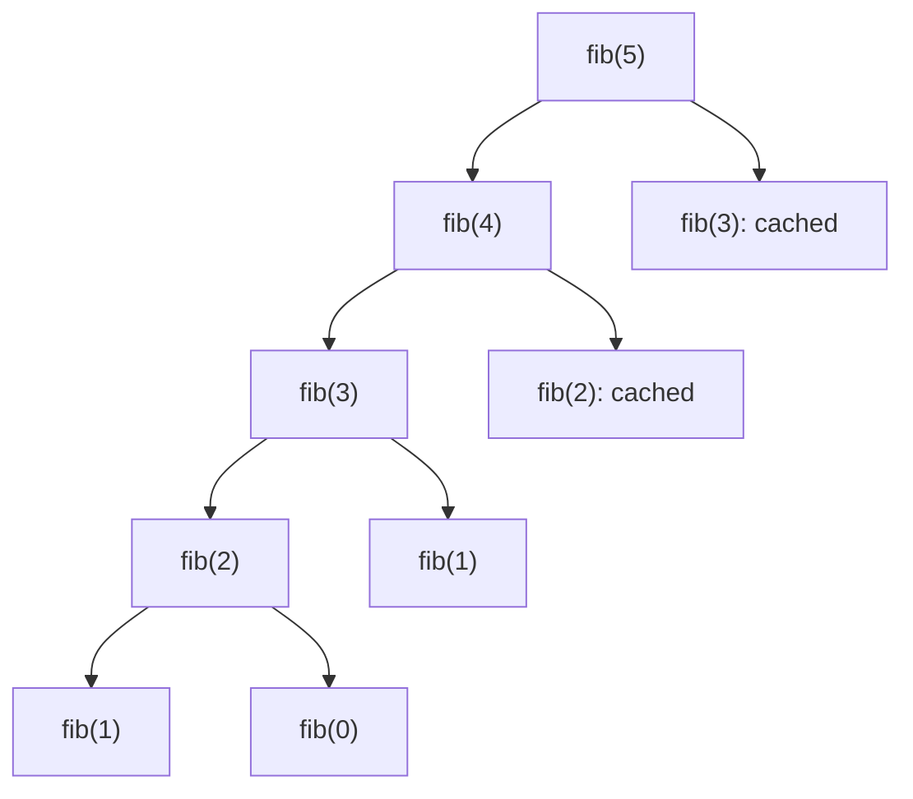

## Intuition

The naive version wastes time because it forgets. The fix is simple: keep a notebook. Before computing F(k), look in the notebook. If the answer is there, use it. If not, work it out, write it in the notebook, and then return it. This is called **memoisation** (from the word memo, a note to remember something; it is not a typo for memorisation).

The code keeps the same shape as the naive recursion, which is why it is the easiest way to speed up a recursive solution: you only add a lookup before the work and a store after it. It is **top-down**: you start from the big problem, F(n), and go down to the small ones only when you need them.

After the change, each value F(k) is computed exactly once, and every other call to F(k) is a quick lookup.

## Walkthrough

Input: n = 5. The table shows the order of events. A "hit" means the answer was found in the notebook.

| Step | Call | Notebook before | What happens |
| --- | --- | --- | --- |
| 1 | solve(5) | empty | not known, call solve(4) |
| 2 | solve(4) | empty | not known, call solve(3) |
| 3 | solve(3) | empty | not known, call solve(2) |
| 4 | solve(2) | empty | not known, call solve(1) |
| 5 | solve(1) | empty | base case, returns 1 |
| 6 | solve(0) | empty | base case, returns 0; then F(2) = 1 + 0 = 1 is stored |
| 7 | solve(1) | F(2) | base case, returns 1; then F(3) = 1 + 1 = 2 is stored |
| 8 | solve(2) | F(2), F(3) | hit, returns 1 immediately; then F(4) = 2 + 1 = 3 is stored |
| 9 | solve(3) | F(2), F(3), F(4) | hit, returns 2 immediately; then F(5) = 3 + 2 = 5 is stored |

The answer is 5. In steps 8 and 9 the notebook saved a whole subtree each time. In total there are 9 calls instead of the 15 of the naive version, and for larger n the difference is huge: for n = 30 there are 59 calls instead of 2,692,537. The number of calls is always 2n minus 1 for n of 2 or more.

Read it as the call tree with the cached calls marked. Every boxed call marked cached returns at once, and its subtree is never visited.

## Complexity

| | Value | Why |
| --- | --- | --- |
| Time | O(n) | There are only n plus 1 different subproblems, and each is solved once, with constant work for the addition and the lookup. |
| Space | O(n) | The notebook holds up to n answers, and the recursion goes n levels deep before the first answer comes back. |

A useful rule for any memoised function: **time equals the number of distinct states multiplied by the work per state**. Here that is n times a constant.

## Code explanation

1. **Base cases.** F(0) and F(1) are known and need no storing.
2. **Look in the notebook first.** If the answer for this k is there, return it and skip all the work below.
3. **Solve each subproblem at most once.** The two recursive calls are the same as in the naive version.
4. **Write the answer down.** The next caller who asks for F(k) will find it.

The cache is created inside `fib` and passed along (or captured by an inner function), so each call to `fib` starts with an empty notebook. Keeping it outside would share it across calls, which is faster for many calls and fine for a pure function, but it makes the code depend on hidden state.

| Language | Cache | Note |
| --- | --- | --- |
| JavaScript / TypeScript | `Map<number, number>` | An inner function closes over the map. In TypeScript, `memo.get` returns `number \| undefined`, so we compare with `undefined`, not truthiness (a stored 0 would look false). |
| Python | `dict` | The standard library has `functools.cache`: decorate the naive function and you get the same result in one line. We write the dictionary here to show how it works. |
| Go | `map[int]int64` | A recursive closure must be declared with `var solve func(int) int64` before it is assigned. |
| Java | `HashMap<Integer, Long>` | Do not use `computeIfAbsent` with a recursive call inside it: `HashMap` throws `ConcurrentModificationException` (Java 9 and later). Use `get` and `put` as here. |
| C# | `Dictionary<int, long>` | A local function captures the dictionary. `TryGetValue` combines the check and the read. |
| C++ | `std::unordered_map<int, long long>` | `find` is used instead of `operator[]` for the check, since `operator[]` would insert an empty entry. |

## Edge cases and tests

The same 22 values of n as tabulation and the space-optimised version. They go up to 50, where the result needs more than 32 bits.

| n | Output | What it checks |
| --- | --- | --- |
| 0, 1 | `0`, `1` | The base cases never touch the notebook. |
| 2 | `1` | The first value that is stored. |
| 3 to 10, 12, 15 | `2 3 5 8 13 21 34 55 144 610` | The start of the sequence. |
| 20, 25, 30, 35, 40 | `6765`, `75025`, `832040`, `9227465`, `102334155` | Values the naive version cannot reach in reasonable time at 40. |
| 45 | `1134903170` | Close to the 32-bit limit. |
| 46 | `1836311903` | The last Fibonacci number that fits in a 32-bit signed integer. |
| 47 | `2971215073` | The first one that does not. A 32-bit type would give a wrong result. |
| 50 | `12586269025` | A comfortable test for 64-bit types. |

## When to use it (and when not)

**Use it** when you have a recursive solution that is correct but slow because of repeated subproblems, and you need the speed-up quickly. It is also the best choice when only some of the subproblems are needed, because it never computes the ones nobody asks for.

**Do not use it** for very large n in languages with a small recursion limit, because it still goes n levels deep. Use the loop. Also, a hash map is heavier than an array, so tabulation is usually faster when all subproblems are needed.

## Interview notes

- Say: "I add a notebook to the recursion. Check it first, store the answer last. Now each value is computed once."
- Say the cost as a rule: "Distinct states times the work per state: n times a constant."
- Mention the recursion depth: "It is still n levels deep, so I would use a loop for very large n."
- Likely follow-up: "Can you remove the recursion?" Tabulation.
- Mistake to avoid: a falsy check on the cached value. A stored answer of 0 (F(0)) must not look like "missing". Use `has`, `in`, `ok` or `TryGetValue`.

## Real-life usage

Memoisation is built into many tools: `functools.cache` in Python, selector libraries in Redux, `useMemo` in React, compilers that cache the type of an expression, and build systems that cache outputs by input hash. Anywhere a pure function is called again with the same arguments, a memo table saves the repeated work.
