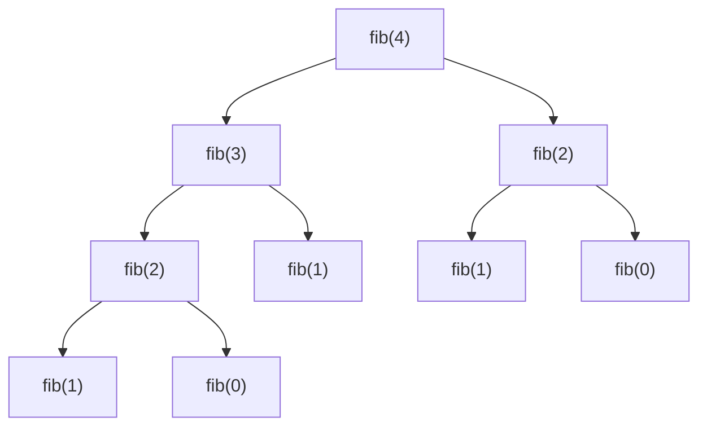

## Intuition

The definition of the Fibonacci numbers is already a recipe: to get F(n), add F(n minus 1) and F(n minus 2). The first two numbers, F(0) = 0 and F(1) = 1, are given. So we can write a function that calls itself, which is called **recursion**.

It works, and it is the clearest code you can write. The problem is hidden in the shape of the calls. To compute F(5) the function asks for F(4) and F(3). To compute F(4) it asks for F(3) and F(2). So F(3) is computed twice, once for F(5) and once for F(4). The same happens deeper down, and the repeats multiply. The function has no memory: each time it is asked for F(3) it works it out again from scratch, like a person who forgets the answer to a question as soon as they have said it.

## Walkthrough

The call tree for F(4). Each box is one call. Look for the repeated boxes.

Read it from the top: fib(4) needs fib(3) and fib(2). The box fib(2) appears twice, in the left and the right branch, and each one is worked out separately. There are 9 calls to compute F(4), though only 5 different values (F(0) to F(4)) are needed.

The values come back up the tree: fib(1) is 1 and fib(0) is 0, so the left fib(2) is 1. Then fib(3) is that 1 plus fib(1) which is 1, giving 2. The right fib(2) is 1 again. Finally fib(4) is 2 plus 1, which is 3.

How many calls are needed as n grows:

| n | F(n) | Number of calls |
| --- | --- | --- |
| 5 | 5 | 15 |
| 10 | 55 | 177 |
| 20 | 6,765 | 21,891 |
| 30 | 832,040 | 2,692,537 |
| 40 | 102,334,155 | 331,160,281 |
| 50 | 12,586,269,025 | about 40 billion |

The number of calls is about twice the answer, so it grows by a factor of about 1.6 with every step of n.

## Complexity

| | Value | Why |
| --- | --- | --- |
| Time | O(2^n) | Each call makes two more calls, so the tree roughly doubles in size per level. A tighter bound is about 1.618 to the power n, the golden ratio, which is the true growth rate of the number of calls. Both are exponential. |
| Space | O(n) | The calls wait on the call stack, one per level, and the deepest chain goes from n down to 1, which is n levels. |

There is no best or worst case: every call for n of 2 or more splits in two, so the cost depends only on n. Adding 10 to n multiplies the time by about 120. If F(30) takes a fraction of a second, F(50) would take hours.

## Code explanation

1. **Base cases.** For n of 0 or 1 the answer is n itself. This stops the recursion, and it covers both F(0) = 0 and F(1) = 1 in one line.
2. **Two smaller problems.** Add the answers for n minus 1 and n minus 2. Both are computed from scratch.

| Language | Return type | Note |
| --- | --- | --- |
| JavaScript / TypeScript | `number` | Exact up to F(78). Beyond that precision is lost silently; use `BigInt`. |
| Python | `int` | Never overflows. The recursion limit of 1000 is not reached here because n is at most 30. |
| Go | `int64` | Wraps around silently on overflow. `int` is 64 bits on modern machines, but `int64` says what we mean. |
| Java | `long` | `int` would overflow at F(47). |
| C# | `long` | Same as Java. Arithmetic is unchecked by default. |
| C++ | `long long` | At least 64 bits. Signed overflow would be undefined behaviour. |

The test inputs stay at n of 30 or less so that the program finishes in a fraction of a second in every language.

## Edge cases and tests

Seventeen values of n, each printing F(n). This approach has its own `expected.txt` because the others also test larger n.

| n | Output | What it checks |
| --- | --- | --- |
| 0 | `0` | The first base case. |
| 1 | `1` | The second base case. |
| 2, 3, 4, 5, 6, 7, 8, 9, 10 | `1 2 3 5 8 13 21 34 55` | The start of the sequence, one by one. |
| 12 | `144` | A value above ten. |
| 15, 20 | `610`, `6765` | Medium values. |
| 25, 27, 30 | `75025`, `196418`, `832040` | The largest inputs: 30 needs about 2.7 million calls. |

## When to use it (and when not)

**Use it** to show the definition and as a reference to test faster versions against, for small n.

**Do not use it** for anything real. The cost doubles with every extra step of n. The next approaches give the same answers in linear time.

## Interview notes

- Say: "This is a direct translation of the definition. It is correct, but it recomputes the same values, so it is exponential."
- Draw the call tree for F(4) or F(5) and point at the repeated calls. This is the moment the interviewer waits for.
- Name the two properties out loud: "The subproblems overlap, and the answer is built from smaller answers, so dynamic programming applies."
- Likely follow-up: "How would you speed it up?" Memoisation.
- Mistake to avoid: saying the time is O(n). It is exponential.

## Real-life usage

Plain recursion is the right tool when the subproblems do not overlap: walking a folder tree, traversing a binary tree, merge sort, quick sort. When they do overlap, as here, real code adds a cache. The naive version of Fibonacci is mostly used in teaching and in benchmarks that measure how fast a language handles function calls.
