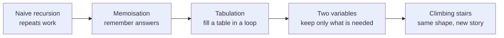
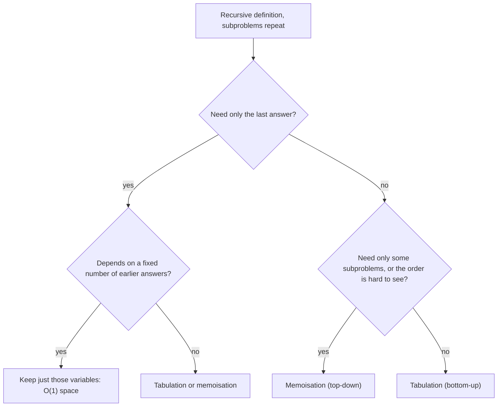

## How interviewers ask it

**The classic wording.** "Write a function that returns the n-th Fibonacci number." The Fibonacci sequence starts with 0 and 1, and every next number is the sum of the two before it: 0, 1, 1, 2, 3, 5, 8, 13, 21, 34, and so on. We write F(0) = 0, F(1) = 1 and F(n) = F(n minus 1) plus F(n minus 2).

The question is rarely about Fibonacci itself. It is a doorway to **dynamic programming**, which means solving a big problem by solving smaller versions of it and remembering the answers so that no small problem is ever solved twice. The interviewer watches whether you notice that the simple recursive solution repeats work, and whether you can fix it.

**The most common disguise: climbing stairs.** "You are climbing a staircase with n steps. Each time you can climb 1 or 2 steps. In how many different ways can you reach the top?" The answer for n stairs is the Fibonacci number F(n plus 1), because the last move was either a 1-step from stair n minus 1 or a 2-step from stair n minus 2. So ways(n) = ways(n minus 1) + ways(n minus 2). The fifth approach in this problem solves exactly this.

**Common variations:**

- *Fast Fibonacci for huge n.* "Compute F(1,000,000) modulo a prime." (matrix power or fast doubling, in O(log n) steps)
- *Tribonacci and k-step stairs.* "You may climb 1, 2 or 3 steps." (sum of the last three or last k answers)
- *Minimum cost climbing stairs.* "Each stair has a cost; find the cheapest way to the top."
- *House robber.* "You cannot rob two neighbouring houses; maximise the money." (the same two-variable rolling window)
- *Decode ways, domino tiling, number of binary strings without two ones in a row.* (each one is a Fibonacci-like recurrence)
- *Print the first n numbers*, or *return a generator that never ends*.

**What to clarify before you code:**

| Question to ask | Why it matters |
| --- | --- |
| Does the sequence start at F(0) = 0 or F(1) = 1? | Some books start with 1, 1. The index shifts by one. |
| What is the range of n? | Decides the approach and the integer type. |
| What happens for negative n? | Usually not allowed. Say so, or return an error. |
| How big can the answer get? | F(47) already passes the 32-bit signed integer limit. F(93) passes the 64-bit one. |
| Is the answer needed modulo a number? | Then you can keep the numbers small and use fast methods for huge n. |
| Called once or many times? | Many calls favour a shared table or cache. |

A good answer starts from the definition, points out that the naive recursion is exponential and why, fixes it with memoisation or a loop, reduces the memory to two variables, and states the cost of each step out loud.

In this repo the programs print one number per test case. The slow naive approach uses only small n (up to 30). The others go up to n equal to 50, where the result no longer fits in 32 bits, so 64-bit integers are required. The climbing stairs program prints the number of ways for n from 0 to 50.

## Real-life scenarios

| Scenario | What is actually used | Why |
| --- | --- | --- |
| Shortest route, cheapest plan, best schedule | Dynamic programming over states (shortest path algorithms, route planners) | The best route to a place is built from the best routes to the places just before it. |
| Spell check and "did you mean" suggestions | Edit distance computed with a table | Each cell is the best answer for two shorter prefixes of the words. |
| `diff` and `git diff` | Longest common subsequence with a table | It finds the largest unchanged part of two files and reports the rest as changes. |
| Text justification, line breaking in word processors and TeX | Dynamic programming over where to break lines | The best layout for the first k words is reused when placing the next line. |
| Speech recognition and gene alignment | The Viterbi algorithm and sequence alignment | Both are tables where each cell depends on a few earlier cells. |
| Caching an expensive pure function (a price calculation, a permission check) | Memoisation: a map from input to result, or `functools.cache` | The same inputs come back often, so recomputing is waste. |
| Build tools such as Make, Bazel, Gradle | A cache of results keyed by inputs | A target that has been built with the same inputs is not built again. |
| React `useMemo` and selector libraries | Memoisation of the last result | The function is not run again if its inputs did not change. |
| Resource and budget planning (knapsack) | Dynamic programming over weight and value | Choose the best set of items under a limit by building on smaller limits. |

Whenever you see a result that is reused because its inputs repeat, you are looking at the idea behind this problem.

## Approaches compared

| Approach | Time | Extra space | Style | Use when |
| --- | --- | --- | --- | --- |
| 1. Naive recursion | O(2^n) | O(n) call stack | Top-down, no memory | Never for real work. It shows the problem. |
| 2. Memoisation | O(n) | O(n) table plus O(n) call stack | Top-down, with a cache | When the recursion is natural and only some subproblems are needed. |
| 3. Tabulation | O(n) | O(n) table | Bottom-up, a loop | When you need all values up to n and want no recursion. |
| 4. Space-optimised | O(n) | O(1) | Bottom-up, two variables | The final answer in an interview. |
| 5. Climbing stairs | O(n) | O(1) | The same idea on a new problem | To show you can recognise the pattern. |

Read it as the ladder every dynamic programming solution climbs: first correct, then remembered, then iterative, then small.

**Two key ideas.** A problem is a good fit for dynamic programming when it has both of these:

- **Overlapping subproblems.** The same smaller problem appears many times. In the naive Fibonacci tree F(2) is computed again and again.
- **Optimal substructure.** The answer for the big problem is built from the answers to smaller ones. For Fibonacci, it is just a sum.

If subproblems do not overlap (for example merge sort splits a list into independent halves), plain divide and conquer is enough and a table does not help.

## How to choose

Start at the top and answer each question. In an interview, start from the recursive idea, add memoisation, convert to a loop, and then shrink the memory.

**How to recognise a dynamic programming problem.** Use this checklist.

1. The question asks for a **count** ("how many ways"), a **best value** ("minimum cost", "longest", "maximum profit") or a **yes or no** ("is it possible to reach this sum?").
2. You make a **sequence of choices**, and each choice leaves a smaller problem of the same kind.
3. A brute-force solution would try all combinations, which is exponential, and the **same sub-situation shows up again and again**.
4. The state can be described by a **few numbers** (an index, a remaining amount, a position in two strings).
5. The best answer for a state uses only the best answers for smaller states (optimal substructure).

Then follow the recipe: define the state in words, write the recurrence (how a state is built from smaller ones), set the base cases, decide the order of filling (smaller states first), and finally check whether you only need the last few states, which lets you drop the table.

## Built-ins and the standard library

Dynamic programming is a technique, not a function. What the languages offer are tools for caching and for big numbers. The table shows what to use and the pitfalls.

| Language | Memoisation tool | Big or checked integers | Pitfall |
| --- | --- | --- | --- |
| JavaScript / TypeScript | A `Map`, or a small `memoize` helper. No built-in. | `BigInt` for exact large integers. | The `number` type is a 64-bit float, exact only up to 2 to the power 53. F(79) and beyond lose precision silently. `BigInt` and `number` cannot be mixed in one expression. |
| Python | `functools.cache` (3.9 and later) or `functools.lru_cache` | Integers have no limit. | The default recursion limit is 1000, so memoised recursion fails for n around a thousand. Use the loop. `lru_cache` keeps arguments alive, so be careful with large inputs. |
| Go | A `map` or a slice, written by hand. | `int64`, and `math/big` for big values. | Signed integer overflow wraps around silently. There is no built-in cache. |
| Java | `HashMap`, or an array | `long`, `BigInteger`, `Math.addExact` (throws on overflow). | Calling `map.computeIfAbsent` recursively on a `HashMap` throws `ConcurrentModificationException` (Java 9 and later). Overflow wraps silently. |
| C# | `Dictionary`, or an array | `long`, `System.Numerics.BigInteger`, `checked` arithmetic. | Arithmetic is unchecked by default, so `int` overflow wraps silently. A very deep recursion ends the process. |
| C++ | `std::unordered_map`, `std::vector` | `long long`, `unsigned long long`. No big integer in the standard library. | Signed overflow is undefined behaviour, not a wrap. Deep recursion can crash. |

**Hand-write or use a library?** Use a built-in cache when you have one and the function is pure (same input, same output, no side effects). Write the table yourself when you need control over memory, or when an interviewer asks you to.

## Common mistakes

- **Using the naive recursion for large n.** F(40) already takes hundreds of millions of calls. F(50) would take tens of billions.
- **Forgetting the base cases.** Without F(0) and F(1), the recursion never stops.
- **Off-by-one in the index.** F(1) = 1 and F(2) = 1. For climbing stairs, ways(1) = 1 and ways(2) = 2, so ways(n) = F(n plus 1).
- **Integer overflow.** F(47) is 2,971,215,073, which is larger than the 32-bit signed integer limit of 2,147,483,647. Use 64-bit integers in Java, C#, C++ and Go. F(93) overflows even 64 bits.
- **JavaScript precision.** Numbers above 2 to the power 53 are not exact. Use `BigInt` beyond F(78).
- **A shared cache that is never cleared, or that is cleared too often.** A global memo that leaks across calls is fine for a pure function, but a bug if the function depends on other input.
- **Mutable default arguments in Python.** `def fib(n, memo={})` works by accident because the dictionary is shared across calls; it hides bugs. Pass the memo in explicitly or use a decorator.
- **Recursion depth.** Memoised recursion still goes n levels deep before it returns. For n around ten thousand or more, use the loop.
- **Allocating a table you do not need.** If each value depends only on the last two, two variables are enough.

## How to answer in an interview

1. **Clarify.** "Does the sequence start at 0? What is the largest n? What happens for negative n? How large can the result be?"
2. **Give examples.** "F(0) is 0, F(1) is 1, F(2) is 1, F(5) is 5, F(10) is 55."
3. **Say the simple approach and its cost.** "I translate the definition into recursion. It is correct, but it recomputes the same values again and again, so the time is exponential, about 1.6 to the power n."
4. **Show why.** Draw the call tree for F(5) and point at the repeated F(3) and F(2).
5. **Improve it with memoisation.** "I store each answer in a map the first time I compute it. Now every value is computed once: O(n) time and O(n) space."
6. **Convert to a loop.** "Bottom-up, I fill a table from F(0) upwards. That removes the recursion and its stack."
7. **Shrink the memory.** "Each value only needs the previous two, so two variables are enough: O(1) space."
8. **Test aloud.** n equal to 0, 1, 2, and a bigger one such as 10. Mention overflow and the integer type you chose.
9. **Connect to the pattern.** "Climbing stairs has the same recurrence, so it is the same code."
10. **Mention the fast method.** "For a huge n there is an O(log n) method using matrix exponentiation or fast doubling."

## Follow-up questions

- **How fast can you compute F(n)?** In O(log n) arithmetic steps using fast doubling or matrix exponentiation. The matrix with rows 1 1 and 1 0 raised to the n-th power contains F(n). With big numbers the cost of the multiplications grows, but for answers modulo a fixed number it is truly logarithmic.
- **Is there a closed formula?** Yes, Binet's formula uses the golden ratio, about 1.618. With floating point numbers it becomes inaccurate for n above about 70, so it is not used for exact answers.
- **Why is the naive recursion exponential?** Each call makes two more calls, and the number of calls for F(n) is about twice F(n plus 1). The sequence grows by the golden ratio each step, so the call count does too.
- **What is the difference between memoisation and tabulation?** Memoisation is top-down: start from the big problem, recurse, and cache. Tabulation is bottom-up: start from the base cases and fill a table in order. Memoisation solves only the subproblems that are needed. Tabulation avoids recursion and is usually faster and easier to optimise for space.
- **When can you drop the table?** When each state depends only on a fixed number of recent states. The window slides along, and the old values are forgotten.
- **What is the answer for climbing stairs with steps of 1, 2 or 3?** ways(n) = ways(n minus 1) + ways(n minus 2) + ways(n minus 3), with ways(0) = 1. Use three variables.
- **How do you compute it modulo 1,000,000,007?** Take the remainder after each addition. The numbers stay small, so no overflow occurs, and fast doubling still applies.
- **What if the stairs have a cost?** Let best(i) be the lowest cost to reach stair i: it is the cost of stair i plus the smaller of best(i minus 1) and best(i minus 2). Same shape, with a minimum instead of a sum.
- **Is dynamic programming just caching?** Caching is the tool. The skill is finding the state and the recurrence so that there are only a small number of distinct subproblems.

## Practice

- Climbing stairs and min cost climbing stairs.
- House robber (I and II).
- N-th Tribonacci number.
- Decode ways (how many ways to read a digit string as letters).
- Coin change (fewest coins, and number of ways).
- Longest increasing subsequence, longest common subsequence, edit distance.
- 0/1 knapsack and partition equal subset sum.
- Unique paths in a grid and minimum path sum.
