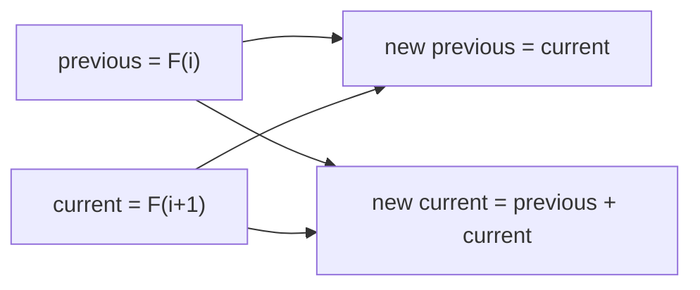

## Intuition

Look at the table from the tabulation approach. When we compute F(10), do we still need F(3)? No. Each cell depends only on the two cells just before it. Everything older is dead weight. So instead of a whole table, keep only a **window of two numbers** and slide it forward.

Think of two people carrying a ruler along a road: all that matters at any moment is the two marks they hold. After each step the one behind moves ahead of the other. Here the "previous" number takes the value of the "current" one, and the "current" number becomes the sum of both.

This is the last step of the usual dynamic programming ladder: first make it correct, then fast, then small. The idea works whenever each state depends on a fixed number of recent states. The same trick shrinks the grid table in many problems from two dimensions to one row.

## Walkthrough

Input: n = 8. Two variables, `previous` and `current`, start as F(0) and F(1). Each round slides the window.

| Round | previous before | current before | New previous | New current |
| --- | --- | --- | --- | --- |
| start | | | 0 (F0) | 1 (F1) |
| 1 | 0 | 1 | 1 (F1) | 1 (F2) |
| 2 | 1 | 1 | 1 (F2) | 2 (F3) |
| 3 | 1 | 2 | 2 (F3) | 3 (F4) |
| 4 | 2 | 3 | 3 (F4) | 5 (F5) |
| 5 | 3 | 5 | 5 (F5) | 8 (F6) |
| 6 | 5 | 8 | 8 (F6) | 13 (F7) |
| 7 | 8 | 13 | 13 (F7) | 21 (F8) |
| 8 | 13 | 21 | 21 (F8) | 34 (F9) |

After 8 rounds, `previous` is F(8), which is 21. We return `previous`, not `current`. This also makes n = 0 work with no special case: the loop does not run and `previous` is still F(0) = 0.

Read it as one round: the old current becomes the new previous, and the sum of the old pair becomes the new current.

## Complexity

| | Value | Why |
| --- | --- | --- |
| Time | O(n) | One loop with n rounds, each a single addition and two assignments. |
| Space | O(1) | Two variables, whatever the value of n. |

The values themselves grow (F(n) has about 0.7 times n binary digits), so for big numbers an addition is not constant time. For 64-bit integers this does not matter, because the result must fit anyway: F(92) is the largest value that fits in a signed 64-bit integer.

## Code explanation

1. **Slide the window.** The new pair is (current, previous plus current). A simultaneous assignment (tuple or destructuring in JavaScript, Python, Go and C#) updates both without a temporary variable. In Java and C++ a temporary `next` is used, since they have no simultaneous assignment for plain variables. The order matters: if you wrote `previous = current` first and then used `previous` in the sum, the sum would be wrong.
2. **Return `previous`.** After n rounds it holds F(n).

| Language | How both variables change at once | Note |
| --- | --- | --- |
| JavaScript / TypeScript | Array destructuring: `[a, b] = [b, a + b]` | The right side is built before assigning. A line before it must end with a semicolon, because a line starting with `[` can continue the previous line. |
| Python | Tuple assignment: `a, b = b, a + b` | The idiomatic form. |
| Go | Multiple assignment: `a, b = b, a+b` | Evaluated before assigning. |
| Java | A temporary variable `next` | Java has no tuple assignment. |
| C# | Tuple deconstruction: `(a, b) = (b, a + b)` | Available since C# 7. |
| C++ | A temporary variable `next` | `std::tie(a, b) = std::make_pair(b, a + b)` also works but is less clear. |

## Edge cases and tests

The same 22 values of n as the memoisation and tabulation approaches.

| n | Output | What it checks |
| --- | --- | --- |
| 0 | `0` | The loop does not run and `previous` is 0. |
| 1 | `1` | One round: `previous` becomes 1. |
| 2 | `1` | Two rounds. |
| 10, 20, 30, 40 | `55`, `6765`, `832040`, `102334155` | Ordinary values. |
| 45, 46 | `1134903170`, `1836311903` | Just below the 32-bit limit. |
| 47 | `2971215073` | Above the 32-bit limit: needs a 64-bit variable. |
| 50 | `12586269025` | A comfortable test for 64-bit types. |

## When to use it (and when not)

**Use it** as your final answer for Fibonacci and for any recurrence that depends on a fixed number of recent values: climbing stairs, house robber, tribonacci, and the one-row version of many grid problems.

**Do not use it** when you need to rebuild the choices (for example to print which items were chosen in a knapsack): that needs the whole table to trace back. Also not when the state depends on far-away earlier values.

## Interview notes

- Say: "Each value depends only on the previous two, so two variables replace the table: O(1) space."
- Explain the slide: "The old current becomes the new previous, and the sum becomes the new current."
- Mention overflow and the type: "I use a 64-bit integer; F(92) is the largest that fits."
- Likely follow-up: "Can you do better than linear time?" Matrix exponentiation or fast doubling gives O(log n) steps.
- Mistake to avoid: updating one variable before the other without a temporary, which corrupts the sum.

## Real-life usage

Rolling-window computations appear in streaming code: moving averages, running totals, sliding minimum, and online algorithms that process a long input one item at a time with constant memory. In dynamic programming, keeping only the previous row of a table is the standard way to cut memory for edit distance and longest common subsequence from quadratic to linear.
