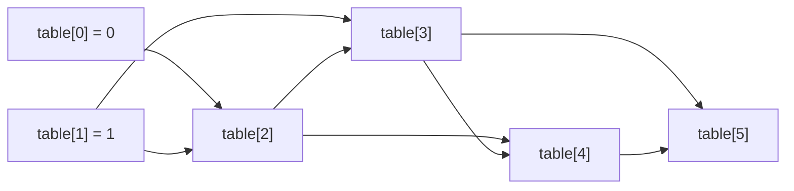

## Intuition

Memoisation starts at the top and works down, remembering as it goes. **Tabulation** turns this around: start at the bottom and build up. We know F(0) and F(1). From these we can compute F(2). From F(1) and F(2) we compute F(3), and so on. We write each answer into a **table** (an array), and each new cell is computed from cells that were filled earlier.

It is like building a staircase from the ground: each step rests on the two below it. We never need to ask "have I solved this before?", because we solve the problems in an order that guarantees every needed answer is already there. This is called **bottom-up** dynamic programming.

The order of filling matters. Here the order is simply 2, 3, 4, up to n, because F(i) depends only on smaller indexes. In harder problems (a grid, two strings) choosing the order is the real work.

## Walkthrough

Input: n = 8. Fill the table from left to right.

| Index i | 0 | 1 | 2 | 3 | 4 | 5 | 6 | 7 | 8 |
| --- | --- | --- | --- | --- | --- | --- | --- | --- | --- |
| Table[i] | 0 | 1 | 1 | 2 | 3 | 5 | 8 | 13 | 21 |
| Computed as | given | given | 1 + 0 | 1 + 1 | 2 + 1 | 3 + 2 | 5 + 3 | 8 + 5 | 13 + 8 |

The answer is the last cell, 21. Each cell takes one addition, and there are n minus 1 additions.

Read it as: every cell is the sum of the two cells that point to it, and the arrows only go forward, so a left-to-right loop is a valid order.

## Complexity

| | Value | Why |
| --- | --- | --- |
| Time | O(n) | One loop with n minus 1 steps, each a single addition. |
| Space | O(n) | The table has n plus 1 cells. |

There is no recursion, so there is no call stack to overflow, and the loop is fast because arrays are laid out contiguously in memory. It is the most common shape of a dynamic programming solution in production code.

## Code explanation

1. **Tiny inputs.** For n of 0 or 1, the answer is n, and creating a table of size 2 is wasted. It also avoids writing to `table[1]` when the table has only one cell.
2. **Create the table.** It has n plus 1 cells, because the indexes go from 0 to n. Everything is 0 to start with; only `table[1]` is set to 1.
3. **Fill in order.** Each cell is the sum of the two before it. Both are already filled.
4. **Return the last cell.**

| Language | Table | Note |
| --- | --- | --- |
| JavaScript / TypeScript | `new Array(n + 1).fill(0)` | Without `fill`, an array has holes, and adding to a hole gives `NaN`. |
| Python | `[0] * (n + 1)` | A list of integers. Python integers never overflow. |
| Go | `make([]int64, n+1)` | The zero value is 0, so no explicit fill is needed. |
| Java | `new long[n + 1]` | Arrays are zero-filled by default. |
| C# | `new long[n + 1]` | Zero-filled by default as well. |
| C++ | `std::vector<long long> table(n + 1, 0)` | The second argument is the fill value. |

## Edge cases and tests

The same 22 values of n as the memoisation approach.

| n | Output | What it checks |
| --- | --- | --- |
| 0 | `0` | The early return: a table of size 1 would break `table[1] = 1`. |
| 1 | `1` | The early return for the second base case. |
| 2 | `1` | The smallest n that uses the loop. |
| 10, 20, 30 | `55`, `6765`, `832040` | Ordinary values. |
| 46 | `1836311903` | The last Fibonacci number that fits in 32 bits. |
| 47 | `2971215073` | The first one that does not: needs a 64-bit table. |
| 50 | `12586269025` | A comfortable test for 64-bit types. |

## When to use it (and when not)

**Use it** when you need the answers for all sizes up to n (for example to print the whole sequence), when n is large, or when the recursion depth is a concern. It is easy to turn into the space-optimised version.

**Do not use it** when only a few of the subproblems matter and most of the table would be wasted. A memoised recursion computes only what it needs. Also, for Fibonacci itself the table is not needed at all, as the next approach shows.

## Interview notes

- Say: "I fill a table from the smallest case up, so every answer I need is already there."
- Name the three parts: "The state is the index, the recurrence is the sum of the previous two, and the base cases are 0 and 1."
- Say the cost: "Linear time, linear space, no recursion."
- Likely follow-up: "Can you use less memory?" Yes, only the last two values are used.
- Mistake to avoid: a table of size n instead of n plus 1, which fails on the last index.

## Real-life usage

Bottom-up tables are the standard form of dynamic programming in production: edit distance for spell checkers, longest common subsequence in `diff`, the Viterbi algorithm in speech and tagging systems, sequence alignment in bioinformatics, and knapsack-style planners. They are easy for a compiler to optimise and have predictable memory use.
