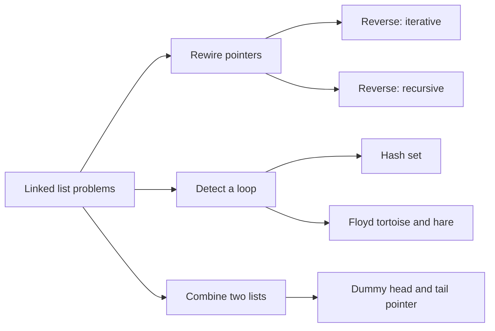
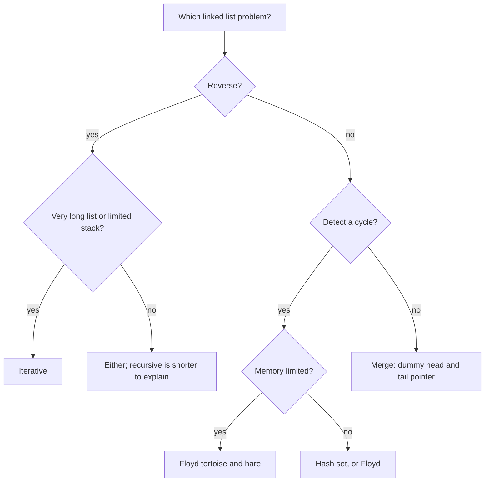
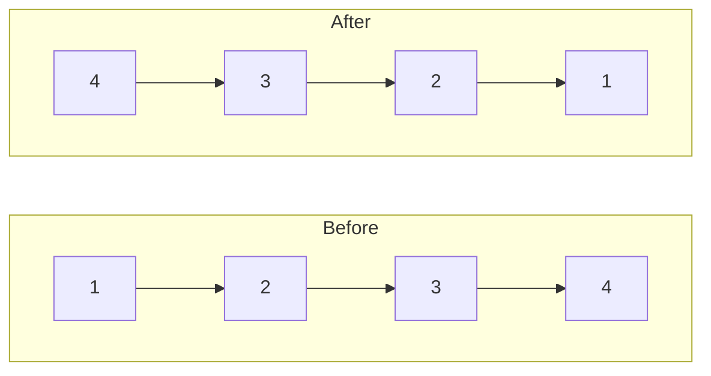
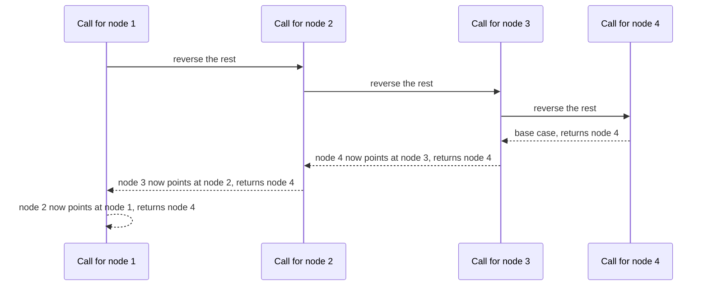
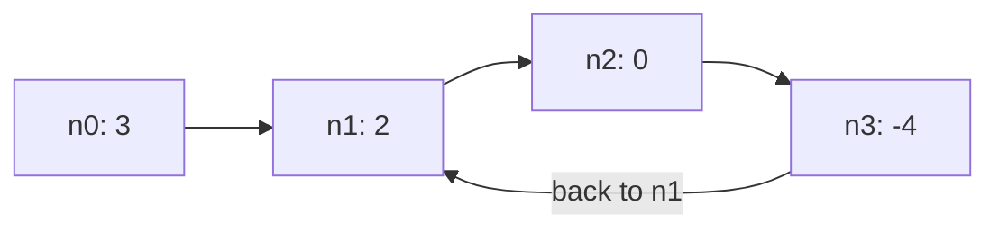
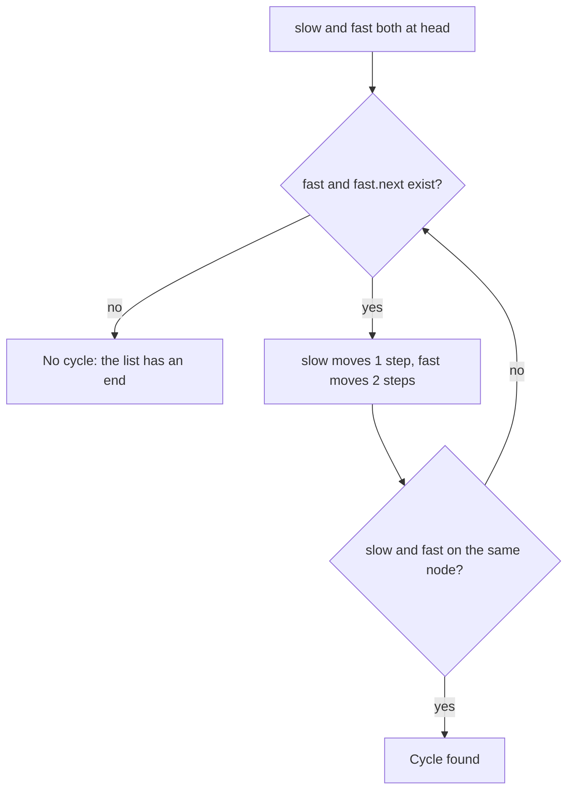
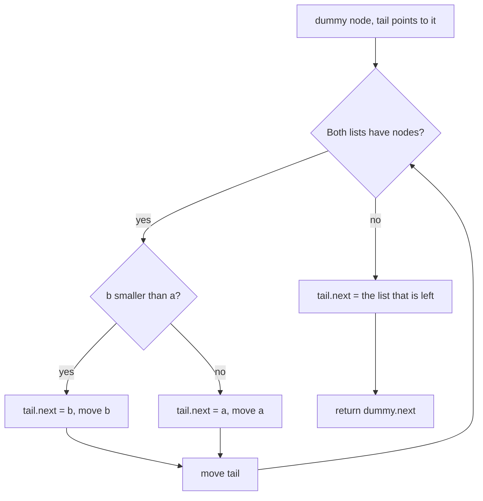

# Linked list

[← All problems](../README.md)

> Reverse a list, find a cycle and merge two sorted lists: the classic pointer problems that teach you to rewire nodes without losing the rest of the list.

**Level:** basic · **Tags:** linked-list, pointers, two-pointers, recursion, complexity

**Related interview questions:**

- [Golang: What are pointers in Go, and when should you use them?](../../questions/golang.md)
- [Golang: Value receiver vs pointer receiver: how do you choose?](../../questions/golang.md)
- [Golang: Why is an interface holding a nil pointer not equal to nil?](../../questions/golang.md)
- [Golang: What is escape analysis? How does Go decide between stack and heap?](../../questions/golang.md)
- [JavaScript: How would you implement an LRU cache and a `pipe` function?](../../questions/javascript.md)
- [Golang: Design a thread-safe LRU cache with TTL in Go.](../../questions/golang.md)

## How interviewers ask it

**Three classic questions on a singly linked list.** A singly linked list is a chain of nodes. Each node holds a value and a pointer to the next node. The last node points to nothing. You are given only the first node, called the head.

- *Reverse it.* "Reverse a singly linked list and return the new head."
- *Find a cycle.* "Given the head of a linked list, decide whether it contains a cycle, which means some node can be reached again by following next pointers." A follow-up asks you to do it with constant extra memory.
- *Merge two sorted lists.* "Merge two sorted linked lists into one sorted list and return its head."

**Common variations:**

- Reverse only a part of the list, or reverse in groups of k nodes.
- Find where the cycle starts, or how long the cycle is.
- Find the middle node, or the n-th node from the end (two pointers again).
- Check whether a list is a palindrome (find the middle, reverse the second half, compare).
- Merge k sorted lists (a heap), or sort a linked list (merge sort).
- Remove duplicates, remove a node by value, or detect where two lists meet.

**What to clarify before you code:**

| Question to ask | Why it matters |
| --- | --- |
| Is it singly or doubly linked? | Doubly linked lists let you walk backwards, which changes reversal and deletion. |
| Can the list be empty or have one node? | These are the usual edge cases. The head can be null. |
| May I change the nodes, or must I build new ones? | Re-pointing nodes in place uses constant memory. Copying uses linear memory. |
| Can the list have a cycle? | If it can, loops that walk to the end may never finish. |
| Are the values sorted, and can they repeat? | Needed for merging, and for the order of equal values (stability). |
| Do I return the new head? | After a reversal or a merge, the head changes. |

A good answer draws the nodes and arrows on paper, keeps a pointer to the rest of the list before cutting a link, and names the empty list and the single node as test cases.

In this repo every program builds the list from an array, runs the function, and prints the values separated by spaces. An empty list prints the word `empty`. The cycle programs print `true` or `false`. A cycle is described by a position: the tail node is linked back to the node at that position, or to nothing when the position is minus one.

## Real-life scenarios

| Scenario | What is actually used | Why |
| --- | --- | --- |
| An LRU cache (browser cache, database buffer pool, Redis eviction) | A hash map plus a doubly linked list | Moving a node to the front and removing the last node are constant-time pointer updates. |
| Undo and redo history in an editor, and the browser back button | A doubly linked list or two stacks | You step to the previous or next state in constant time. |
| A music player playlist, or a carousel of images | A circular linked list | The last item points back to the first, so "next" never ends. |
| The free list in a memory allocator | A linked list of free blocks | Blocks are linked in place, so no extra memory is needed to track them. |
| Hash table buckets that handle collisions by chaining | A short linked list per bucket | Inserting at the head is constant time. |
| Merging sorted log files or sorted streams from many servers | The merge step of merge sort, often with a heap for k inputs | It reads each input once, in order, with almost no memory. |
| Git history | A graph of commits, where each commit points to its parent | Walking the history is following pointers, and a rebase rewires them. |
| Finding a deadlock or an endless loop in a chain of references | Cycle detection on a graph, with the tortoise and hare idea | Following "who waits for whom" must not loop forever. |
| Operating system process and task queues, and the Linux kernel `list_head` | Intrusive doubly linked lists | The node is embedded in the object, so there is no separate allocation. |

In everyday application code you almost always use an array-like structure (`Array`, `list`, slice, `ArrayList`, `List<T>`, `vector`) because it is faster in practice. Linked lists matter for the cases above and for interviews, where they test whether you can handle pointers.

## Approaches compared

| Approach | Problem | Time | Extra space | Changes the list? | Use when |
| --- | --- | --- | --- | --- | --- |
| 1. Reverse, iterative | Reverse | O(n) | O(1) | Yes, in place | The default answer. Three pointers and a loop. |
| 2. Reverse, recursive | Reverse | O(n) | O(n) call stack | Yes, in place | To show you understand recursion. Risky for very long lists. |
| 3. Cycle, hash set | Cycle | O(n) | O(n) | No | When memory is fine and you want the simplest correct idea. |
| 4. Cycle, Floyd tortoise and hare | Cycle | O(n) | O(1) | No | The expected answer when memory is limited. |
| 5. Merge two sorted lists | Merge | O(m + n) | O(1) | Yes, relinks nodes | Always for this problem. A dummy head makes it short. |



Read it from left to right: three kinds of problem, with the approaches that solve each one.

## How to choose



Start at the top and answer each question. In an interview, show the simple idea first, then the constant-memory idea.

## Built-ins and the standard library

Interview questions use a hand-made node type, but every language also ships a linked list. In production you rarely want it, because an array is faster for most work: its items sit next to each other in memory, so the CPU cache works well, while list nodes are scattered.

| Language | Linked list in the standard library | Notes and pitfalls |
| --- | --- | --- |
| JavaScript / TypeScript | None. Use an object with a `next` field, or an `Array`. | `Array.prototype.reverse` reverses an array in place. Arrays are the normal choice. A `Set` of objects compares by reference, which is what cycle detection needs. |
| Python | `collections.deque` is a doubly linked list of blocks. There is no plain linked list. | `list.reverse()` and `reversed()` exist. The built-in `heapq.merge` merges sorted inputs lazily. Objects are compared by identity unless you define `__eq__`. |
| Go | `container/list` (doubly linked, values are `any`) | No generics in that package, so values need type assertions. For a singly linked list write your own struct with a pointer. `slices.Reverse` reverses a slice in place (Go 1.21 and later). |
| Java | `LinkedList<E>` (doubly linked) | `ArrayList` or `ArrayDeque` is almost always faster. `Collections.reverse(list)` reverses a list. A `HashSet` of nodes uses `equals` and `hashCode`; the default is identity, which is right for cycle detection. |
| C# | `LinkedList<T>` (doubly linked) with `LinkedListNode<T>` | Nodes are objects you can insert and remove in constant time. `Enumerable.Reverse` does not change the list. A `HashSet` of a class without overrides compares by reference. |
| C++ | `std::list` (doubly linked) and `std::forward_list` (singly linked) | `std::reverse` works on random access or bidirectional iterators, and `list::reverse()` and `list::merge()` exist and relink nodes. `std::unordered_set` of pointers compares addresses. |

**Hand-write or call the library?** Use the library for sorted merging (`heapq.merge`, `std::merge`, `list::merge`) and for reversing arrays. Write your own node code only when the interview asks for it, or when you need an intrusive list inside a performance-critical structure.

## Common mistakes

- **Losing the rest of the list.** If you set `current.next` before saving the old next node, the remaining nodes are lost. Save the next pointer first.
- **Forgetting to cut the old link.** In the recursive reversal, forgetting `head.next = null` leaves the old head pointing to the node after it, and the list now has a cycle of length two.
- **Returning the wrong head.** After a reversal the new head is the old tail. After a merge the head is whatever the dummy points to, not the dummy itself.
- **Not handling the empty list and the single node.** `head.next.next` throws when `head.next` is null. Check both.
- **Fast pointer without a null check.** In the tortoise and hare loop, check `fast` and `fast.next` before moving two steps.
- **Comparing values instead of nodes for cycles.** Two different nodes can hold the same value. A cycle means the same node object, so compare references or addresses, never values.
- **Starting the two pointers at different places by accident.** Both start at the head. Check for a meeting after moving, not before, or the first step reports a false cycle.
- **Recursion on huge lists.** A recursive reversal uses one stack frame per node. A list of a million nodes can crash the program.
- **Building the merge result with an `if` for the first node.** Without a dummy head, the first node needs special code. A dummy node removes it.

## How to answer in an interview

1. **Clarify.** "Singly linked? Can it be empty? May I change the nodes? Could it have a cycle?"
2. **Draw it.** Draw three or four nodes with arrows and write the pointer names on the board.
3. **Give examples and edge cases.** "Empty list, one node, two nodes, and a longer list. For cycles, a self loop and a cycle at the head."
4. **Say the simple approach.** "To reverse, I could copy the values into an array and write them back, but that uses O(n) memory. To find a cycle, I can keep a set of visited nodes."
5. **Improve it.** "I can reverse in place with three pointers: previous, current and next. I can detect the cycle in constant memory with two pointers, one twice as fast as the other."
6. **Code it.** Save the next pointer before changing links. Use a dummy head for merging.
7. **Test aloud.** Walk the empty list and a three-node list on paper, updating each pointer.
8. **State complexity.** "All of them are linear in time. Reversal and Floyd use constant space; the recursive version and the hash set use linear space."
9. **Offer follow-ups.** "Floyd's second phase finds the node where the cycle starts. I can also reverse in groups, or merge k lists with a heap."

## Follow-up questions

- **How do you find where the cycle starts?** After the two pointers meet, move one pointer back to the head. Move both one step at a time. They meet again at the start of the cycle. The reason is that the distance from the head to the cycle start equals the distance from the meeting point to the cycle start, going around the cycle.
- **How do you find the length of the cycle?** After the meeting, keep one pointer fixed and move the other until it comes back. Count the steps.
- **Why does the fast pointer catch the slow one?** Inside the cycle, the distance between them shrinks by one on every step, because the fast one gains one node per round. So the gap reaches zero without jumping over the slow pointer.
- **Could the pointers skip each other if the fast pointer moved three steps?** They might never meet if the gap and the cycle length do not fit. With steps of one and two the gap shrinks by exactly one, so they always meet.
- **How do you reverse a doubly linked list?** Swap the next and previous pointers of every node, then return the old tail.
- **How do you reverse the nodes in groups of k?** Reverse each group of k nodes with the same iterative loop, and connect the groups. If the last group has fewer than k nodes, leave it as it is.
- **How do you merge k sorted lists?** Keep the front node of each list in a min-heap. Pop the smallest, append it, and push its next node. The time is O(N log k) for N nodes in total.
- **How would you sort a linked list?** Merge sort. Split the list with the slow and fast pointer trick, sort each half, and merge. It needs O(n log n) time and O(log n) stack, and no random access.
- **Why not binary search a linked list?** You cannot jump to the middle in constant time, so finding the middle costs linear time and the search loses its speed.

## Practice

- Linked list cycle II: return the node where the cycle begins.
- Middle of the linked list, and remove the n-th node from the end (two pointers).
- Palindrome linked list (middle, reverse half, compare).
- Reverse linked list II (reverse between positions left and right) and reverse nodes in k-group.
- Merge k sorted lists and sort list (merge sort on a list).
- Intersection of two linked lists, and copy a list with random pointers.
- Design an LRU cache (hash map plus doubly linked list).

## Further reading

Where to read more at the source. Official docs and references come first.

**Official docs**

- [Go: container/list](https://pkg.go.dev/container/list) — Go's standard doubly linked list and its API. _(intermediate)_
- [Java: LinkedList](https://docs.oracle.com/en/java/javase/21/docs/api/java.base/java/util/LinkedList.html) — Java's doubly linked list, and why ArrayList or ArrayDeque are usually better. _(intermediate)_
- [.NET: LinkedList<T>](https://learn.microsoft.com/dotnet/api/system.collections.generic.linkedlist-1) — The .NET doubly linked list and its node-based API. _(intermediate)_

**Reference**

- [Linked list (Wikipedia)](https://en.wikipedia.org/wiki/Linked_list) — Singly, doubly and circular lists, with costs compared to arrays. _(beginner)_
- [Cycle detection (Wikipedia)](https://en.wikipedia.org/wiki/Cycle_detection) — Floyd's tortoise and hare, Brent's algorithm and why they work. _(intermediate)_
- [C++: std::list](https://en.cppreference.com/w/cpp/container/list) — The standard doubly linked list and std::forward_list for singly linked lists. _(intermediate)_

**Tool**

- [LeetCode: Reverse Linked List](https://leetcode.com/problems/reverse-linked-list/) — The original reversal problem to practise with an online judge. _(beginner)_
- [LeetCode: Linked List Cycle](https://leetcode.com/problems/linked-list-cycle/) — The cycle detection problem, with the follow-up to use constant memory. _(beginner)_
- [LeetCode: Merge Two Sorted Lists](https://leetcode.com/problems/merge-two-sorted-lists/) — The merge problem that is also the merge step of merge sort. _(beginner)_

## Approaches

| Approach | Best | Average | Worst | Space | Stable | In place | Languages |
| --- | --- | --- | --- | --- | --- | --- | --- |
| [Reverse a list (iterative)](#reverse-a-list-iterative) | O(n) | O(n) | O(n) | O(1) | – | yes | JavaScript, TypeScript, Python, Go, Java, C#, C++ |
| [Reverse a list (recursive)](#reverse-a-list-recursive) | O(n) | O(n) | O(n) | O(n) | – | yes | JavaScript, TypeScript, Python, Go, Java, C#, C++ |
| [Detect a cycle (hash set)](#detect-a-cycle-hash-set) | O(1) | O(n) | O(n) | O(n) | – | no | JavaScript, TypeScript, Python, Go, Java, C#, C++ |
| [Detect a cycle (Floyd tortoise and hare)](#detect-a-cycle-floyd-tortoise-and-hare) | O(1) | O(n) | O(n) | O(1) | – | yes | JavaScript, TypeScript, Python, Go, Java, C#, C++ |
| [Merge two sorted lists](#merge-two-sorted-lists) | O(min(m, n)) | O(m + n) | O(m + n) | O(1) | yes | yes | JavaScript, TypeScript, Python, Go, Java, C#, C++ |

## Reverse a list (iterative)

> Walk the list once and point every node backwards, keeping track of the previous node.

### Intuition

Imagine people standing in a queue, each one holding the hand of the person in front. To reverse the queue, you walk down the line and ask each person to let go of the person in front and hold the hand of the person behind instead. The important detail: before one person lets go, you must remember who was in front, otherwise you lose the rest of the queue.

A singly linked list works the same way. Each node points to the next node. To reverse the list we walk through it once and turn every arrow around so that it points to the previous node. We keep three things: `prev` (the part we have already reversed), `current` (the node we are turning) and `next` (the node we saved so we do not lose the rest).

When we run out of nodes, `prev` is the last node we handled, which was the old tail. That is the new head.

### Walkthrough

Input: the list `1 -> 2 -> 3 -> 4` (the head is the node with value 1). This is not one of the shared test cases, but it is traced by the same rules.

| Step | current | next (saved) | After `current.next = prev` | prev after | current after |
| --- | --- | --- | --- | --- | --- |
| start | 1 | | | none | 1 |
| 1 | 1 | 2 | `1 -> none` | 1 | 2 |
| 2 | 2 | 3 | `2 -> 1` | 2 | 3 |
| 3 | 3 | 4 | `3 -> 2` | 3 | 4 |
| 4 | 4 | none | `4 -> 3` | 4 | none |

The loop stops when `current` is none. We return `prev`, which is the node 4. Following the arrows from 4 gives `4 -> 3 -> 2 -> 1`.



Read it as: the same four nodes, with every arrow turned around.

Special cases: an empty list never enters the loop, so `prev` stays none and we return none. A single node has its arrow set to none (it was already none), and we return that node.

### Complexity

| | Value | Why |
| --- | --- | --- |
| Time | O(n) | Each node is visited exactly once and each visit does a fixed number of pointer assignments. |
| Space | O(1) | Only three pointers are kept, whatever the length. The nodes are reused, not copied. |

There is no best or worst case: every node must be touched, so the time is linear for any input.

### Code explanation

1. **Start with an empty reversed part.** `prev` is none because nothing has been reversed yet. The first node will become the tail, and a tail points to nothing.
2. **Save the next node.** Do this before touching the arrow, or the rest of the list is lost.
3. **Turn the arrow around.** The current node now points to the part we already reversed.
4. **Grow the reversed part.** `prev` becomes the current node.
5. **Move on.** `current` becomes the saved next node.
6. **Return `prev`.** When the loop ends, `current` is none, and `prev` is the last node we processed, which is the new head.

| Language | Pointer type | Note |
| --- | --- | --- |
| JavaScript / TypeScript | Object reference, `null` for the end | TypeScript marks the type as `ListNode \| null`, so the compiler forces you to deal with the empty list. |
| Python | Object reference, `None` for the end | Use `is not None` rather than a truthiness test, which also works but is less explicit. |
| Go | `*ListNode`, `nil` for the end | Field names start with a capital letter because they are accessed by name. The zero value of a pointer is `nil`. |
| Java | Object reference, `null` for the end | Garbage collection frees nodes that nobody points to. |
| C# | Class reference, `null` for the end | With nullable reference types on, `ListNode?` shows which references may be null. |
| C++ | Raw pointer `ListNode*`, `nullptr` for the end | The test harness owns the nodes in a pool, so the algorithm never deletes anything. In real code prefer a smart pointer or a container to manage ownership. |

### Edge cases and tests

All nine cases print the reversed values separated by spaces. An empty list prints the word `empty`, because a blank line would be easy to lose.

| Input | Output | What it checks |
| --- | --- | --- |
| `[1,2,3,4,5]` | `5 4 3 2 1` | The standard example. |
| `[]` | `empty` | The loop never runs and we return nothing. |
| `[1]` | `1` | A single node. |
| `[1,2]` | `2 1` | Two nodes, the smallest list that changes. |
| `[1,2,3]` | `3 2 1` | An odd length. |
| `[7,7,8]` | `8 7 7` | Duplicate values do not confuse the pointer logic. |
| `[10,20,30,40]` | `40 30 20 10` | An even length. |
| `[-1,0,1]` | `1 0 -1` | Negative values and zero. |
| `[1,...,10]` | `10 9 8 7 6 5 4 3 2 1` | A longer list. |

### When to use it (and when not)

**Use it** whenever you must reverse a singly linked list. It is the answer interviewers expect, and it uses no extra memory.

**Do not use** a linked list at all if you can use an array: reversing an array in place with two indices is just as easy and faster in real life. And if the list is shared with other code that holds pointers into the middle of it, reversing in place changes what they see.

### Interview notes

- Say: "I walk the list once, turning each arrow around. I keep `prev`, `current` and `next`."
- Say out loud: "Save the next pointer before I overwrite it."
- Name the edge cases: empty list, one node.
- Likely follow-up: "Now do it recursively." The next approach covers it.
- Mistake to avoid: returning `current` instead of `prev`. After the loop `current` is none.

### Real-life usage

Reversing a list is a building block for other algorithms. A palindrome check on a linked list reverses the second half. Reversing in groups is used in some data-processing pipelines. Linked-list reversal also appears inside undo/redo structures and in routines that turn a "newest first" chain into "oldest first" order.

### Code

Every example prints the same output and is tested (`npm run problems:test`).

<details><summary>JavaScript</summary>

```js
// Linked list, approach 1: reverse a singly linked list iteratively. Re-point every next pointer backwards.
class ListNode {
  constructor(val, next = null) {
    this.val = val;
    this.next = next;
  }
}

function reverseList(head) {
  let prev = null; // 1. the already reversed part starts empty
  let current = head;
  while (current !== null) {
    const next = current.next; // 2. save the rest of the list before we cut the link
    current.next = prev; // 3. point this node backwards
    prev = current; // 4. the reversed part now starts at this node
    current = next; // 5. move on to the saved rest
  }
  return prev; // 6. prev is the old tail, which is the new head
}

// Test helper: build a list from an array. cyclePos >= 0 links the tail back to that node.
function fromArray(values, cyclePos = -1) {
  const dummy = new ListNode(0);
  let tail = dummy;
  const nodes = [];
  for (const v of values) {
    tail.next = new ListNode(v);
    tail = tail.next;
    nodes.push(tail);
  }
  if (cyclePos >= 0) tail.next = nodes[cyclePos];
  return dummy.next;
}

// Test helper: values separated by spaces, or the word "empty" for an empty list.
function toText(head) {
  const out = [];
  for (let n = head; n; n = n.next) out.push(n.val);
  return out.length ? out.join(' ') : 'empty';
}

const cases = [
  [1, 2, 3, 4, 5],
  [],
  [1],
  [1, 2],
  [1, 2, 3],
  [7, 7, 8],
  [10, 20, 30, 40],
  [-1, 0, 1],
  [1, 2, 3, 4, 5, 6, 7, 8, 9, 10],
];

for (const values of cases) console.log(toText(reverseList(fromArray(values))));
```

</details>

<details><summary>TypeScript</summary>

```ts
// Linked list, approach 1: reverse a singly linked list iteratively. Re-point every next pointer backwards.
class ListNode {
  val: number;
  next: ListNode | null;
  constructor(val: number, next: ListNode | null = null) {
    this.val = val;
    this.next = next;
  }
}

function reverseList(head: ListNode | null): ListNode | null {
  let prev: ListNode | null = null; // 1. the already reversed part starts empty
  let current = head;
  while (current !== null) {
    const next: ListNode | null = current.next; // 2. save the rest of the list before we cut the link
    current.next = prev; // 3. point this node backwards
    prev = current; // 4. the reversed part now starts at this node
    current = next; // 5. move on to the saved rest
  }
  return prev; // 6. prev is the old tail, which is the new head
}

// Test helper: build a list from an array. cyclePos >= 0 links the tail back to that node.
function fromArray(values: number[], cyclePos: number = -1): ListNode | null {
  const dummy = new ListNode(0);
  let tail = dummy;
  const nodes: ListNode[] = [];
  for (const v of values) {
    tail.next = new ListNode(v);
    tail = tail.next;
    nodes.push(tail);
  }
  if (cyclePos >= 0) tail.next = nodes[cyclePos];
  return dummy.next;
}

// Test helper: values separated by spaces, or the word "empty" for an empty list.
function toText(head: ListNode | null) {
  const out: number[] = [];
  for (let n = head; n; n = n.next) out.push(n.val);
  return out.length ? out.join(' ') : 'empty';
}

const cases: number[][] = [
  [1, 2, 3, 4, 5],
  [],
  [1],
  [1, 2],
  [1, 2, 3],
  [7, 7, 8],
  [10, 20, 30, 40],
  [-1, 0, 1],
  [1, 2, 3, 4, 5, 6, 7, 8, 9, 10],
];

for (const values of cases) console.log(toText(reverseList(fromArray(values))));
```

</details>

<details><summary>Python</summary>

```python
"""Linked list, approach 1: reverse a singly linked list iteratively. Re-point every next pointer backwards."""

class ListNode:
    def __init__(self, val, next=None):
        self.val = val
        self.next = next


def reverse_list(head):
    prev = None  # 1. the already reversed part starts empty
    current = head
    while current is not None:
        next_node = current.next  # 2. save the rest of the list before we cut the link
        current.next = prev  # 3. point this node backwards
        prev = current  # 4. the reversed part now starts at this node
        current = next_node  # 5. move on to the saved rest
    return prev  # 6. prev is the old tail, which is the new head

def from_list(values, cycle_pos=-1):
    """Test helper: build a list from a Python list. cycle_pos >= 0 links the tail back to that node."""
    dummy = ListNode(0)
    tail = dummy
    nodes = []
    for v in values:
        tail.next = ListNode(v)
        tail = tail.next
        nodes.append(tail)
    if cycle_pos >= 0:
        tail.next = nodes[cycle_pos]
    return dummy.next


def to_text(head):
    """Test helper: values separated by spaces, or the word "empty" for an empty list."""
    out = []
    while head:
        out.append(str(head.val))
        head = head.next
    return " ".join(out) if out else "empty"


CASES = [
    [1, 2, 3, 4, 5],
    [],
    [1],
    [1, 2],
    [1, 2, 3],
    [7, 7, 8],
    [10, 20, 30, 40],
    [-1, 0, 1],
    [1, 2, 3, 4, 5, 6, 7, 8, 9, 10],
]

for values in CASES:
    print(to_text(reverse_list(from_list(values))))
```

</details>

<details><summary>Go</summary>

```go
// Linked list, approach 1: reverse a singly linked list iteratively. Re-point every next pointer backwards.
package main

import (
	"fmt"
	"strconv"
	"strings"
)

type ListNode struct {
	Val  int
	Next *ListNode
}

func reverseList(head *ListNode) *ListNode {
	var prev *ListNode // 1. the already reversed part starts empty
	current := head
	for current != nil {
		next := current.Next // 2. save the rest of the list before we cut the link
		current.Next = prev  // 3. point this node backwards
		prev = current       // 4. the reversed part now starts at this node
		current = next       // 5. move on to the saved rest
	}
	return prev // 6. prev is the old tail, which is the new head
}

// Test helper: build a list from a slice. cyclePos >= 0 links the tail back to that node.
func fromSlice(values []int, cyclePos int) *ListNode {
	dummy := &ListNode{}
	tail := dummy
	var nodes []*ListNode
	for _, v := range values {
		tail.Next = &ListNode{Val: v}
		tail = tail.Next
		nodes = append(nodes, tail)
	}
	if cyclePos >= 0 {
		tail.Next = nodes[cyclePos]
	}
	return dummy.Next
}

// Test helper: values separated by spaces, or the word "empty" for an empty list.
func toText(head *ListNode) string {
	var out []string
	for n := head; n != nil; n = n.Next {
		out = append(out, strconv.Itoa(n.Val))
	}
	if len(out) == 0 {
		return "empty"
	}
	return strings.Join(out, " ")
}

func main() {
	cases := [][]int{
		[]int{1, 2, 3, 4, 5},
		[]int{},
		[]int{1},
		[]int{1, 2},
		[]int{1, 2, 3},
		[]int{7, 7, 8},
		[]int{10, 20, 30, 40},
		[]int{-1, 0, 1},
		[]int{1, 2, 3, 4, 5, 6, 7, 8, 9, 10},
	}
	for _, values := range cases {
		fmt.Println(toText(reverseList(fromSlice(values, -1))))
	}
}
```

</details>

<details><summary>Java</summary>

```java
// Linked list, approach 1: reverse a singly linked list iteratively. Re-point every next pointer backwards.
import java.util.ArrayList;
import java.util.List;

public class Main {
    static class ListNode {
        int val;
        ListNode next;

        ListNode(int val) {
            this.val = val;
        }
    }

    static ListNode reverseList(ListNode head) {
        ListNode prev = null; // 1. the already reversed part starts empty
        ListNode current = head;
        while (current != null) {
            ListNode next = current.next; // 2. save the rest of the list before we cut the link
            current.next = prev; // 3. point this node backwards
            prev = current; // 4. the reversed part now starts at this node
            current = next; // 5. move on to the saved rest
        }
        return prev; // 6. prev is the old tail, which is the new head
    }

    // Test helper: build a list from an array. cyclePos >= 0 links the tail back to that node.
    static ListNode fromArray(int[] values, int cyclePos) {
        ListNode dummy = new ListNode(0);
        ListNode tail = dummy;
        List<ListNode> nodes = new ArrayList<>();
        for (int v : values) {
            tail.next = new ListNode(v);
            tail = tail.next;
            nodes.add(tail);
        }
        if (cyclePos >= 0) tail.next = nodes.get(cyclePos);
        return dummy.next;
    }

    // Test helper: values separated by spaces, or the word "empty" for an empty list.
    static String toText(ListNode head) {
        StringBuilder sb = new StringBuilder();
        for (ListNode n = head; n != null; n = n.next) {
            if (sb.length() > 0) sb.append(' ');
            sb.append(n.val);
        }
        return sb.length() == 0 ? "empty" : sb.toString();
    }

    public static void main(String[] args) {
        int[][] cases = {
            new int[]{1, 2, 3, 4, 5},
            new int[]{},
            new int[]{1},
            new int[]{1, 2},
            new int[]{1, 2, 3},
            new int[]{7, 7, 8},
            new int[]{10, 20, 30, 40},
            new int[]{-1, 0, 1},
            new int[]{1, 2, 3, 4, 5, 6, 7, 8, 9, 10},
        };
        for (int[] values : cases) System.out.println(toText(reverseList(fromArray(values, -1))));
    }
}
```

</details>

<details><summary>C#</summary>

```csharp
// Linked list, approach 1: reverse a singly linked list iteratively. Re-point every next pointer backwards.
static ListNode? ReverseList(ListNode? head)
{
    ListNode? prev = null; // 1. the already reversed part starts empty
    var current = head;
    while (current != null)
    {
        var next = current.Next; // 2. save the rest of the list before we cut the link
        current.Next = prev; // 3. point this node backwards
        prev = current; // 4. the reversed part now starts at this node
        current = next; // 5. move on to the saved rest
    }
    return prev; // 6. prev is the old tail, which is the new head
}

// Test helper: build a list from an array. cyclePos >= 0 links the tail back to that node.
static ListNode? FromArray(int[] values, int cyclePos = -1)
{
    var dummy = new ListNode(0);
    var tail = dummy;
    var nodes = new List<ListNode>();
    foreach (int v in values)
    {
        tail.Next = new ListNode(v);
        tail = tail.Next;
        nodes.Add(tail);
    }
    if (cyclePos >= 0) tail.Next = nodes[cyclePos];
    return dummy.Next;
}

// Test helper: values separated by spaces, or the word "empty" for an empty list.
static string ToText(ListNode? head)
{
    var parts = new List<string>();
    for (var n = head; n != null; n = n.Next) parts.Add(n.Val.ToString());
    return parts.Count == 0 ? "empty" : string.Join(" ", parts);
}

int[][] cases =
{
    new int[] { 1, 2, 3, 4, 5 },
    new int[0],
    new int[] { 1 },
    new int[] { 1, 2 },
    new int[] { 1, 2, 3 },
    new int[] { 7, 7, 8 },
    new int[] { 10, 20, 30, 40 },
    new int[] { -1, 0, 1 },
    new int[] { 1, 2, 3, 4, 5, 6, 7, 8, 9, 10 },
};

foreach (var values in cases) Console.WriteLine(ToText(ReverseList(FromArray(values))));

// In top-level programs, type declarations must come after the statements.
class ListNode
{
    public int Val;
    public ListNode? Next;

    public ListNode(int val)
    {
        Val = val;
    }
}
```

</details>

<details><summary>C++</summary>

```cpp
// Linked list, approach 1: reverse a singly linked list iteratively. Re-point every next pointer backwards.
#include <iostream>
#include <memory>
#include <string>
#include <vector>

struct ListNode {
    int val;
    ListNode* next;
    explicit ListNode(int v) : val(v), next(nullptr) {}
};

ListNode* reverseList(ListNode* head) {
    ListNode* prev = nullptr; // 1. the already reversed part starts empty
    ListNode* current = head;
    while (current != nullptr) {
        ListNode* next = current->next; // 2. save the rest of the list before we cut the link
        current->next = prev; // 3. point this node backwards
        prev = current; // 4. the reversed part now starts at this node
        current = next; // 5. move on to the saved rest
    }
    return prev; // 6. prev is the old tail, which is the new head
}

// Test helpers. The pool owns every node, so nothing leaks even when the list has a cycle.
using Pool = std::vector<std::unique_ptr<ListNode>>;

// Build a list from a vector. cyclePos >= 0 links the tail back to that node.
ListNode* fromVector(const std::vector<int>& values, Pool& pool, int cyclePos = -1) {
    ListNode* head = nullptr;
    ListNode* tail = nullptr;
    std::vector<ListNode*> nodes;
    for (int v : values) {
        pool.push_back(std::make_unique<ListNode>(v));
        ListNode* node = pool.back().get();
        if (tail) tail->next = node; else head = node;
        tail = node;
        nodes.push_back(node);
    }
    if (cyclePos >= 0) tail->next = nodes[cyclePos];
    return head;
}

// Values separated by spaces, or the word "empty" for an empty list.
std::string toText(const ListNode* head) {
    std::string out;
    for (const ListNode* n = head; n; n = n->next) out += (out.empty() ? "" : " ") + std::to_string(n->val);
    return out.empty() ? "empty" : out;
}

int main() {
    std::vector<std::vector<int>> cases = {
        {1, 2, 3, 4, 5},
        {},
        {1},
        {1, 2},
        {1, 2, 3},
        {7, 7, 8},
        {10, 20, 30, 40},
        {-1, 0, 1},
        {1, 2, 3, 4, 5, 6, 7, 8, 9, 10},
    };
    for (const auto& values : cases) {
        Pool pool;
        std::cout << toText(reverseList(fromVector(values, pool))) << "\n";
    }
}
```

</details>

### Expected output

```text
5 4 3 2 1
empty
1
2 1
3 2 1
8 7 7
40 30 20 10
1 0 -1
10 9 8 7 6 5 4 3 2 1
```

## Reverse a list (recursive)

> Reverse the rest of the list first, then attach the current node at the end of it.

### Intuition

Recursion lets you solve a big problem by trusting a smaller copy of it. Here we say: "Suppose I already know how to reverse the part of the list that starts after the first node. What is left to do?"

Take the list `1 -> 2 -> 3`. If I reverse everything after node 1, I get `1 -> 3 -> 2`... but careful, the arrow from node 1 still points to node 2, and node 2 is now the tail of the reversed rest. So node 2 is exactly where node 1 should be attached: make node 2 point back to node 1, and make node 1 the new end of the list by pointing it to nothing.

That is the whole trick, in two lines: `head.next.next = head` and `head.next = null`. The recursion handles all the other nodes in the same way. The recursion stops when the list is empty or has a single node, because those are already reversed.

### Walkthrough

Input: the list `1 -> 2 -> 3 -> 4` (not one of the shared test cases). The calls go down to the last node, then the work happens while the calls return.

| Call | head | What happens going down | What happens on return |
| --- | --- | --- | --- |
| A | 1 | calls reverse on node 2 | after it returns, set `2.next = 1` and `1.next = none` |
| B | 2 | calls reverse on node 3 | set `3.next = 2` and `2.next = none` |
| C | 3 | calls reverse on node 4 | set `4.next = 3` and `3.next = none` |
| D | 4 | base case: next is none, return node 4 | |

The base case returns node 4 and every caller passes that same value upward, so the final answer is node 4. The pointer changes happen in the order C, B, A, so at the end we have `4 -> 3 -> 2 -> 1`.



Read it from top to bottom: the calls go down to the last node, then each call fixes one arrow on the way back up.

### Complexity

| | Value | Why |
| --- | --- | --- |
| Time | O(n) | Each node is handled by exactly one call, and each call does constant work. |
| Space | O(n) | The calls wait on the call stack. For n nodes there are n calls waiting at the deepest point. |

The space is the price of recursion. The iterative version does the same work in constant space. A list with hundreds of thousands of nodes can overflow the stack in languages with a small default stack (Python stops at about a thousand levels by default).

### Code explanation

1. **Base case.** An empty list or a single node is already reversed, so return it as it is. Checking `head.next` as well as `head` protects the next lines from a null access.
2. **Trust the recursion.** Reverse everything after the head. The result is the new head of the whole list, which is the old tail.
3. **Point back.** The node after us (which is now the tail of the reversed rest) must point to us.
4. **Cut the old link.** We are now the tail, so we point to nothing. If we forget, we and the next node point at each other, which is a cycle.
5. **Return the new head.** It is the same node on every level, because only the first call to the base case creates it.

| Language | Note |
| --- | --- |
| JavaScript / TypeScript | The engine's stack limit is around ten thousand frames, so a very long list throws `RangeError`. |
| Python | The default recursion limit is 1000, so a list of a thousand nodes raises `RecursionError`. Use the iterative version for long lists. |
| Go | Goroutine stacks grow on demand up to a large limit (1 GB on 64-bit systems by default), so deep recursion is possible but still wasteful. |
| Java | The default thread stack is small; roughly ten thousand frames are fine, a million is not (`StackOverflowError`). |
| C# | Similar to Java, the default stack is about 1 MB on the main thread, and a stack overflow ends the process. |
| C++ | There is no check at all: too deep a recursion crashes the program. Compilers may turn some tail calls into loops, but this function is not a tail call. |

The test lists in this repo are short, so every language passes.

### Edge cases and tests

The same nine cases as the iterative approach, with the same output.

| Input | Output | What it checks |
| --- | --- | --- |
| `[]` | `empty` | The base case for the empty list. |
| `[1]` | `1` | The base case for one node. |
| `[1,2]` | `2 1` | The smallest case that uses the two lines after the recursion. |
| `[1,2,3,4,5]` | `5 4 3 2 1` | The standard example. |
| `[7,7,8]` | `8 7 7` | Duplicate values. |
| `[1,...,10]` | `10 9 8 ... 1` | Ten calls deep. |

### When to use it (and when not)

**Use it** to show that you understand recursion, or when the code must be short and the list is known to be small.

**Do not use it** for long lists. It uses stack space proportional to the length and can crash. The iterative approach has no such limit.

### Interview notes

- Say: "I assume the recursive call returns the reversed rest, then I attach my node to its end."
- Explain the two lines after the call: `head.next.next = head` and `head.next = null`.
- Mention the cost: "It uses O(n) stack space, so for long lists I would use the loop."
- Likely follow-up: "Can you do it without recursion?" Yes, with the iterative approach.
- Mistake to avoid: forgetting `head.next = null`, which creates a cycle.

### Real-life usage

Recursive list reversal is mostly a teaching tool. It is the usual way to write list functions in functional languages, where lists are immutable and recursion is the normal loop. In production code in imperative languages, reversing is done with a loop or with the library's `reverse`.

### Code

Every example prints the same output and is tested (`npm run problems:test`).

<details><summary>JavaScript</summary>

```js
// Linked list, approach 2: reverse a singly linked list recursively. Reverse the rest first, then hang this node at its end.
class ListNode {
  constructor(val, next = null) {
    this.val = val;
    this.next = next;
  }
}

function reverseList(head) {
  if (head === null || head.next === null) return head; // 1. base case: empty or single node is already reversed
  const newHead = reverseList(head.next); // 2. reverse everything after this node; newHead is the old tail
  head.next.next = head; // 3. the node after us must now point back at us
  head.next = null; // 4. we become the tail, so we point at nothing (this also prevents a cycle)
  return newHead; // 5. the new head never changes while the recursion unwinds
}

// Test helper: build a list from an array. cyclePos >= 0 links the tail back to that node.
function fromArray(values, cyclePos = -1) {
  const dummy = new ListNode(0);
  let tail = dummy;
  const nodes = [];
  for (const v of values) {
    tail.next = new ListNode(v);
    tail = tail.next;
    nodes.push(tail);
  }
  if (cyclePos >= 0) tail.next = nodes[cyclePos];
  return dummy.next;
}

// Test helper: values separated by spaces, or the word "empty" for an empty list.
function toText(head) {
  const out = [];
  for (let n = head; n; n = n.next) out.push(n.val);
  return out.length ? out.join(' ') : 'empty';
}

const cases = [
  [1, 2, 3, 4, 5],
  [],
  [1],
  [1, 2],
  [1, 2, 3],
  [7, 7, 8],
  [10, 20, 30, 40],
  [-1, 0, 1],
  [1, 2, 3, 4, 5, 6, 7, 8, 9, 10],
];

for (const values of cases) console.log(toText(reverseList(fromArray(values))));
```

</details>

<details><summary>TypeScript</summary>

```ts
// Linked list, approach 2: reverse a singly linked list recursively. Reverse the rest first, then hang this node at its end.
class ListNode {
  val: number;
  next: ListNode | null;
  constructor(val: number, next: ListNode | null = null) {
    this.val = val;
    this.next = next;
  }
}

function reverseList(head: ListNode | null): ListNode | null {
  if (head === null || head.next === null) return head; // 1. base case: empty or single node is already reversed
  const newHead = reverseList(head.next); // 2. reverse everything after this node; newHead is the old tail
  head.next.next = head; // 3. the node after us must now point back at us
  head.next = null; // 4. we become the tail, so we point at nothing (this also prevents a cycle)
  return newHead; // 5. the new head never changes while the recursion unwinds
}

// Test helper: build a list from an array. cyclePos >= 0 links the tail back to that node.
function fromArray(values: number[], cyclePos: number = -1): ListNode | null {
  const dummy = new ListNode(0);
  let tail = dummy;
  const nodes: ListNode[] = [];
  for (const v of values) {
    tail.next = new ListNode(v);
    tail = tail.next;
    nodes.push(tail);
  }
  if (cyclePos >= 0) tail.next = nodes[cyclePos];
  return dummy.next;
}

// Test helper: values separated by spaces, or the word "empty" for an empty list.
function toText(head: ListNode | null) {
  const out: number[] = [];
  for (let n = head; n; n = n.next) out.push(n.val);
  return out.length ? out.join(' ') : 'empty';
}

const cases: number[][] = [
  [1, 2, 3, 4, 5],
  [],
  [1],
  [1, 2],
  [1, 2, 3],
  [7, 7, 8],
  [10, 20, 30, 40],
  [-1, 0, 1],
  [1, 2, 3, 4, 5, 6, 7, 8, 9, 10],
];

for (const values of cases) console.log(toText(reverseList(fromArray(values))));
```

</details>

<details><summary>Python</summary>

```python
"""Linked list, approach 2: reverse a singly linked list recursively. Reverse the rest first, then hang this node at its end."""

class ListNode:
    def __init__(self, val, next=None):
        self.val = val
        self.next = next


def reverse_list(head):
    if head is None or head.next is None:  # 1. base case: empty or single node is already reversed
        return head
    new_head = reverse_list(head.next)  # 2. reverse everything after this node; new_head is the old tail
    head.next.next = head  # 3. the node after us must now point back at us
    head.next = None  # 4. we become the tail, so we point at nothing (this also prevents a cycle)
    return new_head  # 5. the new head never changes while the recursion unwinds

def from_list(values, cycle_pos=-1):
    """Test helper: build a list from a Python list. cycle_pos >= 0 links the tail back to that node."""
    dummy = ListNode(0)
    tail = dummy
    nodes = []
    for v in values:
        tail.next = ListNode(v)
        tail = tail.next
        nodes.append(tail)
    if cycle_pos >= 0:
        tail.next = nodes[cycle_pos]
    return dummy.next


def to_text(head):
    """Test helper: values separated by spaces, or the word "empty" for an empty list."""
    out = []
    while head:
        out.append(str(head.val))
        head = head.next
    return " ".join(out) if out else "empty"


CASES = [
    [1, 2, 3, 4, 5],
    [],
    [1],
    [1, 2],
    [1, 2, 3],
    [7, 7, 8],
    [10, 20, 30, 40],
    [-1, 0, 1],
    [1, 2, 3, 4, 5, 6, 7, 8, 9, 10],
]

for values in CASES:
    print(to_text(reverse_list(from_list(values))))
```

</details>

<details><summary>Go</summary>

```go
// Linked list, approach 2: reverse a singly linked list recursively. Reverse the rest first, then hang this node at its end.
package main

import (
	"fmt"
	"strconv"
	"strings"
)

type ListNode struct {
	Val  int
	Next *ListNode
}

func reverseList(head *ListNode) *ListNode {
	if head == nil || head.Next == nil { // 1. base case: empty or single node is already reversed
		return head
	}
	newHead := reverseList(head.Next) // 2. reverse everything after this node; newHead is the old tail
	head.Next.Next = head             // 3. the node after us must now point back at us
	head.Next = nil                   // 4. we become the tail, so we point at nothing (this also prevents a cycle)
	return newHead                    // 5. the new head never changes while the recursion unwinds
}

// Test helper: build a list from a slice. cyclePos >= 0 links the tail back to that node.
func fromSlice(values []int, cyclePos int) *ListNode {
	dummy := &ListNode{}
	tail := dummy
	var nodes []*ListNode
	for _, v := range values {
		tail.Next = &ListNode{Val: v}
		tail = tail.Next
		nodes = append(nodes, tail)
	}
	if cyclePos >= 0 {
		tail.Next = nodes[cyclePos]
	}
	return dummy.Next
}

// Test helper: values separated by spaces, or the word "empty" for an empty list.
func toText(head *ListNode) string {
	var out []string
	for n := head; n != nil; n = n.Next {
		out = append(out, strconv.Itoa(n.Val))
	}
	if len(out) == 0 {
		return "empty"
	}
	return strings.Join(out, " ")
}

func main() {
	cases := [][]int{
		[]int{1, 2, 3, 4, 5},
		[]int{},
		[]int{1},
		[]int{1, 2},
		[]int{1, 2, 3},
		[]int{7, 7, 8},
		[]int{10, 20, 30, 40},
		[]int{-1, 0, 1},
		[]int{1, 2, 3, 4, 5, 6, 7, 8, 9, 10},
	}
	for _, values := range cases {
		fmt.Println(toText(reverseList(fromSlice(values, -1))))
	}
}
```

</details>

<details><summary>Java</summary>

```java
// Linked list, approach 2: reverse a singly linked list recursively. Reverse the rest first, then hang this node at its end.
import java.util.ArrayList;
import java.util.List;

public class Main {
    static class ListNode {
        int val;
        ListNode next;

        ListNode(int val) {
            this.val = val;
        }
    }

    static ListNode reverseList(ListNode head) {
        if (head == null || head.next == null) return head; // 1. base case: empty or single node is already reversed
        ListNode newHead = reverseList(head.next); // 2. reverse everything after this node; newHead is the old tail
        head.next.next = head; // 3. the node after us must now point back at us
        head.next = null; // 4. we become the tail, so we point at nothing (this also prevents a cycle)
        return newHead; // 5. the new head never changes while the recursion unwinds
    }

    // Test helper: build a list from an array. cyclePos >= 0 links the tail back to that node.
    static ListNode fromArray(int[] values, int cyclePos) {
        ListNode dummy = new ListNode(0);
        ListNode tail = dummy;
        List<ListNode> nodes = new ArrayList<>();
        for (int v : values) {
            tail.next = new ListNode(v);
            tail = tail.next;
            nodes.add(tail);
        }
        if (cyclePos >= 0) tail.next = nodes.get(cyclePos);
        return dummy.next;
    }

    // Test helper: values separated by spaces, or the word "empty" for an empty list.
    static String toText(ListNode head) {
        StringBuilder sb = new StringBuilder();
        for (ListNode n = head; n != null; n = n.next) {
            if (sb.length() > 0) sb.append(' ');
            sb.append(n.val);
        }
        return sb.length() == 0 ? "empty" : sb.toString();
    }

    public static void main(String[] args) {
        int[][] cases = {
            new int[]{1, 2, 3, 4, 5},
            new int[]{},
            new int[]{1},
            new int[]{1, 2},
            new int[]{1, 2, 3},
            new int[]{7, 7, 8},
            new int[]{10, 20, 30, 40},
            new int[]{-1, 0, 1},
            new int[]{1, 2, 3, 4, 5, 6, 7, 8, 9, 10},
        };
        for (int[] values : cases) System.out.println(toText(reverseList(fromArray(values, -1))));
    }
}
```

</details>

<details><summary>C#</summary>

```csharp
// Linked list, approach 2: reverse a singly linked list recursively. Reverse the rest first, then hang this node at its end.
static ListNode? ReverseList(ListNode? head)
{
    if (head == null || head.Next == null) return head; // 1. base case: empty or single node is already reversed
    var newHead = ReverseList(head.Next); // 2. reverse everything after this node; newHead is the old tail
    head.Next.Next = head; // 3. the node after us must now point back at us
    head.Next = null; // 4. we become the tail, so we point at nothing (this also prevents a cycle)
    return newHead; // 5. the new head never changes while the recursion unwinds
}

// Test helper: build a list from an array. cyclePos >= 0 links the tail back to that node.
static ListNode? FromArray(int[] values, int cyclePos = -1)
{
    var dummy = new ListNode(0);
    var tail = dummy;
    var nodes = new List<ListNode>();
    foreach (int v in values)
    {
        tail.Next = new ListNode(v);
        tail = tail.Next;
        nodes.Add(tail);
    }
    if (cyclePos >= 0) tail.Next = nodes[cyclePos];
    return dummy.Next;
}

// Test helper: values separated by spaces, or the word "empty" for an empty list.
static string ToText(ListNode? head)
{
    var parts = new List<string>();
    for (var n = head; n != null; n = n.Next) parts.Add(n.Val.ToString());
    return parts.Count == 0 ? "empty" : string.Join(" ", parts);
}

int[][] cases =
{
    new int[] { 1, 2, 3, 4, 5 },
    new int[0],
    new int[] { 1 },
    new int[] { 1, 2 },
    new int[] { 1, 2, 3 },
    new int[] { 7, 7, 8 },
    new int[] { 10, 20, 30, 40 },
    new int[] { -1, 0, 1 },
    new int[] { 1, 2, 3, 4, 5, 6, 7, 8, 9, 10 },
};

foreach (var values in cases) Console.WriteLine(ToText(ReverseList(FromArray(values))));

// In top-level programs, type declarations must come after the statements.
class ListNode
{
    public int Val;
    public ListNode? Next;

    public ListNode(int val)
    {
        Val = val;
    }
}
```

</details>

<details><summary>C++</summary>

```cpp
// Linked list, approach 2: reverse a singly linked list recursively. Reverse the rest first, then hang this node at its end.
#include <iostream>
#include <memory>
#include <string>
#include <vector>

struct ListNode {
    int val;
    ListNode* next;
    explicit ListNode(int v) : val(v), next(nullptr) {}
};

ListNode* reverseList(ListNode* head) {
    if (head == nullptr || head->next == nullptr) return head; // 1. base case: empty or single node is already reversed
    ListNode* newHead = reverseList(head->next); // 2. reverse everything after this node; newHead is the old tail
    head->next->next = head; // 3. the node after us must now point back at us
    head->next = nullptr; // 4. we become the tail, so we point at nothing (this also prevents a cycle)
    return newHead; // 5. the new head never changes while the recursion unwinds
}

// Test helpers. The pool owns every node, so nothing leaks even when the list has a cycle.
using Pool = std::vector<std::unique_ptr<ListNode>>;

// Build a list from a vector. cyclePos >= 0 links the tail back to that node.
ListNode* fromVector(const std::vector<int>& values, Pool& pool, int cyclePos = -1) {
    ListNode* head = nullptr;
    ListNode* tail = nullptr;
    std::vector<ListNode*> nodes;
    for (int v : values) {
        pool.push_back(std::make_unique<ListNode>(v));
        ListNode* node = pool.back().get();
        if (tail) tail->next = node; else head = node;
        tail = node;
        nodes.push_back(node);
    }
    if (cyclePos >= 0) tail->next = nodes[cyclePos];
    return head;
}

// Values separated by spaces, or the word "empty" for an empty list.
std::string toText(const ListNode* head) {
    std::string out;
    for (const ListNode* n = head; n; n = n->next) out += (out.empty() ? "" : " ") + std::to_string(n->val);
    return out.empty() ? "empty" : out;
}

int main() {
    std::vector<std::vector<int>> cases = {
        {1, 2, 3, 4, 5},
        {},
        {1},
        {1, 2},
        {1, 2, 3},
        {7, 7, 8},
        {10, 20, 30, 40},
        {-1, 0, 1},
        {1, 2, 3, 4, 5, 6, 7, 8, 9, 10},
    };
    for (const auto& values : cases) {
        Pool pool;
        std::cout << toText(reverseList(fromVector(values, pool))) << "\n";
    }
}
```

</details>

### Expected output

```text
5 4 3 2 1
empty
1
2 1
3 2 1
8 7 7
40 30 20 10
1 0 -1
10 9 8 7 6 5 4 3 2 1
```

## Detect a cycle (hash set)

> Remember every node you have visited; meeting one again means the list loops.

### Intuition

A **cycle** in a linked list means that if you keep following the next pointers, you never reach the end. You walk in a circle. The cause is some node whose next pointer points back to an earlier node.

The simplest way to find out: walk the list and keep a notebook of the nodes you have visited. Every time you arrive at a node, check the notebook. If the node is already written there, you have been here before, so the list has a cycle. If you reach the end of the list (the next pointer is none), the list has no cycle.

This is like walking through a maze and dropping a breadcrumb at each junction. If you step on a breadcrumb, you are going in circles.

The "notebook" is a hash set, which answers "is this item in here?" in constant time on average. The important point: the set must remember the nodes themselves (their identity), not their values. Two different nodes can hold the same value.

### Walkthrough

Input: the list with values `3, 2, 0, -4` where the tail (-4) points back to the node at position 1 (value 2). This is the first test case. Nodes are named by position: n0, n1, n2, n3.

| Step | Current node | Already in the set? | Set after |
| --- | --- | --- | --- |
| 1 | n0 (value 3) | no | {n0} |
| 2 | n1 (value 2) | no | {n0, n1} |
| 3 | n2 (value 0) | no | {n0, n1, n2} |
| 4 | n3 (value -4) | no | {n0, n1, n2, n3} |
| 5 | n1 (value 2), reached from n3 | yes, so there is a cycle | stop, answer `true` |

A list without a cycle, such as `1, 2, 3`: the three nodes are added one by one, then the next pointer of the third node is none, the loop ends and the answer is `false`.



Read it as: the walk goes along the top and the last arrow jumps back to the second node, so we meet a node we already saw.

### Complexity

| | Value | Why |
| --- | --- | --- |
| Time, best | O(1) | An empty list, or a list whose first node points to itself, is decided right away. |
| Time, average and worst | O(n) | Each node is visited at most once, because we stop the first time we see a repeat. A set lookup and insert are constant on average. |
| Space | O(n) | In the worst case every node is stored in the set. |

The worst-case time of a hash set operation can be higher if many keys collide, but pointers hash well in practice.

### Code explanation

1. **Check the notebook.** If the node is already in the set, we have walked into a known node, so there is a cycle. In Java, C# and C++ the `add` or `insert` call both checks and records in one step; the other languages check and add separately.
2. **Write the node down.** Add it to the set.
3. **No repeat found.** The loop ended because the next pointer was none, so the list has an end. There is no cycle.

| Language | Set type | What is compared | Note |
| --- | --- | --- | --- |
| JavaScript / TypeScript | `Set` of objects | The reference (identity) | Never use the value as the key; equal values are common. |
| Python | `set` | The object's identity, by default | If you define `__eq__` on the node class, you must also take care of `__hash__`. |
| Go | `map[*ListNode]struct{}` | The pointer address | `struct{}` takes no memory, so it is the usual way to write a set. |
| Java | `HashSet<ListNode>` | `equals` and `hashCode`, which default to identity | If you override `equals` for value comparison, cycle detection breaks. |
| C# | `HashSet<ListNode>` | `Equals` and `GetHashCode`, reference-based by default for classes | Records would compare by value and break this idea. |
| C++ | `std::unordered_set<const ListNode*>` | The pointer address | `insert(...).second` is false when the element was already there. |

### Edge cases and tests

The same twelve cases for both cycle approaches. Each case gives the values and the position that the tail is linked to (minus one means no cycle).

| Input (values, position) | Output | What it checks |
| --- | --- | --- |
| `[3,2,0,-4]`, 1 | `true` | The standard example. |
| `[1,2]`, 0 | `true` | The tail points back to the head. |
| `[1]`, minus 1 | `false` | A single node with no cycle. |
| `[1]`, 0 | `true` | A node that points to itself. |
| `[]`, minus 1 | `false` | An empty list. |
| `[1,2,3,4,5]`, minus 1 | `false` | A normal list. |
| `[1,2,3,4,5]`, 4 | `true` | A self loop on the last node. |
| `[1,2,3,4,5]`, 2 | `true` | A cycle in the middle. |
| `[1,1,1]`, minus 1 | `false` | Equal values must not look like a cycle. |
| `[1,1,1]`, 1 | `true` | Equal values with a real cycle. |
| `[1,...,12]`, minus 1 | `false` | A longer list. |
| `[1,...,12]`, 0 | `true` | A long cycle through the whole list. |

### When to use it (and when not)

**Use it** when memory is not an issue and you want an obviously correct solution, or when you also need to know which nodes were visited (for example to return the first repeated node directly).

**Do not use it** when the list is huge or memory is tight. Floyd's method does the job in constant space. Also, hash sets add overhead on every step, so the hash-set method is slower in practice for long lists.

### Interview notes

- Say: "I keep a set of visited nodes. If I see one again, there is a cycle. If I reach the end, there is none."
- Stress identity: "I store the node, not the value, because different nodes can have the same value."
- State the cost: "Linear time and linear space."
- Likely follow-up: "Can you do it in constant space?" Answer with Floyd's tortoise and hare.
- Mistake to avoid: comparing values. Another mistake is using an array and a linear search instead of a set, which makes it quadratic.

### Real-life usage

The "set of visited things" is the standard way to stop loops in graph walks, dependency resolvers, garbage collectors that mark objects, serialisers that must not follow a circular reference forever, and web crawlers that remember URLs they have already fetched. When memory is a concern, the tortoise and hare idea is used instead, for example to detect loops in a chain of pointers inside a memory-limited system.

### Code

Every example prints the same output and is tested (`npm run problems:test`).

<details><summary>JavaScript</summary>

```js
// Linked list, approach 3: detect a cycle with a hash set. Remember every node visited; seeing one twice means a cycle.
class ListNode {
  constructor(val, next = null) {
    this.val = val;
    this.next = next;
  }
}

function hasCycle(head) {
  const seen = new Set(); // a Set of objects compares by identity (the node itself), not by value
  for (let node = head; node !== null; node = node.next) {
    if (seen.has(node)) return true; // 1. we are back at a node we already visited: there is a cycle
    seen.add(node); // 2. remember this node
  }
  return false; // 3. we fell off the end, so the list has an end and no cycle
}

// Test helper: build a list from an array. cyclePos >= 0 links the tail back to that node.
function fromArray(values, cyclePos = -1) {
  const dummy = new ListNode(0);
  let tail = dummy;
  const nodes = [];
  for (const v of values) {
    tail.next = new ListNode(v);
    tail = tail.next;
    nodes.push(tail);
  }
  if (cyclePos >= 0) tail.next = nodes[cyclePos];
  return dummy.next;
}

// Test helper: values separated by spaces, or the word "empty" for an empty list.
function toText(head) {
  const out = [];
  for (let n = head; n; n = n.next) out.push(n.val);
  return out.length ? out.join(' ') : 'empty';
}

const cases = [
  [[3, 2, 0, -4], 1],
  [[1, 2], 0],
  [[1], -1],
  [[1], 0],
  [[], -1],
  [[1, 2, 3, 4, 5], -1],
  [[1, 2, 3, 4, 5], 4],
  [[1, 2, 3, 4, 5], 2],
  [[1, 1, 1], -1],
  [[1, 1, 1], 1],
  [[1, 2, 3, 4, 5, 6, 7, 8, 9, 10, 11, 12], -1],
  [[1, 2, 3, 4, 5, 6, 7, 8, 9, 10, 11, 12], 0],
];

for (const [values, pos] of cases) console.log(String(hasCycle(fromArray(values, pos))));
```

</details>

<details><summary>TypeScript</summary>

```ts
// Linked list, approach 3: detect a cycle with a hash set. Remember every node visited; seeing one twice means a cycle.
class ListNode {
  val: number;
  next: ListNode | null;
  constructor(val: number, next: ListNode | null = null) {
    this.val = val;
    this.next = next;
  }
}

function hasCycle(head: ListNode | null): boolean {
  const seen = new Set<ListNode>(); // a Set of objects compares by identity (the node itself), not by value
  for (let node = head; node !== null; node = node.next) {
    if (seen.has(node)) return true; // 1. we are back at a node we already visited: there is a cycle
    seen.add(node); // 2. remember this node
  }
  return false; // 3. we fell off the end, so the list has an end and no cycle
}

// Test helper: build a list from an array. cyclePos >= 0 links the tail back to that node.
function fromArray(values: number[], cyclePos: number = -1): ListNode | null {
  const dummy = new ListNode(0);
  let tail = dummy;
  const nodes: ListNode[] = [];
  for (const v of values) {
    tail.next = new ListNode(v);
    tail = tail.next;
    nodes.push(tail);
  }
  if (cyclePos >= 0) tail.next = nodes[cyclePos];
  return dummy.next;
}

// Test helper: values separated by spaces, or the word "empty" for an empty list.
function toText(head: ListNode | null) {
  const out: number[] = [];
  for (let n = head; n; n = n.next) out.push(n.val);
  return out.length ? out.join(' ') : 'empty';
}

const cases: [number[], number][] = [
  [[3, 2, 0, -4], 1],
  [[1, 2], 0],
  [[1], -1],
  [[1], 0],
  [[], -1],
  [[1, 2, 3, 4, 5], -1],
  [[1, 2, 3, 4, 5], 4],
  [[1, 2, 3, 4, 5], 2],
  [[1, 1, 1], -1],
  [[1, 1, 1], 1],
  [[1, 2, 3, 4, 5, 6, 7, 8, 9, 10, 11, 12], -1],
  [[1, 2, 3, 4, 5, 6, 7, 8, 9, 10, 11, 12], 0],
];

for (const [values, pos] of cases) console.log(String(hasCycle(fromArray(values, pos))));
```

</details>

<details><summary>Python</summary>

```python
"""Linked list, approach 3: detect a cycle with a hash set. Remember every node visited; seeing one twice means a cycle."""

class ListNode:
    def __init__(self, val, next=None):
        self.val = val
        self.next = next


def has_cycle(head):
    seen = set()  # objects without __eq__ and __hash__ compare by identity, which is what we want
    node = head
    while node is not None:
        if node in seen:  # 1. we are back at a node we already visited: there is a cycle
            return True
        seen.add(node)  # 2. remember this node
        node = node.next
    return False  # 3. we fell off the end, so the list has an end and no cycle

def from_list(values, cycle_pos=-1):
    """Test helper: build a list from a Python list. cycle_pos >= 0 links the tail back to that node."""
    dummy = ListNode(0)
    tail = dummy
    nodes = []
    for v in values:
        tail.next = ListNode(v)
        tail = tail.next
        nodes.append(tail)
    if cycle_pos >= 0:
        tail.next = nodes[cycle_pos]
    return dummy.next


def to_text(head):
    """Test helper: values separated by spaces, or the word "empty" for an empty list."""
    out = []
    while head:
        out.append(str(head.val))
        head = head.next
    return " ".join(out) if out else "empty"


CASES = [
    ([3, 2, 0, -4], 1),
    ([1, 2], 0),
    ([1], -1),
    ([1], 0),
    ([], -1),
    ([1, 2, 3, 4, 5], -1),
    ([1, 2, 3, 4, 5], 4),
    ([1, 2, 3, 4, 5], 2),
    ([1, 1, 1], -1),
    ([1, 1, 1], 1),
    ([1, 2, 3, 4, 5, 6, 7, 8, 9, 10, 11, 12], -1),
    ([1, 2, 3, 4, 5, 6, 7, 8, 9, 10, 11, 12], 0),
]

for values, pos in CASES:
    print("true" if has_cycle(from_list(values, pos)) else "false")
```

</details>

<details><summary>Go</summary>

```go
// Linked list, approach 3: detect a cycle with a hash set. Remember every node visited; seeing one twice means a cycle.
package main

import (
	"fmt"
	"strconv"
	"strings"
)

type ListNode struct {
	Val  int
	Next *ListNode
}

func hasCycle(head *ListNode) bool {
	seen := make(map[*ListNode]struct{}) // pointer keys compare by address, i.e. by identity
	for node := head; node != nil; node = node.Next {
		if _, ok := seen[node]; ok { // 1. we are back at a node we already visited: there is a cycle
			return true
		}
		seen[node] = struct{}{} // 2. remember this node
	}
	return false // 3. we fell off the end, so the list has an end and no cycle
}

// Test helper: build a list from a slice. cyclePos >= 0 links the tail back to that node.
func fromSlice(values []int, cyclePos int) *ListNode {
	dummy := &ListNode{}
	tail := dummy
	var nodes []*ListNode
	for _, v := range values {
		tail.Next = &ListNode{Val: v}
		tail = tail.Next
		nodes = append(nodes, tail)
	}
	if cyclePos >= 0 {
		tail.Next = nodes[cyclePos]
	}
	return dummy.Next
}

// Test helper: values separated by spaces, or the word "empty" for an empty list.
func toText(head *ListNode) string {
	var out []string
	for n := head; n != nil; n = n.Next {
		out = append(out, strconv.Itoa(n.Val))
	}
	if len(out) == 0 {
		return "empty"
	}
	return strings.Join(out, " ")
}

func main() {
	cases := []struct {
		values []int
		pos    int
	}{
		{[]int{3, 2, 0, -4}, 1},
		{[]int{1, 2}, 0},
		{[]int{1}, -1},
		{[]int{1}, 0},
		{[]int{}, -1},
		{[]int{1, 2, 3, 4, 5}, -1},
		{[]int{1, 2, 3, 4, 5}, 4},
		{[]int{1, 2, 3, 4, 5}, 2},
		{[]int{1, 1, 1}, -1},
		{[]int{1, 1, 1}, 1},
		{[]int{1, 2, 3, 4, 5, 6, 7, 8, 9, 10, 11, 12}, -1},
		{[]int{1, 2, 3, 4, 5, 6, 7, 8, 9, 10, 11, 12}, 0},
	}
	for _, c := range cases {
		fmt.Println(hasCycle(fromSlice(c.values, c.pos)))
	}
}
```

</details>

<details><summary>Java</summary>

```java
// Linked list, approach 3: detect a cycle with a hash set. Remember every node visited; seeing one twice means a cycle.
import java.util.ArrayList;
import java.util.HashSet;
import java.util.List;
import java.util.Set;

public class Main {
    static class ListNode {
        int val;
        ListNode next;

        ListNode(int val) {
            this.val = val;
        }
    }

    static boolean hasCycle(ListNode head) {
        Set<ListNode> seen = new HashSet<>(); // ListNode does not override equals/hashCode, so this compares by identity
        for (ListNode node = head; node != null; node = node.next) {
            if (!seen.add(node)) return true; // 1. add returns false when the node was already there: a cycle
            // 2. otherwise the node is now remembered
        }
        return false; // 3. we fell off the end, so the list has an end and no cycle
    }

    // Test helper: build a list from an array. cyclePos >= 0 links the tail back to that node.
    static ListNode fromArray(int[] values, int cyclePos) {
        ListNode dummy = new ListNode(0);
        ListNode tail = dummy;
        List<ListNode> nodes = new ArrayList<>();
        for (int v : values) {
            tail.next = new ListNode(v);
            tail = tail.next;
            nodes.add(tail);
        }
        if (cyclePos >= 0) tail.next = nodes.get(cyclePos);
        return dummy.next;
    }

    // Test helper: values separated by spaces, or the word "empty" for an empty list.
    static String toText(ListNode head) {
        StringBuilder sb = new StringBuilder();
        for (ListNode n = head; n != null; n = n.next) {
            if (sb.length() > 0) sb.append(' ');
            sb.append(n.val);
        }
        return sb.length() == 0 ? "empty" : sb.toString();
    }

    public static void main(String[] args) {
        record Case(int[] values, int pos) {}
        Case[] cases = {
            new Case(new int[]{3, 2, 0, -4}, 1),
            new Case(new int[]{1, 2}, 0),
            new Case(new int[]{1}, -1),
            new Case(new int[]{1}, 0),
            new Case(new int[]{}, -1),
            new Case(new int[]{1, 2, 3, 4, 5}, -1),
            new Case(new int[]{1, 2, 3, 4, 5}, 4),
            new Case(new int[]{1, 2, 3, 4, 5}, 2),
            new Case(new int[]{1, 1, 1}, -1),
            new Case(new int[]{1, 1, 1}, 1),
            new Case(new int[]{1, 2, 3, 4, 5, 6, 7, 8, 9, 10, 11, 12}, -1),
            new Case(new int[]{1, 2, 3, 4, 5, 6, 7, 8, 9, 10, 11, 12}, 0),
        };
        for (Case c : cases) System.out.println(hasCycle(fromArray(c.values(), c.pos())));
    }
}
```

</details>

<details><summary>C#</summary>

```csharp
// Linked list, approach 3: detect a cycle with a hash set. Remember every node visited; seeing one twice means a cycle.
static bool HasCycle(ListNode? head)
{
    var seen = new HashSet<ListNode>(); // a class without Equals/GetHashCode overrides is compared by reference
    for (var node = head; node != null; node = node.Next)
    {
        if (!seen.Add(node)) return true; // 1. Add returns false when the node was already there: a cycle
        // 2. otherwise the node is now remembered
    }
    return false; // 3. we fell off the end, so the list has an end and no cycle
}

// Test helper: build a list from an array. cyclePos >= 0 links the tail back to that node.
static ListNode? FromArray(int[] values, int cyclePos = -1)
{
    var dummy = new ListNode(0);
    var tail = dummy;
    var nodes = new List<ListNode>();
    foreach (int v in values)
    {
        tail.Next = new ListNode(v);
        tail = tail.Next;
        nodes.Add(tail);
    }
    if (cyclePos >= 0) tail.Next = nodes[cyclePos];
    return dummy.Next;
}

(int[] Values, int Pos)[] cases =
{
    (new int[] { 3, 2, 0, -4 }, 1),
    (new int[] { 1, 2 }, 0),
    (new int[] { 1 }, -1),
    (new int[] { 1 }, 0),
    (new int[0], -1),
    (new int[] { 1, 2, 3, 4, 5 }, -1),
    (new int[] { 1, 2, 3, 4, 5 }, 4),
    (new int[] { 1, 2, 3, 4, 5 }, 2),
    (new int[] { 1, 1, 1 }, -1),
    (new int[] { 1, 1, 1 }, 1),
    (new int[] { 1, 2, 3, 4, 5, 6, 7, 8, 9, 10, 11, 12 }, -1),
    (new int[] { 1, 2, 3, 4, 5, 6, 7, 8, 9, 10, 11, 12 }, 0),
};

foreach (var (values, pos) in cases) Console.WriteLine(HasCycle(FromArray(values, pos)) ? "true" : "false");

// In top-level programs, type declarations must come after the statements.
class ListNode
{
    public int Val;
    public ListNode? Next;

    public ListNode(int val)
    {
        Val = val;
    }
}
```

</details>

<details><summary>C++</summary>

```cpp
// Linked list, approach 3: detect a cycle with a hash set. Remember every node visited; seeing one twice means a cycle.
#include <iostream>
#include <memory>
#include <string>
#include <unordered_set>
#include <vector>

struct ListNode {
    int val;
    ListNode* next;
    explicit ListNode(int v) : val(v), next(nullptr) {}
};

bool hasCycle(const ListNode* head) {
    std::unordered_set<const ListNode*> seen; // pointers hash by address, i.e. by identity
    for (const ListNode* node = head; node != nullptr; node = node->next) {
        if (!seen.insert(node).second) return true; // 1. insert reports false when the node was already there: a cycle
        // 2. otherwise the node is now remembered
    }
    return false; // 3. we fell off the end, so the list has an end and no cycle
}

// Test helpers. The pool owns every node, so nothing leaks even when the list has a cycle.
using Pool = std::vector<std::unique_ptr<ListNode>>;

// Build a list from a vector. cyclePos >= 0 links the tail back to that node.
ListNode* fromVector(const std::vector<int>& values, Pool& pool, int cyclePos = -1) {
    ListNode* head = nullptr;
    ListNode* tail = nullptr;
    std::vector<ListNode*> nodes;
    for (int v : values) {
        pool.push_back(std::make_unique<ListNode>(v));
        ListNode* node = pool.back().get();
        if (tail) tail->next = node; else head = node;
        tail = node;
        nodes.push_back(node);
    }
    if (cyclePos >= 0) tail->next = nodes[cyclePos];
    return head;
}

// Values separated by spaces, or the word "empty" for an empty list.
std::string toText(const ListNode* head) {
    std::string out;
    for (const ListNode* n = head; n; n = n->next) out += (out.empty() ? "" : " ") + std::to_string(n->val);
    return out.empty() ? "empty" : out;
}

int main() {
    struct Case {
        std::vector<int> values;
        int pos;
    };
    std::vector<Case> cases = {
        {{3, 2, 0, -4}, 1},
        {{1, 2}, 0},
        {{1}, -1},
        {{1}, 0},
        {{}, -1},
        {{1, 2, 3, 4, 5}, -1},
        {{1, 2, 3, 4, 5}, 4},
        {{1, 2, 3, 4, 5}, 2},
        {{1, 1, 1}, -1},
        {{1, 1, 1}, 1},
        {{1, 2, 3, 4, 5, 6, 7, 8, 9, 10, 11, 12}, -1},
        {{1, 2, 3, 4, 5, 6, 7, 8, 9, 10, 11, 12}, 0},
    };
    for (const auto& c : cases) {
        Pool pool;
        std::cout << (hasCycle(fromVector(c.values, pool, c.pos)) ? "true" : "false") << "\n";
    }
}
```

</details>

### Expected output

```text
true
true
false
true
false
false
true
true
false
true
false
true
```

## Detect a cycle (Floyd tortoise and hare)

> Move one pointer one step and another two steps; they meet only if the list has a cycle.

### Intuition

Picture two runners on a track. If the track is a straight road with an end, the faster runner reaches the end first and the race is over. If the track is a circle, the faster runner eventually laps the slower one and they meet. So if they ever meet, the track is a circle.

Floyd's cycle detection uses exactly this idea, with two pointers that start at the head. The **tortoise** (slow) moves one node per step. The **hare** (fast) moves two nodes per step.

- If the list has an end, the hare reaches it, and we answer no cycle.
- If the list has a cycle, both pointers end up inside it. The hare gains one node on the tortoise each step, so the gap between them shrinks by exactly one each time, and the hare cannot jump over the tortoise. Sooner or later the gap is zero and they stand on the same node.

No notebook is needed, only two pointers, so the memory stays constant.

### Walkthrough

Input: the first test case, values `3, 2, 0, -4`, where the tail points back to the node at position 1. Nodes are n0 to n3 and n3 points to n1.

| Step | Slow moves to | Fast moves to | Same node? |
| --- | --- | --- | --- |
| start | n0 | n0 | (they start together, we do not check yet) |
| 1 | n1 | n2 | no |
| 2 | n2 | n1 (n2 to n3 to n1) | no |
| 3 | n3 | n3 (n1 to n2 to n3) | yes, answer `true` |

Notice what happened in the cycle: after step 1 the slow pointer is at n1 and the fast pointer is at n2. Inside the cycle of length three (n1, n2, n3) the fast pointer is one node ahead, so after two more steps it has gone around and met the slow one.

Without a cycle, take `1, 2, 3, 4`. After step 1 the slow pointer is at node 2 and the fast pointer is at node 3. After step 2 the slow pointer is at node 3 and the fast pointer has moved from node 3 to node 4 to nothing. The fast pointer fell off the end, the loop stops, and the answer is `false`.



Read it as: keep moving while the hare has room; meeting means a cycle, running out of room means no cycle.

### Complexity

| | Value | Why |
| --- | --- | --- |
| Time, best | O(1) | An empty list, a single node without a cycle, or a self loop is decided in the first step. |
| Time, average and worst | O(n) | Without a cycle the hare reaches the end after about n over two steps. With a cycle, the slow pointer enters the cycle after at most n steps, and then the gap closes within at most one trip around the cycle. Together this is linear. |
| Space | O(1) | Two pointers, whatever the length. |

The first part of the walk (before the cycle) has some length, call it a. The cycle has a length, call it c. The slow pointer needs a steps to enter. After that the gap shrinks by one per step, and it is at most c. So the total is at most about a plus c steps, which is at most n.

### Code explanation

1. **Is there room for the hare?** The hare moves two steps, so it needs a node and a next node. If either is missing, it has reached the end: no cycle.
2. **Tortoise moves one step.**
3. **Hare moves two steps.**
4. **Compare the two nodes.** The comparison must be by identity: the same node. We compare after moving, never before, because both start at the head.

| Language | How identity is compared | Note |
| --- | --- | --- |
| JavaScript / TypeScript | `===` on objects compares references | TypeScript needs `slow!.next` because the type of `slow` is `ListNode \| null`. The `!` is an erasable assertion; the loop condition guarantees it is safe. |
| Python | `is` | `==` would also work unless you define `__eq__`, but `is` states the intent. |
| Go | `==` on pointers compares addresses | |
| Java | `==` on references | `equals` could be overridden to compare values, which would break the check. |
| C# | `ReferenceEquals` | It does not call any overloaded `==` or `Equals`, so it always means identity. |
| C++ | `==` on pointers | The pointers are `const ListNode*` because the function does not modify the list. |

### Edge cases and tests

The same twelve cases as the hash set approach, with the same output (see the notes of the hash set approach for the table). The ones that stress the two pointers most:

| Input (values, position) | Output | What it checks |
| --- | --- | --- |
| `[]`, minus 1 | `false` | The loop condition handles an empty list (fast is none). |
| `[1]`, minus 1 | `false` | The hare has no next node. |
| `[1]`, 0 | `true` | A self loop: after one step both pointers are on the same node. |
| `[1,2]`, 0 | `true` | A cycle of length two meets in two steps. |
| `[1,2,3,4,5]`, 4 | `true` | A cycle at the tail. |
| `[1,1,1]`, minus 1 | `false` | Equal values must not count. |
| `[1,...,12]`, 0 | `true` | A long cycle through the whole list. |

### When to use it (and when not)

**Use it** when you need constant memory, or as the standard interview answer to "can you do it without extra space?" It also extends to finding the start of the cycle.

**Do not use it** if you also need the full list of visited nodes. Also, it does not tell you anything about the cycle by itself except that one exists; finding the cycle start or length needs a second phase.

### Interview notes

- Say: "A slow pointer moves one step and a fast pointer moves two. If they meet, there is a cycle."
- Explain why they must meet: "Inside the cycle the gap shrinks by one every step."
- Mention the loop condition: "I check `fast` and `fast.next` so I never move off the end."
- Likely follow-up: "Where does the cycle start?" Reset one pointer to the head, move both one step at a time, and they meet at the cycle start.
- Mistake to avoid: comparing the pointers before moving. Both start at the head, so the first comparison would always be true.

### Real-life usage

Floyd's algorithm is used to find loops in chains of pointers or states when you cannot afford a set. A well-known use is detecting repeating values in a pseudo-random sequence, which is how Pollard's rho method for factoring numbers works. It is also used in checks for circular references in linked structures. The idea behind it, two speeds, shows up whenever you need to find the middle of a list in one pass (when the fast pointer reaches the end, the slow pointer is at the middle).

### Code

Every example prints the same output and is tested (`npm run problems:test`).

<details><summary>JavaScript</summary>

```js
// Linked list, approach 4: detect a cycle with Floyd's tortoise and hare. Two pointers, one twice as fast; they meet only in a cycle.
class ListNode {
  constructor(val, next = null) {
    this.val = val;
    this.next = next;
  }
}

function hasCycle(head) {
  let slow = head; // the tortoise moves one step at a time
  let fast = head; // the hare moves two steps at a time
  while (fast !== null && fast.next !== null) { // 1. the hare reaching the end proves there is no cycle
    slow = slow.next; // 2. tortoise: one step
    fast = fast.next.next; // 3. hare: two steps
    if (slow === fast) return true; // 4. inside a cycle the hare catches the tortoise
  }
  return false;
}

// Test helper: build a list from an array. cyclePos >= 0 links the tail back to that node.
function fromArray(values, cyclePos = -1) {
  const dummy = new ListNode(0);
  let tail = dummy;
  const nodes = [];
  for (const v of values) {
    tail.next = new ListNode(v);
    tail = tail.next;
    nodes.push(tail);
  }
  if (cyclePos >= 0) tail.next = nodes[cyclePos];
  return dummy.next;
}

// Test helper: values separated by spaces, or the word "empty" for an empty list.
function toText(head) {
  const out = [];
  for (let n = head; n; n = n.next) out.push(n.val);
  return out.length ? out.join(' ') : 'empty';
}

const cases = [
  [[3, 2, 0, -4], 1],
  [[1, 2], 0],
  [[1], -1],
  [[1], 0],
  [[], -1],
  [[1, 2, 3, 4, 5], -1],
  [[1, 2, 3, 4, 5], 4],
  [[1, 2, 3, 4, 5], 2],
  [[1, 1, 1], -1],
  [[1, 1, 1], 1],
  [[1, 2, 3, 4, 5, 6, 7, 8, 9, 10, 11, 12], -1],
  [[1, 2, 3, 4, 5, 6, 7, 8, 9, 10, 11, 12], 0],
];

for (const [values, pos] of cases) console.log(String(hasCycle(fromArray(values, pos))));
```

</details>

<details><summary>TypeScript</summary>

```ts
// Linked list, approach 4: detect a cycle with Floyd's tortoise and hare. Two pointers, one twice as fast; they meet only in a cycle.
class ListNode {
  val: number;
  next: ListNode | null;
  constructor(val: number, next: ListNode | null = null) {
    this.val = val;
    this.next = next;
  }
}

function hasCycle(head: ListNode | null): boolean {
  let slow = head; // the tortoise moves one step at a time
  let fast = head; // the hare moves two steps at a time
  while (fast !== null && fast.next !== null) { // 1. the hare reaching the end proves there is no cycle
    slow = slow!.next; // 2. tortoise: one step
    fast = fast.next.next; // 3. hare: two steps
    if (slow === fast) return true; // 4. inside a cycle the hare catches the tortoise
  }
  return false;
}

// Test helper: build a list from an array. cyclePos >= 0 links the tail back to that node.
function fromArray(values: number[], cyclePos: number = -1): ListNode | null {
  const dummy = new ListNode(0);
  let tail = dummy;
  const nodes: ListNode[] = [];
  for (const v of values) {
    tail.next = new ListNode(v);
    tail = tail.next;
    nodes.push(tail);
  }
  if (cyclePos >= 0) tail.next = nodes[cyclePos];
  return dummy.next;
}

// Test helper: values separated by spaces, or the word "empty" for an empty list.
function toText(head: ListNode | null) {
  const out: number[] = [];
  for (let n = head; n; n = n.next) out.push(n.val);
  return out.length ? out.join(' ') : 'empty';
}

const cases: [number[], number][] = [
  [[3, 2, 0, -4], 1],
  [[1, 2], 0],
  [[1], -1],
  [[1], 0],
  [[], -1],
  [[1, 2, 3, 4, 5], -1],
  [[1, 2, 3, 4, 5], 4],
  [[1, 2, 3, 4, 5], 2],
  [[1, 1, 1], -1],
  [[1, 1, 1], 1],
  [[1, 2, 3, 4, 5, 6, 7, 8, 9, 10, 11, 12], -1],
  [[1, 2, 3, 4, 5, 6, 7, 8, 9, 10, 11, 12], 0],
];

for (const [values, pos] of cases) console.log(String(hasCycle(fromArray(values, pos))));
```

</details>

<details><summary>Python</summary>

```python
"""Linked list, approach 4: detect a cycle with Floyd's tortoise and hare. Two pointers, one twice as fast; they meet only in a cycle."""

class ListNode:
    def __init__(self, val, next=None):
        self.val = val
        self.next = next


def has_cycle(head):
    slow = head  # the tortoise moves one step at a time
    fast = head  # the hare moves two steps at a time
    while fast is not None and fast.next is not None:  # 1. the hare reaching the end proves there is no cycle
        slow = slow.next  # 2. tortoise: one step
        fast = fast.next.next  # 3. hare: two steps
        if slow is fast:  # 4. inside a cycle the hare catches the tortoise
            return True
    return False

def from_list(values, cycle_pos=-1):
    """Test helper: build a list from a Python list. cycle_pos >= 0 links the tail back to that node."""
    dummy = ListNode(0)
    tail = dummy
    nodes = []
    for v in values:
        tail.next = ListNode(v)
        tail = tail.next
        nodes.append(tail)
    if cycle_pos >= 0:
        tail.next = nodes[cycle_pos]
    return dummy.next


def to_text(head):
    """Test helper: values separated by spaces, or the word "empty" for an empty list."""
    out = []
    while head:
        out.append(str(head.val))
        head = head.next
    return " ".join(out) if out else "empty"


CASES = [
    ([3, 2, 0, -4], 1),
    ([1, 2], 0),
    ([1], -1),
    ([1], 0),
    ([], -1),
    ([1, 2, 3, 4, 5], -1),
    ([1, 2, 3, 4, 5], 4),
    ([1, 2, 3, 4, 5], 2),
    ([1, 1, 1], -1),
    ([1, 1, 1], 1),
    ([1, 2, 3, 4, 5, 6, 7, 8, 9, 10, 11, 12], -1),
    ([1, 2, 3, 4, 5, 6, 7, 8, 9, 10, 11, 12], 0),
]

for values, pos in CASES:
    print("true" if has_cycle(from_list(values, pos)) else "false")
```

</details>

<details><summary>Go</summary>

```go
// Linked list, approach 4: detect a cycle with Floyd's tortoise and hare. Two pointers, one twice as fast; they meet only in a cycle.
package main

import (
	"fmt"
	"strconv"
	"strings"
)

type ListNode struct {
	Val  int
	Next *ListNode
}

func hasCycle(head *ListNode) bool {
	slow, fast := head, head              // tortoise: one step at a time, hare: two steps at a time
	for fast != nil && fast.Next != nil { // 1. the hare reaching the end proves there is no cycle
		slow = slow.Next      // 2. tortoise: one step
		fast = fast.Next.Next // 3. hare: two steps
		if slow == fast {     // 4. inside a cycle the hare catches the tortoise
			return true
		}
	}
	return false
}

// Test helper: build a list from a slice. cyclePos >= 0 links the tail back to that node.
func fromSlice(values []int, cyclePos int) *ListNode {
	dummy := &ListNode{}
	tail := dummy
	var nodes []*ListNode
	for _, v := range values {
		tail.Next = &ListNode{Val: v}
		tail = tail.Next
		nodes = append(nodes, tail)
	}
	if cyclePos >= 0 {
		tail.Next = nodes[cyclePos]
	}
	return dummy.Next
}

// Test helper: values separated by spaces, or the word "empty" for an empty list.
func toText(head *ListNode) string {
	var out []string
	for n := head; n != nil; n = n.Next {
		out = append(out, strconv.Itoa(n.Val))
	}
	if len(out) == 0 {
		return "empty"
	}
	return strings.Join(out, " ")
}

func main() {
	cases := []struct {
		values []int
		pos    int
	}{
		{[]int{3, 2, 0, -4}, 1},
		{[]int{1, 2}, 0},
		{[]int{1}, -1},
		{[]int{1}, 0},
		{[]int{}, -1},
		{[]int{1, 2, 3, 4, 5}, -1},
		{[]int{1, 2, 3, 4, 5}, 4},
		{[]int{1, 2, 3, 4, 5}, 2},
		{[]int{1, 1, 1}, -1},
		{[]int{1, 1, 1}, 1},
		{[]int{1, 2, 3, 4, 5, 6, 7, 8, 9, 10, 11, 12}, -1},
		{[]int{1, 2, 3, 4, 5, 6, 7, 8, 9, 10, 11, 12}, 0},
	}
	for _, c := range cases {
		fmt.Println(hasCycle(fromSlice(c.values, c.pos)))
	}
}
```

</details>

<details><summary>Java</summary>

```java
// Linked list, approach 4: detect a cycle with Floyd's tortoise and hare. Two pointers, one twice as fast; they meet only in a cycle.
import java.util.ArrayList;
import java.util.List;

public class Main {
    static class ListNode {
        int val;
        ListNode next;

        ListNode(int val) {
            this.val = val;
        }
    }

    static boolean hasCycle(ListNode head) {
        ListNode slow = head; // the tortoise moves one step at a time
        ListNode fast = head; // the hare moves two steps at a time
        while (fast != null && fast.next != null) { // 1. the hare reaching the end proves there is no cycle
            slow = slow.next; // 2. tortoise: one step
            fast = fast.next.next; // 3. hare: two steps
            if (slow == fast) return true; // 4. inside a cycle the hare catches the tortoise (== compares references)
        }
        return false;
    }

    // Test helper: build a list from an array. cyclePos >= 0 links the tail back to that node.
    static ListNode fromArray(int[] values, int cyclePos) {
        ListNode dummy = new ListNode(0);
        ListNode tail = dummy;
        List<ListNode> nodes = new ArrayList<>();
        for (int v : values) {
            tail.next = new ListNode(v);
            tail = tail.next;
            nodes.add(tail);
        }
        if (cyclePos >= 0) tail.next = nodes.get(cyclePos);
        return dummy.next;
    }

    // Test helper: values separated by spaces, or the word "empty" for an empty list.
    static String toText(ListNode head) {
        StringBuilder sb = new StringBuilder();
        for (ListNode n = head; n != null; n = n.next) {
            if (sb.length() > 0) sb.append(' ');
            sb.append(n.val);
        }
        return sb.length() == 0 ? "empty" : sb.toString();
    }

    public static void main(String[] args) {
        record Case(int[] values, int pos) {}
        Case[] cases = {
            new Case(new int[]{3, 2, 0, -4}, 1),
            new Case(new int[]{1, 2}, 0),
            new Case(new int[]{1}, -1),
            new Case(new int[]{1}, 0),
            new Case(new int[]{}, -1),
            new Case(new int[]{1, 2, 3, 4, 5}, -1),
            new Case(new int[]{1, 2, 3, 4, 5}, 4),
            new Case(new int[]{1, 2, 3, 4, 5}, 2),
            new Case(new int[]{1, 1, 1}, -1),
            new Case(new int[]{1, 1, 1}, 1),
            new Case(new int[]{1, 2, 3, 4, 5, 6, 7, 8, 9, 10, 11, 12}, -1),
            new Case(new int[]{1, 2, 3, 4, 5, 6, 7, 8, 9, 10, 11, 12}, 0),
        };
        for (Case c : cases) System.out.println(hasCycle(fromArray(c.values(), c.pos())));
    }
}
```

</details>

<details><summary>C#</summary>

```csharp
// Linked list, approach 4: detect a cycle with Floyd's tortoise and hare. Two pointers, one twice as fast; they meet only in a cycle.
static bool HasCycle(ListNode? head)
{
    var slow = head; // the tortoise moves one step at a time
    var fast = head; // the hare moves two steps at a time
    while (fast != null && fast.Next != null) // 1. the hare reaching the end proves there is no cycle
    {
        slow = slow!.Next; // 2. tortoise: one step
        fast = fast.Next.Next; // 3. hare: two steps
        if (ReferenceEquals(slow, fast)) return true; // 4. inside a cycle the hare catches the tortoise
    }
    return false;
}

// Test helper: build a list from an array. cyclePos >= 0 links the tail back to that node.
static ListNode? FromArray(int[] values, int cyclePos = -1)
{
    var dummy = new ListNode(0);
    var tail = dummy;
    var nodes = new List<ListNode>();
    foreach (int v in values)
    {
        tail.Next = new ListNode(v);
        tail = tail.Next;
        nodes.Add(tail);
    }
    if (cyclePos >= 0) tail.Next = nodes[cyclePos];
    return dummy.Next;
}

(int[] Values, int Pos)[] cases =
{
    (new int[] { 3, 2, 0, -4 }, 1),
    (new int[] { 1, 2 }, 0),
    (new int[] { 1 }, -1),
    (new int[] { 1 }, 0),
    (new int[0], -1),
    (new int[] { 1, 2, 3, 4, 5 }, -1),
    (new int[] { 1, 2, 3, 4, 5 }, 4),
    (new int[] { 1, 2, 3, 4, 5 }, 2),
    (new int[] { 1, 1, 1 }, -1),
    (new int[] { 1, 1, 1 }, 1),
    (new int[] { 1, 2, 3, 4, 5, 6, 7, 8, 9, 10, 11, 12 }, -1),
    (new int[] { 1, 2, 3, 4, 5, 6, 7, 8, 9, 10, 11, 12 }, 0),
};

foreach (var (values, pos) in cases) Console.WriteLine(HasCycle(FromArray(values, pos)) ? "true" : "false");

// In top-level programs, type declarations must come after the statements.
class ListNode
{
    public int Val;
    public ListNode? Next;

    public ListNode(int val)
    {
        Val = val;
    }
}
```

</details>

<details><summary>C++</summary>

```cpp
// Linked list, approach 4: detect a cycle with Floyd's tortoise and hare. Two pointers, one twice as fast; they meet only in a cycle.
#include <iostream>
#include <memory>
#include <string>
#include <vector>

struct ListNode {
    int val;
    ListNode* next;
    explicit ListNode(int v) : val(v), next(nullptr) {}
};

bool hasCycle(const ListNode* head) {
    const ListNode* slow = head; // the tortoise moves one step at a time
    const ListNode* fast = head; // the hare moves two steps at a time
    while (fast != nullptr && fast->next != nullptr) { // 1. the hare reaching the end proves there is no cycle
        slow = slow->next; // 2. tortoise: one step
        fast = fast->next->next; // 3. hare: two steps
        if (slow == fast) return true; // 4. inside a cycle the hare catches the tortoise
    }
    return false;
}

// Test helpers. The pool owns every node, so nothing leaks even when the list has a cycle.
using Pool = std::vector<std::unique_ptr<ListNode>>;

// Build a list from a vector. cyclePos >= 0 links the tail back to that node.
ListNode* fromVector(const std::vector<int>& values, Pool& pool, int cyclePos = -1) {
    ListNode* head = nullptr;
    ListNode* tail = nullptr;
    std::vector<ListNode*> nodes;
    for (int v : values) {
        pool.push_back(std::make_unique<ListNode>(v));
        ListNode* node = pool.back().get();
        if (tail) tail->next = node; else head = node;
        tail = node;
        nodes.push_back(node);
    }
    if (cyclePos >= 0) tail->next = nodes[cyclePos];
    return head;
}

// Values separated by spaces, or the word "empty" for an empty list.
std::string toText(const ListNode* head) {
    std::string out;
    for (const ListNode* n = head; n; n = n->next) out += (out.empty() ? "" : " ") + std::to_string(n->val);
    return out.empty() ? "empty" : out;
}

int main() {
    struct Case {
        std::vector<int> values;
        int pos;
    };
    std::vector<Case> cases = {
        {{3, 2, 0, -4}, 1},
        {{1, 2}, 0},
        {{1}, -1},
        {{1}, 0},
        {{}, -1},
        {{1, 2, 3, 4, 5}, -1},
        {{1, 2, 3, 4, 5}, 4},
        {{1, 2, 3, 4, 5}, 2},
        {{1, 1, 1}, -1},
        {{1, 1, 1}, 1},
        {{1, 2, 3, 4, 5, 6, 7, 8, 9, 10, 11, 12}, -1},
        {{1, 2, 3, 4, 5, 6, 7, 8, 9, 10, 11, 12}, 0},
    };
    for (const auto& c : cases) {
        Pool pool;
        std::cout << (hasCycle(fromVector(c.values, pool, c.pos)) ? "true" : "false") << "\n";
    }
}
```

</details>

### Expected output

```text
true
true
false
true
false
false
true
true
false
true
false
true
```

## Merge two sorted lists

> Use a dummy head and a tail pointer to relink the smaller front node each time.

### Intuition

Think of two sorted piles of exam papers, ordered by marks. To make one sorted pile, you look at the top paper of each pile, take the one with the lower mark, and put it on the new pile. You repeat until one pile is empty, then you put the whole rest of the other pile on top, because it is already in order. You never need to look at a paper twice.

With linked lists, you do not even move the papers: you only change which paper points to which. A **tail pointer** marks the end of the new list, and a **dummy node** at the very start means you never have to ask "is the new list still empty?". When you are done, the real result starts after the dummy.

This is exactly the merge step of merge sort, and it is the reason merge sort suits linked lists.

### Walkthrough

Input: `a = 1 -> 2 -> 4` and `b = 1 -> 3 -> 4` (the first test case). The new list starts as `dummy`.

| Step | Front of a | Front of b | Choice | New list after |
| --- | --- | --- | --- | --- |
| 1 | 1 | 1 | tie, take from a | 1 (from a) |
| 2 | 2 | 1 | b is smaller | 1, 1 |
| 3 | 2 | 3 | a is smaller | 1, 1, 2 |
| 4 | 4 | 3 | b is smaller | 1, 1, 2, 3 |
| 5 | 4 | 4 | tie, take from a | 1, 1, 2, 3, 4 |
| end | none (a is used up) | 4 | attach the rest of b | 1, 1, 2, 3, 4, 4 |

The result is `1 1 2 3 4 4`. On a tie we take from `a` first. Because equal values from `a` come before equal values from `b`, the merge is **stable**.



Read it as: pick the smaller front node, link it, and repeat; at the end attach the leftover.

### Complexity

| | Value | Why |
| --- | --- | --- |
| Time, best | O(min(m, n)) | If one list is entirely smaller, the other list is attached in one step after only the shorter list has been walked. |
| Time, average and worst | O(m + n) | In the worst case the two lists interleave, and every node is looked at once. |
| Space | O(1) | We relink the existing nodes, so only a few pointers and one dummy node are needed. |

Here m and n are the lengths of the two lists. If you built a new list by copying values, the space would be O(m + n).

### Code explanation

1. **Dummy node.** It is a throwaway node that sits before the real list. The tail pointer starts on it, so the first real node is attached in exactly the same way as every other.
2. **Pick the smaller front.** Compare `b.val < a.val`. Using "less than" for `b` means that on a tie we take `a`, which keeps the merge stable. Link the chosen node after the tail, and move that list's front forward. Then move the tail.
3. **Attach the leftover.** When one list runs out, at most one list still has nodes. They are already sorted, so we link them in one assignment without a loop.
4. **Skip the dummy.** Return `dummy.next`. The dummy itself is discarded.

| Language | Note |
| --- | --- |
| JavaScript / TypeScript | Parameters `a` and `b` are reassigned as cursors. That is fine because only the references are local. |
| Python | `tail.next, b = b, b.next` is a tuple assignment: the right side is evaluated first, so it is safe. |
| Go | The same tuple assignment `tail.Next, b = b, b.Next` works. There is no ternary operator, so the leftover uses an `if`. |
| Java | `tail.next = (a != null) ? a : b` picks the leftover list. |
| C# | `a ?? b` returns `a` unless it is null. |
| C++ | The dummy node lives on the stack; only its `next` is returned. The nodes themselves are owned by the harness. |

### Edge cases and tests

Eleven cases. Each prints the merged values, or `empty`.

| Input (a, b) | Output | What it checks |
| --- | --- | --- |
| `[1,2,4]`, `[1,3,4]` | `1 1 2 3 4 4` | The standard example with ties. |
| `[]`, `[]` | `empty` | Both lists empty. |
| `[]`, `[0]` | `0` | One list empty. |
| `[5]`, `[]` | `5` | The other list empty. |
| `[1,3,5]`, `[2,4,6]` | `1 2 3 4 5 6` | Perfect interleaving. |
| `[1,1,1]`, `[1,1]` | `1 1 1 1 1` | All values equal. |
| `[1,2,3]`, `[4,5,6]` | `1 2 3 4 5 6` | All of a comes first, then b is attached in one step. |
| `[4,5,6]`, `[1,2,3]` | `1 2 3 4 5 6` | All of b comes first. |
| `[-5,-1,0]`, `[-3,2]` | `-5 -3 -1 0 2` | Negative numbers. |
| `[1]`, `[1]` | `1 1` | Two single nodes that tie. |
| `[2,4,6,8]`, `[1,3]` | `1 2 3 4 6 8` | Different lengths. |

### When to use it (and when not)

**Use it** whenever you need to combine two sorted sequences that are stored as linked lists, and as the merge step of a linked-list merge sort.

**Do not use it** on unsorted lists: the result is not sorted. If the inputs are arrays, merge into a new array instead, or use the library (`std::merge`, `heapq.merge`). For k lists use a min-heap, or merge pairs of lists in rounds.

### Interview notes

- Say: "I use a dummy node and a tail pointer, and relink the smaller front node each time."
- Mention stability: "On a tie I take from the first list, so equal values keep their original order."
- Mention the end: "When one list is used up I attach the rest of the other in one step."
- Likely follow-up: "Do it recursively." Choose the smaller head, and set its next to the merge of the rest. It is shorter but uses O(m + n) stack.
- Mistake to avoid: returning the dummy node, or forgetting to attach the leftover.

### Real-life usage

Merging sorted sequences is everywhere: the merge step of merge sort (the algorithm behind `Array.sort` in some languages for objects, and `sort` in Python and Java for objects), external sorting of files that do not fit in memory, merging sorted log streams from several servers, combining sorted index segments in search engines and LSM-tree databases, and joining two sorted tables with a merge join.

### Code

Every example prints the same output and is tested (`npm run problems:test`).

<details><summary>JavaScript</summary>

```js
// Linked list, approach 5: merge two sorted lists. A dummy head node and a tail pointer relink the existing nodes in order.
class ListNode {
  constructor(val, next = null) {
    this.val = val;
    this.next = next;
  }
}

function mergeTwoLists(a, b) {
  const dummy = new ListNode(0); // 1. a dummy node removes the special case of an empty result list
  let tail = dummy;
  while (a !== null && b !== null) {
    if (b.val < a.val) { // 2. take the smaller front node; on a tie take from a (keeps the merge stable)
      tail.next = b;
      b = b.next;
    } else {
      tail.next = a;
      a = a.next;
    }
    tail = tail.next;
  }
  tail.next = a !== null ? a : b; // 3. one list is used up: attach the rest of the other in one step
  return dummy.next; // 4. skip the dummy
}

// Test helper: build a list from an array. cyclePos >= 0 links the tail back to that node.
function fromArray(values, cyclePos = -1) {
  const dummy = new ListNode(0);
  let tail = dummy;
  const nodes = [];
  for (const v of values) {
    tail.next = new ListNode(v);
    tail = tail.next;
    nodes.push(tail);
  }
  if (cyclePos >= 0) tail.next = nodes[cyclePos];
  return dummy.next;
}

// Test helper: values separated by spaces, or the word "empty" for an empty list.
function toText(head) {
  const out = [];
  for (let n = head; n; n = n.next) out.push(n.val);
  return out.length ? out.join(' ') : 'empty';
}

const cases = [
  [[1, 2, 4], [1, 3, 4]],
  [[], []],
  [[], [0]],
  [[5], []],
  [[1, 3, 5], [2, 4, 6]],
  [[1, 1, 1], [1, 1]],
  [[1, 2, 3], [4, 5, 6]],
  [[4, 5, 6], [1, 2, 3]],
  [[-5, -1, 0], [-3, 2]],
  [[1], [1]],
  [[2, 4, 6, 8], [1, 3]],
];

for (const [a, b] of cases) console.log(toText(mergeTwoLists(fromArray(a), fromArray(b))));
```

</details>

<details><summary>TypeScript</summary>

```ts
// Linked list, approach 5: merge two sorted lists. A dummy head node and a tail pointer relink the existing nodes in order.
class ListNode {
  val: number;
  next: ListNode | null;
  constructor(val: number, next: ListNode | null = null) {
    this.val = val;
    this.next = next;
  }
}

function mergeTwoLists(a: ListNode | null, b: ListNode | null): ListNode | null {
  const dummy = new ListNode(0); // 1. a dummy node removes the special case of an empty result list
  let tail = dummy;
  while (a !== null && b !== null) {
    if (b.val < a.val) { // 2. take the smaller front node; on a tie take from a (keeps the merge stable)
      tail.next = b;
      b = b.next;
    } else {
      tail.next = a;
      a = a.next;
    }
    tail = tail.next;
  }
  tail.next = a !== null ? a : b; // 3. one list is used up: attach the rest of the other in one step
  return dummy.next; // 4. skip the dummy
}

// Test helper: build a list from an array. cyclePos >= 0 links the tail back to that node.
function fromArray(values: number[], cyclePos: number = -1): ListNode | null {
  const dummy = new ListNode(0);
  let tail = dummy;
  const nodes: ListNode[] = [];
  for (const v of values) {
    tail.next = new ListNode(v);
    tail = tail.next;
    nodes.push(tail);
  }
  if (cyclePos >= 0) tail.next = nodes[cyclePos];
  return dummy.next;
}

// Test helper: values separated by spaces, or the word "empty" for an empty list.
function toText(head: ListNode | null) {
  const out: number[] = [];
  for (let n = head; n; n = n.next) out.push(n.val);
  return out.length ? out.join(' ') : 'empty';
}

const cases: [number[], number[]][] = [
  [[1, 2, 4], [1, 3, 4]],
  [[], []],
  [[], [0]],
  [[5], []],
  [[1, 3, 5], [2, 4, 6]],
  [[1, 1, 1], [1, 1]],
  [[1, 2, 3], [4, 5, 6]],
  [[4, 5, 6], [1, 2, 3]],
  [[-5, -1, 0], [-3, 2]],
  [[1], [1]],
  [[2, 4, 6, 8], [1, 3]],
];

for (const [a, b] of cases) console.log(toText(mergeTwoLists(fromArray(a), fromArray(b))));
```

</details>

<details><summary>Python</summary>

```python
"""Linked list, approach 5: merge two sorted lists. A dummy head node and a tail pointer relink the existing nodes in order."""

class ListNode:
    def __init__(self, val, next=None):
        self.val = val
        self.next = next


def merge_two_lists(a, b):
    dummy = ListNode(0)  # 1. a dummy node removes the special case of an empty result list
    tail = dummy
    while a is not None and b is not None:
        if b.val < a.val:  # 2. take the smaller front node; on a tie take from a (keeps the merge stable)
            tail.next, b = b, b.next
        else:
            tail.next, a = a, a.next
        tail = tail.next
    tail.next = a if a is not None else b  # 3. one list is used up: attach the rest of the other in one step
    return dummy.next  # 4. skip the dummy

def from_list(values, cycle_pos=-1):
    """Test helper: build a list from a Python list. cycle_pos >= 0 links the tail back to that node."""
    dummy = ListNode(0)
    tail = dummy
    nodes = []
    for v in values:
        tail.next = ListNode(v)
        tail = tail.next
        nodes.append(tail)
    if cycle_pos >= 0:
        tail.next = nodes[cycle_pos]
    return dummy.next


def to_text(head):
    """Test helper: values separated by spaces, or the word "empty" for an empty list."""
    out = []
    while head:
        out.append(str(head.val))
        head = head.next
    return " ".join(out) if out else "empty"


CASES = [
    ([1, 2, 4], [1, 3, 4]),
    ([], []),
    ([], [0]),
    ([5], []),
    ([1, 3, 5], [2, 4, 6]),
    ([1, 1, 1], [1, 1]),
    ([1, 2, 3], [4, 5, 6]),
    ([4, 5, 6], [1, 2, 3]),
    ([-5, -1, 0], [-3, 2]),
    ([1], [1]),
    ([2, 4, 6, 8], [1, 3]),
]

for a, b in CASES:
    print(to_text(merge_two_lists(from_list(a), from_list(b))))
```

</details>

<details><summary>Go</summary>

```go
// Linked list, approach 5: merge two sorted lists. A dummy head node and a tail pointer relink the existing nodes in order.
package main

import (
	"fmt"
	"strconv"
	"strings"
)

type ListNode struct {
	Val  int
	Next *ListNode
}

func mergeTwoLists(a, b *ListNode) *ListNode {
	dummy := &ListNode{} // 1. a dummy node removes the special case of an empty result list
	tail := dummy
	for a != nil && b != nil {
		if b.Val < a.Val { // 2. take the smaller front node; on a tie take from a (keeps the merge stable)
			tail.Next, b = b, b.Next
		} else {
			tail.Next, a = a, a.Next
		}
		tail = tail.Next
	}
	if a != nil { // 3. one list is used up: attach the rest of the other in one step
		tail.Next = a
	} else {
		tail.Next = b
	}
	return dummy.Next // 4. skip the dummy
}

// Test helper: build a list from a slice. cyclePos >= 0 links the tail back to that node.
func fromSlice(values []int, cyclePos int) *ListNode {
	dummy := &ListNode{}
	tail := dummy
	var nodes []*ListNode
	for _, v := range values {
		tail.Next = &ListNode{Val: v}
		tail = tail.Next
		nodes = append(nodes, tail)
	}
	if cyclePos >= 0 {
		tail.Next = nodes[cyclePos]
	}
	return dummy.Next
}

// Test helper: values separated by spaces, or the word "empty" for an empty list.
func toText(head *ListNode) string {
	var out []string
	for n := head; n != nil; n = n.Next {
		out = append(out, strconv.Itoa(n.Val))
	}
	if len(out) == 0 {
		return "empty"
	}
	return strings.Join(out, " ")
}

func main() {
	cases := []struct{ a, b []int }{
		{[]int{1, 2, 4}, []int{1, 3, 4}},
		{[]int{}, []int{}},
		{[]int{}, []int{0}},
		{[]int{5}, []int{}},
		{[]int{1, 3, 5}, []int{2, 4, 6}},
		{[]int{1, 1, 1}, []int{1, 1}},
		{[]int{1, 2, 3}, []int{4, 5, 6}},
		{[]int{4, 5, 6}, []int{1, 2, 3}},
		{[]int{-5, -1, 0}, []int{-3, 2}},
		{[]int{1}, []int{1}},
		{[]int{2, 4, 6, 8}, []int{1, 3}},
	}
	for _, c := range cases {
		fmt.Println(toText(mergeTwoLists(fromSlice(c.a, -1), fromSlice(c.b, -1))))
	}
}
```

</details>

<details><summary>Java</summary>

```java
// Linked list, approach 5: merge two sorted lists. A dummy head node and a tail pointer relink the existing nodes in order.
import java.util.ArrayList;
import java.util.List;

public class Main {
    static class ListNode {
        int val;
        ListNode next;

        ListNode(int val) {
            this.val = val;
        }
    }

    static ListNode mergeTwoLists(ListNode a, ListNode b) {
        ListNode dummy = new ListNode(0); // 1. a dummy node removes the special case of an empty result list
        ListNode tail = dummy;
        while (a != null && b != null) {
            if (b.val < a.val) { // 2. take the smaller front node; on a tie take from a (keeps the merge stable)
                tail.next = b;
                b = b.next;
            } else {
                tail.next = a;
                a = a.next;
            }
            tail = tail.next;
        }
        tail.next = (a != null) ? a : b; // 3. one list is used up: attach the rest of the other in one step
        return dummy.next; // 4. skip the dummy
    }

    // Test helper: build a list from an array. cyclePos >= 0 links the tail back to that node.
    static ListNode fromArray(int[] values, int cyclePos) {
        ListNode dummy = new ListNode(0);
        ListNode tail = dummy;
        List<ListNode> nodes = new ArrayList<>();
        for (int v : values) {
            tail.next = new ListNode(v);
            tail = tail.next;
            nodes.add(tail);
        }
        if (cyclePos >= 0) tail.next = nodes.get(cyclePos);
        return dummy.next;
    }

    // Test helper: values separated by spaces, or the word "empty" for an empty list.
    static String toText(ListNode head) {
        StringBuilder sb = new StringBuilder();
        for (ListNode n = head; n != null; n = n.next) {
            if (sb.length() > 0) sb.append(' ');
            sb.append(n.val);
        }
        return sb.length() == 0 ? "empty" : sb.toString();
    }

    public static void main(String[] args) {
        record Case(int[] a, int[] b) {}
        Case[] cases = {
            new Case(new int[]{1, 2, 4}, new int[]{1, 3, 4}),
            new Case(new int[]{}, new int[]{}),
            new Case(new int[]{}, new int[]{0}),
            new Case(new int[]{5}, new int[]{}),
            new Case(new int[]{1, 3, 5}, new int[]{2, 4, 6}),
            new Case(new int[]{1, 1, 1}, new int[]{1, 1}),
            new Case(new int[]{1, 2, 3}, new int[]{4, 5, 6}),
            new Case(new int[]{4, 5, 6}, new int[]{1, 2, 3}),
            new Case(new int[]{-5, -1, 0}, new int[]{-3, 2}),
            new Case(new int[]{1}, new int[]{1}),
            new Case(new int[]{2, 4, 6, 8}, new int[]{1, 3}),
        };
        for (Case c : cases) System.out.println(toText(mergeTwoLists(fromArray(c.a(), -1), fromArray(c.b(), -1))));
    }
}
```

</details>

<details><summary>C#</summary>

```csharp
// Linked list, approach 5: merge two sorted lists. A dummy head node and a tail pointer relink the existing nodes in order.
static ListNode? MergeTwoLists(ListNode? a, ListNode? b)
{
    var dummy = new ListNode(0); // 1. a dummy node removes the special case of an empty result list
    var tail = dummy;
    while (a != null && b != null)
    {
        if (b.Val < a.Val) // 2. take the smaller front node; on a tie take from a (keeps the merge stable)
        {
            tail.Next = b;
            b = b.Next;
        }
        else
        {
            tail.Next = a;
            a = a.Next;
        }
        tail = tail.Next;
    }
    tail.Next = a ?? b; // 3. one list is used up: attach the rest of the other in one step
    return dummy.Next; // 4. skip the dummy
}

// Test helper: build a list from an array. cyclePos >= 0 links the tail back to that node.
static ListNode? FromArray(int[] values, int cyclePos = -1)
{
    var dummy = new ListNode(0);
    var tail = dummy;
    var nodes = new List<ListNode>();
    foreach (int v in values)
    {
        tail.Next = new ListNode(v);
        tail = tail.Next;
        nodes.Add(tail);
    }
    if (cyclePos >= 0) tail.Next = nodes[cyclePos];
    return dummy.Next;
}

// Test helper: values separated by spaces, or the word "empty" for an empty list.
static string ToText(ListNode? head)
{
    var parts = new List<string>();
    for (var n = head; n != null; n = n.Next) parts.Add(n.Val.ToString());
    return parts.Count == 0 ? "empty" : string.Join(" ", parts);
}

(int[] A, int[] B)[] cases =
{
    (new int[] { 1, 2, 4 }, new int[] { 1, 3, 4 }),
    (new int[0], new int[0]),
    (new int[0], new int[] { 0 }),
    (new int[] { 5 }, new int[0]),
    (new int[] { 1, 3, 5 }, new int[] { 2, 4, 6 }),
    (new int[] { 1, 1, 1 }, new int[] { 1, 1 }),
    (new int[] { 1, 2, 3 }, new int[] { 4, 5, 6 }),
    (new int[] { 4, 5, 6 }, new int[] { 1, 2, 3 }),
    (new int[] { -5, -1, 0 }, new int[] { -3, 2 }),
    (new int[] { 1 }, new int[] { 1 }),
    (new int[] { 2, 4, 6, 8 }, new int[] { 1, 3 }),
};

foreach (var (a, b) in cases) Console.WriteLine(ToText(MergeTwoLists(FromArray(a), FromArray(b))));

// In top-level programs, type declarations must come after the statements.
class ListNode
{
    public int Val;
    public ListNode? Next;

    public ListNode(int val)
    {
        Val = val;
    }
}
```

</details>

<details><summary>C++</summary>

```cpp
// Linked list, approach 5: merge two sorted lists. A dummy head node and a tail pointer relink the existing nodes in order.
#include <iostream>
#include <memory>
#include <string>
#include <vector>

struct ListNode {
    int val;
    ListNode* next;
    explicit ListNode(int v) : val(v), next(nullptr) {}
};

ListNode* mergeTwoLists(ListNode* a, ListNode* b) {
    ListNode dummy(0); // 1. a dummy node (on the stack) removes the special case of an empty result list
    ListNode* tail = &dummy;
    while (a != nullptr && b != nullptr) {
        if (b->val < a->val) { // 2. take the smaller front node; on a tie take from a (keeps the merge stable)
            tail->next = b;
            b = b->next;
        } else {
            tail->next = a;
            a = a->next;
        }
        tail = tail->next;
    }
    tail->next = (a != nullptr) ? a : b; // 3. one list is used up: attach the rest of the other in one step
    return dummy.next; // 4. skip the dummy
}

// Test helpers. The pool owns every node, so nothing leaks even when the list has a cycle.
using Pool = std::vector<std::unique_ptr<ListNode>>;

// Build a list from a vector. cyclePos >= 0 links the tail back to that node.
ListNode* fromVector(const std::vector<int>& values, Pool& pool, int cyclePos = -1) {
    ListNode* head = nullptr;
    ListNode* tail = nullptr;
    std::vector<ListNode*> nodes;
    for (int v : values) {
        pool.push_back(std::make_unique<ListNode>(v));
        ListNode* node = pool.back().get();
        if (tail) tail->next = node; else head = node;
        tail = node;
        nodes.push_back(node);
    }
    if (cyclePos >= 0) tail->next = nodes[cyclePos];
    return head;
}

// Values separated by spaces, or the word "empty" for an empty list.
std::string toText(const ListNode* head) {
    std::string out;
    for (const ListNode* n = head; n; n = n->next) out += (out.empty() ? "" : " ") + std::to_string(n->val);
    return out.empty() ? "empty" : out;
}

int main() {
    struct Case {
        std::vector<int> a, b;
    };
    std::vector<Case> cases = {
        {{1, 2, 4}, {1, 3, 4}},
        {{}, {}},
        {{}, {0}},
        {{5}, {}},
        {{1, 3, 5}, {2, 4, 6}},
        {{1, 1, 1}, {1, 1}},
        {{1, 2, 3}, {4, 5, 6}},
        {{4, 5, 6}, {1, 2, 3}},
        {{-5, -1, 0}, {-3, 2}},
        {{1}, {1}},
        {{2, 4, 6, 8}, {1, 3}},
    };
    for (const auto& c : cases) {
        Pool pool;
        std::cout << toText(mergeTwoLists(fromVector(c.a, pool), fromVector(c.b, pool))) << "\n";
    }
}
```

</details>

### Expected output

```text
1 1 2 3 4 4
empty
0
5
1 2 3 4 5 6
1 1 1 1 1
1 2 3 4 5 6
1 2 3 4 5 6
-5 -3 -1 0 2
1 1
1 2 3 4 6 8
```
