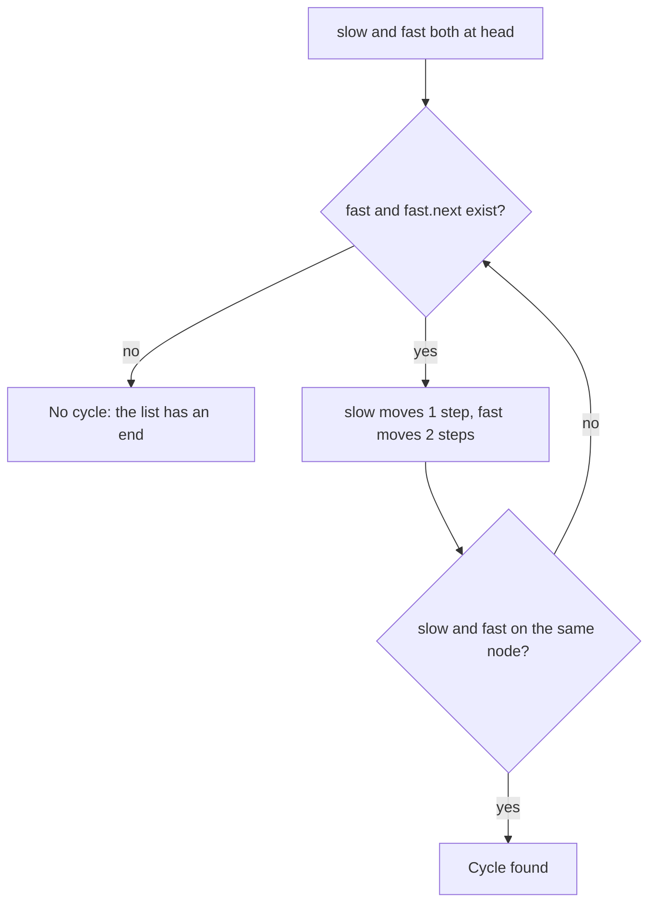

## Intuition

Picture two runners on a track. If the track is a straight road with an end, the faster runner reaches the end first and the race is over. If the track is a circle, the faster runner eventually laps the slower one and they meet. So if they ever meet, the track is a circle.

Floyd's cycle detection uses exactly this idea, with two pointers that start at the head. The **tortoise** (slow) moves one node per step. The **hare** (fast) moves two nodes per step.

- If the list has an end, the hare reaches it, and we answer no cycle.
- If the list has a cycle, both pointers end up inside it. The hare gains one node on the tortoise each step, so the gap between them shrinks by exactly one each time, and the hare cannot jump over the tortoise. Sooner or later the gap is zero and they stand on the same node.

No notebook is needed, only two pointers, so the memory stays constant.

## Walkthrough

Input: the first test case, values `3, 2, 0, -4`, where the tail points back to the node at position 1. Nodes are n0 to n3 and n3 points to n1.

| Step | Slow moves to | Fast moves to | Same node? |
| --- | --- | --- | --- |
| start | n0 | n0 | (they start together, we do not check yet) |
| 1 | n1 | n2 | no |
| 2 | n2 | n1 (n2 to n3 to n1) | no |
| 3 | n3 | n3 (n1 to n2 to n3) | yes, answer `true` |

Notice what happened in the cycle: after step 1 the slow pointer is at n1 and the fast pointer is at n2. Inside the cycle of length three (n1, n2, n3) the fast pointer is one node ahead, so after two more steps it has gone around and met the slow one.

Without a cycle, take `1, 2, 3, 4`. After step 1 the slow pointer is at node 2 and the fast pointer is at node 3. After step 2 the slow pointer is at node 3 and the fast pointer has moved from node 3 to node 4 to nothing. The fast pointer fell off the end, the loop stops, and the answer is `false`.

Read it as: keep moving while the hare has room; meeting means a cycle, running out of room means no cycle.

## Complexity

| | Value | Why |
| --- | --- | --- |
| Time, best | O(1) | An empty list, a single node without a cycle, or a self loop is decided in the first step. |
| Time, average and worst | O(n) | Without a cycle the hare reaches the end after about n over two steps. With a cycle, the slow pointer enters the cycle after at most n steps, and then the gap closes within at most one trip around the cycle. Together this is linear. |
| Space | O(1) | Two pointers, whatever the length. |

The first part of the walk (before the cycle) has some length, call it a. The cycle has a length, call it c. The slow pointer needs a steps to enter. After that the gap shrinks by one per step, and it is at most c. So the total is at most about a plus c steps, which is at most n.

## Code explanation

1. **Is there room for the hare?** The hare moves two steps, so it needs a node and a next node. If either is missing, it has reached the end: no cycle.
2. **Tortoise moves one step.**
3. **Hare moves two steps.**
4. **Compare the two nodes.** The comparison must be by identity: the same node. We compare after moving, never before, because both start at the head.

| Language | How identity is compared | Note |
| --- | --- | --- |
| JavaScript / TypeScript | `===` on objects compares references | TypeScript needs `slow!.next` because the type of `slow` is `ListNode \| null`. The `!` is an erasable assertion; the loop condition guarantees it is safe. |
| Python | `is` | `==` would also work unless you define `__eq__`, but `is` states the intent. |
| Go | `==` on pointers compares addresses | |
| Java | `==` on references | `equals` could be overridden to compare values, which would break the check. |
| C# | `ReferenceEquals` | It does not call any overloaded `==` or `Equals`, so it always means identity. |
| C++ | `==` on pointers | The pointers are `const ListNode*` because the function does not modify the list. |

## Edge cases and tests

The same twelve cases as the hash set approach, with the same output (see the notes of the hash set approach for the table). The ones that stress the two pointers most:

| Input (values, position) | Output | What it checks |
| --- | --- | --- |
| `[]`, minus 1 | `false` | The loop condition handles an empty list (fast is none). |
| `[1]`, minus 1 | `false` | The hare has no next node. |
| `[1]`, 0 | `true` | A self loop: after one step both pointers are on the same node. |
| `[1,2]`, 0 | `true` | A cycle of length two meets in two steps. |
| `[1,2,3,4,5]`, 4 | `true` | A cycle at the tail. |
| `[1,1,1]`, minus 1 | `false` | Equal values must not count. |
| `[1,...,12]`, 0 | `true` | A long cycle through the whole list. |

## When to use it (and when not)

**Use it** when you need constant memory, or as the standard interview answer to "can you do it without extra space?" It also extends to finding the start of the cycle.

**Do not use it** if you also need the full list of visited nodes. Also, it does not tell you anything about the cycle by itself except that one exists; finding the cycle start or length needs a second phase.

## Interview notes

- Say: "A slow pointer moves one step and a fast pointer moves two. If they meet, there is a cycle."
- Explain why they must meet: "Inside the cycle the gap shrinks by one every step."
- Mention the loop condition: "I check `fast` and `fast.next` so I never move off the end."
- Likely follow-up: "Where does the cycle start?" Reset one pointer to the head, move both one step at a time, and they meet at the cycle start.
- Mistake to avoid: comparing the pointers before moving. Both start at the head, so the first comparison would always be true.

## Real-life usage

Floyd's algorithm is used to find loops in chains of pointers or states when you cannot afford a set. A well-known use is detecting repeating values in a pseudo-random sequence, which is how Pollard's rho method for factoring numbers works. It is also used in checks for circular references in linked structures. The idea behind it, two speeds, shows up whenever you need to find the middle of a list in one pass (when the fast pointer reaches the end, the slow pointer is at the middle).
