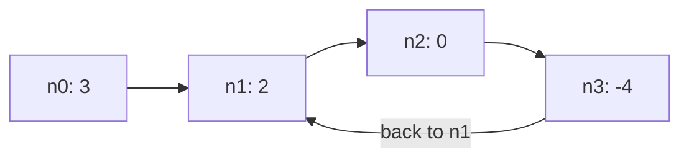

## Intuition

A **cycle** in a linked list means that if you keep following the next pointers, you never reach the end. You walk in a circle. The cause is some node whose next pointer points back to an earlier node.

The simplest way to find out: walk the list and keep a notebook of the nodes you have visited. Every time you arrive at a node, check the notebook. If the node is already written there, you have been here before, so the list has a cycle. If you reach the end of the list (the next pointer is none), the list has no cycle.

This is like walking through a maze and dropping a breadcrumb at each junction. If you step on a breadcrumb, you are going in circles.

The "notebook" is a hash set, which answers "is this item in here?" in constant time on average. The important point: the set must remember the nodes themselves (their identity), not their values. Two different nodes can hold the same value.

## Walkthrough

Input: the list with values `3, 2, 0, -4` where the tail (-4) points back to the node at position 1 (value 2). This is the first test case. Nodes are named by position: n0, n1, n2, n3.

| Step | Current node | Already in the set? | Set after |
| --- | --- | --- | --- |
| 1 | n0 (value 3) | no | {n0} |
| 2 | n1 (value 2) | no | {n0, n1} |
| 3 | n2 (value 0) | no | {n0, n1, n2} |
| 4 | n3 (value -4) | no | {n0, n1, n2, n3} |
| 5 | n1 (value 2), reached from n3 | yes, so there is a cycle | stop, answer `true` |

A list without a cycle, such as `1, 2, 3`: the three nodes are added one by one, then the next pointer of the third node is none, the loop ends and the answer is `false`.

Read it as: the walk goes along the top and the last arrow jumps back to the second node, so we meet a node we already saw.

## Complexity

| | Value | Why |
| --- | --- | --- |
| Time, best | O(1) | An empty list, or a list whose first node points to itself, is decided right away. |
| Time, average and worst | O(n) | Each node is visited at most once, because we stop the first time we see a repeat. A set lookup and insert are constant on average. |
| Space | O(n) | In the worst case every node is stored in the set. |

The worst-case time of a hash set operation can be higher if many keys collide, but pointers hash well in practice.

## Code explanation

1. **Check the notebook.** If the node is already in the set, we have walked into a known node, so there is a cycle. In Java, C# and C++ the `add` or `insert` call both checks and records in one step; the other languages check and add separately.
2. **Write the node down.** Add it to the set.
3. **No repeat found.** The loop ended because the next pointer was none, so the list has an end. There is no cycle.

| Language | Set type | What is compared | Note |
| --- | --- | --- | --- |
| JavaScript / TypeScript | `Set` of objects | The reference (identity) | Never use the value as the key; equal values are common. |
| Python | `set` | The object's identity, by default | If you define `__eq__` on the node class, you must also take care of `__hash__`. |
| Go | `map[*ListNode]struct{}` | The pointer address | `struct{}` takes no memory, so it is the usual way to write a set. |
| Java | `HashSet<ListNode>` | `equals` and `hashCode`, which default to identity | If you override `equals` for value comparison, cycle detection breaks. |
| C# | `HashSet<ListNode>` | `Equals` and `GetHashCode`, reference-based by default for classes | Records would compare by value and break this idea. |
| C++ | `std::unordered_set<const ListNode*>` | The pointer address | `insert(...).second` is false when the element was already there. |

## Edge cases and tests

The same twelve cases for both cycle approaches. Each case gives the values and the position that the tail is linked to (minus one means no cycle).

| Input (values, position) | Output | What it checks |
| --- | --- | --- |
| `[3,2,0,-4]`, 1 | `true` | The standard example. |
| `[1,2]`, 0 | `true` | The tail points back to the head. |
| `[1]`, minus 1 | `false` | A single node with no cycle. |
| `[1]`, 0 | `true` | A node that points to itself. |
| `[]`, minus 1 | `false` | An empty list. |
| `[1,2,3,4,5]`, minus 1 | `false` | A normal list. |
| `[1,2,3,4,5]`, 4 | `true` | A self loop on the last node. |
| `[1,2,3,4,5]`, 2 | `true` | A cycle in the middle. |
| `[1,1,1]`, minus 1 | `false` | Equal values must not look like a cycle. |
| `[1,1,1]`, 1 | `true` | Equal values with a real cycle. |
| `[1,...,12]`, minus 1 | `false` | A longer list. |
| `[1,...,12]`, 0 | `true` | A long cycle through the whole list. |

## When to use it (and when not)

**Use it** when memory is not an issue and you want an obviously correct solution, or when you also need to know which nodes were visited (for example to return the first repeated node directly).

**Do not use it** when the list is huge or memory is tight. Floyd's method does the job in constant space. Also, hash sets add overhead on every step, so the hash-set method is slower in practice for long lists.

## Interview notes

- Say: "I keep a set of visited nodes. If I see one again, there is a cycle. If I reach the end, there is none."
- Stress identity: "I store the node, not the value, because different nodes can have the same value."
- State the cost: "Linear time and linear space."
- Likely follow-up: "Can you do it in constant space?" Answer with Floyd's tortoise and hare.
- Mistake to avoid: comparing values. Another mistake is using an array and a linear search instead of a set, which makes it quadratic.

## Real-life usage

The "set of visited things" is the standard way to stop loops in graph walks, dependency resolvers, garbage collectors that mark objects, serialisers that must not follow a circular reference forever, and web crawlers that remember URLs they have already fetched. When memory is a concern, the tortoise and hare idea is used instead, for example to detect loops in a chain of pointers inside a memory-limited system.
