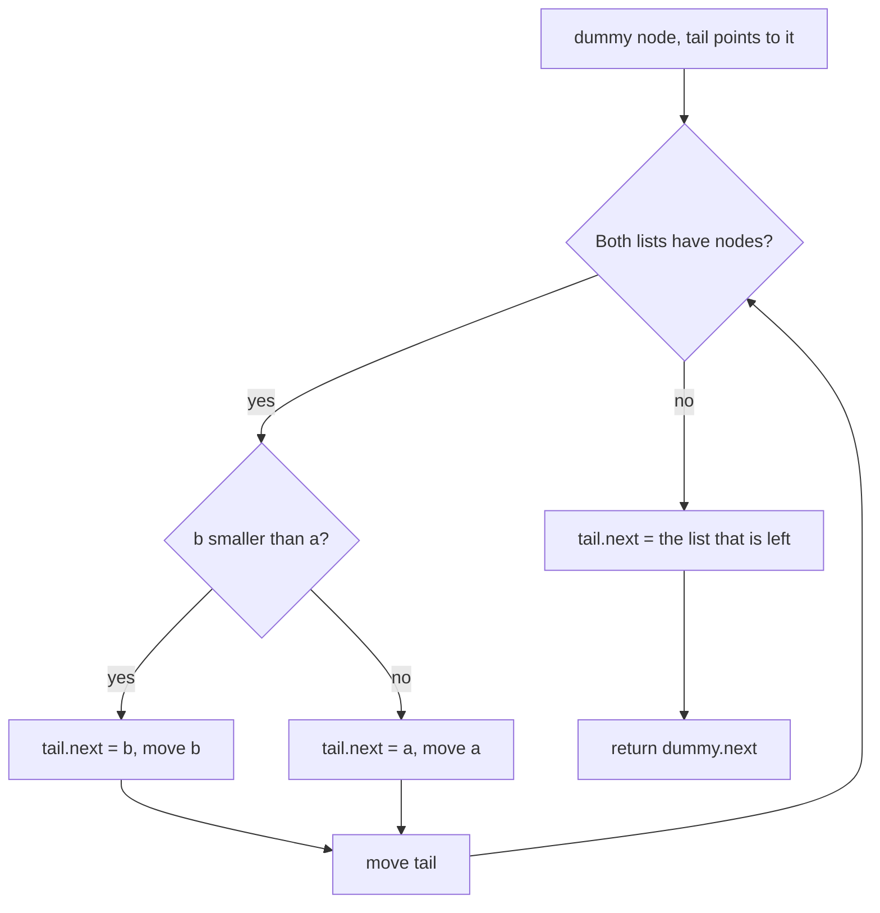

## Intuition

Think of two sorted piles of exam papers, ordered by marks. To make one sorted pile, you look at the top paper of each pile, take the one with the lower mark, and put it on the new pile. You repeat until one pile is empty, then you put the whole rest of the other pile on top, because it is already in order. You never need to look at a paper twice.

With linked lists, you do not even move the papers: you only change which paper points to which. A **tail pointer** marks the end of the new list, and a **dummy node** at the very start means you never have to ask "is the new list still empty?". When you are done, the real result starts after the dummy.

This is exactly the merge step of merge sort, and it is the reason merge sort suits linked lists.

## Walkthrough

Input: `a = 1 -> 2 -> 4` and `b = 1 -> 3 -> 4` (the first test case). The new list starts as `dummy`.

| Step | Front of a | Front of b | Choice | New list after |
| --- | --- | --- | --- | --- |
| 1 | 1 | 1 | tie, take from a | 1 (from a) |
| 2 | 2 | 1 | b is smaller | 1, 1 |
| 3 | 2 | 3 | a is smaller | 1, 1, 2 |
| 4 | 4 | 3 | b is smaller | 1, 1, 2, 3 |
| 5 | 4 | 4 | tie, take from a | 1, 1, 2, 3, 4 |
| end | none (a is used up) | 4 | attach the rest of b | 1, 1, 2, 3, 4, 4 |

The result is `1 1 2 3 4 4`. On a tie we take from `a` first. Because equal values from `a` come before equal values from `b`, the merge is **stable**.

Read it as: pick the smaller front node, link it, and repeat; at the end attach the leftover.

## Complexity

| | Value | Why |
| --- | --- | --- |
| Time, best | O(min(m, n)) | If one list is entirely smaller, the other list is attached in one step after only the shorter list has been walked. |
| Time, average and worst | O(m + n) | In the worst case the two lists interleave, and every node is looked at once. |
| Space | O(1) | We relink the existing nodes, so only a few pointers and one dummy node are needed. |

Here m and n are the lengths of the two lists. If you built a new list by copying values, the space would be O(m + n).

## Code explanation

1. **Dummy node.** It is a throwaway node that sits before the real list. The tail pointer starts on it, so the first real node is attached in exactly the same way as every other.
2. **Pick the smaller front.** Compare `b.val < a.val`. Using "less than" for `b` means that on a tie we take `a`, which keeps the merge stable. Link the chosen node after the tail, and move that list's front forward. Then move the tail.
3. **Attach the leftover.** When one list runs out, at most one list still has nodes. They are already sorted, so we link them in one assignment without a loop.
4. **Skip the dummy.** Return `dummy.next`. The dummy itself is discarded.

| Language | Note |
| --- | --- |
| JavaScript / TypeScript | Parameters `a` and `b` are reassigned as cursors. That is fine because only the references are local. |
| Python | `tail.next, b = b, b.next` is a tuple assignment: the right side is evaluated first, so it is safe. |
| Go | The same tuple assignment `tail.Next, b = b, b.Next` works. There is no ternary operator, so the leftover uses an `if`. |
| Java | `tail.next = (a != null) ? a : b` picks the leftover list. |
| C# | `a ?? b` returns `a` unless it is null. |
| C++ | The dummy node lives on the stack; only its `next` is returned. The nodes themselves are owned by the harness. |

## Edge cases and tests

Eleven cases. Each prints the merged values, or `empty`.

| Input (a, b) | Output | What it checks |
| --- | --- | --- |
| `[1,2,4]`, `[1,3,4]` | `1 1 2 3 4 4` | The standard example with ties. |
| `[]`, `[]` | `empty` | Both lists empty. |
| `[]`, `[0]` | `0` | One list empty. |
| `[5]`, `[]` | `5` | The other list empty. |
| `[1,3,5]`, `[2,4,6]` | `1 2 3 4 5 6` | Perfect interleaving. |
| `[1,1,1]`, `[1,1]` | `1 1 1 1 1` | All values equal. |
| `[1,2,3]`, `[4,5,6]` | `1 2 3 4 5 6` | All of a comes first, then b is attached in one step. |
| `[4,5,6]`, `[1,2,3]` | `1 2 3 4 5 6` | All of b comes first. |
| `[-5,-1,0]`, `[-3,2]` | `-5 -3 -1 0 2` | Negative numbers. |
| `[1]`, `[1]` | `1 1` | Two single nodes that tie. |
| `[2,4,6,8]`, `[1,3]` | `1 2 3 4 6 8` | Different lengths. |

## When to use it (and when not)

**Use it** whenever you need to combine two sorted sequences that are stored as linked lists, and as the merge step of a linked-list merge sort.

**Do not use it** on unsorted lists: the result is not sorted. If the inputs are arrays, merge into a new array instead, or use the library (`std::merge`, `heapq.merge`). For k lists use a min-heap, or merge pairs of lists in rounds.

## Interview notes

- Say: "I use a dummy node and a tail pointer, and relink the smaller front node each time."
- Mention stability: "On a tie I take from the first list, so equal values keep their original order."
- Mention the end: "When one list is used up I attach the rest of the other in one step."
- Likely follow-up: "Do it recursively." Choose the smaller head, and set its next to the merge of the rest. It is shorter but uses O(m + n) stack.
- Mistake to avoid: returning the dummy node, or forgetting to attach the leftover.

## Real-life usage

Merging sorted sequences is everywhere: the merge step of merge sort (the algorithm behind `Array.sort` in some languages for objects, and `sort` in Python and Java for objects), external sorting of files that do not fit in memory, merging sorted log streams from several servers, combining sorted index segments in search engines and LSM-tree databases, and joining two sorted tables with a merge join.
