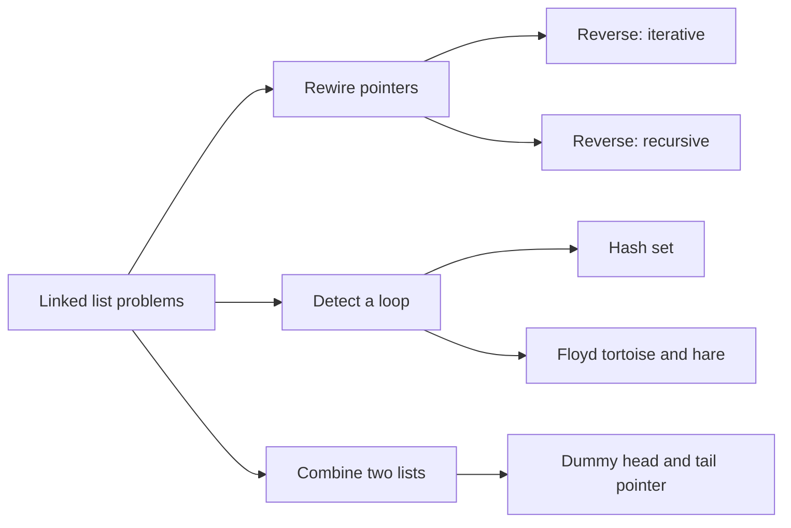
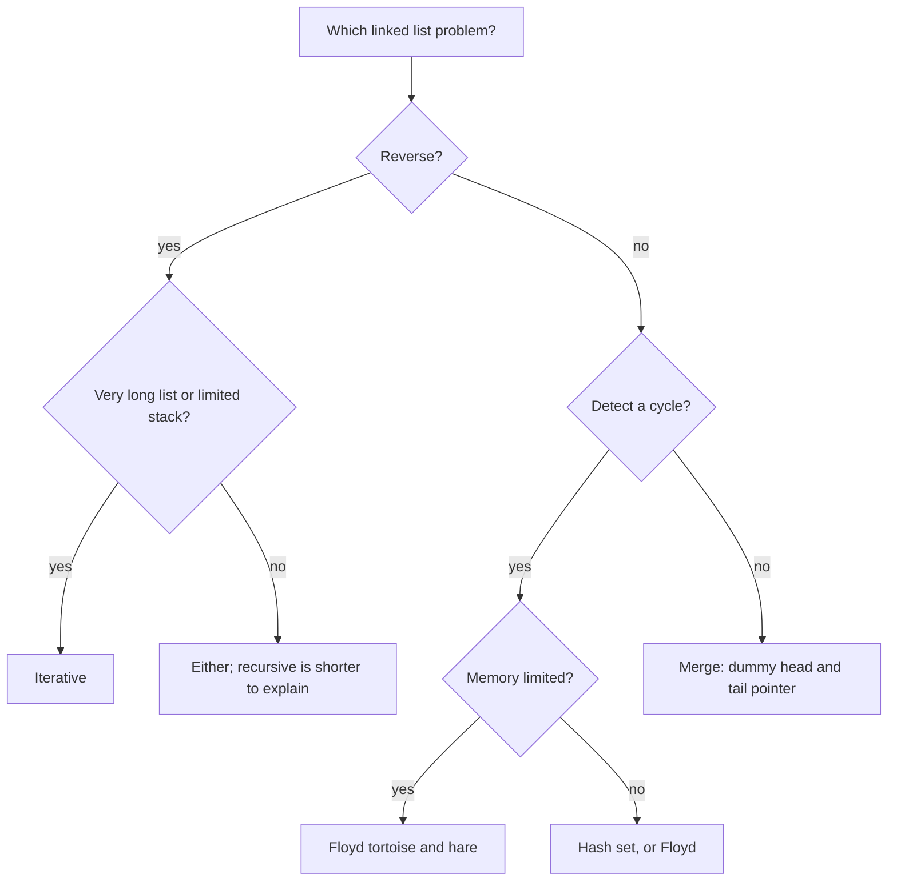

## How interviewers ask it

**Three classic questions on a singly linked list.** A singly linked list is a chain of nodes. Each node holds a value and a pointer to the next node. The last node points to nothing. You are given only the first node, called the head.

- *Reverse it.* "Reverse a singly linked list and return the new head."
- *Find a cycle.* "Given the head of a linked list, decide whether it contains a cycle, which means some node can be reached again by following next pointers." A follow-up asks you to do it with constant extra memory.
- *Merge two sorted lists.* "Merge two sorted linked lists into one sorted list and return its head."

**Common variations:**

- Reverse only a part of the list, or reverse in groups of k nodes.
- Find where the cycle starts, or how long the cycle is.
- Find the middle node, or the n-th node from the end (two pointers again).
- Check whether a list is a palindrome (find the middle, reverse the second half, compare).
- Merge k sorted lists (a heap), or sort a linked list (merge sort).
- Remove duplicates, remove a node by value, or detect where two lists meet.

**What to clarify before you code:**

| Question to ask | Why it matters |
| --- | --- |
| Is it singly or doubly linked? | Doubly linked lists let you walk backwards, which changes reversal and deletion. |
| Can the list be empty or have one node? | These are the usual edge cases. The head can be null. |
| May I change the nodes, or must I build new ones? | Re-pointing nodes in place uses constant memory. Copying uses linear memory. |
| Can the list have a cycle? | If it can, loops that walk to the end may never finish. |
| Are the values sorted, and can they repeat? | Needed for merging, and for the order of equal values (stability). |
| Do I return the new head? | After a reversal or a merge, the head changes. |

A good answer draws the nodes and arrows on paper, keeps a pointer to the rest of the list before cutting a link, and names the empty list and the single node as test cases.

In this repo every program builds the list from an array, runs the function, and prints the values separated by spaces. An empty list prints the word `empty`. The cycle programs print `true` or `false`. A cycle is described by a position: the tail node is linked back to the node at that position, or to nothing when the position is minus one.

## Real-life scenarios

| Scenario | What is actually used | Why |
| --- | --- | --- |
| An LRU cache (browser cache, database buffer pool, Redis eviction) | A hash map plus a doubly linked list | Moving a node to the front and removing the last node are constant-time pointer updates. |
| Undo and redo history in an editor, and the browser back button | A doubly linked list or two stacks | You step to the previous or next state in constant time. |
| A music player playlist, or a carousel of images | A circular linked list | The last item points back to the first, so "next" never ends. |
| The free list in a memory allocator | A linked list of free blocks | Blocks are linked in place, so no extra memory is needed to track them. |
| Hash table buckets that handle collisions by chaining | A short linked list per bucket | Inserting at the head is constant time. |
| Merging sorted log files or sorted streams from many servers | The merge step of merge sort, often with a heap for k inputs | It reads each input once, in order, with almost no memory. |
| Git history | A graph of commits, where each commit points to its parent | Walking the history is following pointers, and a rebase rewires them. |
| Finding a deadlock or an endless loop in a chain of references | Cycle detection on a graph, with the tortoise and hare idea | Following "who waits for whom" must not loop forever. |
| Operating system process and task queues, and the Linux kernel `list_head` | Intrusive doubly linked lists | The node is embedded in the object, so there is no separate allocation. |

In everyday application code you almost always use an array-like structure (`Array`, `list`, slice, `ArrayList`, `List<T>`, `vector`) because it is faster in practice. Linked lists matter for the cases above and for interviews, where they test whether you can handle pointers.

## Approaches compared

| Approach | Problem | Time | Extra space | Changes the list? | Use when |
| --- | --- | --- | --- | --- | --- |
| 1. Reverse, iterative | Reverse | O(n) | O(1) | Yes, in place | The default answer. Three pointers and a loop. |
| 2. Reverse, recursive | Reverse | O(n) | O(n) call stack | Yes, in place | To show you understand recursion. Risky for very long lists. |
| 3. Cycle, hash set | Cycle | O(n) | O(n) | No | When memory is fine and you want the simplest correct idea. |
| 4. Cycle, Floyd tortoise and hare | Cycle | O(n) | O(1) | No | The expected answer when memory is limited. |
| 5. Merge two sorted lists | Merge | O(m + n) | O(1) | Yes, relinks nodes | Always for this problem. A dummy head makes it short. |

Read it from left to right: three kinds of problem, with the approaches that solve each one.

## How to choose

Start at the top and answer each question. In an interview, show the simple idea first, then the constant-memory idea.

## Built-ins and the standard library

Interview questions use a hand-made node type, but every language also ships a linked list. In production you rarely want it, because an array is faster for most work: its items sit next to each other in memory, so the CPU cache works well, while list nodes are scattered.

| Language | Linked list in the standard library | Notes and pitfalls |
| --- | --- | --- |
| JavaScript / TypeScript | None. Use an object with a `next` field, or an `Array`. | `Array.prototype.reverse` reverses an array in place. Arrays are the normal choice. A `Set` of objects compares by reference, which is what cycle detection needs. |
| Python | `collections.deque` is a doubly linked list of blocks. There is no plain linked list. | `list.reverse()` and `reversed()` exist. The built-in `heapq.merge` merges sorted inputs lazily. Objects are compared by identity unless you define `__eq__`. |
| Go | `container/list` (doubly linked, values are `any`) | No generics in that package, so values need type assertions. For a singly linked list write your own struct with a pointer. `slices.Reverse` reverses a slice in place (Go 1.21 and later). |
| Java | `LinkedList<E>` (doubly linked) | `ArrayList` or `ArrayDeque` is almost always faster. `Collections.reverse(list)` reverses a list. A `HashSet` of nodes uses `equals` and `hashCode`; the default is identity, which is right for cycle detection. |
| C# | `LinkedList<T>` (doubly linked) with `LinkedListNode<T>` | Nodes are objects you can insert and remove in constant time. `Enumerable.Reverse` does not change the list. A `HashSet` of a class without overrides compares by reference. |
| C++ | `std::list` (doubly linked) and `std::forward_list` (singly linked) | `std::reverse` works on random access or bidirectional iterators, and `list::reverse()` and `list::merge()` exist and relink nodes. `std::unordered_set` of pointers compares addresses. |

**Hand-write or call the library?** Use the library for sorted merging (`heapq.merge`, `std::merge`, `list::merge`) and for reversing arrays. Write your own node code only when the interview asks for it, or when you need an intrusive list inside a performance-critical structure.

## Common mistakes

- **Losing the rest of the list.** If you set `current.next` before saving the old next node, the remaining nodes are lost. Save the next pointer first.
- **Forgetting to cut the old link.** In the recursive reversal, forgetting `head.next = null` leaves the old head pointing to the node after it, and the list now has a cycle of length two.
- **Returning the wrong head.** After a reversal the new head is the old tail. After a merge the head is whatever the dummy points to, not the dummy itself.
- **Not handling the empty list and the single node.** `head.next.next` throws when `head.next` is null. Check both.
- **Fast pointer without a null check.** In the tortoise and hare loop, check `fast` and `fast.next` before moving two steps.
- **Comparing values instead of nodes for cycles.** Two different nodes can hold the same value. A cycle means the same node object, so compare references or addresses, never values.
- **Starting the two pointers at different places by accident.** Both start at the head. Check for a meeting after moving, not before, or the first step reports a false cycle.
- **Recursion on huge lists.** A recursive reversal uses one stack frame per node. A list of a million nodes can crash the program.
- **Building the merge result with an `if` for the first node.** Without a dummy head, the first node needs special code. A dummy node removes it.

## How to answer in an interview

1. **Clarify.** "Singly linked? Can it be empty? May I change the nodes? Could it have a cycle?"
2. **Draw it.** Draw three or four nodes with arrows and write the pointer names on the board.
3. **Give examples and edge cases.** "Empty list, one node, two nodes, and a longer list. For cycles, a self loop and a cycle at the head."
4. **Say the simple approach.** "To reverse, I could copy the values into an array and write them back, but that uses O(n) memory. To find a cycle, I can keep a set of visited nodes."
5. **Improve it.** "I can reverse in place with three pointers: previous, current and next. I can detect the cycle in constant memory with two pointers, one twice as fast as the other."
6. **Code it.** Save the next pointer before changing links. Use a dummy head for merging.
7. **Test aloud.** Walk the empty list and a three-node list on paper, updating each pointer.
8. **State complexity.** "All of them are linear in time. Reversal and Floyd use constant space; the recursive version and the hash set use linear space."
9. **Offer follow-ups.** "Floyd's second phase finds the node where the cycle starts. I can also reverse in groups, or merge k lists with a heap."

## Follow-up questions

- **How do you find where the cycle starts?** After the two pointers meet, move one pointer back to the head. Move both one step at a time. They meet again at the start of the cycle. The reason is that the distance from the head to the cycle start equals the distance from the meeting point to the cycle start, going around the cycle.
- **How do you find the length of the cycle?** After the meeting, keep one pointer fixed and move the other until it comes back. Count the steps.
- **Why does the fast pointer catch the slow one?** Inside the cycle, the distance between them shrinks by one on every step, because the fast one gains one node per round. So the gap reaches zero without jumping over the slow pointer.
- **Could the pointers skip each other if the fast pointer moved three steps?** They might never meet if the gap and the cycle length do not fit. With steps of one and two the gap shrinks by exactly one, so they always meet.
- **How do you reverse a doubly linked list?** Swap the next and previous pointers of every node, then return the old tail.
- **How do you reverse the nodes in groups of k?** Reverse each group of k nodes with the same iterative loop, and connect the groups. If the last group has fewer than k nodes, leave it as it is.
- **How do you merge k sorted lists?** Keep the front node of each list in a min-heap. Pop the smallest, append it, and push its next node. The time is O(N log k) for N nodes in total.
- **How would you sort a linked list?** Merge sort. Split the list with the slow and fast pointer trick, sort each half, and merge. It needs O(n log n) time and O(log n) stack, and no random access.
- **Why not binary search a linked list?** You cannot jump to the middle in constant time, so finding the middle costs linear time and the search loses its speed.

## Practice

- Linked list cycle II: return the node where the cycle begins.
- Middle of the linked list, and remove the n-th node from the end (two pointers).
- Palindrome linked list (middle, reverse half, compare).
- Reverse linked list II (reverse between positions left and right) and reverse nodes in k-group.
- Merge k sorted lists and sort list (merge sort on a list).
- Intersection of two linked lists, and copy a list with random pointers.
- Design an LRU cache (hash map plus doubly linked list).
