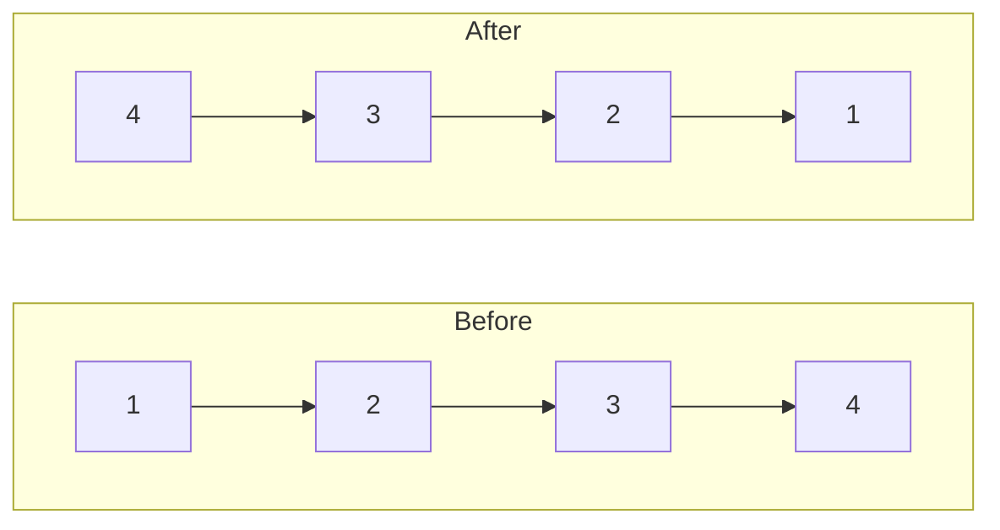

## Intuition

Imagine people standing in a queue, each one holding the hand of the person in front. To reverse the queue, you walk down the line and ask each person to let go of the person in front and hold the hand of the person behind instead. The important detail: before one person lets go, you must remember who was in front, otherwise you lose the rest of the queue.

A singly linked list works the same way. Each node points to the next node. To reverse the list we walk through it once and turn every arrow around so that it points to the previous node. We keep three things: `prev` (the part we have already reversed), `current` (the node we are turning) and `next` (the node we saved so we do not lose the rest).

When we run out of nodes, `prev` is the last node we handled, which was the old tail. That is the new head.

## Walkthrough

Input: the list `1 -> 2 -> 3 -> 4` (the head is the node with value 1). This is not one of the shared test cases, but it is traced by the same rules.

| Step | current | next (saved) | After `current.next = prev` | prev after | current after |
| --- | --- | --- | --- | --- | --- |
| start | 1 | | | none | 1 |
| 1 | 1 | 2 | `1 -> none` | 1 | 2 |
| 2 | 2 | 3 | `2 -> 1` | 2 | 3 |
| 3 | 3 | 4 | `3 -> 2` | 3 | 4 |
| 4 | 4 | none | `4 -> 3` | 4 | none |

The loop stops when `current` is none. We return `prev`, which is the node 4. Following the arrows from 4 gives `4 -> 3 -> 2 -> 1`.

Read it as: the same four nodes, with every arrow turned around.

Special cases: an empty list never enters the loop, so `prev` stays none and we return none. A single node has its arrow set to none (it was already none), and we return that node.

## Complexity

| | Value | Why |
| --- | --- | --- |
| Time | O(n) | Each node is visited exactly once and each visit does a fixed number of pointer assignments. |
| Space | O(1) | Only three pointers are kept, whatever the length. The nodes are reused, not copied. |

There is no best or worst case: every node must be touched, so the time is linear for any input.

## Code explanation

1. **Start with an empty reversed part.** `prev` is none because nothing has been reversed yet. The first node will become the tail, and a tail points to nothing.
2. **Save the next node.** Do this before touching the arrow, or the rest of the list is lost.
3. **Turn the arrow around.** The current node now points to the part we already reversed.
4. **Grow the reversed part.** `prev` becomes the current node.
5. **Move on.** `current` becomes the saved next node.
6. **Return `prev`.** When the loop ends, `current` is none, and `prev` is the last node we processed, which is the new head.

| Language | Pointer type | Note |
| --- | --- | --- |
| JavaScript / TypeScript | Object reference, `null` for the end | TypeScript marks the type as `ListNode \| null`, so the compiler forces you to deal with the empty list. |
| Python | Object reference, `None` for the end | Use `is not None` rather than a truthiness test, which also works but is less explicit. |
| Go | `*ListNode`, `nil` for the end | Field names start with a capital letter because they are accessed by name. The zero value of a pointer is `nil`. |
| Java | Object reference, `null` for the end | Garbage collection frees nodes that nobody points to. |
| C# | Class reference, `null` for the end | With nullable reference types on, `ListNode?` shows which references may be null. |
| C++ | Raw pointer `ListNode*`, `nullptr` for the end | The test harness owns the nodes in a pool, so the algorithm never deletes anything. In real code prefer a smart pointer or a container to manage ownership. |

## Edge cases and tests

All nine cases print the reversed values separated by spaces. An empty list prints the word `empty`, because a blank line would be easy to lose.

| Input | Output | What it checks |
| --- | --- | --- |
| `[1,2,3,4,5]` | `5 4 3 2 1` | The standard example. |
| `[]` | `empty` | The loop never runs and we return nothing. |
| `[1]` | `1` | A single node. |
| `[1,2]` | `2 1` | Two nodes, the smallest list that changes. |
| `[1,2,3]` | `3 2 1` | An odd length. |
| `[7,7,8]` | `8 7 7` | Duplicate values do not confuse the pointer logic. |
| `[10,20,30,40]` | `40 30 20 10` | An even length. |
| `[-1,0,1]` | `1 0 -1` | Negative values and zero. |
| `[1,...,10]` | `10 9 8 7 6 5 4 3 2 1` | A longer list. |

## When to use it (and when not)

**Use it** whenever you must reverse a singly linked list. It is the answer interviewers expect, and it uses no extra memory.

**Do not use** a linked list at all if you can use an array: reversing an array in place with two indices is just as easy and faster in real life. And if the list is shared with other code that holds pointers into the middle of it, reversing in place changes what they see.

## Interview notes

- Say: "I walk the list once, turning each arrow around. I keep `prev`, `current` and `next`."
- Say out loud: "Save the next pointer before I overwrite it."
- Name the edge cases: empty list, one node.
- Likely follow-up: "Now do it recursively." The next approach covers it.
- Mistake to avoid: returning `current` instead of `prev`. After the loop `current` is none.

## Real-life usage

Reversing a list is a building block for other algorithms. A palindrome check on a linked list reverses the second half. Reversing in groups is used in some data-processing pipelines. Linked-list reversal also appears inside undo/redo structures and in routines that turn a "newest first" chain into "oldest first" order.
