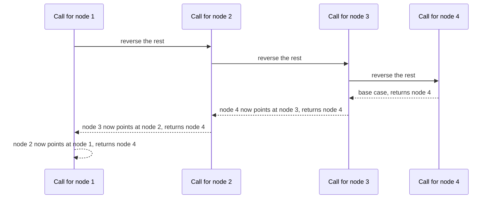

## Intuition

Recursion lets you solve a big problem by trusting a smaller copy of it. Here we say: "Suppose I already know how to reverse the part of the list that starts after the first node. What is left to do?"

Take the list `1 -> 2 -> 3`. If I reverse everything after node 1, I get `1 -> 3 -> 2`... but careful, the arrow from node 1 still points to node 2, and node 2 is now the tail of the reversed rest. So node 2 is exactly where node 1 should be attached: make node 2 point back to node 1, and make node 1 the new end of the list by pointing it to nothing.

That is the whole trick, in two lines: `head.next.next = head` and `head.next = null`. The recursion handles all the other nodes in the same way. The recursion stops when the list is empty or has a single node, because those are already reversed.

## Walkthrough

Input: the list `1 -> 2 -> 3 -> 4` (not one of the shared test cases). The calls go down to the last node, then the work happens while the calls return.

| Call | head | What happens going down | What happens on return |
| --- | --- | --- | --- |
| A | 1 | calls reverse on node 2 | after it returns, set `2.next = 1` and `1.next = none` |
| B | 2 | calls reverse on node 3 | set `3.next = 2` and `2.next = none` |
| C | 3 | calls reverse on node 4 | set `4.next = 3` and `3.next = none` |
| D | 4 | base case: next is none, return node 4 | |

The base case returns node 4 and every caller passes that same value upward, so the final answer is node 4. The pointer changes happen in the order C, B, A, so at the end we have `4 -> 3 -> 2 -> 1`.

Read it from top to bottom: the calls go down to the last node, then each call fixes one arrow on the way back up.

## Complexity

| | Value | Why |
| --- | --- | --- |
| Time | O(n) | Each node is handled by exactly one call, and each call does constant work. |
| Space | O(n) | The calls wait on the call stack. For n nodes there are n calls waiting at the deepest point. |

The space is the price of recursion. The iterative version does the same work in constant space. A list with hundreds of thousands of nodes can overflow the stack in languages with a small default stack (Python stops at about a thousand levels by default).

## Code explanation

1. **Base case.** An empty list or a single node is already reversed, so return it as it is. Checking `head.next` as well as `head` protects the next lines from a null access.
2. **Trust the recursion.** Reverse everything after the head. The result is the new head of the whole list, which is the old tail.
3. **Point back.** The node after us (which is now the tail of the reversed rest) must point to us.
4. **Cut the old link.** We are now the tail, so we point to nothing. If we forget, we and the next node point at each other, which is a cycle.
5. **Return the new head.** It is the same node on every level, because only the first call to the base case creates it.

| Language | Note |
| --- | --- |
| JavaScript / TypeScript | The engine's stack limit is around ten thousand frames, so a very long list throws `RangeError`. |
| Python | The default recursion limit is 1000, so a list of a thousand nodes raises `RecursionError`. Use the iterative version for long lists. |
| Go | Goroutine stacks grow on demand up to a large limit (1 GB on 64-bit systems by default), so deep recursion is possible but still wasteful. |
| Java | The default thread stack is small; roughly ten thousand frames are fine, a million is not (`StackOverflowError`). |
| C# | Similar to Java, the default stack is about 1 MB on the main thread, and a stack overflow ends the process. |
| C++ | There is no check at all: too deep a recursion crashes the program. Compilers may turn some tail calls into loops, but this function is not a tail call. |

The test lists in this repo are short, so every language passes.

## Edge cases and tests

The same nine cases as the iterative approach, with the same output.

| Input | Output | What it checks |
| --- | --- | --- |
| `[]` | `empty` | The base case for the empty list. |
| `[1]` | `1` | The base case for one node. |
| `[1,2]` | `2 1` | The smallest case that uses the two lines after the recursion. |
| `[1,2,3,4,5]` | `5 4 3 2 1` | The standard example. |
| `[7,7,8]` | `8 7 7` | Duplicate values. |
| `[1,...,10]` | `10 9 8 ... 1` | Ten calls deep. |

## When to use it (and when not)

**Use it** to show that you understand recursion, or when the code must be short and the list is known to be small.

**Do not use it** for long lists. It uses stack space proportional to the length and can crash. The iterative approach has no such limit.

## Interview notes

- Say: "I assume the recursive call returns the reversed rest, then I attach my node to its end."
- Explain the two lines after the call: `head.next.next = head` and `head.next = null`.
- Mention the cost: "It uses O(n) stack space, so for long lists I would use the loop."
- Likely follow-up: "Can you do it without recursion?" Yes, with the iterative approach.
- Mistake to avoid: forgetting `head.next = null`, which creates a cycle.

## Real-life usage

Recursive list reversal is mostly a teaching tool. It is the usual way to write list functions in functional languages, where lists are immutable and recursion is the normal loop. In production code in imperative languages, reversing is done with a loop or with the library's `reverse`.
