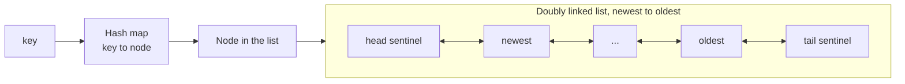
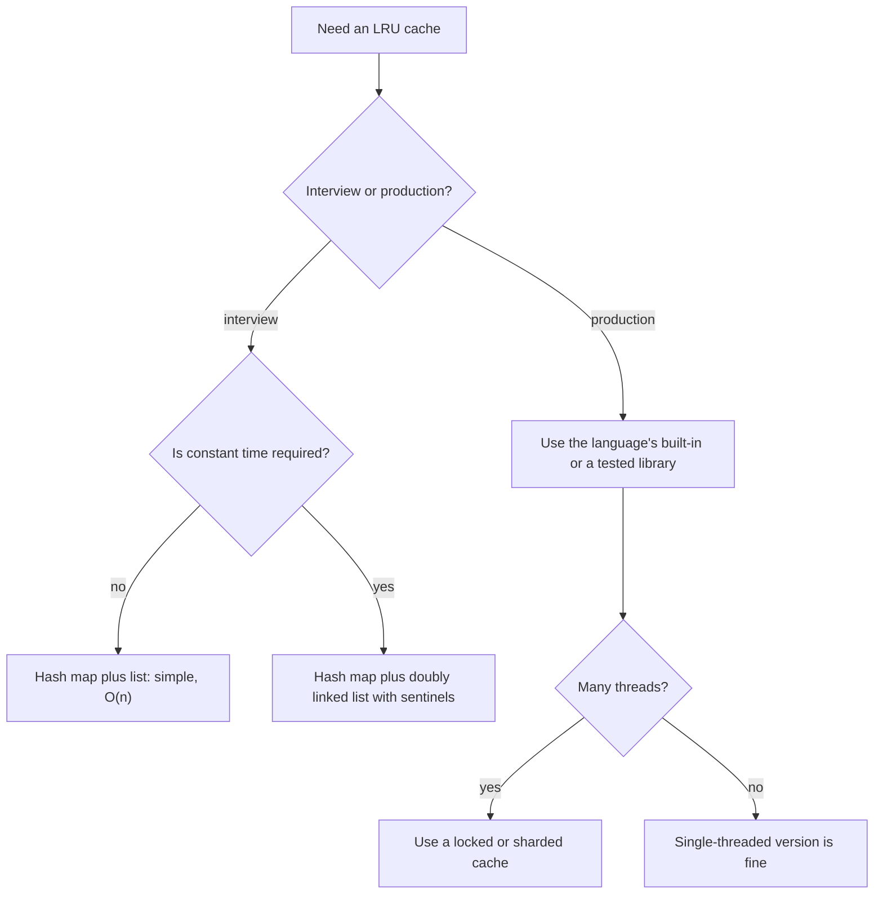
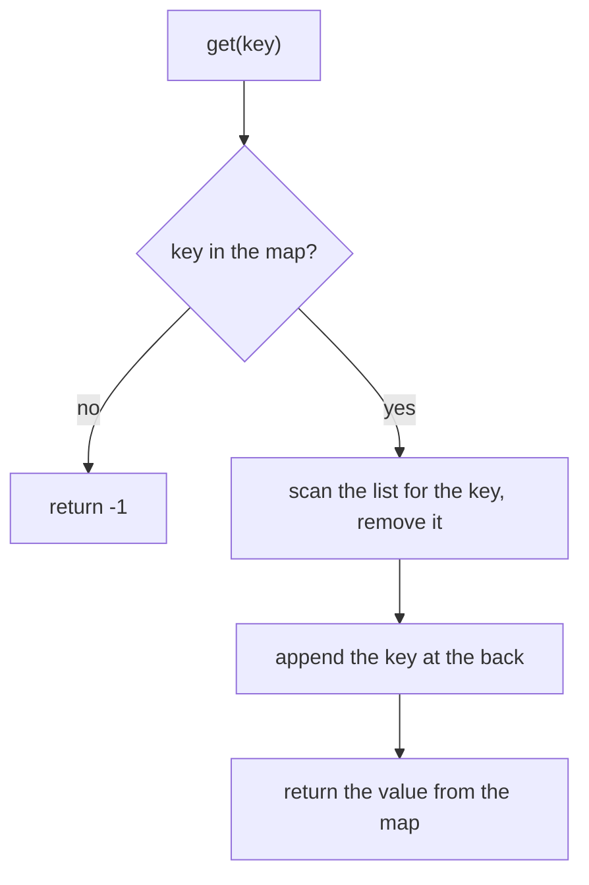
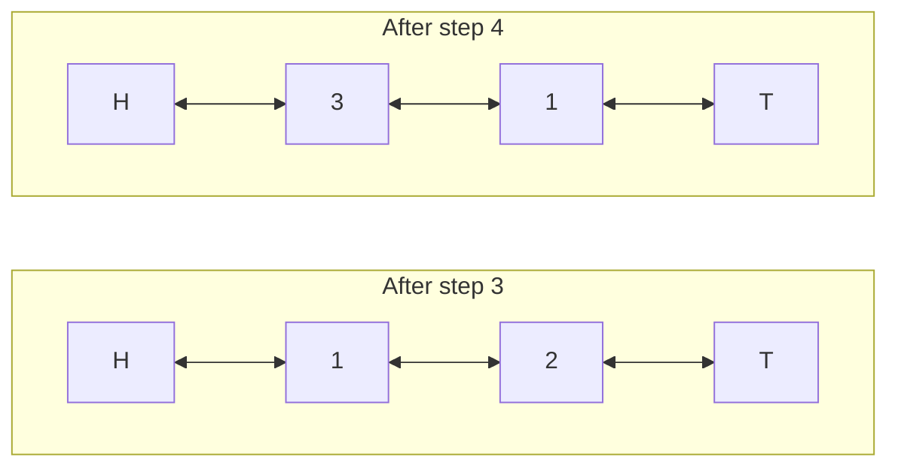

# LRU cache

[← All problems](../README.md)

> Design a cache that evicts the least recently used item, with constant-time get and put: the classic design problem that combines a hash map and a linked list.

**Level:** intermediate · **Tags:** design, cache, hash-map, linked-list, data-structures, complexity

**Related interview questions:**

- [JavaScript: How would you implement an LRU cache and a `pipe` function?](../../questions/javascript.md)
- [Golang: Design a thread-safe LRU cache with TTL in Go.](../../questions/golang.md)
- [Golang: When do you use `sync.Mutex` and `sync.RWMutex`? Show a safe cache.](../../questions/golang.md)
- [System Design: System design: how would you design a distributed cache?](../../questions/system-design.md)
- [System Design: What caching patterns does Redis enable, and how do you handle cache stampede and hot keys?](../../questions/system-design.md)
- [Databases: How do you put Redis in front of a database: cache-aside and invalidation?](../../questions/databases.md)
- [Networking & Security: How does HTTP caching work? Explain Cache-Control, ETag and conditional requests.](../../questions/networking-security.md)

## How interviewers ask it

**The classic wording.** "Design a data structure for a Least Recently Used (LRU) cache. It is created with a fixed capacity. `get(key)` returns the value if the key is in the cache, otherwise it returns minus one. `put(key, value)` inserts or updates the value. When the cache is full, adding a new key must first remove the least recently used key. Both `get` and `put` must run in O(1) average time."

A **cache** is a small, fast store that keeps copies of data that is expensive to fetch or compute. Because the cache is smaller than the data, it must throw something away when it is full. **LRU** is one policy: throw away the item that was used longest ago. The bet is that things used recently will be used again soon.

"Used" means read or written. Both `get` and `put` make a key the most recently used.

This is a **design problem**: there is no single algorithm. You must combine two data structures so that every operation is fast.

**Common variations:**

- *LFU cache.* "Evict the least frequently used key" (a frequency table of lists).
- *Add expiry.* "Each entry has a time to live."
- *Thread safe.* "Many threads call get and put at the same time."
- *Weighted capacity.* "The capacity is in bytes and entries have different sizes."
- *Generic types.* "Make keys and values generic."
- *Design a distributed cache.* (a follow-up that moves into system design)
- *Two-level cache*, or *cache with a loader function* that fills a miss automatically.

**What to clarify before you code:**

| Question to ask | Why it matters |
| --- | --- |
| Does `get` count as a use? Does updating an existing key count? | Usually yes to both. This is the most common source of bugs. |
| What does `get` return on a miss: minus one, null, an optional? | Decides the signature. Minus one only works if values are never negative. |
| Can the capacity be zero? | A special case: nothing can be stored. |
| Do I need to be thread safe? | Even `get` changes the order, so a plain read lock is not enough. |
| Are keys and values integers or generic? | Affects the code, not the idea. |
| Is O(1) required, or is O(n) fine? | Decides whether the simple list approach is acceptable. |

A good answer states the requirement of constant time, shows why a hash map alone and a list alone are not enough, combines them (a hash map from key to node plus a doubly linked list ordered by use), explains the sentinels, and tests the eviction order out loud.

**The output format in this repo.** The programs run scripted scenarios. Each scenario has a capacity and a script of operations written as text. Operations are separated by semicolons, for example `put 1 1; put 2 2; get 1`. The program creates a cache with that capacity, runs the operations in order, and prints **one line per scenario**. The line contains the result of every `get`, separated by single spaces. A hit prints the value, and a miss prints a dash. For example, the scenario `put 1 1; put 2 2; get 1; put 3 3; get 2` with capacity 2 prints `1 -`. Internally `get` returns minus one for a miss, and all test values are zero or more.

## Real-life scenarios

| Scenario | What is actually used | Why |
| --- | --- | --- |
| The browser cache for images, scripts and pages | An LRU-like policy with size limits | Recently viewed pages are likely to be viewed again, and old ones can be fetched again. |
| An operating system file (page) cache | An approximated LRU (Linux uses active and inactive lists) | Exact LRU is too expensive for every memory access, so systems approximate it. |
| A database buffer pool (PostgreSQL, MySQL InnoDB) | A clock sweep in PostgreSQL, an LRU list with a midpoint in InnoDB | Hot pages stay in memory; a big table scan must not push all hot pages out. |
| Redis as a cache with `maxmemory` | `allkeys-lru` samples a few keys and evicts the oldest of them | Exact LRU would need a linked list for every key, which costs memory. |
| A CDN edge server holding videos and images | LRU or a variant by object size | Popular content stays near the users. |
| `functools.lru_cache` in Python, memoisation of pure functions | A bounded LRU map | The cache cannot grow without limit. |
| Mobile apps keeping thumbnails and decoded images | A memory cache with LRU eviction | Memory is limited, and users go back to recent screens. |
| An ORM or API client caching recent query results | A bounded LRU map with a time to live | Avoids repeated database or network calls. |
| CPU caches (L1, L2, L3) | Pseudo-LRU in hardware | A few bits per set approximate the order cheaply. |

In production you almost always use a library or a built-in structure for this. The interview tests whether you understand how it works inside.

## Approaches compared

| Approach | get | put | Space | Use when |
| --- | --- | --- | --- | --- |
| 1. Hash map and list scan | O(n) | O(n) | O(n) | Tiny capacity (say under 50) where simple code matters more. As a first idea in an interview. |
| 2. Hash map and doubly linked list | O(1) | O(1) | O(n) | The expected answer. Anything bigger than a toy. |



Read it as: the map jumps straight to the node, and the list keeps the nodes in usage order, with the newest next to the head and the oldest next to the tail.

**Why two structures?** A hash map finds a key in O(1) but has no useful order for recent use. A list keeps an order, but finding a key in it takes O(n). A doubly linked list can remove a node in O(1) *if you already hold the node*, because the node knows its two neighbours. The map gives you the node. Together every step is constant time.

## How to choose



Start at the top and answer each question. In an interview, start from the simple version, say why it is slow, and then upgrade to the linked list.

## Built-ins and the standard library

Most languages have a ready-made building block. Know them so you can say "in production I would use this".

| Language | Ready-made way | Notes and pitfalls |
| --- | --- | --- |
| JavaScript / TypeScript | `Map` keeps keys in insertion order. To mark a key as recent, `delete` it and `set` it again. The oldest key is `map.keys().next().value`. | A 10-line LRU, but `delete` plus `set` is not a linked list operation under the hood, so do not claim a specific cost. No weak or size-based eviction in the standard library. |
| Python | `collections.OrderedDict` with `move_to_end(key)` and `popitem(last=False)`. For functions, `functools.lru_cache` or `functools.cache`. | `lru_cache` keeps strong references to arguments and results. Arguments must be hashable. It is thread safe for its own data but does not stop two threads computing the same value at once. |
| Go | `container/list` plus a `map`. There is no LRU in the standard library. | `container/list` elements hold `any`, so you need type assertions. A cache that mutates on `Get` needs a `sync.Mutex`, not just a read lock. |
| Java | `LinkedHashMap` with `accessOrder = true`, and override `removeEldestEntry` to evict. | Not thread safe. Wrap it with `Collections.synchronizedMap` or use a library cache for concurrency. |
| C# | No strict LRU in the base class library. `MemoryCache` evicts by size and time, not strict LRU. Use `Dictionary` plus `LinkedList<T>`. | `LinkedList<T>.Remove(node)` is O(1) when you hold the node. |
| C++ | `std::list` plus `std::unordered_map` from key to list iterator, with `list::splice` to move a node to the front in O(1). | Iterators of `std::list` stay valid after splice and insert, which is what makes the map of iterators work. |

**Hand-write or use a library?** Use a library in production, because it already handles thread safety, size limits, expiry and statistics. Hand-write only in interviews, or in very small and special cases.

## Common mistakes

- **Not updating the order on `get`.** A read must make the key the most recently used. Forgetting this evicts items that were just read.
- **Not updating the order on `put` for an existing key.** Updating a value is also a use.
- **Evicting before checking for an update.** If the key already exists, the size does not grow and nothing should be evicted.
- **Forgetting to remove the evicted key from the map.** The node leaves the list but the map still points to it, which is a memory leak and a wrong `get`.
- **Not storing the key in the node.** When you evict the tail node you need its key to delete the map entry.
- **A singly linked list.** To remove a node in O(1) you need its previous node. Singly linked lists cannot do that.
- **Special cases at the ends of the list.** Without sentinel nodes, every insert and remove needs checks for the head and the tail. Sentinels remove all those `if` statements.
- **Order of pointer updates.** In `pushFront`, reading `head.next` after you overwrote it loses the old first node. Write the new node's pointers first.
- **Java list removal.** `list.remove(key)` on a `List<Integer>` removes by index, not by value. Use `remove(Integer.valueOf(key))`.
- **Using a read lock for `get` in a concurrent cache.** `get` changes the order, so it is a write.
- **Capacity zero or negative.** Decide and handle it, or state your assumption.

## How to answer in an interview

1. **Clarify.** "Does `get` count as a use? What does `get` return on a miss? Is the capacity at least one? Do I need thread safety?"
2. **Give an example.** Capacity 2: put 1, put 2, get 1, put 3. Key 2 is evicted, because key 1 was used more recently. Then `get 2` misses.
3. **Say the simple approach.** "A hash map for the values, and a list of keys in usage order. Moving a key means finding it in the list, which is O(n)."
4. **Explain the goal.** "I need to find a node in O(1) and move it in O(1). A hash map finds a node, and a doubly linked list moves a node."
5. **Describe the structure.** "The map goes from key to node. The list goes from most recently used at the front to least recently used at the back. I use two dummy sentinel nodes so there are no edge cases."
6. **Code the helpers first.** `unlink(node)` and `pushFront(node)`. Then `get` and `put` become a few lines each.
7. **Test aloud.** The example above, an update of an existing key, capacity one, and a miss on an empty cache.
8. **State complexity.** "Both operations are O(1). Space is O(capacity)."
9. **Offer extensions.** "For thread safety I would add a mutex. For expiry I would store a deadline in the node. For LFU I would need frequency lists."

## Follow-up questions

- **Why a doubly linked list and not a singly linked one?** To unlink a node in O(1) you must change the `next` of the previous node. A singly linked list does not know the previous node without scanning.
- **Why sentinel nodes?** They make the first and last real nodes look like any other node, so the code has no special cases for an empty list, the head or the tail.
- **Why does the node store its key?** When you evict the least recently used node, you must remove its entry from the hash map, and the map is keyed by key.
- **How do you make it thread safe?** The simplest way is one mutex around `get` and `put`, because even `get` changes the order. For more throughput, split the cache into several independent shards by key hash, each with its own lock, accepting that the LRU order is then per shard.
- **How would you add a time to live?** Store an expiry time in each node. On `get`, treat an expired node as a miss and remove it. A background sweep or lazy cleaning removes the rest. Time comes from a clock, so inject it to keep tests deterministic.
- **How is LFU different, and how do you do it in O(1)?** LFU evicts the key used the fewest times. A known O(1) design keeps a map from key to node and a map from a count to a doubly linked list of keys with that count, plus the current minimum count.
- **What are the weaknesses of LRU?** A single large scan reads many items once and pushes out the hot ones (cache pollution). Variants such as 2Q, ARC, SLRU, TinyLFU and the midpoint insertion in InnoDB handle this.
- **Why do Redis and operating systems use approximate LRU?** Exact LRU needs to update a shared list on every access, which costs memory and adds contention. Sampling a few entries or using a clock hand gives most of the benefit at a small cost.
- **What about write policy?** If the cache sits in front of a database: write-through writes both at once, write-back writes to the cache first and flushes later, and cache-aside leaves the writes to the application. The choice affects consistency and failure handling.
- **How do you avoid a stampede on a miss?** When many callers miss the same key, only one should load it. Use a per-key lock or a "single flight" mechanism and let the others wait for the result.
- **How would you shard a cache over many servers?** Use consistent hashing so adding or removing a server moves only a small part of the keys.

## Practice

- LFU cache (least frequently used), the harder sibling.
- Design a cache with expiry (time to live), and a cache with a size limit in bytes.
- All O(1) data structure (increment, decrement, get max and min key).
- Design a browser history (a doubly linked list with a current pointer).
- Design a hit counter or a rate limiter with a sliding window.
- Insert delete getRandom in O(1) (a hash map plus an array).
- Implement an LRU cache with generics and a loader function in your own language.

## Further reading

Where to read more at the source. Official docs and references come first.

**Official docs**

- [Python: collections.OrderedDict](https://docs.python.org/3/library/collections.html#collections.OrderedDict) — move_to_end and popitem make a short LRU cache in Python. _(intermediate)_
- [Python: functools.lru_cache](https://docs.python.org/3/library/functools.html#functools.lru_cache) — The built-in LRU cache decorator for pure functions. _(beginner)_
- [Java: LinkedHashMap](https://docs.oracle.com/en/java/javase/21/docs/api/java.base/java/util/LinkedHashMap.html) — Access order and removeEldestEntry give an LRU cache in a few lines. _(intermediate)_
- [Go: container/list](https://pkg.go.dev/container/list) — The standard doubly linked list, used with a map for an LRU cache. _(intermediate)_
- [MDN: Map](https://developer.mozilla.org/en-US/docs/Web/JavaScript/Reference/Global_Objects/Map) — JavaScript Map keeps insertion order, which allows a very short LRU trick. _(beginner)_
- [Redis: key eviction](https://redis.io/docs/latest/develop/reference/eviction/) — How Redis approximates LRU and LFU with maxmemory policies. _(intermediate)_

**Reference**

- [Cache replacement policies (Wikipedia)](https://en.wikipedia.org/wiki/Cache_replacement_policies) — LRU, LFU, FIFO, CLOCK and ARC compared. _(intermediate)_
- [Doubly linked list (Wikipedia)](https://en.wikipedia.org/wiki/Doubly_linked_list) — Insert and remove in constant time, and the sentinel node trick. _(beginner)_

**Tool**

- [LeetCode: LRU Cache](https://leetcode.com/problems/lru-cache/) — The original design problem to practise with an online judge. _(intermediate)_

## Approaches

| Approach | Best | Average | Worst | Space | Stable | In place | Languages |
| --- | --- | --- | --- | --- | --- | --- | --- |
| [Hash map and list scan](#hash-map-and-list-scan) | O(1) | O(n) | O(n) | O(n) | – | – | JavaScript, TypeScript, Python, Go, Java, C#, C++ |
| [Hash map and doubly linked list](#hash-map-and-doubly-linked-list) | O(1) | O(1) | O(1) | O(n) | – | – | JavaScript, TypeScript, Python, Go, Java, C#, C++ |

## Hash map and list scan

> Keep values in a hash map and the usage order in a plain list; correct, but moving a key costs O(n).

### Intuition

To build an LRU cache you must answer two questions quickly. First: "Is this key in the cache, and what is its value?" Second: "Which key was used the longest time ago?"

A **hash map** answers the first question in one step. For the second, we keep a plain **list of keys sorted by recent use**. The front of the list is the least recently used key. The back is the most recently used key. When a key is used, we move it to the back. When the cache is full and a new key arrives, we remove the key at the front.

This is like a pile of books on a desk. Each time you read a book you put it back on top of the pile. When the desk is full and you bring a new book, you take away the book at the bottom, the one you have not touched for the longest time.

The weak point is the move to the back. To move a key you first have to find it in the list, and a plain list has no index: you scan from the front until you meet the key. That scan takes time proportional to the number of keys, which is why this version is O(n). It is simple and obviously correct, which makes it a good first answer.

### Walkthrough

Scenario: capacity 2, script `put 1 1; put 2 2; get 1; put 3 3; get 2; put 4 4; get 1; get 3; get 4` (the first test scenario). The map holds key to value. The list is shown from least recent (left) to most recent (right).

| Step | Operation | List after | Map after | Output |
| --- | --- | --- | --- | --- |
| 1 | put 1 1 | 1 | {1: 1} | |
| 2 | put 2 2 | 1, 2 | {1: 1, 2: 2} | |
| 3 | get 1 | 2, 1 | unchanged | 1 |
| 4 | put 3 3: full, evict the front (2) | 1, 3 | {1: 1, 3: 3} | |
| 5 | get 2: not in the map | 1, 3 | unchanged | - |
| 6 | put 4 4: full, evict the front (1) | 3, 4 | {3: 3, 4: 4} | |
| 7 | get 1: not in the map | 3, 4 | unchanged | - |
| 8 | get 3 | 4, 3 | unchanged | 3 |
| 9 | get 4 | 3, 4 | unchanged | 4 |

The line printed for the scenario is `1 - - 3 4`. In step 3 the read of key 1 moved it behind key 2, so key 2 became the oldest and was the one evicted in step 4.



Read it as: the map answers "is it there"; the list scan is the slow part.

### Complexity

| | Value | Why |
| --- | --- | --- |
| Time of `get` | O(n) | The map lookup is O(1), but moving the key needs a scan of the list, which can hold up to the capacity n. |
| Time of `put` | O(n) | Updating an existing key scans the list. Evicting from the front of an array-based list shifts all other items by one place. |
| Time, best case | O(1) | A `get` that misses needs only the map lookup and does not touch the list. |
| Space | O(n) | The map and the list each hold up to n keys. |

Here n is the capacity. For a cache with 10 entries nobody notices. For a cache with a million entries every `get` would scan up to a million keys, which is far too slow. That is the motivation for the next approach.

### Code explanation

1. **Find the key in the list (O(n)) and cut it out.** `indexOf`, `list.remove`, `slices.Index` or `std::find` all scan from the front. The code then removes the item at that position, which also costs O(n) for arrays because later items shift left.
2. **Put the key at the back.** It is now the most recently used.
3. **Evict the front.** When the map is full and the new key is not already present, remove the first key from the list and its entry from the map. Do this *before* adding the new key.

The `get` function uses `touch` after checking the map, so a miss never changes the order. `put` calls `touch` for an existing key (an update) and otherwise evicts if needed and appends.

| Language | Map | List | Note |
| --- | --- | --- | --- |
| JavaScript / TypeScript | `Map` | `Array` with `indexOf`, `splice`, `shift` | `shift` is O(n) on arrays. TypeScript needs `!` on `shift()` because it can return `undefined`; the capacity check guarantees there is an item. |
| Python | `dict` | `list` with `remove` and `pop(0)` | `list.remove(x)` scans for the first equal item. `pop(0)` shifts the whole list. |
| Go | `map[int]int` | `[]int` with `slices.Index` and `slices.Delete` | `slices` is in the standard library since Go 1.21. Slicing off the front with `order[1:]` is cheap, though the backing array stays alive. |
| Java | `HashMap<Integer, Integer>` | `ArrayList<Integer>` | `list.remove(Integer.valueOf(key))` removes by value. `list.remove(key)` with an `int` would remove by index and corrupt the cache. |
| C# | `Dictionary<int, int>` | `List<int>` with `Remove` and `RemoveAt` | `Remove(x)` scans for the value, `RemoveAt(0)` removes the first item. |
| C++ | `std::unordered_map<int, int>` | `std::vector<int>` with `std::find` and `erase` | `erase` shifts the later items. The order is stored in a `vector` rather than `std::list` to keep this version as simple as possible. |

### Edge cases and tests

Eleven scenarios, each printing the results of its `get` calls (a dash for a miss). Both approaches use the same scenarios and the same expected output.

| Capacity and script (shortened) | Output | What it checks |
| --- | --- | --- |
| 2: put 1,2; get 1; put 3; get 2; put 4; get 1,3,4 | `1 - - 3 4` | The standard example. A read protects a key from eviction. |
| 1: put 2; get 2; put 3; get 2; get 3 | `1 - 2` | Capacity one: every new key evicts the previous one. |
| 2: put 1,2; put 1 again with a new value; put 3; get 1,2,3 | `10 - 3` | Updating an existing key refreshes it, so key 2 is evicted and key 1 survives with the new value. |
| 3: put 1,2,3; get 1,2; put 4; get 3,1,2,4 | `1 2 - 1 2 4` | The key never used since insertion (3) is evicted. |
| 2: get 5; put 5; get 5 | `- 50` | A miss on an empty cache, then a hit. |
| 2: put 1,2; get 2,1; put 3; get 2,1,3 | `2 1 - 1 3` | Reading in the reverse order changes who is evicted. |
| 1: put 1 twice; get 1; put 2; get 1,2 | `2 - 3` | Updating the same key at capacity one does not evict it. |
| 3: put 0 0; get 0; put 1 0; get 1 | `0 0` | A stored value of zero is a hit, not a miss. |
| 2: get 1; get 2 | `- -` | Only misses. |
| 4: put 1..5; get 1,2; put 6; get 3,5,6,4 | `- 20 - 50 60 40` | A longer sequence with several evictions. |
| 3: a mixed script with repeated reads | `1 1 - 2 4 - 4 5` | Repeated `get` of the same key, then eviction of the oldest. |

### When to use it (and when not)

**Use it** when the capacity is very small (a few dozen entries), when simple code matters more than speed, or as the first version you describe in an interview before improving it.

**Do not use it** for a real cache. Every `get` and `put` scans the list, so the cost grows with the capacity. Use the hash map with a doubly linked list instead, or the language's ready-made structure.

### Interview notes

- Say: "A hash map for the values and a list for the usage order. It is correct, but moving a key means a linear scan."
- Say the cost plainly: "Both get and put are O(n), and the requirement was O(1)."
- Then move on: "To get O(1) I need to find a node and move it in constant time, so I would use a doubly linked list with a map from key to node."
- Mistake to avoid: forgetting to touch the key on `get`, or evicting before deciding whether the key already exists.

### Real-life usage

You see this shape in small caches, such as a "recent files" menu with a maximum of ten items, or a recent searches list. For ten entries a scan is fine and the code is easy to read. For anything larger, caches use the linked list design, a ready-made structure like `LinkedHashMap` or `OrderedDict`, or an approximate policy.

### Code

Every example prints the same output and is tested (`npm run problems:test`).

<details><summary>JavaScript</summary>

```js
// LRU cache, approach 1: a hash map for the values plus a plain list that remembers the usage order.
// Lookups are fast, but moving a key to "most recent" means scanning the list, so get and put cost O(n).
// get returns -1 when the key is missing (values in this exercise are never negative).
class LRUCache {
  constructor(capacity) {
    this.capacity = capacity;
    this.values = new Map(); // key -> value
    this.order = []; // keys from least recently used (front) to most recently used (back)
  }

  touch(key) {
    this.order.splice(this.order.indexOf(key), 1); // 1. find the key in the list (O(n)) and cut it out
    this.order.push(key); // 2. put it at the back: most recently used
  }

  get(key) {
    if (!this.values.has(key)) return -1;
    this.touch(key); // a read counts as a use
    return this.values.get(key);
  }

  put(key, value) {
    if (this.values.has(key)) {
      this.touch(key); // updating an existing key also counts as a use
    } else {
      if (this.values.size === this.capacity) {
        this.values.delete(this.order.shift()); // 3. full: evict the front of the list, the least recently used
      }
      this.order.push(key);
    }
    this.values.set(key, value);
  }
}

const scenarios = [
  [2, "put 1 1; put 2 2; get 1; put 3 3; get 2; put 4 4; get 1; get 3; get 4"],
  [1, "put 2 1; get 2; put 3 2; get 2; get 3"],
  [2, "put 1 1; put 2 2; put 1 10; put 3 3; get 1; get 2; get 3"],
  [3, "put 1 1; put 2 2; put 3 3; get 1; get 2; put 4 4; get 3; get 1; get 2; get 4"],
  [2, "get 5; put 5 50; get 5"],
  [2, "put 1 1; put 2 2; get 2; get 1; put 3 3; get 2; get 1; get 3"],
  [1, "put 1 1; put 1 2; get 1; put 2 3; get 1; get 2"],
  [3, "put 0 0; get 0; put 1 0; get 1"],
  [2, "get 1; get 2"],
  [4, "put 1 10; put 2 20; put 3 30; put 4 40; put 5 50; get 1; get 2; put 6 60; get 3; get 5; get 6; get 4"],
  [3, "put 1 1; get 1; get 1; put 2 2; put 3 3; put 4 4; get 1; get 2; get 4; put 5 5; get 3; get 4; get 5"],
];

for (const [capacity, script] of scenarios) {
  const cache = new LRUCache(capacity);
  const results = [];
  for (const op of script.split(';')) {
    const [name, key, value] = op.trim().split(' ');
    if (name === 'put') {
      cache.put(Number(key), Number(value));
    } else {
      const found = cache.get(Number(key));
      results.push(found === -1 ? '-' : String(found)); // -1 means "not in the cache"
    }
  }
  console.log(results.join(' '));
}
```

</details>

<details><summary>TypeScript</summary>

```ts
// LRU cache, approach 1: a hash map for the values plus a plain list that remembers the usage order.
// Lookups are fast, but moving a key to "most recent" means scanning the list, so get and put cost O(n).
// get returns -1 when the key is missing (values in this exercise are never negative).
class LRUCache {
  private readonly capacity: number;
  private readonly values = new Map<number, number>(); // key -> value
  private readonly order: number[] = []; // keys from least recently used (front) to most recently used (back)

  constructor(capacity: number) {
    this.capacity = capacity;
  }

  private touch(key: number): void {
    this.order.splice(this.order.indexOf(key), 1); // 1. find the key in the list (O(n)) and cut it out
    this.order.push(key); // 2. put it at the back: most recently used
  }

  get(key: number): number {
    const value = this.values.get(key);
    if (value === undefined) return -1;
    this.touch(key); // a read counts as a use
    return value;
  }

  put(key: number, value: number): void {
    if (this.values.has(key)) {
      this.touch(key); // updating an existing key also counts as a use
    } else {
      if (this.values.size === this.capacity) {
        this.values.delete(this.order.shift()!); // 3. full: evict the front of the list, the least recently used
      }
      this.order.push(key);
    }
    this.values.set(key, value);
  }
}

const scenarios: [number, string][] = [
  [2, "put 1 1; put 2 2; get 1; put 3 3; get 2; put 4 4; get 1; get 3; get 4"],
  [1, "put 2 1; get 2; put 3 2; get 2; get 3"],
  [2, "put 1 1; put 2 2; put 1 10; put 3 3; get 1; get 2; get 3"],
  [3, "put 1 1; put 2 2; put 3 3; get 1; get 2; put 4 4; get 3; get 1; get 2; get 4"],
  [2, "get 5; put 5 50; get 5"],
  [2, "put 1 1; put 2 2; get 2; get 1; put 3 3; get 2; get 1; get 3"],
  [1, "put 1 1; put 1 2; get 1; put 2 3; get 1; get 2"],
  [3, "put 0 0; get 0; put 1 0; get 1"],
  [2, "get 1; get 2"],
  [4, "put 1 10; put 2 20; put 3 30; put 4 40; put 5 50; get 1; get 2; put 6 60; get 3; get 5; get 6; get 4"],
  [3, "put 1 1; get 1; get 1; put 2 2; put 3 3; put 4 4; get 1; get 2; get 4; put 5 5; get 3; get 4; get 5"],
];

for (const [capacity, script] of scenarios) {
  const cache = new LRUCache(capacity);
  const results: string[] = [];
  for (const op of script.split(';')) {
    const [name, key, value] = op.trim().split(' ');
    if (name === 'put') {
      cache.put(Number(key), Number(value));
    } else {
      const found = cache.get(Number(key));
      results.push(found === -1 ? '-' : String(found)); // -1 means "not in the cache"
    }
  }
  console.log(results.join(' '));
}
```

</details>

<details><summary>Python</summary>

```python
"""LRU cache, approach 1: a hash map for the values plus a plain list that remembers the usage order.

Lookups are fast, but moving a key to "most recent" means scanning the list, so get and put cost O(n).
get returns -1 when the key is missing (values in this exercise are never negative).
"""


class LRUCache:
    def __init__(self, capacity):
        self.capacity = capacity
        self.values = {}  # key -> value
        self.order = []  # keys from least recently used (front) to most recently used (back)

    def _touch(self, key):
        self.order.remove(key)  # 1. find the key in the list (O(n)) and cut it out
        self.order.append(key)  # 2. put it at the back: most recently used

    def get(self, key):
        if key not in self.values:
            return -1
        self._touch(key)  # a read counts as a use
        return self.values[key]

    def put(self, key, value):
        if key in self.values:
            self._touch(key)  # updating an existing key also counts as a use
        else:
            if len(self.values) == self.capacity:
                oldest = self.order.pop(0)  # 3. full: evict the front of the list, the least recently used
                del self.values[oldest]
            self.order.append(key)
        self.values[key] = value

SCENARIOS = [
    (2, "put 1 1; put 2 2; get 1; put 3 3; get 2; put 4 4; get 1; get 3; get 4"),
    (1, "put 2 1; get 2; put 3 2; get 2; get 3"),
    (2, "put 1 1; put 2 2; put 1 10; put 3 3; get 1; get 2; get 3"),
    (3, "put 1 1; put 2 2; put 3 3; get 1; get 2; put 4 4; get 3; get 1; get 2; get 4"),
    (2, "get 5; put 5 50; get 5"),
    (2, "put 1 1; put 2 2; get 2; get 1; put 3 3; get 2; get 1; get 3"),
    (1, "put 1 1; put 1 2; get 1; put 2 3; get 1; get 2"),
    (3, "put 0 0; get 0; put 1 0; get 1"),
    (2, "get 1; get 2"),
    (4, "put 1 10; put 2 20; put 3 30; put 4 40; put 5 50; get 1; get 2; put 6 60; get 3; get 5; get 6; get 4"),
    (3, "put 1 1; get 1; get 1; put 2 2; put 3 3; put 4 4; get 1; get 2; get 4; put 5 5; get 3; get 4; get 5"),
]

for capacity, script in SCENARIOS:
    cache = LRUCache(capacity)
    results = []
    for op in script.split(";"):
        name, key, *rest = op.split()
        if name == "put":
            cache.put(int(key), int(rest[0]))
        else:
            found = cache.get(int(key))
            results.append("-" if found == -1 else str(found))  # -1 means "not in the cache"
    print(" ".join(results))
```

</details>

<details><summary>Go</summary>

```go
// LRU cache, approach 1: a hash map for the values plus a plain slice that remembers the usage order.
// Lookups are fast, but moving a key to "most recent" means scanning the slice, so Get and Put cost O(n).
// Get returns -1 when the key is missing (values in this exercise are never negative).
package main

import (
	"fmt"
	"slices"
	"strconv"
	"strings"
)

type LRUCache struct {
	capacity int
	values   map[int]int // key -> value
	order    []int       // keys from least recently used (front) to most recently used (back)
}

func NewLRUCache(capacity int) *LRUCache {
	return &LRUCache{capacity: capacity, values: make(map[int]int)}
}

func (c *LRUCache) touch(key int) {
	i := slices.Index(c.order, key)          // 1. find the key in the slice (O(n))
	c.order = slices.Delete(c.order, i, i+1) // cut it out
	c.order = append(c.order, key)           // 2. put it at the back: most recently used
}

func (c *LRUCache) Get(key int) int {
	value, ok := c.values[key]
	if !ok {
		return -1
	}
	c.touch(key) // a read counts as a use
	return value
}

func (c *LRUCache) Put(key, value int) {
	if _, ok := c.values[key]; ok {
		c.touch(key) // updating an existing key also counts as a use
	} else {
		if len(c.values) == c.capacity {
			delete(c.values, c.order[0]) // 3. full: evict the front of the slice, the least recently used
			c.order = c.order[1:]
		}
		c.order = append(c.order, key)
	}
	c.values[key] = value
}

func main() {
	scenarios := []struct {
		capacity int
		script   string
	}{
		{2, "put 1 1; put 2 2; get 1; put 3 3; get 2; put 4 4; get 1; get 3; get 4"},
		{1, "put 2 1; get 2; put 3 2; get 2; get 3"},
		{2, "put 1 1; put 2 2; put 1 10; put 3 3; get 1; get 2; get 3"},
		{3, "put 1 1; put 2 2; put 3 3; get 1; get 2; put 4 4; get 3; get 1; get 2; get 4"},
		{2, "get 5; put 5 50; get 5"},
		{2, "put 1 1; put 2 2; get 2; get 1; put 3 3; get 2; get 1; get 3"},
		{1, "put 1 1; put 1 2; get 1; put 2 3; get 1; get 2"},
		{3, "put 0 0; get 0; put 1 0; get 1"},
		{2, "get 1; get 2"},
		{4, "put 1 10; put 2 20; put 3 30; put 4 40; put 5 50; get 1; get 2; put 6 60; get 3; get 5; get 6; get 4"},
		{3, "put 1 1; get 1; get 1; put 2 2; put 3 3; put 4 4; get 1; get 2; get 4; put 5 5; get 3; get 4; get 5"},
	}
	for _, sc := range scenarios {
		cache := NewLRUCache(sc.capacity)
		var results []string
		for _, op := range strings.Split(sc.script, ";") {
			parts := strings.Fields(op)
			key, _ := strconv.Atoi(parts[1])
			if parts[0] == "put" {
				value, _ := strconv.Atoi(parts[2])
				cache.Put(key, value)
			} else if found := cache.Get(key); found == -1 { // -1 means "not in the cache"
				results = append(results, "-")
			} else {
				results = append(results, strconv.Itoa(found))
			}
		}
		fmt.Println(strings.Join(results, " "))
	}
}
```

</details>

<details><summary>Java</summary>

```java
// LRU cache, approach 1: a hash map for the values plus a plain list that remembers the usage order.
// Lookups are fast, but moving a key to "most recent" means scanning the list, so get and put cost O(n).
// get returns -1 when the key is missing (values in this exercise are never negative).
import java.util.ArrayList;
import java.util.HashMap;
import java.util.List;
import java.util.Map;

public class Main {
    static class LRUCache {
        private final int capacity;
        private final Map<Integer, Integer> values = new HashMap<>(); // key -> value
        private final List<Integer> order = new ArrayList<>(); // keys from least (front) to most (back) recently used

        LRUCache(int capacity) {
            this.capacity = capacity;
        }

        private void touch(int key) {
            order.remove(Integer.valueOf(key)); // 1. find the key (O(n)) and cut it out; remove(int) would mean an index!
            order.add(key); // 2. put it at the back: most recently used
        }

        int get(int key) {
            Integer value = values.get(key);
            if (value == null) return -1;
            touch(key); // a read counts as a use
            return value;
        }

        void put(int key, int value) {
            if (values.containsKey(key)) {
                touch(key); // updating an existing key also counts as a use
            } else {
                if (values.size() == capacity) {
                    values.remove(order.remove(0)); // 3. full: evict the front of the list, the least recently used
                }
                order.add(key);
            }
            values.put(key, value);
        }
    }

    public static void main(String[] args) {
        Object[][] scenarios = {
            {2, "put 1 1; put 2 2; get 1; put 3 3; get 2; put 4 4; get 1; get 3; get 4"},
            {1, "put 2 1; get 2; put 3 2; get 2; get 3"},
            {2, "put 1 1; put 2 2; put 1 10; put 3 3; get 1; get 2; get 3"},
            {3, "put 1 1; put 2 2; put 3 3; get 1; get 2; put 4 4; get 3; get 1; get 2; get 4"},
            {2, "get 5; put 5 50; get 5"},
            {2, "put 1 1; put 2 2; get 2; get 1; put 3 3; get 2; get 1; get 3"},
            {1, "put 1 1; put 1 2; get 1; put 2 3; get 1; get 2"},
            {3, "put 0 0; get 0; put 1 0; get 1"},
            {2, "get 1; get 2"},
            {4, "put 1 10; put 2 20; put 3 30; put 4 40; put 5 50; get 1; get 2; put 6 60; get 3; get 5; get 6; get 4"},
            {3, "put 1 1; get 1; get 1; put 2 2; put 3 3; put 4 4; get 1; get 2; get 4; put 5 5; get 3; get 4; get 5"},
        };
        for (Object[] sc : scenarios) {
            LRUCache cache = new LRUCache((int) sc[0]);
            List<String> results = new ArrayList<>();
            for (String op : ((String) sc[1]).split(";")) {
                String[] parts = op.trim().split(" ");
                int key = Integer.parseInt(parts[1]);
                if (parts[0].equals("put")) {
                    cache.put(key, Integer.parseInt(parts[2]));
                } else {
                    int found = cache.get(key);
                    results.add(found == -1 ? "-" : String.valueOf(found)); // -1 means "not in the cache"
                }
            }
            System.out.println(String.join(" ", results));
        }
    }
}
```

</details>

<details><summary>C#</summary>

```csharp
// LRU cache, approach 1: a hash map for the values plus a plain list that remembers the usage order.
// Lookups are fast, but moving a key to "most recent" means scanning the list, so Get and Put cost O(n).
// Get returns -1 when the key is missing (values in this exercise are never negative).
(int Capacity, string Script)[] scenarios =
{
    (2, "put 1 1; put 2 2; get 1; put 3 3; get 2; put 4 4; get 1; get 3; get 4"),
    (1, "put 2 1; get 2; put 3 2; get 2; get 3"),
    (2, "put 1 1; put 2 2; put 1 10; put 3 3; get 1; get 2; get 3"),
    (3, "put 1 1; put 2 2; put 3 3; get 1; get 2; put 4 4; get 3; get 1; get 2; get 4"),
    (2, "get 5; put 5 50; get 5"),
    (2, "put 1 1; put 2 2; get 2; get 1; put 3 3; get 2; get 1; get 3"),
    (1, "put 1 1; put 1 2; get 1; put 2 3; get 1; get 2"),
    (3, "put 0 0; get 0; put 1 0; get 1"),
    (2, "get 1; get 2"),
    (4, "put 1 10; put 2 20; put 3 30; put 4 40; put 5 50; get 1; get 2; put 6 60; get 3; get 5; get 6; get 4"),
    (3, "put 1 1; get 1; get 1; put 2 2; put 3 3; put 4 4; get 1; get 2; get 4; put 5 5; get 3; get 4; get 5"),
};

foreach (var (capacity, script) in scenarios)
{
    var cache = new LRUCache(capacity);
    var results = new List<string>();
    foreach (string op in script.Split(';'))
    {
        string[] parts = op.Trim().Split(' ');
        int key = int.Parse(parts[1]);
        if (parts[0] == "put")
        {
            cache.Put(key, int.Parse(parts[2]));
        }
        else
        {
            int found = cache.Get(key);
            results.Add(found == -1 ? "-" : found.ToString()); // -1 means "not in the cache"
        }
    }
    Console.WriteLine(string.Join(" ", results));
}

// In top-level programs, type declarations must come after the statements.
class LRUCache
{
    private readonly int capacity;
    private readonly Dictionary<int, int> values = new(); // key -> value
    private readonly List<int> order = new(); // keys from least (front) to most (back) recently used

    public LRUCache(int capacity)
    {
        this.capacity = capacity;
    }

    private void Touch(int key)
    {
        order.Remove(key); // 1. find the key in the list (O(n)) and cut it out
        order.Add(key); // 2. put it at the back: most recently used
    }

    public int Get(int key)
    {
        if (!values.TryGetValue(key, out int value)) return -1;
        Touch(key); // a read counts as a use
        return value;
    }

    public void Put(int key, int value)
    {
        if (values.ContainsKey(key))
        {
            Touch(key); // updating an existing key also counts as a use
        }
        else
        {
            if (values.Count == capacity)
            {
                values.Remove(order[0]); // 3. full: evict the front of the list, the least recently used
                order.RemoveAt(0);
            }
            order.Add(key);
        }
        values[key] = value;
    }
}
```

</details>

<details><summary>C++</summary>

```cpp
// LRU cache, approach 1: a hash map for the values plus a plain vector that remembers the usage order.
// Lookups are fast, but moving a key to "most recent" means scanning the vector, so get and put cost O(n).
// get returns -1 when the key is missing (values in this exercise are never negative).
#include <algorithm>
#include <iostream>
#include <sstream>
#include <string>
#include <unordered_map>
#include <utility>
#include <vector>

class LRUCache {
public:
    explicit LRUCache(int capacity) : capacity_(capacity) {}

    int get(int key) {
        auto it = values_.find(key);
        if (it == values_.end()) return -1;
        touch(key); // a read counts as a use
        return it->second;
    }

    void put(int key, int value) {
        if (values_.count(key)) {
            touch(key); // updating an existing key also counts as a use
        } else {
            if (static_cast<int>(values_.size()) == capacity_) {
                values_.erase(order_.front()); // 3. full: evict the front, the least recently used
                order_.erase(order_.begin());
            }
            order_.push_back(key);
        }
        values_[key] = value;
    }

private:
    void touch(int key) {
        order_.erase(std::find(order_.begin(), order_.end(), key)); // 1. find the key (O(n)) and cut it out
        order_.push_back(key); // 2. put it at the back: most recently used
    }

    int capacity_;
    std::unordered_map<int, int> values_; // key -> value
    std::vector<int> order_; // keys from least (front) to most (back) recently used
};

int main() {
    std::vector<std::pair<int, std::string>> scenarios = {
        {2, "put 1 1; put 2 2; get 1; put 3 3; get 2; put 4 4; get 1; get 3; get 4"},
        {1, "put 2 1; get 2; put 3 2; get 2; get 3"},
        {2, "put 1 1; put 2 2; put 1 10; put 3 3; get 1; get 2; get 3"},
        {3, "put 1 1; put 2 2; put 3 3; get 1; get 2; put 4 4; get 3; get 1; get 2; get 4"},
        {2, "get 5; put 5 50; get 5"},
        {2, "put 1 1; put 2 2; get 2; get 1; put 3 3; get 2; get 1; get 3"},
        {1, "put 1 1; put 1 2; get 1; put 2 3; get 1; get 2"},
        {3, "put 0 0; get 0; put 1 0; get 1"},
        {2, "get 1; get 2"},
        {4, "put 1 10; put 2 20; put 3 30; put 4 40; put 5 50; get 1; get 2; put 6 60; get 3; get 5; get 6; get 4"},
        {3, "put 1 1; get 1; get 1; put 2 2; put 3 3; put 4 4; get 1; get 2; get 4; put 5 5; get 3; get 4; get 5"},
    };
    for (const auto& [capacity, script] : scenarios) {
        LRUCache cache(capacity);
        std::string results;
        std::istringstream ops(script);
        for (std::string op; std::getline(ops, op, ';');) {
            std::istringstream in(op);
            std::string name;
            int key, value;
            in >> name >> key;
            if (name == "put") {
                in >> value;
                cache.put(key, value);
            } else {
                int found = cache.get(key);
                results += (results.empty() ? "" : " ") + (found == -1 ? std::string("-") : std::to_string(found)); // -1 means "not in the cache"
            }
        }
        std::cout << results << "\n";
    }
}
```

</details>

### Expected output

```text
1 - - 3 4
1 - 2
10 - 3
1 2 - 1 2 4
- 50
2 1 - 1 3
2 - 3
0 0
- -
- 20 - 50 60 40
1 1 - 2 4 - 4 5
```

## Hash map and doubly linked list

> The map finds the node in O(1) and the linked list with sentinels moves or removes it in O(1).

### Intuition

The slow part of the previous version was moving a key to the "most recently used" end, because we first had to search for it. What if we could jump straight to the item we want to move?

Two ideas make that possible.

1. **A hash map from the key to the node.** Instead of storing just the value, the map stores the node of a linked list. A lookup now gives us the exact node in O(1).
2. **A doubly linked list.** Each node knows its previous and its next node. If you hold a node, you can cut it out of the list by connecting its two neighbours to each other, and you can insert it at the front by changing a few pointers. No searching and no shifting: constant time.

The list is kept in order of use. The node next to the front (head) is the most recently used. The node next to the back (tail) is the least recently used and is the one to evict.

**Sentinels.** We add two dummy nodes, a head sentinel and a tail sentinel, that never hold real data. They make every real node have a real neighbour on both sides, so the code needs no special case for an empty list, the first node or the last node. The list is never truly empty: it always contains at least the two sentinels connected to each other.

Think of a line of people in a queue where each person holds the hand of the person in front and behind. When someone leaves the middle, their two neighbours take each other's hands. When someone joins at the front, only three hands change.

### Walkthrough

Scenario: capacity 2, script `put 1 1; put 2 2; get 1; put 3 3; get 2` (the beginning of the first test scenario). The list is shown from head to tail, so the most recently used key is on the left.

| Step | Operation | List (head to tail) | Map keys | Output |
| --- | --- | --- | --- | --- |
| 1 | put 1 1: new node, push at the front | H, 1, T | 1 | |
| 2 | put 2 2: new node, push at the front | H, 2, 1, T | 1, 2 | |
| 3 | get 1: unlink node 1, push at the front | H, 1, 2, T | 1, 2 | 1 |
| 4 | put 3 3: full; tail.prev is node 2, unlink and delete it; push node 3 | H, 3, 1, T | 1, 3 | |
| 5 | get 2: not in the map | H, 3, 1, T | 1, 3 | - |

Here H and T are the sentinels. The picture of step 3 to 4:



Read it as: the node next to the tail sentinel (key 2, the oldest) leaves, and the new node (key 3) enters next to the head sentinel.

**Unlinking a node** takes two assignments: the previous node's `next` becomes this node's `next`, and the next node's `prev` becomes this node's `prev`. **Pushing to the front** takes four: set the node's `prev` to the head and its `next` to the old first node, then make the old first node's `prev` and the head's `next` point to the node. The order matters: set the new node's pointers first, so you do not lose the old first node.

### Complexity

| | Value | Why |
| --- | --- | --- |
| Time of `get` | O(1) | One map lookup, one unlink, one insert at the front: a fixed number of steps. |
| Time of `put` | O(1) | A map lookup, possibly one eviction (unlink the tail node and delete one map entry), one insert. |
| Space | O(n) | One node and one map entry per stored key, where n is the capacity. Plus two sentinels. |

"O(1)" for the hash map is an average. In the worst case with many collisions a lookup can be slower, but a good hash function makes this rare. The linked list part is truly constant.

### Code explanation

1. **Create the sentinels.** The head and the tail point to each other. The real nodes will live between them.
2. **`unlink(node)`.** Connect the node's two neighbours to each other. This works for every real node because every real node has a neighbour on both sides (possibly a sentinel).
3. **`pushFront(node)`.** Insert the node right after the head sentinel. It becomes the most recently used.
4. **`get`.** Look up the node. A miss returns minus one. A hit is moved to the front and its value is returned.
5. **Evict.** When the cache is full and the key is new, the least recently used node is the one just before the tail sentinel. Unlink it and delete its key from the map. This is why the node stores its key.

`put` for an existing key updates the value and moves the node to the front, without evicting anything.

| Language | Notes |
| --- | --- |
| JavaScript / TypeScript | `Map` for the nodes. In TypeScript, `prev` and `next` have the type `Node \| null`, and the code uses `!` where the sentinels guarantee a neighbour exists. |
| Python | Plain classes. `__slots__` on the node saves memory. The standard library already offers `OrderedDict` and `functools.lru_cache`, which you would use in real code. |
| Go | A `map[int]*node` and pointer fields. The struct `node` has a lowercase name because it is not exported. |
| Java | Static nested classes. `LinkedHashMap` with `accessOrder` set to true does all this in the standard library. |
| C# | Nullable reference types (`Node?`) make the sentinel guarantees visible; `!` tells the compiler a neighbour exists. The classes sit after the top-level statements in the file. |
| C++ | The map owns the nodes through `std::unique_ptr`, so erasing a map entry frees the node. The sentinels are plain members, so no allocation is needed for them. Raw pointers are used only for the links. |

### Edge cases and tests

The same eleven scenarios and the same expected output as the list-scan approach (see its notes for the full table). The ones that stress the linked list most:

| Scenario | Output | What it checks |
| --- | --- | --- |
| capacity 1: put 2, get 2, put 3, get 2, get 3 | `1 - 2` | The list holds a single real node; unlink and push must work next to both sentinels. |
| capacity 2: put 1, put 2, put 1 again, put 3, gets | `10 - 3` | Updating a node refreshes its position without growing the list. |
| capacity 3: put 1, 2, 3; get 1, 2; put 4 | `1 2 - 1 2 4` | The middle node is moved; the oldest is evicted from next to the tail. |
| capacity 3: repeated `get 1` | `1 1 - 2 4 - 4 5` | Moving a node that is already at the front must not break the links. |
| capacity 3: stored value zero | `0 0` | A value of 0 is a hit; only minus one means a miss. |
| capacity 2: only misses | `- -` | The list is never touched. |

### When to use it (and when not)

**Use it** as the standard answer for an LRU cache in an interview, and for a hand-written cache in a language without a ready-made structure. The same combination (hash map plus doubly linked list) also supports an LFU cache and many "ordered by use" designs.

**Do not use it** if a ready-made structure fits: `OrderedDict`, `LinkedHashMap`, `functools.lru_cache`. Also not when many threads access it without protection: this code is not thread safe, and even `get` changes shared state. Add a lock, or shard the cache.

### Interview notes

- Say: "A hash map from key to node gives O(1) lookup. A doubly linked list gives O(1) move and remove. Sentinels remove the edge cases."
- Name the invariant: "The list is ordered from most recently used at the head to least recently used at the tail."
- Explain why the node stores the key: "When I evict the tail node I need its key to remove it from the map."
- Likely follow-ups: thread safety, expiry, LFU, and "how would you do it with `LinkedHashMap`?"
- Mistake to avoid: updating pointers in the wrong order in `pushFront`, which loses the old first node. Another mistake: forgetting to touch the node on `get` or on an update.

### Real-life usage

This is how many real LRU caches are built, with variations: memory-bounded caches in language runtimes and mobile image libraries, page caches in storage engines, and the in-memory part of many database buffer managers. Python's `OrderedDict` and Java's `LinkedHashMap` are essentially this structure in a library. Large systems often replace exact LRU with an approximation to avoid contention on the shared list, but the idea of "map plus ordered list" remains the base.

### Code

Every example prints the same output and is tested (`npm run problems:test`).

<details><summary>JavaScript</summary>

```js
// LRU cache, approach 2: a hash map from key to node, plus a doubly linked list ordered by recent use.
// The map finds a node in O(1); the list moves or removes a node in O(1) because it knows both neighbours.
// get returns -1 when the key is missing (values in this exercise are never negative).
class Node {
  constructor(key, value) {
    this.key = key;
    this.value = value;
    this.prev = null;
    this.next = null;
  }
}

class LRUCache {
  constructor(capacity) {
    this.capacity = capacity;
    this.nodes = new Map(); // key -> node
    this.head = new Node(0, 0); // 1. sentinels: dummy nodes at both ends, so no node ever has a null neighbour
    this.tail = new Node(0, 0);
    this.head.next = this.tail; // most recently used sits right after head, least recently used right before tail
    this.tail.prev = this.head;
  }

  unlink(node) {
    node.prev.next = node.next; // 2. connect the two neighbours to each other
    node.next.prev = node.prev;
  }

  pushFront(node) {
    node.prev = this.head; // 3. insert right after the head sentinel
    node.next = this.head.next;
    this.head.next.prev = node;
    this.head.next = node;
  }

  get(key) {
    const node = this.nodes.get(key);
    if (node === undefined) return -1;
    this.unlink(node); // 4. a read makes the node the most recently used
    this.pushFront(node);
    return node.value;
  }

  put(key, value) {
    const existing = this.nodes.get(key);
    if (existing !== undefined) {
      existing.value = value;
      this.unlink(existing);
      this.pushFront(existing);
      return;
    }
    if (this.nodes.size === this.capacity) {
      const lru = this.tail.prev; // 5. full: the node before the tail sentinel is the least recently used
      this.unlink(lru);
      this.nodes.delete(lru.key); // the node stores its key, so we can remove the map entry too
    }
    const node = new Node(key, value);
    this.nodes.set(key, node);
    this.pushFront(node);
  }
}

const scenarios = [
  [2, "put 1 1; put 2 2; get 1; put 3 3; get 2; put 4 4; get 1; get 3; get 4"],
  [1, "put 2 1; get 2; put 3 2; get 2; get 3"],
  [2, "put 1 1; put 2 2; put 1 10; put 3 3; get 1; get 2; get 3"],
  [3, "put 1 1; put 2 2; put 3 3; get 1; get 2; put 4 4; get 3; get 1; get 2; get 4"],
  [2, "get 5; put 5 50; get 5"],
  [2, "put 1 1; put 2 2; get 2; get 1; put 3 3; get 2; get 1; get 3"],
  [1, "put 1 1; put 1 2; get 1; put 2 3; get 1; get 2"],
  [3, "put 0 0; get 0; put 1 0; get 1"],
  [2, "get 1; get 2"],
  [4, "put 1 10; put 2 20; put 3 30; put 4 40; put 5 50; get 1; get 2; put 6 60; get 3; get 5; get 6; get 4"],
  [3, "put 1 1; get 1; get 1; put 2 2; put 3 3; put 4 4; get 1; get 2; get 4; put 5 5; get 3; get 4; get 5"],
];

for (const [capacity, script] of scenarios) {
  const cache = new LRUCache(capacity);
  const results = [];
  for (const op of script.split(';')) {
    const [name, key, value] = op.trim().split(' ');
    if (name === 'put') {
      cache.put(Number(key), Number(value));
    } else {
      const found = cache.get(Number(key));
      results.push(found === -1 ? '-' : String(found)); // -1 means "not in the cache"
    }
  }
  console.log(results.join(' '));
}
```

</details>

<details><summary>TypeScript</summary>

```ts
// LRU cache, approach 2: a hash map from key to node, plus a doubly linked list ordered by recent use.
// The map finds a node in O(1); the list moves or removes a node in O(1) because it knows both neighbours.
// get returns -1 when the key is missing (values in this exercise are never negative).
class Node {
  key: number;
  value: number;
  prev: Node | null = null;
  next: Node | null = null;

  constructor(key: number, value: number) {
    this.key = key;
    this.value = value;
  }
}

class LRUCache {
  private readonly capacity: number;
  private readonly nodes = new Map<number, Node>(); // key -> node
  private readonly head = new Node(0, 0); // 1. sentinels: dummy nodes at both ends, so no node ever has a null neighbour
  private readonly tail = new Node(0, 0);

  constructor(capacity: number) {
    this.capacity = capacity;
    this.head.next = this.tail; // most recently used sits right after head, least recently used right before tail
    this.tail.prev = this.head;
  }

  private unlink(node: Node): void {
    node.prev!.next = node.next; // 2. connect the two neighbours to each other
    node.next!.prev = node.prev;
  }

  private pushFront(node: Node): void {
    node.prev = this.head; // 3. insert right after the head sentinel
    node.next = this.head.next;
    this.head.next!.prev = node;
    this.head.next = node;
  }

  get(key: number): number {
    const node = this.nodes.get(key);
    if (node === undefined) return -1;
    this.unlink(node); // 4. a read makes the node the most recently used
    this.pushFront(node);
    return node.value;
  }

  put(key: number, value: number): void {
    const existing = this.nodes.get(key);
    if (existing !== undefined) {
      existing.value = value;
      this.unlink(existing);
      this.pushFront(existing);
      return;
    }
    if (this.nodes.size === this.capacity) {
      const lru = this.tail.prev!; // 5. full: the node before the tail sentinel is the least recently used
      this.unlink(lru);
      this.nodes.delete(lru.key); // the node stores its key, so we can remove the map entry too
    }
    const node = new Node(key, value);
    this.nodes.set(key, node);
    this.pushFront(node);
  }
}

const scenarios: [number, string][] = [
  [2, "put 1 1; put 2 2; get 1; put 3 3; get 2; put 4 4; get 1; get 3; get 4"],
  [1, "put 2 1; get 2; put 3 2; get 2; get 3"],
  [2, "put 1 1; put 2 2; put 1 10; put 3 3; get 1; get 2; get 3"],
  [3, "put 1 1; put 2 2; put 3 3; get 1; get 2; put 4 4; get 3; get 1; get 2; get 4"],
  [2, "get 5; put 5 50; get 5"],
  [2, "put 1 1; put 2 2; get 2; get 1; put 3 3; get 2; get 1; get 3"],
  [1, "put 1 1; put 1 2; get 1; put 2 3; get 1; get 2"],
  [3, "put 0 0; get 0; put 1 0; get 1"],
  [2, "get 1; get 2"],
  [4, "put 1 10; put 2 20; put 3 30; put 4 40; put 5 50; get 1; get 2; put 6 60; get 3; get 5; get 6; get 4"],
  [3, "put 1 1; get 1; get 1; put 2 2; put 3 3; put 4 4; get 1; get 2; get 4; put 5 5; get 3; get 4; get 5"],
];

for (const [capacity, script] of scenarios) {
  const cache = new LRUCache(capacity);
  const results: string[] = [];
  for (const op of script.split(';')) {
    const [name, key, value] = op.trim().split(' ');
    if (name === 'put') {
      cache.put(Number(key), Number(value));
    } else {
      const found = cache.get(Number(key));
      results.push(found === -1 ? '-' : String(found)); // -1 means "not in the cache"
    }
  }
  console.log(results.join(' '));
}
```

</details>

<details><summary>Python</summary>

```python
"""LRU cache, approach 2: a hash map from key to node, plus a doubly linked list ordered by recent use.

The map finds a node in O(1); the list moves or removes a node in O(1) because it knows both neighbours.
get returns -1 when the key is missing (values in this exercise are never negative).
"""


class Node:
    __slots__ = ("key", "value", "prev", "next")

    def __init__(self, key, value):
        self.key = key
        self.value = value
        self.prev = None
        self.next = None


class LRUCache:
    def __init__(self, capacity):
        self.capacity = capacity
        self.nodes = {}  # key -> node
        self.head = Node(0, 0)  # 1. sentinels: dummy nodes at both ends, so no node ever has a None neighbour
        self.tail = Node(0, 0)
        self.head.next = self.tail  # most recently used sits right after head, least recently used right before tail
        self.tail.prev = self.head

    def _unlink(self, node):
        node.prev.next = node.next  # 2. connect the two neighbours to each other
        node.next.prev = node.prev

    def _push_front(self, node):
        node.prev = self.head  # 3. insert right after the head sentinel
        node.next = self.head.next
        self.head.next.prev = node
        self.head.next = node

    def get(self, key):
        node = self.nodes.get(key)
        if node is None:
            return -1
        self._unlink(node)  # 4. a read makes the node the most recently used
        self._push_front(node)
        return node.value

    def put(self, key, value):
        node = self.nodes.get(key)
        if node is not None:
            node.value = value
            self._unlink(node)
            self._push_front(node)
            return
        if len(self.nodes) == self.capacity:
            lru = self.tail.prev  # 5. full: the node before the tail sentinel is the least recently used
            self._unlink(lru)
            del self.nodes[lru.key]  # the node stores its key, so we can remove the map entry too
        node = Node(key, value)
        self.nodes[key] = node
        self._push_front(node)

SCENARIOS = [
    (2, "put 1 1; put 2 2; get 1; put 3 3; get 2; put 4 4; get 1; get 3; get 4"),
    (1, "put 2 1; get 2; put 3 2; get 2; get 3"),
    (2, "put 1 1; put 2 2; put 1 10; put 3 3; get 1; get 2; get 3"),
    (3, "put 1 1; put 2 2; put 3 3; get 1; get 2; put 4 4; get 3; get 1; get 2; get 4"),
    (2, "get 5; put 5 50; get 5"),
    (2, "put 1 1; put 2 2; get 2; get 1; put 3 3; get 2; get 1; get 3"),
    (1, "put 1 1; put 1 2; get 1; put 2 3; get 1; get 2"),
    (3, "put 0 0; get 0; put 1 0; get 1"),
    (2, "get 1; get 2"),
    (4, "put 1 10; put 2 20; put 3 30; put 4 40; put 5 50; get 1; get 2; put 6 60; get 3; get 5; get 6; get 4"),
    (3, "put 1 1; get 1; get 1; put 2 2; put 3 3; put 4 4; get 1; get 2; get 4; put 5 5; get 3; get 4; get 5"),
]

for capacity, script in SCENARIOS:
    cache = LRUCache(capacity)
    results = []
    for op in script.split(";"):
        name, key, *rest = op.split()
        if name == "put":
            cache.put(int(key), int(rest[0]))
        else:
            found = cache.get(int(key))
            results.append("-" if found == -1 else str(found))  # -1 means "not in the cache"
    print(" ".join(results))
```

</details>

<details><summary>Go</summary>

```go
// LRU cache, approach 2: a hash map from key to node, plus a doubly linked list ordered by recent use.
// The map finds a node in O(1); the list moves or removes a node in O(1) because it knows both neighbours.
// Get returns -1 when the key is missing (values in this exercise are never negative).
package main

import (
	"fmt"
	"strconv"
	"strings"
)

type node struct {
	key, value int
	prev, next *node
}

type LRUCache struct {
	capacity   int
	nodes      map[int]*node // key -> node
	head, tail *node         // sentinels: dummy nodes at both ends, so no node ever has a nil neighbour
}

func NewLRUCache(capacity int) *LRUCache {
	c := &LRUCache{capacity: capacity, nodes: make(map[int]*node), head: &node{}, tail: &node{}} // 1. create the sentinels
	c.head.next = c.tail                                                                         // most recently used sits right after head, least recently used right before tail
	c.tail.prev = c.head
	return c
}

func (c *LRUCache) unlink(n *node) {
	n.prev.next = n.next // 2. connect the two neighbours to each other
	n.next.prev = n.prev
}

func (c *LRUCache) pushFront(n *node) {
	n.prev = c.head // 3. insert right after the head sentinel
	n.next = c.head.next
	c.head.next.prev = n
	c.head.next = n
}

func (c *LRUCache) Get(key int) int {
	n, ok := c.nodes[key]
	if !ok {
		return -1
	}
	c.unlink(n) // 4. a read makes the node the most recently used
	c.pushFront(n)
	return n.value
}

func (c *LRUCache) Put(key, value int) {
	if n, ok := c.nodes[key]; ok {
		n.value = value
		c.unlink(n)
		c.pushFront(n)
		return
	}
	if len(c.nodes) == c.capacity {
		lru := c.tail.prev // 5. full: the node before the tail sentinel is the least recently used
		c.unlink(lru)
		delete(c.nodes, lru.key) // the node stores its key, so we can remove the map entry too
	}
	n := &node{key: key, value: value}
	c.nodes[key] = n
	c.pushFront(n)
}

func main() {
	scenarios := []struct {
		capacity int
		script   string
	}{
		{2, "put 1 1; put 2 2; get 1; put 3 3; get 2; put 4 4; get 1; get 3; get 4"},
		{1, "put 2 1; get 2; put 3 2; get 2; get 3"},
		{2, "put 1 1; put 2 2; put 1 10; put 3 3; get 1; get 2; get 3"},
		{3, "put 1 1; put 2 2; put 3 3; get 1; get 2; put 4 4; get 3; get 1; get 2; get 4"},
		{2, "get 5; put 5 50; get 5"},
		{2, "put 1 1; put 2 2; get 2; get 1; put 3 3; get 2; get 1; get 3"},
		{1, "put 1 1; put 1 2; get 1; put 2 3; get 1; get 2"},
		{3, "put 0 0; get 0; put 1 0; get 1"},
		{2, "get 1; get 2"},
		{4, "put 1 10; put 2 20; put 3 30; put 4 40; put 5 50; get 1; get 2; put 6 60; get 3; get 5; get 6; get 4"},
		{3, "put 1 1; get 1; get 1; put 2 2; put 3 3; put 4 4; get 1; get 2; get 4; put 5 5; get 3; get 4; get 5"},
	}
	for _, sc := range scenarios {
		cache := NewLRUCache(sc.capacity)
		var results []string
		for _, op := range strings.Split(sc.script, ";") {
			parts := strings.Fields(op)
			key, _ := strconv.Atoi(parts[1])
			if parts[0] == "put" {
				value, _ := strconv.Atoi(parts[2])
				cache.Put(key, value)
			} else if found := cache.Get(key); found == -1 { // -1 means "not in the cache"
				results = append(results, "-")
			} else {
				results = append(results, strconv.Itoa(found))
			}
		}
		fmt.Println(strings.Join(results, " "))
	}
}
```

</details>

<details><summary>Java</summary>

```java
// LRU cache, approach 2: a hash map from key to node, plus a doubly linked list ordered by recent use.
// The map finds a node in O(1); the list moves or removes a node in O(1) because it knows both neighbours.
// get returns -1 when the key is missing (values in this exercise are never negative).
import java.util.ArrayList;
import java.util.HashMap;
import java.util.List;
import java.util.Map;

public class Main {
    static class Node {
        final int key;
        int value;
        Node prev, next;

        Node(int key, int value) {
            this.key = key;
            this.value = value;
        }
    }

    static class LRUCache {
        private final int capacity;
        private final Map<Integer, Node> nodes = new HashMap<>(); // key -> node
        private final Node head = new Node(0, 0); // 1. sentinels: dummy nodes at both ends, so no node has a null neighbour
        private final Node tail = new Node(0, 0);

        LRUCache(int capacity) {
            this.capacity = capacity;
            head.next = tail; // most recently used sits right after head, least recently used right before tail
            tail.prev = head;
        }

        private void unlink(Node node) {
            node.prev.next = node.next; // 2. connect the two neighbours to each other
            node.next.prev = node.prev;
        }

        private void pushFront(Node node) {
            node.prev = head; // 3. insert right after the head sentinel
            node.next = head.next;
            head.next.prev = node;
            head.next = node;
        }

        int get(int key) {
            Node node = nodes.get(key);
            if (node == null) return -1;
            unlink(node); // 4. a read makes the node the most recently used
            pushFront(node);
            return node.value;
        }

        void put(int key, int value) {
            Node node = nodes.get(key);
            if (node != null) {
                node.value = value;
                unlink(node);
                pushFront(node);
                return;
            }
            if (nodes.size() == capacity) {
                Node lru = tail.prev; // 5. full: the node before the tail sentinel is the least recently used
                unlink(lru);
                nodes.remove(lru.key); // the node stores its key, so we can remove the map entry too
            }
            node = new Node(key, value);
            nodes.put(key, node);
            pushFront(node);
        }
    }

    public static void main(String[] args) {
        Object[][] scenarios = {
            {2, "put 1 1; put 2 2; get 1; put 3 3; get 2; put 4 4; get 1; get 3; get 4"},
            {1, "put 2 1; get 2; put 3 2; get 2; get 3"},
            {2, "put 1 1; put 2 2; put 1 10; put 3 3; get 1; get 2; get 3"},
            {3, "put 1 1; put 2 2; put 3 3; get 1; get 2; put 4 4; get 3; get 1; get 2; get 4"},
            {2, "get 5; put 5 50; get 5"},
            {2, "put 1 1; put 2 2; get 2; get 1; put 3 3; get 2; get 1; get 3"},
            {1, "put 1 1; put 1 2; get 1; put 2 3; get 1; get 2"},
            {3, "put 0 0; get 0; put 1 0; get 1"},
            {2, "get 1; get 2"},
            {4, "put 1 10; put 2 20; put 3 30; put 4 40; put 5 50; get 1; get 2; put 6 60; get 3; get 5; get 6; get 4"},
            {3, "put 1 1; get 1; get 1; put 2 2; put 3 3; put 4 4; get 1; get 2; get 4; put 5 5; get 3; get 4; get 5"},
        };
        for (Object[] sc : scenarios) {
            LRUCache cache = new LRUCache((int) sc[0]);
            List<String> results = new ArrayList<>();
            for (String op : ((String) sc[1]).split(";")) {
                String[] parts = op.trim().split(" ");
                int key = Integer.parseInt(parts[1]);
                if (parts[0].equals("put")) {
                    cache.put(key, Integer.parseInt(parts[2]));
                } else {
                    int found = cache.get(key);
                    results.add(found == -1 ? "-" : String.valueOf(found)); // -1 means "not in the cache"
                }
            }
            System.out.println(String.join(" ", results));
        }
    }
}
```

</details>

<details><summary>C#</summary>

```csharp
// LRU cache, approach 2: a hash map from key to node, plus a doubly linked list ordered by recent use.
// The map finds a node in O(1); the list moves or removes a node in O(1) because it knows both neighbours.
// Get returns -1 when the key is missing (values in this exercise are never negative).
(int Capacity, string Script)[] scenarios =
{
    (2, "put 1 1; put 2 2; get 1; put 3 3; get 2; put 4 4; get 1; get 3; get 4"),
    (1, "put 2 1; get 2; put 3 2; get 2; get 3"),
    (2, "put 1 1; put 2 2; put 1 10; put 3 3; get 1; get 2; get 3"),
    (3, "put 1 1; put 2 2; put 3 3; get 1; get 2; put 4 4; get 3; get 1; get 2; get 4"),
    (2, "get 5; put 5 50; get 5"),
    (2, "put 1 1; put 2 2; get 2; get 1; put 3 3; get 2; get 1; get 3"),
    (1, "put 1 1; put 1 2; get 1; put 2 3; get 1; get 2"),
    (3, "put 0 0; get 0; put 1 0; get 1"),
    (2, "get 1; get 2"),
    (4, "put 1 10; put 2 20; put 3 30; put 4 40; put 5 50; get 1; get 2; put 6 60; get 3; get 5; get 6; get 4"),
    (3, "put 1 1; get 1; get 1; put 2 2; put 3 3; put 4 4; get 1; get 2; get 4; put 5 5; get 3; get 4; get 5"),
};

foreach (var (capacity, script) in scenarios)
{
    var cache = new LRUCache(capacity);
    var results = new List<string>();
    foreach (string op in script.Split(';'))
    {
        string[] parts = op.Trim().Split(' ');
        int key = int.Parse(parts[1]);
        if (parts[0] == "put")
        {
            cache.Put(key, int.Parse(parts[2]));
        }
        else
        {
            int found = cache.Get(key);
            results.Add(found == -1 ? "-" : found.ToString()); // -1 means "not in the cache"
        }
    }
    Console.WriteLine(string.Join(" ", results));
}

// In top-level programs, type declarations must come after the statements.
class Node
{
    public int Key, Value;
    public Node? Prev, Next;

    public Node(int key, int value)
    {
        Key = key;
        Value = value;
    }
}

class LRUCache
{
    private readonly int capacity;
    private readonly Dictionary<int, Node> nodes = new(); // key -> node
    private readonly Node head = new(0, 0); // 1. sentinels: dummy nodes at both ends, so no node has a null neighbour
    private readonly Node tail = new(0, 0);

    public LRUCache(int capacity)
    {
        this.capacity = capacity;
        head.Next = tail; // most recently used sits right after head, least recently used right before tail
        tail.Prev = head;
    }

    private static void Unlink(Node node)
    {
        node.Prev!.Next = node.Next; // 2. connect the two neighbours to each other
        node.Next!.Prev = node.Prev;
    }

    private void PushFront(Node node)
    {
        node.Prev = head; // 3. insert right after the head sentinel
        node.Next = head.Next;
        head.Next!.Prev = node;
        head.Next = node;
    }

    public int Get(int key)
    {
        if (!nodes.TryGetValue(key, out var node)) return -1;
        Unlink(node); // 4. a read makes the node the most recently used
        PushFront(node);
        return node.Value;
    }

    public void Put(int key, int value)
    {
        if (nodes.TryGetValue(key, out var existing))
        {
            existing.Value = value;
            Unlink(existing);
            PushFront(existing);
            return;
        }
        if (nodes.Count == capacity)
        {
            var lru = tail.Prev!; // 5. full: the node before the tail sentinel is the least recently used
            Unlink(lru);
            nodes.Remove(lru.Key); // the node stores its key, so we can remove the map entry too
        }
        var node = new Node(key, value);
        nodes[key] = node;
        PushFront(node);
    }
}
```

</details>

<details><summary>C++</summary>

```cpp
// LRU cache, approach 2: a hash map from key to node, plus a doubly linked list ordered by recent use.
// The map finds a node in O(1); the list moves or removes a node in O(1) because it knows both neighbours.
// get returns -1 when the key is missing (values in this exercise are never negative).
#include <iostream>
#include <memory>
#include <sstream>
#include <string>
#include <unordered_map>
#include <utility>
#include <vector>

class LRUCache {
public:
    explicit LRUCache(int capacity) : capacity_(capacity) {
        head_.next = &tail_; // 1. sentinels: two dummy nodes (members, so no allocation) at both ends
        tail_.prev = &head_; // most recently used sits right after head, least recently used right before tail
    }

    int get(int key) {
        auto it = nodes_.find(key);
        if (it == nodes_.end()) return -1;
        Node* node = it->second.get();
        unlink(node); // 4. a read makes the node the most recently used
        pushFront(node);
        return node->value;
    }

    void put(int key, int value) {
        auto it = nodes_.find(key);
        if (it != nodes_.end()) {
            it->second->value = value;
            unlink(it->second.get());
            pushFront(it->second.get());
            return;
        }
        if (static_cast<int>(nodes_.size()) == capacity_) {
            Node* lru = tail_.prev; // 5. full: the node before the tail sentinel is the least recently used
            unlink(lru);
            nodes_.erase(lru->key); // erasing the owning unique_ptr frees the node
        }
        auto node = std::make_unique<Node>(key, value);
        pushFront(node.get());
        nodes_[key] = std::move(node);
    }

private:
    struct Node {
        int key = 0, value = 0;
        Node* prev = nullptr;
        Node* next = nullptr;
        Node() = default;
        Node(int k, int v) : key(k), value(v) {}
    };

    static void unlink(Node* node) {
        node->prev->next = node->next; // 2. connect the two neighbours to each other
        node->next->prev = node->prev;
    }

    void pushFront(Node* node) {
        node->prev = &head_; // 3. insert right after the head sentinel
        node->next = head_.next;
        head_.next->prev = node;
        head_.next = node;
    }

    int capacity_;
    Node head_, tail_;
    std::unordered_map<int, std::unique_ptr<Node>> nodes_; // key -> node (the map owns the nodes)
};

int main() {
    std::vector<std::pair<int, std::string>> scenarios = {
        {2, "put 1 1; put 2 2; get 1; put 3 3; get 2; put 4 4; get 1; get 3; get 4"},
        {1, "put 2 1; get 2; put 3 2; get 2; get 3"},
        {2, "put 1 1; put 2 2; put 1 10; put 3 3; get 1; get 2; get 3"},
        {3, "put 1 1; put 2 2; put 3 3; get 1; get 2; put 4 4; get 3; get 1; get 2; get 4"},
        {2, "get 5; put 5 50; get 5"},
        {2, "put 1 1; put 2 2; get 2; get 1; put 3 3; get 2; get 1; get 3"},
        {1, "put 1 1; put 1 2; get 1; put 2 3; get 1; get 2"},
        {3, "put 0 0; get 0; put 1 0; get 1"},
        {2, "get 1; get 2"},
        {4, "put 1 10; put 2 20; put 3 30; put 4 40; put 5 50; get 1; get 2; put 6 60; get 3; get 5; get 6; get 4"},
        {3, "put 1 1; get 1; get 1; put 2 2; put 3 3; put 4 4; get 1; get 2; get 4; put 5 5; get 3; get 4; get 5"},
    };
    for (const auto& [capacity, script] : scenarios) {
        LRUCache cache(capacity);
        std::string results;
        std::istringstream ops(script);
        for (std::string op; std::getline(ops, op, ';');) {
            std::istringstream in(op);
            std::string name;
            int key, value;
            in >> name >> key;
            if (name == "put") {
                in >> value;
                cache.put(key, value);
            } else {
                int found = cache.get(key);
                results += (results.empty() ? "" : " ") + (found == -1 ? std::string("-") : std::to_string(found)); // -1 means "not in the cache"
            }
        }
        std::cout << results << "\n";
    }
}
```

</details>

### Expected output

```text
1 - - 3 4
1 - 2
10 - 3
1 2 - 1 2 4
- 50
2 1 - 1 3
2 - 3
0 0
- -
- 20 - 50 60 40
1 1 - 2 4 - 4 5
```
