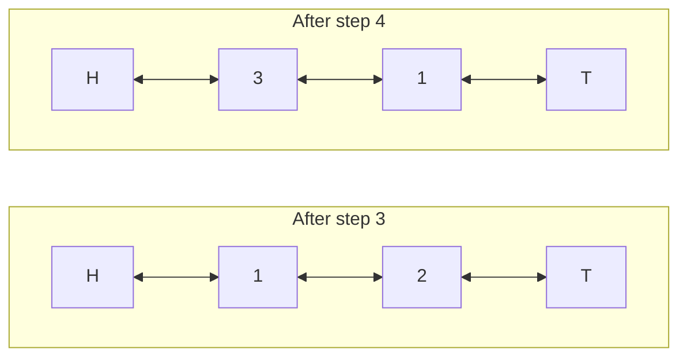

## Intuition

The slow part of the previous version was moving a key to the "most recently used" end, because we first had to search for it. What if we could jump straight to the item we want to move?

Two ideas make that possible.

1. **A hash map from the key to the node.** Instead of storing just the value, the map stores the node of a linked list. A lookup now gives us the exact node in O(1).
2. **A doubly linked list.** Each node knows its previous and its next node. If you hold a node, you can cut it out of the list by connecting its two neighbours to each other, and you can insert it at the front by changing a few pointers. No searching and no shifting: constant time.

The list is kept in order of use. The node next to the front (head) is the most recently used. The node next to the back (tail) is the least recently used and is the one to evict.

**Sentinels.** We add two dummy nodes, a head sentinel and a tail sentinel, that never hold real data. They make every real node have a real neighbour on both sides, so the code needs no special case for an empty list, the first node or the last node. The list is never truly empty: it always contains at least the two sentinels connected to each other.

Think of a line of people in a queue where each person holds the hand of the person in front and behind. When someone leaves the middle, their two neighbours take each other's hands. When someone joins at the front, only three hands change.

## Walkthrough

Scenario: capacity 2, script `put 1 1; put 2 2; get 1; put 3 3; get 2` (the beginning of the first test scenario). The list is shown from head to tail, so the most recently used key is on the left.

| Step | Operation | List (head to tail) | Map keys | Output |
| --- | --- | --- | --- | --- |
| 1 | put 1 1: new node, push at the front | H, 1, T | 1 | |
| 2 | put 2 2: new node, push at the front | H, 2, 1, T | 1, 2 | |
| 3 | get 1: unlink node 1, push at the front | H, 1, 2, T | 1, 2 | 1 |
| 4 | put 3 3: full; tail.prev is node 2, unlink and delete it; push node 3 | H, 3, 1, T | 1, 3 | |
| 5 | get 2: not in the map | H, 3, 1, T | 1, 3 | - |

Here H and T are the sentinels. The picture of step 3 to 4:

Read it as: the node next to the tail sentinel (key 2, the oldest) leaves, and the new node (key 3) enters next to the head sentinel.

**Unlinking a node** takes two assignments: the previous node's `next` becomes this node's `next`, and the next node's `prev` becomes this node's `prev`. **Pushing to the front** takes four: set the node's `prev` to the head and its `next` to the old first node, then make the old first node's `prev` and the head's `next` point to the node. The order matters: set the new node's pointers first, so you do not lose the old first node.

## Complexity

| | Value | Why |
| --- | --- | --- |
| Time of `get` | O(1) | One map lookup, one unlink, one insert at the front: a fixed number of steps. |
| Time of `put` | O(1) | A map lookup, possibly one eviction (unlink the tail node and delete one map entry), one insert. |
| Space | O(n) | One node and one map entry per stored key, where n is the capacity. Plus two sentinels. |

"O(1)" for the hash map is an average. In the worst case with many collisions a lookup can be slower, but a good hash function makes this rare. The linked list part is truly constant.

## Code explanation

1. **Create the sentinels.** The head and the tail point to each other. The real nodes will live between them.
2. **`unlink(node)`.** Connect the node's two neighbours to each other. This works for every real node because every real node has a neighbour on both sides (possibly a sentinel).
3. **`pushFront(node)`.** Insert the node right after the head sentinel. It becomes the most recently used.
4. **`get`.** Look up the node. A miss returns minus one. A hit is moved to the front and its value is returned.
5. **Evict.** When the cache is full and the key is new, the least recently used node is the one just before the tail sentinel. Unlink it and delete its key from the map. This is why the node stores its key.

`put` for an existing key updates the value and moves the node to the front, without evicting anything.

| Language | Notes |
| --- | --- |
| JavaScript / TypeScript | `Map` for the nodes. In TypeScript, `prev` and `next` have the type `Node \| null`, and the code uses `!` where the sentinels guarantee a neighbour exists. |
| Python | Plain classes. `__slots__` on the node saves memory. The standard library already offers `OrderedDict` and `functools.lru_cache`, which you would use in real code. |
| Go | A `map[int]*node` and pointer fields. The struct `node` has a lowercase name because it is not exported. |
| Java | Static nested classes. `LinkedHashMap` with `accessOrder` set to true does all this in the standard library. |
| C# | Nullable reference types (`Node?`) make the sentinel guarantees visible; `!` tells the compiler a neighbour exists. The classes sit after the top-level statements in the file. |
| C++ | The map owns the nodes through `std::unique_ptr`, so erasing a map entry frees the node. The sentinels are plain members, so no allocation is needed for them. Raw pointers are used only for the links. |

## Edge cases and tests

The same eleven scenarios and the same expected output as the list-scan approach (see its notes for the full table). The ones that stress the linked list most:

| Scenario | Output | What it checks |
| --- | --- | --- |
| capacity 1: put 2, get 2, put 3, get 2, get 3 | `1 - 2` | The list holds a single real node; unlink and push must work next to both sentinels. |
| capacity 2: put 1, put 2, put 1 again, put 3, gets | `10 - 3` | Updating a node refreshes its position without growing the list. |
| capacity 3: put 1, 2, 3; get 1, 2; put 4 | `1 2 - 1 2 4` | The middle node is moved; the oldest is evicted from next to the tail. |
| capacity 3: repeated `get 1` | `1 1 - 2 4 - 4 5` | Moving a node that is already at the front must not break the links. |
| capacity 3: stored value zero | `0 0` | A value of 0 is a hit; only minus one means a miss. |
| capacity 2: only misses | `- -` | The list is never touched. |

## When to use it (and when not)

**Use it** as the standard answer for an LRU cache in an interview, and for a hand-written cache in a language without a ready-made structure. The same combination (hash map plus doubly linked list) also supports an LFU cache and many "ordered by use" designs.

**Do not use it** if a ready-made structure fits: `OrderedDict`, `LinkedHashMap`, `functools.lru_cache`. Also not when many threads access it without protection: this code is not thread safe, and even `get` changes shared state. Add a lock, or shard the cache.

## Interview notes

- Say: "A hash map from key to node gives O(1) lookup. A doubly linked list gives O(1) move and remove. Sentinels remove the edge cases."
- Name the invariant: "The list is ordered from most recently used at the head to least recently used at the tail."
- Explain why the node stores the key: "When I evict the tail node I need its key to remove it from the map."
- Likely follow-ups: thread safety, expiry, LFU, and "how would you do it with `LinkedHashMap`?"
- Mistake to avoid: updating pointers in the wrong order in `pushFront`, which loses the old first node. Another mistake: forgetting to touch the node on `get` or on an update.

## Real-life usage

This is how many real LRU caches are built, with variations: memory-bounded caches in language runtimes and mobile image libraries, page caches in storage engines, and the in-memory part of many database buffer managers. Python's `OrderedDict` and Java's `LinkedHashMap` are essentially this structure in a library. Large systems often replace exact LRU with an approximation to avoid contention on the shared list, but the idea of "map plus ordered list" remains the base.
