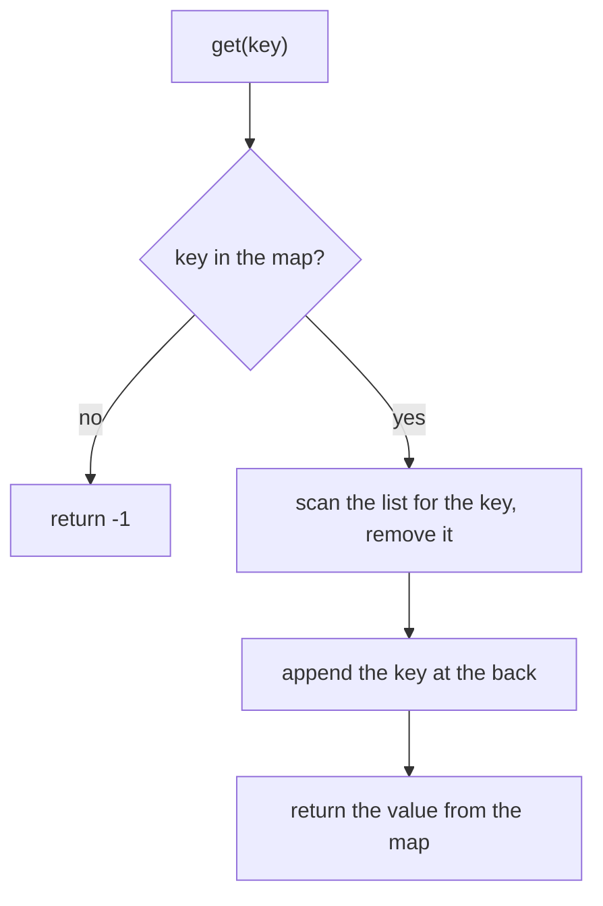

## Intuition

To build an LRU cache you must answer two questions quickly. First: "Is this key in the cache, and what is its value?" Second: "Which key was used the longest time ago?"

A **hash map** answers the first question in one step. For the second, we keep a plain **list of keys sorted by recent use**. The front of the list is the least recently used key. The back is the most recently used key. When a key is used, we move it to the back. When the cache is full and a new key arrives, we remove the key at the front.

This is like a pile of books on a desk. Each time you read a book you put it back on top of the pile. When the desk is full and you bring a new book, you take away the book at the bottom, the one you have not touched for the longest time.

The weak point is the move to the back. To move a key you first have to find it in the list, and a plain list has no index: you scan from the front until you meet the key. That scan takes time proportional to the number of keys, which is why this version is O(n). It is simple and obviously correct, which makes it a good first answer.

## Walkthrough

Scenario: capacity 2, script `put 1 1; put 2 2; get 1; put 3 3; get 2; put 4 4; get 1; get 3; get 4` (the first test scenario). The map holds key to value. The list is shown from least recent (left) to most recent (right).

| Step | Operation | List after | Map after | Output |
| --- | --- | --- | --- | --- |
| 1 | put 1 1 | 1 | {1: 1} | |
| 2 | put 2 2 | 1, 2 | {1: 1, 2: 2} | |
| 3 | get 1 | 2, 1 | unchanged | 1 |
| 4 | put 3 3: full, evict the front (2) | 1, 3 | {1: 1, 3: 3} | |
| 5 | get 2: not in the map | 1, 3 | unchanged | - |
| 6 | put 4 4: full, evict the front (1) | 3, 4 | {3: 3, 4: 4} | |
| 7 | get 1: not in the map | 3, 4 | unchanged | - |
| 8 | get 3 | 4, 3 | unchanged | 3 |
| 9 | get 4 | 3, 4 | unchanged | 4 |

The line printed for the scenario is `1 - - 3 4`. In step 3 the read of key 1 moved it behind key 2, so key 2 became the oldest and was the one evicted in step 4.

Read it as: the map answers "is it there"; the list scan is the slow part.

## Complexity

| | Value | Why |
| --- | --- | --- |
| Time of `get` | O(n) | The map lookup is O(1), but moving the key needs a scan of the list, which can hold up to the capacity n. |
| Time of `put` | O(n) | Updating an existing key scans the list. Evicting from the front of an array-based list shifts all other items by one place. |
| Time, best case | O(1) | A `get` that misses needs only the map lookup and does not touch the list. |
| Space | O(n) | The map and the list each hold up to n keys. |

Here n is the capacity. For a cache with 10 entries nobody notices. For a cache with a million entries every `get` would scan up to a million keys, which is far too slow. That is the motivation for the next approach.

## Code explanation

1. **Find the key in the list (O(n)) and cut it out.** `indexOf`, `list.remove`, `slices.Index` or `std::find` all scan from the front. The code then removes the item at that position, which also costs O(n) for arrays because later items shift left.
2. **Put the key at the back.** It is now the most recently used.
3. **Evict the front.** When the map is full and the new key is not already present, remove the first key from the list and its entry from the map. Do this *before* adding the new key.

The `get` function uses `touch` after checking the map, so a miss never changes the order. `put` calls `touch` for an existing key (an update) and otherwise evicts if needed and appends.

| Language | Map | List | Note |
| --- | --- | --- | --- |
| JavaScript / TypeScript | `Map` | `Array` with `indexOf`, `splice`, `shift` | `shift` is O(n) on arrays. TypeScript needs `!` on `shift()` because it can return `undefined`; the capacity check guarantees there is an item. |
| Python | `dict` | `list` with `remove` and `pop(0)` | `list.remove(x)` scans for the first equal item. `pop(0)` shifts the whole list. |
| Go | `map[int]int` | `[]int` with `slices.Index` and `slices.Delete` | `slices` is in the standard library since Go 1.21. Slicing off the front with `order[1:]` is cheap, though the backing array stays alive. |
| Java | `HashMap<Integer, Integer>` | `ArrayList<Integer>` | `list.remove(Integer.valueOf(key))` removes by value. `list.remove(key)` with an `int` would remove by index and corrupt the cache. |
| C# | `Dictionary<int, int>` | `List<int>` with `Remove` and `RemoveAt` | `Remove(x)` scans for the value, `RemoveAt(0)` removes the first item. |
| C++ | `std::unordered_map<int, int>` | `std::vector<int>` with `std::find` and `erase` | `erase` shifts the later items. The order is stored in a `vector` rather than `std::list` to keep this version as simple as possible. |

## Edge cases and tests

Eleven scenarios, each printing the results of its `get` calls (a dash for a miss). Both approaches use the same scenarios and the same expected output.

| Capacity and script (shortened) | Output | What it checks |
| --- | --- | --- |
| 2: put 1,2; get 1; put 3; get 2; put 4; get 1,3,4 | `1 - - 3 4` | The standard example. A read protects a key from eviction. |
| 1: put 2; get 2; put 3; get 2; get 3 | `1 - 2` | Capacity one: every new key evicts the previous one. |
| 2: put 1,2; put 1 again with a new value; put 3; get 1,2,3 | `10 - 3` | Updating an existing key refreshes it, so key 2 is evicted and key 1 survives with the new value. |
| 3: put 1,2,3; get 1,2; put 4; get 3,1,2,4 | `1 2 - 1 2 4` | The key never used since insertion (3) is evicted. |
| 2: get 5; put 5; get 5 | `- 50` | A miss on an empty cache, then a hit. |
| 2: put 1,2; get 2,1; put 3; get 2,1,3 | `2 1 - 1 3` | Reading in the reverse order changes who is evicted. |
| 1: put 1 twice; get 1; put 2; get 1,2 | `2 - 3` | Updating the same key at capacity one does not evict it. |
| 3: put 0 0; get 0; put 1 0; get 1 | `0 0` | A stored value of zero is a hit, not a miss. |
| 2: get 1; get 2 | `- -` | Only misses. |
| 4: put 1..5; get 1,2; put 6; get 3,5,6,4 | `- 20 - 50 60 40` | A longer sequence with several evictions. |
| 3: a mixed script with repeated reads | `1 1 - 2 4 - 4 5` | Repeated `get` of the same key, then eviction of the oldest. |

## When to use it (and when not)

**Use it** when the capacity is very small (a few dozen entries), when simple code matters more than speed, or as the first version you describe in an interview before improving it.

**Do not use it** for a real cache. Every `get` and `put` scans the list, so the cost grows with the capacity. Use the hash map with a doubly linked list instead, or the language's ready-made structure.

## Interview notes

- Say: "A hash map for the values and a list for the usage order. It is correct, but moving a key means a linear scan."
- Say the cost plainly: "Both get and put are O(n), and the requirement was O(1)."
- Then move on: "To get O(1) I need to find a node and move it in constant time, so I would use a doubly linked list with a map from key to node."
- Mistake to avoid: forgetting to touch the key on `get`, or evicting before deciding whether the key already exists.

## Real-life usage

You see this shape in small caches, such as a "recent files" menu with a maximum of ten items, or a recent searches list. For ten entries a scan is fine and the code is easy to read. For anything larger, caches use the linked list design, a ready-made structure like `LinkedHashMap` or `OrderedDict`, or an approximate policy.
