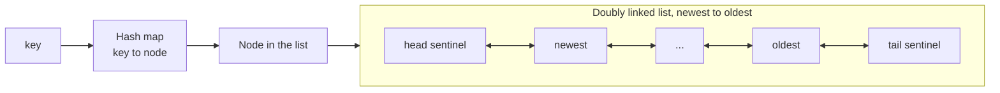
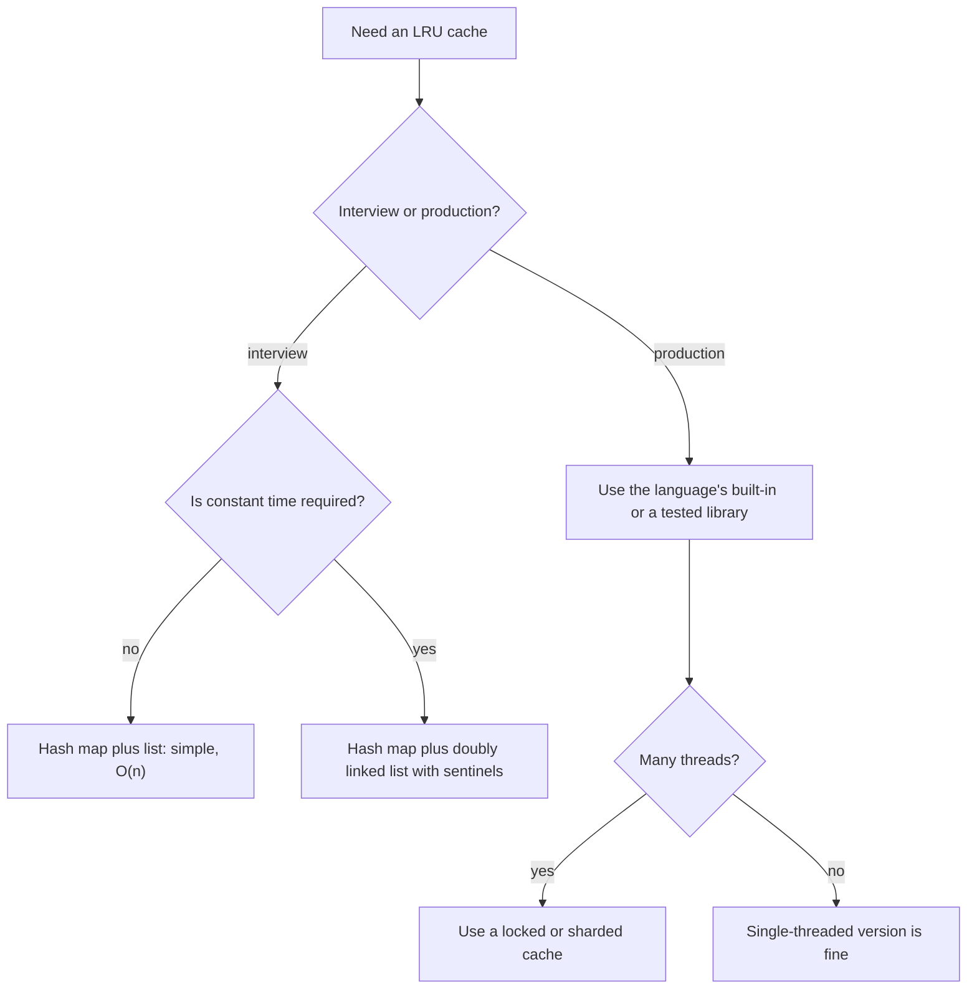

## How interviewers ask it

**The classic wording.** "Design a data structure for a Least Recently Used (LRU) cache. It is created with a fixed capacity. `get(key)` returns the value if the key is in the cache, otherwise it returns minus one. `put(key, value)` inserts or updates the value. When the cache is full, adding a new key must first remove the least recently used key. Both `get` and `put` must run in O(1) average time."

A **cache** is a small, fast store that keeps copies of data that is expensive to fetch or compute. Because the cache is smaller than the data, it must throw something away when it is full. **LRU** is one policy: throw away the item that was used longest ago. The bet is that things used recently will be used again soon.

"Used" means read or written. Both `get` and `put` make a key the most recently used.

This is a **design problem**: there is no single algorithm. You must combine two data structures so that every operation is fast.

**Common variations:**

- *LFU cache.* "Evict the least frequently used key" (a frequency table of lists).
- *Add expiry.* "Each entry has a time to live."
- *Thread safe.* "Many threads call get and put at the same time."
- *Weighted capacity.* "The capacity is in bytes and entries have different sizes."
- *Generic types.* "Make keys and values generic."
- *Design a distributed cache.* (a follow-up that moves into system design)
- *Two-level cache*, or *cache with a loader function* that fills a miss automatically.

**What to clarify before you code:**

| Question to ask | Why it matters |
| --- | --- |
| Does `get` count as a use? Does updating an existing key count? | Usually yes to both. This is the most common source of bugs. |
| What does `get` return on a miss: minus one, null, an optional? | Decides the signature. Minus one only works if values are never negative. |
| Can the capacity be zero? | A special case: nothing can be stored. |
| Do I need to be thread safe? | Even `get` changes the order, so a plain read lock is not enough. |
| Are keys and values integers or generic? | Affects the code, not the idea. |
| Is O(1) required, or is O(n) fine? | Decides whether the simple list approach is acceptable. |

A good answer states the requirement of constant time, shows why a hash map alone and a list alone are not enough, combines them (a hash map from key to node plus a doubly linked list ordered by use), explains the sentinels, and tests the eviction order out loud.

**The output format in this repo.** The programs run scripted scenarios. Each scenario has a capacity and a script of operations written as text. Operations are separated by semicolons, for example `put 1 1; put 2 2; get 1`. The program creates a cache with that capacity, runs the operations in order, and prints **one line per scenario**. The line contains the result of every `get`, separated by single spaces. A hit prints the value, and a miss prints a dash. For example, the scenario `put 1 1; put 2 2; get 1; put 3 3; get 2` with capacity 2 prints `1 -`. Internally `get` returns minus one for a miss, and all test values are zero or more.

## Real-life scenarios

| Scenario | What is actually used | Why |
| --- | --- | --- |
| The browser cache for images, scripts and pages | An LRU-like policy with size limits | Recently viewed pages are likely to be viewed again, and old ones can be fetched again. |
| An operating system file (page) cache | An approximated LRU (Linux uses active and inactive lists) | Exact LRU is too expensive for every memory access, so systems approximate it. |
| A database buffer pool (PostgreSQL, MySQL InnoDB) | A clock sweep in PostgreSQL, an LRU list with a midpoint in InnoDB | Hot pages stay in memory; a big table scan must not push all hot pages out. |
| Redis as a cache with `maxmemory` | `allkeys-lru` samples a few keys and evicts the oldest of them | Exact LRU would need a linked list for every key, which costs memory. |
| A CDN edge server holding videos and images | LRU or a variant by object size | Popular content stays near the users. |
| `functools.lru_cache` in Python, memoisation of pure functions | A bounded LRU map | The cache cannot grow without limit. |
| Mobile apps keeping thumbnails and decoded images | A memory cache with LRU eviction | Memory is limited, and users go back to recent screens. |
| An ORM or API client caching recent query results | A bounded LRU map with a time to live | Avoids repeated database or network calls. |
| CPU caches (L1, L2, L3) | Pseudo-LRU in hardware | A few bits per set approximate the order cheaply. |

In production you almost always use a library or a built-in structure for this. The interview tests whether you understand how it works inside.

## Approaches compared

| Approach | get | put | Space | Use when |
| --- | --- | --- | --- | --- |
| 1. Hash map and list scan | O(n) | O(n) | O(n) | Tiny capacity (say under 50) where simple code matters more. As a first idea in an interview. |
| 2. Hash map and doubly linked list | O(1) | O(1) | O(n) | The expected answer. Anything bigger than a toy. |

Read it as: the map jumps straight to the node, and the list keeps the nodes in usage order, with the newest next to the head and the oldest next to the tail.

**Why two structures?** A hash map finds a key in O(1) but has no useful order for recent use. A list keeps an order, but finding a key in it takes O(n). A doubly linked list can remove a node in O(1) *if you already hold the node*, because the node knows its two neighbours. The map gives you the node. Together every step is constant time.

## How to choose

Start at the top and answer each question. In an interview, start from the simple version, say why it is slow, and then upgrade to the linked list.

## Built-ins and the standard library

Most languages have a ready-made building block. Know them so you can say "in production I would use this".

| Language | Ready-made way | Notes and pitfalls |
| --- | --- | --- |
| JavaScript / TypeScript | `Map` keeps keys in insertion order. To mark a key as recent, `delete` it and `set` it again. The oldest key is `map.keys().next().value`. | A 10-line LRU, but `delete` plus `set` is not a linked list operation under the hood, so do not claim a specific cost. No weak or size-based eviction in the standard library. |
| Python | `collections.OrderedDict` with `move_to_end(key)` and `popitem(last=False)`. For functions, `functools.lru_cache` or `functools.cache`. | `lru_cache` keeps strong references to arguments and results. Arguments must be hashable. It is thread safe for its own data but does not stop two threads computing the same value at once. |
| Go | `container/list` plus a `map`. There is no LRU in the standard library. | `container/list` elements hold `any`, so you need type assertions. A cache that mutates on `Get` needs a `sync.Mutex`, not just a read lock. |
| Java | `LinkedHashMap` with `accessOrder = true`, and override `removeEldestEntry` to evict. | Not thread safe. Wrap it with `Collections.synchronizedMap` or use a library cache for concurrency. |
| C# | No strict LRU in the base class library. `MemoryCache` evicts by size and time, not strict LRU. Use `Dictionary` plus `LinkedList<T>`. | `LinkedList<T>.Remove(node)` is O(1) when you hold the node. |
| C++ | `std::list` plus `std::unordered_map` from key to list iterator, with `list::splice` to move a node to the front in O(1). | Iterators of `std::list` stay valid after splice and insert, which is what makes the map of iterators work. |

**Hand-write or use a library?** Use a library in production, because it already handles thread safety, size limits, expiry and statistics. Hand-write only in interviews, or in very small and special cases.

## Common mistakes

- **Not updating the order on `get`.** A read must make the key the most recently used. Forgetting this evicts items that were just read.
- **Not updating the order on `put` for an existing key.** Updating a value is also a use.
- **Evicting before checking for an update.** If the key already exists, the size does not grow and nothing should be evicted.
- **Forgetting to remove the evicted key from the map.** The node leaves the list but the map still points to it, which is a memory leak and a wrong `get`.
- **Not storing the key in the node.** When you evict the tail node you need its key to delete the map entry.
- **A singly linked list.** To remove a node in O(1) you need its previous node. Singly linked lists cannot do that.
- **Special cases at the ends of the list.** Without sentinel nodes, every insert and remove needs checks for the head and the tail. Sentinels remove all those `if` statements.
- **Order of pointer updates.** In `pushFront`, reading `head.next` after you overwrote it loses the old first node. Write the new node's pointers first.
- **Java list removal.** `list.remove(key)` on a `List<Integer>` removes by index, not by value. Use `remove(Integer.valueOf(key))`.
- **Using a read lock for `get` in a concurrent cache.** `get` changes the order, so it is a write.
- **Capacity zero or negative.** Decide and handle it, or state your assumption.

## How to answer in an interview

1. **Clarify.** "Does `get` count as a use? What does `get` return on a miss? Is the capacity at least one? Do I need thread safety?"
2. **Give an example.** Capacity 2: put 1, put 2, get 1, put 3. Key 2 is evicted, because key 1 was used more recently. Then `get 2` misses.
3. **Say the simple approach.** "A hash map for the values, and a list of keys in usage order. Moving a key means finding it in the list, which is O(n)."
4. **Explain the goal.** "I need to find a node in O(1) and move it in O(1). A hash map finds a node, and a doubly linked list moves a node."
5. **Describe the structure.** "The map goes from key to node. The list goes from most recently used at the front to least recently used at the back. I use two dummy sentinel nodes so there are no edge cases."
6. **Code the helpers first.** `unlink(node)` and `pushFront(node)`. Then `get` and `put` become a few lines each.
7. **Test aloud.** The example above, an update of an existing key, capacity one, and a miss on an empty cache.
8. **State complexity.** "Both operations are O(1). Space is O(capacity)."
9. **Offer extensions.** "For thread safety I would add a mutex. For expiry I would store a deadline in the node. For LFU I would need frequency lists."

## Follow-up questions

- **Why a doubly linked list and not a singly linked one?** To unlink a node in O(1) you must change the `next` of the previous node. A singly linked list does not know the previous node without scanning.
- **Why sentinel nodes?** They make the first and last real nodes look like any other node, so the code has no special cases for an empty list, the head or the tail.
- **Why does the node store its key?** When you evict the least recently used node, you must remove its entry from the hash map, and the map is keyed by key.
- **How do you make it thread safe?** The simplest way is one mutex around `get` and `put`, because even `get` changes the order. For more throughput, split the cache into several independent shards by key hash, each with its own lock, accepting that the LRU order is then per shard.
- **How would you add a time to live?** Store an expiry time in each node. On `get`, treat an expired node as a miss and remove it. A background sweep or lazy cleaning removes the rest. Time comes from a clock, so inject it to keep tests deterministic.
- **How is LFU different, and how do you do it in O(1)?** LFU evicts the key used the fewest times. A known O(1) design keeps a map from key to node and a map from a count to a doubly linked list of keys with that count, plus the current minimum count.
- **What are the weaknesses of LRU?** A single large scan reads many items once and pushes out the hot ones (cache pollution). Variants such as 2Q, ARC, SLRU, TinyLFU and the midpoint insertion in InnoDB handle this.
- **Why do Redis and operating systems use approximate LRU?** Exact LRU needs to update a shared list on every access, which costs memory and adds contention. Sampling a few entries or using a clock hand gives most of the benefit at a small cost.
- **What about write policy?** If the cache sits in front of a database: write-through writes both at once, write-back writes to the cache first and flushes later, and cache-aside leaves the writes to the application. The choice affects consistency and failure handling.
- **How do you avoid a stampede on a miss?** When many callers miss the same key, only one should load it. Use a per-key lock or a "single flight" mechanism and let the others wait for the result.
- **How would you shard a cache over many servers?** Use consistent hashing so adding or removing a server moves only a small part of the keys.

## Practice

- LFU cache (least frequently used), the harder sibling.
- Design a cache with expiry (time to live), and a cache with a size limit in bytes.
- All O(1) data structure (increment, decrement, get max and min key).
- Design a browser history (a doubly linked list with a current pointer).
- Design a hit counter or a rate limiter with a sliding window.
- Insert delete getRandom in O(1) (a hash map plus an array).
- Implement an LRU cache with generics and a loader function in your own language.
