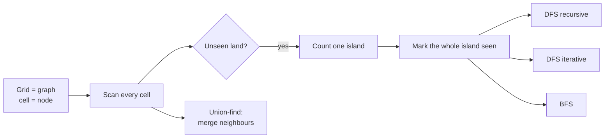
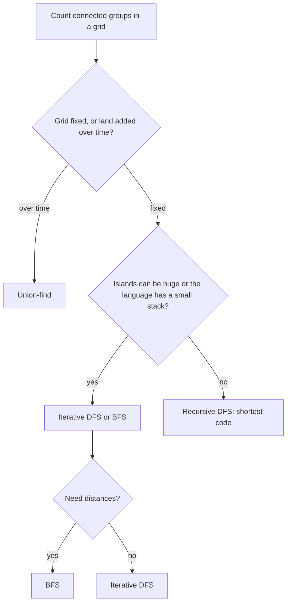
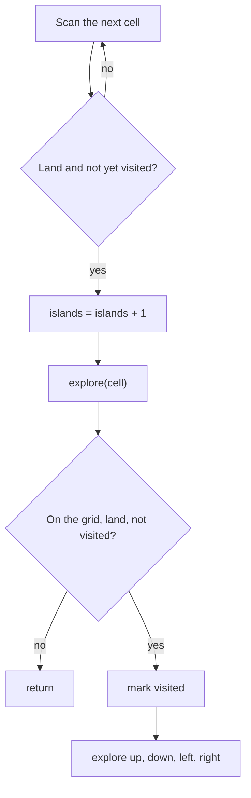
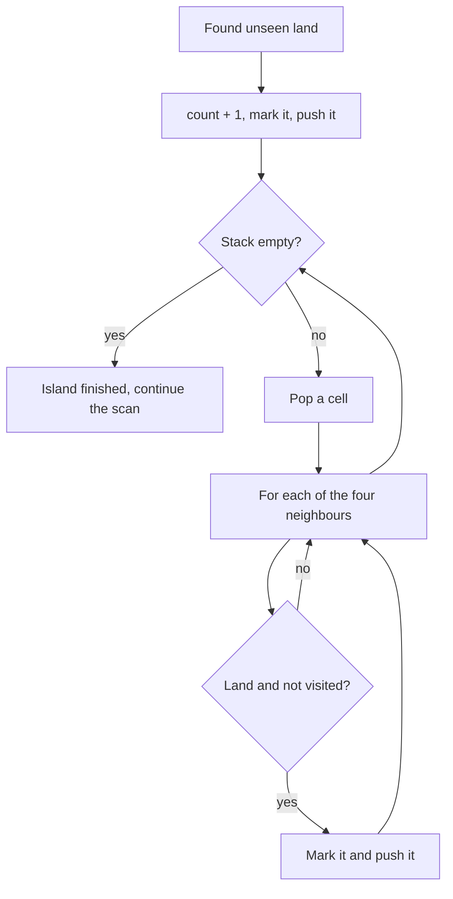
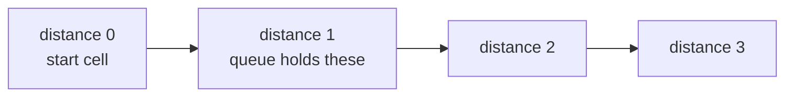
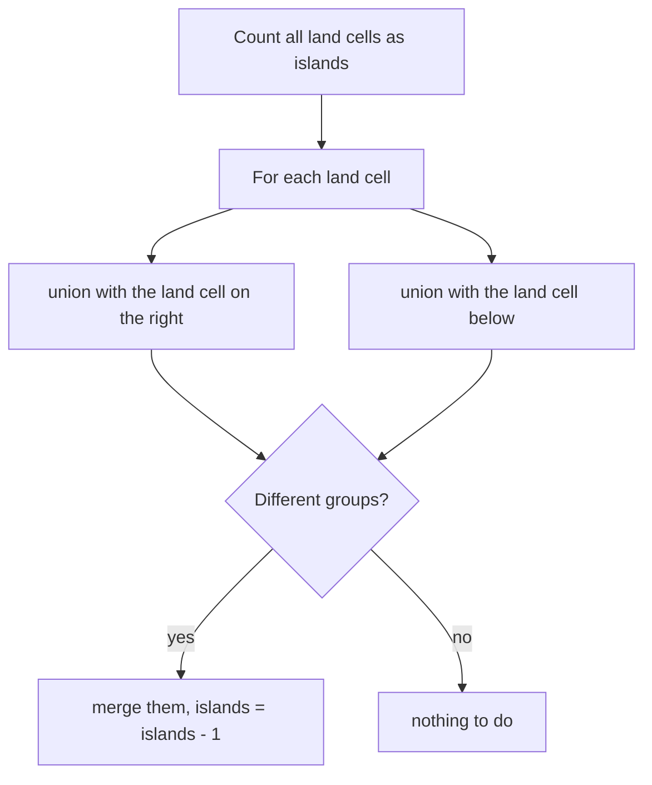

# Number of islands

[← All problems](../README.md)

> Count the connected groups of land in a grid: the classic way to learn flood fill with depth-first search, breadth-first search and union-find.

**Level:** intermediate · **Tags:** graphs, grid, dfs, bfs, union-find, recursion, queue, stack

**Related interview questions:**

- [System Design: Why use message queues, and what problems do they solve?](../../questions/system-design.md)
- [JavaScript: What is the event loop? How do the call stack, task queue and microtasks work?](../../questions/javascript.md)
- [Git & Version Control: What are the commit graph and bitmap indexes, and why do they make Git faster?](../../questions/git-version-control.md)
- [Kubernetes: How do controllers, informers and work queues work?](../../questions/kubernetes.md)
- [Golang: Tech Lead How do you design a Go service for high concurrency: bounded concurrency, queues and backpressure?](../../questions/golang.md)
- [Golang: What is escape analysis? How does Go decide between stack and heap?](../../questions/golang.md)
- [Git & Version Control: What is Git's object model: blobs, trees, commits and tags?](../../questions/git-version-control.md)

## How interviewers ask it

**The classic wording.** "Given a two-dimensional grid of characters where `1` is land and `0` is water, return the number of islands. An island is a group of land cells connected horizontally or vertically, and surrounded by water. You may assume all four edges of the grid are surrounded by water."

For this example grid, the answer is 1:

| | | | | |
| --- | --- | --- | --- | --- |
| 1 | 1 | 1 | 1 | 0 |
| 1 | 1 | 0 | 1 | 0 |
| 1 | 1 | 0 | 0 | 0 |
| 0 | 0 | 0 | 0 | 0 |

And for this one, the answer is 3: a block of four cells in the top left, a single cell in the middle, and a pair at the bottom right.

| | | | | |
| --- | --- | --- | --- | --- |
| 1 | 1 | 0 | 0 | 0 |
| 1 | 1 | 0 | 0 | 0 |
| 0 | 0 | 1 | 0 | 0 |
| 0 | 0 | 0 | 1 | 1 |

This is the standard introduction to **graph traversal on a grid**. A grid is a graph in disguise: every cell is a node, and each cell is connected to its four neighbours (up, down, left, right). An island is a **connected component**: a set of nodes that can all be reached from each other. Counting islands means counting connected components.

**Common variations:**

- *Diagonals count as connected.* (eight neighbours instead of four)
- *The size of the largest island*, or the sizes of all islands.
- *Perimeter of an island*, or the number of distinct island shapes.
- *Surrounded regions*, and *flood fill* (the paint bucket tool).
- *Number of islands II.* "Land cells are added one by one; report the count after each." (union-find shines here)
- *Shortest bridge between two islands*, and *rotting oranges* (breadth-first search from many starting cells).
- *The grid is huge and does not fit in memory.* (process it row by row)

**What to clarify before you code:**

| Question to ask | Why it matters |
| --- | --- |
| Do diagonal neighbours count? | Four directions or eight. The classic version uses four. |
| Is the grid made of characters or numbers? | `'1'` versus `1` is a common bug. |
| May I change the input grid? | Marking visited cells by overwriting land with water saves memory but destroys the input. |
| How large can the grid be? | Decides if recursion is safe: a snake-shaped island can be as deep as the whole grid. |
| Can the grid be empty, or have empty rows? | You must not read `grid[0]` before checking. |
| Are the rows all the same length? | The usual assumption is yes (a rectangle). |

A good answer says "this is counting connected components", scans the grid, and every time it meets land it has not seen before, adds one to the count and uses a traversal to mark the whole island as seen. It states the cost: each cell is visited a constant number of times, so O(rows times columns).

**The input format in this repo.** Each test case is the rows of a grid joined by spaces, for example `11000 11000 00100 00011`. An empty text is an empty grid. The program prints one number per grid. The functions receive the rows as strings and do not change them: they keep their own array of visited cells.

## Real-life scenarios

| Scenario | What is actually used | Why |
| --- | --- | --- |
| The paint bucket tool in an image editor (flood fill) | A queue or stack based fill, or a scanline fill | It spreads from the clicked pixel to all connected pixels of a similar colour. |
| Counting cells, stars or objects in an image (microscopy, astronomy, quality control) | Connected-component labelling in image libraries | Each blob of connected pixels is one object. |
| Geographic maps: counting lakes, islands, forest patches, flood zones | Connected components on raster data | Cells of the same type that touch each other form one region. |
| Social networks and "people you may know" groups | Connected components in a graph | Each separate cluster of friends is one component. |
| Detecting network partitions in a cluster ("split brain") | Connected components of the live-links graph | If the graph has more than one component, parts of the cluster cannot talk to each other. |
| Games: Minesweeper reveal, Go (groups of stones and liberties), strategy-game region capture | Flood fill and union-find | The board is a grid, and groups are connected components. |
| Garbage collection | Marking reachable objects with depth-first search | Anything not reached from the roots is garbage. |
| Dependency analysis and build tools | Graph traversal and components | Finding groups of modules that do not depend on each other lets you build them in parallel. |
| Chip layout and circuit checks | Connected components of wires | Two wires belong to the same net if they are connected. |

The same code with a different definition of "neighbour" solves all of these.

## Approaches compared

Let `R` be the number of rows and `C` the number of columns. All approaches read every cell a constant number of times.

| Approach | Time | Extra space | Recursion? | Use when |
| --- | --- | --- | --- | --- |
| 1. DFS, recursive | O(R C) | O(R C) for the visited grid plus the call stack, which is up to O(R C) deep | Yes | Shortest code. Fine for small grids. |
| 2. DFS, iterative | O(R C) | O(R C) visited, plus the stack on the heap | No | When a single island can be very large. |
| 3. BFS | O(R C) | O(R C) visited, plus a queue holding one ring of cells | No | When distance from the start matters, or you prefer a queue. |
| 4. Union-find | O(R C) times a tiny factor (the inverse Ackermann function) | O(R C) for the parent array | No | When land is added over time, or you need the component of any cell at any moment. |



Read it as: the outer scan is the same for the first three approaches, and they differ only in how they mark an island. Union-find takes a different route and merges neighbours.

## How to choose



Start at the top and answer each question. In an interview, write the recursive DFS first because it is shortest, then say how you would remove the recursion.

## Built-ins and the standard library

No standard library counts islands. What you need are a 2D array, a stack or a queue, and the right integer types.

| Language | Visited grid | Stack and queue | Pitfall |
| --- | --- | --- | --- |
| JavaScript / TypeScript | `Array.from({ length: rows }, () => new Array(cols).fill(false))` | `Array` with `push` and `pop` (stack). For a queue use a head index, because `shift` can be O(n). | `new Array(rows).fill(new Array(cols))` fills every row with the same array. Strings are immutable, so you cannot write `grid[r][c] = '0'` on a string row. |
| Python | `[[False] * cols for _ in range(rows)]` | `list` (stack), `collections.deque` (queue) | `[[False] * cols] * rows` repeats one row object. The default recursion limit is 1000, so a recursive DFS fails on a long snake-shaped island. Strings are immutable. |
| Go | `make([][]bool, rows)` and then `make([]bool, cols)` for each row | A slice for both | Out-of-range indexing panics. Indexing a string gives a byte, so compare with `'1'` (a byte), not `"1"` (a string). |
| Java | `new boolean[rows][cols]` | `ArrayDeque` for both | `charAt(c) == '1'`, not `== 1`. A deep recursion throws `StackOverflowError`. `ArrayDeque` rejects `null`. |
| C# | `new bool[rows, cols]` (rectangular) or `bool[][]` (jagged) | `Stack<T>`, `Queue<T>` | A stack overflow cannot be caught and ends the process. Value tuples `(int, int)` make good cells. |
| C++ | `std::vector<std::vector<char>>` | `std::stack`, `std::queue` | Avoid `std::vector<bool>`: it is a packed special case with odd behaviour. Use `int` for indices, because `size() - 1` on an empty container wraps around. |

**Hand-write or use a library?** In an interview, hand-write it. In production on images or maps, use an image-processing or GIS library (for example, connected-component functions in image libraries) that is optimised and well tested.

## Common mistakes

- **Counting a cell twice.** Forgetting to mark visited, or marking after the recursive calls instead of before, causes endless recursion or double counting.
- **Marking too late in BFS or iterative DFS.** If you mark a cell visited only when you take it out of the queue, the same cell can be added many times. Mark when you add it.
- **Diagonals by mistake.** Using eight directions counts diagonal land as connected. The problem says four.
- **Off the grid.** Check the bounds before reading `grid[r][c]`. Check them in the right order: row and column bounds first, then the cell.
- **Reading `grid[0]` on an empty grid.** Take the number of columns only after checking the number of rows.
- **Comparing with the wrong type.** `'1'` is a character, `1` is a number, and `"1"` is a string. In Java and C++ comparing a `char` with the number 1 is silently false.
- **Changing the input without saying so.** Overwriting `'1'` with `'0'` is a valid trick, but the caller loses the grid. Mention it or use a visited array.
- **Recursion depth.** A snake-shaped island of a million cells needs a million nested calls. Use an explicit stack or a queue.
- **Union-find index mistakes.** Cell `(r, c)` has the id `r * cols + c`, not `r * rows + c`. Using the wrong multiplier maps different cells to the same id.
- **Using union-find without compression or size.** Without them, long chains make find slow.

## How to answer in an interview

1. **Clarify.** "Four or eight neighbours? Characters or numbers? May I change the grid? How big can it be?"
2. **Draw a small grid** and circle the islands. Say: "This is counting connected components in a graph where cells are nodes."
3. **State the plan.** "I scan every cell. When I find land I have not seen, I add one to the count and mark the entire island as seen, so I never count it again."
4. **Pick a traversal.** "Depth-first search with recursion is the shortest. I mark a cell as visited before recursing into its four neighbours, and I check the bounds first."
5. **Code it,** with a separate visited array (or say you flip land to water to save memory).
6. **Test aloud.** The empty grid, a single `1`, all water, all land, and a grid with diagonal land cells that must count separately.
7. **State complexity.** "Each cell is visited a constant number of times, so O(R times C) time. The visited grid is O(R times C), and the recursion can go as deep as the biggest island."
8. **Offer the improvement.** "If the recursion depth is a risk I use an explicit stack or a queue. If land is added over time I use union-find."

## Follow-up questions

- **How do you avoid the extra visited array?** Overwrite visited land with water in the grid itself (or with a third marker character). It saves memory and destroys the input, so say so, or copy first.
- **Why can recursion fail here?** The depth equals the longest chain of newly visited cells. A single snake-like island can have as many cells as the whole grid, so the call stack can overflow (about one thousand frames in Python by default, around ten thousand in JavaScript or Java).
- **DFS or BFS: which is better?** For counting they are equal. BFS uses a queue and visits cells in rings, which also gives shortest distances. DFS with a stack can hold more cells at once on some shapes. Neither is faster in big-O terms.
- **What changes with diagonal connections?** Use eight directions: the four plus the four diagonal offsets. Everything else stays the same.
- **How would you find the largest island?** Count the cells visited in each traversal and keep the maximum. With union-find, keep the size of each root.
- **When is union-find better?** When land cells are added one at a time and you must report the number of islands after each addition. Each addition is a few unions, almost constant time, whereas rerunning a traversal costs O(R C) each time.
- **What is the cost of union-find?** With path compression and union by size, each operation takes amortised O(α(n)) time, where α is the inverse Ackermann function. It is below 5 for any input you can store, so it is effectively constant.
- **What if the grid does not fit in memory?** Read it row by row and keep only the labels of the previous row, with union-find to merge labels. This is how large raster images are labelled.
- **How do you do it in parallel?** Split the grid into tiles, count islands per tile, then merge islands that touch across tile borders with union-find.
- **Why only look right and down in union-find?** Each pair of neighbouring cells needs to be merged once. Looking right and down from every cell visits each pair exactly once and saves half the work.

## Practice

- Max area of island, and island perimeter.
- Surrounded regions, and pacific atlantic water flow.
- Flood fill (the paint bucket) and rotting oranges (multi-source BFS).
- Number of closed islands, and number of distinct islands (shape hashing).
- Number of islands II (union-find with additions).
- Shortest bridge, and walls and gates.
- Clone graph, number of connected components in an undirected graph, and accounts merge (union-find).
- Word search (DFS with backtracking on a grid).

## Further reading

Where to read more at the source. Official docs and references come first.

**Official docs**

- [Python: collections.deque](https://docs.python.org/3/library/collections.html#collections.deque) — A fast double-ended queue for breadth-first search. _(beginner)_
- [Java: ArrayDeque](https://docs.oracle.com/en/java/javase/21/docs/api/java.base/java/util/ArrayDeque.html) — The recommended stack and queue in Java. _(intermediate)_

**Reference**

- [Flood fill (Wikipedia)](https://en.wikipedia.org/wiki/Flood_fill) — The algorithm behind the paint bucket tool, with stack and queue versions. _(beginner)_
- [Depth-first search (Wikipedia)](https://en.wikipedia.org/wiki/Depth-first_search) — How DFS works on graphs, with recursive and iterative forms. _(intermediate)_
- [Breadth-first search (Wikipedia)](https://en.wikipedia.org/wiki/Breadth-first_search) — How BFS works and why it finds shortest paths in unweighted graphs. _(intermediate)_
- [Disjoint-set data structure (Wikipedia)](https://en.wikipedia.org/wiki/Disjoint-set_data_structure) — Union-find with path compression and union by rank or size. _(intermediate)_
- [Connected component (Wikipedia)](https://en.wikipedia.org/wiki/Component_(graph_theory)) — The graph idea behind an island: a maximal set of connected cells. _(intermediate)_
- [C++: std::queue](https://en.cppreference.com/w/cpp/container/queue) — The queue adaptor used for breadth-first search. _(intermediate)_

**Tool**

- [LeetCode: Number of Islands](https://leetcode.com/problems/number-of-islands/) — The original problem statement to practise with an online judge. _(intermediate)_

## Approaches

| Approach | Best | Average | Worst | Space | Stable | In place | Languages |
| --- | --- | --- | --- | --- | --- | --- | --- |
| [Depth-first search (recursive)](#depth-first-search-recursive) | O(rows × cols) | O(rows × cols) | O(rows × cols) | O(rows × cols) | – | – | JavaScript, TypeScript, Python, Go, Java, C#, C++ |
| [Depth-first search (iterative)](#depth-first-search-iterative) | O(rows × cols) | O(rows × cols) | O(rows × cols) | O(rows × cols) | – | – | JavaScript, TypeScript, Python, Go, Java, C#, C++ |
| [Breadth-first search](#breadth-first-search) | O(rows × cols) | O(rows × cols) | O(rows × cols) | O(rows × cols) | – | – | JavaScript, TypeScript, Python, Go, Java, C#, C++ |
| [Union-find (disjoint set)](#union-find-disjoint-set) | O(rows × cols) | O(rows × cols × α) | O(rows × cols × α) | O(rows × cols) | – | – | JavaScript, TypeScript, Python, Go, Java, C#, C++ |

## Depth-first search (recursive)

> Scan the grid; at each unexplored land cell count a new island and explore all its land with recursion.

### Intuition

Imagine looking at a map from above. You want to count the islands. Walk over the map cell by cell. When your finger lands on a piece of land you have not seen before, you say "a new island" and add one to the count. Then you must make sure you do not count the same island again when your finger reaches its other cells. So you do this: **paint the whole island with a marker** before you move on. A marked cell is "already seen".

To paint a whole island from one cell, use **depth-first search**: paint this cell, then do the same thing from its four neighbours (up, down, left, right). Each neighbour paints itself and asks its own neighbours, and so on, like a spreading stain. The stain stops at water, at the edge of the map and at cells that are already painted. When the stain stops, the entire island is painted.

This is called **flood fill**. Counting islands is "scan for unpainted land, flood fill it, add one".

The word **recursion** just means that the painting function calls itself for each neighbour.

### Walkthrough

Use a small grid that is not one of the test cases: `1101 0100 0011`, which has three rows and four columns.

| | c0 | c1 | c2 | c3 |
| --- | --- | --- | --- | --- |
| r0 | 1 | 1 | 0 | 1 |
| r1 | 0 | 1 | 0 | 0 |
| r2 | 0 | 0 | 1 | 1 |

The scan goes row by row, left to right. `E(r,c)` means the explore function for that cell.

| Step | Cell | What happens | Islands |
| --- | --- | --- | --- |
| 1 | (0,0) | Unseen land: count 1. E(0,0) marks it, then tries down (1,0): water. Up and left: off the grid. Right (0,1): land, so E(0,1). | 1 |
| 2 | E(0,1) | Marks (0,1). Down (1,1): land, so E(1,1). | 1 |
| 3 | E(1,1) | Marks (1,1). Down (2,1) water, up (0,1) already marked, right (1,2) water, left (1,0) water. | 1 |
| 4 | back in E(0,1) | Up: off the grid, right (0,2): water, left (0,0): marked. Done. | 1 |
| 5 | (0,1), (0,2) | The scan sees marked land and water: nothing to do. | 1 |
| 6 | (0,3) | Unseen land: count 2. E(0,3) marks it; its neighbours are water or off the grid. | 2 |
| 7 | (1,0) to (2,1) | Water or marked cells: nothing to do. | 2 |
| 8 | (2,2) | Unseen land: count 3. E(2,2) marks it, goes right to (2,3), marks it, and stops. | 3 |
| 9 | (2,3) | Already marked. End of the grid. | 3 |

The answer is 3. Notice how cell (1,1) belongs to the island of (0,0) because it touches (0,1) from below, and how (0,3) is a separate island: nothing land touches it.



Read it as: the scan finds the start of an island, and the explore step spreads through all its cells.

### Complexity

| | Value | Why |
| --- | --- | --- |
| Time | O(R times C) | The scan visits each cell once. The explore function is called for each cell at most five times (once from the scan and once from each neighbour), and it marks a cell only the first time, so the total work is a constant times the number of cells. |
| Space | O(R times C) | The visited grid has one entry per cell. The recursion adds a call stack that, in the worst case (one snake-shaped island through the whole grid), is as deep as the number of cells. |

Here R is the number of rows and C the number of columns. If you overwrite land with water in the input instead of using a visited grid, the extra space is only the call stack.

### Code explanation

1. **Off the grid.** Check the bounds first. Reading a cell outside the grid is a crash or, in C++, undefined behaviour.
2. **Water or already visited.** Both mean "stop spreading here". This is the base case of the recursion.
3. **Mark before going deeper.** The cell must be marked visited before the recursive calls. If you mark it after, the neighbour can ask this cell again and the recursion never ends.
4. **Spread to four neighbours.** Down, up, right and left. Not diagonals.
5. **Count a new island.** In the scan, land that is not visited is the start of an island, and exploring it marks every cell.

| Language | Notes |
| --- | --- |
| JavaScript / TypeScript | The explore function is nested and uses `grid`, `visited`, `rows` and `cols` from the outer function. Rows are strings, read with `grid[r][c]`. |
| Python | A nested function closes over the same variables. The recursion limit (1000 by default) is a real risk for large islands. |
| Go | A recursive closure must be declared first with `var explore func(r, c int)`. Indexing a string gives a `byte`, so compare with `'1'`. |
| Java | A static helper takes the grid and the visited array as parameters. `charAt(c) == '1'` compares characters. |
| C# | A local function with access to the outer variables. `bool[,]` is a rectangular array indexed as `visited[r, c]`. |
| C++ | A static helper takes the grid and visited arrays by reference. `visited` is `vector<vector<char>>` rather than `vector<bool>`. The sizes are converted to `int` before use so that comparisons with negative indices are safe. |

### Edge cases and tests

Fifteen grids; all four approaches use the same grids and the same expected output.

| Grid (rows separated by spaces) | Output | What it checks |
| --- | --- | --- |
| `11110 11010 11000 00000` | `1` | One big island with a notch. |
| `11000 11000 00100 00011` | `3` | Three separate islands of different sizes. |
| empty text | `0` | An empty grid: no row is read. |
| `0` | `0` | A single water cell. |
| `1` | `1` | A single land cell. |
| `000 000` | `0` | Only water. |
| `111 111 111` | `1` | Only land: one island, maximum spreading. |
| `101 010 101` | `5` | Land touching only diagonally is not connected. |
| `1 0 1 0 1` | `3` | A single column (five rows of one cell). |
| `10101` | `3` | A single row. |
| `11011 10001 00100 10001 11011` | `5` | Four corner islands and a middle one. |
| `11111 10001 10101 10001 11111` | `2` | A ring around water, with an island in the middle. |
| `11111 00001 11111 10000 11111` | `1` | A snake: a deep recursion. |
| `110011 110011 001100 001100 110011 110011` | `5` | Blocks touching only at corners. |
| `10 01` | `2` | The smallest diagonal case. |

### When to use it (and when not)

**Use it** for small and medium grids, in interviews, and whenever shortest code matters. It extends naturally to the size of an island (count cells) and to many "region" problems.

**Do not use it** when the grid is large and an island can be very large: the call stack can overflow. Use the iterative versions. Also not when land is added over time and you need the count after each change: use union-find.

### Interview notes

- Say: "A grid is a graph. Counting islands is counting connected components. I scan, and for each unseen land cell I flood fill its island and add one."
- Say the order: "I mark the cell before I recurse, otherwise the recursion would loop."
- Mention the alternative to the visited array: "I could overwrite land with water to save memory, but that changes the input."
- Mention the risk: "The recursion depth can be as large as the grid, so for big grids I would use a stack or a queue."
- Mistake to avoid: checking the cell value before the bounds, or exploring diagonals.

### Real-life usage

Flood fill with recursion or an explicit stack is the heart of the paint bucket tool, of Minesweeper's reveal of empty areas, and of connected-component labelling in image processing. Real implementations use an explicit stack or a scanline method to avoid deep recursion and to run faster on big images.

### Code

Every example prints the same output and is tested (`npm run problems:test`).

<details><summary>JavaScript</summary>

```js
// Number of islands, approach 1: recursive depth-first search. Find a land cell, then explore its whole island.
// '1' is land and '0' is water. Cells touch only up, down, left and right (not diagonally).
function numIslands(grid) {
  const rows = grid.length;
  const cols = rows === 0 ? 0 : grid[0].length;
  const visited = Array.from({ length: rows }, () => new Array(cols).fill(false)); // keeps the input unchanged

  function explore(r, c) {
    if (r < 0 || r >= rows || c < 0 || c >= cols) return; // 1. off the grid
    if (grid[r][c] !== '1' || visited[r][c]) return; // 2. water, or land we already explored
    visited[r][c] = true; // 3. mark before going deeper, so we never come back here
    explore(r + 1, c); // 4. the four neighbours
    explore(r - 1, c);
    explore(r, c + 1);
    explore(r, c - 1);
  }

  let islands = 0;
  for (let r = 0; r < rows; r++) {
    for (let c = 0; c < cols; c++) {
      if (grid[r][c] === '1' && !visited[r][c]) {
        islands++; // 5. unexplored land means a new island
        explore(r, c); // explore marks every cell of it
      }
    }
  }
  return islands;
}

const cases = [
  "11110 11010 11000 00000",
  "11000 11000 00100 00011",
  "",
  "0",
  "1",
  "000 000",
  "111 111 111",
  "101 010 101",
  "1 0 1 0 1",
  "10101",
  "11011 10001 00100 10001 11011",
  "11111 10001 10101 10001 11111",
  "11111 00001 11111 10000 11111",
  "110011 110011 001100 001100 110011 110011",
  "10 01",
];

// Each case is the rows of a grid separated by spaces. '1' is land and '0' is water.
for (const text of cases) console.log(numIslands(text.split(' ').filter(Boolean)));
```

</details>

<details><summary>TypeScript</summary>

```ts
// Number of islands, approach 1: recursive depth-first search. Find a land cell, then explore its whole island.
// '1' is land and '0' is water. Cells touch only up, down, left and right (not diagonally).
function numIslands(grid: string[]): number {
  const rows = grid.length;
  const cols = rows === 0 ? 0 : grid[0].length;
  const visited: boolean[][] = Array.from({ length: rows }, () => new Array<boolean>(cols).fill(false)); // keeps the input unchanged

  function explore(r: number, c: number): void {
    if (r < 0 || r >= rows || c < 0 || c >= cols) return; // 1. off the grid
    if (grid[r][c] !== '1' || visited[r][c]) return; // 2. water, or land we already explored
    visited[r][c] = true; // 3. mark before going deeper, so we never come back here
    explore(r + 1, c); // 4. the four neighbours
    explore(r - 1, c);
    explore(r, c + 1);
    explore(r, c - 1);
  }

  let islands = 0;
  for (let r = 0; r < rows; r++) {
    for (let c = 0; c < cols; c++) {
      if (grid[r][c] === '1' && !visited[r][c]) {
        islands++; // 5. unexplored land means a new island
        explore(r, c); // explore marks every cell of it
      }
    }
  }
  return islands;
}

const cases: string[] = [
  "11110 11010 11000 00000",
  "11000 11000 00100 00011",
  "",
  "0",
  "1",
  "000 000",
  "111 111 111",
  "101 010 101",
  "1 0 1 0 1",
  "10101",
  "11011 10001 00100 10001 11011",
  "11111 10001 10101 10001 11111",
  "11111 00001 11111 10000 11111",
  "110011 110011 001100 001100 110011 110011",
  "10 01",
];

// Each case is the rows of a grid separated by spaces. '1' is land and '0' is water.
for (const text of cases) console.log(numIslands(text.split(' ').filter(Boolean)));
```

</details>

<details><summary>Python</summary>

```python
"""Number of islands, approach 1: recursive depth-first search. Find a land cell, then explore its whole island.

'1' is land and '0' is water. Cells touch only up, down, left and right (not diagonally).
"""


def num_islands(grid):
    rows = len(grid)
    cols = len(grid[0]) if rows else 0
    visited = [[False] * cols for _ in range(rows)]  # keeps the input unchanged

    def explore(r, c):
        if r < 0 or r >= rows or c < 0 or c >= cols:  # 1. off the grid
            return
        if grid[r][c] != "1" or visited[r][c]:  # 2. water, or land we already explored
            return
        visited[r][c] = True  # 3. mark before going deeper, so we never come back here
        explore(r + 1, c)  # 4. the four neighbours
        explore(r - 1, c)
        explore(r, c + 1)
        explore(r, c - 1)

    islands = 0
    for r in range(rows):
        for c in range(cols):
            if grid[r][c] == "1" and not visited[r][c]:
                islands += 1  # 5. unexplored land means a new island
                explore(r, c)  # explore marks every cell of it
    return islands

CASES = [
    "11110 11010 11000 00000",
    "11000 11000 00100 00011",
    "",
    "0",
    "1",
    "000 000",
    "111 111 111",
    "101 010 101",
    "1 0 1 0 1",
    "10101",
    "11011 10001 00100 10001 11011",
    "11111 10001 10101 10001 11111",
    "11111 00001 11111 10000 11111",
    "110011 110011 001100 001100 110011 110011",
    "10 01",
]

# Each case is the rows of a grid separated by spaces. '1' is land and '0' is water.
for text in CASES:
    print(num_islands(text.split()))
```

</details>

<details><summary>Go</summary>

```go
// Number of islands, approach 1: recursive depth-first search. Find a land cell, then explore its whole island.
// '1' is land and '0' is water. Cells touch only up, down, left and right (not diagonally).
package main

import (
	"fmt"
	"strings"
)

func numIslands(grid []string) int {
	rows := len(grid)
	cols := 0
	if rows > 0 {
		cols = len(grid[0])
	}
	visited := make([][]bool, rows) // keeps the input unchanged
	for r := range visited {
		visited[r] = make([]bool, cols)
	}

	var explore func(r, c int)
	explore = func(r, c int) {
		if r < 0 || r >= rows || c < 0 || c >= cols { // 1. off the grid
			return
		}
		if grid[r][c] != '1' || visited[r][c] { // 2. water, or land we already explored
			return
		}
		visited[r][c] = true // 3. mark before going deeper, so we never come back here
		explore(r+1, c)      // 4. the four neighbours
		explore(r-1, c)
		explore(r, c+1)
		explore(r, c-1)
	}

	islands := 0
	for r := 0; r < rows; r++ {
		for c := 0; c < cols; c++ {
			if grid[r][c] == '1' && !visited[r][c] {
				islands++ // 5. unexplored land means a new island
				explore(r, c)
			}
		}
	}
	return islands
}

func main() {
	cases := []string{
		"11110 11010 11000 00000",
		"11000 11000 00100 00011",
		"",
		"0",
		"1",
		"000 000",
		"111 111 111",
		"101 010 101",
		"1 0 1 0 1",
		"10101",
		"11011 10001 00100 10001 11011",
		"11111 10001 10101 10001 11111",
		"11111 00001 11111 10000 11111",
		"110011 110011 001100 001100 110011 110011",
		"10 01",
	}
	// Each case is the rows of a grid separated by spaces. '1' is land and '0' is water.
	for _, text := range cases {
		fmt.Println(numIslands(strings.Fields(text)))
	}
}
```

</details>

<details><summary>Java</summary>

```java
// Number of islands, approach 1: recursive depth-first search. Find a land cell, then explore its whole island.
// '1' is land and '0' is water. Cells touch only up, down, left and right (not diagonally).
public class Main {
    static void explore(String[] grid, boolean[][] visited, int r, int c) {
        if (r < 0 || r >= grid.length || c < 0 || c >= grid[0].length()) return; // 1. off the grid
        if (grid[r].charAt(c) != '1' || visited[r][c]) return; // 2. water, or land we already explored
        visited[r][c] = true; // 3. mark before going deeper, so we never come back here
        explore(grid, visited, r + 1, c); // 4. the four neighbours
        explore(grid, visited, r - 1, c);
        explore(grid, visited, r, c + 1);
        explore(grid, visited, r, c - 1);
    }

    static int numIslands(String[] grid) {
        int rows = grid.length;
        int cols = rows == 0 ? 0 : grid[0].length();
        boolean[][] visited = new boolean[rows][cols]; // keeps the input unchanged; booleans start as false
        int islands = 0;
        for (int r = 0; r < rows; r++) {
            for (int c = 0; c < cols; c++) {
                if (grid[r].charAt(c) == '1' && !visited[r][c]) {
                    islands++; // 5. unexplored land means a new island
                    explore(grid, visited, r, c); // explore marks every cell of it
                }
            }
        }
        return islands;
    }

    public static void main(String[] args) {
        String[] cases = {
            "11110 11010 11000 00000",
            "11000 11000 00100 00011",
            "",
            "0",
            "1",
            "000 000",
            "111 111 111",
            "101 010 101",
            "1 0 1 0 1",
            "10101",
            "11011 10001 00100 10001 11011",
            "11111 10001 10101 10001 11111",
            "11111 00001 11111 10000 11111",
            "110011 110011 001100 001100 110011 110011",
            "10 01",
        };
        // Each case is the rows of a grid separated by spaces. '1' is land and '0' is water.
        for (String text : cases) {
            String[] rows = text.isEmpty() ? new String[0] : text.split(" ");
            System.out.println(numIslands(rows));
        }
    }
}
```

</details>

<details><summary>C#</summary>

```csharp
// Number of islands, approach 1: recursive depth-first search. Find a land cell, then explore its whole island.
// '1' is land and '0' is water. Cells touch only up, down, left and right (not diagonally).
static int NumIslands(string[] grid)
{
    int rows = grid.Length;
    int cols = rows == 0 ? 0 : grid[0].Length;
    var visited = new bool[rows, cols]; // keeps the input unchanged; booleans start as false

    void Explore(int r, int c)
    {
        if (r < 0 || r >= rows || c < 0 || c >= cols) return; // 1. off the grid
        if (grid[r][c] != '1' || visited[r, c]) return; // 2. water, or land we already explored
        visited[r, c] = true; // 3. mark before going deeper, so we never come back here
        Explore(r + 1, c); // 4. the four neighbours
        Explore(r - 1, c);
        Explore(r, c + 1);
        Explore(r, c - 1);
    }

    int islands = 0;
    for (int r = 0; r < rows; r++)
    {
        for (int c = 0; c < cols; c++)
        {
            if (grid[r][c] == '1' && !visited[r, c])
            {
                islands++; // 5. unexplored land means a new island
                Explore(r, c); // explore marks every cell of it
            }
        }
    }
    return islands;
}

string[] cases =
{
    "11110 11010 11000 00000",
    "11000 11000 00100 00011",
    "",
    "0",
    "1",
    "000 000",
    "111 111 111",
    "101 010 101",
    "1 0 1 0 1",
    "10101",
    "11011 10001 00100 10001 11011",
    "11111 10001 10101 10001 11111",
    "11111 00001 11111 10000 11111",
    "110011 110011 001100 001100 110011 110011",
    "10 01",
};

// Each case is the rows of a grid separated by spaces. '1' is land and '0' is water.
foreach (string text in cases)
    Console.WriteLine(NumIslands(text.Split(' ', StringSplitOptions.RemoveEmptyEntries)));
```

</details>

<details><summary>C++</summary>

```cpp
// Number of islands, approach 1: recursive depth-first search. Find a land cell, then explore its whole island.
// '1' is land and '0' is water. Cells touch only up, down, left and right (not diagonally).
#include <iostream>
#include <queue>
#include <sstream>
#include <stack>
#include <string>
#include <utility>
#include <vector>

static void explore(const std::vector<std::string>& grid, std::vector<std::vector<char>>& visited, int r, int c) {
    int rows = static_cast<int>(grid.size());
    int cols = static_cast<int>(grid[0].size());
    if (r < 0 || r >= rows || c < 0 || c >= cols) return; // 1. off the grid
    if (grid[r][c] != '1' || visited[r][c]) return; // 2. water, or land we already explored
    visited[r][c] = 1; // 3. mark before going deeper, so we never come back here
    explore(grid, visited, r + 1, c); // 4. the four neighbours
    explore(grid, visited, r - 1, c);
    explore(grid, visited, r, c + 1);
    explore(grid, visited, r, c - 1);
}

int numIslands(const std::vector<std::string>& grid) {
    int rows = static_cast<int>(grid.size()); // cast first: size() - 1 on an empty container would wrap around
    int cols = rows == 0 ? 0 : static_cast<int>(grid[0].size());
    std::vector<std::vector<char>> visited(rows, std::vector<char>(cols, 0)); // keeps the input unchanged
    int islands = 0;
    for (int r = 0; r < rows; r++) {
        for (int c = 0; c < cols; c++) {
            if (grid[r][c] == '1' && !visited[r][c]) {
                islands++; // 5. unexplored land means a new island
                explore(grid, visited, r, c); // explore marks every cell of it
            }
        }
    }
    return islands;
}

int main() {
    std::vector<std::string> cases = {
        "11110 11010 11000 00000",
        "11000 11000 00100 00011",
        "",
        "0",
        "1",
        "000 000",
        "111 111 111",
        "101 010 101",
        "1 0 1 0 1",
        "10101",
        "11011 10001 00100 10001 11011",
        "11111 10001 10101 10001 11111",
        "11111 00001 11111 10000 11111",
        "110011 110011 001100 001100 110011 110011",
        "10 01",
    };
    // Each case is the rows of a grid separated by spaces. '1' is land and '0' is water.
    for (const auto& text : cases) {
        std::vector<std::string> rows;
        std::istringstream in(text);
        for (std::string row; in >> row;) rows.push_back(row);
        std::cout << numIslands(rows) << "\n";
    }
}
```

</details>

### Expected output

```text
1
3
0
0
1
0
1
5
3
3
5
2
1
5
2
```

## Depth-first search (iterative)

> The same flood fill with an explicit stack, so a huge island cannot overflow the call stack.

### Intuition

The recursive version uses the computer's call stack to remember "where was I?" while it spreads through an island. The call stack is small, and a very large island can fill it up and crash the program. The cure is simple: keep our own pile of cells that still need to be visited. That pile is a **stack**, and it lives in ordinary memory, which is much larger.

The idea is the same as before: find unseen land, count an island, and spread to all connected land. Spreading now looks like this:

1. Put the starting cell on the stack and mark it visited.
2. Take a cell from the top of the stack.
3. Look at its four neighbours. Every neighbour that is land and not yet visited is marked visited and put on the stack.
4. Repeat from step 2 until the stack is empty. Then the whole island has been visited.

Think of it as a to-do list. Each visited cell adds its unvisited neighbours to the list, and you keep working through the list until it is empty. A stack takes the newest item first, which makes the walk go deep before it goes wide, like the recursive version.

One detail matters: **mark a cell when you put it on the stack, not when you take it off.** Otherwise two neighbours can both put the same cell on the stack before either of them has been processed.

### Walkthrough

Use the grid from the recursive notes, which is not one of the test cases: `1101 0100 0011`.

| | c0 | c1 | c2 | c3 |
| --- | --- | --- | --- | --- |
| r0 | 1 | 1 | 0 | 1 |
| r1 | 0 | 1 | 0 | 0 |
| r2 | 0 | 0 | 1 | 1 |

The directions are tried in the order down, up, right, left. The stack top is on the right.

| Step | Action | Stack after | Islands |
| --- | --- | --- | --- |
| 1 | Scan finds (0,0): unseen land. Count it, mark it, push it. | (0,0) | 1 |
| 2 | Pop (0,0). Down (1,0): water. Up: off. Right (0,1): land, mark, push. Left: off. | (0,1) | 1 |
| 3 | Pop (0,1). Down (1,1): land, mark, push. Up: off. Right (0,2): water. Left (0,0): marked. | (1,1) | 1 |
| 4 | Pop (1,1). Down (2,1): water. Up (0,1) marked. Right (1,2): water. Left (1,0): water. | empty | 1 |
| 5 | The stack is empty, so the island is done. The scan continues. | empty | 1 |
| 6 | Scan finds (0,3): unseen land. Count it, mark it, push it. Pop it: all neighbours are water or off the grid. | empty | 2 |
| 7 | Scan finds (2,2): unseen land. Count it, mark it, push it. Pop it: right (2,3) is land, mark, push. Pop (2,3): nothing new. | empty | 3 |

The answer is 3, the same as the recursive version.



Read it as: pop one cell, push its new neighbours, repeat until nothing is left.

### Complexity

| | Value | Why |
| --- | --- | --- |
| Time | O(R times C) | Every cell is pushed at most once (it is marked when pushed) and popped at most once, and each pop looks at four neighbours. |
| Space | O(R times C) | The visited grid is one entry per cell. The stack can hold many cells at once, up to the size of the island in the worst case. |

The memory is on the heap, so there is no stack overflow, unlike the recursive version. The big-O is the same.

### Code explanation

1. **Count a new island.** In the scan, unseen land starts an island.
2. **Create the stack** with the starting cell, which has already been marked visited.
3. **Pop the newest cell.**
4. **Check each neighbour.** Test the bounds first, then the land and visited conditions. If the neighbour qualifies, mark it visited at once and push it.

The list of directions is written once as data, and the loop goes over it. This avoids writing the same four lines four times, and it makes the change to eight directions a one-line edit.

| Language | Stack | Note |
| --- | --- | --- |
| JavaScript / TypeScript | `Array` of `[row, col]` pairs, with `push` and `pop` | TypeScript needs `stack.pop()!` because `pop` can return `undefined`. |
| Python | `list` of tuples | Tuple unpacking in the loop: `cr, cc = stack.pop()`. |
| Go | `[][2]int` slice, popping by re-slicing | `[2]int` is a small value type, so no allocation per cell. |
| Java | `ArrayDeque<int[]>` | `push` and `pop` work at the head. Using `ArrayDeque` is better than the legacy `Stack` class. |
| C# | `Stack<(int, int)>` | A value tuple holds the cell. Deconstruct it with `var (cr, cc) = stack.Pop()`. |
| C++ | `std::stack<std::pair<int, int>>` | Structured bindings `auto [cr, cc] = stack.top()` read the pair. `top` and `pop` are separate calls. |

### Edge cases and tests

The same fifteen grids and expected output as the recursive approach (see its notes for the table). The ones that stress the stack most:

| Grid | Output | What it checks |
| --- | --- | --- |
| `111 111 111` | `1` | Many cells are added by several neighbours; marking at push time prevents duplicates. |
| `11111 00001 11111 10000 11111` | `1` | A snake: the stack never needs recursion however long the path. |
| `101 010 101` | `5` | Diagonal cells are never pushed. |
| empty text | `0` | No loop iteration runs. |
| `11111 10001 10101 10001 11111` | `2` | The ring island and the island inside it are found separately. |

### When to use it (and when not)

**Use it** when islands can be huge, in a language with a small call stack, or when you want to avoid any chance of a stack overflow. It is the version most production flood fills are based on.

**Do not use it** if the grid is tiny and the recursive code is clearer. And note that the stack order is not the same as a true recursion, so if you need the exact depth-first visit order (for example, to build a path), take care.

### Interview notes

- Say: "I replace the recursion by an explicit stack, so a big island cannot overflow the call stack."
- Say: "I mark a cell visited when I push it, so no cell is pushed twice."
- Mention the data-driven directions: "I loop over a list of direction offsets, which makes eight directions a one-line change."
- Likely follow-up: "What is the difference to BFS?" Only the container: a queue instead of a stack.
- Mistake to avoid: marking when popping, which lets the stack grow with duplicates.

### Real-life usage

Production flood fills (image editors, map tools, game engines) use an explicit stack, a queue, or a scanline algorithm instead of recursion, for exactly this reason. Garbage collectors do the same when they mark objects reachable from the roots, because an object graph can be very deep.

### Code

Every example prints the same output and is tested (`npm run problems:test`).

<details><summary>JavaScript</summary>

```js
// Number of islands, approach 2: iterative depth-first search. An explicit stack replaces the call stack,
// so a huge island cannot overflow it. '1' is land and '0' is water; cells touch only up, down, left and right.
function numIslands(grid) {
  const rows = grid.length;
  const cols = rows === 0 ? 0 : grid[0].length;
  const visited = Array.from({ length: rows }, () => new Array(cols).fill(false));
  const directions = [[1, 0], [-1, 0], [0, 1], [0, -1]]; // down, up, right, left
  let islands = 0;

  for (let r = 0; r < rows; r++) {
    for (let c = 0; c < cols; c++) {
      if (grid[r][c] !== '1' || visited[r][c]) continue;
      islands++; // 1. unexplored land means a new island
      visited[r][c] = true;
      const stack = [[r, c]]; // 2. cells waiting to be explored
      while (stack.length > 0) {
        const [cr, cc] = stack.pop(); // 3. take the most recently added cell
        for (const [dr, dc] of directions) {
          const nr = cr + dr;
          const nc = cc + dc;
          if (nr >= 0 && nr < rows && nc >= 0 && nc < cols && grid[nr][nc] === '1' && !visited[nr][nc]) {
            visited[nr][nc] = true; // 4. mark when pushed, so a cell is never pushed twice
            stack.push([nr, nc]);
          }
        }
      }
    }
  }
  return islands;
}

const cases = [
  "11110 11010 11000 00000",
  "11000 11000 00100 00011",
  "",
  "0",
  "1",
  "000 000",
  "111 111 111",
  "101 010 101",
  "1 0 1 0 1",
  "10101",
  "11011 10001 00100 10001 11011",
  "11111 10001 10101 10001 11111",
  "11111 00001 11111 10000 11111",
  "110011 110011 001100 001100 110011 110011",
  "10 01",
];

// Each case is the rows of a grid separated by spaces. '1' is land and '0' is water.
for (const text of cases) console.log(numIslands(text.split(' ').filter(Boolean)));
```

</details>

<details><summary>TypeScript</summary>

```ts
// Number of islands, approach 2: iterative depth-first search. An explicit stack replaces the call stack,
// so a huge island cannot overflow it. '1' is land and '0' is water; cells touch only up, down, left and right.
function numIslands(grid: string[]): number {
  const rows = grid.length;
  const cols = rows === 0 ? 0 : grid[0].length;
  const visited: boolean[][] = Array.from({ length: rows }, () => new Array<boolean>(cols).fill(false));
  const directions: [number, number][] = [[1, 0], [-1, 0], [0, 1], [0, -1]]; // down, up, right, left
  let islands = 0;

  for (let r = 0; r < rows; r++) {
    for (let c = 0; c < cols; c++) {
      if (grid[r][c] !== '1' || visited[r][c]) continue;
      islands++; // 1. unexplored land means a new island
      visited[r][c] = true;
      const stack: [number, number][] = [[r, c]]; // 2. cells waiting to be explored
      while (stack.length > 0) {
        const [cr, cc] = stack.pop()!; // 3. take the most recently added cell
        for (const [dr, dc] of directions) {
          const nr = cr + dr;
          const nc = cc + dc;
          if (nr >= 0 && nr < rows && nc >= 0 && nc < cols && grid[nr][nc] === '1' && !visited[nr][nc]) {
            visited[nr][nc] = true; // 4. mark when pushed, so a cell is never pushed twice
            stack.push([nr, nc]);
          }
        }
      }
    }
  }
  return islands;
}

const cases: string[] = [
  "11110 11010 11000 00000",
  "11000 11000 00100 00011",
  "",
  "0",
  "1",
  "000 000",
  "111 111 111",
  "101 010 101",
  "1 0 1 0 1",
  "10101",
  "11011 10001 00100 10001 11011",
  "11111 10001 10101 10001 11111",
  "11111 00001 11111 10000 11111",
  "110011 110011 001100 001100 110011 110011",
  "10 01",
];

// Each case is the rows of a grid separated by spaces. '1' is land and '0' is water.
for (const text of cases) console.log(numIslands(text.split(' ').filter(Boolean)));
```

</details>

<details><summary>Python</summary>

```python
"""Number of islands, approach 2: iterative depth-first search. An explicit stack replaces the call stack,
so a huge island cannot overflow it. '1' is land and '0' is water; cells touch only up, down, left and right.
"""


def num_islands(grid):
    rows = len(grid)
    cols = len(grid[0]) if rows else 0
    visited = [[False] * cols for _ in range(rows)]
    directions = ((1, 0), (-1, 0), (0, 1), (0, -1))  # down, up, right, left
    islands = 0

    for r in range(rows):
        for c in range(cols):
            if grid[r][c] != "1" or visited[r][c]:
                continue
            islands += 1  # 1. unexplored land means a new island
            visited[r][c] = True
            stack = [(r, c)]  # 2. cells waiting to be explored
            while stack:
                cr, cc = stack.pop()  # 3. take the most recently added cell
                for dr, dc in directions:
                    nr, nc = cr + dr, cc + dc
                    if 0 <= nr < rows and 0 <= nc < cols and grid[nr][nc] == "1" and not visited[nr][nc]:
                        visited[nr][nc] = True  # 4. mark when pushed, so a cell is never pushed twice
                        stack.append((nr, nc))
    return islands

CASES = [
    "11110 11010 11000 00000",
    "11000 11000 00100 00011",
    "",
    "0",
    "1",
    "000 000",
    "111 111 111",
    "101 010 101",
    "1 0 1 0 1",
    "10101",
    "11011 10001 00100 10001 11011",
    "11111 10001 10101 10001 11111",
    "11111 00001 11111 10000 11111",
    "110011 110011 001100 001100 110011 110011",
    "10 01",
]

# Each case is the rows of a grid separated by spaces. '1' is land and '0' is water.
for text in CASES:
    print(num_islands(text.split()))
```

</details>

<details><summary>Go</summary>

```go
// Number of islands, approach 2: iterative depth-first search. An explicit stack replaces the call stack,
// so a huge island cannot overflow it. '1' is land and '0' is water; cells touch only up, down, left and right.
package main

import (
	"fmt"
	"strings"
)

func numIslands(grid []string) int {
	rows := len(grid)
	cols := 0
	if rows > 0 {
		cols = len(grid[0])
	}
	visited := make([][]bool, rows)
	for r := range visited {
		visited[r] = make([]bool, cols)
	}
	directions := [4][2]int{{1, 0}, {-1, 0}, {0, 1}, {0, -1}} // down, up, right, left
	islands := 0

	for r := 0; r < rows; r++ {
		for c := 0; c < cols; c++ {
			if grid[r][c] != '1' || visited[r][c] {
				continue
			}
			islands++ // 1. unexplored land means a new island
			visited[r][c] = true
			stack := [][2]int{{r, c}} // 2. cells waiting to be explored
			for len(stack) > 0 {
				cell := stack[len(stack)-1] // 3. take the most recently added cell
				stack = stack[:len(stack)-1]
				for _, d := range directions {
					nr, nc := cell[0]+d[0], cell[1]+d[1]
					if nr >= 0 && nr < rows && nc >= 0 && nc < cols && grid[nr][nc] == '1' && !visited[nr][nc] {
						visited[nr][nc] = true // 4. mark when pushed, so a cell is never pushed twice
						stack = append(stack, [2]int{nr, nc})
					}
				}
			}
		}
	}
	return islands
}

func main() {
	cases := []string{
		"11110 11010 11000 00000",
		"11000 11000 00100 00011",
		"",
		"0",
		"1",
		"000 000",
		"111 111 111",
		"101 010 101",
		"1 0 1 0 1",
		"10101",
		"11011 10001 00100 10001 11011",
		"11111 10001 10101 10001 11111",
		"11111 00001 11111 10000 11111",
		"110011 110011 001100 001100 110011 110011",
		"10 01",
	}
	// Each case is the rows of a grid separated by spaces. '1' is land and '0' is water.
	for _, text := range cases {
		fmt.Println(numIslands(strings.Fields(text)))
	}
}
```

</details>

<details><summary>Java</summary>

```java
// Number of islands, approach 2: iterative depth-first search. An explicit stack replaces the call stack,
// so a huge island cannot overflow it. '1' is land and '0' is water; cells touch only up, down, left and right.
import java.util.ArrayDeque;
import java.util.Deque;

public class Main {
    static int numIslands(String[] grid) {
        int rows = grid.length;
        int cols = rows == 0 ? 0 : grid[0].length();
        boolean[][] visited = new boolean[rows][cols];
        int[][] directions = {{1, 0}, {-1, 0}, {0, 1}, {0, -1}}; // down, up, right, left
        int islands = 0;

        for (int r = 0; r < rows; r++) {
            for (int c = 0; c < cols; c++) {
                if (grid[r].charAt(c) != '1' || visited[r][c]) continue;
                islands++; // 1. unexplored land means a new island
                visited[r][c] = true;
                Deque<int[]> stack = new ArrayDeque<>(); // 2. cells waiting to be explored
                stack.push(new int[] {r, c});
                while (!stack.isEmpty()) {
                    int[] cell = stack.pop(); // 3. take the most recently added cell
                    for (int[] d : directions) {
                        int nr = cell[0] + d[0];
                        int nc = cell[1] + d[1];
                        if (nr >= 0 && nr < rows && nc >= 0 && nc < cols && grid[nr].charAt(nc) == '1' && !visited[nr][nc]) {
                            visited[nr][nc] = true; // 4. mark when pushed, so a cell is never pushed twice
                            stack.push(new int[] {nr, nc});
                        }
                    }
                }
            }
        }
        return islands;
    }

    public static void main(String[] args) {
        String[] cases = {
            "11110 11010 11000 00000",
            "11000 11000 00100 00011",
            "",
            "0",
            "1",
            "000 000",
            "111 111 111",
            "101 010 101",
            "1 0 1 0 1",
            "10101",
            "11011 10001 00100 10001 11011",
            "11111 10001 10101 10001 11111",
            "11111 00001 11111 10000 11111",
            "110011 110011 001100 001100 110011 110011",
            "10 01",
        };
        // Each case is the rows of a grid separated by spaces. '1' is land and '0' is water.
        for (String text : cases) {
            String[] rows = text.isEmpty() ? new String[0] : text.split(" ");
            System.out.println(numIslands(rows));
        }
    }
}
```

</details>

<details><summary>C#</summary>

```csharp
// Number of islands, approach 2: iterative depth-first search. An explicit stack replaces the call stack,
// so a huge island cannot overflow it. '1' is land and '0' is water; cells touch only up, down, left and right.
static int NumIslands(string[] grid)
{
    int rows = grid.Length;
    int cols = rows == 0 ? 0 : grid[0].Length;
    var visited = new bool[rows, cols];
    (int, int)[] directions = { (1, 0), (-1, 0), (0, 1), (0, -1) }; // down, up, right, left
    int islands = 0;

    for (int r = 0; r < rows; r++)
    {
        for (int c = 0; c < cols; c++)
        {
            if (grid[r][c] != '1' || visited[r, c]) continue;
            islands++; // 1. unexplored land means a new island
            visited[r, c] = true;
            var stack = new Stack<(int, int)>(); // 2. cells waiting to be explored
            stack.Push((r, c));
            while (stack.Count > 0)
            {
                var (cr, cc) = stack.Pop(); // 3. take the most recently added cell
                foreach (var (dr, dc) in directions)
                {
                    int nr = cr + dr, nc = cc + dc;
                    if (nr >= 0 && nr < rows && nc >= 0 && nc < cols && grid[nr][nc] == '1' && !visited[nr, nc])
                    {
                        visited[nr, nc] = true; // 4. mark when pushed, so a cell is never pushed twice
                        stack.Push((nr, nc));
                    }
                }
            }
        }
    }
    return islands;
}

string[] cases =
{
    "11110 11010 11000 00000",
    "11000 11000 00100 00011",
    "",
    "0",
    "1",
    "000 000",
    "111 111 111",
    "101 010 101",
    "1 0 1 0 1",
    "10101",
    "11011 10001 00100 10001 11011",
    "11111 10001 10101 10001 11111",
    "11111 00001 11111 10000 11111",
    "110011 110011 001100 001100 110011 110011",
    "10 01",
};

// Each case is the rows of a grid separated by spaces. '1' is land and '0' is water.
foreach (string text in cases)
    Console.WriteLine(NumIslands(text.Split(' ', StringSplitOptions.RemoveEmptyEntries)));
```

</details>

<details><summary>C++</summary>

```cpp
// Number of islands, approach 2: iterative depth-first search. An explicit stack replaces the call stack,
// so a huge island cannot overflow it. '1' is land and '0' is water; cells touch only up, down, left and right.
#include <array>
#include <iostream>
#include <queue>
#include <sstream>
#include <stack>
#include <string>
#include <utility>
#include <vector>

int numIslands(const std::vector<std::string>& grid) {
    int rows = static_cast<int>(grid.size()); // cast first: size() - 1 on an empty container would wrap around
    int cols = rows == 0 ? 0 : static_cast<int>(grid[0].size());
    std::vector<std::vector<char>> visited(rows, std::vector<char>(cols, 0));
    const std::array<std::pair<int, int>, 4> directions = {{{1, 0}, {-1, 0}, {0, 1}, {0, -1}}}; // down, up, right, left
    int islands = 0;

    for (int r = 0; r < rows; r++) {
        for (int c = 0; c < cols; c++) {
            if (grid[r][c] != '1' || visited[r][c]) continue;
            islands++; // 1. unexplored land means a new island
            visited[r][c] = 1;
            std::stack<std::pair<int, int>> stack; // 2. cells waiting to be explored
            stack.push({r, c});
            while (!stack.empty()) {
                auto [cr, cc] = stack.top(); // 3. take the most recently added cell
                stack.pop();
                for (const auto& [dr, dc] : directions) {
                    int nr = cr + dr, nc = cc + dc;
                    if (nr >= 0 && nr < rows && nc >= 0 && nc < cols && grid[nr][nc] == '1' && !visited[nr][nc]) {
                        visited[nr][nc] = 1; // 4. mark when pushed, so a cell is never pushed twice
                        stack.push({nr, nc});
                    }
                }
            }
        }
    }
    return islands;
}

int main() {
    std::vector<std::string> cases = {
        "11110 11010 11000 00000",
        "11000 11000 00100 00011",
        "",
        "0",
        "1",
        "000 000",
        "111 111 111",
        "101 010 101",
        "1 0 1 0 1",
        "10101",
        "11011 10001 00100 10001 11011",
        "11111 10001 10101 10001 11111",
        "11111 00001 11111 10000 11111",
        "110011 110011 001100 001100 110011 110011",
        "10 01",
    };
    // Each case is the rows of a grid separated by spaces. '1' is land and '0' is water.
    for (const auto& text : cases) {
        std::vector<std::string> rows;
        std::istringstream in(text);
        for (std::string row; in >> row;) rows.push_back(row);
        std::cout << numIslands(rows) << "\n";
    }
}
```

</details>

### Expected output

```text
1
3
0
0
1
0
1
5
3
3
5
2
1
5
2
```

## Breadth-first search

> Explore each island ring by ring with a queue; the same cost, and a natural fit when distance matters.

### Intuition

Depth-first search dives down one path as far as it can. **Breadth-first search** (BFS) spreads out evenly instead, like a ripple in a pond or a drop of ink on wet paper. From the starting cell it visits all cells one step away, then all cells two steps away, then three, and so on. The container that makes this work is a **queue**: the line at a shop, where the first person to arrive is served first.

The counting logic is the same as in the other approaches: scan the grid, and every time you meet land you have not visited, you have found a new island. Add one to the count, and then visit its whole island to mark it.

To visit the island with a queue:

1. Put the start cell in the queue and mark it visited.
2. Take the oldest cell from the front of the queue.
3. For each of its four neighbours that is land and not visited, mark it and add it to the back of the queue.
4. Repeat until the queue is empty.

For counting islands, BFS and DFS give the same answer and cost the same. BFS is worth knowing because it also gives you the **shortest distance** from the start cell to every other cell, which many grid problems need (shortest path in a maze, rotting oranges, walls and gates).

### Walkthrough

The same example grid as in the other approaches, which is not one of the test cases: `1101 0100 0011`.

| | c0 | c1 | c2 | c3 |
| --- | --- | --- | --- | --- |
| r0 | 1 | 1 | 0 | 1 |
| r1 | 0 | 1 | 0 | 0 |
| r2 | 0 | 0 | 1 | 1 |

The queue is written with the front on the left.

| Step | Action | Queue after | Islands |
| --- | --- | --- | --- |
| 1 | Scan finds (0,0): unseen land. Count it, mark it, enqueue it. | (0,0) | 1 |
| 2 | Dequeue (0,0). Right (0,1) is land: mark and enqueue. Other neighbours are water or off the grid. | (0,1) | 1 |
| 3 | Dequeue (0,1). Down (1,1) is land: mark and enqueue. | (1,1) | 1 |
| 4 | Dequeue (1,1). All neighbours are water or marked. | empty | 1 |
| 5 | Scan finds (0,3): count 2, mark, enqueue, dequeue; nothing new. | empty | 2 |
| 6 | Scan finds (2,2): count 3, mark, enqueue. Dequeue it: right (2,3) is land, mark and enqueue. Dequeue (2,3): nothing new. | empty | 3 |

The answer is 3. For a larger island the queue would hold a ring of cells, and the picture of the visit would be like ripples:

| | c0 | c1 | c2 |
| --- | --- | --- | --- |
| r0 | 0 | 1 | 2 |
| r1 | 1 | 2 | 3 |
| r2 | 2 | 3 | 4 |

The numbers show the distance in steps from the top-left cell. BFS visits all the 1s, then all the 2s, then the 3s. The first ring is cheap, and the ring size is the size of the queue.



Read it as: each ring of cells is fully processed before the next ring starts, because the queue serves the oldest cells first.

### Complexity

| | Value | Why |
| --- | --- | --- |
| Time | O(R times C) | Each cell is enqueued at most once (it is marked when enqueued) and dequeued at most once, with four neighbour checks. |
| Space | O(R times C) | The visited grid is one entry per cell. The queue holds only the current ring of cells, which is at most the order of the shorter side of the grid, so the queue is small. The visited grid dominates. |

A queue is the better choice for memory on large open grids: the ring is much smaller than the whole island. A stack can hold a large part of the island at once.

### Code explanation

1. **Count a new island.** Unseen land found by the scan.
2. **Create the queue** with the starting cell, which is already marked.
3. **Take the oldest cell.** In JavaScript and TypeScript a head index walks along the array, because `shift` can be slow; the others use a real queue type (`deque`, `ArrayDeque`, `Queue`, `std::queue`) or a slice.
4. **Mark when adding.** A cell is marked visited the moment it enters the queue so that it is added only once.

| Language | Queue | Note |
| --- | --- | --- |
| JavaScript / TypeScript | `Array` with a moving head index | The array only grows during one island; that is fine for a short-lived structure. |
| Python | `collections.deque` with `popleft` | `list.pop(0)` would be O(n) per call. |
| Go | A slice, taking from the front with `queue[1:]` | Re-slicing is cheap; the underlying array grows only while the island is explored. |
| Java | `ArrayDeque` through the `Queue` interface (`add`, `remove`) | `LinkedList` also works but is slower and bigger. |
| C# | `Queue<(int, int)>` with `Enqueue` and `Dequeue` | Value tuples avoid allocating an object per cell. |
| C++ | `std::queue<std::pair<int, int>>` | `front` then `pop`. |

### Edge cases and tests

The same fifteen grids and expected output as the other approaches (see the recursive notes for the table). The ones that stress the queue most:

| Grid | Output | What it checks |
| --- | --- | --- |
| `111 111 111` | `1` | A cell reachable from several neighbours is enqueued only once, thanks to marking at enqueue time. |
| `11111 00001 11111 10000 11111` | `1` | A snake: the queue always holds one or two cells. |
| `11111 10001 10101 10001 11111` | `2` | A ring and an island inside it. |
| `101 010 101` | `5` | No diagonal moves are made. |
| empty text | `0` | No loop iteration runs. |

### When to use it (and when not)

**Use it** when you may also need distances (shortest path in a grid, spreading problems), or when you want to keep the working memory small on wide open areas.

**Do not use it** for anything that must follow one path to the end before trying another, like finding all paths or backtracking (word search): those need depth-first search.

### Interview notes

- Say: "BFS uses a queue and visits cells ring by ring. I mark a cell when I add it so it is never added twice."
- Mention what BFS gives you for free: "The number of rings is the shortest distance from the start, which DFS would not give."
- Mention the data structure: "In Python I use `deque`, because `list.pop(0)` is linear."
- Likely follow-up: "What is the difference between BFS and DFS here?" Only the container: a queue or a stack. The count is the same.
- Mistake to avoid: marking when dequeuing, which lets the queue fill with duplicates.

### Real-life usage

BFS on a grid is behind shortest-path features in games and robotics on simple maps, "spread" simulations (fire, infection, flood), and level-by-level processing. On general graphs it underlies web crawlers that go a fixed number of links deep, social network "degrees of separation", and many routing algorithms.

### Code

Every example prints the same output and is tested (`npm run problems:test`).

<details><summary>JavaScript</summary>

```js
// Number of islands, approach 3: breadth-first search. A queue explores the island in rings around the first cell,
// and never recurses. '1' is land and '0' is water; cells touch only up, down, left and right.
function numIslands(grid) {
  const rows = grid.length;
  const cols = rows === 0 ? 0 : grid[0].length;
  const visited = Array.from({ length: rows }, () => new Array(cols).fill(false));
  const directions = [[1, 0], [-1, 0], [0, 1], [0, -1]]; // down, up, right, left
  let islands = 0;

  for (let r = 0; r < rows; r++) {
    for (let c = 0; c < cols; c++) {
      if (grid[r][c] !== '1' || visited[r][c]) continue;
      islands++; // 1. unexplored land means a new island
      visited[r][c] = true;
      const queue = [[r, c]]; // 2. cells waiting to be explored (a head index avoids the slow Array.shift)
      for (let head = 0; head < queue.length; head++) {
        const [cr, cc] = queue[head]; // 3. take the oldest waiting cell
        for (const [dr, dc] of directions) {
          const nr = cr + dr;
          const nc = cc + dc;
          if (nr >= 0 && nr < rows && nc >= 0 && nc < cols && grid[nr][nc] === '1' && !visited[nr][nc]) {
            visited[nr][nc] = true; // 4. mark when added, so a cell is never added twice
            queue.push([nr, nc]);
          }
        }
      }
    }
  }
  return islands;
}

const cases = [
  "11110 11010 11000 00000",
  "11000 11000 00100 00011",
  "",
  "0",
  "1",
  "000 000",
  "111 111 111",
  "101 010 101",
  "1 0 1 0 1",
  "10101",
  "11011 10001 00100 10001 11011",
  "11111 10001 10101 10001 11111",
  "11111 00001 11111 10000 11111",
  "110011 110011 001100 001100 110011 110011",
  "10 01",
];

// Each case is the rows of a grid separated by spaces. '1' is land and '0' is water.
for (const text of cases) console.log(numIslands(text.split(' ').filter(Boolean)));
```

</details>

<details><summary>TypeScript</summary>

```ts
// Number of islands, approach 3: breadth-first search. A queue explores the island in rings around the first cell,
// and never recurses. '1' is land and '0' is water; cells touch only up, down, left and right.
function numIslands(grid: string[]): number {
  const rows = grid.length;
  const cols = rows === 0 ? 0 : grid[0].length;
  const visited: boolean[][] = Array.from({ length: rows }, () => new Array<boolean>(cols).fill(false));
  const directions: [number, number][] = [[1, 0], [-1, 0], [0, 1], [0, -1]]; // down, up, right, left
  let islands = 0;

  for (let r = 0; r < rows; r++) {
    for (let c = 0; c < cols; c++) {
      if (grid[r][c] !== '1' || visited[r][c]) continue;
      islands++; // 1. unexplored land means a new island
      visited[r][c] = true;
      const queue: [number, number][] = [[r, c]]; // 2. cells waiting to be explored (a head index avoids the slow Array.shift)
      for (let head = 0; head < queue.length; head++) {
        const [cr, cc] = queue[head]; // 3. take the oldest waiting cell
        for (const [dr, dc] of directions) {
          const nr = cr + dr;
          const nc = cc + dc;
          if (nr >= 0 && nr < rows && nc >= 0 && nc < cols && grid[nr][nc] === '1' && !visited[nr][nc]) {
            visited[nr][nc] = true; // 4. mark when added, so a cell is never added twice
            queue.push([nr, nc]);
          }
        }
      }
    }
  }
  return islands;
}

const cases: string[] = [
  "11110 11010 11000 00000",
  "11000 11000 00100 00011",
  "",
  "0",
  "1",
  "000 000",
  "111 111 111",
  "101 010 101",
  "1 0 1 0 1",
  "10101",
  "11011 10001 00100 10001 11011",
  "11111 10001 10101 10001 11111",
  "11111 00001 11111 10000 11111",
  "110011 110011 001100 001100 110011 110011",
  "10 01",
];

// Each case is the rows of a grid separated by spaces. '1' is land and '0' is water.
for (const text of cases) console.log(numIslands(text.split(' ').filter(Boolean)));
```

</details>

<details><summary>Python</summary>

```python
"""Number of islands, approach 3: breadth-first search. A queue explores the island in rings around the first cell,
and never recurses. '1' is land and '0' is water; cells touch only up, down, left and right.
"""


from collections import deque


def num_islands(grid):
    rows = len(grid)
    cols = len(grid[0]) if rows else 0
    visited = [[False] * cols for _ in range(rows)]
    directions = ((1, 0), (-1, 0), (0, 1), (0, -1))  # down, up, right, left
    islands = 0

    for r in range(rows):
        for c in range(cols):
            if grid[r][c] != "1" or visited[r][c]:
                continue
            islands += 1  # 1. unexplored land means a new island
            visited[r][c] = True
            queue = deque([(r, c)])  # 2. cells waiting to be explored
            while queue:
                cr, cc = queue.popleft()  # 3. take the oldest waiting cell
                for dr, dc in directions:
                    nr, nc = cr + dr, cc + dc
                    if 0 <= nr < rows and 0 <= nc < cols and grid[nr][nc] == "1" and not visited[nr][nc]:
                        visited[nr][nc] = True  # 4. mark when pushed, so a cell is never pushed twice
                        queue.append((nr, nc))
    return islands

CASES = [
    "11110 11010 11000 00000",
    "11000 11000 00100 00011",
    "",
    "0",
    "1",
    "000 000",
    "111 111 111",
    "101 010 101",
    "1 0 1 0 1",
    "10101",
    "11011 10001 00100 10001 11011",
    "11111 10001 10101 10001 11111",
    "11111 00001 11111 10000 11111",
    "110011 110011 001100 001100 110011 110011",
    "10 01",
]

# Each case is the rows of a grid separated by spaces. '1' is land and '0' is water.
for text in CASES:
    print(num_islands(text.split()))
```

</details>

<details><summary>Go</summary>

```go
// Number of islands, approach 3: breadth-first search. A queue explores the island in rings around the first cell,
// and never recurses. '1' is land and '0' is water; cells touch only up, down, left and right.
package main

import (
	"fmt"
	"strings"
)

func numIslands(grid []string) int {
	rows := len(grid)
	cols := 0
	if rows > 0 {
		cols = len(grid[0])
	}
	visited := make([][]bool, rows)
	for r := range visited {
		visited[r] = make([]bool, cols)
	}
	directions := [4][2]int{{1, 0}, {-1, 0}, {0, 1}, {0, -1}} // down, up, right, left
	islands := 0

	for r := 0; r < rows; r++ {
		for c := 0; c < cols; c++ {
			if grid[r][c] != '1' || visited[r][c] {
				continue
			}
			islands++ // 1. unexplored land means a new island
			visited[r][c] = true
			queue := [][2]int{{r, c}} // 2. cells waiting to be explored
			for len(queue) > 0 {
				cell := queue[0] // 3. take the oldest waiting cell
				queue = queue[1:]
				for _, d := range directions {
					nr, nc := cell[0]+d[0], cell[1]+d[1]
					if nr >= 0 && nr < rows && nc >= 0 && nc < cols && grid[nr][nc] == '1' && !visited[nr][nc] {
						visited[nr][nc] = true // 4. mark when added, so a cell is never added twice
						queue = append(queue, [2]int{nr, nc})
					}
				}
			}
		}
	}
	return islands
}

func main() {
	cases := []string{
		"11110 11010 11000 00000",
		"11000 11000 00100 00011",
		"",
		"0",
		"1",
		"000 000",
		"111 111 111",
		"101 010 101",
		"1 0 1 0 1",
		"10101",
		"11011 10001 00100 10001 11011",
		"11111 10001 10101 10001 11111",
		"11111 00001 11111 10000 11111",
		"110011 110011 001100 001100 110011 110011",
		"10 01",
	}
	// Each case is the rows of a grid separated by spaces. '1' is land and '0' is water.
	for _, text := range cases {
		fmt.Println(numIslands(strings.Fields(text)))
	}
}
```

</details>

<details><summary>Java</summary>

```java
// Number of islands, approach 3: breadth-first search. A queue explores the island in rings around the first cell,
// and never recurses. '1' is land and '0' is water; cells touch only up, down, left and right.
import java.util.ArrayDeque;
import java.util.Queue;

public class Main {
    static int numIslands(String[] grid) {
        int rows = grid.length;
        int cols = rows == 0 ? 0 : grid[0].length();
        boolean[][] visited = new boolean[rows][cols];
        int[][] directions = {{1, 0}, {-1, 0}, {0, 1}, {0, -1}}; // down, up, right, left
        int islands = 0;

        for (int r = 0; r < rows; r++) {
            for (int c = 0; c < cols; c++) {
                if (grid[r].charAt(c) != '1' || visited[r][c]) continue;
                islands++; // 1. unexplored land means a new island
                visited[r][c] = true;
                Queue<int[]> queue = new ArrayDeque<>(); // 2. cells waiting to be explored
                queue.add(new int[] {r, c});
                while (!queue.isEmpty()) {
                    int[] cell = queue.remove(); // 3. take the oldest waiting cell
                    for (int[] d : directions) {
                        int nr = cell[0] + d[0];
                        int nc = cell[1] + d[1];
                        if (nr >= 0 && nr < rows && nc >= 0 && nc < cols && grid[nr].charAt(nc) == '1' && !visited[nr][nc]) {
                            visited[nr][nc] = true; // 4. mark when added, so a cell is never added twice
                            queue.add(new int[] {nr, nc});
                        }
                    }
                }
            }
        }
        return islands;
    }

    public static void main(String[] args) {
        String[] cases = {
            "11110 11010 11000 00000",
            "11000 11000 00100 00011",
            "",
            "0",
            "1",
            "000 000",
            "111 111 111",
            "101 010 101",
            "1 0 1 0 1",
            "10101",
            "11011 10001 00100 10001 11011",
            "11111 10001 10101 10001 11111",
            "11111 00001 11111 10000 11111",
            "110011 110011 001100 001100 110011 110011",
            "10 01",
        };
        // Each case is the rows of a grid separated by spaces. '1' is land and '0' is water.
        for (String text : cases) {
            String[] rows = text.isEmpty() ? new String[0] : text.split(" ");
            System.out.println(numIslands(rows));
        }
    }
}
```

</details>

<details><summary>C#</summary>

```csharp
// Number of islands, approach 3: breadth-first search. A queue explores the island in rings around the first cell,
// and never recurses. '1' is land and '0' is water; cells touch only up, down, left and right.
static int NumIslands(string[] grid)
{
    int rows = grid.Length;
    int cols = rows == 0 ? 0 : grid[0].Length;
    var visited = new bool[rows, cols];
    (int, int)[] directions = { (1, 0), (-1, 0), (0, 1), (0, -1) }; // down, up, right, left
    int islands = 0;

    for (int r = 0; r < rows; r++)
    {
        for (int c = 0; c < cols; c++)
        {
            if (grid[r][c] != '1' || visited[r, c]) continue;
            islands++; // 1. unexplored land means a new island
            visited[r, c] = true;
            var queue = new Queue<(int, int)>(); // 2. cells waiting to be explored
            queue.Enqueue((r, c));
            while (queue.Count > 0)
            {
                var (cr, cc) = queue.Dequeue(); // 3. take the oldest waiting cell
                foreach (var (dr, dc) in directions)
                {
                    int nr = cr + dr, nc = cc + dc;
                    if (nr >= 0 && nr < rows && nc >= 0 && nc < cols && grid[nr][nc] == '1' && !visited[nr, nc])
                    {
                        visited[nr, nc] = true; // 4. mark when added, so a cell is never added twice
                        queue.Enqueue((nr, nc));
                    }
                }
            }
        }
    }
    return islands;
}

string[] cases =
{
    "11110 11010 11000 00000",
    "11000 11000 00100 00011",
    "",
    "0",
    "1",
    "000 000",
    "111 111 111",
    "101 010 101",
    "1 0 1 0 1",
    "10101",
    "11011 10001 00100 10001 11011",
    "11111 10001 10101 10001 11111",
    "11111 00001 11111 10000 11111",
    "110011 110011 001100 001100 110011 110011",
    "10 01",
};

// Each case is the rows of a grid separated by spaces. '1' is land and '0' is water.
foreach (string text in cases)
    Console.WriteLine(NumIslands(text.Split(' ', StringSplitOptions.RemoveEmptyEntries)));
```

</details>

<details><summary>C++</summary>

```cpp
// Number of islands, approach 3: breadth-first search. A queue explores the island in rings around the first cell,
// and never recurses. '1' is land and '0' is water; cells touch only up, down, left and right.
#include <array>
#include <iostream>
#include <queue>
#include <sstream>
#include <string>
#include <utility>
#include <vector>

int numIslands(const std::vector<std::string>& grid) {
    int rows = static_cast<int>(grid.size()); // cast first: size() - 1 on an empty container would wrap around
    int cols = rows == 0 ? 0 : static_cast<int>(grid[0].size());
    std::vector<std::vector<char>> visited(rows, std::vector<char>(cols, 0));
    const std::array<std::pair<int, int>, 4> directions = {{{1, 0}, {-1, 0}, {0, 1}, {0, -1}}}; // down, up, right, left
    int islands = 0;

    for (int r = 0; r < rows; r++) {
        for (int c = 0; c < cols; c++) {
            if (grid[r][c] != '1' || visited[r][c]) continue;
            islands++; // 1. unexplored land means a new island
            visited[r][c] = 1;
            std::queue<std::pair<int, int>> queue; // 2. cells waiting to be explored
            queue.push({r, c});
            while (!queue.empty()) {
                auto [cr, cc] = queue.front(); // 3. take the oldest waiting cell
                queue.pop();
                for (const auto& [dr, dc] : directions) {
                    int nr = cr + dr, nc = cc + dc;
                    if (nr >= 0 && nr < rows && nc >= 0 && nc < cols && grid[nr][nc] == '1' && !visited[nr][nc]) {
                        visited[nr][nc] = 1; // 4. mark when added, so a cell is never added twice
                        queue.push({nr, nc});
                    }
                }
            }
        }
    }
    return islands;
}

int main() {
    std::vector<std::string> cases = {
        "11110 11010 11000 00000",
        "11000 11000 00100 00011",
        "",
        "0",
        "1",
        "000 000",
        "111 111 111",
        "101 010 101",
        "1 0 1 0 1",
        "10101",
        "11011 10001 00100 10001 11011",
        "11111 10001 10101 10001 11111",
        "11111 00001 11111 10000 11111",
        "110011 110011 001100 001100 110011 110011",
        "10 01",
    };
    // Each case is the rows of a grid separated by spaces. '1' is land and '0' is water.
    for (const auto& text : cases) {
        std::vector<std::string> rows;
        std::istringstream in(text);
        for (std::string row; in >> row;) rows.push_back(row);
        std::cout << numIslands(rows) << "\n";
    }
}
```

</details>

### Expected output

```text
1
3
0
0
1
0
1
5
3
3
5
2
1
5
2
```

## Union-find (disjoint set)

> Treat each land cell as its own island and merge neighbours; each successful merge removes one island.

### Intuition

The three earlier approaches explore each island by walking through it. **Union-find** (also called a disjoint-set structure) takes a different view. It keeps track of *groups* of cells, and it has just two operations:

- **find(x)**: which group does cell x belong to? (It returns a representative cell of the group, called the root.)
- **union(a, b)**: put the groups of a and b together into one group.

To count islands, treat every land cell as a group of one. Then look at each pair of neighbouring land cells and union them. Every time a union joins two *different* groups, the number of groups drops by one. At the end, the number of groups is the number of islands.

Think of a party where everyone starts alone. Each time two people who are standing next to each other shake hands, their two circles of friends merge into one, unless they were already in the same circle. At the end you count the circles.

Two small tricks make union-find fast:

- **Path halving** (a form of path compression): while looking for the root, make each visited node point to its grandparent. The paths get shorter every time you use them.
- **Union by size**: when merging, hang the smaller tree under the bigger one, so the trees stay shallow.

Together they make each operation take almost constant time. "Almost" means the inverse Ackermann function, which is below 5 for any number you can ever store.

This approach is more code for a one-off count. It earns its place when land is added over time (a follow-up called Number of Islands II), because each new cell needs only a few unions instead of a whole new traversal.

### Walkthrough

Use a small grid that is not one of the test cases: `110 011`, which has two rows and three columns. Cell `(r, c)` has the id `r * 3 + c`.

| | c0 | c1 | c2 |
| --- | --- | --- | --- |
| r0 | 1 (id 0) | 1 (id 1) | 0 (id 2) |
| r1 | 0 (id 3) | 1 (id 4) | 1 (id 5) |

Land cells: 0, 1, 4, 5. So we start with 4 islands. We go through the cells; for each land cell we try to union with the cell to the right and the cell below.

| Step | Union attempted | Roots | Result | parent array (0 to 5) | Islands |
| --- | --- | --- | --- | --- | --- |
| start | | | all alone | 0 1 2 3 4 5 | 4 |
| 1 | cell 0 and its right neighbour 1 | 0 and 1 (equal sizes) | merged: 1 now points to 0 | 0 0 2 3 4 5 | 3 |
| 2 | cell 0 and the cell below, id 3: water | | skipped | 0 0 2 3 4 5 | 3 |
| 3 | cell 1 and the cell right, id 2: water | | skipped | 0 0 2 3 4 5 | 3 |
| 4 | cell 1 and the cell below, id 4 | 0 (size 2) and 4 (size 1) | merged: 4 points to 0 | 0 0 2 3 0 5 | 2 |
| 5 | cell 4 and the cell right, id 5 | 0 and 5 | merged: 5 points to 0 | 0 0 2 3 0 0 | 1 |

All four land cells point to the root 0, so there is one island. The answer is 1.



Read it as: start with the largest possible count, and lower it for every merge that really joins two groups.

### Complexity

| | Value | Why |
| --- | --- | --- |
| Time | O(R times C times α) | Counting land and the neighbour loop touch each cell a constant number of times. Each find or union takes amortised O(α(R times C)) steps with path compression and union by size, where α grows so slowly that it is at most 4 in practice. So the total is almost exactly linear. |
| Space | O(R times C) | The parent array and the size array have one entry per cell. There is no recursion and no stack or queue. |

Without path compression and union by size, a find could take O(n) time in the worst case, and the total would become quadratic. That is the usual interview follow-up: "Why do you need both tricks?"

### Code explanation

1. **Each cell is its own group.** The parent of every cell is the cell itself. Cell `(r, c)` has the id `r * cols + c`, a single number we can store in an array. Water cells are in the arrays too, but are never touched.
2. **Path halving in `find`.** In the loop, point `x` to its grandparent before moving up. The path to the root gets shorter every time.
3. **Union by size.** Make the root of the bigger group the parent of the smaller one's root.
4. **Count the merge.** Only a union of two different roots reduces the number of islands.
5. **Only look right and down.** Every pair of neighbouring cells is seen once from its upper or left member. Looking in all four directions would do each union twice, with no change to the result.

The count starts as the number of land cells, so we do not need a separate pass to count roots at the end.

| Language | Notes |
| --- | --- |
| JavaScript / TypeScript | `find` and `union` are nested functions. `Array.from({ length: n }, (_, i) => i)` creates the identity array. |
| Python | `list(range(n))` is the identity array. `nonlocal islands` lets the nested `union` change the counter. |
| Go | `find` and `union` are closures. Note `union` is not a reserved word in Go, but it is in C++, so the C++ version calls it `unite`. |
| Java | Static fields and methods. Java has no nested functions; lambdas cannot change a local variable, so the state is held in static fields. |
| C# | Local functions with access to the outer arrays and the `islands` variable. Tuple swap `(rootA, rootB) = (rootB, rootA)`. |
| C++ | Lambdas that capture by reference. `std::iota` fills the identity array. `union` is a keyword, so the function is `unite`. |

### Edge cases and tests

The same fifteen grids and expected output as the other approaches (see the recursive notes for the table). The ones that stress union-find most:

| Grid | Output | What it checks |
| --- | --- | --- |
| empty text | `0` | Zero cells, zero-sized arrays. |
| `0`, `000 000` | `0` | No land: the count starts at 0 and nothing is merged. |
| `1` | `1` | One land cell, no neighbours. |
| `111 111 111` | `1` | Eight successful merges take the count from 9 to 1; later attempts find equal roots. |
| `101 010 101` | `5` | Diagonal cells are never unioned. |
| `11111 00001 11111 10000 11111` | `1` | A long chain of merges: path halving and union by size keep it fast. |
| `110011 110011 001100 001100 110011 110011` | `5` | Blocks that touch only at corners stay separate. |

### When to use it (and when not)

**Use it** when the land arrives over time, when you need to answer "are these two cells in the same island?" many times, when you need the size of each island, or when the data is a stream or too large to traverse repeatedly.

**Do not use it** for a single count on a fixed grid when a simple traversal is shorter and just as fast. Union-find has more moving parts to get right, such as the id formula and the two optimisations.

### Interview notes

- Say: "I treat each land cell as its own set and merge neighbours. Each successful merge reduces the island count by one."
- Name the two optimisations: "Path compression and union by size make operations nearly constant."
- Explain the right-and-down trick: "Each neighbour pair only needs to be looked at once."
- Likely follow-up: "Number of Islands II, where land is added." Each addition increments the count, then merges with up to four neighbours, which is almost constant time.
- Mistake to avoid: using the wrong multiplier in the id (`r * rows + c`), or forgetting that only a merge of two different roots changes the count.

### Real-life usage

Union-find is used wherever groups merge over time: network connectivity checks and cluster membership, Kruskal's minimum spanning tree algorithm, image segmentation and connected-component labelling in a single pass over a big image, finding equivalent accounts or duplicates ("accounts merge"), and type unification in compilers.

### Code

Every example prints the same output and is tested (`npm run problems:test`).

<details><summary>JavaScript</summary>

```js
// Number of islands, approach 4: union-find (disjoint set). Start with every land cell as its own island,
// then merge neighbouring land cells; every successful merge removes one island. '1' is land, '0' is water.
function numIslands(grid) {
  const rows = grid.length;
  const cols = rows === 0 ? 0 : grid[0].length;
  const parent = Array.from({ length: rows * cols }, (_, i) => i); // 1. each cell is its own set; cell (r, c) has id r * cols + c
  const size = new Array(rows * cols).fill(1);
  let islands = 0;

  function find(x) {
    while (parent[x] !== x) {
      parent[x] = parent[parent[x]]; // 2. path halving: make the path shorter for next time
      x = parent[x];
    }
    return x;
  }

  function union(a, b) {
    let rootA = find(a);
    let rootB = find(b);
    if (rootA === rootB) return; // already the same island
    if (size[rootA] < size[rootB]) [rootA, rootB] = [rootB, rootA]; // 3. union by size: hang the small tree under the big one
    parent[rootB] = rootA;
    size[rootA] += size[rootB];
    islands--; // 4. two islands became one
  }

  for (let r = 0; r < rows; r++) for (let c = 0; c < cols; c++) if (grid[r][c] === '1') islands++;
  for (let r = 0; r < rows; r++) {
    for (let c = 0; c < cols; c++) {
      if (grid[r][c] !== '1') continue;
      if (r + 1 < rows && grid[r + 1][c] === '1') union(r * cols + c, (r + 1) * cols + c); // 5. only look right and down:
      if (c + 1 < cols && grid[r][c + 1] === '1') union(r * cols + c, r * cols + c + 1); //    each pair is seen once
    }
  }
  return islands;
}

const cases = [
  "11110 11010 11000 00000",
  "11000 11000 00100 00011",
  "",
  "0",
  "1",
  "000 000",
  "111 111 111",
  "101 010 101",
  "1 0 1 0 1",
  "10101",
  "11011 10001 00100 10001 11011",
  "11111 10001 10101 10001 11111",
  "11111 00001 11111 10000 11111",
  "110011 110011 001100 001100 110011 110011",
  "10 01",
];

// Each case is the rows of a grid separated by spaces. '1' is land and '0' is water.
for (const text of cases) console.log(numIslands(text.split(' ').filter(Boolean)));
```

</details>

<details><summary>TypeScript</summary>

```ts
// Number of islands, approach 4: union-find (disjoint set). Start with every land cell as its own island,
// then merge neighbouring land cells; every successful merge removes one island. '1' is land, '0' is water.
function numIslands(grid: string[]): number {
  const rows = grid.length;
  const cols = rows === 0 ? 0 : grid[0].length;
  const parent: number[] = Array.from({ length: rows * cols }, (_, i) => i); // 1. each cell is its own set; cell (r, c) has id r * cols + c
  const size: number[] = new Array(rows * cols).fill(1);
  let islands = 0;

  function find(x: number): number {
    while (parent[x] !== x) {
      parent[x] = parent[parent[x]]; // 2. path halving: make the path shorter for next time
      x = parent[x];
    }
    return x;
  }

  function union(a: number, b: number): void {
    let rootA = find(a);
    let rootB = find(b);
    if (rootA === rootB) return; // already the same island
    if (size[rootA] < size[rootB]) [rootA, rootB] = [rootB, rootA]; // 3. union by size: hang the small tree under the big one
    parent[rootB] = rootA;
    size[rootA] += size[rootB];
    islands--; // 4. two islands became one
  }

  for (let r = 0; r < rows; r++) for (let c = 0; c < cols; c++) if (grid[r][c] === '1') islands++;
  for (let r = 0; r < rows; r++) {
    for (let c = 0; c < cols; c++) {
      if (grid[r][c] !== '1') continue;
      if (r + 1 < rows && grid[r + 1][c] === '1') union(r * cols + c, (r + 1) * cols + c); // 5. only look right and down:
      if (c + 1 < cols && grid[r][c + 1] === '1') union(r * cols + c, r * cols + c + 1); //    each pair is seen once
    }
  }
  return islands;
}

const cases: string[] = [
  "11110 11010 11000 00000",
  "11000 11000 00100 00011",
  "",
  "0",
  "1",
  "000 000",
  "111 111 111",
  "101 010 101",
  "1 0 1 0 1",
  "10101",
  "11011 10001 00100 10001 11011",
  "11111 10001 10101 10001 11111",
  "11111 00001 11111 10000 11111",
  "110011 110011 001100 001100 110011 110011",
  "10 01",
];

// Each case is the rows of a grid separated by spaces. '1' is land and '0' is water.
for (const text of cases) console.log(numIslands(text.split(' ').filter(Boolean)));
```

</details>

<details><summary>Python</summary>

```python
"""Number of islands, approach 4: union-find (disjoint set). Start with every land cell as its own island,
then merge neighbouring land cells; every successful merge removes one island. '1' is land, '0' is water.
"""


def num_islands(grid):
    rows = len(grid)
    cols = len(grid[0]) if rows else 0
    parent = list(range(rows * cols))  # 1. each cell is its own set; cell (r, c) has id r * cols + c
    size = [1] * (rows * cols)
    islands = sum(row.count("1") for row in grid)

    def find(x):
        while parent[x] != x:
            parent[x] = parent[parent[x]]  # 2. path halving: make the path shorter for next time
            x = parent[x]
        return x

    def union(a, b):
        nonlocal islands
        root_a, root_b = find(a), find(b)
        if root_a == root_b:  # already the same island
            return
        if size[root_a] < size[root_b]:  # 3. union by size: hang the small tree under the big one
            root_a, root_b = root_b, root_a
        parent[root_b] = root_a
        size[root_a] += size[root_b]
        islands -= 1  # 4. two islands became one

    for r in range(rows):
        for c in range(cols):
            if grid[r][c] != "1":
                continue
            if r + 1 < rows and grid[r + 1][c] == "1":  # 5. only look right and down:
                union(r * cols + c, (r + 1) * cols + c)
            if c + 1 < cols and grid[r][c + 1] == "1":  #    each pair is seen once
                union(r * cols + c, r * cols + c + 1)
    return islands

CASES = [
    "11110 11010 11000 00000",
    "11000 11000 00100 00011",
    "",
    "0",
    "1",
    "000 000",
    "111 111 111",
    "101 010 101",
    "1 0 1 0 1",
    "10101",
    "11011 10001 00100 10001 11011",
    "11111 10001 10101 10001 11111",
    "11111 00001 11111 10000 11111",
    "110011 110011 001100 001100 110011 110011",
    "10 01",
]

# Each case is the rows of a grid separated by spaces. '1' is land and '0' is water.
for text in CASES:
    print(num_islands(text.split()))
```

</details>

<details><summary>Go</summary>

```go
// Number of islands, approach 4: union-find (disjoint set). Start with every land cell as its own island,
// then merge neighbouring land cells; every successful merge removes one island. '1' is land, '0' is water.
package main

import (
	"fmt"
	"strings"
)

func numIslands(grid []string) int {
	rows := len(grid)
	cols := 0
	if rows > 0 {
		cols = len(grid[0])
	}
	parent := make([]int, rows*cols) // 1. each cell is its own set; cell (r, c) has id r*cols+c
	size := make([]int, rows*cols)
	for i := range parent {
		parent[i], size[i] = i, 1
	}
	islands := 0

	find := func(x int) int {
		for parent[x] != x {
			parent[x] = parent[parent[x]] // 2. path halving: make the path shorter for next time
			x = parent[x]
		}
		return x
	}
	union := func(a, b int) {
		rootA, rootB := find(a), find(b)
		if rootA == rootB { // already the same island
			return
		}
		if size[rootA] < size[rootB] { // 3. union by size: hang the small tree under the big one
			rootA, rootB = rootB, rootA
		}
		parent[rootB] = rootA
		size[rootA] += size[rootB]
		islands-- // 4. two islands became one
	}

	for r := 0; r < rows; r++ {
		for c := 0; c < cols; c++ {
			if grid[r][c] == '1' {
				islands++
			}
		}
	}
	for r := 0; r < rows; r++ {
		for c := 0; c < cols; c++ {
			if grid[r][c] != '1' {
				continue
			}
			if r+1 < rows && grid[r+1][c] == '1' { // 5. only look right and down: each pair is seen once
				union(r*cols+c, (r+1)*cols+c)
			}
			if c+1 < cols && grid[r][c+1] == '1' {
				union(r*cols+c, r*cols+c+1)
			}
		}
	}
	return islands
}

func main() {
	cases := []string{
		"11110 11010 11000 00000",
		"11000 11000 00100 00011",
		"",
		"0",
		"1",
		"000 000",
		"111 111 111",
		"101 010 101",
		"1 0 1 0 1",
		"10101",
		"11011 10001 00100 10001 11011",
		"11111 10001 10101 10001 11111",
		"11111 00001 11111 10000 11111",
		"110011 110011 001100 001100 110011 110011",
		"10 01",
	}
	// Each case is the rows of a grid separated by spaces. '1' is land and '0' is water.
	for _, text := range cases {
		fmt.Println(numIslands(strings.Fields(text)))
	}
}
```

</details>

<details><summary>Java</summary>

```java
// Number of islands, approach 4: union-find (disjoint set). Start with every land cell as its own island,
// then merge neighbouring land cells; every successful merge removes one island. '1' is land, '0' is water.
public class Main {
    static int[] parent;
    static int[] size;
    static int islands;

    static int find(int x) {
        while (parent[x] != x) {
            parent[x] = parent[parent[x]]; // 2. path halving: make the path shorter for next time
            x = parent[x];
        }
        return x;
    }

    static void union(int a, int b) {
        int rootA = find(a);
        int rootB = find(b);
        if (rootA == rootB) return; // already the same island
        if (size[rootA] < size[rootB]) { // 3. union by size: hang the small tree under the big one
            int tmp = rootA;
            rootA = rootB;
            rootB = tmp;
        }
        parent[rootB] = rootA;
        size[rootA] += size[rootB];
        islands--; // 4. two islands became one
    }

    static int numIslands(String[] grid) {
        int rows = grid.length;
        int cols = rows == 0 ? 0 : grid[0].length();
        parent = new int[rows * cols]; // 1. each cell is its own set; cell (r, c) has id r * cols + c
        size = new int[rows * cols];
        for (int i = 0; i < parent.length; i++) {
            parent[i] = i;
            size[i] = 1;
        }
        islands = 0;
        for (int r = 0; r < rows; r++) {
            for (int c = 0; c < cols; c++) if (grid[r].charAt(c) == '1') islands++;
        }
        for (int r = 0; r < rows; r++) {
            for (int c = 0; c < cols; c++) {
                if (grid[r].charAt(c) != '1') continue;
                if (r + 1 < rows && grid[r + 1].charAt(c) == '1') union(r * cols + c, (r + 1) * cols + c); // 5. only right and down
                if (c + 1 < cols && grid[r].charAt(c + 1) == '1') union(r * cols + c, r * cols + c + 1); // each pair is seen once
            }
        }
        return islands;
    }

    public static void main(String[] args) {
        String[] cases = {
            "11110 11010 11000 00000",
            "11000 11000 00100 00011",
            "",
            "0",
            "1",
            "000 000",
            "111 111 111",
            "101 010 101",
            "1 0 1 0 1",
            "10101",
            "11011 10001 00100 10001 11011",
            "11111 10001 10101 10001 11111",
            "11111 00001 11111 10000 11111",
            "110011 110011 001100 001100 110011 110011",
            "10 01",
        };
        // Each case is the rows of a grid separated by spaces. '1' is land and '0' is water.
        for (String text : cases) {
            String[] rows = text.isEmpty() ? new String[0] : text.split(" ");
            System.out.println(numIslands(rows));
        }
    }
}
```

</details>

<details><summary>C#</summary>

```csharp
// Number of islands, approach 4: union-find (disjoint set). Start with every land cell as its own island,
// then merge neighbouring land cells; every successful merge removes one island. '1' is land, '0' is water.
static int NumIslands(string[] grid)
{
    int rows = grid.Length;
    int cols = rows == 0 ? 0 : grid[0].Length;
    var parent = new int[rows * cols]; // 1. each cell is its own set; cell (r, c) has id r * cols + c
    var size = new int[rows * cols];
    for (int i = 0; i < parent.Length; i++)
    {
        parent[i] = i;
        size[i] = 1;
    }
    int islands = 0;

    int Find(int x)
    {
        while (parent[x] != x)
        {
            parent[x] = parent[parent[x]]; // 2. path halving: make the path shorter for next time
            x = parent[x];
        }
        return x;
    }

    void Union(int a, int b)
    {
        int rootA = Find(a), rootB = Find(b);
        if (rootA == rootB) return; // already the same island
        if (size[rootA] < size[rootB]) (rootA, rootB) = (rootB, rootA); // 3. union by size: hang the small tree under the big one
        parent[rootB] = rootA;
        size[rootA] += size[rootB];
        islands--; // 4. two islands became one
    }

    for (int r = 0; r < rows; r++)
        for (int c = 0; c < cols; c++)
            if (grid[r][c] == '1') islands++;

    for (int r = 0; r < rows; r++)
    {
        for (int c = 0; c < cols; c++)
        {
            if (grid[r][c] != '1') continue;
            if (r + 1 < rows && grid[r + 1][c] == '1') Union(r * cols + c, (r + 1) * cols + c); // 5. only look right and down:
            if (c + 1 < cols && grid[r][c + 1] == '1') Union(r * cols + c, r * cols + c + 1); //    each pair is seen once
        }
    }
    return islands;
}

string[] cases =
{
    "11110 11010 11000 00000",
    "11000 11000 00100 00011",
    "",
    "0",
    "1",
    "000 000",
    "111 111 111",
    "101 010 101",
    "1 0 1 0 1",
    "10101",
    "11011 10001 00100 10001 11011",
    "11111 10001 10101 10001 11111",
    "11111 00001 11111 10000 11111",
    "110011 110011 001100 001100 110011 110011",
    "10 01",
};

// Each case is the rows of a grid separated by spaces. '1' is land and '0' is water.
foreach (string text in cases)
    Console.WriteLine(NumIslands(text.Split(' ', StringSplitOptions.RemoveEmptyEntries)));
```

</details>

<details><summary>C++</summary>

```cpp
// Number of islands, approach 4: union-find (disjoint set). Start with every land cell as its own island,
// then merge neighbouring land cells; every successful merge removes one island. '1' is land, '0' is water.
#include <iostream>
#include <numeric>
#include <sstream>
#include <string>
#include <utility>
#include <vector>

int numIslands(const std::vector<std::string>& grid) {
    int rows = static_cast<int>(grid.size()); // cast first: size() - 1 on an empty container would wrap around
    int cols = rows == 0 ? 0 : static_cast<int>(grid[0].size());
    std::vector<int> parent(rows * cols); // 1. each cell is its own set; cell (r, c) has id r * cols + c
    std::iota(parent.begin(), parent.end(), 0);
    std::vector<int> size(rows * cols, 1);
    int islands = 0;

    auto find = [&](int x) {
        while (parent[x] != x) {
            parent[x] = parent[parent[x]]; // 2. path halving: make the path shorter for next time
            x = parent[x];
        }
        return x;
    };
    auto unite = [&](int a, int b) { // "union" is a reserved word in C++
        int rootA = find(a), rootB = find(b);
        if (rootA == rootB) return; // already the same island
        if (size[rootA] < size[rootB]) std::swap(rootA, rootB); // 3. union by size: hang the small tree under the big one
        parent[rootB] = rootA;
        size[rootA] += size[rootB];
        islands--; // 4. two islands became one
    };

    for (int r = 0; r < rows; r++)
        for (int c = 0; c < cols; c++)
            if (grid[r][c] == '1') islands++;

    for (int r = 0; r < rows; r++) {
        for (int c = 0; c < cols; c++) {
            if (grid[r][c] != '1') continue;
            if (r + 1 < rows && grid[r + 1][c] == '1') unite(r * cols + c, (r + 1) * cols + c); // 5. only look right and down:
            if (c + 1 < cols && grid[r][c + 1] == '1') unite(r * cols + c, r * cols + c + 1); //    each pair is seen once
        }
    }
    return islands;
}

int main() {
    std::vector<std::string> cases = {
        "11110 11010 11000 00000",
        "11000 11000 00100 00011",
        "",
        "0",
        "1",
        "000 000",
        "111 111 111",
        "101 010 101",
        "1 0 1 0 1",
        "10101",
        "11011 10001 00100 10001 11011",
        "11111 10001 10101 10001 11111",
        "11111 00001 11111 10000 11111",
        "110011 110011 001100 001100 110011 110011",
        "10 01",
    };
    // Each case is the rows of a grid separated by spaces. '1' is land and '0' is water.
    for (const auto& text : cases) {
        std::vector<std::string> rows;
        std::istringstream in(text);
        for (std::string row; in >> row;) rows.push_back(row);
        std::cout << numIslands(rows) << "\n";
    }
}
```

</details>

### Expected output

```text
1
3
0
0
1
0
1
5
3
3
5
2
1
5
2
```
