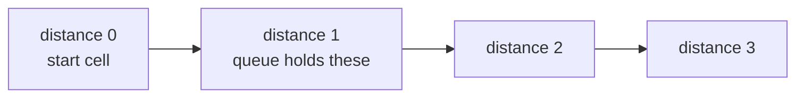

## Intuition

Depth-first search dives down one path as far as it can. **Breadth-first search** (BFS) spreads out evenly instead, like a ripple in a pond or a drop of ink on wet paper. From the starting cell it visits all cells one step away, then all cells two steps away, then three, and so on. The container that makes this work is a **queue**: the line at a shop, where the first person to arrive is served first.

The counting logic is the same as in the other approaches: scan the grid, and every time you meet land you have not visited, you have found a new island. Add one to the count, and then visit its whole island to mark it.

To visit the island with a queue:

1. Put the start cell in the queue and mark it visited.
2. Take the oldest cell from the front of the queue.
3. For each of its four neighbours that is land and not visited, mark it and add it to the back of the queue.
4. Repeat until the queue is empty.

For counting islands, BFS and DFS give the same answer and cost the same. BFS is worth knowing because it also gives you the **shortest distance** from the start cell to every other cell, which many grid problems need (shortest path in a maze, rotting oranges, walls and gates).

## Walkthrough

The same example grid as in the other approaches, which is not one of the test cases: `1101 0100 0011`.

| | c0 | c1 | c2 | c3 |
| --- | --- | --- | --- | --- |
| r0 | 1 | 1 | 0 | 1 |
| r1 | 0 | 1 | 0 | 0 |
| r2 | 0 | 0 | 1 | 1 |

The queue is written with the front on the left.

| Step | Action | Queue after | Islands |
| --- | --- | --- | --- |
| 1 | Scan finds (0,0): unseen land. Count it, mark it, enqueue it. | (0,0) | 1 |
| 2 | Dequeue (0,0). Right (0,1) is land: mark and enqueue. Other neighbours are water or off the grid. | (0,1) | 1 |
| 3 | Dequeue (0,1). Down (1,1) is land: mark and enqueue. | (1,1) | 1 |
| 4 | Dequeue (1,1). All neighbours are water or marked. | empty | 1 |
| 5 | Scan finds (0,3): count 2, mark, enqueue, dequeue; nothing new. | empty | 2 |
| 6 | Scan finds (2,2): count 3, mark, enqueue. Dequeue it: right (2,3) is land, mark and enqueue. Dequeue (2,3): nothing new. | empty | 3 |

The answer is 3. For a larger island the queue would hold a ring of cells, and the picture of the visit would be like ripples:

| | c0 | c1 | c2 |
| --- | --- | --- | --- |
| r0 | 0 | 1 | 2 |
| r1 | 1 | 2 | 3 |
| r2 | 2 | 3 | 4 |

The numbers show the distance in steps from the top-left cell. BFS visits all the 1s, then all the 2s, then the 3s. The first ring is cheap, and the ring size is the size of the queue.

Read it as: each ring of cells is fully processed before the next ring starts, because the queue serves the oldest cells first.

## Complexity

| | Value | Why |
| --- | --- | --- |
| Time | O(R times C) | Each cell is enqueued at most once (it is marked when enqueued) and dequeued at most once, with four neighbour checks. |
| Space | O(R times C) | The visited grid is one entry per cell. The queue holds only the current ring of cells, which is at most the order of the shorter side of the grid, so the queue is small. The visited grid dominates. |

A queue is the better choice for memory on large open grids: the ring is much smaller than the whole island. A stack can hold a large part of the island at once.

## Code explanation

1. **Count a new island.** Unseen land found by the scan.
2. **Create the queue** with the starting cell, which is already marked.
3. **Take the oldest cell.** In JavaScript and TypeScript a head index walks along the array, because `shift` can be slow; the others use a real queue type (`deque`, `ArrayDeque`, `Queue`, `std::queue`) or a slice.
4. **Mark when adding.** A cell is marked visited the moment it enters the queue so that it is added only once.

| Language | Queue | Note |
| --- | --- | --- |
| JavaScript / TypeScript | `Array` with a moving head index | The array only grows during one island; that is fine for a short-lived structure. |
| Python | `collections.deque` with `popleft` | `list.pop(0)` would be O(n) per call. |
| Go | A slice, taking from the front with `queue[1:]` | Re-slicing is cheap; the underlying array grows only while the island is explored. |
| Java | `ArrayDeque` through the `Queue` interface (`add`, `remove`) | `LinkedList` also works but is slower and bigger. |
| C# | `Queue<(int, int)>` with `Enqueue` and `Dequeue` | Value tuples avoid allocating an object per cell. |
| C++ | `std::queue<std::pair<int, int>>` | `front` then `pop`. |

## Edge cases and tests

The same fifteen grids and expected output as the other approaches (see the recursive notes for the table). The ones that stress the queue most:

| Grid | Output | What it checks |
| --- | --- | --- |
| `111 111 111` | `1` | A cell reachable from several neighbours is enqueued only once, thanks to marking at enqueue time. |
| `11111 00001 11111 10000 11111` | `1` | A snake: the queue always holds one or two cells. |
| `11111 10001 10101 10001 11111` | `2` | A ring and an island inside it. |
| `101 010 101` | `5` | No diagonal moves are made. |
| empty text | `0` | No loop iteration runs. |

## When to use it (and when not)

**Use it** when you may also need distances (shortest path in a grid, spreading problems), or when you want to keep the working memory small on wide open areas.

**Do not use it** for anything that must follow one path to the end before trying another, like finding all paths or backtracking (word search): those need depth-first search.

## Interview notes

- Say: "BFS uses a queue and visits cells ring by ring. I mark a cell when I add it so it is never added twice."
- Mention what BFS gives you for free: "The number of rings is the shortest distance from the start, which DFS would not give."
- Mention the data structure: "In Python I use `deque`, because `list.pop(0)` is linear."
- Likely follow-up: "What is the difference between BFS and DFS here?" Only the container: a queue or a stack. The count is the same.
- Mistake to avoid: marking when dequeuing, which lets the queue fill with duplicates.

## Real-life usage

BFS on a grid is behind shortest-path features in games and robotics on simple maps, "spread" simulations (fire, infection, flood), and level-by-level processing. On general graphs it underlies web crawlers that go a fixed number of links deep, social network "degrees of separation", and many routing algorithms.
