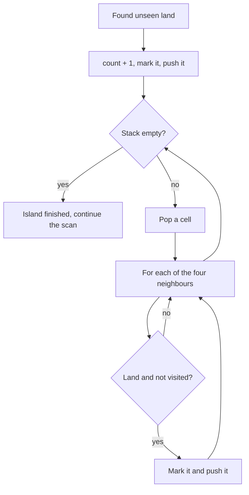

## Intuition

The recursive version uses the computer's call stack to remember "where was I?" while it spreads through an island. The call stack is small, and a very large island can fill it up and crash the program. The cure is simple: keep our own pile of cells that still need to be visited. That pile is a **stack**, and it lives in ordinary memory, which is much larger.

The idea is the same as before: find unseen land, count an island, and spread to all connected land. Spreading now looks like this:

1. Put the starting cell on the stack and mark it visited.
2. Take a cell from the top of the stack.
3. Look at its four neighbours. Every neighbour that is land and not yet visited is marked visited and put on the stack.
4. Repeat from step 2 until the stack is empty. Then the whole island has been visited.

Think of it as a to-do list. Each visited cell adds its unvisited neighbours to the list, and you keep working through the list until it is empty. A stack takes the newest item first, which makes the walk go deep before it goes wide, like the recursive version.

One detail matters: **mark a cell when you put it on the stack, not when you take it off.** Otherwise two neighbours can both put the same cell on the stack before either of them has been processed.

## Walkthrough

Use the grid from the recursive notes, which is not one of the test cases: `1101 0100 0011`.

| | c0 | c1 | c2 | c3 |
| --- | --- | --- | --- | --- |
| r0 | 1 | 1 | 0 | 1 |
| r1 | 0 | 1 | 0 | 0 |
| r2 | 0 | 0 | 1 | 1 |

The directions are tried in the order down, up, right, left. The stack top is on the right.

| Step | Action | Stack after | Islands |
| --- | --- | --- | --- |
| 1 | Scan finds (0,0): unseen land. Count it, mark it, push it. | (0,0) | 1 |
| 2 | Pop (0,0). Down (1,0): water. Up: off. Right (0,1): land, mark, push. Left: off. | (0,1) | 1 |
| 3 | Pop (0,1). Down (1,1): land, mark, push. Up: off. Right (0,2): water. Left (0,0): marked. | (1,1) | 1 |
| 4 | Pop (1,1). Down (2,1): water. Up (0,1) marked. Right (1,2): water. Left (1,0): water. | empty | 1 |
| 5 | The stack is empty, so the island is done. The scan continues. | empty | 1 |
| 6 | Scan finds (0,3): unseen land. Count it, mark it, push it. Pop it: all neighbours are water or off the grid. | empty | 2 |
| 7 | Scan finds (2,2): unseen land. Count it, mark it, push it. Pop it: right (2,3) is land, mark, push. Pop (2,3): nothing new. | empty | 3 |

The answer is 3, the same as the recursive version.

Read it as: pop one cell, push its new neighbours, repeat until nothing is left.

## Complexity

| | Value | Why |
| --- | --- | --- |
| Time | O(R times C) | Every cell is pushed at most once (it is marked when pushed) and popped at most once, and each pop looks at four neighbours. |
| Space | O(R times C) | The visited grid is one entry per cell. The stack can hold many cells at once, up to the size of the island in the worst case. |

The memory is on the heap, so there is no stack overflow, unlike the recursive version. The big-O is the same.

## Code explanation

1. **Count a new island.** In the scan, unseen land starts an island.
2. **Create the stack** with the starting cell, which has already been marked visited.
3. **Pop the newest cell.**
4. **Check each neighbour.** Test the bounds first, then the land and visited conditions. If the neighbour qualifies, mark it visited at once and push it.

The list of directions is written once as data, and the loop goes over it. This avoids writing the same four lines four times, and it makes the change to eight directions a one-line edit.

| Language | Stack | Note |
| --- | --- | --- |
| JavaScript / TypeScript | `Array` of `[row, col]` pairs, with `push` and `pop` | TypeScript needs `stack.pop()!` because `pop` can return `undefined`. |
| Python | `list` of tuples | Tuple unpacking in the loop: `cr, cc = stack.pop()`. |
| Go | `[][2]int` slice, popping by re-slicing | `[2]int` is a small value type, so no allocation per cell. |
| Java | `ArrayDeque<int[]>` | `push` and `pop` work at the head. Using `ArrayDeque` is better than the legacy `Stack` class. |
| C# | `Stack<(int, int)>` | A value tuple holds the cell. Deconstruct it with `var (cr, cc) = stack.Pop()`. |
| C++ | `std::stack<std::pair<int, int>>` | Structured bindings `auto [cr, cc] = stack.top()` read the pair. `top` and `pop` are separate calls. |

## Edge cases and tests

The same fifteen grids and expected output as the recursive approach (see its notes for the table). The ones that stress the stack most:

| Grid | Output | What it checks |
| --- | --- | --- |
| `111 111 111` | `1` | Many cells are added by several neighbours; marking at push time prevents duplicates. |
| `11111 00001 11111 10000 11111` | `1` | A snake: the stack never needs recursion however long the path. |
| `101 010 101` | `5` | Diagonal cells are never pushed. |
| empty text | `0` | No loop iteration runs. |
| `11111 10001 10101 10001 11111` | `2` | The ring island and the island inside it are found separately. |

## When to use it (and when not)

**Use it** when islands can be huge, in a language with a small call stack, or when you want to avoid any chance of a stack overflow. It is the version most production flood fills are based on.

**Do not use it** if the grid is tiny and the recursive code is clearer. And note that the stack order is not the same as a true recursion, so if you need the exact depth-first visit order (for example, to build a path), take care.

## Interview notes

- Say: "I replace the recursion by an explicit stack, so a big island cannot overflow the call stack."
- Say: "I mark a cell visited when I push it, so no cell is pushed twice."
- Mention the data-driven directions: "I loop over a list of direction offsets, which makes eight directions a one-line change."
- Likely follow-up: "What is the difference to BFS?" Only the container: a queue instead of a stack.
- Mistake to avoid: marking when popping, which lets the stack grow with duplicates.

## Real-life usage

Production flood fills (image editors, map tools, game engines) use an explicit stack, a queue, or a scanline algorithm instead of recursion, for exactly this reason. Garbage collectors do the same when they mark objects reachable from the roots, because an object graph can be very deep.
