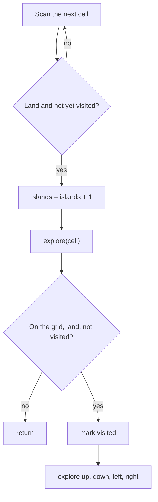

## Intuition

Imagine looking at a map from above. You want to count the islands. Walk over the map cell by cell. When your finger lands on a piece of land you have not seen before, you say "a new island" and add one to the count. Then you must make sure you do not count the same island again when your finger reaches its other cells. So you do this: **paint the whole island with a marker** before you move on. A marked cell is "already seen".

To paint a whole island from one cell, use **depth-first search**: paint this cell, then do the same thing from its four neighbours (up, down, left, right). Each neighbour paints itself and asks its own neighbours, and so on, like a spreading stain. The stain stops at water, at the edge of the map and at cells that are already painted. When the stain stops, the entire island is painted.

This is called **flood fill**. Counting islands is "scan for unpainted land, flood fill it, add one".

The word **recursion** just means that the painting function calls itself for each neighbour.

## Walkthrough

Use a small grid that is not one of the test cases: `1101 0100 0011`, which has three rows and four columns.

| | c0 | c1 | c2 | c3 |
| --- | --- | --- | --- | --- |
| r0 | 1 | 1 | 0 | 1 |
| r1 | 0 | 1 | 0 | 0 |
| r2 | 0 | 0 | 1 | 1 |

The scan goes row by row, left to right. `E(r,c)` means the explore function for that cell.

| Step | Cell | What happens | Islands |
| --- | --- | --- | --- |
| 1 | (0,0) | Unseen land: count 1. E(0,0) marks it, then tries down (1,0): water. Up and left: off the grid. Right (0,1): land, so E(0,1). | 1 |
| 2 | E(0,1) | Marks (0,1). Down (1,1): land, so E(1,1). | 1 |
| 3 | E(1,1) | Marks (1,1). Down (2,1) water, up (0,1) already marked, right (1,2) water, left (1,0) water. | 1 |
| 4 | back in E(0,1) | Up: off the grid, right (0,2): water, left (0,0): marked. Done. | 1 |
| 5 | (0,1), (0,2) | The scan sees marked land and water: nothing to do. | 1 |
| 6 | (0,3) | Unseen land: count 2. E(0,3) marks it; its neighbours are water or off the grid. | 2 |
| 7 | (1,0) to (2,1) | Water or marked cells: nothing to do. | 2 |
| 8 | (2,2) | Unseen land: count 3. E(2,2) marks it, goes right to (2,3), marks it, and stops. | 3 |
| 9 | (2,3) | Already marked. End of the grid. | 3 |

The answer is 3. Notice how cell (1,1) belongs to the island of (0,0) because it touches (0,1) from below, and how (0,3) is a separate island: nothing land touches it.

Read it as: the scan finds the start of an island, and the explore step spreads through all its cells.

## Complexity

| | Value | Why |
| --- | --- | --- |
| Time | O(R times C) | The scan visits each cell once. The explore function is called for each cell at most five times (once from the scan and once from each neighbour), and it marks a cell only the first time, so the total work is a constant times the number of cells. |
| Space | O(R times C) | The visited grid has one entry per cell. The recursion adds a call stack that, in the worst case (one snake-shaped island through the whole grid), is as deep as the number of cells. |

Here R is the number of rows and C the number of columns. If you overwrite land with water in the input instead of using a visited grid, the extra space is only the call stack.

## Code explanation

1. **Off the grid.** Check the bounds first. Reading a cell outside the grid is a crash or, in C++, undefined behaviour.
2. **Water or already visited.** Both mean "stop spreading here". This is the base case of the recursion.
3. **Mark before going deeper.** The cell must be marked visited before the recursive calls. If you mark it after, the neighbour can ask this cell again and the recursion never ends.
4. **Spread to four neighbours.** Down, up, right and left. Not diagonals.
5. **Count a new island.** In the scan, land that is not visited is the start of an island, and exploring it marks every cell.

| Language | Notes |
| --- | --- |
| JavaScript / TypeScript | The explore function is nested and uses `grid`, `visited`, `rows` and `cols` from the outer function. Rows are strings, read with `grid[r][c]`. |
| Python | A nested function closes over the same variables. The recursion limit (1000 by default) is a real risk for large islands. |
| Go | A recursive closure must be declared first with `var explore func(r, c int)`. Indexing a string gives a `byte`, so compare with `'1'`. |
| Java | A static helper takes the grid and the visited array as parameters. `charAt(c) == '1'` compares characters. |
| C# | A local function with access to the outer variables. `bool[,]` is a rectangular array indexed as `visited[r, c]`. |
| C++ | A static helper takes the grid and visited arrays by reference. `visited` is `vector<vector<char>>` rather than `vector<bool>`. The sizes are converted to `int` before use so that comparisons with negative indices are safe. |

## Edge cases and tests

Fifteen grids; all four approaches use the same grids and the same expected output.

| Grid (rows separated by spaces) | Output | What it checks |
| --- | --- | --- |
| `11110 11010 11000 00000` | `1` | One big island with a notch. |
| `11000 11000 00100 00011` | `3` | Three separate islands of different sizes. |
| empty text | `0` | An empty grid: no row is read. |
| `0` | `0` | A single water cell. |
| `1` | `1` | A single land cell. |
| `000 000` | `0` | Only water. |
| `111 111 111` | `1` | Only land: one island, maximum spreading. |
| `101 010 101` | `5` | Land touching only diagonally is not connected. |
| `1 0 1 0 1` | `3` | A single column (five rows of one cell). |
| `10101` | `3` | A single row. |
| `11011 10001 00100 10001 11011` | `5` | Four corner islands and a middle one. |
| `11111 10001 10101 10001 11111` | `2` | A ring around water, with an island in the middle. |
| `11111 00001 11111 10000 11111` | `1` | A snake: a deep recursion. |
| `110011 110011 001100 001100 110011 110011` | `5` | Blocks touching only at corners. |
| `10 01` | `2` | The smallest diagonal case. |

## When to use it (and when not)

**Use it** for small and medium grids, in interviews, and whenever shortest code matters. It extends naturally to the size of an island (count cells) and to many "region" problems.

**Do not use it** when the grid is large and an island can be very large: the call stack can overflow. Use the iterative versions. Also not when land is added over time and you need the count after each change: use union-find.

## Interview notes

- Say: "A grid is a graph. Counting islands is counting connected components. I scan, and for each unseen land cell I flood fill its island and add one."
- Say the order: "I mark the cell before I recurse, otherwise the recursion would loop."
- Mention the alternative to the visited array: "I could overwrite land with water to save memory, but that changes the input."
- Mention the risk: "The recursion depth can be as large as the grid, so for big grids I would use a stack or a queue."
- Mistake to avoid: checking the cell value before the bounds, or exploring diagonals.

## Real-life usage

Flood fill with recursion or an explicit stack is the heart of the paint bucket tool, of Minesweeper's reveal of empty areas, and of connected-component labelling in image processing. Real implementations use an explicit stack or a scanline method to avoid deep recursion and to run faster on big images.
