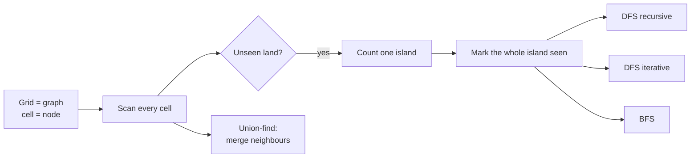
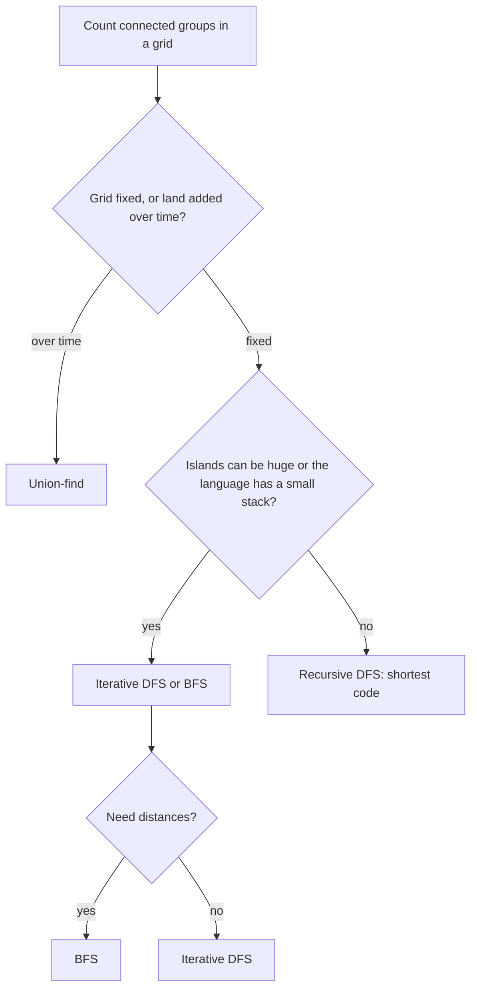

## How interviewers ask it

**The classic wording.** "Given a two-dimensional grid of characters where `1` is land and `0` is water, return the number of islands. An island is a group of land cells connected horizontally or vertically, and surrounded by water. You may assume all four edges of the grid are surrounded by water."

For this example grid, the answer is 1:

| | | | | |
| --- | --- | --- | --- | --- |
| 1 | 1 | 1 | 1 | 0 |
| 1 | 1 | 0 | 1 | 0 |
| 1 | 1 | 0 | 0 | 0 |
| 0 | 0 | 0 | 0 | 0 |

And for this one, the answer is 3: a block of four cells in the top left, a single cell in the middle, and a pair at the bottom right.

| | | | | |
| --- | --- | --- | --- | --- |
| 1 | 1 | 0 | 0 | 0 |
| 1 | 1 | 0 | 0 | 0 |
| 0 | 0 | 1 | 0 | 0 |
| 0 | 0 | 0 | 1 | 1 |

This is the standard introduction to **graph traversal on a grid**. A grid is a graph in disguise: every cell is a node, and each cell is connected to its four neighbours (up, down, left, right). An island is a **connected component**: a set of nodes that can all be reached from each other. Counting islands means counting connected components.

**Common variations:**

- *Diagonals count as connected.* (eight neighbours instead of four)
- *The size of the largest island*, or the sizes of all islands.
- *Perimeter of an island*, or the number of distinct island shapes.
- *Surrounded regions*, and *flood fill* (the paint bucket tool).
- *Number of islands II.* "Land cells are added one by one; report the count after each." (union-find shines here)
- *Shortest bridge between two islands*, and *rotting oranges* (breadth-first search from many starting cells).
- *The grid is huge and does not fit in memory.* (process it row by row)

**What to clarify before you code:**

| Question to ask | Why it matters |
| --- | --- |
| Do diagonal neighbours count? | Four directions or eight. The classic version uses four. |
| Is the grid made of characters or numbers? | `'1'` versus `1` is a common bug. |
| May I change the input grid? | Marking visited cells by overwriting land with water saves memory but destroys the input. |
| How large can the grid be? | Decides if recursion is safe: a snake-shaped island can be as deep as the whole grid. |
| Can the grid be empty, or have empty rows? | You must not read `grid[0]` before checking. |
| Are the rows all the same length? | The usual assumption is yes (a rectangle). |

A good answer says "this is counting connected components", scans the grid, and every time it meets land it has not seen before, adds one to the count and uses a traversal to mark the whole island as seen. It states the cost: each cell is visited a constant number of times, so O(rows times columns).

**The input format in this repo.** Each test case is the rows of a grid joined by spaces, for example `11000 11000 00100 00011`. An empty text is an empty grid. The program prints one number per grid. The functions receive the rows as strings and do not change them: they keep their own array of visited cells.

## Real-life scenarios

| Scenario | What is actually used | Why |
| --- | --- | --- |
| The paint bucket tool in an image editor (flood fill) | A queue or stack based fill, or a scanline fill | It spreads from the clicked pixel to all connected pixels of a similar colour. |
| Counting cells, stars or objects in an image (microscopy, astronomy, quality control) | Connected-component labelling in image libraries | Each blob of connected pixels is one object. |
| Geographic maps: counting lakes, islands, forest patches, flood zones | Connected components on raster data | Cells of the same type that touch each other form one region. |
| Social networks and "people you may know" groups | Connected components in a graph | Each separate cluster of friends is one component. |
| Detecting network partitions in a cluster ("split brain") | Connected components of the live-links graph | If the graph has more than one component, parts of the cluster cannot talk to each other. |
| Games: Minesweeper reveal, Go (groups of stones and liberties), strategy-game region capture | Flood fill and union-find | The board is a grid, and groups are connected components. |
| Garbage collection | Marking reachable objects with depth-first search | Anything not reached from the roots is garbage. |
| Dependency analysis and build tools | Graph traversal and components | Finding groups of modules that do not depend on each other lets you build them in parallel. |
| Chip layout and circuit checks | Connected components of wires | Two wires belong to the same net if they are connected. |

The same code with a different definition of "neighbour" solves all of these.

## Approaches compared

Let `R` be the number of rows and `C` the number of columns. All approaches read every cell a constant number of times.

| Approach | Time | Extra space | Recursion? | Use when |
| --- | --- | --- | --- | --- |
| 1. DFS, recursive | O(R C) | O(R C) for the visited grid plus the call stack, which is up to O(R C) deep | Yes | Shortest code. Fine for small grids. |
| 2. DFS, iterative | O(R C) | O(R C) visited, plus the stack on the heap | No | When a single island can be very large. |
| 3. BFS | O(R C) | O(R C) visited, plus a queue holding one ring of cells | No | When distance from the start matters, or you prefer a queue. |
| 4. Union-find | O(R C) times a tiny factor (the inverse Ackermann function) | O(R C) for the parent array | No | When land is added over time, or you need the component of any cell at any moment. |

Read it as: the outer scan is the same for the first three approaches, and they differ only in how they mark an island. Union-find takes a different route and merges neighbours.

## How to choose

Start at the top and answer each question. In an interview, write the recursive DFS first because it is shortest, then say how you would remove the recursion.

## Built-ins and the standard library

No standard library counts islands. What you need are a 2D array, a stack or a queue, and the right integer types.

| Language | Visited grid | Stack and queue | Pitfall |
| --- | --- | --- | --- |
| JavaScript / TypeScript | `Array.from({ length: rows }, () => new Array(cols).fill(false))` | `Array` with `push` and `pop` (stack). For a queue use a head index, because `shift` can be O(n). | `new Array(rows).fill(new Array(cols))` fills every row with the same array. Strings are immutable, so you cannot write `grid[r][c] = '0'` on a string row. |
| Python | `[[False] * cols for _ in range(rows)]` | `list` (stack), `collections.deque` (queue) | `[[False] * cols] * rows` repeats one row object. The default recursion limit is 1000, so a recursive DFS fails on a long snake-shaped island. Strings are immutable. |
| Go | `make([][]bool, rows)` and then `make([]bool, cols)` for each row | A slice for both | Out-of-range indexing panics. Indexing a string gives a byte, so compare with `'1'` (a byte), not `"1"` (a string). |
| Java | `new boolean[rows][cols]` | `ArrayDeque` for both | `charAt(c) == '1'`, not `== 1`. A deep recursion throws `StackOverflowError`. `ArrayDeque` rejects `null`. |
| C# | `new bool[rows, cols]` (rectangular) or `bool[][]` (jagged) | `Stack<T>`, `Queue<T>` | A stack overflow cannot be caught and ends the process. Value tuples `(int, int)` make good cells. |
| C++ | `std::vector<std::vector<char>>` | `std::stack`, `std::queue` | Avoid `std::vector<bool>`: it is a packed special case with odd behaviour. Use `int` for indices, because `size() - 1` on an empty container wraps around. |

**Hand-write or use a library?** In an interview, hand-write it. In production on images or maps, use an image-processing or GIS library (for example, connected-component functions in image libraries) that is optimised and well tested.

## Common mistakes

- **Counting a cell twice.** Forgetting to mark visited, or marking after the recursive calls instead of before, causes endless recursion or double counting.
- **Marking too late in BFS or iterative DFS.** If you mark a cell visited only when you take it out of the queue, the same cell can be added many times. Mark when you add it.
- **Diagonals by mistake.** Using eight directions counts diagonal land as connected. The problem says four.
- **Off the grid.** Check the bounds before reading `grid[r][c]`. Check them in the right order: row and column bounds first, then the cell.
- **Reading `grid[0]` on an empty grid.** Take the number of columns only after checking the number of rows.
- **Comparing with the wrong type.** `'1'` is a character, `1` is a number, and `"1"` is a string. In Java and C++ comparing a `char` with the number 1 is silently false.
- **Changing the input without saying so.** Overwriting `'1'` with `'0'` is a valid trick, but the caller loses the grid. Mention it or use a visited array.
- **Recursion depth.** A snake-shaped island of a million cells needs a million nested calls. Use an explicit stack or a queue.
- **Union-find index mistakes.** Cell `(r, c)` has the id `r * cols + c`, not `r * rows + c`. Using the wrong multiplier maps different cells to the same id.
- **Using union-find without compression or size.** Without them, long chains make find slow.

## How to answer in an interview

1. **Clarify.** "Four or eight neighbours? Characters or numbers? May I change the grid? How big can it be?"
2. **Draw a small grid** and circle the islands. Say: "This is counting connected components in a graph where cells are nodes."
3. **State the plan.** "I scan every cell. When I find land I have not seen, I add one to the count and mark the entire island as seen, so I never count it again."
4. **Pick a traversal.** "Depth-first search with recursion is the shortest. I mark a cell as visited before recursing into its four neighbours, and I check the bounds first."
5. **Code it,** with a separate visited array (or say you flip land to water to save memory).
6. **Test aloud.** The empty grid, a single `1`, all water, all land, and a grid with diagonal land cells that must count separately.
7. **State complexity.** "Each cell is visited a constant number of times, so O(R times C) time. The visited grid is O(R times C), and the recursion can go as deep as the biggest island."
8. **Offer the improvement.** "If the recursion depth is a risk I use an explicit stack or a queue. If land is added over time I use union-find."

## Follow-up questions

- **How do you avoid the extra visited array?** Overwrite visited land with water in the grid itself (or with a third marker character). It saves memory and destroys the input, so say so, or copy first.
- **Why can recursion fail here?** The depth equals the longest chain of newly visited cells. A single snake-like island can have as many cells as the whole grid, so the call stack can overflow (about one thousand frames in Python by default, around ten thousand in JavaScript or Java).
- **DFS or BFS: which is better?** For counting they are equal. BFS uses a queue and visits cells in rings, which also gives shortest distances. DFS with a stack can hold more cells at once on some shapes. Neither is faster in big-O terms.
- **What changes with diagonal connections?** Use eight directions: the four plus the four diagonal offsets. Everything else stays the same.
- **How would you find the largest island?** Count the cells visited in each traversal and keep the maximum. With union-find, keep the size of each root.
- **When is union-find better?** When land cells are added one at a time and you must report the number of islands after each addition. Each addition is a few unions, almost constant time, whereas rerunning a traversal costs O(R C) each time.
- **What is the cost of union-find?** With path compression and union by size, each operation takes amortised O(α(n)) time, where α is the inverse Ackermann function. It is below 5 for any input you can store, so it is effectively constant.
- **What if the grid does not fit in memory?** Read it row by row and keep only the labels of the previous row, with union-find to merge labels. This is how large raster images are labelled.
- **How do you do it in parallel?** Split the grid into tiles, count islands per tile, then merge islands that touch across tile borders with union-find.
- **Why only look right and down in union-find?** Each pair of neighbouring cells needs to be merged once. Looking right and down from every cell visits each pair exactly once and saves half the work.

## Practice

- Max area of island, and island perimeter.
- Surrounded regions, and pacific atlantic water flow.
- Flood fill (the paint bucket) and rotting oranges (multi-source BFS).
- Number of closed islands, and number of distinct islands (shape hashing).
- Number of islands II (union-find with additions).
- Shortest bridge, and walls and gates.
- Clone graph, number of connected components in an undirected graph, and accounts merge (union-find).
- Word search (DFS with backtracking on a grid).
