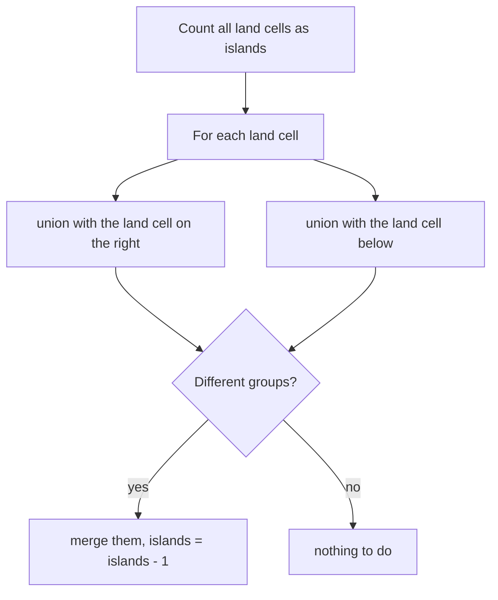

## Intuition

The three earlier approaches explore each island by walking through it. **Union-find** (also called a disjoint-set structure) takes a different view. It keeps track of *groups* of cells, and it has just two operations:

- **find(x)**: which group does cell x belong to? (It returns a representative cell of the group, called the root.)
- **union(a, b)**: put the groups of a and b together into one group.

To count islands, treat every land cell as a group of one. Then look at each pair of neighbouring land cells and union them. Every time a union joins two *different* groups, the number of groups drops by one. At the end, the number of groups is the number of islands.

Think of a party where everyone starts alone. Each time two people who are standing next to each other shake hands, their two circles of friends merge into one, unless they were already in the same circle. At the end you count the circles.

Two small tricks make union-find fast:

- **Path halving** (a form of path compression): while looking for the root, make each visited node point to its grandparent. The paths get shorter every time you use them.
- **Union by size**: when merging, hang the smaller tree under the bigger one, so the trees stay shallow.

Together they make each operation take almost constant time. "Almost" means the inverse Ackermann function, which is below 5 for any number you can ever store.

This approach is more code for a one-off count. It earns its place when land is added over time (a follow-up called Number of Islands II), because each new cell needs only a few unions instead of a whole new traversal.

## Walkthrough

Use a small grid that is not one of the test cases: `110 011`, which has two rows and three columns. Cell `(r, c)` has the id `r * 3 + c`.

| | c0 | c1 | c2 |
| --- | --- | --- | --- |
| r0 | 1 (id 0) | 1 (id 1) | 0 (id 2) |
| r1 | 0 (id 3) | 1 (id 4) | 1 (id 5) |

Land cells: 0, 1, 4, 5. So we start with 4 islands. We go through the cells; for each land cell we try to union with the cell to the right and the cell below.

| Step | Union attempted | Roots | Result | parent array (0 to 5) | Islands |
| --- | --- | --- | --- | --- | --- |
| start | | | all alone | 0 1 2 3 4 5 | 4 |
| 1 | cell 0 and its right neighbour 1 | 0 and 1 (equal sizes) | merged: 1 now points to 0 | 0 0 2 3 4 5 | 3 |
| 2 | cell 0 and the cell below, id 3: water | | skipped | 0 0 2 3 4 5 | 3 |
| 3 | cell 1 and the cell right, id 2: water | | skipped | 0 0 2 3 4 5 | 3 |
| 4 | cell 1 and the cell below, id 4 | 0 (size 2) and 4 (size 1) | merged: 4 points to 0 | 0 0 2 3 0 5 | 2 |
| 5 | cell 4 and the cell right, id 5 | 0 and 5 | merged: 5 points to 0 | 0 0 2 3 0 0 | 1 |

All four land cells point to the root 0, so there is one island. The answer is 1.

Read it as: start with the largest possible count, and lower it for every merge that really joins two groups.

## Complexity

| | Value | Why |
| --- | --- | --- |
| Time | O(R times C times α) | Counting land and the neighbour loop touch each cell a constant number of times. Each find or union takes amortised O(α(R times C)) steps with path compression and union by size, where α grows so slowly that it is at most 4 in practice. So the total is almost exactly linear. |
| Space | O(R times C) | The parent array and the size array have one entry per cell. There is no recursion and no stack or queue. |

Without path compression and union by size, a find could take O(n) time in the worst case, and the total would become quadratic. That is the usual interview follow-up: "Why do you need both tricks?"

## Code explanation

1. **Each cell is its own group.** The parent of every cell is the cell itself. Cell `(r, c)` has the id `r * cols + c`, a single number we can store in an array. Water cells are in the arrays too, but are never touched.
2. **Path halving in `find`.** In the loop, point `x` to its grandparent before moving up. The path to the root gets shorter every time.
3. **Union by size.** Make the root of the bigger group the parent of the smaller one's root.
4. **Count the merge.** Only a union of two different roots reduces the number of islands.
5. **Only look right and down.** Every pair of neighbouring cells is seen once from its upper or left member. Looking in all four directions would do each union twice, with no change to the result.

The count starts as the number of land cells, so we do not need a separate pass to count roots at the end.

| Language | Notes |
| --- | --- |
| JavaScript / TypeScript | `find` and `union` are nested functions. `Array.from({ length: n }, (_, i) => i)` creates the identity array. |
| Python | `list(range(n))` is the identity array. `nonlocal islands` lets the nested `union` change the counter. |
| Go | `find` and `union` are closures. Note `union` is not a reserved word in Go, but it is in C++, so the C++ version calls it `unite`. |
| Java | Static fields and methods. Java has no nested functions; lambdas cannot change a local variable, so the state is held in static fields. |
| C# | Local functions with access to the outer arrays and the `islands` variable. Tuple swap `(rootA, rootB) = (rootB, rootA)`. |
| C++ | Lambdas that capture by reference. `std::iota` fills the identity array. `union` is a keyword, so the function is `unite`. |

## Edge cases and tests

The same fifteen grids and expected output as the other approaches (see the recursive notes for the table). The ones that stress union-find most:

| Grid | Output | What it checks |
| --- | --- | --- |
| empty text | `0` | Zero cells, zero-sized arrays. |
| `0`, `000 000` | `0` | No land: the count starts at 0 and nothing is merged. |
| `1` | `1` | One land cell, no neighbours. |
| `111 111 111` | `1` | Eight successful merges take the count from 9 to 1; later attempts find equal roots. |
| `101 010 101` | `5` | Diagonal cells are never unioned. |
| `11111 00001 11111 10000 11111` | `1` | A long chain of merges: path halving and union by size keep it fast. |
| `110011 110011 001100 001100 110011 110011` | `5` | Blocks that touch only at corners stay separate. |

## When to use it (and when not)

**Use it** when the land arrives over time, when you need to answer "are these two cells in the same island?" many times, when you need the size of each island, or when the data is a stream or too large to traverse repeatedly.

**Do not use it** for a single count on a fixed grid when a simple traversal is shorter and just as fast. Union-find has more moving parts to get right, such as the id formula and the two optimisations.

## Interview notes

- Say: "I treat each land cell as its own set and merge neighbours. Each successful merge reduces the island count by one."
- Name the two optimisations: "Path compression and union by size make operations nearly constant."
- Explain the right-and-down trick: "Each neighbour pair only needs to be looked at once."
- Likely follow-up: "Number of Islands II, where land is added." Each addition increments the count, then merges with up to four neighbours, which is almost constant time.
- Mistake to avoid: using the wrong multiplier in the id (`r * rows + c`), or forgetting that only a merge of two different roots changes the count.

## Real-life usage

Union-find is used wherever groups merge over time: network connectivity checks and cluster membership, Kruskal's minimum spanning tree algorithm, image segmentation and connected-component labelling in a single pass over a big image, finding equivalent accounts or duplicates ("accounts merge"), and type unification in compilers.
