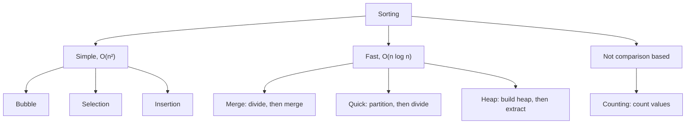
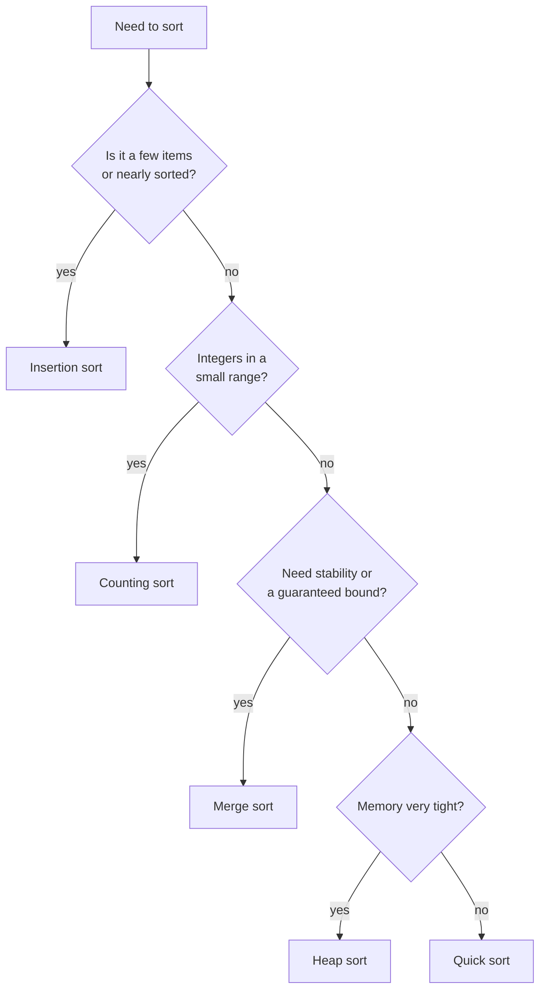
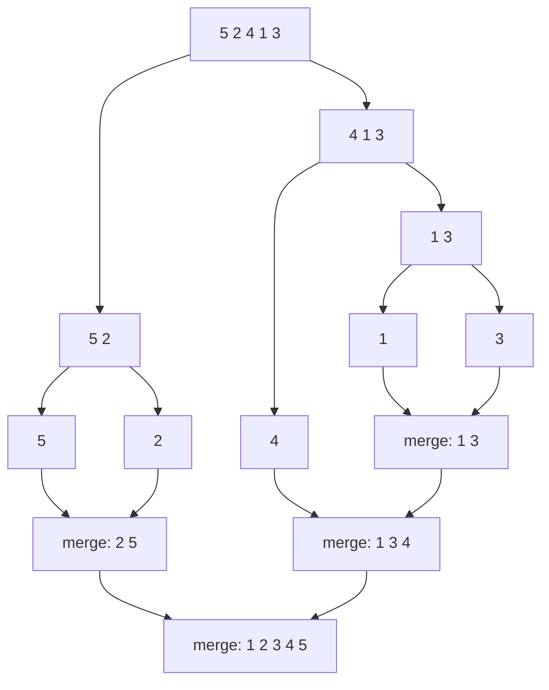
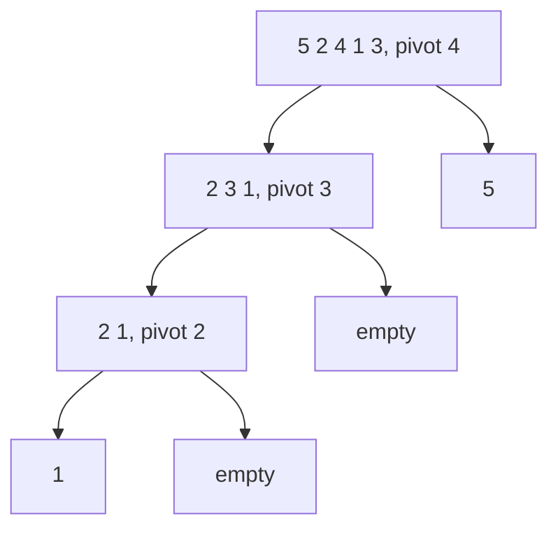
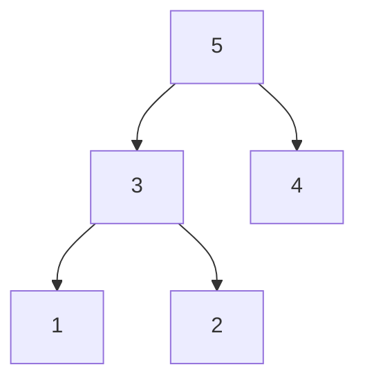

# Sorting

[← All problems](../README.md)

> Put items in order: the building block behind search, ranking, deduplication and merging.

**Level:** basic · **Tags:** sorting, arrays, complexity, divide-and-conquer

**Related interview questions:**

- [Golang: How does `append` grow a slice, and what are the aliasing gotchas?](../../questions/golang.md)
- [Golang: What are arrays and slices? Why are slices used almost everywhere?](../../questions/golang.md)
- [JavaScript: Which array methods should you know, and which ones mutate the array?](../../questions/javascript.md)
- [JavaScript: How do you do immutability in JavaScript? What do `Object.freeze` and spread do?](../../questions/javascript.md)
- [React: Why do list items need a stable `key`, and why is the array index a bad key?](../../questions/react.md)
- [React: Tech Lead How do you handle very long lists (virtualisation)?](../../questions/react.md)

## How interviewers ask it

Sorting is asked in three ways.

1. **Implement it.** "Write a function that sorts an array of integers. Do not use the built-in sort." They usually want one simple sort first (bubble, insertion), then one fast sort (merge or quick).
2. **Explain it.** "How does quick sort work? What is its worst case? Is merge sort stable?" This checks that you understand the trade-offs, not just the code.
3. **Use it.** "Sort these orders by date, then by amount." "Return the top 10 scores." "Merge two sorted lists." Here sorting is a tool inside a bigger problem. Most real interviews are this kind.

**What to clarify before you write code**

| Ask | Why it changes the answer |
| --- | --- |
| How big is the input? | Under about 50 items, a simple sort is fine. Millions of items need O(n log n). More than memory needs an external sort. |
| What type are the items, and what range? | Small-range integers allow counting sort in O(n + k). |
| Are there duplicates? Negatives? | Quick sort with a naive partition struggles with many duplicates. Counting sort needs an offset for negatives. |
| Must equal items keep their order (stability)? | Needed when sorting by a second key. Merge and insertion sort are stable. Quick and heap sort are not. |
| Can I change the input, or must I return a new array? | In place saves memory but mutates the caller's data. |
| Is the data nearly sorted already? | Insertion sort and Timsort are very fast on that. |
| Do I need all items sorted, or only the top K? | Top K can be done without a full sort. |

**A good answer covers:** a correct algorithm, its time and space complexity with the reason, the edge cases (empty, one item, duplicates, negatives, already sorted, reverse sorted), stability, and when you would just call the built-in sort instead.

## Real-life scenarios

| Scenario | What is actually used | Why |
| --- | --- | --- |
| Database `ORDER BY` | If an index (usually a B-tree, which keeps keys in order) matches the sort columns, the database reads rows in index order and does no sorting at all. Otherwise it sorts in memory and, when the data is too big, spills sorted chunks to disk and merges them (external merge sort). | Reading in index order is nearly free. A sort costs O(n log n) and memory. This is why `ORDER BY` on an unindexed column over a big table is slow. |
| Paginated, sorted product list (`ORDER BY price LIMIT 20 OFFSET 40`) | A stable, deterministic order: sort by price and then by a unique key such as `id`. Often cursor ("keyset") pagination on the same index. | Equal prices have no defined order, so without a tie-breaker the same product can appear on two pages or on none. |
| Leaderboard or "top K" feed | A min-heap of size K, or a sorted set (for example a Redis sorted set). Not a full sort. | A heap keeps K items, so each update is O(log K) instead of re-sorting everything. |
| Merging sorted log files from many servers | A k-way merge: the merge step of merge sort, with a heap holding the front line of each file. | Each file is already sorted by time, so merging is O(n log k) and needs almost no memory. |
| Sorting a table in the UI (click a column header) | The built-in `sort` with a comparator. Multi-key sort relies on a **stable** sort: sort by the secondary column first, then by the primary, or use one comparator with both keys. | A stable sort keeps the earlier order among equal rows, so users do not see rows jump around. |
| Sorting data larger than memory (10 GB with 1 GB of RAM) | External merge sort: sort chunks that fit in memory, write each to disk, then k-way merge them. Big-data systems do this in their "shuffle" step. | Merge sort reads and writes data sequentially, which disks are good at. |
| The sort inside the standard library | Timsort (Python, Java for objects, V8 in JavaScript), introsort (C++ `std::sort`, .NET `Array.Sort`), pdqsort (Go 1.19+), dual-pivot quicksort (Java primitives). | They are hybrids: a fast general algorithm plus insertion sort for small pieces, and a fallback to avoid the worst case. Timsort also exploits runs that are already ordered. |

## Approaches compared

| Approach | Best | Average | Worst | Space | Stable | In place | Use when |
| --- | --- | --- | --- | --- | --- | --- | --- |
| Bubble sort | O(n) | O(n²) | O(n²) | O(1) | Yes | Yes | Teaching only |
| Selection sort | O(n²) | O(n²) | O(n²) | O(1) | No | Yes | Writes are very costly, tiny inputs |
| Insertion sort | O(n) | O(n²) | O(n²) | O(1) | Yes | Yes | Small or nearly sorted data, online input |
| Merge sort | O(n log n) | O(n log n) | O(n log n) | O(n) | Yes | No | You need stability and a guaranteed bound, linked lists, external sort |
| Quick sort | O(n log n) | O(n log n) | O(n²) | O(log n) | No | Yes | Fast general in-memory sorting of primitives |
| Heap sort | O(n log n) | O(n log n) | O(n log n) | O(1) | No | Yes | Guaranteed bound with no extra memory |
| Counting sort | O(n + k) | O(n + k) | O(n + k) | O(n + k) | Yes | No | Integers in a small range (k = max - min + 1) |



Read it as a family tree. The simple sorts are easy to write but slow. The fast ones all use a smarter structure (halving, partitioning or a heap). Counting sort avoids comparing items altogether.

A fact worth knowing: any algorithm that sorts by **comparing** items needs at least about n log n comparisons in the worst case. Counting sort beats that only because it uses extra knowledge about the values.

## How to choose



In production the answer is simpler: **call the standard library sort**. Hand-write a sort only in an interview, for learning, or in an unusual case such as a custom data structure.

| Situation | Use |
| --- | --- |
| Small or nearly sorted data | Insertion sort (or the built-in, which already handles it) |
| Huge data that does not fit in memory | External merge sort |
| Need a stable sort | Merge sort (or the built-in stable sort) |
| Need the best average speed on numbers | Quick sort (introsort or pdqsort in libraries) |
| Need a guaranteed O(n log n) with O(1) memory | Heap sort |
| Integers in a small range, or a histogram | Counting sort |
| Only the top K items | A heap of size K, or quickselect, not a full sort |

## Built-ins and the standard library

In real code, use these. The pitfalls are where bugs and interview questions come from.

| Language | Call | Algorithm | Stable | Pitfall |
| --- | --- | --- | --- | --- |
| JavaScript | `arr.sort(cmp)`, and `arr.toSorted(cmp)` (ES2023) for a copy | Timsort in V8 | Yes (required by the spec since ES2019) | With no comparator, items are compared **as strings**: `[10, 9, 1].sort()` gives `[1, 10, 9]`. Use `(a, b) => a - b`. `sort` mutates the array and returns it. `undefined` values go last. |
| TypeScript | Same as JavaScript, with types | Same | Yes | The compiler does not warn about the default string comparison on `number[]`. `toSorted` needs the ES2023 library setting. |
| Python | `sorted(it, key=..., reverse=...)` returns a new list; `list.sort()` sorts in place and returns `None` | Timsort | Yes | `x = x.sort()` sets `x` to `None`. `key` runs once per item, which is cheaper than a comparison function. Mixed types such as `int` and `str` raise `TypeError`. `NaN` breaks ordering. |
| Go | `sort.Ints`, `sort.Slice(s, less)`, `sort.SliceStable`, and since Go 1.21 `slices.Sort` and `slices.SortFunc` (and `slices.SortStableFunc`) | pdqsort since Go 1.19 (not stable); the stable versions use insertion plus merge ideas | `sort.Slice` and `slices.SortFunc`: **No**. `sort.SliceStable` and `slices.SortStableFunc`: yes | `sort.Slice` is not stable, so ties can change order between runs of different data. `less` must be a strict "less than", not `<=`. `sort.Slice` takes `any`, and a wrong argument fails only at run time. |
| Java (21) | `Arrays.sort(int[])` for primitives; `Arrays.sort(T[], cmp)`, `Collections.sort(list)`, `list.sort(cmp)` for objects | Dual-pivot quicksort for primitives; Timsort for objects | Primitives: not applicable (equal ints look the same). Objects: **yes** | Never write a comparator as `a - b` for ints: it can overflow. Use `Integer.compare(a, b)` or `Comparator.comparingInt`. Chain keys with `thenComparing`. |
| C# (.NET 8) | `Array.Sort`, `List<T>.Sort`, and LINQ `OrderBy` / `ThenBy` | Introsort for `Array.Sort` and `List.Sort`; `OrderBy` is a stable sort | `Array.Sort`, `List.Sort`: **No**. `OrderBy`: **Yes** | `OrderBy` returns a new lazy sequence and costs more memory. `List.Sort` with a comparison must be consistent, or you get odd results or an exception. |
| C++ | `std::sort(first, last, cmp)`, `std::stable_sort` | `std::sort`: introsort in common implementations; `std::stable_sort`: merge sort, using extra memory when it can | `std::sort`: **No**. `std::stable_sort`: yes | The comparator must be a **strict weak ordering**: `<` is fine, `<=` is undefined behaviour and can crash. Needs random-access iterators, so `std::list` uses its own `list.sort()`. |

Two more things worth saying in an interview. First, the standard sorts are hybrids, not plain quick sort or merge sort: they switch algorithms for small ranges or deep recursion. Second, the language specs often do not promise the exact algorithm (C++ only promises O(n log n)), so say "typically" or "in the common implementation" when you name it.

## Common mistakes

- **Using the default sort for numbers in JavaScript.** `[10, 9, 1].sort()` is `[1, 10, 9]`. Always pass a comparator for numbers.
- **Comparator `a - b` with overflow or `NaN`.** With big ints in Java it can overflow, and with `Infinity` or `NaN` in JavaScript it returns `NaN`. Use `Integer.compare` or `a < b ? -1 : a > b ? 1 : 0`.
- **A comparator that is not a strict weak ordering.** `<=` instead of `<`, or random results. Some libraries throw ("Comparison method violates its general contract"), some loop, some silently give wrong answers.
- **Mutating the caller's array by accident.** `sort` in JavaScript and Python's `list.sort()` change the original. In React state, that breaks change detection. Copy first (`[...items].sort(...)` or `toSorted`).
- **Assuming stability.** `sort.Slice` in Go, `std::sort` in C++ and `Array.Sort` in C# are not stable. If you sort rows by a second key, use the stable version or add a tie-breaker.
- **Off-by-one errors.** `i < n - 1` vs `i < n`, `j >= 0`, and writing the key to `a[j + 1]`. Trace the smallest cases (empty, one item, two items).
- **Integer overflow in the midpoint.** `(lo + hi) / 2` can overflow for big indexes. Write `lo + (hi - lo) / 2`.
- **Unsigned indexes.** In C++ or Rust, `j >= 0` is always true for unsigned types, so the loop never ends.
- **Quick sort with a bad pivot.** First or last item as the pivot is O(n²) on sorted input. Use the middle, median-of-three or a random pivot.
- **Recursion depth.** Recursive quick sort on bad input can overflow the stack. Recurse into the smaller side first.
- **Counting sort without an offset.** Negative numbers give a negative index. Subtract the minimum. Also check the range is small enough.
- **Sorting strings with plain comparison.** Language-aware order (accents, case) needs a locale-aware comparison such as `localeCompare` or `Intl.Collator`.

## How to answer in an interview

1. **Clarify.** "How many items? Integers? Can there be duplicates or negatives? Should I change the input or return a new array? Does it need to be stable?" Say this out loud before coding.
2. **Give examples and edge cases.** "For `[3, 1, 2]` I expect `[1, 2, 3]`. I will also check empty, one item, duplicates, already sorted and reverse sorted."
3. **State the simple approach and its cost.** "The easiest way is insertion sort or selection sort. They are O(n²), fine for small inputs but too slow for a million items."
4. **Improve it.** "To get O(n log n) I can use divide and conquer. Merge sort splits in half, sorts each half and merges, which is O(n log n) always but needs O(n) extra space. Quick sort partitions around a pivot, is in place, and is O(n log n) on average."
5. **Code it** in small, named pieces (`merge`, `partition`). Keep the variable names clear and explain each step as you type.
6. **Test it aloud.** Walk the smallest example through the code, then the edge cases. "With an empty array the base case returns immediately."
7. **State complexity with the reason.** "Time is O(n log n) because there are log n levels and each level does O(n) work. Space is O(n) because merge needs a second array."
8. **Mention trade-offs and the real world.** "In production I would call the built-in sort. It is a tuned hybrid, and in Python and Java it is stable. I would hand-write it only if the data has a special shape, like small-range integers, where counting sort is O(n)."

## Follow-up questions

- **Which of these sorts are stable, and why does it matter?** Bubble, insertion, merge and counting (the version here) are stable. Selection, quick and heap are not. Stability keeps the old order of equal items, which is what makes multi-key sorting and "sort by column" in a UI work.
- **How would you sort 10 GB of numbers with 1 GB of memory?** External merge sort. Read chunks of about 1 GB, sort each in memory, write them as sorted files, then do a k-way merge of all the files using a heap that holds the front item of each file.
- **What is the best algorithm for nearly sorted data?** Insertion sort, which is O(n + d) where d is the number of out-of-order pairs. Timsort is also designed to find and use runs that are already in order.
- **How do you find the top K items without sorting everything?** Keep a min-heap of size K while scanning: O(n log K). Or use quickselect, which is O(n) on average. Sort only the K results if they must be ordered.
- **How do you sort by two keys?** Use a comparator with both keys (compare the first, and if equal compare the second). Or use a stable sort twice: first by the secondary key, then by the primary key.
- **Can you sort faster than O(n log n)?** Not by comparing items: the lower bound is about n log n comparisons. With extra knowledge you can: counting sort and radix sort run in linear time for integers with a bounded range.
- **How do you parallelise sorting?** Split the data, sort the parts on separate threads or machines, then merge. Merge sort fits this well. Quick sort can also sort its two sides in parallel.
- **Why is quick sort often faster than merge sort in practice, although its worst case is worse?** It sorts in place on contiguous memory, which is friendly to the CPU cache, and it does less copying. Introsort or pdqsort removes the bad worst case.

## Practice

1. **Sort colors** (Dutch national flag): sort an array of 0s, 1s and 2s in one pass and O(1) space. Related idea: three-way partition and counting sort.
2. **Merge two sorted arrays**, then **merge k sorted lists**: the merge step of merge sort, plus a heap for k lists.
3. **Kth largest element in an array**: quickselect or a heap of size k.
4. **Merge intervals**: sort by start, then sweep once.
5. **Sort by frequency** (or "largest number" from a list of integers): a custom comparator on top of a stable sort.

## Approaches

| Approach | Best | Average | Worst | Space | Stable | In place | Languages |
| --- | --- | --- | --- | --- | --- | --- | --- |
| [Bubble sort](#bubble-sort) | O(n) | O(n²) | O(n²) | O(1) | yes | yes | JavaScript, TypeScript, Python, Go, Java, C#, C++ |
| [Selection sort](#selection-sort) | O(n²) | O(n²) | O(n²) | O(1) | no | yes | JavaScript, TypeScript, Python, Go, Java, C#, C++ |
| [Insertion sort](#insertion-sort) | O(n) | O(n²) | O(n²) | O(1) | yes | yes | JavaScript, TypeScript, Python, Go, Java, C#, C++ |
| [Merge sort](#merge-sort) | O(n log n) | O(n log n) | O(n log n) | O(n) | yes | no | JavaScript, TypeScript, Python, Go, Java, C#, C++ |
| [Quick sort](#quick-sort) | O(n log n) | O(n log n) | O(n²) | O(log n) | no | yes | JavaScript, TypeScript, Python, Go, Java, C#, C++ |
| [Heap sort](#heap-sort) | O(n log n) | O(n log n) | O(n log n) | O(1) | no | yes | JavaScript, TypeScript, Python, Go, Java, C#, C++ |
| [Counting sort](#counting-sort) | O(n + k) | O(n + k) | O(n + k) | O(n + k) | yes | no | JavaScript, TypeScript, Python, Go, Java, C#, C++ |

## Bubble sort

> Swap neighbours that are out of order, pass after pass, until nothing moves.

### Intuition

Imagine people standing in a line, and you want them ordered by height. You walk along the line and look at each pair of neighbours. If the left person is taller, they swap places. When you reach the end, the tallest person has "bubbled" to the end of the line. Walk again, and the second tallest settles next to them. Keep going until a whole walk needs no swaps.

It is slow, but it is the easiest sort to explain, so interviewers use it as a warm-up.

### Walkthrough

Sort `[5, 2, 4, 1, 3]`. Each pass compares neighbours from the left and stops one place earlier than the pass before.

| Pass | Swaps made | Array after the pass |
| --- | --- | --- |
| start | | `5 2 4 1 3` |
| 1 | 5 and 2, 5 and 4, 5 and 1, 5 and 3 | `2 4 1 3 5` |
| 2 | 4 and 1, 4 and 3 | `2 1 3 4 5` |
| 3 | 2 and 1 | `1 2 3 4 5` |
| 4 | none, so stop | `1 2 3 4 5` |

After pass 1 the largest value (5) is in its final place. After pass 2 the two largest are in place, and so on. That is why each pass can stop one step earlier.

### Complexity

| Case | Time | Why |
| --- | --- | --- |
| Best | O(n) | Already sorted: one pass finds no swap and the early exit stops. |
| Average | O(n²) | About n passes, each doing up to n comparisons. |
| Worst | O(n²) | Reverse sorted: every comparison swaps. |
| Space | O(1) | Only a few variables; the work is done inside the array copy. |

Why n²? There are up to n-1 passes. Pass k does n-k comparisons. Adding them up gives n(n-1)/2, which grows like n². Doubling the input makes it about four times slower. Without the early exit (step 4) the best case would also be O(n²).

### Code explanation

1. The outer loop runs the passes. `end` is the last index still to be checked. It shrinks because the biggest values are already placed.
2. The inner loop compares each pair `a[i]` and `a[i + 1]`. We use strict `>`, so equal values are never swapped. That keeps the sort **stable** (equal items keep their original order).
3. The swap moves the bigger value to the right.
4. If a full pass made no swap, the array is sorted and we stop early.

| Language | Difference |
| --- | --- |
| JavaScript / TypeScript | `[a[i], a[j]] = [a[j], a[i]]` swaps with array destructuring. `[...input]` copies. |
| Python | `a[i], a[j] = a[j], a[i]` swaps with tuple unpacking. `list(items)` copies. |
| Go | Same tuple swap. Slices share memory, so `append([]int(nil), input...)` makes a real copy. |
| Java | No tuple swap: use a temporary variable. `input.clone()` copies the array. |
| C# | `(a[i], a[j]) = (a[j], a[i])` is a tuple swap. `[.. input]` copies (C# 12). |
| C++ | `std::swap`. The vector is passed by value, which is the copy. The loops are written so the unsigned `size_t` index never goes below zero. |

### Edge cases and tests

Every solution in every language runs the same seven cases, in this order, and prints one line per case: the sorted values separated by single spaces.

| # | Input | Output line | What it checks |
| --- | --- | --- | --- |
| 1 | `[7]` | `7` | one item: nothing to do, no crash |
| 2 | `[1, 2, 3, 4, 5]` | `1 2 3 4 5` | already sorted |
| 3 | `[]` | (an empty line) | empty input must not crash and must print an empty line |
| 4 | `[9, 7, 5, 3, 1]` | `1 3 5 7 9` | reverse sorted, the worst case for several algorithms |
| 5 | `[4, 2, 4, 1, 2, 4]` | `1 2 2 4 4 4` | duplicates |
| 6 | `[-3, 5, -1, 0, -8, 2]` | `-8 -3 -1 0 2 5` | negative numbers and zero |
| 7 | `[29, -4, 15, 0, 8, -17, 42, 15, 3, -4, 100, 7]` | `-17 -4 -4 0 3 7 8 15 15 29 42 100` | longer mixed input with repeats |

Output rule (same in every approach and language): an empty result prints an empty line, with no placeholder. The empty case sits in the middle of the list on purpose. The test runner trims blank lines at the very start and end of the output, and a blank line in the middle survives that trimming. Each function returns a new sorted list and never changes the test data, so one case cannot affect another.

### When to use it (and when not)

- Use it to teach, or for tiny lists where simplicity matters more than speed.
- Do not use it for real data. Insertion sort is just as simple and usually faster, and the standard library `sort` is far faster for large input.

### Interview notes

- Say the early-exit optimisation out loud. It shows you know the best case is O(n).
- Expected follow-up: "Is it stable?" Yes, because we only swap when the left value is strictly bigger.
- Mistake to avoid: using `>=` in the comparison. It still sorts, but it swaps equal values for nothing and loses stability.

### Real-life usage

Almost never in production. It appears in teaching, and in rare embedded cases where code size matters more than speed. Libraries use hybrids such as Timsort or introsort instead.

### Code

Every example prints the same output and is tested (`npm run problems:test`).

<details><summary>JavaScript</summary>

```js
// Bubble sort: repeatedly swap neighbours that are in the wrong order.
const testCases = [
  [7], [1, 2, 3, 4, 5], [], [9, 7, 5, 3, 1], [4, 2, 4, 1, 2, 4],
  [-3, 5, -1, 0, -8, 2], [29, -4, 15, 0, 8, -17, 42, 15, 3, -4, 100, 7],
];

function bubbleSort(input) {
  const a = [...input]; // work on a copy so the caller's array is untouched
  // 1. Each pass pushes the largest unsorted value to the end, so `end` shrinks.
  for (let end = a.length - 1; end > 0; end--) {
    let swapped = false;
    for (let i = 0; i < end; i++) {
      // 2. Compare neighbours. Strict ">" keeps equal values in order (stable).
      if (a[i] > a[i + 1]) {
        [a[i], a[i + 1]] = [a[i + 1], a[i]]; // 3. swap
        swapped = true;
      }
    }
    if (!swapped) break; // 4. a pass with no swaps means we are done
  }
  return a;
}

for (const c of testCases) console.log(bubbleSort(c).join(" "));
```

</details>

<details><summary>TypeScript</summary>

```ts
// Bubble sort: repeatedly swap neighbours that are in the wrong order.
const testCases: number[][] = [
  [7], [1, 2, 3, 4, 5], [], [9, 7, 5, 3, 1], [4, 2, 4, 1, 2, 4],
  [-3, 5, -1, 0, -8, 2], [29, -4, 15, 0, 8, -17, 42, 15, 3, -4, 100, 7],
];

function bubbleSort(input: readonly number[]): number[] {
  const a: number[] = [...input]; // work on a copy so the caller's array is untouched
  // 1. Each pass pushes the largest unsorted value to the end, so `end` shrinks.
  for (let end = a.length - 1; end > 0; end--) {
    let swapped = false;
    for (let i = 0; i < end; i++) {
      // 2. Compare neighbours. Strict ">" keeps equal values in order (stable).
      if (a[i] > a[i + 1]) {
        [a[i], a[i + 1]] = [a[i + 1], a[i]]; // 3. swap
        swapped = true;
      }
    }
    if (!swapped) break; // 4. a pass with no swaps means we are done
  }
  return a;
}

for (const c of testCases) console.log(bubbleSort(c).join(" "));
```

</details>

<details><summary>Python</summary>

```python
"""Bubble sort: repeatedly swap neighbours that are in the wrong order."""

TEST_CASES = [
    [7], [1, 2, 3, 4, 5], [], [9, 7, 5, 3, 1], [4, 2, 4, 1, 2, 4],
    [-3, 5, -1, 0, -8, 2], [29, -4, 15, 0, 8, -17, 42, 15, 3, -4, 100, 7],
]


def bubble_sort(items: list[int]) -> list[int]:
    a = list(items)  # work on a copy so the caller's list is untouched
    # 1. Each pass pushes the largest unsorted value to the end, so `end` shrinks.
    for end in range(len(a) - 1, 0, -1):
        swapped = False
        for i in range(end):
            # 2. Compare neighbours. Strict ">" keeps equal values in order (stable).
            if a[i] > a[i + 1]:
                a[i], a[i + 1] = a[i + 1], a[i]  # 3. swap
                swapped = True
        if not swapped:  # 4. a pass with no swaps means we are done
            break
    return a


for case in TEST_CASES:
    print(" ".join(map(str, bubble_sort(case))))
```

</details>

<details><summary>Go</summary>

```go
// Bubble sort: repeatedly swap neighbours that are in the wrong order.
package main

import (
	"fmt"
	"strings"
)

var testCases = [][]int{
	{7}, {1, 2, 3, 4, 5}, {}, {9, 7, 5, 3, 1}, {4, 2, 4, 1, 2, 4},
	{-3, 5, -1, 0, -8, 2}, {29, -4, 15, 0, 8, -17, 42, 15, 3, -4, 100, 7},
}

func bubbleSort(input []int) []int {
	a := append([]int(nil), input...) // copy: slices share memory, so do not sort the caller's data
	// 1. Each pass pushes the largest unsorted value to the end, so `end` shrinks.
	for end := len(a) - 1; end > 0; end-- {
		swapped := false
		for i := 0; i < end; i++ {
			// 2. Compare neighbours. Strict ">" keeps equal values in order (stable).
			if a[i] > a[i+1] {
				a[i], a[i+1] = a[i+1], a[i] // 3. swap
				swapped = true
			}
		}
		if !swapped { // 4. a pass with no swaps means we are done
			break
		}
	}
	return a
}

func main() {
	for _, c := range testCases {
		fmt.Println(strings.Trim(fmt.Sprint(bubbleSort(c)), "[]"))
	}
}
```

</details>

<details><summary>Java</summary>

```java
import java.util.Arrays;
import java.util.stream.Collectors;

// Bubble sort: repeatedly swap neighbours that are in the wrong order.
public class Main {
    static final int[][] TEST_CASES = {
        {7}, {1, 2, 3, 4, 5}, {}, {9, 7, 5, 3, 1}, {4, 2, 4, 1, 2, 4},
        {-3, 5, -1, 0, -8, 2}, {29, -4, 15, 0, 8, -17, 42, 15, 3, -4, 100, 7},
    };

    static int[] bubbleSort(int[] input) {
        int[] a = input.clone(); // arrays are mutable objects: copy before sorting
        // 1. Each pass pushes the largest unsorted value to the end, so `end` shrinks.
        for (int end = a.length - 1; end > 0; end--) {
            boolean swapped = false;
            for (int i = 0; i < end; i++) {
                // 2. Compare neighbours. Strict ">" keeps equal values in order (stable).
                if (a[i] > a[i + 1]) {
                    int tmp = a[i]; // 3. swap (Java has no tuple swap)
                    a[i] = a[i + 1];
                    a[i + 1] = tmp;
                    swapped = true;
                }
            }
            if (!swapped) break; // 4. a pass with no swaps means we are done
        }
        return a;
    }

    public static void main(String[] args) {
        for (int[] c : TEST_CASES) {
            System.out.println(Arrays.stream(bubbleSort(c))
                .mapToObj(String::valueOf).collect(Collectors.joining(" ")));
        }
    }
}
```

</details>

<details><summary>C#</summary>

```csharp
// Bubble sort: repeatedly swap neighbours that are in the wrong order.
int[][] testCases =
[
    [7], [1, 2, 3, 4, 5], [], [9, 7, 5, 3, 1], [4, 2, 4, 1, 2, 4],
    [-3, 5, -1, 0, -8, 2], [29, -4, 15, 0, 8, -17, 42, 15, 3, -4, 100, 7],
];

foreach (var c in testCases)
{
    Console.WriteLine(string.Join(" ", BubbleSort(c)));
}

static int[] BubbleSort(int[] input)
{
    int[] a = [.. input]; // copy so the caller's array is untouched
    // 1. Each pass pushes the largest unsorted value to the end, so `end` shrinks.
    for (int end = a.Length - 1; end > 0; end--)
    {
        bool swapped = false;
        for (int i = 0; i < end; i++)
        {
            // 2. Compare neighbours. Strict ">" keeps equal values in order (stable).
            if (a[i] > a[i + 1])
            {
                (a[i], a[i + 1]) = (a[i + 1], a[i]); // 3. swap with a tuple
                swapped = true;
            }
        }
        if (!swapped) break; // 4. a pass with no swaps means we are done
    }
    return a;
}
```

</details>

<details><summary>C++</summary>

```cpp
// Bubble sort: repeatedly swap neighbours that are in the wrong order.
#include <iostream>
#include <utility>
#include <vector>

std::vector<int> bubbleSort(std::vector<int> a) {  // by value: the caller's vector is a copy
    // 1. Each pass pushes the largest unsorted value to the end, so `end` shrinks.
    for (std::size_t end = a.size(); end > 1; --end) {
        bool swapped = false;
        for (std::size_t i = 0; i + 1 < end; ++i) {
            // 2. Compare neighbours. Strict ">" keeps equal values in order (stable).
            if (a[i] > a[i + 1]) {
                std::swap(a[i], a[i + 1]);  // 3. swap
                swapped = true;
            }
        }
        if (!swapped) break;  // 4. a pass with no swaps means we are done
    }
    return a;
}

int main() {
    const std::vector<std::vector<int>> testCases = {
        {7}, {1, 2, 3, 4, 5}, {}, {9, 7, 5, 3, 1}, {4, 2, 4, 1, 2, 4},
        {-3, 5, -1, 0, -8, 2}, {29, -4, 15, 0, 8, -17, 42, 15, 3, -4, 100, 7},
    };
    for (const auto& c : testCases) {
        const auto sorted = bubbleSort(c);
        for (std::size_t i = 0; i < sorted.size(); ++i) std::cout << (i ? " " : "") << sorted[i];
        std::cout << "\n";
    }
}
```

</details>

### Expected output

```text
7
1 2 3 4 5

1 3 5 7 9
1 2 2 4 4 4
-8 -3 -1 0 2 5
-17 -4 -4 0 3 7 8 15 15 29 42 100
```

## Selection sort

> Find the smallest remaining item and put it at the front, again and again.

### Intuition

Think of a pile of numbered cards face up on a table. You find the smallest card and put it first. Then you find the smallest of the remaining cards and put it second. You repeat until the pile is gone. The sorted part grows from the left, one final card at a time.

Selection sort does very few **swaps** (at most n-1), but it always does a lot of **comparisons**.

### Walkthrough

Sort `[5, 2, 4, 1, 3]`. The bar `|` separates the sorted part (left) from the unsorted part (right).

| Pass | Smallest in the unsorted part | Swap | Array after the pass |
| --- | --- | --- | --- |
| start | | | `\| 5 2 4 1 3` |
| 1 | 1 (index 3) | with index 0 | `1 \| 2 4 5 3` |
| 2 | 2 (index 1) | already in place | `1 2 \| 4 5 3` |
| 3 | 3 (index 4) | with index 2 | `1 2 3 \| 5 4` |
| 4 | 4 (index 4) | with index 3 | `1 2 3 4 \| 5` |

Why it is not stable: sort `[3a, 3b, 1]`. The smallest is `1`, and swapping it with `3a` gives `[1, 3b, 3a]`. The two equal threes changed order.

### Complexity

| Case | Time | Why |
| --- | --- | --- |
| Best | O(n²) | Even for sorted input it still scans the whole unsorted part to be sure. |
| Average | O(n²) | n-1 passes, each scanning the rest. |
| Worst | O(n²) | Same number of comparisons for every input. |
| Space | O(1) | Only the index of the smallest value. |

The number of comparisons is (n-1) + (n-2) + ... + 1 = n(n-1)/2, for every input. The number of swaps is at most n-1, which is the one good thing about it: if writing to memory is expensive (for example flash memory), fewer writes help.

### Code explanation

1. The outer loop fixes position `i`. Everything left of `i` is final.
2. The inner loop scans the unsorted part and remembers the index of the smallest value. In Python we use `min(range(...), key=...)` to find that index.
3. One swap puts the smallest value at `i`. The swap jumps over other items, and that is why equal values can change order.

| Language | Difference |
| --- | --- |
| JavaScript / TypeScript | Destructuring swap. We skip the swap when `min === i`. |
| Python | `min(..., key=a.__getitem__)` finds the index of the smallest value in one expression. |
| Go | Tuple swap. Slices share memory, so we copy first. |
| Java | Temporary variable for the swap. |
| C# | Tuple swap `(a[i], a[smallest]) = (a[smallest], a[i])`. |
| C++ | `std::swap`; loop bound `i + 1 < a.size()` avoids unsigned underflow on an empty vector. |

### Edge cases and tests

Every solution in every language runs the same seven cases, in this order, and prints one line per case: the sorted values separated by single spaces.

| # | Input | Output line | What it checks |
| --- | --- | --- | --- |
| 1 | `[7]` | `7` | one item: nothing to do, no crash |
| 2 | `[1, 2, 3, 4, 5]` | `1 2 3 4 5` | already sorted |
| 3 | `[]` | (an empty line) | empty input must not crash and must print an empty line |
| 4 | `[9, 7, 5, 3, 1]` | `1 3 5 7 9` | reverse sorted, the worst case for several algorithms |
| 5 | `[4, 2, 4, 1, 2, 4]` | `1 2 2 4 4 4` | duplicates |
| 6 | `[-3, 5, -1, 0, -8, 2]` | `-8 -3 -1 0 2 5` | negative numbers and zero |
| 7 | `[29, -4, 15, 0, 8, -17, 42, 15, 3, -4, 100, 7]` | `-17 -4 -4 0 3 7 8 15 15 29 42 100` | longer mixed input with repeats |

Output rule (same in every approach and language): an empty result prints an empty line, with no placeholder. The empty case sits in the middle of the list on purpose. The test runner trims blank lines at the very start and end of the output, and a blank line in the middle survives that trimming. Each function returns a new sorted list and never changes the test data, so one case cannot affect another.

### When to use it (and when not)

- Use it when writes are far more expensive than reads, or to show the idea of "grow a sorted prefix".
- Do not use it when you need stability, or for anything but tiny inputs. It never gets faster on nearly sorted data, unlike insertion sort.

### Interview notes

- Say: "It does at most n-1 swaps but always n²/2 comparisons."
- Expected follow-up: "Why is it not stable?" Use the `[3a, 3b, 1]` example. A stable version exists (insert instead of swap) but it is then close to insertion sort.
- Mistake to avoid: forgetting the sorted/unsorted boundary and scanning the whole array every pass.

### Real-life usage

Rare. It is a teaching tool. A related idea, "find the best item, take it out", appears in top-K selection (quickselect or a heap), where you do not need to sort everything.

### Code

Every example prints the same output and is tested (`npm run problems:test`).

<details><summary>JavaScript</summary>

```js
// Selection sort: find the smallest remaining value and move it to the front.
const testCases = [
  [7], [1, 2, 3, 4, 5], [], [9, 7, 5, 3, 1], [4, 2, 4, 1, 2, 4],
  [-3, 5, -1, 0, -8, 2], [29, -4, 15, 0, 8, -17, 42, 15, 3, -4, 100, 7],
];

function selectionSort(input) {
  const a = [...input]; // work on a copy so the caller's array is untouched
  for (let i = 0; i < a.length - 1; i++) { // 1. a[0..i-1] is already final
    let min = i;
    for (let j = i + 1; j < a.length; j++) { // 2. scan the unsorted part for the smallest
      if (a[j] < a[min]) min = j;
    }
    // 3. One swap per pass. This long-distance swap is why it is not stable.
    if (min !== i) [a[i], a[min]] = [a[min], a[i]];
  }
  return a;
}

for (const c of testCases) console.log(selectionSort(c).join(" "));
```

</details>

<details><summary>TypeScript</summary>

```ts
// Selection sort: find the smallest remaining value and move it to the front.
const testCases: number[][] = [
  [7], [1, 2, 3, 4, 5], [], [9, 7, 5, 3, 1], [4, 2, 4, 1, 2, 4],
  [-3, 5, -1, 0, -8, 2], [29, -4, 15, 0, 8, -17, 42, 15, 3, -4, 100, 7],
];

function selectionSort(input: readonly number[]): number[] {
  const a: number[] = [...input]; // work on a copy so the caller's array is untouched
  for (let i = 0; i < a.length - 1; i++) { // 1. a[0..i-1] is already final
    let min = i;
    for (let j = i + 1; j < a.length; j++) { // 2. scan the unsorted part for the smallest
      if (a[j] < a[min]) min = j;
    }
    // 3. One swap per pass. This long-distance swap is why it is not stable.
    if (min !== i) [a[i], a[min]] = [a[min], a[i]];
  }
  return a;
}

for (const c of testCases) console.log(selectionSort(c).join(" "));
```

</details>

<details><summary>Python</summary>

```python
"""Selection sort: find the smallest remaining value and move it to the front."""

TEST_CASES = [
    [7], [1, 2, 3, 4, 5], [], [9, 7, 5, 3, 1], [4, 2, 4, 1, 2, 4],
    [-3, 5, -1, 0, -8, 2], [29, -4, 15, 0, 8, -17, 42, 15, 3, -4, 100, 7],
]


def selection_sort(items: list[int]) -> list[int]:
    a = list(items)  # work on a copy so the caller's list is untouched
    for i in range(len(a) - 1):  # 1. a[:i] is already final
        # 2. Scan the unsorted part for the index of the smallest value.
        smallest = min(range(i, len(a)), key=a.__getitem__)
        # 3. One swap per pass. This long-distance swap is why it is not stable.
        a[i], a[smallest] = a[smallest], a[i]
    return a


for case in TEST_CASES:
    print(" ".join(map(str, selection_sort(case))))
```

</details>

<details><summary>Go</summary>

```go
// Selection sort: find the smallest remaining value and move it to the front.
package main

import (
	"fmt"
	"strings"
)

var testCases = [][]int{
	{7}, {1, 2, 3, 4, 5}, {}, {9, 7, 5, 3, 1}, {4, 2, 4, 1, 2, 4},
	{-3, 5, -1, 0, -8, 2}, {29, -4, 15, 0, 8, -17, 42, 15, 3, -4, 100, 7},
}

func selectionSort(input []int) []int {
	a := append([]int(nil), input...) // copy: slices share memory
	for i := 0; i < len(a)-1; i++ {   // 1. a[:i] is already final
		smallest := i
		for j := i + 1; j < len(a); j++ { // 2. scan the unsorted part for the smallest
			if a[j] < a[smallest] {
				smallest = j
			}
		}
		// 3. One swap per pass. This long-distance swap is why it is not stable.
		a[i], a[smallest] = a[smallest], a[i]
	}
	return a
}

func main() {
	for _, c := range testCases {
		fmt.Println(strings.Trim(fmt.Sprint(selectionSort(c)), "[]"))
	}
}
```

</details>

<details><summary>Java</summary>

```java
import java.util.Arrays;
import java.util.stream.Collectors;

// Selection sort: find the smallest remaining value and move it to the front.
public class Main {
    static final int[][] TEST_CASES = {
        {7}, {1, 2, 3, 4, 5}, {}, {9, 7, 5, 3, 1}, {4, 2, 4, 1, 2, 4},
        {-3, 5, -1, 0, -8, 2}, {29, -4, 15, 0, 8, -17, 42, 15, 3, -4, 100, 7},
    };

    static int[] selectionSort(int[] input) {
        int[] a = input.clone(); // copy before sorting in place
        for (int i = 0; i < a.length - 1; i++) { // 1. a[0..i-1] is already final
            int smallest = i;
            for (int j = i + 1; j < a.length; j++) { // 2. scan the unsorted part for the smallest
                if (a[j] < a[smallest]) smallest = j;
            }
            // 3. One swap per pass. This long-distance swap is why it is not stable.
            int tmp = a[i];
            a[i] = a[smallest];
            a[smallest] = tmp;
        }
        return a;
    }

    public static void main(String[] args) {
        for (int[] c : TEST_CASES) {
            System.out.println(Arrays.stream(selectionSort(c))
                .mapToObj(String::valueOf).collect(Collectors.joining(" ")));
        }
    }
}
```

</details>

<details><summary>C#</summary>

```csharp
// Selection sort: find the smallest remaining value and move it to the front.
int[][] testCases =
[
    [7], [1, 2, 3, 4, 5], [], [9, 7, 5, 3, 1], [4, 2, 4, 1, 2, 4],
    [-3, 5, -1, 0, -8, 2], [29, -4, 15, 0, 8, -17, 42, 15, 3, -4, 100, 7],
];

foreach (var c in testCases)
{
    Console.WriteLine(string.Join(" ", SelectionSort(c)));
}

static int[] SelectionSort(int[] input)
{
    int[] a = [.. input]; // copy so the caller's array is untouched
    for (int i = 0; i < a.Length - 1; i++) // 1. a[0..i-1] is already final
    {
        int smallest = i;
        for (int j = i + 1; j < a.Length; j++) // 2. scan the unsorted part for the smallest
        {
            if (a[j] < a[smallest]) smallest = j;
        }
        // 3. One swap per pass. This long-distance swap is why it is not stable.
        (a[i], a[smallest]) = (a[smallest], a[i]);
    }
    return a;
}
```

</details>

<details><summary>C++</summary>

```cpp
// Selection sort: find the smallest remaining value and move it to the front.
#include <iostream>
#include <utility>
#include <vector>

std::vector<int> selectionSort(std::vector<int> a) {  // by value: we sort our own copy
    for (std::size_t i = 0; i + 1 < a.size(); ++i) {  // 1. a[0..i-1] is already final
        std::size_t smallest = i;
        for (std::size_t j = i + 1; j < a.size(); ++j) {  // 2. scan the unsorted part
            if (a[j] < a[smallest]) smallest = j;
        }
        // 3. One swap per pass. This long-distance swap is why it is not stable.
        std::swap(a[i], a[smallest]);
    }
    return a;
}

int main() {
    const std::vector<std::vector<int>> testCases = {
        {7}, {1, 2, 3, 4, 5}, {}, {9, 7, 5, 3, 1}, {4, 2, 4, 1, 2, 4},
        {-3, 5, -1, 0, -8, 2}, {29, -4, 15, 0, 8, -17, 42, 15, 3, -4, 100, 7},
    };
    for (const auto& c : testCases) {
        const auto sorted = selectionSort(c);
        for (std::size_t i = 0; i < sorted.size(); ++i) std::cout << (i ? " " : "") << sorted[i];
        std::cout << "\n";
    }
}
```

</details>

### Expected output

```text
7
1 2 3 4 5

1 3 5 7 9
1 2 2 4 4 4
-8 -3 -1 0 2 5
-17 -4 -4 0 3 7 8 15 15 29 42 100
```

## Insertion sort

> Grow a sorted prefix by sliding each new item into its place, like sorting playing cards in your hand.

### Intuition

This is how most people sort playing cards in their hand. You pick up one card at a time. You slide it left past every card that is bigger, until it fits. The cards in your hand are always in order.

The big advantage: if the cards are already nearly in order, each new card barely moves, so it is very fast.

### Walkthrough

Sort `[5, 2, 4, 1, 3]`. The bar `|` marks the sorted part on the left.

| Step | Value taken | What happens | Array after the step |
| --- | --- | --- | --- |
| start | | `5` alone is sorted | `5 \| 2 4 1 3` |
| 1 | 2 | shift 5 right, place 2 | `2 5 \| 4 1 3` |
| 2 | 4 | shift 5 right, place 4 | `2 4 5 \| 1 3` |
| 3 | 1 | shift 5, 4, 2 right, place 1 | `1 2 4 5 \| 3` |
| 4 | 3 | shift 5, 4 right, place 3 | `1 2 3 4 5` |

### Complexity

| Case | Time | Why |
| --- | --- | --- |
| Best | O(n) | Already sorted: each value is compared once and does not move. |
| Average | O(n²) | On average each value moves about halfway back through the sorted part. |
| Worst | O(n²) | Reverse sorted: each value moves all the way to the front, 1 + 2 + ... + (n-1) shifts. |
| Space | O(1) | One temporary value (`key`). |

A useful way to think about it: the time is O(n + d), where d is the number of **inversions** (pairs that are in the wrong order). Sorted input has d = 0. Reverse input has about n²/2 inversions. Each shift removes exactly one inversion.

### Code explanation

1. Take the next value (`key`) from the unsorted part. Everything to its left is already sorted.
2. Shift every bigger value one step right. The loop stops when the next value is not bigger. Strict `>` means equal values are not passed, so the sort is **stable**.
3. Put `key` in the gap that opened up.

Shifting (one write per step) is cheaper than swapping (three writes per step), which is why insertion sort beats bubble sort in practice.

| Language | Difference |
| --- | --- |
| JavaScript / TypeScript / Python / Go / Java / C# | Plain index loops with `j >= 0`. |
| C++ | The index is `size_t` (unsigned), so `j >= 0` would always be true. The code keeps `j` as the gap position and checks `j > 0 && a[j - 1] > key`. |
| Go, Java, C# | Arrays and slices have fixed length, so we only overwrite existing slots. Python lists could use `insert`, but that hides the O(n) shift. |

### Edge cases and tests

Every solution in every language runs the same seven cases, in this order, and prints one line per case: the sorted values separated by single spaces.

| # | Input | Output line | What it checks |
| --- | --- | --- | --- |
| 1 | `[7]` | `7` | one item: nothing to do, no crash |
| 2 | `[1, 2, 3, 4, 5]` | `1 2 3 4 5` | already sorted |
| 3 | `[]` | (an empty line) | empty input must not crash and must print an empty line |
| 4 | `[9, 7, 5, 3, 1]` | `1 3 5 7 9` | reverse sorted, the worst case for several algorithms |
| 5 | `[4, 2, 4, 1, 2, 4]` | `1 2 2 4 4 4` | duplicates |
| 6 | `[-3, 5, -1, 0, -8, 2]` | `-8 -3 -1 0 2 5` | negative numbers and zero |
| 7 | `[29, -4, 15, 0, 8, -17, 42, 15, 3, -4, 100, 7]` | `-17 -4 -4 0 3 7 8 15 15 29 42 100` | longer mixed input with repeats |

Output rule (same in every approach and language): an empty result prints an empty line, with no placeholder. The empty case sits in the middle of the list on purpose. The test runner trims blank lines at the very start and end of the output, and a blank line in the middle survives that trimming. Each function returns a new sorted list and never changes the test data, so one case cannot affect another.

### When to use it (and when not)

- Use it for small arrays (roughly under 20-50 items) and for nearly sorted data.
- Use it as the finishing step of faster algorithms. It is also good for "online" sorting, when items arrive one at a time.
- Do not use it for large random data: O(n²).

### Interview notes

- Say: "It is O(n²) in the worst case but O(n) on nearly sorted data, and it is stable and in place."
- Expected follow-up: "Why do real libraries use it?" For small slices, its low overhead beats O(n log n) algorithms. Timsort and introsort both switch to it for short runs.
- Mistake to avoid: an off-by-one in the shifting loop (`j >= 0`, and writing the key at `j + 1`).

### Real-life usage

Very common, but hidden inside other sorts. Timsort (Python, Java object sorting, JavaScript engines) uses binary insertion sort on small runs. Introsort-style sorts (C++ `std::sort` in common implementations) finish small partitions with insertion sort. It is also how you keep a small sorted list up to date as new items arrive.

### Code

Every example prints the same output and is tested (`npm run problems:test`).

<details><summary>JavaScript</summary>

```js
// Insertion sort: grow a sorted prefix by sliding each new value into place.
const testCases = [
  [7], [1, 2, 3, 4, 5], [], [9, 7, 5, 3, 1], [4, 2, 4, 1, 2, 4],
  [-3, 5, -1, 0, -8, 2], [29, -4, 15, 0, 8, -17, 42, 15, 3, -4, 100, 7],
];

function insertionSort(input) {
  const a = [...input]; // work on a copy so the caller's array is untouched
  for (let i = 1; i < a.length; i++) { // 1. a[0..i-1] is sorted; take the next value
    const key = a[i];
    let j = i - 1;
    // 2. Shift bigger values one slot right. Strict ">" stops at equals (stable).
    while (j >= 0 && a[j] > key) {
      a[j + 1] = a[j];
      j--;
    }
    a[j + 1] = key; // 3. drop the value into the gap
  }
  return a;
}

for (const c of testCases) console.log(insertionSort(c).join(" "));
```

</details>

<details><summary>TypeScript</summary>

```ts
// Insertion sort: grow a sorted prefix by sliding each new value into place.
const testCases: number[][] = [
  [7], [1, 2, 3, 4, 5], [], [9, 7, 5, 3, 1], [4, 2, 4, 1, 2, 4],
  [-3, 5, -1, 0, -8, 2], [29, -4, 15, 0, 8, -17, 42, 15, 3, -4, 100, 7],
];

function insertionSort(input: readonly number[]): number[] {
  const a: number[] = [...input]; // work on a copy so the caller's array is untouched
  for (let i = 1; i < a.length; i++) { // 1. a[0..i-1] is sorted; take the next value
    const key = a[i];
    let j = i - 1;
    // 2. Shift bigger values one slot right. Strict ">" stops at equals (stable).
    while (j >= 0 && a[j] > key) {
      a[j + 1] = a[j];
      j--;
    }
    a[j + 1] = key; // 3. drop the value into the gap
  }
  return a;
}

for (const c of testCases) console.log(insertionSort(c).join(" "));
```

</details>

<details><summary>Python</summary>

```python
"""Insertion sort: grow a sorted prefix by sliding each new value into place."""

TEST_CASES = [
    [7], [1, 2, 3, 4, 5], [], [9, 7, 5, 3, 1], [4, 2, 4, 1, 2, 4],
    [-3, 5, -1, 0, -8, 2], [29, -4, 15, 0, 8, -17, 42, 15, 3, -4, 100, 7],
]


def insertion_sort(items: list[int]) -> list[int]:
    a = list(items)  # work on a copy so the caller's list is untouched
    for i in range(1, len(a)):  # 1. a[:i] is sorted; take the next value
        key = a[i]
        j = i - 1
        # 2. Shift bigger values one slot right. Strict ">" stops at equals (stable).
        while j >= 0 and a[j] > key:
            a[j + 1] = a[j]
            j -= 1
        a[j + 1] = key  # 3. drop the value into the gap
    return a


for case in TEST_CASES:
    print(" ".join(map(str, insertion_sort(case))))
```

</details>

<details><summary>Go</summary>

```go
// Insertion sort: grow a sorted prefix by sliding each new value into place.
package main

import (
	"fmt"
	"strings"
)

var testCases = [][]int{
	{7}, {1, 2, 3, 4, 5}, {}, {9, 7, 5, 3, 1}, {4, 2, 4, 1, 2, 4},
	{-3, 5, -1, 0, -8, 2}, {29, -4, 15, 0, 8, -17, 42, 15, 3, -4, 100, 7},
}

func insertionSort(input []int) []int {
	a := append([]int(nil), input...) // copy: slices share memory
	for i := 1; i < len(a); i++ {     // 1. a[:i] is sorted; take the next value
		key := a[i]
		j := i - 1
		// 2. Shift bigger values one slot right. Strict ">" stops at equals (stable).
		for j >= 0 && a[j] > key {
			a[j+1] = a[j]
			j--
		}
		a[j+1] = key // 3. drop the value into the gap
	}
	return a
}

func main() {
	for _, c := range testCases {
		fmt.Println(strings.Trim(fmt.Sprint(insertionSort(c)), "[]"))
	}
}
```

</details>

<details><summary>Java</summary>

```java
import java.util.Arrays;
import java.util.stream.Collectors;

// Insertion sort: grow a sorted prefix by sliding each new value into place.
public class Main {
    static final int[][] TEST_CASES = {
        {7}, {1, 2, 3, 4, 5}, {}, {9, 7, 5, 3, 1}, {4, 2, 4, 1, 2, 4},
        {-3, 5, -1, 0, -8, 2}, {29, -4, 15, 0, 8, -17, 42, 15, 3, -4, 100, 7},
    };

    static int[] insertionSort(int[] input) {
        int[] a = input.clone(); // copy before sorting in place
        for (int i = 1; i < a.length; i++) { // 1. a[0..i-1] is sorted; take the next value
            int key = a[i];
            int j = i - 1;
            // 2. Shift bigger values one slot right. Strict ">" stops at equals (stable).
            while (j >= 0 && a[j] > key) {
                a[j + 1] = a[j];
                j--;
            }
            a[j + 1] = key; // 3. drop the value into the gap
        }
        return a;
    }

    public static void main(String[] args) {
        for (int[] c : TEST_CASES) {
            System.out.println(Arrays.stream(insertionSort(c))
                .mapToObj(String::valueOf).collect(Collectors.joining(" ")));
        }
    }
}
```

</details>

<details><summary>C#</summary>

```csharp
// Insertion sort: grow a sorted prefix by sliding each new value into place.
int[][] testCases =
[
    [7], [1, 2, 3, 4, 5], [], [9, 7, 5, 3, 1], [4, 2, 4, 1, 2, 4],
    [-3, 5, -1, 0, -8, 2], [29, -4, 15, 0, 8, -17, 42, 15, 3, -4, 100, 7],
];

foreach (var c in testCases)
{
    Console.WriteLine(string.Join(" ", InsertionSort(c)));
}

static int[] InsertionSort(int[] input)
{
    int[] a = [.. input]; // copy so the caller's array is untouched
    for (int i = 1; i < a.Length; i++) // 1. a[0..i-1] is sorted; take the next value
    {
        int key = a[i];
        int j = i - 1;
        // 2. Shift bigger values one slot right. Strict ">" stops at equals (stable).
        while (j >= 0 && a[j] > key)
        {
            a[j + 1] = a[j];
            j--;
        }
        a[j + 1] = key; // 3. drop the value into the gap
    }
    return a;
}
```

</details>

<details><summary>C++</summary>

```cpp
// Insertion sort: grow a sorted prefix by sliding each new value into place.
#include <iostream>
#include <vector>

std::vector<int> insertionSort(std::vector<int> a) {  // by value: we sort our own copy
    for (std::size_t i = 1; i < a.size(); ++i) {      // 1. a[0..i-1] is sorted; take the next value
        const int key = a[i];
        std::size_t j = i;  // j is the gap position; unsigned, so we avoid "j - 1 >= 0"
        // 2. Shift bigger values one slot right. Strict ">" stops at equals (stable).
        while (j > 0 && a[j - 1] > key) {
            a[j] = a[j - 1];
            --j;
        }
        a[j] = key;  // 3. drop the value into the gap
    }
    return a;
}

int main() {
    const std::vector<std::vector<int>> testCases = {
        {7}, {1, 2, 3, 4, 5}, {}, {9, 7, 5, 3, 1}, {4, 2, 4, 1, 2, 4},
        {-3, 5, -1, 0, -8, 2}, {29, -4, 15, 0, 8, -17, 42, 15, 3, -4, 100, 7},
    };
    for (const auto& c : testCases) {
        const auto sorted = insertionSort(c);
        for (std::size_t i = 0; i < sorted.size(); ++i) std::cout << (i ? " " : "") << sorted[i];
        std::cout << "\n";
    }
}
```

</details>

### Expected output

```text
7
1 2 3 4 5

1 3 5 7 9
1 2 2 4 4 4
-8 -3 -1 0 2 5
-17 -4 -4 0 3 7 8 15 15 29 42 100
```

## Merge sort

> Split in half, sort each half, then merge the two sorted halves.

### Intuition

Divide and conquer. Sorting two small piles is easier than sorting one big pile, and **merging** two already-sorted piles is easy: look at the top card of each pile and take the smaller one.

So: split the pile in half, sort each half the same way (recursion), then merge the two sorted halves. A pile with 0 or 1 card is already sorted, and that is where the splitting stops.

### Walkthrough

Sort `[5, 2, 4, 1, 3]`.



Read it from the top down to see the splits, then from the bottom up to see the merges.

Merging `[2, 5]` and `[1, 3, 4]`:

| Left front | Right front | Take | Output so far |
| --- | --- | --- | --- |
| 2 | 1 | 1 | `1` |
| 2 | 3 | 2 | `1 2` |
| 5 | 3 | 3 | `1 2 3` |
| 5 | 4 | 4 | `1 2 3 4` |
| 5 | (empty) | rest of left | `1 2 3 4 5` |

### Complexity

| Case | Time | Why |
| --- | --- | --- |
| Best | O(n log n) | The splitting does not depend on the values. |
| Average | O(n log n) | Same. |
| Worst | O(n log n) | Same. This guarantee is its selling point. |
| Space | O(n) | Merging needs a separate output array. |

Why n log n? Halving n items until you reach size 1 takes log₂ n levels (1,000,000 items need about 20 levels). On each level every item is looked at once during merging, which is n work. So n work times log n levels.

Why O(n) extra space? You cannot merge two sorted halves in place without overwriting items you still need, so you write into a new array of size n. (This simple version allocates new arrays at every level, but they are freed quickly, and at any moment only O(n) is alive. A tuned version allocates one buffer once.) The recursion depth is only log n.

### Code explanation

1. **Base case:** zero or one item is already sorted. We return a copy so the caller never gets its own array back.
2. **Split** at the middle. `mid` comes from a length, so there is no overflow. When you split by indices, write `lo + (hi - lo) / 2`, never `(lo + hi) / 2`.
3. **Sort each half** recursively.
4. **Merge:** compare the two front items and take the smaller. On a tie we take the **left** one (`<=`). That rule is what makes merge sort **stable**.
5. When one side is used up, copy the rest of the other side, which is already sorted.

| Language | Difference |
| --- | --- |
| JavaScript / TypeScript | `slice` copies; `concat` joins the leftovers. |
| Python | Slices are copies; `extend` appends the leftovers. |
| Go | Sub-slices share memory (no copy), which is safe here because we only read them. `append(out, left[i:]...)` adds leftovers. |
| Java | `Arrays.copyOfRange` copies the halves. |
| C# | Range syntax `input[..mid]` copies an array. |
| C++ | Vector range constructors copy; `insert` adds leftovers. |

### Edge cases and tests

Every solution in every language runs the same seven cases, in this order, and prints one line per case: the sorted values separated by single spaces.

| # | Input | Output line | What it checks |
| --- | --- | --- | --- |
| 1 | `[7]` | `7` | one item: nothing to do, no crash |
| 2 | `[1, 2, 3, 4, 5]` | `1 2 3 4 5` | already sorted |
| 3 | `[]` | (an empty line) | empty input must not crash and must print an empty line |
| 4 | `[9, 7, 5, 3, 1]` | `1 3 5 7 9` | reverse sorted, the worst case for several algorithms |
| 5 | `[4, 2, 4, 1, 2, 4]` | `1 2 2 4 4 4` | duplicates |
| 6 | `[-3, 5, -1, 0, -8, 2]` | `-8 -3 -1 0 2 5` | negative numbers and zero |
| 7 | `[29, -4, 15, 0, 8, -17, 42, 15, 3, -4, 100, 7]` | `-17 -4 -4 0 3 7 8 15 15 29 42 100` | longer mixed input with repeats |

Output rule (same in every approach and language): an empty result prints an empty line, with no placeholder. The empty case sits in the middle of the list on purpose. The test runner trims blank lines at the very start and end of the output, and a blank line in the middle survives that trimming. Each function returns a new sorted list and never changes the test data, so one case cannot affect another.

### When to use it (and when not)

- Use it when you need a **guaranteed** O(n log n) time and **stability**, for example sorting records by a second key.
- Use it for linked lists (merging needs no extra array there) and for data that does not fit in memory (external sort).
- Do not use it when memory is tight and you have plain numbers: quick sort or heap sort need less extra space.

### Interview notes

- Say: "Split, sort halves, merge. O(n log n) always, O(n) extra space, stable."
- Expected follow-up: "How do you sort a file bigger than memory?" Sort chunks that fit, write them out, then merge the sorted chunk files (a k-way merge).
- Mistake to avoid: using `<` instead of `<=` in the merge, which breaks stability.

### Real-life usage

Merge sort is the base of Timsort, used by Python's `sorted`, Java's object sorting (`Arrays.sort(T[])`, `List.sort`) and modern JavaScript engines. Databases use external merge sort when `ORDER BY` data does not fit in memory. Merging sorted log files or sorted result pages from several shards is the same merge step.

### Code

Every example prints the same output and is tested (`npm run problems:test`).

<details><summary>JavaScript</summary>

```js
// Merge sort: split in half, sort each half, merge the two sorted halves.
const testCases = [
  [7], [1, 2, 3, 4, 5], [], [9, 7, 5, 3, 1], [4, 2, 4, 1, 2, 4],
  [-3, 5, -1, 0, -8, 2], [29, -4, 15, 0, 8, -17, 42, 15, 3, -4, 100, 7],
];

function mergeSort(input) {
  if (input.length <= 1) return [...input]; // 1. base case: 0 or 1 items is already sorted
  const mid = input.length >> 1; // 2. split in the middle (no overflow: it is a length)
  const left = mergeSort(input.slice(0, mid)); // 3. sort each half
  const right = mergeSort(input.slice(mid));
  return merge(left, right);
}

function merge(left, right) {
  const out = [];
  let i = 0;
  let j = 0;
  // 4. Repeatedly take the smaller front item. "<=" takes from the left on ties (stable).
  while (i < left.length && j < right.length) {
    out.push(left[i] <= right[j] ? left[i++] : right[j++]);
  }
  // 5. One side ran out: the rest of the other side is already sorted.
  return out.concat(left.slice(i), right.slice(j));
}

for (const c of testCases) console.log(mergeSort(c).join(" "));
```

</details>

<details><summary>TypeScript</summary>

```ts
// Merge sort: split in half, sort each half, merge the two sorted halves.
const testCases: number[][] = [
  [7], [1, 2, 3, 4, 5], [], [9, 7, 5, 3, 1], [4, 2, 4, 1, 2, 4],
  [-3, 5, -1, 0, -8, 2], [29, -4, 15, 0, 8, -17, 42, 15, 3, -4, 100, 7],
];

function mergeSort(input: readonly number[]): number[] {
  if (input.length <= 1) return [...input]; // 1. base case: 0 or 1 items is already sorted
  const mid = input.length >> 1; // 2. split in the middle (no overflow: it is a length)
  const left = mergeSort(input.slice(0, mid)); // 3. sort each half
  const right = mergeSort(input.slice(mid));
  return merge(left, right);
}

function merge(left: number[], right: number[]): number[] {
  const out: number[] = [];
  let i = 0;
  let j = 0;
  // 4. Repeatedly take the smaller front item. "<=" takes from the left on ties (stable).
  while (i < left.length && j < right.length) {
    out.push(left[i] <= right[j] ? left[i++] : right[j++]);
  }
  // 5. One side ran out: the rest of the other side is already sorted.
  return out.concat(left.slice(i), right.slice(j));
}

for (const c of testCases) console.log(mergeSort(c).join(" "));
```

</details>

<details><summary>Python</summary>

```python
"""Merge sort: split in half, sort each half, merge the two sorted halves."""

TEST_CASES = [
    [7], [1, 2, 3, 4, 5], [], [9, 7, 5, 3, 1], [4, 2, 4, 1, 2, 4],
    [-3, 5, -1, 0, -8, 2], [29, -4, 15, 0, 8, -17, 42, 15, 3, -4, 100, 7],
]


def merge_sort(items: list[int]) -> list[int]:
    if len(items) <= 1:  # 1. base case: 0 or 1 items is already sorted
        return list(items)
    mid = len(items) // 2  # 2. split in the middle (// is integer division)
    left = merge_sort(items[:mid])  # 3. sort each half (slices are copies)
    right = merge_sort(items[mid:])
    return _merge(left, right)


def _merge(left: list[int], right: list[int]) -> list[int]:
    out: list[int] = []
    i = j = 0
    # 4. Repeatedly take the smaller front item. "<=" takes from the left on ties (stable).
    while i < len(left) and j < len(right):
        if left[i] <= right[j]:
            out.append(left[i])
            i += 1
        else:
            out.append(right[j])
            j += 1
    # 5. One side ran out: the rest of the other side is already sorted.
    out.extend(left[i:])
    out.extend(right[j:])
    return out


for case in TEST_CASES:
    print(" ".join(map(str, merge_sort(case))))
```

</details>

<details><summary>Go</summary>

```go
// Merge sort: split in half, sort each half, merge the two sorted halves.
package main

import (
	"fmt"
	"strings"
)

var testCases = [][]int{
	{7}, {1, 2, 3, 4, 5}, {}, {9, 7, 5, 3, 1}, {4, 2, 4, 1, 2, 4},
	{-3, 5, -1, 0, -8, 2}, {29, -4, 15, 0, 8, -17, 42, 15, 3, -4, 100, 7},
}

func mergeSort(input []int) []int {
	if len(input) <= 1 { // 1. base case: 0 or 1 items is already sorted
		return append([]int(nil), input...)
	}
	mid := len(input) / 2 // 2. split in the middle
	// 3. Sort each half. Sub-slices share memory, but we only read them and return new slices.
	left := mergeSort(input[:mid])
	right := mergeSort(input[mid:])
	return merge(left, right)
}

func merge(left, right []int) []int {
	out := make([]int, 0, len(left)+len(right)) // the O(n) extra space lives here
	i, j := 0, 0
	// 4. Repeatedly take the smaller front item. "<=" takes from the left on ties (stable).
	for i < len(left) && j < len(right) {
		if left[i] <= right[j] {
			out = append(out, left[i])
			i++
		} else {
			out = append(out, right[j])
			j++
		}
	}
	// 5. One side ran out: the rest of the other side is already sorted.
	out = append(out, left[i:]...)
	return append(out, right[j:]...)
}

func main() {
	for _, c := range testCases {
		fmt.Println(strings.Trim(fmt.Sprint(mergeSort(c)), "[]"))
	}
}
```

</details>

<details><summary>Java</summary>

```java
import java.util.Arrays;
import java.util.stream.Collectors;

// Merge sort: split in half, sort each half, merge the two sorted halves.
public class Main {
    static final int[][] TEST_CASES = {
        {7}, {1, 2, 3, 4, 5}, {}, {9, 7, 5, 3, 1}, {4, 2, 4, 1, 2, 4},
        {-3, 5, -1, 0, -8, 2}, {29, -4, 15, 0, 8, -17, 42, 15, 3, -4, 100, 7},
    };

    static int[] mergeSort(int[] input) {
        if (input.length <= 1) return input.clone(); // 1. base case: already sorted
        int mid = input.length / 2; // 2. split in the middle (a length, so no overflow)
        int[] left = mergeSort(Arrays.copyOfRange(input, 0, mid)); // 3. sort each half
        int[] right = mergeSort(Arrays.copyOfRange(input, mid, input.length));
        return merge(left, right);
    }

    static int[] merge(int[] left, int[] right) {
        int[] out = new int[left.length + right.length]; // the O(n) extra space
        int i = 0, j = 0, k = 0;
        // 4. Repeatedly take the smaller front item. "<=" takes from the left on ties (stable).
        while (i < left.length && j < right.length) {
            out[k++] = left[i] <= right[j] ? left[i++] : right[j++];
        }
        // 5. One side ran out: copy the rest of the other side.
        while (i < left.length) out[k++] = left[i++];
        while (j < right.length) out[k++] = right[j++];
        return out;
    }

    public static void main(String[] args) {
        for (int[] c : TEST_CASES) {
            System.out.println(Arrays.stream(mergeSort(c))
                .mapToObj(String::valueOf).collect(Collectors.joining(" ")));
        }
    }
}
```

</details>

<details><summary>C#</summary>

```csharp
// Merge sort: split in half, sort each half, merge the two sorted halves.
int[][] testCases =
[
    [7], [1, 2, 3, 4, 5], [], [9, 7, 5, 3, 1], [4, 2, 4, 1, 2, 4],
    [-3, 5, -1, 0, -8, 2], [29, -4, 15, 0, 8, -17, 42, 15, 3, -4, 100, 7],
];

foreach (var c in testCases)
{
    Console.WriteLine(string.Join(" ", MergeSort(c)));
}

static int[] MergeSort(int[] input)
{
    if (input.Length <= 1) return [.. input]; // 1. base case: already sorted
    int mid = input.Length / 2; // 2. split in the middle (a length, so no overflow)
    int[] left = MergeSort(input[..mid]); // 3. sort each half (range on an array copies it)
    int[] right = MergeSort(input[mid..]);
    return Merge(left, right);
}

static int[] Merge(int[] left, int[] right)
{
    int[] output = new int[left.Length + right.Length]; // the O(n) extra space
    int i = 0, j = 0, k = 0;
    // 4. Repeatedly take the smaller front item. "<=" takes from the left on ties (stable).
    while (i < left.Length && j < right.Length)
    {
        output[k++] = left[i] <= right[j] ? left[i++] : right[j++];
    }
    // 5. One side ran out: copy the rest of the other side.
    while (i < left.Length) output[k++] = left[i++];
    while (j < right.Length) output[k++] = right[j++];
    return output;
}
```

</details>

<details><summary>C++</summary>

```cpp
// Merge sort: split in half, sort each half, merge the two sorted halves.
#include <iostream>
#include <vector>

std::vector<int> merge(const std::vector<int>& left, const std::vector<int>& right) {
    std::vector<int> out;
    out.reserve(left.size() + right.size());  // the O(n) extra space
    std::size_t i = 0, j = 0;
    // 4. Repeatedly take the smaller front item. "<=" takes from the left on ties (stable).
    while (i < left.size() && j < right.size()) {
        out.push_back(left[i] <= right[j] ? left[i++] : right[j++]);
    }
    // 5. One side ran out: copy the rest of the other side.
    out.insert(out.end(), left.begin() + i, left.end());
    out.insert(out.end(), right.begin() + j, right.end());
    return out;
}

std::vector<int> mergeSort(const std::vector<int>& input) {
    if (input.size() <= 1) return input;  // 1. base case: already sorted (returns a copy)
    const auto mid = input.begin() + input.size() / 2;  // 2. split in the middle
    // 3. Sort each half; the vector constructors copy the ranges.
    const auto left = mergeSort(std::vector<int>(input.begin(), mid));
    const auto right = mergeSort(std::vector<int>(mid, input.end()));
    return merge(left, right);
}

int main() {
    const std::vector<std::vector<int>> testCases = {
        {7}, {1, 2, 3, 4, 5}, {}, {9, 7, 5, 3, 1}, {4, 2, 4, 1, 2, 4},
        {-3, 5, -1, 0, -8, 2}, {29, -4, 15, 0, 8, -17, 42, 15, 3, -4, 100, 7},
    };
    for (const auto& c : testCases) {
        const auto sorted = mergeSort(c);
        for (std::size_t i = 0; i < sorted.size(); ++i) std::cout << (i ? " " : "") << sorted[i];
        std::cout << "\n";
    }
}
```

</details>

### Expected output

```text
7
1 2 3 4 5

1 3 5 7 9
1 2 2 4 4 4
-8 -3 -1 0 2 5
-17 -4 -4 0 3 7 8 15 15 29 42 100
```

## Quick sort

> Pick a pivot, partition smaller items to its left and larger to its right, recurse on both sides.

### Intuition

Pick one card, the **pivot**. Put every smaller card on its left and every bigger card on its right. Now the pivot is in its final place, and you only have to sort the left group and the right group the same way. The step of splitting around the pivot is called **partitioning**.

It is "divide and conquer" like merge sort, but the hard work happens while splitting, and nothing has to be merged afterwards.

### Walkthrough

Sort `[5, 2, 4, 1, 3]`. This code takes the **middle** item as the pivot.

| Step | Range | Pivot | Result of partitioning |
| --- | --- | --- | --- |
| 1 | all five | 4 | `2 3 1 \| 4 \| 5` |
| 2 | `2 3 1` | 3 | `2 1 \| 3` |
| 3 | `2 1` | 2 | `1 \| 2` |
| done | | | `1 2 3 4 5` |



Inside one partition, an index `store` marks the end of the "smaller than pivot" block. The pivot is parked at the end, we scan the rest, move each smaller value into the block, and finally swap the pivot into the gap. This is the **Lomuto** partition scheme.

### Complexity

| Case | Time | Why |
| --- | --- | --- |
| Best | O(n log n) | Every pivot splits the range about in half: log n levels of n work. |
| Average | O(n log n) | Even a 10/90 split still gives about log n levels. |
| Worst | O(n²) | The pivot is always the smallest or largest, so one side is empty and you get n levels of n work. |
| Space | O(log n) | Recursion stack. Recursing into the smaller side first keeps it at log n. |

What makes the worst case? A bad pivot. If you always take the first or last item, sorted or reverse sorted input is the worst case. Taking the middle item fixes those common inputs, but a clever adversary can still build a bad input. Real libraries use median-of-three or random pivots, and **introsort** switches to heap sort if the recursion gets too deep, so the worst case stays O(n log n).

This Lomuto version also slows down when many values are equal (all-equal input is O(n²)), because `a[i] < pivot` never moves them. Hoare or three-way partitioning fixes that.

### Code explanation

1. **Choose the pivot** as the middle item and move it to the end. `lo + (hi - lo) / 2` avoids integer overflow.
2. **Partition:** scan from `lo` to `hi - 1`. Every value smaller than the pivot is swapped into the "small" block that ends at `store`.
3. **Place the pivot:** swap it into index `store`. It is now in its final position, and the function returns that index.
4. **Recurse on the smaller side, loop on the larger.** The loop replaces the second recursive call, so the stack never gets deeper than about log n, even for bad input.

| Language | Difference |
| --- | --- |
| JavaScript / TypeScript | Destructuring swap. Recursion depth is limited (roughly 10,000 frames), so step 4 matters. |
| Python | Tuple swap. The recursion limit is about 1000 by default, so step 4 really matters here. |
| Go | Tuple swap; the function is named `sort` and is local to `package main`. Do not confuse it with the `sort` package. |
| Java | A small `swap` helper. `int` indexes; midpoint written to avoid overflow. |
| C# | Tuple swap. |
| C++ | `lo` and `hi` are signed `int` so the empty range `hi = -1` works without unsigned wrap-around. |

### Edge cases and tests

Every solution in every language runs the same seven cases, in this order, and prints one line per case: the sorted values separated by single spaces.

| # | Input | Output line | What it checks |
| --- | --- | --- | --- |
| 1 | `[7]` | `7` | one item: nothing to do, no crash |
| 2 | `[1, 2, 3, 4, 5]` | `1 2 3 4 5` | already sorted |
| 3 | `[]` | (an empty line) | empty input must not crash and must print an empty line |
| 4 | `[9, 7, 5, 3, 1]` | `1 3 5 7 9` | reverse sorted, the worst case for several algorithms |
| 5 | `[4, 2, 4, 1, 2, 4]` | `1 2 2 4 4 4` | duplicates |
| 6 | `[-3, 5, -1, 0, -8, 2]` | `-8 -3 -1 0 2 5` | negative numbers and zero |
| 7 | `[29, -4, 15, 0, 8, -17, 42, 15, 3, -4, 100, 7]` | `-17 -4 -4 0 3 7 8 15 15 29 42 100` | longer mixed input with repeats |

Output rule (same in every approach and language): an empty result prints an empty line, with no placeholder. The empty case sits in the middle of the list on purpose. The test runner trims blank lines at the very start and end of the output, and a blank line in the middle survives that trimming. Each function returns a new sorted list and never changes the test data, so one case cannot affect another.

### When to use it (and when not)

- Use it for general in-memory sorting of primitives when stability does not matter. It is fast in practice because it works on contiguous memory and has few operations per item.
- Do not use it when you need stability (sorting records by a second key), or when worst-case guarantees matter and you cannot use a safe pivot rule.

### Interview notes

- Say: "Average O(n log n), worst O(n²) with bad pivots, in place, not stable. I choose the pivot carefully."
- Expected follow-ups: how to avoid the worst case (random or median-of-three pivot, introsort), why it is not stable (partition swaps jump over equal items), and quickselect for the k-th smallest.
- Mistake to avoid: an off-by-one in partitioning, or recursing on both sides without handling a one-sided split.

### Real-life usage

C++ `std::sort` is an introsort (quick sort, switching to heap sort when too deep, and insertion sort for small ranges). Go's `sort.Slice` and `slices.Sort` use pdqsort (pattern-defeating quicksort) since Go 1.19. Java's `Arrays.sort(int[])` uses dual-pivot quicksort. .NET's `Array.Sort` is introsort. Quickselect, a cousin of this algorithm, finds the median or the top K without a full sort.

### Code

Every example prints the same output and is tested (`npm run problems:test`).

<details><summary>JavaScript</summary>

```js
// Quick sort: partition around a pivot, then sort the two sides.
const testCases = [
  [7], [1, 2, 3, 4, 5], [], [9, 7, 5, 3, 1], [4, 2, 4, 1, 2, 4],
  [-3, 5, -1, 0, -8, 2], [29, -4, 15, 0, 8, -17, 42, 15, 3, -4, 100, 7],
];

function quickSort(input) {
  const a = [...input]; // sort a copy in place
  sort(a, 0, a.length - 1);
  return a;
}

function sort(a, lo, hi) {
  while (lo < hi) {
    const p = partition(a, lo, hi); // 3. a[p] is now in its final place
    // 4. Recurse into the smaller side, loop on the larger: stack depth stays O(log n).
    if (p - lo < hi - p) {
      sort(a, lo, p - 1);
      lo = p + 1;
    } else {
      sort(a, p + 1, hi);
      hi = p - 1;
    }
  }
}

function partition(a, lo, hi) {
  const mid = lo + Math.floor((hi - lo) / 2); // 1. middle pivot: sorted input is no longer the worst case
  [a[mid], a[hi]] = [a[hi], a[mid]]; // park the pivot at the end
  const pivot = a[hi];
  let store = lo; // everything before `store` is smaller than the pivot
  for (let i = lo; i < hi; i++) {
    if (a[i] < pivot) { // 2. move smaller values to the left block
      [a[i], a[store]] = [a[store], a[i]];
      store++;
    }
  }
  [a[store], a[hi]] = [a[hi], a[store]]; // put the pivot between the two blocks
  return store;
}

for (const c of testCases) console.log(quickSort(c).join(" "));
```

</details>

<details><summary>TypeScript</summary>

```ts
// Quick sort: partition around a pivot, then sort the two sides.
const testCases: number[][] = [
  [7], [1, 2, 3, 4, 5], [], [9, 7, 5, 3, 1], [4, 2, 4, 1, 2, 4],
  [-3, 5, -1, 0, -8, 2], [29, -4, 15, 0, 8, -17, 42, 15, 3, -4, 100, 7],
];

function quickSort(input: readonly number[]): number[] {
  const a: number[] = [...input]; // sort a copy in place
  sort(a, 0, a.length - 1);
  return a;
}

function sort(a: number[], lo: number, hi: number): void {
  while (lo < hi) {
    const p = partition(a, lo, hi); // 3. a[p] is now in its final place
    // 4. Recurse into the smaller side, loop on the larger: stack depth stays O(log n).
    if (p - lo < hi - p) {
      sort(a, lo, p - 1);
      lo = p + 1;
    } else {
      sort(a, p + 1, hi);
      hi = p - 1;
    }
  }
}

function partition(a: number[], lo: number, hi: number): number {
  const mid = lo + Math.floor((hi - lo) / 2); // 1. middle pivot: sorted input is no longer the worst case
  [a[mid], a[hi]] = [a[hi], a[mid]]; // park the pivot at the end
  const pivot = a[hi];
  let store = lo; // everything before `store` is smaller than the pivot
  for (let i = lo; i < hi; i++) {
    if (a[i] < pivot) { // 2. move smaller values to the left block
      [a[i], a[store]] = [a[store], a[i]];
      store++;
    }
  }
  [a[store], a[hi]] = [a[hi], a[store]]; // put the pivot between the two blocks
  return store;
}

for (const c of testCases) console.log(quickSort(c).join(" "));
```

</details>

<details><summary>Python</summary>

```python
"""Quick sort: partition around a pivot, then sort the two sides."""

TEST_CASES = [
    [7], [1, 2, 3, 4, 5], [], [9, 7, 5, 3, 1], [4, 2, 4, 1, 2, 4],
    [-3, 5, -1, 0, -8, 2], [29, -4, 15, 0, 8, -17, 42, 15, 3, -4, 100, 7],
]


def quick_sort(items: list[int]) -> list[int]:
    a = list(items)  # sort a copy in place
    _sort(a, 0, len(a) - 1)
    return a


def _sort(a: list[int], lo: int, hi: int) -> None:
    while lo < hi:
        p = _partition(a, lo, hi)  # 3. a[p] is now in its final place
        # 4. Recurse into the smaller side, loop on the larger: stack depth stays O(log n).
        # (CPython's recursion limit is about 1000, so this matters here.)
        if p - lo < hi - p:
            _sort(a, lo, p - 1)
            lo = p + 1
        else:
            _sort(a, p + 1, hi)
            hi = p - 1


def _partition(a: list[int], lo: int, hi: int) -> int:
    mid = lo + (hi - lo) // 2  # 1. middle pivot: sorted input is no longer the worst case
    a[mid], a[hi] = a[hi], a[mid]  # park the pivot at the end
    pivot = a[hi]
    store = lo  # everything before `store` is smaller than the pivot
    for i in range(lo, hi):
        if a[i] < pivot:  # 2. move smaller values to the left block
            a[i], a[store] = a[store], a[i]
            store += 1
    a[store], a[hi] = a[hi], a[store]  # put the pivot between the two blocks
    return store


for case in TEST_CASES:
    print(" ".join(map(str, quick_sort(case))))
```

</details>

<details><summary>Go</summary>

```go
// Quick sort: partition around a pivot, then sort the two sides.
package main

import (
	"fmt"
	"strings"
)

var testCases = [][]int{
	{7}, {1, 2, 3, 4, 5}, {}, {9, 7, 5, 3, 1}, {4, 2, 4, 1, 2, 4},
	{-3, 5, -1, 0, -8, 2}, {29, -4, 15, 0, 8, -17, 42, 15, 3, -4, 100, 7},
}

func quickSort(input []int) []int {
	a := append([]int(nil), input...) // sort a copy in place
	sort(a, 0, len(a)-1)
	return a
}

func sort(a []int, lo, hi int) {
	for lo < hi {
		p := partition(a, lo, hi) // 3. a[p] is now in its final place
		// 4. Recurse into the smaller side, loop on the larger: stack depth stays O(log n).
		if p-lo < hi-p {
			sort(a, lo, p-1)
			lo = p + 1
		} else {
			sort(a, p+1, hi)
			hi = p - 1
		}
	}
}

func partition(a []int, lo, hi int) int {
	mid := lo + (hi-lo)/2         // 1. middle pivot: sorted input is no longer the worst case
	a[mid], a[hi] = a[hi], a[mid] // park the pivot at the end
	pivot := a[hi]
	store := lo // everything before store is smaller than the pivot
	for i := lo; i < hi; i++ {
		if a[i] < pivot { // 2. move smaller values to the left block
			a[i], a[store] = a[store], a[i]
			store++
		}
	}
	a[store], a[hi] = a[hi], a[store] // put the pivot between the two blocks
	return store
}

func main() {
	for _, c := range testCases {
		fmt.Println(strings.Trim(fmt.Sprint(quickSort(c)), "[]"))
	}
}
```

</details>

<details><summary>Java</summary>

```java
import java.util.Arrays;
import java.util.stream.Collectors;

// Quick sort: partition around a pivot, then sort the two sides.
public class Main {
    static final int[][] TEST_CASES = {
        {7}, {1, 2, 3, 4, 5}, {}, {9, 7, 5, 3, 1}, {4, 2, 4, 1, 2, 4},
        {-3, 5, -1, 0, -8, 2}, {29, -4, 15, 0, 8, -17, 42, 15, 3, -4, 100, 7},
    };

    static int[] quickSort(int[] input) {
        int[] a = input.clone(); // sort a copy in place
        sort(a, 0, a.length - 1);
        return a;
    }

    static void sort(int[] a, int lo, int hi) {
        while (lo < hi) {
            int p = partition(a, lo, hi); // 3. a[p] is now in its final place
            // 4. Recurse into the smaller side, loop on the larger: stack depth stays O(log n).
            if (p - lo < hi - p) {
                sort(a, lo, p - 1);
                lo = p + 1;
            } else {
                sort(a, p + 1, hi);
                hi = p - 1;
            }
        }
    }

    static int partition(int[] a, int lo, int hi) {
        int mid = lo + (hi - lo) / 2; // 1. middle pivot; "(lo + hi) / 2" could overflow
        swap(a, mid, hi); // park the pivot at the end
        int pivot = a[hi];
        int store = lo; // everything before `store` is smaller than the pivot
        for (int i = lo; i < hi; i++) {
            if (a[i] < pivot) { // 2. move smaller values to the left block
                swap(a, i, store++);
            }
        }
        swap(a, store, hi); // put the pivot between the two blocks
        return store;
    }

    static void swap(int[] a, int i, int j) {
        int tmp = a[i];
        a[i] = a[j];
        a[j] = tmp;
    }

    public static void main(String[] args) {
        for (int[] c : TEST_CASES) {
            System.out.println(Arrays.stream(quickSort(c))
                .mapToObj(String::valueOf).collect(Collectors.joining(" ")));
        }
    }
}
```

</details>

<details><summary>C#</summary>

```csharp
// Quick sort: partition around a pivot, then sort the two sides.
int[][] testCases =
[
    [7], [1, 2, 3, 4, 5], [], [9, 7, 5, 3, 1], [4, 2, 4, 1, 2, 4],
    [-3, 5, -1, 0, -8, 2], [29, -4, 15, 0, 8, -17, 42, 15, 3, -4, 100, 7],
];

foreach (var c in testCases)
{
    Console.WriteLine(string.Join(" ", QuickSort(c)));
}

static int[] QuickSort(int[] input)
{
    int[] a = [.. input]; // sort a copy in place
    Sort(a, 0, a.Length - 1);
    return a;
}

static void Sort(int[] a, int lo, int hi)
{
    while (lo < hi)
    {
        int p = Partition(a, lo, hi); // 3. a[p] is now in its final place
        // 4. Recurse into the smaller side, loop on the larger: stack depth stays O(log n).
        if (p - lo < hi - p)
        {
            Sort(a, lo, p - 1);
            lo = p + 1;
        }
        else
        {
            Sort(a, p + 1, hi);
            hi = p - 1;
        }
    }
}

static int Partition(int[] a, int lo, int hi)
{
    int mid = lo + (hi - lo) / 2; // 1. middle pivot; "(lo + hi) / 2" could overflow
    (a[mid], a[hi]) = (a[hi], a[mid]); // park the pivot at the end
    int pivot = a[hi];
    int store = lo; // everything before `store` is smaller than the pivot
    for (int i = lo; i < hi; i++)
    {
        if (a[i] < pivot) // 2. move smaller values to the left block
        {
            (a[i], a[store]) = (a[store], a[i]);
            store++;
        }
    }
    (a[store], a[hi]) = (a[hi], a[store]); // put the pivot between the two blocks
    return store;
}
```

</details>

<details><summary>C++</summary>

```cpp
// Quick sort: partition around a pivot, then sort the two sides.
#include <iostream>
#include <utility>
#include <vector>

// lo and hi are signed so that hi = -1 (empty range) works without wrap-around.
int partition(std::vector<int>& a, int lo, int hi) {
    const int mid = lo + (hi - lo) / 2;  // 1. middle pivot; "(lo + hi) / 2" could overflow
    std::swap(a[mid], a[hi]);            // park the pivot at the end
    const int pivot = a[hi];
    int store = lo;  // everything before `store` is smaller than the pivot
    for (int i = lo; i < hi; ++i) {
        if (a[i] < pivot) std::swap(a[i], a[store++]);  // 2. move smaller values to the left block
    }
    std::swap(a[store], a[hi]);  // put the pivot between the two blocks
    return store;
}

void sort(std::vector<int>& a, int lo, int hi) {
    while (lo < hi) {
        const int p = partition(a, lo, hi);  // 3. a[p] is now in its final place
        // 4. Recurse into the smaller side, loop on the larger: stack depth stays O(log n).
        if (p - lo < hi - p) {
            sort(a, lo, p - 1);
            lo = p + 1;
        } else {
            sort(a, p + 1, hi);
            hi = p - 1;
        }
    }
}

std::vector<int> quickSort(std::vector<int> a) {  // by value: we sort our own copy
    sort(a, 0, static_cast<int>(a.size()) - 1);
    return a;
}

int main() {
    const std::vector<std::vector<int>> testCases = {
        {7}, {1, 2, 3, 4, 5}, {}, {9, 7, 5, 3, 1}, {4, 2, 4, 1, 2, 4},
        {-3, 5, -1, 0, -8, 2}, {29, -4, 15, 0, 8, -17, 42, 15, 3, -4, 100, 7},
    };
    for (const auto& c : testCases) {
        const auto sorted = quickSort(c);
        for (std::size_t i = 0; i < sorted.size(); ++i) std::cout << (i ? " " : "") << sorted[i];
        std::cout << "\n";
    }
}
```

</details>

### Expected output

```text
7
1 2 3 4 5

1 3 5 7 9
1 2 2 4 4 4
-8 -3 -1 0 2 5
-17 -4 -4 0 3 7 8 15 15 29 42 100
```

## Heap sort

> Build a max-heap, then repeatedly move the largest item to the end.

### Intuition

A **max-heap** is a tree, stored in a plain array, where every parent is at least as big as its children. So the biggest value is always at the top (index 0).

Heap sort has two phases. First, rearrange the array into a max-heap. Then repeat: swap the top (the biggest) with the last item of the heap, shrink the heap by one, and fix the top by sliding it down. Each repeat drops the next biggest value into its final place at the end.

It is like a tournament: the winner (the biggest) is taken out, and the bracket is quickly repaired.

### Walkthrough

In the array, the children of index `i` are `2i + 1` and `2i + 2`. Sort `[5, 2, 4, 1, 3]`.

| Step | What happens | Array (heap part, then sorted part after `\|`) |
| --- | --- | --- |
| start | | `5 2 4 1 3` |
| build | sift down index 1: swap 2 with its bigger child 3 | `5 3 4 1 2` |
| build | sift down index 0: 5 is bigger than both children, stop | `5 3 4 1 2` (a max-heap) |
| 1 | swap root 5 with last; sift down the new root 2 (swap with 4) | `4 3 2 1 \| 5` |
| 2 | swap root 4 with last; sift down 1 (swap with 3) | `3 1 2 \| 4 5` |
| 3 | swap root 3 with last; 2 stays on top | `2 1 \| 3 4 5` |
| 4 | swap root 2 with last | `1 \| 2 3 4 5` |
| done | | `1 2 3 4 5` |



This is the max-heap after the build phase. The array `5 3 4 1 2` and this tree are the same thing.

### Complexity

| Case | Time | Why |
| --- | --- | --- |
| Best | O(n log n) | The work does not depend on the order (even all-equal input still does the extraction phase). |
| Average | O(n log n) | n extractions, each sliding down at most log n levels. |
| Worst | O(n log n) | Same. It has no bad input, unlike quick sort. |
| Space | O(1) | Done in the array itself; the sift-down loop is iterative. |

Building the heap costs only O(n) (most nodes are near the bottom and barely move). The n extractions cost n times O(log n), because a heap with n items is about log₂ n levels tall. That second part dominates.

### Code explanation

1. **Build the max-heap.** Start at the last parent (`n / 2 - 1`) and sift each one down, going backwards to index 0.
2. **Extract the maximum.** Swap the root with the last item of the heap. That item is now in its final place, so the heap shrinks (`end` moves left).
3. **Repair the heap** by sifting the new root down. `siftDown` picks the bigger child, swaps if that child is bigger than the parent, and repeats.

Heap sort is not stable: swapping the root with the last item moves equal values past each other.

| Language | Difference |
| --- | --- |
| JavaScript / TypeScript | `>> 1` or integer maths for half; destructuring swap. |
| Python | `//` for integer division; `range(n // 2 - 1, -1, -1)` counts down. |
| Go | `len(a)/2 - 1` is integer division. Tuple swap. |
| Java / C# | Integer division truncates. |
| C++ | Unsigned indexes: `for (i = n / 2; i-- > 0;)` counts down to 0 without going negative. |

### Edge cases and tests

Every solution in every language runs the same seven cases, in this order, and prints one line per case: the sorted values separated by single spaces.

| # | Input | Output line | What it checks |
| --- | --- | --- | --- |
| 1 | `[7]` | `7` | one item: nothing to do, no crash |
| 2 | `[1, 2, 3, 4, 5]` | `1 2 3 4 5` | already sorted |
| 3 | `[]` | (an empty line) | empty input must not crash and must print an empty line |
| 4 | `[9, 7, 5, 3, 1]` | `1 3 5 7 9` | reverse sorted, the worst case for several algorithms |
| 5 | `[4, 2, 4, 1, 2, 4]` | `1 2 2 4 4 4` | duplicates |
| 6 | `[-3, 5, -1, 0, -8, 2]` | `-8 -3 -1 0 2 5` | negative numbers and zero |
| 7 | `[29, -4, 15, 0, 8, -17, 42, 15, 3, -4, 100, 7]` | `-17 -4 -4 0 3 7 8 15 15 29 42 100` | longer mixed input with repeats |

Output rule (same in every approach and language): an empty result prints an empty line, with no placeholder. The empty case sits in the middle of the list on purpose. The test runner trims blank lines at the very start and end of the output, and a blank line in the middle survives that trimming. Each function returns a new sorted list and never changes the test data, so one case cannot affect another.

### When to use it (and when not)

- Use it when you need a **guaranteed** O(n log n) time with **O(1)** extra memory.
- Do not use it when stability matters. In practice it is also slower than quick sort, because it jumps around memory (poor cache behaviour).

### Interview notes

- Say: "In place, O(n log n) always, not stable. Build a max-heap in O(n), then extract n times."
- Expected follow-up: "Why O(n) to build?" Most nodes sit near the leaves, so their sift-down is short.
- Mistake to avoid: wrong child indexes, or sifting down over the whole array instead of only the shrinking heap (`size`).

### Real-life usage

Used as the safety net inside **introsort**: when quick sort recursion goes too deep, C++ standard libraries switch to heap sort, so the worst case stays O(n log n). The heap idea itself is everywhere else: priority queues, schedulers, Dijkstra, and top-K problems.

### Code

Every example prints the same output and is tested (`npm run problems:test`).

<details><summary>JavaScript</summary>

```js
// Heap sort: build a max-heap, then keep moving the biggest value to the end.
const testCases = [
  [7], [1, 2, 3, 4, 5], [], [9, 7, 5, 3, 1], [4, 2, 4, 1, 2, 4],
  [-3, 5, -1, 0, -8, 2], [29, -4, 15, 0, 8, -17, 42, 15, 3, -4, 100, 7],
];

function heapSort(input) {
  const a = [...input]; // sort a copy in place
  // 1. Build a max-heap: start at the last parent and sift each one down.
  for (let i = (a.length >> 1) - 1; i >= 0; i--) siftDown(a, i, a.length);
  for (let end = a.length - 1; end > 0; end--) {
    [a[0], a[end]] = [a[end], a[0]]; // 2. the root is the max: move it to its final slot
    siftDown(a, 0, end); // 3. the heap is now one smaller; repair it
  }
  return a;
}

// Push a[i] down until both children are smaller. Children of i are 2i+1 and 2i+2.
function siftDown(a, i, size) {
  for (;;) {
    let child = 2 * i + 1;
    if (child >= size) return;
    if (child + 1 < size && a[child + 1] > a[child]) child++; // pick the bigger child
    if (a[i] >= a[child]) return;
    [a[i], a[child]] = [a[child], a[i]];
    i = child;
  }
}

for (const c of testCases) console.log(heapSort(c).join(" "));
```

</details>

<details><summary>TypeScript</summary>

```ts
// Heap sort: build a max-heap, then keep moving the biggest value to the end.
const testCases: number[][] = [
  [7], [1, 2, 3, 4, 5], [], [9, 7, 5, 3, 1], [4, 2, 4, 1, 2, 4],
  [-3, 5, -1, 0, -8, 2], [29, -4, 15, 0, 8, -17, 42, 15, 3, -4, 100, 7],
];

function heapSort(input: readonly number[]): number[] {
  const a: number[] = [...input]; // sort a copy in place
  // 1. Build a max-heap: start at the last parent and sift each one down.
  for (let i = (a.length >> 1) - 1; i >= 0; i--) siftDown(a, i, a.length);
  for (let end = a.length - 1; end > 0; end--) {
    [a[0], a[end]] = [a[end], a[0]]; // 2. the root is the max: move it to its final slot
    siftDown(a, 0, end); // 3. the heap is now one smaller; repair it
  }
  return a;
}

// Push a[i] down until both children are smaller. Children of i are 2i+1 and 2i+2.
function siftDown(a: number[], i: number, size: number): void {
  for (;;) {
    let child = 2 * i + 1;
    if (child >= size) return;
    if (child + 1 < size && a[child + 1] > a[child]) child++; // pick the bigger child
    if (a[i] >= a[child]) return;
    [a[i], a[child]] = [a[child], a[i]];
    i = child;
  }
}

for (const c of testCases) console.log(heapSort(c).join(" "));
```

</details>

<details><summary>Python</summary>

```python
"""Heap sort: build a max-heap, then keep moving the biggest value to the end."""

TEST_CASES = [
    [7], [1, 2, 3, 4, 5], [], [9, 7, 5, 3, 1], [4, 2, 4, 1, 2, 4],
    [-3, 5, -1, 0, -8, 2], [29, -4, 15, 0, 8, -17, 42, 15, 3, -4, 100, 7],
]


def heap_sort(items: list[int]) -> list[int]:
    a = list(items)  # sort a copy in place
    # 1. Build a max-heap: start at the last parent and sift each one down.
    for i in range(len(a) // 2 - 1, -1, -1):
        _sift_down(a, i, len(a))
    for end in range(len(a) - 1, 0, -1):
        a[0], a[end] = a[end], a[0]  # 2. the root is the max: move it to its final slot
        _sift_down(a, 0, end)  # 3. the heap is now one smaller; repair it
    return a


def _sift_down(a: list[int], i: int, size: int) -> None:
    """Push a[i] down until both children are smaller. Children of i are 2i+1 and 2i+2."""
    while True:
        child = 2 * i + 1
        if child >= size:
            return
        if child + 1 < size and a[child + 1] > a[child]:
            child += 1  # pick the bigger child
        if a[i] >= a[child]:
            return
        a[i], a[child] = a[child], a[i]
        i = child


for case in TEST_CASES:
    print(" ".join(map(str, heap_sort(case))))
```

</details>

<details><summary>Go</summary>

```go
// Heap sort: build a max-heap, then keep moving the biggest value to the end.
package main

import (
	"fmt"
	"strings"
)

var testCases = [][]int{
	{7}, {1, 2, 3, 4, 5}, {}, {9, 7, 5, 3, 1}, {4, 2, 4, 1, 2, 4},
	{-3, 5, -1, 0, -8, 2}, {29, -4, 15, 0, 8, -17, 42, 15, 3, -4, 100, 7},
}

func heapSort(input []int) []int {
	a := append([]int(nil), input...) // sort a copy in place
	// 1. Build a max-heap: start at the last parent and sift each one down.
	for i := len(a)/2 - 1; i >= 0; i-- {
		siftDown(a, i, len(a))
	}
	for end := len(a) - 1; end > 0; end-- {
		a[0], a[end] = a[end], a[0] // 2. the root is the max: move it to its final slot
		siftDown(a, 0, end)         // 3. the heap is now one smaller; repair it
	}
	return a
}

// siftDown pushes a[i] down until both children are smaller. Children of i are 2i+1 and 2i+2.
func siftDown(a []int, i, size int) {
	for {
		child := 2*i + 1
		if child >= size {
			return
		}
		if child+1 < size && a[child+1] > a[child] {
			child++ // pick the bigger child
		}
		if a[i] >= a[child] {
			return
		}
		a[i], a[child] = a[child], a[i]
		i = child
	}
}

func main() {
	for _, c := range testCases {
		fmt.Println(strings.Trim(fmt.Sprint(heapSort(c)), "[]"))
	}
}
```

</details>

<details><summary>Java</summary>

```java
import java.util.Arrays;
import java.util.stream.Collectors;

// Heap sort: build a max-heap, then keep moving the biggest value to the end.
public class Main {
    static final int[][] TEST_CASES = {
        {7}, {1, 2, 3, 4, 5}, {}, {9, 7, 5, 3, 1}, {4, 2, 4, 1, 2, 4},
        {-3, 5, -1, 0, -8, 2}, {29, -4, 15, 0, 8, -17, 42, 15, 3, -4, 100, 7},
    };

    static int[] heapSort(int[] input) {
        int[] a = input.clone(); // sort a copy in place
        // 1. Build a max-heap: start at the last parent and sift each one down.
        for (int i = a.length / 2 - 1; i >= 0; i--) siftDown(a, i, a.length);
        for (int end = a.length - 1; end > 0; end--) {
            int tmp = a[0]; // 2. the root is the max: move it to its final slot
            a[0] = a[end];
            a[end] = tmp;
            siftDown(a, 0, end); // 3. the heap is now one smaller; repair it
        }
        return a;
    }

    // Push a[i] down until both children are smaller. Children of i are 2i+1 and 2i+2.
    static void siftDown(int[] a, int i, int size) {
        while (true) {
            int child = 2 * i + 1;
            if (child >= size) return;
            if (child + 1 < size && a[child + 1] > a[child]) child++; // pick the bigger child
            if (a[i] >= a[child]) return;
            int tmp = a[i];
            a[i] = a[child];
            a[child] = tmp;
            i = child;
        }
    }

    public static void main(String[] args) {
        for (int[] c : TEST_CASES) {
            System.out.println(Arrays.stream(heapSort(c))
                .mapToObj(String::valueOf).collect(Collectors.joining(" ")));
        }
    }
}
```

</details>

<details><summary>C#</summary>

```csharp
// Heap sort: build a max-heap, then keep moving the biggest value to the end.
int[][] testCases =
[
    [7], [1, 2, 3, 4, 5], [], [9, 7, 5, 3, 1], [4, 2, 4, 1, 2, 4],
    [-3, 5, -1, 0, -8, 2], [29, -4, 15, 0, 8, -17, 42, 15, 3, -4, 100, 7],
];

foreach (var c in testCases)
{
    Console.WriteLine(string.Join(" ", HeapSort(c)));
}

static int[] HeapSort(int[] input)
{
    int[] a = [.. input]; // sort a copy in place
    // 1. Build a max-heap: start at the last parent and sift each one down.
    for (int i = a.Length / 2 - 1; i >= 0; i--) SiftDown(a, i, a.Length);
    for (int end = a.Length - 1; end > 0; end--)
    {
        (a[0], a[end]) = (a[end], a[0]); // 2. the root is the max: move it to its final slot
        SiftDown(a, 0, end); // 3. the heap is now one smaller; repair it
    }
    return a;
}

// Push a[i] down until both children are smaller. Children of i are 2i+1 and 2i+2.
static void SiftDown(int[] a, int i, int size)
{
    while (true)
    {
        int child = 2 * i + 1;
        if (child >= size) return;
        if (child + 1 < size && a[child + 1] > a[child]) child++; // pick the bigger child
        if (a[i] >= a[child]) return;
        (a[i], a[child]) = (a[child], a[i]);
        i = child;
    }
}
```

</details>

<details><summary>C++</summary>

```cpp
// Heap sort: build a max-heap, then keep moving the biggest value to the end.
#include <iostream>
#include <utility>
#include <vector>

// Push a[i] down until both children are smaller. Children of i are 2i+1 and 2i+2.
void siftDown(std::vector<int>& a, std::size_t i, std::size_t size) {
    for (;;) {
        std::size_t child = 2 * i + 1;
        if (child >= size) return;
        if (child + 1 < size && a[child + 1] > a[child]) ++child;  // pick the bigger child
        if (a[i] >= a[child]) return;
        std::swap(a[i], a[child]);
        i = child;
    }
}

std::vector<int> heapSort(std::vector<int> a) {  // by value: we sort our own copy
    // 1. Build a max-heap: start at the last parent and sift each one down.
    //    (i + 1 counts down to 1, which avoids a negative unsigned index.)
    for (std::size_t i = a.size() / 2; i-- > 0;) siftDown(a, i, a.size());
    for (std::size_t end = a.size(); end-- > 1;) {
        std::swap(a[0], a[end]);  // 2. the root is the max: move it to its final slot
        siftDown(a, 0, end);      // 3. the heap is now one smaller; repair it
    }
    return a;
}

int main() {
    const std::vector<std::vector<int>> testCases = {
        {7}, {1, 2, 3, 4, 5}, {}, {9, 7, 5, 3, 1}, {4, 2, 4, 1, 2, 4},
        {-3, 5, -1, 0, -8, 2}, {29, -4, 15, 0, 8, -17, 42, 15, 3, -4, 100, 7},
    };
    for (const auto& c : testCases) {
        const auto sorted = heapSort(c);
        for (std::size_t i = 0; i < sorted.size(); ++i) std::cout << (i ? " " : "") << sorted[i];
        std::cout << "\n";
    }
}
```

</details>

### Expected output

```text
7
1 2 3 4 5

1 3 5 7 9
1 2 2 4 4 4
-8 -3 -1 0 2 5
-17 -4 -4 0 3 7 8 15 15 29 42 100
```

## Counting sort

> Count how many times each value appears, then rebuild the output from the counts. No comparisons.

### Intuition

All the sorts above compare two items. Counting sort does not compare at all. Imagine sorting exam marks from 0 to 100: make 101 buckets, drop each paper into the bucket with its mark, then read the buckets from 0 to 100. If you only record how many papers are in each bucket, you do not even need the papers, just the counts.

This only works for **integers (or things you can map to small integers) in a small range**.

### Walkthrough

Sort `[4, 2, -1, 2, 4]`. The smallest value is -1, so we **offset** every value by -1 (subtract `min`) to get indexes 0 and up. The range is -1 to 4, so `k = 6` counters.

| Value | -1 | 0 | 1 | 2 | 3 | 4 |
| --- | --- | --- | --- | --- | --- | --- |
| Index (value - min) | 0 | 1 | 2 | 3 | 4 | 5 |
| Count | 1 | 0 | 0 | 2 | 0 | 2 |
| Prefix sum | 1 | 1 | 1 | 3 | 3 | 5 |

A prefix sum is a running total. The prefix sum for a value says where the **end** of that value's block is in the output: all `-1`s end at position 1, all `2`s end at position 3, and so on.

Now walk the input **backwards** and drop each value just before its block end:

| Input item | Output slot used | Output so far |
| --- | --- | --- |
| 4 (last) | 4 | `_ _ _ _ 4` |
| 2 | 2 | `_ _ 2 _ 4` |
| -1 | 0 | `-1 _ 2 _ 4` |
| 2 | 1 | `-1 2 2 _ 4` |
| 4 (first) | 3 | `-1 2 2 4 4` |

Going backwards keeps equal values in their original order, so the sort is stable. That matters when you sort records by an integer key.

### Complexity

| Case | Time | Why |
| --- | --- | --- |
| Best | O(n + k) | One pass to find min and max, one to count, one over the k counters, one to place. |
| Average | O(n + k) | Same. It does not depend on the order of the input. |
| Worst | O(n + k) | Same. |
| Space | O(n + k) | k counters plus an output array of n. |

Here n is the number of items and k = max - min + 1 is the size of the value range. If k is about the same size as n, the sort is linear, which beats the O(n log n) limit of comparison sorts (that limit only applies to algorithms that compare). If k is huge, such as sorting 10 numbers between 0 and a billion, the counters array is enormous and the sort is slow and wasteful.

### Code explanation

1. **Find the range** (`min` and `max`) and allocate `max - min + 1` counters. The offset `min` makes negative numbers work. For an empty input we return early, because there is no min or max.
2. **Count** how many times each value appears.
3. **Prefix sums** turn counts into end positions in the output.
4. **Place items walking backwards**, decrementing the counter first. Backwards keeps it stable.

Limitations: only integer-like keys; the range `max - min + 1` must fit in memory (and in an `int`: a range near 2³² would overflow a 32-bit int); it is not in place.

| Language | Difference |
| --- | --- |
| JavaScript / TypeScript | `Math.min(...input)` is fine here but spreads the array into arguments, which fails for very large arrays (use a loop). |
| Python | `min` and `max` are built in; `reversed(items)` walks backwards. |
| Go | `min` and `max` built-ins need Go 1.21+. `make([]int, k)` gives zeroed counters. |
| Java | `Arrays.stream(input).min().getAsInt()`. |
| C# | `input.Min()` and `input.Max()` from LINQ. |
| C++ | `std::minmax_element` finds both in one pass; counters are `size_t`. |

### Edge cases and tests

Every solution in every language runs the same seven cases, in this order, and prints one line per case: the sorted values separated by single spaces.

| # | Input | Output line | What it checks |
| --- | --- | --- | --- |
| 1 | `[7]` | `7` | one item: nothing to do, no crash |
| 2 | `[1, 2, 3, 4, 5]` | `1 2 3 4 5` | already sorted |
| 3 | `[]` | (an empty line) | empty input must not crash and must print an empty line |
| 4 | `[9, 7, 5, 3, 1]` | `1 3 5 7 9` | reverse sorted, the worst case for several algorithms |
| 5 | `[4, 2, 4, 1, 2, 4]` | `1 2 2 4 4 4` | duplicates |
| 6 | `[-3, 5, -1, 0, -8, 2]` | `-8 -3 -1 0 2 5` | negative numbers and zero |
| 7 | `[29, -4, 15, 0, 8, -17, 42, 15, 3, -4, 100, 7]` | `-17 -4 -4 0 3 7 8 15 15 29 42 100` | longer mixed input with repeats |

Output rule (same in every approach and language): an empty result prints an empty line, with no placeholder. The empty case sits in the middle of the list on purpose. The test runner trims blank lines at the very start and end of the output, and a blank line in the middle survives that trimming. Each function returns a new sorted list and never changes the test data, so one case cannot affect another.

Counting sort has one extra edge case of its own: negative numbers, which the offset by `min` handles (cases 6 and 7). A wide range such as `[0, 1000000000]` would need a billion counters, so it is the wrong tool there.

### When to use it (and when not)

- Use it for integers (or small enums, ages, scores, grades, bytes) in a **small known range**, especially with many duplicates.
- Do not use it for floats, strings, or integers with a huge range. Use a comparison sort, or radix sort for big integers.

### Interview notes

- Say: "It is O(n + k), where k is the value range. It is not comparison based, so it beats n log n when k is small. It is stable, which is why radix sort uses it."
- Expected follow-up: "What if values are negative?" Subtract `min`. "What if the range is huge?" Do not use it; use radix sort or a comparison sort.
- Mistake to avoid: forgetting the offset for negatives, or an empty-array crash when finding min and max.

### Real-life usage

Counting a small alphabet (letters in a string, byte histograms), sorting ages, grades or ratings, and as the stable inner step of **radix sort** for large integers and fixed-length strings. Standard libraries do not use it for general sorting because they cannot know the range in advance.

### Code

Every example prints the same output and is tested (`npm run problems:test`).

<details><summary>JavaScript</summary>

```js
// Counting sort: count each value, then rebuild the output from the counts.
// Needs a small value range (max - min), because it allocates one counter per possible value.
const testCases = [
  [7], [1, 2, 3, 4, 5], [], [9, 7, 5, 3, 1], [4, 2, 4, 1, 2, 4],
  [-3, 5, -1, 0, -8, 2], [29, -4, 15, 0, 8, -17, 42, 15, 3, -4, 100, 7],
];

function countingSort(input) {
  if (input.length === 0) return [];
  // 1. Find the range. `min` is the offset that lets negative numbers use index 0 and up.
  const min = Math.min(...input); // fine for small inputs; use a loop for huge arrays
  const max = Math.max(...input);
  const counts = new Array(max - min + 1).fill(0);
  for (const x of input) counts[x - min]++; // 2. count occurrences
  // 3. Prefix sums: counts[v] becomes the position just after the last v in the output.
  for (let v = 1; v < counts.length; v++) counts[v] += counts[v - 1];
  const out = new Array(input.length);
  // 4. Walk backwards so equal values keep their input order (stable).
  for (let i = input.length - 1; i >= 0; i--) out[--counts[input[i] - min]] = input[i];
  return out;
}

for (const c of testCases) console.log(countingSort(c).join(" "));
```

</details>

<details><summary>TypeScript</summary>

```ts
// Counting sort: count each value, then rebuild the output from the counts.
// Needs a small value range (max - min), because it allocates one counter per possible value.
const testCases: number[][] = [
  [7], [1, 2, 3, 4, 5], [], [9, 7, 5, 3, 1], [4, 2, 4, 1, 2, 4],
  [-3, 5, -1, 0, -8, 2], [29, -4, 15, 0, 8, -17, 42, 15, 3, -4, 100, 7],
];

function countingSort(input: readonly number[]): number[] {
  if (input.length === 0) return [];
  // 1. Find the range. `min` is the offset that lets negative numbers use index 0 and up.
  const min = Math.min(...input); // fine for small inputs; use a loop for huge arrays
  const max = Math.max(...input);
  const counts: number[] = new Array(max - min + 1).fill(0);
  for (const x of input) counts[x - min]++; // 2. count occurrences
  // 3. Prefix sums: counts[v] becomes the position just after the last v in the output.
  for (let v = 1; v < counts.length; v++) counts[v] += counts[v - 1];
  const out: number[] = new Array(input.length);
  // 4. Walk backwards so equal values keep their input order (stable).
  for (let i = input.length - 1; i >= 0; i--) out[--counts[input[i] - min]] = input[i];
  return out;
}

for (const c of testCases) console.log(countingSort(c).join(" "));
```

</details>

<details><summary>Python</summary>

```python
"""Counting sort: count each value, then rebuild the output from the counts.

Needs a small value range (max - min), because it allocates one counter per possible value.
"""

TEST_CASES = [
    [7], [1, 2, 3, 4, 5], [], [9, 7, 5, 3, 1], [4, 2, 4, 1, 2, 4],
    [-3, 5, -1, 0, -8, 2], [29, -4, 15, 0, 8, -17, 42, 15, 3, -4, 100, 7],
]


def counting_sort(items: list[int]) -> list[int]:
    if not items:
        return []
    # 1. Find the range. `low` is the offset that lets negative numbers use index 0 and up.
    low, high = min(items), max(items)
    counts = [0] * (high - low + 1)
    for x in items:  # 2. count occurrences
        counts[x - low] += 1
    # 3. Prefix sums: counts[v] becomes the position just after the last v in the output.
    for v in range(1, len(counts)):
        counts[v] += counts[v - 1]
    out = [0] * len(items)
    for x in reversed(items):  # 4. walk backwards so equal values keep their input order (stable)
        counts[x - low] -= 1
        out[counts[x - low]] = x
    return out


for case in TEST_CASES:
    print(" ".join(map(str, counting_sort(case))))
```

</details>

<details><summary>Go</summary>

```go
// Counting sort: count each value, then rebuild the output from the counts.
// Needs a small value range (max - min), because it allocates one counter per possible value.
package main

import (
	"fmt"
	"strings"
)

var testCases = [][]int{
	{7}, {1, 2, 3, 4, 5}, {}, {9, 7, 5, 3, 1}, {4, 2, 4, 1, 2, 4},
	{-3, 5, -1, 0, -8, 2}, {29, -4, 15, 0, 8, -17, 42, 15, 3, -4, 100, 7},
}

func countingSort(input []int) []int {
	if len(input) == 0 {
		return []int{}
	}
	// 1. Find the range. low is the offset that lets negative numbers use index 0 and up.
	low, high := input[0], input[0]
	for _, x := range input {
		low, high = min(low, x), max(high, x) // min and max are built in since Go 1.21
	}
	counts := make([]int, high-low+1)
	for _, x := range input { // 2. count occurrences
		counts[x-low]++
	}
	// 3. Prefix sums: counts[v] becomes the position just after the last v in the output.
	for v := 1; v < len(counts); v++ {
		counts[v] += counts[v-1]
	}
	out := make([]int, len(input))
	for i := len(input) - 1; i >= 0; i-- { // 4. walk backwards so equal values keep their input order (stable)
		counts[input[i]-low]--
		out[counts[input[i]-low]] = input[i]
	}
	return out
}

func main() {
	for _, c := range testCases {
		fmt.Println(strings.Trim(fmt.Sprint(countingSort(c)), "[]"))
	}
}
```

</details>

<details><summary>Java</summary>

```java
import java.util.Arrays;
import java.util.stream.Collectors;

// Counting sort: count each value, then rebuild the output from the counts.
// Needs a small value range (max - min), because it allocates one counter per possible value.
public class Main {
    static final int[][] TEST_CASES = {
        {7}, {1, 2, 3, 4, 5}, {}, {9, 7, 5, 3, 1}, {4, 2, 4, 1, 2, 4},
        {-3, 5, -1, 0, -8, 2}, {29, -4, 15, 0, 8, -17, 42, 15, 3, -4, 100, 7},
    };

    static int[] countingSort(int[] input) {
        if (input.length == 0) return new int[0];
        // 1. Find the range. `low` is the offset that lets negative numbers use index 0 and up.
        int low = Arrays.stream(input).min().getAsInt();
        int high = Arrays.stream(input).max().getAsInt();
        int[] counts = new int[high - low + 1];
        for (int x : input) counts[x - low]++; // 2. count occurrences
        // 3. Prefix sums: counts[v] becomes the position just after the last v in the output.
        for (int v = 1; v < counts.length; v++) counts[v] += counts[v - 1];
        int[] out = new int[input.length];
        // 4. Walk backwards so equal values keep their input order (stable).
        for (int i = input.length - 1; i >= 0; i--) out[--counts[input[i] - low]] = input[i];
        return out;
    }

    public static void main(String[] args) {
        for (int[] c : TEST_CASES) {
            System.out.println(Arrays.stream(countingSort(c))
                .mapToObj(String::valueOf).collect(Collectors.joining(" ")));
        }
    }
}
```

</details>

<details><summary>C#</summary>

```csharp
// Counting sort: count each value, then rebuild the output from the counts.
// Needs a small value range (max - min), because it allocates one counter per possible value.
int[][] testCases =
[
    [7], [1, 2, 3, 4, 5], [], [9, 7, 5, 3, 1], [4, 2, 4, 1, 2, 4],
    [-3, 5, -1, 0, -8, 2], [29, -4, 15, 0, 8, -17, 42, 15, 3, -4, 100, 7],
];

foreach (var c in testCases)
{
    Console.WriteLine(string.Join(" ", CountingSort(c)));
}

static int[] CountingSort(int[] input)
{
    if (input.Length == 0) return [];
    // 1. Find the range. `low` is the offset that lets negative numbers use index 0 and up.
    int low = input.Min();
    int high = input.Max();
    int[] counts = new int[high - low + 1];
    foreach (int x in input) counts[x - low]++; // 2. count occurrences
    // 3. Prefix sums: counts[v] becomes the position just after the last v in the output.
    for (int v = 1; v < counts.Length; v++) counts[v] += counts[v - 1];
    int[] output = new int[input.Length];
    // 4. Walk backwards so equal values keep their input order (stable).
    for (int i = input.Length - 1; i >= 0; i--) output[--counts[input[i] - low]] = input[i];
    return output;
}
```

</details>

<details><summary>C++</summary>

```cpp
// Counting sort: count each value, then rebuild the output from the counts.
// Needs a small value range (max - min), because it allocates one counter per possible value.
#include <algorithm>
#include <iostream>
#include <vector>

std::vector<int> countingSort(const std::vector<int>& input) {
    if (input.empty()) return {};
    // 1. Find the range. `low` is the offset that lets negative numbers use index 0 and up.
    const auto [lowIt, highIt] = std::minmax_element(input.begin(), input.end());
    const int low = *lowIt;
    std::vector<std::size_t> counts(static_cast<std::size_t>(*highIt - low) + 1, 0);
    for (int x : input) ++counts[x - low];  // 2. count occurrences
    // 3. Prefix sums: counts[v] becomes the position just after the last v in the output.
    for (std::size_t v = 1; v < counts.size(); ++v) counts[v] += counts[v - 1];
    std::vector<int> out(input.size());
    // 4. Walk backwards so equal values keep their input order (stable).
    for (auto it = input.rbegin(); it != input.rend(); ++it) out[--counts[*it - low]] = *it;
    return out;
}

int main() {
    const std::vector<std::vector<int>> testCases = {
        {7}, {1, 2, 3, 4, 5}, {}, {9, 7, 5, 3, 1}, {4, 2, 4, 1, 2, 4},
        {-3, 5, -1, 0, -8, 2}, {29, -4, 15, 0, 8, -17, 42, 15, 3, -4, 100, 7},
    };
    for (const auto& c : testCases) {
        const auto sorted = countingSort(c);
        for (std::size_t i = 0; i < sorted.size(); ++i) std::cout << (i ? " " : "") << sorted[i];
        std::cout << "\n";
    }
}
```

</details>

### Expected output

```text
7
1 2 3 4 5

1 3 5 7 9
1 2 2 4 4 4
-8 -3 -1 0 2 5
-17 -4 -4 0 3 7 8 15 15 29 42 100
```
