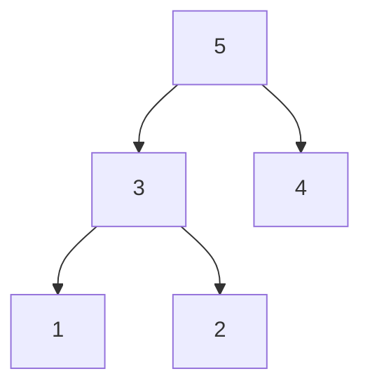

## Intuition

A **max-heap** is a tree, stored in a plain array, where every parent is at least as big as its children. So the biggest value is always at the top (index 0).

Heap sort has two phases. First, rearrange the array into a max-heap. Then repeat: swap the top (the biggest) with the last item of the heap, shrink the heap by one, and fix the top by sliding it down. Each repeat drops the next biggest value into its final place at the end.

It is like a tournament: the winner (the biggest) is taken out, and the bracket is quickly repaired.

## Walkthrough

In the array, the children of index `i` are `2i + 1` and `2i + 2`. Sort `[5, 2, 4, 1, 3]`.

| Step | What happens | Array (heap part, then sorted part after `\|`) |
| --- | --- | --- |
| start | | `5 2 4 1 3` |
| build | sift down index 1: swap 2 with its bigger child 3 | `5 3 4 1 2` |
| build | sift down index 0: 5 is bigger than both children, stop | `5 3 4 1 2` (a max-heap) |
| 1 | swap root 5 with last; sift down the new root 2 (swap with 4) | `4 3 2 1 \| 5` |
| 2 | swap root 4 with last; sift down 1 (swap with 3) | `3 1 2 \| 4 5` |
| 3 | swap root 3 with last; 2 stays on top | `2 1 \| 3 4 5` |
| 4 | swap root 2 with last | `1 \| 2 3 4 5` |
| done | | `1 2 3 4 5` |

This is the max-heap after the build phase. The array `5 3 4 1 2` and this tree are the same thing.

## Complexity

| Case | Time | Why |
| --- | --- | --- |
| Best | O(n log n) | The work does not depend on the order (even all-equal input still does the extraction phase). |
| Average | O(n log n) | n extractions, each sliding down at most log n levels. |
| Worst | O(n log n) | Same. It has no bad input, unlike quick sort. |
| Space | O(1) | Done in the array itself; the sift-down loop is iterative. |

Building the heap costs only O(n) (most nodes are near the bottom and barely move). The n extractions cost n times O(log n), because a heap with n items is about log₂ n levels tall. That second part dominates.

## Code explanation

1. **Build the max-heap.** Start at the last parent (`n / 2 - 1`) and sift each one down, going backwards to index 0.
2. **Extract the maximum.** Swap the root with the last item of the heap. That item is now in its final place, so the heap shrinks (`end` moves left).
3. **Repair the heap** by sifting the new root down. `siftDown` picks the bigger child, swaps if that child is bigger than the parent, and repeats.

Heap sort is not stable: swapping the root with the last item moves equal values past each other.

| Language | Difference |
| --- | --- |
| JavaScript / TypeScript | `>> 1` or integer maths for half; destructuring swap. |
| Python | `//` for integer division; `range(n // 2 - 1, -1, -1)` counts down. |
| Go | `len(a)/2 - 1` is integer division. Tuple swap. |
| Java / C# | Integer division truncates. |
| C++ | Unsigned indexes: `for (i = n / 2; i-- > 0;)` counts down to 0 without going negative. |

## Edge cases and tests

Every solution in every language runs the same seven cases, in this order, and prints one line per case: the sorted values separated by single spaces.

| # | Input | Output line | What it checks |
| --- | --- | --- | --- |
| 1 | `[7]` | `7` | one item: nothing to do, no crash |
| 2 | `[1, 2, 3, 4, 5]` | `1 2 3 4 5` | already sorted |
| 3 | `[]` | (an empty line) | empty input must not crash and must print an empty line |
| 4 | `[9, 7, 5, 3, 1]` | `1 3 5 7 9` | reverse sorted, the worst case for several algorithms |
| 5 | `[4, 2, 4, 1, 2, 4]` | `1 2 2 4 4 4` | duplicates |
| 6 | `[-3, 5, -1, 0, -8, 2]` | `-8 -3 -1 0 2 5` | negative numbers and zero |
| 7 | `[29, -4, 15, 0, 8, -17, 42, 15, 3, -4, 100, 7]` | `-17 -4 -4 0 3 7 8 15 15 29 42 100` | longer mixed input with repeats |

Output rule (same in every approach and language): an empty result prints an empty line, with no placeholder. The empty case sits in the middle of the list on purpose. The test runner trims blank lines at the very start and end of the output, and a blank line in the middle survives that trimming. Each function returns a new sorted list and never changes the test data, so one case cannot affect another.

## When to use it (and when not)

- Use it when you need a **guaranteed** O(n log n) time with **O(1)** extra memory.
- Do not use it when stability matters. In practice it is also slower than quick sort, because it jumps around memory (poor cache behaviour).

## Interview notes

- Say: "In place, O(n log n) always, not stable. Build a max-heap in O(n), then extract n times."
- Expected follow-up: "Why O(n) to build?" Most nodes sit near the leaves, so their sift-down is short.
- Mistake to avoid: wrong child indexes, or sifting down over the whole array instead of only the shrinking heap (`size`).

## Real-life usage

Used as the safety net inside **introsort**: when quick sort recursion goes too deep, C++ standard libraries switch to heap sort, so the worst case stays O(n log n). The heap idea itself is everywhere else: priority queues, schedulers, Dijkstra, and top-K problems.
