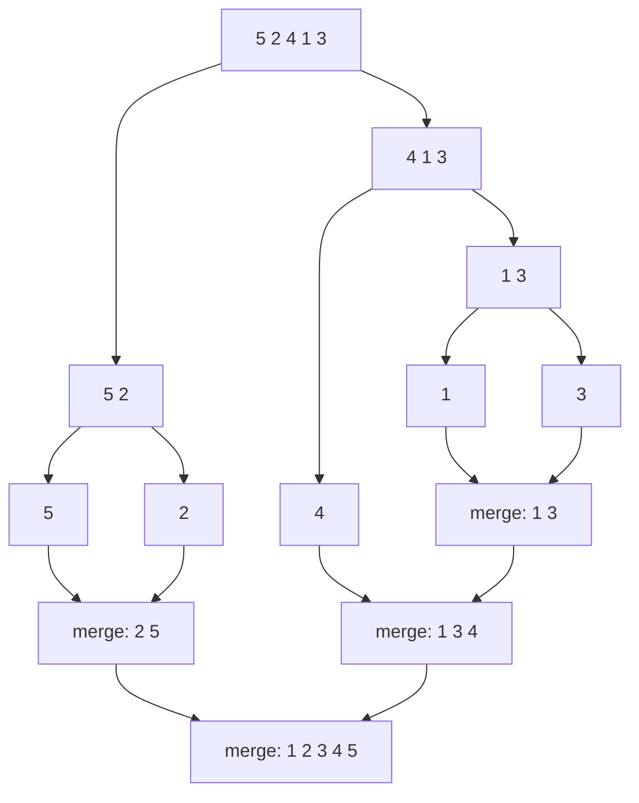

## Intuition

Divide and conquer. Sorting two small piles is easier than sorting one big pile, and **merging** two already-sorted piles is easy: look at the top card of each pile and take the smaller one.

So: split the pile in half, sort each half the same way (recursion), then merge the two sorted halves. A pile with 0 or 1 card is already sorted, and that is where the splitting stops.

## Walkthrough

Sort `[5, 2, 4, 1, 3]`.

Read it from the top down to see the splits, then from the bottom up to see the merges.

Merging `[2, 5]` and `[1, 3, 4]`:

| Left front | Right front | Take | Output so far |
| --- | --- | --- | --- |
| 2 | 1 | 1 | `1` |
| 2 | 3 | 2 | `1 2` |
| 5 | 3 | 3 | `1 2 3` |
| 5 | 4 | 4 | `1 2 3 4` |
| 5 | (empty) | rest of left | `1 2 3 4 5` |

## Complexity

| Case | Time | Why |
| --- | --- | --- |
| Best | O(n log n) | The splitting does not depend on the values. |
| Average | O(n log n) | Same. |
| Worst | O(n log n) | Same. This guarantee is its selling point. |
| Space | O(n) | Merging needs a separate output array. |

Why n log n? Halving n items until you reach size 1 takes log₂ n levels (1,000,000 items need about 20 levels). On each level every item is looked at once during merging, which is n work. So n work times log n levels.

Why O(n) extra space? You cannot merge two sorted halves in place without overwriting items you still need, so you write into a new array of size n. (This simple version allocates new arrays at every level, but they are freed quickly, and at any moment only O(n) is alive. A tuned version allocates one buffer once.) The recursion depth is only log n.

## Code explanation

1. **Base case:** zero or one item is already sorted. We return a copy so the caller never gets its own array back.
2. **Split** at the middle. `mid` comes from a length, so there is no overflow. When you split by indices, write `lo + (hi - lo) / 2`, never `(lo + hi) / 2`.
3. **Sort each half** recursively.
4. **Merge:** compare the two front items and take the smaller. On a tie we take the **left** one (`<=`). That rule is what makes merge sort **stable**.
5. When one side is used up, copy the rest of the other side, which is already sorted.

| Language | Difference |
| --- | --- |
| JavaScript / TypeScript | `slice` copies; `concat` joins the leftovers. |
| Python | Slices are copies; `extend` appends the leftovers. |
| Go | Sub-slices share memory (no copy), which is safe here because we only read them. `append(out, left[i:]...)` adds leftovers. |
| Java | `Arrays.copyOfRange` copies the halves. |
| C# | Range syntax `input[..mid]` copies an array. |
| C++ | Vector range constructors copy; `insert` adds leftovers. |

## Edge cases and tests

Every solution in every language runs the same seven cases, in this order, and prints one line per case: the sorted values separated by single spaces.

| # | Input | Output line | What it checks |
| --- | --- | --- | --- |
| 1 | `[7]` | `7` | one item: nothing to do, no crash |
| 2 | `[1, 2, 3, 4, 5]` | `1 2 3 4 5` | already sorted |
| 3 | `[]` | (an empty line) | empty input must not crash and must print an empty line |
| 4 | `[9, 7, 5, 3, 1]` | `1 3 5 7 9` | reverse sorted, the worst case for several algorithms |
| 5 | `[4, 2, 4, 1, 2, 4]` | `1 2 2 4 4 4` | duplicates |
| 6 | `[-3, 5, -1, 0, -8, 2]` | `-8 -3 -1 0 2 5` | negative numbers and zero |
| 7 | `[29, -4, 15, 0, 8, -17, 42, 15, 3, -4, 100, 7]` | `-17 -4 -4 0 3 7 8 15 15 29 42 100` | longer mixed input with repeats |

Output rule (same in every approach and language): an empty result prints an empty line, with no placeholder. The empty case sits in the middle of the list on purpose. The test runner trims blank lines at the very start and end of the output, and a blank line in the middle survives that trimming. Each function returns a new sorted list and never changes the test data, so one case cannot affect another.

## When to use it (and when not)

- Use it when you need a **guaranteed** O(n log n) time and **stability**, for example sorting records by a second key.
- Use it for linked lists (merging needs no extra array there) and for data that does not fit in memory (external sort).
- Do not use it when memory is tight and you have plain numbers: quick sort or heap sort need less extra space.

## Interview notes

- Say: "Split, sort halves, merge. O(n log n) always, O(n) extra space, stable."
- Expected follow-up: "How do you sort a file bigger than memory?" Sort chunks that fit, write them out, then merge the sorted chunk files (a k-way merge).
- Mistake to avoid: using `<` instead of `<=` in the merge, which breaks stability.

## Real-life usage

Merge sort is the base of Timsort, used by Python's `sorted`, Java's object sorting (`Arrays.sort(T[])`, `List.sort`) and modern JavaScript engines. Databases use external merge sort when `ORDER BY` data does not fit in memory. Merging sorted log files or sorted result pages from several shards is the same merge step.
