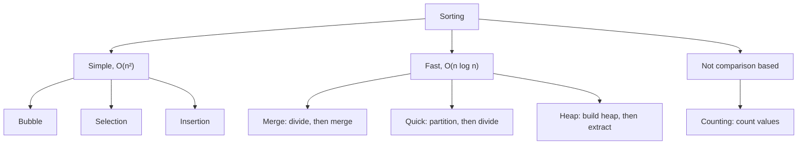
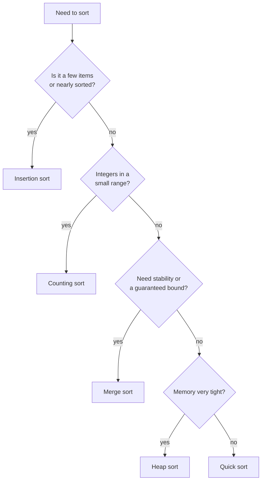

## How interviewers ask it

Sorting is asked in three ways.

1. **Implement it.** "Write a function that sorts an array of integers. Do not use the built-in sort." They usually want one simple sort first (bubble, insertion), then one fast sort (merge or quick).
2. **Explain it.** "How does quick sort work? What is its worst case? Is merge sort stable?" This checks that you understand the trade-offs, not just the code.
3. **Use it.** "Sort these orders by date, then by amount." "Return the top 10 scores." "Merge two sorted lists." Here sorting is a tool inside a bigger problem. Most real interviews are this kind.

**What to clarify before you write code**

| Ask | Why it changes the answer |
| --- | --- |
| How big is the input? | Under about 50 items, a simple sort is fine. Millions of items need O(n log n). More than memory needs an external sort. |
| What type are the items, and what range? | Small-range integers allow counting sort in O(n + k). |
| Are there duplicates? Negatives? | Quick sort with a naive partition struggles with many duplicates. Counting sort needs an offset for negatives. |
| Must equal items keep their order (stability)? | Needed when sorting by a second key. Merge and insertion sort are stable. Quick and heap sort are not. |
| Can I change the input, or must I return a new array? | In place saves memory but mutates the caller's data. |
| Is the data nearly sorted already? | Insertion sort and Timsort are very fast on that. |
| Do I need all items sorted, or only the top K? | Top K can be done without a full sort. |

**A good answer covers:** a correct algorithm, its time and space complexity with the reason, the edge cases (empty, one item, duplicates, negatives, already sorted, reverse sorted), stability, and when you would just call the built-in sort instead.

## Real-life scenarios

| Scenario | What is actually used | Why |
| --- | --- | --- |
| Database `ORDER BY` | If an index (usually a B-tree, which keeps keys in order) matches the sort columns, the database reads rows in index order and does no sorting at all. Otherwise it sorts in memory and, when the data is too big, spills sorted chunks to disk and merges them (external merge sort). | Reading in index order is nearly free. A sort costs O(n log n) and memory. This is why `ORDER BY` on an unindexed column over a big table is slow. |
| Paginated, sorted product list (`ORDER BY price LIMIT 20 OFFSET 40`) | A stable, deterministic order: sort by price and then by a unique key such as `id`. Often cursor ("keyset") pagination on the same index. | Equal prices have no defined order, so without a tie-breaker the same product can appear on two pages or on none. |
| Leaderboard or "top K" feed | A min-heap of size K, or a sorted set (for example a Redis sorted set). Not a full sort. | A heap keeps K items, so each update is O(log K) instead of re-sorting everything. |
| Merging sorted log files from many servers | A k-way merge: the merge step of merge sort, with a heap holding the front line of each file. | Each file is already sorted by time, so merging is O(n log k) and needs almost no memory. |
| Sorting a table in the UI (click a column header) | The built-in `sort` with a comparator. Multi-key sort relies on a **stable** sort: sort by the secondary column first, then by the primary, or use one comparator with both keys. | A stable sort keeps the earlier order among equal rows, so users do not see rows jump around. |
| Sorting data larger than memory (10 GB with 1 GB of RAM) | External merge sort: sort chunks that fit in memory, write each to disk, then k-way merge them. Big-data systems do this in their "shuffle" step. | Merge sort reads and writes data sequentially, which disks are good at. |
| The sort inside the standard library | Timsort (Python, Java for objects, V8 in JavaScript), introsort (C++ `std::sort`, .NET `Array.Sort`), pdqsort (Go 1.19+), dual-pivot quicksort (Java primitives). | They are hybrids: a fast general algorithm plus insertion sort for small pieces, and a fallback to avoid the worst case. Timsort also exploits runs that are already ordered. |

## Approaches compared

| Approach | Best | Average | Worst | Space | Stable | In place | Use when |
| --- | --- | --- | --- | --- | --- | --- | --- |
| Bubble sort | O(n) | O(n²) | O(n²) | O(1) | Yes | Yes | Teaching only |
| Selection sort | O(n²) | O(n²) | O(n²) | O(1) | No | Yes | Writes are very costly, tiny inputs |
| Insertion sort | O(n) | O(n²) | O(n²) | O(1) | Yes | Yes | Small or nearly sorted data, online input |
| Merge sort | O(n log n) | O(n log n) | O(n log n) | O(n) | Yes | No | You need stability and a guaranteed bound, linked lists, external sort |
| Quick sort | O(n log n) | O(n log n) | O(n²) | O(log n) | No | Yes | Fast general in-memory sorting of primitives |
| Heap sort | O(n log n) | O(n log n) | O(n log n) | O(1) | No | Yes | Guaranteed bound with no extra memory |
| Counting sort | O(n + k) | O(n + k) | O(n + k) | O(n + k) | Yes | No | Integers in a small range (k = max - min + 1) |

Read it as a family tree. The simple sorts are easy to write but slow. The fast ones all use a smarter structure (halving, partitioning or a heap). Counting sort avoids comparing items altogether.

A fact worth knowing: any algorithm that sorts by **comparing** items needs at least about n log n comparisons in the worst case. Counting sort beats that only because it uses extra knowledge about the values.

## How to choose

In production the answer is simpler: **call the standard library sort**. Hand-write a sort only in an interview, for learning, or in an unusual case such as a custom data structure.

| Situation | Use |
| --- | --- |
| Small or nearly sorted data | Insertion sort (or the built-in, which already handles it) |
| Huge data that does not fit in memory | External merge sort |
| Need a stable sort | Merge sort (or the built-in stable sort) |
| Need the best average speed on numbers | Quick sort (introsort or pdqsort in libraries) |
| Need a guaranteed O(n log n) with O(1) memory | Heap sort |
| Integers in a small range, or a histogram | Counting sort |
| Only the top K items | A heap of size K, or quickselect, not a full sort |

## Built-ins and the standard library

In real code, use these. The pitfalls are where bugs and interview questions come from.

| Language | Call | Algorithm | Stable | Pitfall |
| --- | --- | --- | --- | --- |
| JavaScript | `arr.sort(cmp)`, and `arr.toSorted(cmp)` (ES2023) for a copy | Timsort in V8 | Yes (required by the spec since ES2019) | With no comparator, items are compared **as strings**: `[10, 9, 1].sort()` gives `[1, 10, 9]`. Use `(a, b) => a - b`. `sort` mutates the array and returns it. `undefined` values go last. |
| TypeScript | Same as JavaScript, with types | Same | Yes | The compiler does not warn about the default string comparison on `number[]`. `toSorted` needs the ES2023 library setting. |
| Python | `sorted(it, key=..., reverse=...)` returns a new list; `list.sort()` sorts in place and returns `None` | Timsort | Yes | `x = x.sort()` sets `x` to `None`. `key` runs once per item, which is cheaper than a comparison function. Mixed types such as `int` and `str` raise `TypeError`. `NaN` breaks ordering. |
| Go | `sort.Ints`, `sort.Slice(s, less)`, `sort.SliceStable`, and since Go 1.21 `slices.Sort` and `slices.SortFunc` (and `slices.SortStableFunc`) | pdqsort since Go 1.19 (not stable); the stable versions use insertion plus merge ideas | `sort.Slice` and `slices.SortFunc`: **No**. `sort.SliceStable` and `slices.SortStableFunc`: yes | `sort.Slice` is not stable, so ties can change order between runs of different data. `less` must be a strict "less than", not `<=`. `sort.Slice` takes `any`, and a wrong argument fails only at run time. |
| Java (21) | `Arrays.sort(int[])` for primitives; `Arrays.sort(T[], cmp)`, `Collections.sort(list)`, `list.sort(cmp)` for objects | Dual-pivot quicksort for primitives; Timsort for objects | Primitives: not applicable (equal ints look the same). Objects: **yes** | Never write a comparator as `a - b` for ints: it can overflow. Use `Integer.compare(a, b)` or `Comparator.comparingInt`. Chain keys with `thenComparing`. |
| C# (.NET 8) | `Array.Sort`, `List<T>.Sort`, and LINQ `OrderBy` / `ThenBy` | Introsort for `Array.Sort` and `List.Sort`; `OrderBy` is a stable sort | `Array.Sort`, `List.Sort`: **No**. `OrderBy`: **Yes** | `OrderBy` returns a new lazy sequence and costs more memory. `List.Sort` with a comparison must be consistent, or you get odd results or an exception. |
| C++ | `std::sort(first, last, cmp)`, `std::stable_sort` | `std::sort`: introsort in common implementations; `std::stable_sort`: merge sort, using extra memory when it can | `std::sort`: **No**. `std::stable_sort`: yes | The comparator must be a **strict weak ordering**: `<` is fine, `<=` is undefined behaviour and can crash. Needs random-access iterators, so `std::list` uses its own `list.sort()`. |

Two more things worth saying in an interview. First, the standard sorts are hybrids, not plain quick sort or merge sort: they switch algorithms for small ranges or deep recursion. Second, the language specs often do not promise the exact algorithm (C++ only promises O(n log n)), so say "typically" or "in the common implementation" when you name it.

## Common mistakes

- **Using the default sort for numbers in JavaScript.** `[10, 9, 1].sort()` is `[1, 10, 9]`. Always pass a comparator for numbers.
- **Comparator `a - b` with overflow or `NaN`.** With big ints in Java it can overflow, and with `Infinity` or `NaN` in JavaScript it returns `NaN`. Use `Integer.compare` or `a < b ? -1 : a > b ? 1 : 0`.
- **A comparator that is not a strict weak ordering.** `<=` instead of `<`, or random results. Some libraries throw ("Comparison method violates its general contract"), some loop, some silently give wrong answers.
- **Mutating the caller's array by accident.** `sort` in JavaScript and Python's `list.sort()` change the original. In React state, that breaks change detection. Copy first (`[...items].sort(...)` or `toSorted`).
- **Assuming stability.** `sort.Slice` in Go, `std::sort` in C++ and `Array.Sort` in C# are not stable. If you sort rows by a second key, use the stable version or add a tie-breaker.
- **Off-by-one errors.** `i < n - 1` vs `i < n`, `j >= 0`, and writing the key to `a[j + 1]`. Trace the smallest cases (empty, one item, two items).
- **Integer overflow in the midpoint.** `(lo + hi) / 2` can overflow for big indexes. Write `lo + (hi - lo) / 2`.
- **Unsigned indexes.** In C++ or Rust, `j >= 0` is always true for unsigned types, so the loop never ends.
- **Quick sort with a bad pivot.** First or last item as the pivot is O(n²) on sorted input. Use the middle, median-of-three or a random pivot.
- **Recursion depth.** Recursive quick sort on bad input can overflow the stack. Recurse into the smaller side first.
- **Counting sort without an offset.** Negative numbers give a negative index. Subtract the minimum. Also check the range is small enough.
- **Sorting strings with plain comparison.** Language-aware order (accents, case) needs a locale-aware comparison such as `localeCompare` or `Intl.Collator`.

## How to answer in an interview

1. **Clarify.** "How many items? Integers? Can there be duplicates or negatives? Should I change the input or return a new array? Does it need to be stable?" Say this out loud before coding.
2. **Give examples and edge cases.** "For `[3, 1, 2]` I expect `[1, 2, 3]`. I will also check empty, one item, duplicates, already sorted and reverse sorted."
3. **State the simple approach and its cost.** "The easiest way is insertion sort or selection sort. They are O(n²), fine for small inputs but too slow for a million items."
4. **Improve it.** "To get O(n log n) I can use divide and conquer. Merge sort splits in half, sorts each half and merges, which is O(n log n) always but needs O(n) extra space. Quick sort partitions around a pivot, is in place, and is O(n log n) on average."
5. **Code it** in small, named pieces (`merge`, `partition`). Keep the variable names clear and explain each step as you type.
6. **Test it aloud.** Walk the smallest example through the code, then the edge cases. "With an empty array the base case returns immediately."
7. **State complexity with the reason.** "Time is O(n log n) because there are log n levels and each level does O(n) work. Space is O(n) because merge needs a second array."
8. **Mention trade-offs and the real world.** "In production I would call the built-in sort. It is a tuned hybrid, and in Python and Java it is stable. I would hand-write it only if the data has a special shape, like small-range integers, where counting sort is O(n)."

## Follow-up questions

- **Which of these sorts are stable, and why does it matter?** Bubble, insertion, merge and counting (the version here) are stable. Selection, quick and heap are not. Stability keeps the old order of equal items, which is what makes multi-key sorting and "sort by column" in a UI work.
- **How would you sort 10 GB of numbers with 1 GB of memory?** External merge sort. Read chunks of about 1 GB, sort each in memory, write them as sorted files, then do a k-way merge of all the files using a heap that holds the front item of each file.
- **What is the best algorithm for nearly sorted data?** Insertion sort, which is O(n + d) where d is the number of out-of-order pairs. Timsort is also designed to find and use runs that are already in order.
- **How do you find the top K items without sorting everything?** Keep a min-heap of size K while scanning: O(n log K). Or use quickselect, which is O(n) on average. Sort only the K results if they must be ordered.
- **How do you sort by two keys?** Use a comparator with both keys (compare the first, and if equal compare the second). Or use a stable sort twice: first by the secondary key, then by the primary key.
- **Can you sort faster than O(n log n)?** Not by comparing items: the lower bound is about n log n comparisons. With extra knowledge you can: counting sort and radix sort run in linear time for integers with a bounded range.
- **How do you parallelise sorting?** Split the data, sort the parts on separate threads or machines, then merge. Merge sort fits this well. Quick sort can also sort its two sides in parallel.
- **Why is quick sort often faster than merge sort in practice, although its worst case is worse?** It sorts in place on contiguous memory, which is friendly to the CPU cache, and it does less copying. Introsort or pdqsort removes the bad worst case.

## Practice

1. **Sort colors** (Dutch national flag): sort an array of 0s, 1s and 2s in one pass and O(1) space. Related idea: three-way partition and counting sort.
2. **Merge two sorted arrays**, then **merge k sorted lists**: the merge step of merge sort, plus a heap for k lists.
3. **Kth largest element in an array**: quickselect or a heap of size k.
4. **Merge intervals**: sort by start, then sweep once.
5. **Sort by frequency** (or "largest number" from a list of integers): a custom comparator on top of a stable sort.
