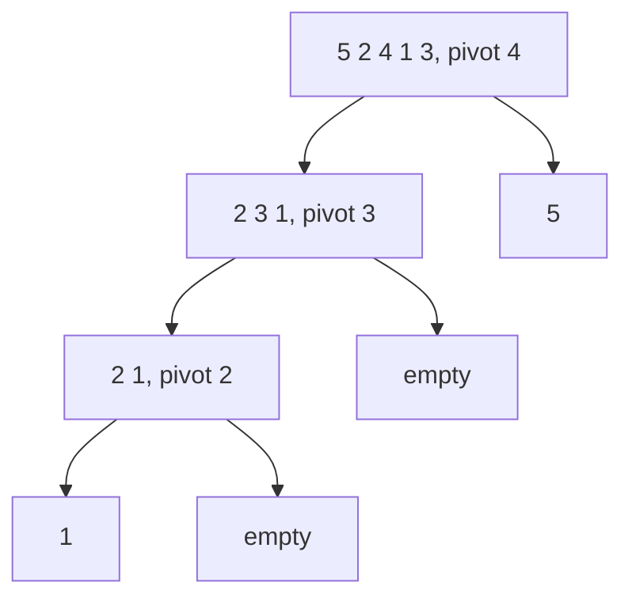

## Intuition

Pick one card, the **pivot**. Put every smaller card on its left and every bigger card on its right. Now the pivot is in its final place, and you only have to sort the left group and the right group the same way. The step of splitting around the pivot is called **partitioning**.

It is "divide and conquer" like merge sort, but the hard work happens while splitting, and nothing has to be merged afterwards.

## Walkthrough

Sort `[5, 2, 4, 1, 3]`. This code takes the **middle** item as the pivot.

| Step | Range | Pivot | Result of partitioning |
| --- | --- | --- | --- |
| 1 | all five | 4 | `2 3 1 \| 4 \| 5` |
| 2 | `2 3 1` | 3 | `2 1 \| 3` |
| 3 | `2 1` | 2 | `1 \| 2` |
| done | | | `1 2 3 4 5` |

Inside one partition, an index `store` marks the end of the "smaller than pivot" block. The pivot is parked at the end, we scan the rest, move each smaller value into the block, and finally swap the pivot into the gap. This is the **Lomuto** partition scheme.

## Complexity

| Case | Time | Why |
| --- | --- | --- |
| Best | O(n log n) | Every pivot splits the range about in half: log n levels of n work. |
| Average | O(n log n) | Even a 10/90 split still gives about log n levels. |
| Worst | O(n²) | The pivot is always the smallest or largest, so one side is empty and you get n levels of n work. |
| Space | O(log n) | Recursion stack. Recursing into the smaller side first keeps it at log n. |

What makes the worst case? A bad pivot. If you always take the first or last item, sorted or reverse sorted input is the worst case. Taking the middle item fixes those common inputs, but a clever adversary can still build a bad input. Real libraries use median-of-three or random pivots, and **introsort** switches to heap sort if the recursion gets too deep, so the worst case stays O(n log n).

This Lomuto version also slows down when many values are equal (all-equal input is O(n²)), because `a[i] < pivot` never moves them. Hoare or three-way partitioning fixes that.

## Code explanation

1. **Choose the pivot** as the middle item and move it to the end. `lo + (hi - lo) / 2` avoids integer overflow.
2. **Partition:** scan from `lo` to `hi - 1`. Every value smaller than the pivot is swapped into the "small" block that ends at `store`.
3. **Place the pivot:** swap it into index `store`. It is now in its final position, and the function returns that index.
4. **Recurse on the smaller side, loop on the larger.** The loop replaces the second recursive call, so the stack never gets deeper than about log n, even for bad input.

| Language | Difference |
| --- | --- |
| JavaScript / TypeScript | Destructuring swap. Recursion depth is limited (roughly 10,000 frames), so step 4 matters. |
| Python | Tuple swap. The recursion limit is about 1000 by default, so step 4 really matters here. |
| Go | Tuple swap; the function is named `sort` and is local to `package main`. Do not confuse it with the `sort` package. |
| Java | A small `swap` helper. `int` indexes; midpoint written to avoid overflow. |
| C# | Tuple swap. |
| C++ | `lo` and `hi` are signed `int` so the empty range `hi = -1` works without unsigned wrap-around. |

## Edge cases and tests

Every solution in every language runs the same seven cases, in this order, and prints one line per case: the sorted values separated by single spaces.

| # | Input | Output line | What it checks |
| --- | --- | --- | --- |
| 1 | `[7]` | `7` | one item: nothing to do, no crash |
| 2 | `[1, 2, 3, 4, 5]` | `1 2 3 4 5` | already sorted |
| 3 | `[]` | (an empty line) | empty input must not crash and must print an empty line |
| 4 | `[9, 7, 5, 3, 1]` | `1 3 5 7 9` | reverse sorted, the worst case for several algorithms |
| 5 | `[4, 2, 4, 1, 2, 4]` | `1 2 2 4 4 4` | duplicates |
| 6 | `[-3, 5, -1, 0, -8, 2]` | `-8 -3 -1 0 2 5` | negative numbers and zero |
| 7 | `[29, -4, 15, 0, 8, -17, 42, 15, 3, -4, 100, 7]` | `-17 -4 -4 0 3 7 8 15 15 29 42 100` | longer mixed input with repeats |

Output rule (same in every approach and language): an empty result prints an empty line, with no placeholder. The empty case sits in the middle of the list on purpose. The test runner trims blank lines at the very start and end of the output, and a blank line in the middle survives that trimming. Each function returns a new sorted list and never changes the test data, so one case cannot affect another.

## When to use it (and when not)

- Use it for general in-memory sorting of primitives when stability does not matter. It is fast in practice because it works on contiguous memory and has few operations per item.
- Do not use it when you need stability (sorting records by a second key), or when worst-case guarantees matter and you cannot use a safe pivot rule.

## Interview notes

- Say: "Average O(n log n), worst O(n²) with bad pivots, in place, not stable. I choose the pivot carefully."
- Expected follow-ups: how to avoid the worst case (random or median-of-three pivot, introsort), why it is not stable (partition swaps jump over equal items), and quickselect for the k-th smallest.
- Mistake to avoid: an off-by-one in partitioning, or recursing on both sides without handling a one-sided split.

## Real-life usage

C++ `std::sort` is an introsort (quick sort, switching to heap sort when too deep, and insertion sort for small ranges). Go's `sort.Slice` and `slices.Sort` use pdqsort (pattern-defeating quicksort) since Go 1.19. Java's `Arrays.sort(int[])` uses dual-pivot quicksort. .NET's `Array.Sort` is introsort. Quickselect, a cousin of this algorithm, finds the median or the top K without a full sort.
