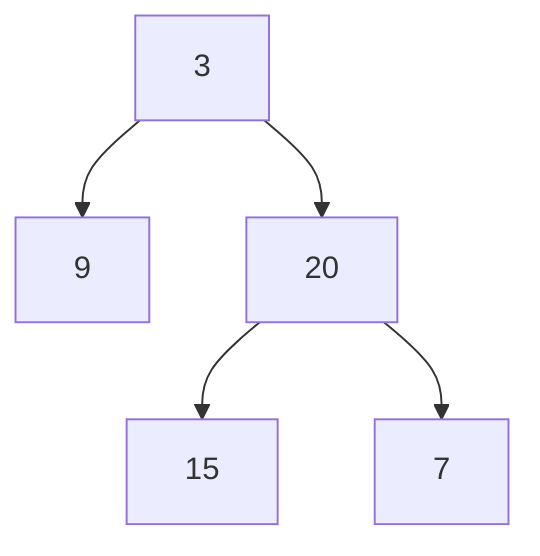
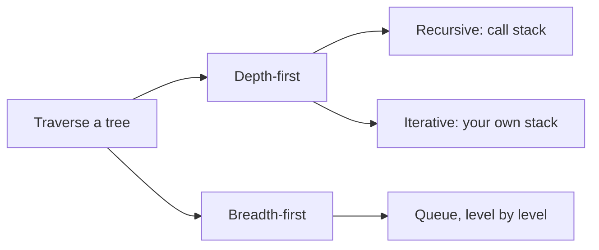
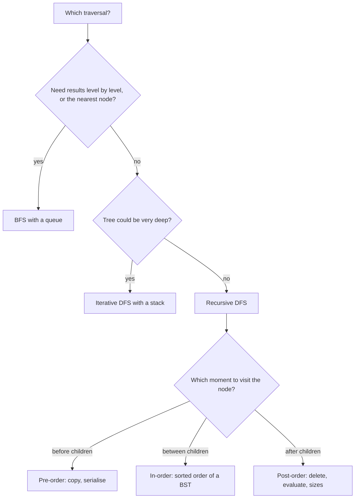
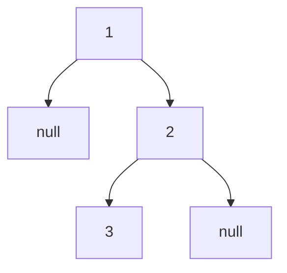
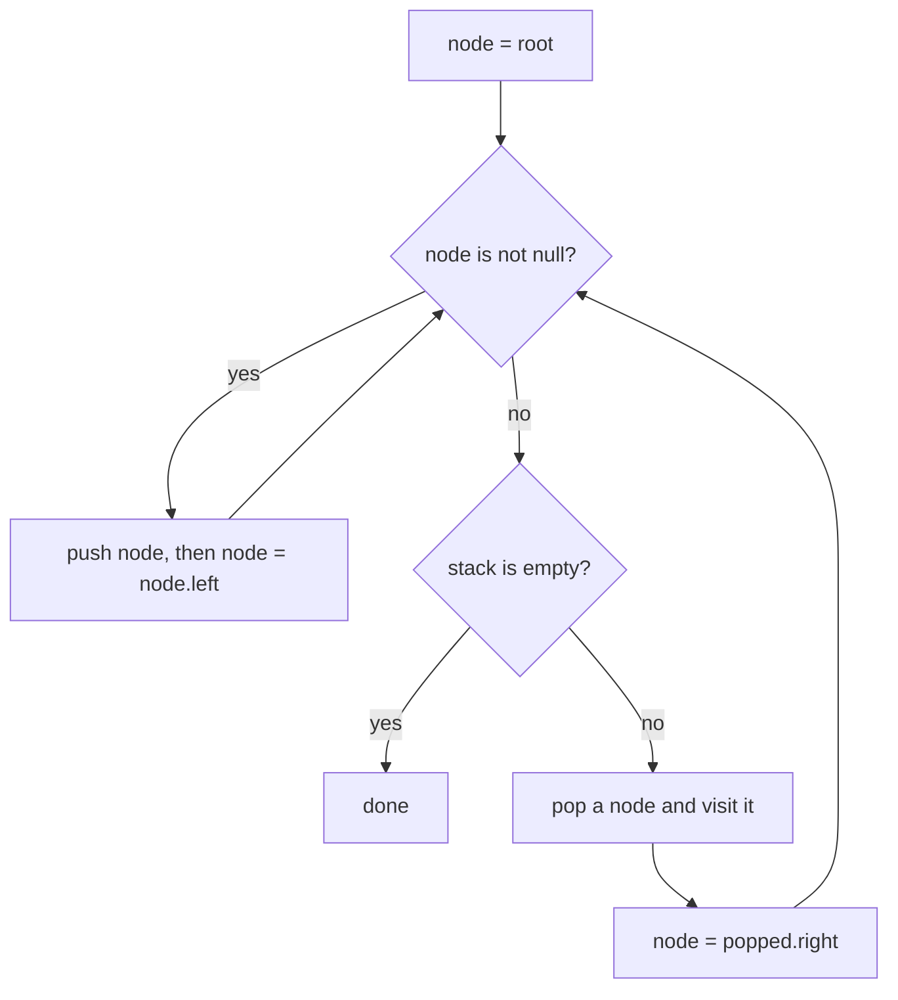
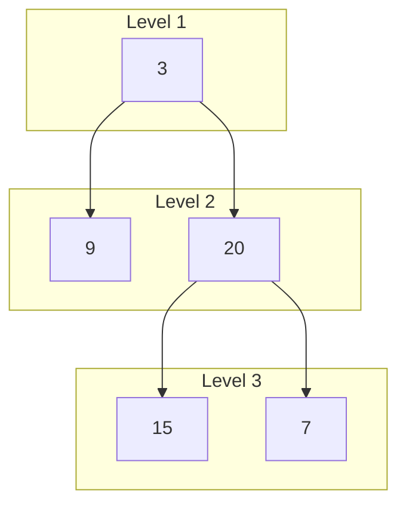

# Tree traversals

[← All problems](../README.md)

> Visit every node of a binary tree in pre-order, in-order, post-order or level order: the base for searching, copying, printing and validating trees.

**Level:** basic · **Tags:** trees, binary-tree, recursion, dfs, bfs, stack, queue

**Related interview questions:**

- [Databases: What is a database index, how does a B-tree work, and what does an index cost?](../../questions/databases.md)
- [Databases: How do B-tree and LSM-tree storage engines differ, and what is each good at?](../../questions/databases.md)
- [Git & Version Control: What is Git's object model: blobs, trees, commits and tags?](../../questions/git-version-control.md)
- [JavaScript: What is the event loop? How do the call stack, task queue and microtasks work?](../../questions/javascript.md)
- [Golang: What are pointers in Go, and when should you use them?](../../questions/golang.md)
- [Golang: What is escape analysis? How does Go decide between stack and heap?](../../questions/golang.md)

## How interviewers ask it

**A binary tree** is a structure of nodes where each node has a value and at most two children, called left and right. The first node is the root. A node with no children is a leaf. A **traversal** is a way of visiting every node exactly once.

**The classic wording.** "Given the root of a binary tree, return its in-order traversal." Often it comes as a set: "Give me the pre-order, in-order and post-order of this tree", and "Print the tree level by level."

The four orders, using the tree with root 3, left child 9, and right child 20 whose children are 15 and 7:



| Order | Rule | Result for the tree above |
| --- | --- | --- |
| Pre-order | node, left subtree, right subtree | 3 9 20 15 7 |
| In-order | left subtree, node, right subtree | 9 3 15 20 7 |
| Post-order | left subtree, right subtree, node | 9 15 7 20 3 |
| Level order | level by level, left to right | 3, then 9 20, then 15 7 |

The first three are depth-first (go all the way down before coming back). Level order is breadth-first (finish one level before the next).

**Common variations:**

- Do it without recursion (explicit stack).
- Return the values level by level, as a list of lists, or in a zigzag order, or only the right-most node of each level.
- Build a tree from its pre-order and in-order lists, or serialise and deserialise a tree.
- Find the maximum depth, check if the tree is balanced, check if it is a valid binary search tree, find the lowest common ancestor.
- Traverse in constant extra space (Morris traversal).
- Traverse a tree with more than two children (an n-ary tree).

**What to clarify before you code:**

| Question to ask | Why it matters |
| --- | --- |
| Which order do you want? | The answer decides the algorithm. |
| Is it a binary search tree? | The in-order of a binary search tree is sorted, which may let you shortcut. |
| How deep can the tree be? | A skewed tree with a million nodes overflows a recursive solution. |
| Can the tree be empty? | The root can be null. Return an empty result. |
| What format is the tree given in? | LeetCode style uses a level-order array with `null` for a missing child. |
| Do you want values or nodes? | Returning nodes lets the caller change them. |

A good answer states all four orders, writes the recursive version first because it is short, then offers the iterative version with a stack, and states the time and the space (the height of the tree).

In this repo the programs build a tree from a level-order text where the word `null` marks a missing child. The first token is the root. Then, for each node in order, the next two tokens are its left and right child. An empty text is an empty tree. The depth-first programs print the values separated by spaces for one order per test case. The level-order program prints the levels separated by a vertical bar. An empty tree prints the word `empty`.

## Real-life scenarios

| Scenario | What is actually used | Why |
| --- | --- | --- |
| Walking a folder on disk (`find`, `du`, `rm -r`, copy a folder) | Depth-first. Delete is post-order, copy is pre-order | You must delete a folder's contents before the folder (children first), and create a folder before its contents (parent first). |
| The browser DOM: `querySelectorAll`, React rendering, accessibility trees | Pre-order depth-first, which is "document order" | Elements are processed in the order they appear in the page. |
| Compilers and interpreters working on an abstract syntax tree | Post-order to evaluate, in-order to print, pre-order to copy | Children values must be known before the operator can be computed. |
| A database index (B-tree) range scan: `WHERE age BETWEEN 20 AND 30` | In-order walk of the tree | In-order gives keys in sorted order, so a range is a contiguous walk. |
| An organisation chart or a menu printed level by level | Breadth-first | Employees at the same depth are shown together. |
| Finding the shortest path in an unweighted graph or a game board | Breadth-first | The first time you reach a node is by the fewest steps. |
| Serialising a tree to JSON or a file | Pre-order (or level order) with markers for missing children | Parents come before children, so a reader can rebuild the shape. |
| Garbage collectors marking reachable objects | Depth-first with an explicit stack | The object graph can be very deep, so recursion would overflow the stack. |
| Git trees and commit history | Walking a tree of directories, a graph of commits | Operations like `git diff` and `git log` walk these structures. |

Whenever data is nested (folders, comments with replies, menus, JSON, HTML, expressions), a tree traversal is hiding in the solution.

## Approaches compared

| Approach | Style | Time | Extra space | Use when |
| --- | --- | --- | --- | --- |
| 1. Recursive DFS | Depth-first, call stack | O(n) | O(h) call stack | The default for pre, in and post-order. Short and clear. |
| 2. Iterative DFS | Depth-first, explicit stack | O(n) | O(h) on the heap | Very deep trees, or when the interviewer says "no recursion". |
| 3. BFS level order | Breadth-first, queue | O(n) | O(w) for the widest level | When levels matter: nearest node, level by level output, shortest path. |

Here n is the number of nodes, h is the height of the tree and w is the width of its widest level. For a balanced tree h is about log n and w is about n over two. For a chain, h is n and w is 1. So DFS is cheaper on wide, bushy trees, and BFS is cheaper on deep, thin trees.



Read it as: first choose how to move (down first or across first), then how to keep track of where you are.

## How to choose



Start at the top and answer each question. The three DFS orders differ only in the moment the node is visited.

## Built-ins and the standard library

No mainstream language ships a general binary tree node with traversals. What the standard libraries give you is the stack and the queue you need, and a few ordered containers that are trees inside.

| Language | Stack and queue to use | Ordered tree-based container | Pitfall |
| --- | --- | --- | --- |
| JavaScript / TypeScript | `Array` with `push` and `pop` (stack). For a queue, an array with a head index or two arrays | None in the standard library | `Array.prototype.shift` is O(n) in the worst case. For a big queue keep an index or swap two arrays, as the code here does. |
| Python | `list` (stack), `collections.deque` (queue) | None in the standard library | `list.pop(0)` is O(n); use `deque.popleft()`. Python's recursion limit is about 1000 frames, so a deep tree raises `RecursionError`. |
| Go | A slice for both | None in the standard library | No recursion limit problem in practice (stacks grow), but deep recursion is still wasteful. Taking `queue[1:]` keeps the old array alive until the slice is replaced. |
| Java | `ArrayDeque` for both (`Deque` as stack, `Queue` as queue) | `TreeMap`, `TreeSet` (red-black trees, iteration is in-order) | `ArrayDeque` does not accept `null`. The legacy `Stack` class is synchronised and slower. Recursion depth is limited by the thread stack. |
| C# | `Stack<T>`, `Queue<T>` | `SortedDictionary`, `SortedSet` (red-black trees) | Iterating a `SortedSet` already gives in-order. A very deep recursion crashes the process because a stack overflow cannot be caught. |
| C++ | `std::stack`, `std::queue` (or `std::vector` and `std::deque`) | `std::map`, `std::set` (usually red-black trees, iteration is in-order) | `top` and `front` on an empty container are undefined behaviour. Deep recursion can crash silently. |

**Hand-write or use a library?** If you only need sorted data, use the ordered container and iterate it; it is an in-order traversal for free. Write a traversal yourself for your own node types (a syntax tree, a folder tree, a DOM) or when the interview asks.

## Common mistakes

- **Missing base case.** Forgetting `if (node == null) return` crashes on every leaf's children.
- **Mixing up the order.** The only difference between the three depth-first orders is the line where the node's value is added. Putting it in the wrong place gives the wrong order without any error.
- **Iterative in-order done like pre-order.** In-order needs to go left first and visit only when you come back. Pushing right then left and visiting on pop gives pre-order, not in-order.
- **Wrong push order in the iterative pre-order.** A stack pops the last item pushed, so push the right child first and the left child second to visit the left first.
- **Forgetting the reverse for post-order.** The two-in-one trick (node, right, left, then reverse) needs the final reverse.
- **Using a list as a queue and removing from the front.** In Python and JavaScript this is O(n) per removal, so BFS becomes quadratic.
- **Mixing levels in BFS.** To print levels, record the queue size before the inner loop. If you read the size inside the loop, it changes while you add children.
- **Pushing null children.** Some queues (Java's `ArrayDeque`) throw on `null`; others create endless work. Check before you add.
- **Recursion on a skewed tree.** A chain of a million nodes overflows the stack.
- **Assuming a balanced tree.** The height, and so the recursion depth and the stack size, can be as big as the number of nodes.

## How to answer in an interview

1. **Clarify.** "Binary tree or binary search tree? Which order? Can it be empty? How deep can it get?"
2. **Draw a small tree** with five or seven nodes and write the three orders next to it.
3. **Say the idea.** "Depth-first means finish a whole subtree before the next. The three orders differ only in when I record the node: before, between or after the two subtrees."
4. **Code the recursive version.** Base case, then the three lines in the right order. State the cost: "Linear time, and space equal to the height of the tree for the call stack."
5. **Offer the iterative version.** "I can replace the call stack by my own stack to avoid overflow on deep trees."
6. **For level order,** "I use a queue. At each round I take exactly the nodes that are in the queue right now, which are one level, and add their children."
7. **Test aloud.** The empty tree, one node, a left-only chain, a right-only chain and a full tree.
8. **State complexity.** "Time is O(n) because each node is visited once. Space is O(h) for depth-first and O(w) for breadth-first."
9. **Mention the follow-ups.** "In-order of a binary search tree is sorted. Morris traversal does in-order in O(1) extra space by temporarily changing pointers."

## Follow-up questions

- **How do you traverse without recursion or a stack?** Morris traversal. For each node, find its in-order predecessor (the right-most node in its left subtree) and temporarily link that predecessor's right pointer to the current node. This lets you walk back up without a stack. You remove the link afterwards. It runs in O(n) time and O(1) extra space but changes the tree temporarily, so it is not thread safe.
- **What is special about the in-order traversal of a binary search tree?** It visits the keys in ascending order. That is why validating a BST can be done by checking that the in-order sequence is strictly increasing.
- **Can you rebuild a tree from two traversals?** Yes from in-order plus pre-order, or in-order plus post-order, if values are unique. The pre-order gives the root, and the in-order tells you how many nodes are in the left subtree. Pre-order alone is not enough unless you also record the missing children.
- **How do you do a zigzag level order?** Same BFS, but reverse every second level before adding it to the result.
- **How do you find the maximum depth?** Recursively, one plus the larger depth of the two children, or count the levels in BFS.
- **How is a tree different from a graph traversal?** A tree has no cycles, so you do not need a visited set. A general graph can have cycles, so you need one.
- **When would you choose BFS over DFS?** When the answer is the closest node, or you must process by distance. DFS is better when the answer is deep in the structure or when memory for the widest level is large.
- **How much memory does each use for a tree with a million nodes?** For a balanced tree DFS holds about twenty nodes (the height), and BFS holds up to about half a million (the last level). For a long chain it is the opposite.
- **How do you traverse a tree with many children?** Replace the left and right steps with a loop over the list of children. Pre-order and post-order are unchanged. In-order is not well defined.

## Practice

- Maximum depth of a binary tree, and minimum depth (BFS stops early).
- Same tree, symmetric tree, invert binary tree.
- Validate binary search tree (in-order, or pass bounds down).
- Lowest common ancestor of two nodes.
- Binary tree right side view and zigzag level order traversal.
- Construct a binary tree from pre-order and in-order traversals.
- Serialise and deserialise a binary tree.
- Path sum and diameter of a binary tree (post-order thinking).

## Further reading

Where to read more at the source. Official docs and references come first.

**Official docs**

- [Python: collections.deque](https://docs.python.org/3/library/collections.html#collections.deque) — A fast double-ended queue; popleft is constant time, unlike list.pop(0). _(beginner)_
- [Java: ArrayDeque](https://docs.oracle.com/en/java/javase/21/docs/api/java.base/java/util/ArrayDeque.html) — The recommended stack and queue in Java. _(intermediate)_

**Reference**

- [Tree traversal (Wikipedia)](https://en.wikipedia.org/wiki/Tree_traversal) — Pre-order, in-order, post-order and level order, with pseudocode for the recursive and iterative forms. _(beginner)_
- [Binary tree (Wikipedia)](https://en.wikipedia.org/wiki/Binary_tree) — Terms such as height, depth, full, complete and balanced trees. _(beginner)_
- [Depth-first search (Wikipedia)](https://en.wikipedia.org/wiki/Depth-first_search) — The graph search that tree pre-order and post-order come from. _(intermediate)_
- [Breadth-first search (Wikipedia)](https://en.wikipedia.org/wiki/Breadth-first_search) — The queue-based search that level order is a special case of. _(intermediate)_
- [C++: std::queue](https://en.cppreference.com/w/cpp/container/queue) — The queue adaptor used for breadth-first search. _(intermediate)_

**Tool**

- [LeetCode: Binary Tree Inorder Traversal](https://leetcode.com/problems/binary-tree-inorder-traversal/) — The in-order problem, with the follow-up to do it without recursion. _(beginner)_
- [LeetCode: Binary Tree Level Order Traversal](https://leetcode.com/problems/binary-tree-level-order-traversal/) — The level-by-level problem solved with a queue. _(beginner)_

## Approaches

| Approach | Best | Average | Worst | Space | Stable | In place | Languages |
| --- | --- | --- | --- | --- | --- | --- | --- |
| [Recursive depth-first (pre, in, post-order)](#recursive-depth-first-pre-in-post-order) | O(n) | O(n) | O(n) | O(h) | – | – | JavaScript, TypeScript, Python, Go, Java, C#, C++ |
| [Iterative depth-first with a stack](#iterative-depth-first-with-a-stack) | O(n) | O(n) | O(n) | O(h) | – | – | JavaScript, TypeScript, Python, Go, Java, C#, C++ |
| [Breadth-first (level order) with a queue](#breadth-first-level-order-with-a-queue) | O(n) | O(n) | O(n) | O(w) | – | – | JavaScript, TypeScript, Python, Go, Java, C#, C++ |

## Recursive depth-first (pre, in, post-order)

> Let the call stack do the work: visit the node before, between or after its two subtrees.

### Intuition

Think of a tree as a family tree or a folder on your computer. To "visit everything" in a folder you open the first subfolder, visit everything inside it, then do the same for the next subfolder. A tree is exactly that: a node plus two smaller trees (its left and right subtree). So a function that visits a tree can simply call itself on the two smaller trees. This is **recursion**: solving a problem by solving smaller copies of the same problem.

The three classic orders differ in only one thing: when you write down the node's value, compared with the two recursive calls.

- **Pre-order**: write the node, then go left, then go right. "Parent before children."
- **In-order**: go left, write the node, then go right. "Left, me, right." For a binary search tree this gives sorted order.
- **Post-order**: go left, go right, then write the node. "Children before parent."

An easy way to remember: the prefix says where the node goes. Pre means before the subtrees, in means in between, post means after.

The recursion needs a stopping rule, called the base case: an empty subtree has nothing to visit, so the function returns at once.

### Walkthrough

Input: the tree `1 null 2 3` (the first test case). Node 1 has no left child and a right child 2. Node 2 has a left child 3 and no right child.



Read it as: 1 at the top, 2 below on the right, 3 below 2 on the left.

The calls, shown for in-order, with the order of events:

| Step | Call | What happens |
| --- | --- | --- |
| 1 | visit(1) | go left first |
| 2 | visit(null) | base case, return |
| 3 | back in 1 | write 1 (in-order: between the subtrees), then go right |
| 4 | visit(2) | go left first |
| 5 | visit(3) | go left: visit(null) returns |
| 6 | back in 3 | write 3, then go right: visit(null) returns |
| 7 | back in 2 | write 2, then go right: visit(null) returns |

In-order result: `1 3 2`. For the same tree, pre-order writes each node on arrival: `1 2 3`. Post-order writes each node when leaving: `3 2 1`.

Side by side on the larger perfect tree `1 2 3 4 5 6 7`:

| Order | Result |
| --- | --- |
| Pre-order | 1 2 4 5 3 6 7 |
| In-order | 4 2 5 1 6 3 7 |
| Post-order | 4 5 2 6 7 3 1 |

### Complexity

| | Value | Why |
| --- | --- | --- |
| Time | O(n) | Each node is visited once, and each visit does a constant amount of work. Each empty child is also visited once, but there are at most n plus one of them. |
| Space | O(h) | The call stack holds one call per level of the tree, where h is the height. The result list is not counted as extra space. |

The height h depends on the shape. A balanced tree has h around log n (a million nodes need about twenty levels). A tree where every node has only one child is a chain, with h equal to n. So the worst case for space is O(n), and that is also the case that can overflow the call stack.

### Code explanation

1. **Base case.** If there is no node, return. This stops the recursion at the bottom.
2. **Pre-order moment.** Add the value before the recursive calls.
3. **Left subtree.** Call the function on the left child.
4. **In-order moment.** Add the value between the two calls.
5. **Right subtree.** Call the function on the right child.
6. **Post-order moment.** Add the value after both calls.

Exactly one of the three "moment" lines fires for each call, depending on the `order` argument. Production code would usually write three small functions, one for each order; one function with a parameter makes the difference visible in a single place.

| Language | Note |
| --- | --- |
| JavaScript / TypeScript | `visit` is an inner function that closes over `result` and `order`. |
| Python | A nested function uses `result` from the enclosing scope. The default recursion limit of 1000 makes deep trees fail with `RecursionError`. |
| Go | A recursive closure must be declared with `var visit func(...)` first, and then assigned, so the body can refer to itself. |
| Java | A static helper with the result list passed along, because Java has no nested functions. |
| C# | A local function inside `Traverse`, which can use the outer variables. |
| C++ | A static helper with the result passed by reference. The root is passed as a `const` pointer, since traversal does not change the tree. |

### Edge cases and tests

Nineteen cases. Each is a tree text and an order, and prints the values separated by spaces. The empty tree prints the word `empty`.

| Tree | Order | Output | What it checks |
| --- | --- | --- | --- |
| `1 null 2 3` | pre, in, post | `1 2 3`, `1 3 2`, `3 2 1` | A tree with a missing left child: all three orders differ. |
| empty text | in-order | `empty` | The empty tree: the base case runs immediately. |
| `1` | pre-order | `1` | A single node. |
| `1 2 3 4 5 6 7` | pre, in, post | `1 2 4 5 3 6 7`, `4 2 5 1 6 3 7`, `4 5 2 6 7 3 1` | A perfect tree. |
| `1 2 null 3 null 4` | pre, post | `1 2 3 4`, `4 3 2 1` | A chain going left. |
| `1 null 2 null 3 null 4` | in, post | `1 2 3 4`, `4 3 2 1` | A chain going right. |
| `4 2 7 1 3 6 9` | in-order | `1 2 3 4 6 7 9` | A binary search tree gives sorted output. |
| `3 9 20 null null 15 7` | pre, in, post | `3 9 20 15 7`, `9 3 15 20 7`, `9 15 7 20 3` | The tree from the overview. |
| `5 3 8 1 4 7 9 null 2` | in-order | `1 2 3 4 5 7 8 9` | A bigger binary search tree with a right child on a left node. |
| `1 2 3 null 4 null 5` | pre, post | `1 2 4 3 5`, `4 2 5 3 1` | Missing children in the middle of the tree. |

### When to use it (and when not)

**Use it** for most tree problems. It is the shortest code, and it maps directly onto the definition of a tree. Pre-order, in-order and post-order are one-line changes of each other.

**Do not use it** when the tree can be very deep (a chain of a hundred thousand nodes), or when the language has a small recursion limit and you cannot control the input. Then use the explicit stack from the next approach.

### Interview notes

- Say: "A tree is a node plus two smaller trees, so I solve it by recursion. The only difference between the orders is when I record the node."
- Name the base case first: "An empty tree returns immediately."
- State the space: "The call stack is as deep as the tree is tall, so O(h)."
- Likely follow-up: "Can you do it without recursion?" Move to the iterative approach.
- Mistake to avoid: recording the node in the wrong place and getting a different order without noticing. Check with a three-node tree.

### Real-life usage

Recursive traversal is how most code walks nested data: JSON and XML visitors, DOM queries, syntax tree visitors in compilers and linters, folder walkers, permission trees and comment threads. Libraries often hide it behind a "visitor" or `walk` function. Deleting a folder is a post-order walk, copying one is a pre-order walk, and listing a database index in order is an in-order walk.

### Code

Every example prints the same output and is tested (`npm run problems:test`).

<details><summary>JavaScript</summary>

```js
// Tree traversals, approach 1: recursive depth-first search. The only difference between the three orders
// is WHEN the node is visited: before its children (pre), between them (in) or after them (post).
class TreeNode {
  constructor(val, left = null, right = null) {
    this.val = val;
    this.left = left;
    this.right = right;
  }
}

function traverse(root, order) {
  const result = [];
  function visit(node) {
    if (node === null) return; // 1. base case: an empty subtree has nothing to visit
    if (order === 'preorder') result.push(node.val); // 2. pre-order: node first
    visit(node.left); // 3. the whole left subtree
    if (order === 'inorder') result.push(node.val); // 4. in-order: node between its subtrees
    visit(node.right); // 5. the whole right subtree
    if (order === 'postorder') result.push(node.val); // 6. post-order: node last
  }
  visit(root);
  return result;
}

// Test helper: build a tree from level-order text. The word "null" marks a missing child.
function buildTree(text) {
  const tokens = text.split(' ').filter(Boolean);
  if (tokens.length === 0 || tokens[0] === 'null') return null;
  const root = new TreeNode(Number(tokens[0]));
  const queue = [root];
  let i = 1;
  const make = () => {
    if (i >= tokens.length) return null;
    const token = tokens[i++];
    if (token === 'null') return null;
    const node = new TreeNode(Number(token));
    queue.push(node);
    return node;
  };
  for (let head = 0; head < queue.length; head++) {
    queue[head].left = make();
    queue[head].right = make();
  }
  return root;
}

const cases = [
  ["1 null 2 3", 'preorder'],
  ["1 null 2 3", 'inorder'],
  ["1 null 2 3", 'postorder'],
  ["", 'inorder'],
  ["1", 'preorder'],
  ["1 2 3 4 5 6 7", 'preorder'],
  ["1 2 3 4 5 6 7", 'inorder'],
  ["1 2 3 4 5 6 7", 'postorder'],
  ["1 2 null 3 null 4", 'preorder'],
  ["1 2 null 3 null 4", 'postorder'],
  ["1 null 2 null 3 null 4", 'inorder'],
  ["1 null 2 null 3 null 4", 'postorder'],
  ["4 2 7 1 3 6 9", 'inorder'],
  ["3 9 20 null null 15 7", 'preorder'],
  ["3 9 20 null null 15 7", 'inorder'],
  ["3 9 20 null null 15 7", 'postorder'],
  ["5 3 8 1 4 7 9 null 2", 'inorder'],
  ["1 2 3 null 4 null 5", 'preorder'],
  ["1 2 3 null 4 null 5", 'postorder'],
];

for (const [text, order] of cases) {
  const values = traverse(buildTree(text), order);
  console.log(values.length ? values.join(' ') : 'empty');
}
```

</details>

<details><summary>TypeScript</summary>

```ts
// Tree traversals, approach 1: recursive depth-first search. The only difference between the three orders
// is WHEN the node is visited: before its children (pre), between them (in) or after them (post).
class TreeNode {
  val: number;
  left: TreeNode | null;
  right: TreeNode | null;
  constructor(val: number, left: TreeNode | null = null, right: TreeNode | null = null) {
    this.val = val;
    this.left = left;
    this.right = right;
  }
}

function traverse(root: TreeNode | null, order: string): number[] {
  const result: number[] = [];
  function visit(node: TreeNode | null): void {
    if (node === null) return; // 1. base case: an empty subtree has nothing to visit
    if (order === 'preorder') result.push(node.val); // 2. pre-order: node first
    visit(node.left); // 3. the whole left subtree
    if (order === 'inorder') result.push(node.val); // 4. in-order: node between its subtrees
    visit(node.right); // 5. the whole right subtree
    if (order === 'postorder') result.push(node.val); // 6. post-order: node last
  }
  visit(root);
  return result;
}

// Test helper: build a tree from level-order text. The word "null" marks a missing child.
function buildTree(text: string): TreeNode | null {
  const tokens = text.split(' ').filter(Boolean);
  if (tokens.length === 0 || tokens[0] === 'null') return null;
  const root = new TreeNode(Number(tokens[0]));
  const queue: TreeNode[] = [root];
  let i = 1;
  const make = (): TreeNode | null => {
    if (i >= tokens.length) return null;
    const token = tokens[i++];
    if (token === 'null') return null;
    const node = new TreeNode(Number(token));
    queue.push(node);
    return node;
  };
  for (let head = 0; head < queue.length; head++) {
    queue[head].left = make();
    queue[head].right = make();
  }
  return root;
}

const cases: [string, string][] = [
  ["1 null 2 3", 'preorder'],
  ["1 null 2 3", 'inorder'],
  ["1 null 2 3", 'postorder'],
  ["", 'inorder'],
  ["1", 'preorder'],
  ["1 2 3 4 5 6 7", 'preorder'],
  ["1 2 3 4 5 6 7", 'inorder'],
  ["1 2 3 4 5 6 7", 'postorder'],
  ["1 2 null 3 null 4", 'preorder'],
  ["1 2 null 3 null 4", 'postorder'],
  ["1 null 2 null 3 null 4", 'inorder'],
  ["1 null 2 null 3 null 4", 'postorder'],
  ["4 2 7 1 3 6 9", 'inorder'],
  ["3 9 20 null null 15 7", 'preorder'],
  ["3 9 20 null null 15 7", 'inorder'],
  ["3 9 20 null null 15 7", 'postorder'],
  ["5 3 8 1 4 7 9 null 2", 'inorder'],
  ["1 2 3 null 4 null 5", 'preorder'],
  ["1 2 3 null 4 null 5", 'postorder'],
];

for (const [text, order] of cases) {
  const values = traverse(buildTree(text), order);
  console.log(values.length ? values.join(' ') : 'empty');
}
```

</details>

<details><summary>Python</summary>

```python
"""Tree traversals, approach 1: recursive depth-first search. The only difference between the three orders
is WHEN the node is visited: before its children (pre), between them (in) or after them (post).
"""

class TreeNode:
    def __init__(self, val, left=None, right=None):
        self.val = val
        self.left = left
        self.right = right


def traverse(root, order):
    result = []

    def visit(node):
        if node is None:  # 1. base case: an empty subtree has nothing to visit
            return
        if order == "preorder":  # 2. pre-order: node first
            result.append(node.val)
        visit(node.left)  # 3. the whole left subtree
        if order == "inorder":  # 4. in-order: node between its subtrees
            result.append(node.val)
        visit(node.right)  # 5. the whole right subtree
        if order == "postorder":  # 6. post-order: node last
            result.append(node.val)

    visit(root)
    return result

def build_tree(text):
    """Test helper: build a tree from level-order text. The word "null" marks a missing child."""
    tokens = text.split()
    if not tokens or tokens[0] == "null":
        return None
    root = TreeNode(int(tokens[0]))
    queue = [root]
    pos = 1

    def make():
        nonlocal pos
        if pos >= len(tokens):
            return None
        token = tokens[pos]
        pos += 1
        if token == "null":
            return None
        node = TreeNode(int(token))
        queue.append(node)
        return node

    for node in queue:  # the list grows while we loop, which is what we want
        node.left = make()
        node.right = make()
    return root


CASES = [
    ("1 null 2 3", "preorder"),
    ("1 null 2 3", "inorder"),
    ("1 null 2 3", "postorder"),
    ("", "inorder"),
    ("1", "preorder"),
    ("1 2 3 4 5 6 7", "preorder"),
    ("1 2 3 4 5 6 7", "inorder"),
    ("1 2 3 4 5 6 7", "postorder"),
    ("1 2 null 3 null 4", "preorder"),
    ("1 2 null 3 null 4", "postorder"),
    ("1 null 2 null 3 null 4", "inorder"),
    ("1 null 2 null 3 null 4", "postorder"),
    ("4 2 7 1 3 6 9", "inorder"),
    ("3 9 20 null null 15 7", "preorder"),
    ("3 9 20 null null 15 7", "inorder"),
    ("3 9 20 null null 15 7", "postorder"),
    ("5 3 8 1 4 7 9 null 2", "inorder"),
    ("1 2 3 null 4 null 5", "preorder"),
    ("1 2 3 null 4 null 5", "postorder"),
]

for text, order in CASES:
    values = traverse(build_tree(text), order)
    print(" ".join(map(str, values)) if values else "empty")
```

</details>

<details><summary>Go</summary>

```go
// Tree traversals, approach 1: recursive depth-first search. The only difference between the three orders
// is WHEN the node is visited: before its children (pre), between them (in) or after them (post).
package main

import (
	"fmt"
	"strconv"
	"strings"
)

type TreeNode struct {
	Val         int
	Left, Right *TreeNode
}

func traverse(root *TreeNode, order string) []int {
	var result []int
	var visit func(node *TreeNode) // declared first so the closure can call itself
	visit = func(node *TreeNode) {
		if node == nil { // 1. base case: an empty subtree has nothing to visit
			return
		}
		if order == "preorder" { // 2. pre-order: node first
			result = append(result, node.Val)
		}
		visit(node.Left)        // 3. the whole left subtree
		if order == "inorder" { // 4. in-order: node between its subtrees
			result = append(result, node.Val)
		}
		visit(node.Right)         // 5. the whole right subtree
		if order == "postorder" { // 6. post-order: node last
			result = append(result, node.Val)
		}
	}
	visit(root)
	return result
}

// Test helper: build a tree from level-order text. The word "null" marks a missing child.
func buildTree(text string) *TreeNode {
	tokens := strings.Fields(text)
	if len(tokens) == 0 || tokens[0] == "null" {
		return nil
	}
	newNode := func(token string) *TreeNode {
		if token == "null" {
			return nil
		}
		v, _ := strconv.Atoi(token)
		return &TreeNode{Val: v}
	}
	root := newNode(tokens[0])
	queue := []*TreeNode{root}
	for i := 1; len(queue) > 0 && i < len(tokens); {
		node := queue[0]
		queue = queue[1:]
		if node.Left = newNode(tokens[i]); node.Left != nil {
			queue = append(queue, node.Left)
		}
		i++
		if i < len(tokens) {
			if node.Right = newNode(tokens[i]); node.Right != nil {
				queue = append(queue, node.Right)
			}
			i++
		}
	}
	return root
}

func joinInts(values []int) string {
	parts := make([]string, len(values))
	for i, v := range values {
		parts[i] = strconv.Itoa(v)
	}
	return strings.Join(parts, " ")
}

func main() {
	cases := []struct{ text, order string }{
		{"1 null 2 3", "preorder"},
		{"1 null 2 3", "inorder"},
		{"1 null 2 3", "postorder"},
		{"", "inorder"},
		{"1", "preorder"},
		{"1 2 3 4 5 6 7", "preorder"},
		{"1 2 3 4 5 6 7", "inorder"},
		{"1 2 3 4 5 6 7", "postorder"},
		{"1 2 null 3 null 4", "preorder"},
		{"1 2 null 3 null 4", "postorder"},
		{"1 null 2 null 3 null 4", "inorder"},
		{"1 null 2 null 3 null 4", "postorder"},
		{"4 2 7 1 3 6 9", "inorder"},
		{"3 9 20 null null 15 7", "preorder"},
		{"3 9 20 null null 15 7", "inorder"},
		{"3 9 20 null null 15 7", "postorder"},
		{"5 3 8 1 4 7 9 null 2", "inorder"},
		{"1 2 3 null 4 null 5", "preorder"},
		{"1 2 3 null 4 null 5", "postorder"},
	}
	for _, c := range cases {
		values := traverse(buildTree(c.text), c.order)
		if len(values) == 0 {
			fmt.Println("empty")
		} else {
			fmt.Println(joinInts(values))
		}
	}
}
```

</details>

<details><summary>Java</summary>

```java
// Tree traversals, approach 1: recursive depth-first search. The only difference between the three orders
// is WHEN the node is visited: before its children (pre), between them (in) or after them (post).
import java.util.ArrayList;
import java.util.List;
import java.util.stream.Collectors;

public class Main {
    static class TreeNode {
        int val;
        TreeNode left, right;

        TreeNode(int val) {
            this.val = val;
        }
    }

    static List<Integer> traverse(TreeNode root, String order) {
        List<Integer> result = new ArrayList<>();
        visit(root, order, result);
        return result;
    }

    static void visit(TreeNode node, String order, List<Integer> result) {
        if (node == null) return; // 1. base case: an empty subtree has nothing to visit
        if (order.equals("preorder")) result.add(node.val); // 2. pre-order: node first
        visit(node.left, order, result); // 3. the whole left subtree
        if (order.equals("inorder")) result.add(node.val); // 4. in-order: node between its subtrees
        visit(node.right, order, result); // 5. the whole right subtree
        if (order.equals("postorder")) result.add(node.val); // 6. post-order: node last
    }

    // Test helper: build a tree from level-order text. The word "null" marks a missing child.
    static TreeNode buildTree(String text) {
        String[] tokens = text.isEmpty() ? new String[0] : text.split(" ");
        if (tokens.length == 0 || tokens[0].equals("null")) return null;
        TreeNode root = new TreeNode(Integer.parseInt(tokens[0]));
        List<TreeNode> queue = new ArrayList<>(List.of(root));
        int pos = 1;
        for (int head = 0; head < queue.size() && pos < tokens.length; head++) {
            TreeNode node = queue.get(head);
            if (!tokens[pos++].equals("null")) {
                node.left = new TreeNode(Integer.parseInt(tokens[pos - 1]));
                queue.add(node.left);
            }
            if (pos < tokens.length && !tokens[pos++].equals("null")) {
                node.right = new TreeNode(Integer.parseInt(tokens[pos - 1]));
                queue.add(node.right);
            }
        }
        return root;
    }

    static String join(List<Integer> values) {
        return values.stream().map(String::valueOf).collect(Collectors.joining(" "));
    }

    public static void main(String[] args) {
        String[][] cases = {
            {"1 null 2 3", "preorder"},
            {"1 null 2 3", "inorder"},
            {"1 null 2 3", "postorder"},
            {"", "inorder"},
            {"1", "preorder"},
            {"1 2 3 4 5 6 7", "preorder"},
            {"1 2 3 4 5 6 7", "inorder"},
            {"1 2 3 4 5 6 7", "postorder"},
            {"1 2 null 3 null 4", "preorder"},
            {"1 2 null 3 null 4", "postorder"},
            {"1 null 2 null 3 null 4", "inorder"},
            {"1 null 2 null 3 null 4", "postorder"},
            {"4 2 7 1 3 6 9", "inorder"},
            {"3 9 20 null null 15 7", "preorder"},
            {"3 9 20 null null 15 7", "inorder"},
            {"3 9 20 null null 15 7", "postorder"},
            {"5 3 8 1 4 7 9 null 2", "inorder"},
            {"1 2 3 null 4 null 5", "preorder"},
            {"1 2 3 null 4 null 5", "postorder"},
        };
        for (String[] c : cases) {
            List<Integer> values = traverse(buildTree(c[0]), c[1]);
            System.out.println(values.isEmpty() ? "empty" : join(values));
        }
    }
}
```

</details>

<details><summary>C#</summary>

```csharp
// Tree traversals, approach 1: recursive depth-first search. The only difference between the three orders
// is WHEN the node is visited: before its children (pre), between them (in) or after them (post).
static List<int> Traverse(TreeNode? root, string order)
{
    var result = new List<int>();

    void Visit(TreeNode? node)
    {
        if (node == null) return; // 1. base case: an empty subtree has nothing to visit
        if (order == "preorder") result.Add(node.Val); // 2. pre-order: node first
        Visit(node.Left); // 3. the whole left subtree
        if (order == "inorder") result.Add(node.Val); // 4. in-order: node between its subtrees
        Visit(node.Right); // 5. the whole right subtree
        if (order == "postorder") result.Add(node.Val); // 6. post-order: node last
    }

    Visit(root);
    return result;
}

// Test helper: build a tree from level-order text. The word "null" marks a missing child.
static TreeNode? BuildTree(string text)
{
    var tokens = text.Split(' ', StringSplitOptions.RemoveEmptyEntries);
    if (tokens.Length == 0 || tokens[0] == "null") return null;
    var root = new TreeNode(int.Parse(tokens[0]));
    var queue = new List<TreeNode> { root };
    int pos = 1;
    TreeNode? Make()
    {
        if (pos >= tokens.Length) return null;
        string token = tokens[pos++];
        if (token == "null") return null;
        var node = new TreeNode(int.Parse(token));
        queue.Add(node);
        return node;
    }
    for (int head = 0; head < queue.Count; head++)
    {
        queue[head].Left = Make();
        queue[head].Right = Make();
    }
    return root;
}

string[][] cases =
{
    new[] { "1 null 2 3", "preorder" },
    new[] { "1 null 2 3", "inorder" },
    new[] { "1 null 2 3", "postorder" },
    new[] { "", "inorder" },
    new[] { "1", "preorder" },
    new[] { "1 2 3 4 5 6 7", "preorder" },
    new[] { "1 2 3 4 5 6 7", "inorder" },
    new[] { "1 2 3 4 5 6 7", "postorder" },
    new[] { "1 2 null 3 null 4", "preorder" },
    new[] { "1 2 null 3 null 4", "postorder" },
    new[] { "1 null 2 null 3 null 4", "inorder" },
    new[] { "1 null 2 null 3 null 4", "postorder" },
    new[] { "4 2 7 1 3 6 9", "inorder" },
    new[] { "3 9 20 null null 15 7", "preorder" },
    new[] { "3 9 20 null null 15 7", "inorder" },
    new[] { "3 9 20 null null 15 7", "postorder" },
    new[] { "5 3 8 1 4 7 9 null 2", "inorder" },
    new[] { "1 2 3 null 4 null 5", "preorder" },
    new[] { "1 2 3 null 4 null 5", "postorder" },
};

foreach (var c in cases)
{
    var values = Traverse(BuildTree(c[0]), c[1]);
    Console.WriteLine(values.Count == 0 ? "empty" : string.Join(" ", values));
}

// In top-level programs, type declarations must come after the statements.
class TreeNode
{
    public int Val;
    public TreeNode? Left, Right;

    public TreeNode(int val)
    {
        Val = val;
    }
}
```

</details>

<details><summary>C++</summary>

```cpp
// Tree traversals, approach 1: recursive depth-first search. The only difference between the three orders
// is WHEN the node is visited: before its children (pre), between them (in) or after them (post).
#include <iostream>
#include <memory>
#include <sstream>
#include <string>
#include <utility>
#include <vector>

struct TreeNode {
    int val;
    TreeNode* left = nullptr;
    TreeNode* right = nullptr;
    explicit TreeNode(int v) : val(v) {}
};

static void visit(const TreeNode* node, const std::string& order, std::vector<int>& result) {
    if (node == nullptr) return; // 1. base case: an empty subtree has nothing to visit
    if (order == "preorder") result.push_back(node->val); // 2. pre-order: node first
    visit(node->left, order, result); // 3. the whole left subtree
    if (order == "inorder") result.push_back(node->val); // 4. in-order: node between its subtrees
    visit(node->right, order, result); // 5. the whole right subtree
    if (order == "postorder") result.push_back(node->val); // 6. post-order: node last
}

std::vector<int> traverse(const TreeNode* root, const std::string& order) {
    std::vector<int> result;
    visit(root, order, result);
    return result;
}

// Test helpers. The pool owns every node.
using Pool = std::vector<std::unique_ptr<TreeNode>>;

// Build a tree from level-order text. The word "null" marks a missing child.
TreeNode* buildTree(const std::string& text, Pool& pool) {
    std::istringstream in(text);
    std::vector<std::string> tokens;
    for (std::string t; in >> t;) tokens.push_back(t);
    if (tokens.empty() || tokens[0] == "null") return nullptr;
    std::size_t pos = 0;
    auto make = [&]() -> TreeNode* {
        if (pos >= tokens.size()) return nullptr;
        const std::string& token = tokens[pos++];
        if (token == "null") return nullptr;
        pool.push_back(std::make_unique<TreeNode>(std::stoi(token)));
        return pool.back().get();
    };
    TreeNode* root = make();
    std::vector<TreeNode*> queue = {root};
    for (std::size_t head = 0; head < queue.size(); head++) {
        queue[head]->left = make();
        queue[head]->right = make();
        if (queue[head]->left) queue.push_back(queue[head]->left);
        if (queue[head]->right) queue.push_back(queue[head]->right);
    }
    return root;
}

std::string join(const std::vector<int>& values) {
    std::string out;
    for (int v : values) out += (out.empty() ? "" : " ") + std::to_string(v);
    return out;
}

int main() {
    std::vector<std::pair<std::string, std::string>> cases = {
        {"1 null 2 3", "preorder"},
        {"1 null 2 3", "inorder"},
        {"1 null 2 3", "postorder"},
        {"", "inorder"},
        {"1", "preorder"},
        {"1 2 3 4 5 6 7", "preorder"},
        {"1 2 3 4 5 6 7", "inorder"},
        {"1 2 3 4 5 6 7", "postorder"},
        {"1 2 null 3 null 4", "preorder"},
        {"1 2 null 3 null 4", "postorder"},
        {"1 null 2 null 3 null 4", "inorder"},
        {"1 null 2 null 3 null 4", "postorder"},
        {"4 2 7 1 3 6 9", "inorder"},
        {"3 9 20 null null 15 7", "preorder"},
        {"3 9 20 null null 15 7", "inorder"},
        {"3 9 20 null null 15 7", "postorder"},
        {"5 3 8 1 4 7 9 null 2", "inorder"},
        {"1 2 3 null 4 null 5", "preorder"},
        {"1 2 3 null 4 null 5", "postorder"},
    };
    for (const auto& [text, order] : cases) {
        Pool pool;
        auto values = traverse(buildTree(text, pool), order);
        std::cout << (values.empty() ? "empty" : join(values)) << "\n";
    }
}
```

</details>

### Expected output

```text
1 2 3
1 3 2
3 2 1
empty
1
1 2 4 5 3 6 7
4 2 5 1 6 3 7
4 5 2 6 7 3 1
1 2 3 4
4 3 2 1
1 2 3 4
4 3 2 1
1 2 3 4 6 7 9
3 9 20 15 7
9 3 15 20 7
9 15 7 20 3
1 2 3 4 5 7 8 9
1 2 4 3 5
4 2 5 3 1
```

## Iterative depth-first with a stack

> Replace the call stack by an explicit stack, so deep trees cannot overflow it.

### Intuition

Recursion works because the computer keeps a **call stack**: a pile of notes saying "when this call finishes, continue here". We can keep such a pile ourselves. Instead of letting the language remember where we are, we use our own stack of nodes that are waiting to be visited. Since the stack lives on the heap and not in the limited call stack, deep trees do not crash it.

The three orders need slightly different tricks:

- **Pre-order** is the easiest. Pop a node, visit it, then push its right child and then its left child. Because a stack gives back the last item first, the left child comes out first.
- **In-order** needs more care. Walk down the left side as far as you can, pushing every node you pass. When you cannot go left any more, pop a node, visit it, and then do the same thing on its right child. The stack remembers the path back up.
- **Post-order** is the hardest to do directly. A neat shortcut: do a pre-order that goes right before left (node, right, left), then reverse the result. The reverse of "node, right, left" is "left, right, node", which is post-order.

### Walkthrough

Input: the tree `1 null 2 3` (node 1, right child 2, and 2 has left child 3).

**In-order** trace. The stack top is on the right.

| Step | Action | Stack after | Result so far |
| --- | --- | --- | --- |
| 1 | node = 1: push 1, go left (no child) | 1 | |
| 2 | node is null: pop 1, visit it, go right to 2 | | 1 |
| 3 | node = 2: push 2, go left to 3: push 3, go left (no child) | 2 3 | 1 |
| 4 | node is null: pop 3, visit it, go right (no child) | 2 | 1 3 |
| 5 | node is null: pop 2, visit it, go right (no child) | | 1 3 2 |
| 6 | node is null and the stack is empty: stop | | 1 3 2 |

**Pre-order** trace: push 1. Pop 1, visit it, push its right child 2 (there is no left child). Pop 2, visit it, push its left child 3. Pop 3, visit it. The result is `1 2 3`.

**Post-order** trace: node, right, left gives `1 2 3` (visit 1, then its right child 2, then 2's right child (none), then 3). Reverse it: `3 2 1`, which is the post-order.



Read it as the in-order loop: go left as far as possible, then visit, then go right.

### Complexity

| | Value | Why |
| --- | --- | --- |
| Time | O(n) | Each node is pushed once and popped once. |
| Space | O(h) | For in-order the stack holds one path from the root down, so at most h nodes. For pre-order and post-order the stack holds the unvisited right siblings along one path, which is at most about h plus one nodes. |

The height h depends on the shape: about log n for a balanced tree, and n for a chain. The difference from the recursive version is where the memory lives: this stack is on the heap and can grow as large as memory allows, while the call stack is small and fixed. Post-order also builds the whole result before reversing it, but the result is the output and is not counted.

### Code explanation

1. **Dive left.** In in-order, push every node on the way down the left side. Nothing is visited yet.
2. **Pop the leftmost.** When there is no left child, the top of the stack is the next node in order.
3. **Visit it.**
4. **Go right.** Set the current node to the popped node's right child, and repeat. If it is null the loop pops the next ancestor.
5. **Take the next node** (pre-order and post-order loop). Pop, and add the value.
6. **Push children in the right order.** Pre-order pushes right first, then left, so left is popped first. For post-order the order is the other way (left first, then right) so that right is popped first, giving "node, right, left".
7. **Reverse for post-order.** This turns "node, right, left" into "left, right, node".

| Language | Stack type | Note |
| --- | --- | --- |
| JavaScript / TypeScript | `Array` with `push` and `pop` | TypeScript needs `stack.pop()!` because `pop` may return `undefined`; the loop condition guarantees the stack is not empty. |
| Python | `list` | `result.reverse()` reverses in place. |
| Go | A slice, popping by re-slicing | `slices.Reverse` is in the standard library since Go 1.21. |
| Java | `ArrayDeque<TreeNode>` | It rejects `null`, so we only push real nodes. `Collections.reverse` reverses the list in place. |
| C# | `Stack<TreeNode>` | `List<T>.Reverse()` reverses in place (the LINQ `Reverse` would return a new sequence instead). |
| C++ | `std::stack<const TreeNode*>` | `std::reverse` from `<algorithm>`. `top()` then `pop()` are separate calls. |

### Edge cases and tests

The same nineteen cases and the same expected output as the recursive approach (see its notes for the full table). The ones that stress the stack logic most:

| Tree | Order | Output | What it checks |
| --- | --- | --- | --- |
| empty text | in-order | `empty` | The loops never run for the empty tree. |
| `1` | pre-order | `1` | A single node. |
| `1 2 null 3 null 4` | post-order | `4 3 2 1` | A left chain: the stack grows to its full height. |
| `1 null 2 null 3 null 4` | in-order | `1 2 3 4` | A right chain: the stack never holds more than one node. |
| `4 2 7 1 3 6 9` | in-order | `1 2 3 4 6 7 9` | Sorted output of a search tree. |
| `1 2 3 4 5 6 7` | post-order | `4 5 2 6 7 3 1` | The reverse trick on a perfect tree. |

### When to use it (and when not)

**Use it** when the tree can be very deep, when you cannot rely on the language's recursion limit, or when you need to pause and resume the traversal (an iterator that gives the next value on demand keeps exactly this stack).

**Do not use it** for a small tree when clarity matters more: the recursive version is shorter and easier to check. Also, post-order done with the reverse trick builds the full list first, so it cannot stream results one by one; a true streaming post-order needs a "last visited" pointer.

### Interview notes

- Say: "I keep my own stack instead of the call stack. For in-order I go left as far as I can, pop, visit, then go right."
- Say why pre-order pushes right first: "A stack gives back the last item first, so pushing right first visits left first."
- For post-order: "I do node, right, left and reverse the result."
- Likely follow-up: "Can you do it without any stack?" Morris traversal, which uses temporary links in the tree.
- Mistake to avoid: visiting a node when you push it in the in-order version. Visit when you pop.

### Real-life usage

An iterative walk with an explicit stack is how garbage collectors mark objects, how file-system walkers avoid stack overflow on very deep directories, and how tree iterators work: the iterator object holds the stack, so `next()` can return one value at a time. Search engines and IDEs that must handle huge or hostile inputs use explicit stacks to avoid crashing on deep nesting.

### Code

Every example prints the same output and is tested (`npm run problems:test`).

<details><summary>JavaScript</summary>

```js
// Tree traversals, approach 2: iterative depth-first search. An explicit stack replaces the call stack.
class TreeNode {
  constructor(val, left = null, right = null) {
    this.val = val;
    this.left = left;
    this.right = right;
  }
}

function traverse(root, order) {
  const result = [];
  const stack = [];
  if (order === 'inorder') {
    let node = root;
    while (node !== null || stack.length > 0) {
      while (node !== null) { // 1. dive as far left as possible, remembering the path
        stack.push(node);
        node = node.left;
      }
      node = stack.pop(); // 2. the leftmost node not yet visited
      result.push(node.val); // 3. visit it
      node = node.right; // 4. then handle its right subtree the same way
    }
    return result;
  }
  // Pre-order and post-order share one loop. Post-order is "node, right, left" reversed at the end.
  if (root !== null) stack.push(root);
  while (stack.length > 0) {
    const node = stack.pop(); // 5. take the next node and visit it
    result.push(node.val);
    const first = order === 'preorder' ? node.right : node.left; // 6. the child pushed first is popped last
    const second = order === 'preorder' ? node.left : node.right;
    if (first !== null) stack.push(first);
    if (second !== null) stack.push(second);
  }
  if (order === 'postorder') result.reverse(); // 7. reverse "node, right, left" to get "left, right, node"
  return result;
}

// Test helper: build a tree from level-order text. The word "null" marks a missing child.
function buildTree(text) {
  const tokens = text.split(' ').filter(Boolean);
  if (tokens.length === 0 || tokens[0] === 'null') return null;
  const root = new TreeNode(Number(tokens[0]));
  const queue = [root];
  let i = 1;
  const make = () => {
    if (i >= tokens.length) return null;
    const token = tokens[i++];
    if (token === 'null') return null;
    const node = new TreeNode(Number(token));
    queue.push(node);
    return node;
  };
  for (let head = 0; head < queue.length; head++) {
    queue[head].left = make();
    queue[head].right = make();
  }
  return root;
}

const cases = [
  ["1 null 2 3", 'preorder'],
  ["1 null 2 3", 'inorder'],
  ["1 null 2 3", 'postorder'],
  ["", 'inorder'],
  ["1", 'preorder'],
  ["1 2 3 4 5 6 7", 'preorder'],
  ["1 2 3 4 5 6 7", 'inorder'],
  ["1 2 3 4 5 6 7", 'postorder'],
  ["1 2 null 3 null 4", 'preorder'],
  ["1 2 null 3 null 4", 'postorder'],
  ["1 null 2 null 3 null 4", 'inorder'],
  ["1 null 2 null 3 null 4", 'postorder'],
  ["4 2 7 1 3 6 9", 'inorder'],
  ["3 9 20 null null 15 7", 'preorder'],
  ["3 9 20 null null 15 7", 'inorder'],
  ["3 9 20 null null 15 7", 'postorder'],
  ["5 3 8 1 4 7 9 null 2", 'inorder'],
  ["1 2 3 null 4 null 5", 'preorder'],
  ["1 2 3 null 4 null 5", 'postorder'],
];

for (const [text, order] of cases) {
  const values = traverse(buildTree(text), order);
  console.log(values.length ? values.join(' ') : 'empty');
}
```

</details>

<details><summary>TypeScript</summary>

```ts
// Tree traversals, approach 2: iterative depth-first search. An explicit stack replaces the call stack.
class TreeNode {
  val: number;
  left: TreeNode | null;
  right: TreeNode | null;
  constructor(val: number, left: TreeNode | null = null, right: TreeNode | null = null) {
    this.val = val;
    this.left = left;
    this.right = right;
  }
}

function traverse(root: TreeNode | null, order: string): number[] {
  const result: number[] = [];
  const stack: TreeNode[] = [];
  if (order === 'inorder') {
    let node = root;
    while (node !== null || stack.length > 0) {
      while (node !== null) { // 1. dive as far left as possible, remembering the path
        stack.push(node);
        node = node.left;
      }
      node = stack.pop()!; // 2. the leftmost node not yet visited
      result.push(node.val); // 3. visit it
      node = node.right; // 4. then handle its right subtree the same way
    }
    return result;
  }
  // Pre-order and post-order share one loop. Post-order is "node, right, left" reversed at the end.
  if (root !== null) stack.push(root);
  while (stack.length > 0) {
    const node = stack.pop()!; // 5. take the next node and visit it
    result.push(node.val);
    const first = order === 'preorder' ? node.right : node.left; // 6. the child pushed first is popped last
    const second = order === 'preorder' ? node.left : node.right;
    if (first !== null) stack.push(first);
    if (second !== null) stack.push(second);
  }
  if (order === 'postorder') result.reverse(); // 7. reverse "node, right, left" to get "left, right, node"
  return result;
}

// Test helper: build a tree from level-order text. The word "null" marks a missing child.
function buildTree(text: string): TreeNode | null {
  const tokens = text.split(' ').filter(Boolean);
  if (tokens.length === 0 || tokens[0] === 'null') return null;
  const root = new TreeNode(Number(tokens[0]));
  const queue: TreeNode[] = [root];
  let i = 1;
  const make = (): TreeNode | null => {
    if (i >= tokens.length) return null;
    const token = tokens[i++];
    if (token === 'null') return null;
    const node = new TreeNode(Number(token));
    queue.push(node);
    return node;
  };
  for (let head = 0; head < queue.length; head++) {
    queue[head].left = make();
    queue[head].right = make();
  }
  return root;
}

const cases: [string, string][] = [
  ["1 null 2 3", 'preorder'],
  ["1 null 2 3", 'inorder'],
  ["1 null 2 3", 'postorder'],
  ["", 'inorder'],
  ["1", 'preorder'],
  ["1 2 3 4 5 6 7", 'preorder'],
  ["1 2 3 4 5 6 7", 'inorder'],
  ["1 2 3 4 5 6 7", 'postorder'],
  ["1 2 null 3 null 4", 'preorder'],
  ["1 2 null 3 null 4", 'postorder'],
  ["1 null 2 null 3 null 4", 'inorder'],
  ["1 null 2 null 3 null 4", 'postorder'],
  ["4 2 7 1 3 6 9", 'inorder'],
  ["3 9 20 null null 15 7", 'preorder'],
  ["3 9 20 null null 15 7", 'inorder'],
  ["3 9 20 null null 15 7", 'postorder'],
  ["5 3 8 1 4 7 9 null 2", 'inorder'],
  ["1 2 3 null 4 null 5", 'preorder'],
  ["1 2 3 null 4 null 5", 'postorder'],
];

for (const [text, order] of cases) {
  const values = traverse(buildTree(text), order);
  console.log(values.length ? values.join(' ') : 'empty');
}
```

</details>

<details><summary>Python</summary>

```python
"""Tree traversals, approach 2: iterative depth-first search. An explicit stack replaces the call stack."""

class TreeNode:
    def __init__(self, val, left=None, right=None):
        self.val = val
        self.left = left
        self.right = right


def traverse(root, order):
    result = []
    stack = []
    if order == "inorder":
        node = root
        while node is not None or stack:
            while node is not None:  # 1. dive as far left as possible, remembering the path
                stack.append(node)
                node = node.left
            node = stack.pop()  # 2. the leftmost node not yet visited
            result.append(node.val)  # 3. visit it
            node = node.right  # 4. then handle its right subtree the same way
        return result
    # Pre-order and post-order share one loop. Post-order is "node, right, left" reversed at the end.
    if root is not None:
        stack.append(root)
    while stack:
        node = stack.pop()  # 5. take the next node and visit it
        result.append(node.val)
        first, second = (node.right, node.left) if order == "preorder" else (node.left, node.right)  # 6. first is popped last
        for child in (first, second):
            if child is not None:
                stack.append(child)
    if order == "postorder":
        result.reverse()  # 7. reverse "node, right, left" to get "left, right, node"
    return result

def build_tree(text):
    """Test helper: build a tree from level-order text. The word "null" marks a missing child."""
    tokens = text.split()
    if not tokens or tokens[0] == "null":
        return None
    root = TreeNode(int(tokens[0]))
    queue = [root]
    pos = 1

    def make():
        nonlocal pos
        if pos >= len(tokens):
            return None
        token = tokens[pos]
        pos += 1
        if token == "null":
            return None
        node = TreeNode(int(token))
        queue.append(node)
        return node

    for node in queue:  # the list grows while we loop, which is what we want
        node.left = make()
        node.right = make()
    return root


CASES = [
    ("1 null 2 3", "preorder"),
    ("1 null 2 3", "inorder"),
    ("1 null 2 3", "postorder"),
    ("", "inorder"),
    ("1", "preorder"),
    ("1 2 3 4 5 6 7", "preorder"),
    ("1 2 3 4 5 6 7", "inorder"),
    ("1 2 3 4 5 6 7", "postorder"),
    ("1 2 null 3 null 4", "preorder"),
    ("1 2 null 3 null 4", "postorder"),
    ("1 null 2 null 3 null 4", "inorder"),
    ("1 null 2 null 3 null 4", "postorder"),
    ("4 2 7 1 3 6 9", "inorder"),
    ("3 9 20 null null 15 7", "preorder"),
    ("3 9 20 null null 15 7", "inorder"),
    ("3 9 20 null null 15 7", "postorder"),
    ("5 3 8 1 4 7 9 null 2", "inorder"),
    ("1 2 3 null 4 null 5", "preorder"),
    ("1 2 3 null 4 null 5", "postorder"),
]

for text, order in CASES:
    values = traverse(build_tree(text), order)
    print(" ".join(map(str, values)) if values else "empty")
```

</details>

<details><summary>Go</summary>

```go
// Tree traversals, approach 2: iterative depth-first search. An explicit stack replaces the call stack.
package main

import (
	"fmt"
	"slices"
	"strconv"
	"strings"
)

type TreeNode struct {
	Val         int
	Left, Right *TreeNode
}

func traverse(root *TreeNode, order string) []int {
	var result []int
	var stack []*TreeNode
	if order == "inorder" {
		node := root
		for node != nil || len(stack) > 0 {
			for node != nil { // 1. dive as far left as possible, remembering the path
				stack = append(stack, node)
				node = node.Left
			}
			node = stack[len(stack)-1] // 2. the leftmost node not yet visited
			stack = stack[:len(stack)-1]
			result = append(result, node.Val) // 3. visit it
			node = node.Right                 // 4. then handle its right subtree the same way
		}
		return result
	}
	// Pre-order and post-order share one loop. Post-order is "node, right, left" reversed at the end.
	if root != nil {
		stack = append(stack, root)
	}
	for len(stack) > 0 {
		node := stack[len(stack)-1] // 5. take the next node and visit it
		stack = stack[:len(stack)-1]
		result = append(result, node.Val)
		first, second := node.Left, node.Right // 6. the child pushed first is popped last
		if order == "preorder" {
			first, second = node.Right, node.Left
		}
		for _, child := range []*TreeNode{first, second} {
			if child != nil {
				stack = append(stack, child)
			}
		}
	}
	if order == "postorder" {
		slices.Reverse(result) // 7. reverse "node, right, left" to get "left, right, node"
	}
	return result
}

// Test helper: build a tree from level-order text. The word "null" marks a missing child.
func buildTree(text string) *TreeNode {
	tokens := strings.Fields(text)
	if len(tokens) == 0 || tokens[0] == "null" {
		return nil
	}
	newNode := func(token string) *TreeNode {
		if token == "null" {
			return nil
		}
		v, _ := strconv.Atoi(token)
		return &TreeNode{Val: v}
	}
	root := newNode(tokens[0])
	queue := []*TreeNode{root}
	for i := 1; len(queue) > 0 && i < len(tokens); {
		node := queue[0]
		queue = queue[1:]
		if node.Left = newNode(tokens[i]); node.Left != nil {
			queue = append(queue, node.Left)
		}
		i++
		if i < len(tokens) {
			if node.Right = newNode(tokens[i]); node.Right != nil {
				queue = append(queue, node.Right)
			}
			i++
		}
	}
	return root
}

func joinInts(values []int) string {
	parts := make([]string, len(values))
	for i, v := range values {
		parts[i] = strconv.Itoa(v)
	}
	return strings.Join(parts, " ")
}

func main() {
	cases := []struct{ text, order string }{
		{"1 null 2 3", "preorder"},
		{"1 null 2 3", "inorder"},
		{"1 null 2 3", "postorder"},
		{"", "inorder"},
		{"1", "preorder"},
		{"1 2 3 4 5 6 7", "preorder"},
		{"1 2 3 4 5 6 7", "inorder"},
		{"1 2 3 4 5 6 7", "postorder"},
		{"1 2 null 3 null 4", "preorder"},
		{"1 2 null 3 null 4", "postorder"},
		{"1 null 2 null 3 null 4", "inorder"},
		{"1 null 2 null 3 null 4", "postorder"},
		{"4 2 7 1 3 6 9", "inorder"},
		{"3 9 20 null null 15 7", "preorder"},
		{"3 9 20 null null 15 7", "inorder"},
		{"3 9 20 null null 15 7", "postorder"},
		{"5 3 8 1 4 7 9 null 2", "inorder"},
		{"1 2 3 null 4 null 5", "preorder"},
		{"1 2 3 null 4 null 5", "postorder"},
	}
	for _, c := range cases {
		values := traverse(buildTree(c.text), c.order)
		if len(values) == 0 {
			fmt.Println("empty")
		} else {
			fmt.Println(joinInts(values))
		}
	}
}
```

</details>

<details><summary>Java</summary>

```java
// Tree traversals, approach 2: iterative depth-first search. An explicit stack replaces the call stack.
import java.util.ArrayDeque;
import java.util.ArrayList;
import java.util.Collections;
import java.util.Deque;
import java.util.List;
import java.util.stream.Collectors;

public class Main {
    static class TreeNode {
        int val;
        TreeNode left, right;

        TreeNode(int val) {
            this.val = val;
        }
    }

    static List<Integer> traverse(TreeNode root, String order) {
        List<Integer> result = new ArrayList<>();
        Deque<TreeNode> stack = new ArrayDeque<>(); // ArrayDeque cannot hold null, so we never push null
        if (order.equals("inorder")) {
            TreeNode node = root;
            while (node != null || !stack.isEmpty()) {
                while (node != null) { // 1. dive as far left as possible, remembering the path
                    stack.push(node);
                    node = node.left;
                }
                node = stack.pop(); // 2. the leftmost node not yet visited
                result.add(node.val); // 3. visit it
                node = node.right; // 4. then handle its right subtree the same way
            }
            return result;
        }
        // Pre-order and post-order share one loop. Post-order is "node, right, left" reversed at the end.
        if (root != null) stack.push(root);
        while (!stack.isEmpty()) {
            TreeNode node = stack.pop(); // 5. take the next node and visit it
            result.add(node.val);
            boolean pre = order.equals("preorder");
            TreeNode first = pre ? node.right : node.left; // 6. the child pushed first is popped last
            TreeNode second = pre ? node.left : node.right;
            if (first != null) stack.push(first);
            if (second != null) stack.push(second);
        }
        if (order.equals("postorder")) Collections.reverse(result); // 7. reverse "node, right, left" to get "left, right, node"
        return result;
    }

    // Test helper: build a tree from level-order text. The word "null" marks a missing child.
    static TreeNode buildTree(String text) {
        String[] tokens = text.isEmpty() ? new String[0] : text.split(" ");
        if (tokens.length == 0 || tokens[0].equals("null")) return null;
        TreeNode root = new TreeNode(Integer.parseInt(tokens[0]));
        List<TreeNode> queue = new ArrayList<>(List.of(root));
        int pos = 1;
        for (int head = 0; head < queue.size() && pos < tokens.length; head++) {
            TreeNode node = queue.get(head);
            if (!tokens[pos++].equals("null")) {
                node.left = new TreeNode(Integer.parseInt(tokens[pos - 1]));
                queue.add(node.left);
            }
            if (pos < tokens.length && !tokens[pos++].equals("null")) {
                node.right = new TreeNode(Integer.parseInt(tokens[pos - 1]));
                queue.add(node.right);
            }
        }
        return root;
    }

    static String join(List<Integer> values) {
        return values.stream().map(String::valueOf).collect(Collectors.joining(" "));
    }

    public static void main(String[] args) {
        String[][] cases = {
            {"1 null 2 3", "preorder"},
            {"1 null 2 3", "inorder"},
            {"1 null 2 3", "postorder"},
            {"", "inorder"},
            {"1", "preorder"},
            {"1 2 3 4 5 6 7", "preorder"},
            {"1 2 3 4 5 6 7", "inorder"},
            {"1 2 3 4 5 6 7", "postorder"},
            {"1 2 null 3 null 4", "preorder"},
            {"1 2 null 3 null 4", "postorder"},
            {"1 null 2 null 3 null 4", "inorder"},
            {"1 null 2 null 3 null 4", "postorder"},
            {"4 2 7 1 3 6 9", "inorder"},
            {"3 9 20 null null 15 7", "preorder"},
            {"3 9 20 null null 15 7", "inorder"},
            {"3 9 20 null null 15 7", "postorder"},
            {"5 3 8 1 4 7 9 null 2", "inorder"},
            {"1 2 3 null 4 null 5", "preorder"},
            {"1 2 3 null 4 null 5", "postorder"},
        };
        for (String[] c : cases) {
            List<Integer> values = traverse(buildTree(c[0]), c[1]);
            System.out.println(values.isEmpty() ? "empty" : join(values));
        }
    }
}
```

</details>

<details><summary>C#</summary>

```csharp
// Tree traversals, approach 2: iterative depth-first search. An explicit stack replaces the call stack.
static List<int> Traverse(TreeNode? root, string order)
{
    var result = new List<int>();
    var stack = new Stack<TreeNode>();
    if (order == "inorder")
    {
        var node = root;
        while (node != null || stack.Count > 0)
        {
            while (node != null) // 1. dive as far left as possible, remembering the path
            {
                stack.Push(node);
                node = node.Left;
            }
            node = stack.Pop(); // 2. the leftmost node not yet visited
            result.Add(node.Val); // 3. visit it
            node = node.Right; // 4. then handle its right subtree the same way
        }
        return result;
    }
    // Pre-order and post-order share one loop. Post-order is "node, right, left" reversed at the end.
    if (root != null) stack.Push(root);
    while (stack.Count > 0)
    {
        var node = stack.Pop(); // 5. take the next node and visit it
        result.Add(node.Val);
        bool pre = order == "preorder";
        var first = pre ? node.Right : node.Left; // 6. the child pushed first is popped last
        var second = pre ? node.Left : node.Right;
        if (first != null) stack.Push(first);
        if (second != null) stack.Push(second);
    }
    if (order == "postorder") result.Reverse(); // 7. reverse "node, right, left" to get "left, right, node"
    return result;
}

// Test helper: build a tree from level-order text. The word "null" marks a missing child.
static TreeNode? BuildTree(string text)
{
    var tokens = text.Split(' ', StringSplitOptions.RemoveEmptyEntries);
    if (tokens.Length == 0 || tokens[0] == "null") return null;
    var root = new TreeNode(int.Parse(tokens[0]));
    var queue = new List<TreeNode> { root };
    int pos = 1;
    TreeNode? Make()
    {
        if (pos >= tokens.Length) return null;
        string token = tokens[pos++];
        if (token == "null") return null;
        var node = new TreeNode(int.Parse(token));
        queue.Add(node);
        return node;
    }
    for (int head = 0; head < queue.Count; head++)
    {
        queue[head].Left = Make();
        queue[head].Right = Make();
    }
    return root;
}

string[][] cases =
{
    new[] { "1 null 2 3", "preorder" },
    new[] { "1 null 2 3", "inorder" },
    new[] { "1 null 2 3", "postorder" },
    new[] { "", "inorder" },
    new[] { "1", "preorder" },
    new[] { "1 2 3 4 5 6 7", "preorder" },
    new[] { "1 2 3 4 5 6 7", "inorder" },
    new[] { "1 2 3 4 5 6 7", "postorder" },
    new[] { "1 2 null 3 null 4", "preorder" },
    new[] { "1 2 null 3 null 4", "postorder" },
    new[] { "1 null 2 null 3 null 4", "inorder" },
    new[] { "1 null 2 null 3 null 4", "postorder" },
    new[] { "4 2 7 1 3 6 9", "inorder" },
    new[] { "3 9 20 null null 15 7", "preorder" },
    new[] { "3 9 20 null null 15 7", "inorder" },
    new[] { "3 9 20 null null 15 7", "postorder" },
    new[] { "5 3 8 1 4 7 9 null 2", "inorder" },
    new[] { "1 2 3 null 4 null 5", "preorder" },
    new[] { "1 2 3 null 4 null 5", "postorder" },
};

foreach (var c in cases)
{
    var values = Traverse(BuildTree(c[0]), c[1]);
    Console.WriteLine(values.Count == 0 ? "empty" : string.Join(" ", values));
}

// In top-level programs, type declarations must come after the statements.
class TreeNode
{
    public int Val;
    public TreeNode? Left, Right;

    public TreeNode(int val)
    {
        Val = val;
    }
}
```

</details>

<details><summary>C++</summary>

```cpp
// Tree traversals, approach 2: iterative depth-first search. An explicit stack replaces the call stack.
#include <algorithm>
#include <iostream>
#include <memory>
#include <sstream>
#include <stack>
#include <string>
#include <utility>
#include <vector>

struct TreeNode {
    int val;
    TreeNode* left = nullptr;
    TreeNode* right = nullptr;
    explicit TreeNode(int v) : val(v) {}
};

std::vector<int> traverse(const TreeNode* root, const std::string& order) {
    std::vector<int> result;
    std::stack<const TreeNode*> stack;
    if (order == "inorder") {
        const TreeNode* node = root;
        while (node != nullptr || !stack.empty()) {
            while (node != nullptr) { // 1. dive as far left as possible, remembering the path
                stack.push(node);
                node = node->left;
            }
            node = stack.top(); // 2. the leftmost node not yet visited
            stack.pop();
            result.push_back(node->val); // 3. visit it
            node = node->right; // 4. then handle its right subtree the same way
        }
        return result;
    }
    // Pre-order and post-order share one loop. Post-order is "node, right, left" reversed at the end.
    if (root != nullptr) stack.push(root);
    while (!stack.empty()) {
        const TreeNode* node = stack.top(); // 5. take the next node and visit it
        stack.pop();
        result.push_back(node->val);
        bool pre = order == "preorder";
        const TreeNode* first = pre ? node->right : node->left; // 6. the child pushed first is popped last
        const TreeNode* second = pre ? node->left : node->right;
        if (first != nullptr) stack.push(first);
        if (second != nullptr) stack.push(second);
    }
    if (order == "postorder") std::reverse(result.begin(), result.end()); // 7. reverse "node, right, left"
    return result;
}

// Test helpers. The pool owns every node.
using Pool = std::vector<std::unique_ptr<TreeNode>>;

// Build a tree from level-order text. The word "null" marks a missing child.
TreeNode* buildTree(const std::string& text, Pool& pool) {
    std::istringstream in(text);
    std::vector<std::string> tokens;
    for (std::string t; in >> t;) tokens.push_back(t);
    if (tokens.empty() || tokens[0] == "null") return nullptr;
    std::size_t pos = 0;
    auto make = [&]() -> TreeNode* {
        if (pos >= tokens.size()) return nullptr;
        const std::string& token = tokens[pos++];
        if (token == "null") return nullptr;
        pool.push_back(std::make_unique<TreeNode>(std::stoi(token)));
        return pool.back().get();
    };
    TreeNode* root = make();
    std::vector<TreeNode*> queue = {root};
    for (std::size_t head = 0; head < queue.size(); head++) {
        queue[head]->left = make();
        queue[head]->right = make();
        if (queue[head]->left) queue.push_back(queue[head]->left);
        if (queue[head]->right) queue.push_back(queue[head]->right);
    }
    return root;
}

std::string join(const std::vector<int>& values) {
    std::string out;
    for (int v : values) out += (out.empty() ? "" : " ") + std::to_string(v);
    return out;
}

int main() {
    std::vector<std::pair<std::string, std::string>> cases = {
        {"1 null 2 3", "preorder"},
        {"1 null 2 3", "inorder"},
        {"1 null 2 3", "postorder"},
        {"", "inorder"},
        {"1", "preorder"},
        {"1 2 3 4 5 6 7", "preorder"},
        {"1 2 3 4 5 6 7", "inorder"},
        {"1 2 3 4 5 6 7", "postorder"},
        {"1 2 null 3 null 4", "preorder"},
        {"1 2 null 3 null 4", "postorder"},
        {"1 null 2 null 3 null 4", "inorder"},
        {"1 null 2 null 3 null 4", "postorder"},
        {"4 2 7 1 3 6 9", "inorder"},
        {"3 9 20 null null 15 7", "preorder"},
        {"3 9 20 null null 15 7", "inorder"},
        {"3 9 20 null null 15 7", "postorder"},
        {"5 3 8 1 4 7 9 null 2", "inorder"},
        {"1 2 3 null 4 null 5", "preorder"},
        {"1 2 3 null 4 null 5", "postorder"},
    };
    for (const auto& [text, order] : cases) {
        Pool pool;
        auto values = traverse(buildTree(text, pool), order);
        std::cout << (values.empty() ? "empty" : join(values)) << "\n";
    }
}
```

</details>

### Expected output

```text
1 2 3
1 3 2
3 2 1
empty
1
1 2 4 5 3 6 7
4 2 5 1 6 3 7
4 5 2 6 7 3 1
1 2 3 4
4 3 2 1
1 2 3 4
4 3 2 1
1 2 3 4 6 7 9
3 9 20 15 7
9 3 15 20 7
9 15 7 20 3
1 2 3 4 5 7 8 9
1 2 4 3 5
4 2 5 3 1
```

## Breadth-first (level order) with a queue

> Visit the tree level by level, using a queue to hold the nodes that are waiting.

### Intuition

Depth-first search dives to the bottom of one branch before looking at the next. **Breadth-first search** does the opposite: it explores the tree in rings, like ripples in a pond. First the root, then all its children, then all their children, and so on. Each ring is a **level**.

To do this you need a **queue**: a line where the first person to arrive is served first (first in, first out). Put the root in the queue. Then repeat: take someone from the front, record them, and put their children at the back. Children always join the line behind everyone from the current level, so levels come out in order.

To get the levels as separate groups, count how many people are in the line at the start of a round. That is exactly one level. Serve that many people, and their children (who join the line behind them) form the next round.

### Walkthrough

Input: the tree `3 9 20 null null 15 7`: root 3, children 9 and 20, and 20 has children 15 and 7.

| Round | Queue at the start | Level recorded | Queue at the end (the children) |
| --- | --- | --- | --- |
| 1 | 3 | 3 | 9, 20 |
| 2 | 9, 20 | 9 20 | 15, 7 (9 has no children) |
| 3 | 15, 7 | 15 7 | empty |

The queue is empty, so we stop. The levels are `3`, `9 20` and `15 7`. The program prints them as `3 | 9 20 | 15 7`.



Read it as: each box is one round of the loop, and the arrows show which nodes join the queue next.

### Complexity

| | Value | Why |
| --- | --- | --- |
| Time | O(n) | Each node enters the queue once and leaves it once. |
| Space | O(w) | The queue holds at most one full level. For a perfect tree the last level has about half of all nodes. For a chain, w is 1. |

Here w is the width of the widest level. Compare with depth-first: it is the height h that costs memory there. A wide, shallow tree is cheap for DFS and expensive for BFS; a long thin chain is the other way around. The result lists are the output and are not counted.

### Code explanation

1. **Start with the root.** If the tree is empty, return an empty list of levels.
2. **Freeze the level size.** At the start of a round, everything in the queue is on the same level. In Python, Java, C# and C++ we read the size once before the loop. In JavaScript and Go we take the whole queue as the level and build a fresh list for the next one.
3. **Add the children to the back.** They belong to the next level, and they stay behind the current level in the line.
4. **Store the finished level.** Then the next round starts with the new queue.

| Language | Queue type | Note |
| --- | --- | --- |
| JavaScript / TypeScript | Two arrays: the current level and the next one | Avoids `Array.shift`, which can be O(n). |
| Python | `collections.deque` with `popleft` | `list.pop(0)` would be O(n). |
| Go | Two slices, current and next | Go has no queue in the standard library; slices are the idiomatic way. |
| Java | `ArrayDeque` through the `Queue` interface | `add`/`remove` are the queue names. It does not accept `null`, which is why we never add null children. |
| C# | `Queue<T>` | `Enqueue` and `Dequeue`. `Count` is read once to freeze the level size. |
| C++ | `std::queue` | `front` then `pop`. The level size is stored in a `std::size_t` to avoid a signed-unsigned comparison. |

### Edge cases and tests

Eleven trees. Each prints its levels separated by a vertical bar, with spaces between values on the same level, or `empty` for the empty tree.

| Tree | Output | What it checks |
| --- | --- | --- |
| `1 null 2 3` | `1 \| 2 \| 3` | Missing left child: three levels of one node each. |
| empty text | `empty` | The empty tree. |
| `1` | `1` | A single node, one level. |
| `1 2 3 4 5 6 7` | `1 \| 2 3 \| 4 5 6 7` | A perfect tree: the width doubles each level. |
| `1 2 null 3 null 4` | `1 \| 2 \| 3 \| 4` | A left chain. |
| `1 null 2 null 3 null 4` | `1 \| 2 \| 3 \| 4` | A right chain. |
| `4 2 7 1 3 6 9` | `4 \| 2 7 \| 1 3 6 9` | A search tree. |
| `3 9 20 null null 15 7` | `3 \| 9 20 \| 15 7` | The overview example. |
| `5 3 8 1 4 7 9 null 2` | `5 \| 3 8 \| 1 4 7 9 \| 2` | A deeper last level with one node. |
| `1 2 3 null 4 null 5` | `1 \| 2 3 \| 4 5` | Gaps in the middle: children of different parents share a level. |
| `10 -5 15 -8 null 12 20` | `10 \| -5 15 \| -8 12 20` | Negative values. |

### When to use it (and when not)

**Use it** when you need results level by level, the shortest path in an unweighted structure, or the closest node that satisfies a condition. It finds the shallowest answer first, so you can stop early.

**Do not use it** on very wide trees when memory is tight (the queue can hold half the tree), or when you only need depth-first orders such as in-order of a search tree.

### Interview notes

- Say: "I use a queue. In each round I process exactly the nodes that are in the queue now, which is one level."
- Say why the size is fixed first: "Children are added while I loop, so I must not read the size again inside the loop."
- Mention the memory: "It is O(w), the width of the widest level."
- Likely follow-up: "Print the tree in zigzag order" or "give me the right side view": same loop, small change at the end of each level.
- Mistake to avoid: using a list and removing from the front in a language where that is O(n).

### Real-life usage

Breadth-first search is the basis of shortest-path search in unweighted graphs (maps with equal steps, word ladders, social network "degrees of separation"), of web crawlers that go a fixed number of links deep, of printing a menu or organisation chart level by level, and of the "closest" queries in games and routing. Level-order is also the natural format for storing a complete binary tree in an array, which is how a binary heap is stored.

### Code

Every example prints the same output and is tested (`npm run problems:test`).

<details><summary>JavaScript</summary>

```js
// Tree traversals, approach 3: breadth-first search (level order). A queue holds the nodes of the current level.
class TreeNode {
  constructor(val, left = null, right = null) {
    this.val = val;
    this.left = left;
    this.right = right;
  }
}

function levelOrder(root) {
  const levels = [];
  if (root === null) return levels;
  let queue = [root]; // 1. start with the root alone as level 0
  while (queue.length > 0) {
    const level = [];
    const next = [];
    for (const node of queue) { // 2. everything currently in the queue belongs to the same level
      level.push(node.val);
      if (node.left !== null) next.push(node.left); // 3. children wait for the next round
      if (node.right !== null) next.push(node.right);
    }
    levels.push(level);
    queue = next; // 4. the next level becomes the queue
  }
  return levels;
}

// Test helper: build a tree from level-order text. The word "null" marks a missing child.
function buildTree(text) {
  const tokens = text.split(' ').filter(Boolean);
  if (tokens.length === 0 || tokens[0] === 'null') return null;
  const root = new TreeNode(Number(tokens[0]));
  const queue = [root];
  let i = 1;
  const make = () => {
    if (i >= tokens.length) return null;
    const token = tokens[i++];
    if (token === 'null') return null;
    const node = new TreeNode(Number(token));
    queue.push(node);
    return node;
  };
  for (let head = 0; head < queue.length; head++) {
    queue[head].left = make();
    queue[head].right = make();
  }
  return root;
}

const cases = [
  "1 null 2 3",
  "",
  "1",
  "1 2 3 4 5 6 7",
  "1 2 null 3 null 4",
  "1 null 2 null 3 null 4",
  "4 2 7 1 3 6 9",
  "3 9 20 null null 15 7",
  "5 3 8 1 4 7 9 null 2",
  "1 2 3 null 4 null 5",
  "10 -5 15 -8 null 12 20",
];

for (const text of cases) {
  const levels = levelOrder(buildTree(text));
  console.log(levels.length ? levels.map((level) => level.join(' ')).join(' | ') : 'empty');
}
```

</details>

<details><summary>TypeScript</summary>

```ts
// Tree traversals, approach 3: breadth-first search (level order). A queue holds the nodes of the current level.
class TreeNode {
  val: number;
  left: TreeNode | null;
  right: TreeNode | null;
  constructor(val: number, left: TreeNode | null = null, right: TreeNode | null = null) {
    this.val = val;
    this.left = left;
    this.right = right;
  }
}

function levelOrder(root: TreeNode | null): number[][] {
  const levels: number[][] = [];
  if (root === null) return levels;
  let queue: TreeNode[] = [root]; // 1. start with the root alone as level 0
  while (queue.length > 0) {
    const level: number[] = [];
    const next: TreeNode[] = [];
    for (const node of queue) { // 2. everything currently in the queue belongs to the same level
      level.push(node.val);
      if (node.left !== null) next.push(node.left); // 3. children wait for the next round
      if (node.right !== null) next.push(node.right);
    }
    levels.push(level);
    queue = next; // 4. the next level becomes the queue
  }
  return levels;
}

// Test helper: build a tree from level-order text. The word "null" marks a missing child.
function buildTree(text: string): TreeNode | null {
  const tokens = text.split(' ').filter(Boolean);
  if (tokens.length === 0 || tokens[0] === 'null') return null;
  const root = new TreeNode(Number(tokens[0]));
  const queue: TreeNode[] = [root];
  let i = 1;
  const make = (): TreeNode | null => {
    if (i >= tokens.length) return null;
    const token = tokens[i++];
    if (token === 'null') return null;
    const node = new TreeNode(Number(token));
    queue.push(node);
    return node;
  };
  for (let head = 0; head < queue.length; head++) {
    queue[head].left = make();
    queue[head].right = make();
  }
  return root;
}

const cases: string[] = [
  "1 null 2 3",
  "",
  "1",
  "1 2 3 4 5 6 7",
  "1 2 null 3 null 4",
  "1 null 2 null 3 null 4",
  "4 2 7 1 3 6 9",
  "3 9 20 null null 15 7",
  "5 3 8 1 4 7 9 null 2",
  "1 2 3 null 4 null 5",
  "10 -5 15 -8 null 12 20",
];

for (const text of cases) {
  const levels = levelOrder(buildTree(text));
  console.log(levels.length ? levels.map((level) => level.join(' ')).join(' | ') : 'empty');
}
```

</details>

<details><summary>Python</summary>

```python
"""Tree traversals, approach 3: breadth-first search (level order). A queue holds the nodes of the current level."""

from collections import deque

class TreeNode:
    def __init__(self, val, left=None, right=None):
        self.val = val
        self.left = left
        self.right = right


def level_order(root):
    levels = []
    if root is None:
        return levels
    queue = deque([root])  # 1. start with the root alone as level 0
    while queue:
        level = []
        for _ in range(len(queue)):  # 2. freeze the size: exactly this many nodes are on the current level
            node = queue.popleft()
            level.append(node.val)
            if node.left is not None:  # 3. children join the back of the queue for the next level
                queue.append(node.left)
            if node.right is not None:
                queue.append(node.right)
        levels.append(level)  # 4. one finished level
    return levels

def build_tree(text):
    """Test helper: build a tree from level-order text. The word "null" marks a missing child."""
    tokens = text.split()
    if not tokens or tokens[0] == "null":
        return None
    root = TreeNode(int(tokens[0]))
    queue = [root]
    pos = 1

    def make():
        nonlocal pos
        if pos >= len(tokens):
            return None
        token = tokens[pos]
        pos += 1
        if token == "null":
            return None
        node = TreeNode(int(token))
        queue.append(node)
        return node

    for node in queue:  # the list grows while we loop, which is what we want
        node.left = make()
        node.right = make()
    return root


CASES = [
    "1 null 2 3",
    "",
    "1",
    "1 2 3 4 5 6 7",
    "1 2 null 3 null 4",
    "1 null 2 null 3 null 4",
    "4 2 7 1 3 6 9",
    "3 9 20 null null 15 7",
    "5 3 8 1 4 7 9 null 2",
    "1 2 3 null 4 null 5",
    "10 -5 15 -8 null 12 20",
]

for text in CASES:
    levels = level_order(build_tree(text))
    print(" | ".join(" ".join(map(str, level)) for level in levels) if levels else "empty")
```

</details>

<details><summary>Go</summary>

```go
// Tree traversals, approach 3: breadth-first search (level order). A queue holds the nodes of the current level.
package main

import (
	"fmt"
	"strconv"
	"strings"
)

type TreeNode struct {
	Val         int
	Left, Right *TreeNode
}

func levelOrder(root *TreeNode) [][]int {
	var levels [][]int
	if root == nil {
		return levels
	}
	queue := []*TreeNode{root} // 1. start with the root alone as level 0
	for len(queue) > 0 {
		var level []int
		for _, node := range queue { // 2. everything currently in the queue belongs to the same level
			level = append(level, node.Val)
		}
		var next []*TreeNode
		for _, node := range queue {
			if node.Left != nil { // 3. children wait for the next round
				next = append(next, node.Left)
			}
			if node.Right != nil {
				next = append(next, node.Right)
			}
		}
		levels = append(levels, level)
		queue = next // 4. the next level becomes the queue
	}
	return levels
}

// Test helper: build a tree from level-order text. The word "null" marks a missing child.
func buildTree(text string) *TreeNode {
	tokens := strings.Fields(text)
	if len(tokens) == 0 || tokens[0] == "null" {
		return nil
	}
	newNode := func(token string) *TreeNode {
		if token == "null" {
			return nil
		}
		v, _ := strconv.Atoi(token)
		return &TreeNode{Val: v}
	}
	root := newNode(tokens[0])
	queue := []*TreeNode{root}
	for i := 1; len(queue) > 0 && i < len(tokens); {
		node := queue[0]
		queue = queue[1:]
		if node.Left = newNode(tokens[i]); node.Left != nil {
			queue = append(queue, node.Left)
		}
		i++
		if i < len(tokens) {
			if node.Right = newNode(tokens[i]); node.Right != nil {
				queue = append(queue, node.Right)
			}
			i++
		}
	}
	return root
}

func joinInts(values []int) string {
	parts := make([]string, len(values))
	for i, v := range values {
		parts[i] = strconv.Itoa(v)
	}
	return strings.Join(parts, " ")
}

func main() {
	cases := []string{
		"1 null 2 3",
		"",
		"1",
		"1 2 3 4 5 6 7",
		"1 2 null 3 null 4",
		"1 null 2 null 3 null 4",
		"4 2 7 1 3 6 9",
		"3 9 20 null null 15 7",
		"5 3 8 1 4 7 9 null 2",
		"1 2 3 null 4 null 5",
		"10 -5 15 -8 null 12 20",
	}
	for _, text := range cases {
		levels := levelOrder(buildTree(text))
		if len(levels) == 0 {
			fmt.Println("empty")
			continue
		}
		parts := make([]string, len(levels))
		for i, level := range levels {
			parts[i] = joinInts(level)
		}
		fmt.Println(strings.Join(parts, " | "))
	}
}
```

</details>

<details><summary>Java</summary>

```java
// Tree traversals, approach 3: breadth-first search (level order). A queue holds the nodes of the current level.
import java.util.ArrayDeque;
import java.util.ArrayList;
import java.util.List;
import java.util.Queue;
import java.util.stream.Collectors;

public class Main {
    static class TreeNode {
        int val;
        TreeNode left, right;

        TreeNode(int val) {
            this.val = val;
        }
    }

    static List<List<Integer>> levelOrder(TreeNode root) {
        List<List<Integer>> levels = new ArrayList<>();
        if (root == null) return levels;
        Queue<TreeNode> queue = new ArrayDeque<>();
        queue.add(root); // 1. start with the root alone as level 0
        while (!queue.isEmpty()) {
            List<Integer> level = new ArrayList<>();
            for (int count = queue.size(); count > 0; count--) { // 2. freeze the size: this many nodes are on the current level
                TreeNode node = queue.remove();
                level.add(node.val);
                if (node.left != null) queue.add(node.left); // 3. children join the back of the queue
                if (node.right != null) queue.add(node.right);
            }
            levels.add(level); // 4. one finished level
        }
        return levels;
    }

    // Test helper: build a tree from level-order text. The word "null" marks a missing child.
    static TreeNode buildTree(String text) {
        String[] tokens = text.isEmpty() ? new String[0] : text.split(" ");
        if (tokens.length == 0 || tokens[0].equals("null")) return null;
        TreeNode root = new TreeNode(Integer.parseInt(tokens[0]));
        List<TreeNode> queue = new ArrayList<>(List.of(root));
        int pos = 1;
        for (int head = 0; head < queue.size() && pos < tokens.length; head++) {
            TreeNode node = queue.get(head);
            if (!tokens[pos++].equals("null")) {
                node.left = new TreeNode(Integer.parseInt(tokens[pos - 1]));
                queue.add(node.left);
            }
            if (pos < tokens.length && !tokens[pos++].equals("null")) {
                node.right = new TreeNode(Integer.parseInt(tokens[pos - 1]));
                queue.add(node.right);
            }
        }
        return root;
    }

    static String join(List<Integer> values) {
        return values.stream().map(String::valueOf).collect(Collectors.joining(" "));
    }

    public static void main(String[] args) {
        String[] cases = {
            "1 null 2 3",
            "",
            "1",
            "1 2 3 4 5 6 7",
            "1 2 null 3 null 4",
            "1 null 2 null 3 null 4",
            "4 2 7 1 3 6 9",
            "3 9 20 null null 15 7",
            "5 3 8 1 4 7 9 null 2",
            "1 2 3 null 4 null 5",
            "10 -5 15 -8 null 12 20",
        };
        for (String text : cases) {
            List<List<Integer>> levels = levelOrder(buildTree(text));
            System.out.println(levels.isEmpty() ? "empty" : levels.stream().map(Main::join).collect(Collectors.joining(" | ")));
        }
    }
}
```

</details>

<details><summary>C#</summary>

```csharp
// Tree traversals, approach 3: breadth-first search (level order). A queue holds the nodes of the current level.
static List<List<int>> LevelOrder(TreeNode? root)
{
    var levels = new List<List<int>>();
    if (root == null) return levels;
    var queue = new Queue<TreeNode>();
    queue.Enqueue(root); // 1. start with the root alone as level 0
    while (queue.Count > 0)
    {
        var level = new List<int>();
        for (int count = queue.Count; count > 0; count--) // 2. freeze the size: this many nodes are on the current level
        {
            var node = queue.Dequeue();
            level.Add(node.Val);
            if (node.Left != null) queue.Enqueue(node.Left); // 3. children join the back of the queue
            if (node.Right != null) queue.Enqueue(node.Right);
        }
        levels.Add(level); // 4. one finished level
    }
    return levels;
}

// Test helper: build a tree from level-order text. The word "null" marks a missing child.
static TreeNode? BuildTree(string text)
{
    var tokens = text.Split(' ', StringSplitOptions.RemoveEmptyEntries);
    if (tokens.Length == 0 || tokens[0] == "null") return null;
    var root = new TreeNode(int.Parse(tokens[0]));
    var queue = new List<TreeNode> { root };
    int pos = 1;
    TreeNode? Make()
    {
        if (pos >= tokens.Length) return null;
        string token = tokens[pos++];
        if (token == "null") return null;
        var node = new TreeNode(int.Parse(token));
        queue.Add(node);
        return node;
    }
    for (int head = 0; head < queue.Count; head++)
    {
        queue[head].Left = Make();
        queue[head].Right = Make();
    }
    return root;
}

string[] cases =
{
    "1 null 2 3",
    "",
    "1",
    "1 2 3 4 5 6 7",
    "1 2 null 3 null 4",
    "1 null 2 null 3 null 4",
    "4 2 7 1 3 6 9",
    "3 9 20 null null 15 7",
    "5 3 8 1 4 7 9 null 2",
    "1 2 3 null 4 null 5",
    "10 -5 15 -8 null 12 20",
};

foreach (var text in cases)
{
    var levels = LevelOrder(BuildTree(text));
    Console.WriteLine(levels.Count == 0 ? "empty" : string.Join(" | ", levels.Select(level => string.Join(" ", level))));
}

// In top-level programs, type declarations must come after the statements.
class TreeNode
{
    public int Val;
    public TreeNode? Left, Right;

    public TreeNode(int val)
    {
        Val = val;
    }
}
```

</details>

<details><summary>C++</summary>

```cpp
// Tree traversals, approach 3: breadth-first search (level order). A queue holds the nodes of the current level.
#include <iostream>
#include <memory>
#include <queue>
#include <sstream>
#include <string>
#include <utility>
#include <vector>

struct TreeNode {
    int val;
    TreeNode* left = nullptr;
    TreeNode* right = nullptr;
    explicit TreeNode(int v) : val(v) {}
};

std::vector<std::vector<int>> levelOrder(const TreeNode* root) {
    std::vector<std::vector<int>> levels;
    if (root == nullptr) return levels;
    std::queue<const TreeNode*> queue;
    queue.push(root); // 1. start with the root alone as level 0
    while (!queue.empty()) {
        std::vector<int> level;
        for (std::size_t count = queue.size(); count > 0; count--) { // 2. freeze the size: this many nodes are on the current level
            const TreeNode* node = queue.front();
            queue.pop();
            level.push_back(node->val);
            if (node->left != nullptr) queue.push(node->left); // 3. children join the back of the queue
            if (node->right != nullptr) queue.push(node->right);
        }
        levels.push_back(std::move(level)); // 4. one finished level
    }
    return levels;
}

// Test helpers. The pool owns every node.
using Pool = std::vector<std::unique_ptr<TreeNode>>;

// Build a tree from level-order text. The word "null" marks a missing child.
TreeNode* buildTree(const std::string& text, Pool& pool) {
    std::istringstream in(text);
    std::vector<std::string> tokens;
    for (std::string t; in >> t;) tokens.push_back(t);
    if (tokens.empty() || tokens[0] == "null") return nullptr;
    std::size_t pos = 0;
    auto make = [&]() -> TreeNode* {
        if (pos >= tokens.size()) return nullptr;
        const std::string& token = tokens[pos++];
        if (token == "null") return nullptr;
        pool.push_back(std::make_unique<TreeNode>(std::stoi(token)));
        return pool.back().get();
    };
    TreeNode* root = make();
    std::vector<TreeNode*> queue = {root};
    for (std::size_t head = 0; head < queue.size(); head++) {
        queue[head]->left = make();
        queue[head]->right = make();
        if (queue[head]->left) queue.push_back(queue[head]->left);
        if (queue[head]->right) queue.push_back(queue[head]->right);
    }
    return root;
}

std::string join(const std::vector<int>& values) {
    std::string out;
    for (int v : values) out += (out.empty() ? "" : " ") + std::to_string(v);
    return out;
}

int main() {
    std::vector<std::string> cases = {
        "1 null 2 3",
        "",
        "1",
        "1 2 3 4 5 6 7",
        "1 2 null 3 null 4",
        "1 null 2 null 3 null 4",
        "4 2 7 1 3 6 9",
        "3 9 20 null null 15 7",
        "5 3 8 1 4 7 9 null 2",
        "1 2 3 null 4 null 5",
        "10 -5 15 -8 null 12 20",
    };
    for (const auto& text : cases) {
        Pool pool;
        auto levels = levelOrder(buildTree(text, pool));
        std::string line;
        for (const auto& level : levels) line += (line.empty() ? "" : " | ") + join(level);
        std::cout << (line.empty() ? "empty" : line) << "\n";
    }
}
```

</details>

### Expected output

```text
1 | 2 | 3
empty
1
1 | 2 3 | 4 5 6 7
1 | 2 | 3 | 4
1 | 2 | 3 | 4
4 | 2 7 | 1 3 6 9
3 | 9 20 | 15 7
5 | 3 8 | 1 4 7 9 | 2
1 | 2 3 | 4 5
10 | -5 15 | -8 12 20
```
