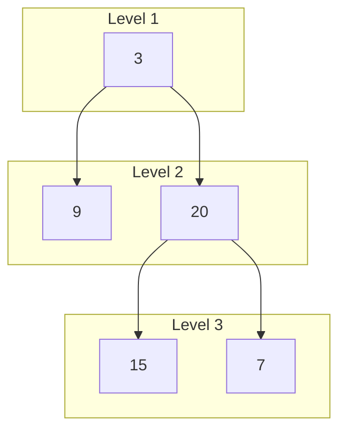

## Intuition

Depth-first search dives to the bottom of one branch before looking at the next. **Breadth-first search** does the opposite: it explores the tree in rings, like ripples in a pond. First the root, then all its children, then all their children, and so on. Each ring is a **level**.

To do this you need a **queue**: a line where the first person to arrive is served first (first in, first out). Put the root in the queue. Then repeat: take someone from the front, record them, and put their children at the back. Children always join the line behind everyone from the current level, so levels come out in order.

To get the levels as separate groups, count how many people are in the line at the start of a round. That is exactly one level. Serve that many people, and their children (who join the line behind them) form the next round.

## Walkthrough

Input: the tree `3 9 20 null null 15 7`: root 3, children 9 and 20, and 20 has children 15 and 7.

| Round | Queue at the start | Level recorded | Queue at the end (the children) |
| --- | --- | --- | --- |
| 1 | 3 | 3 | 9, 20 |
| 2 | 9, 20 | 9 20 | 15, 7 (9 has no children) |
| 3 | 15, 7 | 15 7 | empty |

The queue is empty, so we stop. The levels are `3`, `9 20` and `15 7`. The program prints them as `3 | 9 20 | 15 7`.

Read it as: each box is one round of the loop, and the arrows show which nodes join the queue next.

## Complexity

| | Value | Why |
| --- | --- | --- |
| Time | O(n) | Each node enters the queue once and leaves it once. |
| Space | O(w) | The queue holds at most one full level. For a perfect tree the last level has about half of all nodes. For a chain, w is 1. |

Here w is the width of the widest level. Compare with depth-first: it is the height h that costs memory there. A wide, shallow tree is cheap for DFS and expensive for BFS; a long thin chain is the other way around. The result lists are the output and are not counted.

## Code explanation

1. **Start with the root.** If the tree is empty, return an empty list of levels.
2. **Freeze the level size.** At the start of a round, everything in the queue is on the same level. In Python, Java, C# and C++ we read the size once before the loop. In JavaScript and Go we take the whole queue as the level and build a fresh list for the next one.
3. **Add the children to the back.** They belong to the next level, and they stay behind the current level in the line.
4. **Store the finished level.** Then the next round starts with the new queue.

| Language | Queue type | Note |
| --- | --- | --- |
| JavaScript / TypeScript | Two arrays: the current level and the next one | Avoids `Array.shift`, which can be O(n). |
| Python | `collections.deque` with `popleft` | `list.pop(0)` would be O(n). |
| Go | Two slices, current and next | Go has no queue in the standard library; slices are the idiomatic way. |
| Java | `ArrayDeque` through the `Queue` interface | `add`/`remove` are the queue names. It does not accept `null`, which is why we never add null children. |
| C# | `Queue<T>` | `Enqueue` and `Dequeue`. `Count` is read once to freeze the level size. |
| C++ | `std::queue` | `front` then `pop`. The level size is stored in a `std::size_t` to avoid a signed-unsigned comparison. |

## Edge cases and tests

Eleven trees. Each prints its levels separated by a vertical bar, with spaces between values on the same level, or `empty` for the empty tree.

| Tree | Output | What it checks |
| --- | --- | --- |
| `1 null 2 3` | `1 \| 2 \| 3` | Missing left child: three levels of one node each. |
| empty text | `empty` | The empty tree. |
| `1` | `1` | A single node, one level. |
| `1 2 3 4 5 6 7` | `1 \| 2 3 \| 4 5 6 7` | A perfect tree: the width doubles each level. |
| `1 2 null 3 null 4` | `1 \| 2 \| 3 \| 4` | A left chain. |
| `1 null 2 null 3 null 4` | `1 \| 2 \| 3 \| 4` | A right chain. |
| `4 2 7 1 3 6 9` | `4 \| 2 7 \| 1 3 6 9` | A search tree. |
| `3 9 20 null null 15 7` | `3 \| 9 20 \| 15 7` | The overview example. |
| `5 3 8 1 4 7 9 null 2` | `5 \| 3 8 \| 1 4 7 9 \| 2` | A deeper last level with one node. |
| `1 2 3 null 4 null 5` | `1 \| 2 3 \| 4 5` | Gaps in the middle: children of different parents share a level. |
| `10 -5 15 -8 null 12 20` | `10 \| -5 15 \| -8 12 20` | Negative values. |

## When to use it (and when not)

**Use it** when you need results level by level, the shortest path in an unweighted structure, or the closest node that satisfies a condition. It finds the shallowest answer first, so you can stop early.

**Do not use it** on very wide trees when memory is tight (the queue can hold half the tree), or when you only need depth-first orders such as in-order of a search tree.

## Interview notes

- Say: "I use a queue. In each round I process exactly the nodes that are in the queue now, which is one level."
- Say why the size is fixed first: "Children are added while I loop, so I must not read the size again inside the loop."
- Mention the memory: "It is O(w), the width of the widest level."
- Likely follow-up: "Print the tree in zigzag order" or "give me the right side view": same loop, small change at the end of each level.
- Mistake to avoid: using a list and removing from the front in a language where that is O(n).

## Real-life usage

Breadth-first search is the basis of shortest-path search in unweighted graphs (maps with equal steps, word ladders, social network "degrees of separation"), of web crawlers that go a fixed number of links deep, of printing a menu or organisation chart level by level, and of the "closest" queries in games and routing. Level-order is also the natural format for storing a complete binary tree in an array, which is how a binary heap is stored.
