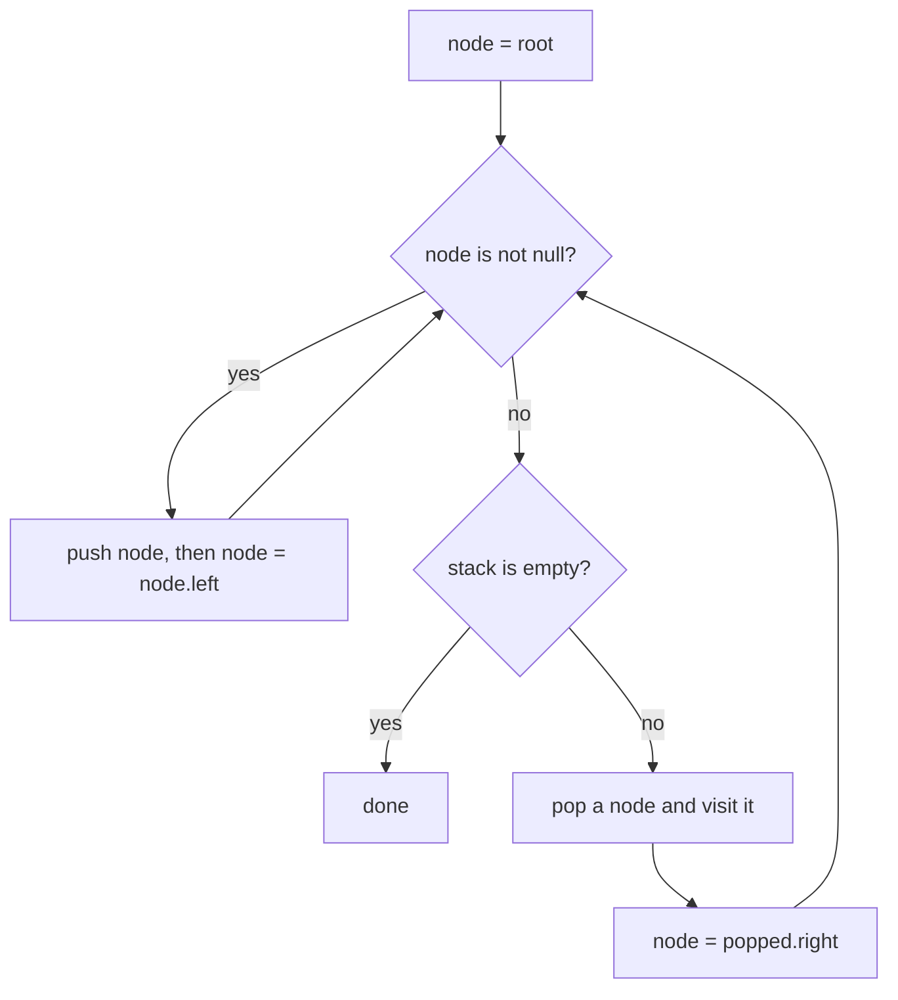

## Intuition

Recursion works because the computer keeps a **call stack**: a pile of notes saying "when this call finishes, continue here". We can keep such a pile ourselves. Instead of letting the language remember where we are, we use our own stack of nodes that are waiting to be visited. Since the stack lives on the heap and not in the limited call stack, deep trees do not crash it.

The three orders need slightly different tricks:

- **Pre-order** is the easiest. Pop a node, visit it, then push its right child and then its left child. Because a stack gives back the last item first, the left child comes out first.
- **In-order** needs more care. Walk down the left side as far as you can, pushing every node you pass. When you cannot go left any more, pop a node, visit it, and then do the same thing on its right child. The stack remembers the path back up.
- **Post-order** is the hardest to do directly. A neat shortcut: do a pre-order that goes right before left (node, right, left), then reverse the result. The reverse of "node, right, left" is "left, right, node", which is post-order.

## Walkthrough

Input: the tree `1 null 2 3` (node 1, right child 2, and 2 has left child 3).

**In-order** trace. The stack top is on the right.

| Step | Action | Stack after | Result so far |
| --- | --- | --- | --- |
| 1 | node = 1: push 1, go left (no child) | 1 | |
| 2 | node is null: pop 1, visit it, go right to 2 | | 1 |
| 3 | node = 2: push 2, go left to 3: push 3, go left (no child) | 2 3 | 1 |
| 4 | node is null: pop 3, visit it, go right (no child) | 2 | 1 3 |
| 5 | node is null: pop 2, visit it, go right (no child) | | 1 3 2 |
| 6 | node is null and the stack is empty: stop | | 1 3 2 |

**Pre-order** trace: push 1. Pop 1, visit it, push its right child 2 (there is no left child). Pop 2, visit it, push its left child 3. Pop 3, visit it. The result is `1 2 3`.

**Post-order** trace: node, right, left gives `1 2 3` (visit 1, then its right child 2, then 2's right child (none), then 3). Reverse it: `3 2 1`, which is the post-order.

Read it as the in-order loop: go left as far as possible, then visit, then go right.

## Complexity

| | Value | Why |
| --- | --- | --- |
| Time | O(n) | Each node is pushed once and popped once. |
| Space | O(h) | For in-order the stack holds one path from the root down, so at most h nodes. For pre-order and post-order the stack holds the unvisited right siblings along one path, which is at most about h plus one nodes. |

The height h depends on the shape: about log n for a balanced tree, and n for a chain. The difference from the recursive version is where the memory lives: this stack is on the heap and can grow as large as memory allows, while the call stack is small and fixed. Post-order also builds the whole result before reversing it, but the result is the output and is not counted.

## Code explanation

1. **Dive left.** In in-order, push every node on the way down the left side. Nothing is visited yet.
2. **Pop the leftmost.** When there is no left child, the top of the stack is the next node in order.
3. **Visit it.**
4. **Go right.** Set the current node to the popped node's right child, and repeat. If it is null the loop pops the next ancestor.
5. **Take the next node** (pre-order and post-order loop). Pop, and add the value.
6. **Push children in the right order.** Pre-order pushes right first, then left, so left is popped first. For post-order the order is the other way (left first, then right) so that right is popped first, giving "node, right, left".
7. **Reverse for post-order.** This turns "node, right, left" into "left, right, node".

| Language | Stack type | Note |
| --- | --- | --- |
| JavaScript / TypeScript | `Array` with `push` and `pop` | TypeScript needs `stack.pop()!` because `pop` may return `undefined`; the loop condition guarantees the stack is not empty. |
| Python | `list` | `result.reverse()` reverses in place. |
| Go | A slice, popping by re-slicing | `slices.Reverse` is in the standard library since Go 1.21. |
| Java | `ArrayDeque<TreeNode>` | It rejects `null`, so we only push real nodes. `Collections.reverse` reverses the list in place. |
| C# | `Stack<TreeNode>` | `List<T>.Reverse()` reverses in place (the LINQ `Reverse` would return a new sequence instead). |
| C++ | `std::stack<const TreeNode*>` | `std::reverse` from `<algorithm>`. `top()` then `pop()` are separate calls. |

## Edge cases and tests

The same nineteen cases and the same expected output as the recursive approach (see its notes for the full table). The ones that stress the stack logic most:

| Tree | Order | Output | What it checks |
| --- | --- | --- | --- |
| empty text | in-order | `empty` | The loops never run for the empty tree. |
| `1` | pre-order | `1` | A single node. |
| `1 2 null 3 null 4` | post-order | `4 3 2 1` | A left chain: the stack grows to its full height. |
| `1 null 2 null 3 null 4` | in-order | `1 2 3 4` | A right chain: the stack never holds more than one node. |
| `4 2 7 1 3 6 9` | in-order | `1 2 3 4 6 7 9` | Sorted output of a search tree. |
| `1 2 3 4 5 6 7` | post-order | `4 5 2 6 7 3 1` | The reverse trick on a perfect tree. |

## When to use it (and when not)

**Use it** when the tree can be very deep, when you cannot rely on the language's recursion limit, or when you need to pause and resume the traversal (an iterator that gives the next value on demand keeps exactly this stack).

**Do not use it** for a small tree when clarity matters more: the recursive version is shorter and easier to check. Also, post-order done with the reverse trick builds the full list first, so it cannot stream results one by one; a true streaming post-order needs a "last visited" pointer.

## Interview notes

- Say: "I keep my own stack instead of the call stack. For in-order I go left as far as I can, pop, visit, then go right."
- Say why pre-order pushes right first: "A stack gives back the last item first, so pushing right first visits left first."
- For post-order: "I do node, right, left and reverse the result."
- Likely follow-up: "Can you do it without any stack?" Morris traversal, which uses temporary links in the tree.
- Mistake to avoid: visiting a node when you push it in the in-order version. Visit when you pop.

## Real-life usage

An iterative walk with an explicit stack is how garbage collectors mark objects, how file-system walkers avoid stack overflow on very deep directories, and how tree iterators work: the iterator object holds the stack, so `next()` can return one value at a time. Search engines and IDEs that must handle huge or hostile inputs use explicit stacks to avoid crashing on deep nesting.
