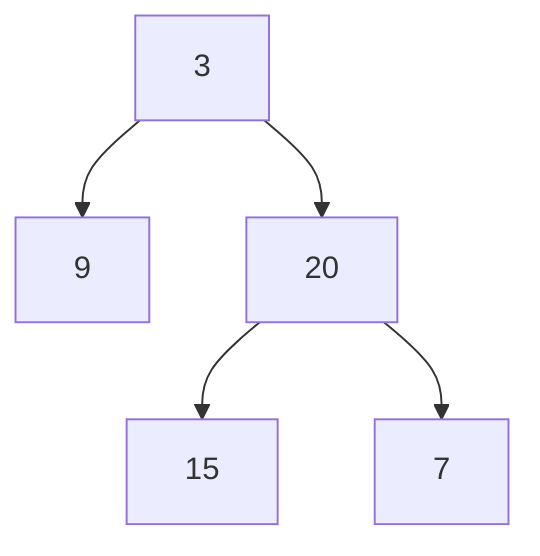
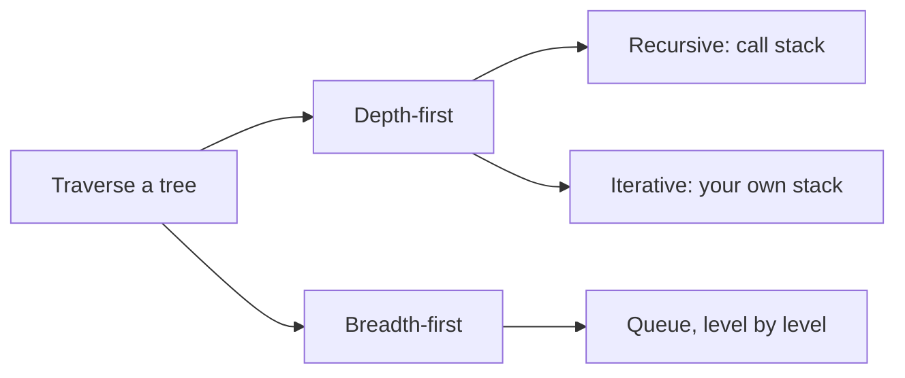
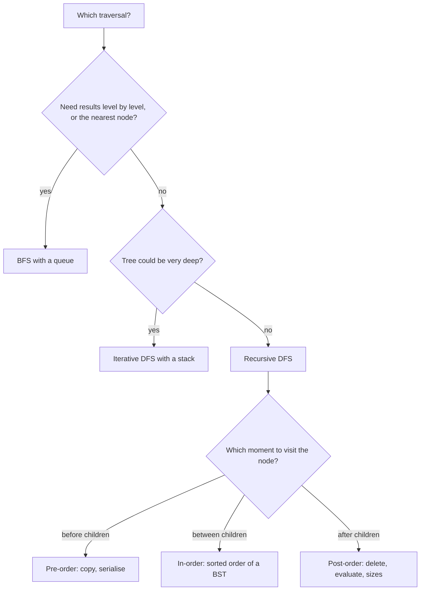

## How interviewers ask it

**A binary tree** is a structure of nodes where each node has a value and at most two children, called left and right. The first node is the root. A node with no children is a leaf. A **traversal** is a way of visiting every node exactly once.

**The classic wording.** "Given the root of a binary tree, return its in-order traversal." Often it comes as a set: "Give me the pre-order, in-order and post-order of this tree", and "Print the tree level by level."

The four orders, using the tree with root 3, left child 9, and right child 20 whose children are 15 and 7:

| Order | Rule | Result for the tree above |
| --- | --- | --- |
| Pre-order | node, left subtree, right subtree | 3 9 20 15 7 |
| In-order | left subtree, node, right subtree | 9 3 15 20 7 |
| Post-order | left subtree, right subtree, node | 9 15 7 20 3 |
| Level order | level by level, left to right | 3, then 9 20, then 15 7 |

The first three are depth-first (go all the way down before coming back). Level order is breadth-first (finish one level before the next).

**Common variations:**

- Do it without recursion (explicit stack).
- Return the values level by level, as a list of lists, or in a zigzag order, or only the right-most node of each level.
- Build a tree from its pre-order and in-order lists, or serialise and deserialise a tree.
- Find the maximum depth, check if the tree is balanced, check if it is a valid binary search tree, find the lowest common ancestor.
- Traverse in constant extra space (Morris traversal).
- Traverse a tree with more than two children (an n-ary tree).

**What to clarify before you code:**

| Question to ask | Why it matters |
| --- | --- |
| Which order do you want? | The answer decides the algorithm. |
| Is it a binary search tree? | The in-order of a binary search tree is sorted, which may let you shortcut. |
| How deep can the tree be? | A skewed tree with a million nodes overflows a recursive solution. |
| Can the tree be empty? | The root can be null. Return an empty result. |
| What format is the tree given in? | LeetCode style uses a level-order array with `null` for a missing child. |
| Do you want values or nodes? | Returning nodes lets the caller change them. |

A good answer states all four orders, writes the recursive version first because it is short, then offers the iterative version with a stack, and states the time and the space (the height of the tree).

In this repo the programs build a tree from a level-order text where the word `null` marks a missing child. The first token is the root. Then, for each node in order, the next two tokens are its left and right child. An empty text is an empty tree. The depth-first programs print the values separated by spaces for one order per test case. The level-order program prints the levels separated by a vertical bar. An empty tree prints the word `empty`.

## Real-life scenarios

| Scenario | What is actually used | Why |
| --- | --- | --- |
| Walking a folder on disk (`find`, `du`, `rm -r`, copy a folder) | Depth-first. Delete is post-order, copy is pre-order | You must delete a folder's contents before the folder (children first), and create a folder before its contents (parent first). |
| The browser DOM: `querySelectorAll`, React rendering, accessibility trees | Pre-order depth-first, which is "document order" | Elements are processed in the order they appear in the page. |
| Compilers and interpreters working on an abstract syntax tree | Post-order to evaluate, in-order to print, pre-order to copy | Children values must be known before the operator can be computed. |
| A database index (B-tree) range scan: `WHERE age BETWEEN 20 AND 30` | In-order walk of the tree | In-order gives keys in sorted order, so a range is a contiguous walk. |
| An organisation chart or a menu printed level by level | Breadth-first | Employees at the same depth are shown together. |
| Finding the shortest path in an unweighted graph or a game board | Breadth-first | The first time you reach a node is by the fewest steps. |
| Serialising a tree to JSON or a file | Pre-order (or level order) with markers for missing children | Parents come before children, so a reader can rebuild the shape. |
| Garbage collectors marking reachable objects | Depth-first with an explicit stack | The object graph can be very deep, so recursion would overflow the stack. |
| Git trees and commit history | Walking a tree of directories, a graph of commits | Operations like `git diff` and `git log` walk these structures. |

Whenever data is nested (folders, comments with replies, menus, JSON, HTML, expressions), a tree traversal is hiding in the solution.

## Approaches compared

| Approach | Style | Time | Extra space | Use when |
| --- | --- | --- | --- | --- |
| 1. Recursive DFS | Depth-first, call stack | O(n) | O(h) call stack | The default for pre, in and post-order. Short and clear. |
| 2. Iterative DFS | Depth-first, explicit stack | O(n) | O(h) on the heap | Very deep trees, or when the interviewer says "no recursion". |
| 3. BFS level order | Breadth-first, queue | O(n) | O(w) for the widest level | When levels matter: nearest node, level by level output, shortest path. |

Here n is the number of nodes, h is the height of the tree and w is the width of its widest level. For a balanced tree h is about log n and w is about n over two. For a chain, h is n and w is 1. So DFS is cheaper on wide, bushy trees, and BFS is cheaper on deep, thin trees.

Read it as: first choose how to move (down first or across first), then how to keep track of where you are.

## How to choose

Start at the top and answer each question. The three DFS orders differ only in the moment the node is visited.

## Built-ins and the standard library

No mainstream language ships a general binary tree node with traversals. What the standard libraries give you is the stack and the queue you need, and a few ordered containers that are trees inside.

| Language | Stack and queue to use | Ordered tree-based container | Pitfall |
| --- | --- | --- | --- |
| JavaScript / TypeScript | `Array` with `push` and `pop` (stack). For a queue, an array with a head index or two arrays | None in the standard library | `Array.prototype.shift` is O(n) in the worst case. For a big queue keep an index or swap two arrays, as the code here does. |
| Python | `list` (stack), `collections.deque` (queue) | None in the standard library | `list.pop(0)` is O(n); use `deque.popleft()`. Python's recursion limit is about 1000 frames, so a deep tree raises `RecursionError`. |
| Go | A slice for both | None in the standard library | No recursion limit problem in practice (stacks grow), but deep recursion is still wasteful. Taking `queue[1:]` keeps the old array alive until the slice is replaced. |
| Java | `ArrayDeque` for both (`Deque` as stack, `Queue` as queue) | `TreeMap`, `TreeSet` (red-black trees, iteration is in-order) | `ArrayDeque` does not accept `null`. The legacy `Stack` class is synchronised and slower. Recursion depth is limited by the thread stack. |
| C# | `Stack<T>`, `Queue<T>` | `SortedDictionary`, `SortedSet` (red-black trees) | Iterating a `SortedSet` already gives in-order. A very deep recursion crashes the process because a stack overflow cannot be caught. |
| C++ | `std::stack`, `std::queue` (or `std::vector` and `std::deque`) | `std::map`, `std::set` (usually red-black trees, iteration is in-order) | `top` and `front` on an empty container are undefined behaviour. Deep recursion can crash silently. |

**Hand-write or use a library?** If you only need sorted data, use the ordered container and iterate it; it is an in-order traversal for free. Write a traversal yourself for your own node types (a syntax tree, a folder tree, a DOM) or when the interview asks.

## Common mistakes

- **Missing base case.** Forgetting `if (node == null) return` crashes on every leaf's children.
- **Mixing up the order.** The only difference between the three depth-first orders is the line where the node's value is added. Putting it in the wrong place gives the wrong order without any error.
- **Iterative in-order done like pre-order.** In-order needs to go left first and visit only when you come back. Pushing right then left and visiting on pop gives pre-order, not in-order.
- **Wrong push order in the iterative pre-order.** A stack pops the last item pushed, so push the right child first and the left child second to visit the left first.
- **Forgetting the reverse for post-order.** The two-in-one trick (node, right, left, then reverse) needs the final reverse.
- **Using a list as a queue and removing from the front.** In Python and JavaScript this is O(n) per removal, so BFS becomes quadratic.
- **Mixing levels in BFS.** To print levels, record the queue size before the inner loop. If you read the size inside the loop, it changes while you add children.
- **Pushing null children.** Some queues (Java's `ArrayDeque`) throw on `null`; others create endless work. Check before you add.
- **Recursion on a skewed tree.** A chain of a million nodes overflows the stack.
- **Assuming a balanced tree.** The height, and so the recursion depth and the stack size, can be as big as the number of nodes.

## How to answer in an interview

1. **Clarify.** "Binary tree or binary search tree? Which order? Can it be empty? How deep can it get?"
2. **Draw a small tree** with five or seven nodes and write the three orders next to it.
3. **Say the idea.** "Depth-first means finish a whole subtree before the next. The three orders differ only in when I record the node: before, between or after the two subtrees."
4. **Code the recursive version.** Base case, then the three lines in the right order. State the cost: "Linear time, and space equal to the height of the tree for the call stack."
5. **Offer the iterative version.** "I can replace the call stack by my own stack to avoid overflow on deep trees."
6. **For level order,** "I use a queue. At each round I take exactly the nodes that are in the queue right now, which are one level, and add their children."
7. **Test aloud.** The empty tree, one node, a left-only chain, a right-only chain and a full tree.
8. **State complexity.** "Time is O(n) because each node is visited once. Space is O(h) for depth-first and O(w) for breadth-first."
9. **Mention the follow-ups.** "In-order of a binary search tree is sorted. Morris traversal does in-order in O(1) extra space by temporarily changing pointers."

## Follow-up questions

- **How do you traverse without recursion or a stack?** Morris traversal. For each node, find its in-order predecessor (the right-most node in its left subtree) and temporarily link that predecessor's right pointer to the current node. This lets you walk back up without a stack. You remove the link afterwards. It runs in O(n) time and O(1) extra space but changes the tree temporarily, so it is not thread safe.
- **What is special about the in-order traversal of a binary search tree?** It visits the keys in ascending order. That is why validating a BST can be done by checking that the in-order sequence is strictly increasing.
- **Can you rebuild a tree from two traversals?** Yes from in-order plus pre-order, or in-order plus post-order, if values are unique. The pre-order gives the root, and the in-order tells you how many nodes are in the left subtree. Pre-order alone is not enough unless you also record the missing children.
- **How do you do a zigzag level order?** Same BFS, but reverse every second level before adding it to the result.
- **How do you find the maximum depth?** Recursively, one plus the larger depth of the two children, or count the levels in BFS.
- **How is a tree different from a graph traversal?** A tree has no cycles, so you do not need a visited set. A general graph can have cycles, so you need one.
- **When would you choose BFS over DFS?** When the answer is the closest node, or you must process by distance. DFS is better when the answer is deep in the structure or when memory for the widest level is large.
- **How much memory does each use for a tree with a million nodes?** For a balanced tree DFS holds about twenty nodes (the height), and BFS holds up to about half a million (the last level). For a long chain it is the opposite.
- **How do you traverse a tree with many children?** Replace the left and right steps with a loop over the list of children. Pre-order and post-order are unchanged. In-order is not well defined.

## Practice

- Maximum depth of a binary tree, and minimum depth (BFS stops early).
- Same tree, symmetric tree, invert binary tree.
- Validate binary search tree (in-order, or pass bounds down).
- Lowest common ancestor of two nodes.
- Binary tree right side view and zigzag level order traversal.
- Construct a binary tree from pre-order and in-order traversals.
- Serialise and deserialise a binary tree.
- Path sum and diameter of a binary tree (post-order thinking).
