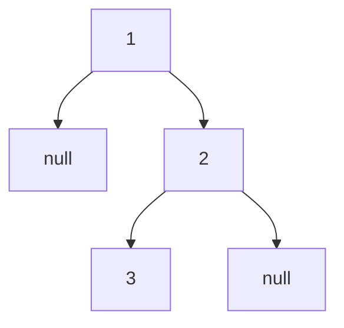

## Intuition

Think of a tree as a family tree or a folder on your computer. To "visit everything" in a folder you open the first subfolder, visit everything inside it, then do the same for the next subfolder. A tree is exactly that: a node plus two smaller trees (its left and right subtree). So a function that visits a tree can simply call itself on the two smaller trees. This is **recursion**: solving a problem by solving smaller copies of the same problem.

The three classic orders differ in only one thing: when you write down the node's value, compared with the two recursive calls.

- **Pre-order**: write the node, then go left, then go right. "Parent before children."
- **In-order**: go left, write the node, then go right. "Left, me, right." For a binary search tree this gives sorted order.
- **Post-order**: go left, go right, then write the node. "Children before parent."

An easy way to remember: the prefix says where the node goes. Pre means before the subtrees, in means in between, post means after.

The recursion needs a stopping rule, called the base case: an empty subtree has nothing to visit, so the function returns at once.

## Walkthrough

Input: the tree `1 null 2 3` (the first test case). Node 1 has no left child and a right child 2. Node 2 has a left child 3 and no right child.

Read it as: 1 at the top, 2 below on the right, 3 below 2 on the left.

The calls, shown for in-order, with the order of events:

| Step | Call | What happens |
| --- | --- | --- |
| 1 | visit(1) | go left first |
| 2 | visit(null) | base case, return |
| 3 | back in 1 | write 1 (in-order: between the subtrees), then go right |
| 4 | visit(2) | go left first |
| 5 | visit(3) | go left: visit(null) returns |
| 6 | back in 3 | write 3, then go right: visit(null) returns |
| 7 | back in 2 | write 2, then go right: visit(null) returns |

In-order result: `1 3 2`. For the same tree, pre-order writes each node on arrival: `1 2 3`. Post-order writes each node when leaving: `3 2 1`.

Side by side on the larger perfect tree `1 2 3 4 5 6 7`:

| Order | Result |
| --- | --- |
| Pre-order | 1 2 4 5 3 6 7 |
| In-order | 4 2 5 1 6 3 7 |
| Post-order | 4 5 2 6 7 3 1 |

## Complexity

| | Value | Why |
| --- | --- | --- |
| Time | O(n) | Each node is visited once, and each visit does a constant amount of work. Each empty child is also visited once, but there are at most n plus one of them. |
| Space | O(h) | The call stack holds one call per level of the tree, where h is the height. The result list is not counted as extra space. |

The height h depends on the shape. A balanced tree has h around log n (a million nodes need about twenty levels). A tree where every node has only one child is a chain, with h equal to n. So the worst case for space is O(n), and that is also the case that can overflow the call stack.

## Code explanation

1. **Base case.** If there is no node, return. This stops the recursion at the bottom.
2. **Pre-order moment.** Add the value before the recursive calls.
3. **Left subtree.** Call the function on the left child.
4. **In-order moment.** Add the value between the two calls.
5. **Right subtree.** Call the function on the right child.
6. **Post-order moment.** Add the value after both calls.

Exactly one of the three "moment" lines fires for each call, depending on the `order` argument. Production code would usually write three small functions, one for each order; one function with a parameter makes the difference visible in a single place.

| Language | Note |
| --- | --- |
| JavaScript / TypeScript | `visit` is an inner function that closes over `result` and `order`. |
| Python | A nested function uses `result` from the enclosing scope. The default recursion limit of 1000 makes deep trees fail with `RecursionError`. |
| Go | A recursive closure must be declared with `var visit func(...)` first, and then assigned, so the body can refer to itself. |
| Java | A static helper with the result list passed along, because Java has no nested functions. |
| C# | A local function inside `Traverse`, which can use the outer variables. |
| C++ | A static helper with the result passed by reference. The root is passed as a `const` pointer, since traversal does not change the tree. |

## Edge cases and tests

Nineteen cases. Each is a tree text and an order, and prints the values separated by spaces. The empty tree prints the word `empty`.

| Tree | Order | Output | What it checks |
| --- | --- | --- | --- |
| `1 null 2 3` | pre, in, post | `1 2 3`, `1 3 2`, `3 2 1` | A tree with a missing left child: all three orders differ. |
| empty text | in-order | `empty` | The empty tree: the base case runs immediately. |
| `1` | pre-order | `1` | A single node. |
| `1 2 3 4 5 6 7` | pre, in, post | `1 2 4 5 3 6 7`, `4 2 5 1 6 3 7`, `4 5 2 6 7 3 1` | A perfect tree. |
| `1 2 null 3 null 4` | pre, post | `1 2 3 4`, `4 3 2 1` | A chain going left. |
| `1 null 2 null 3 null 4` | in, post | `1 2 3 4`, `4 3 2 1` | A chain going right. |
| `4 2 7 1 3 6 9` | in-order | `1 2 3 4 6 7 9` | A binary search tree gives sorted output. |
| `3 9 20 null null 15 7` | pre, in, post | `3 9 20 15 7`, `9 3 15 20 7`, `9 15 7 20 3` | The tree from the overview. |
| `5 3 8 1 4 7 9 null 2` | in-order | `1 2 3 4 5 7 8 9` | A bigger binary search tree with a right child on a left node. |
| `1 2 3 null 4 null 5` | pre, post | `1 2 4 3 5`, `4 2 5 3 1` | Missing children in the middle of the tree. |

## When to use it (and when not)

**Use it** for most tree problems. It is the shortest code, and it maps directly onto the definition of a tree. Pre-order, in-order and post-order are one-line changes of each other.

**Do not use it** when the tree can be very deep (a chain of a hundred thousand nodes), or when the language has a small recursion limit and you cannot control the input. Then use the explicit stack from the next approach.

## Interview notes

- Say: "A tree is a node plus two smaller trees, so I solve it by recursion. The only difference between the orders is when I record the node."
- Name the base case first: "An empty tree returns immediately."
- State the space: "The call stack is as deep as the tree is tall, so O(h)."
- Likely follow-up: "Can you do it without recursion?" Move to the iterative approach.
- Mistake to avoid: recording the node in the wrong place and getting a different order without noticing. Check with a three-node tree.

## Real-life usage

Recursive traversal is how most code walks nested data: JSON and XML visitors, DOM queries, syntax tree visitors in compilers and linters, folder walkers, permission trees and comment threads. Libraries often hide it behind a "visitor" or `walk` function. Deleting a folder is a post-order walk, copying one is a pre-order walk, and listing a database index in order is an in-order walk.
