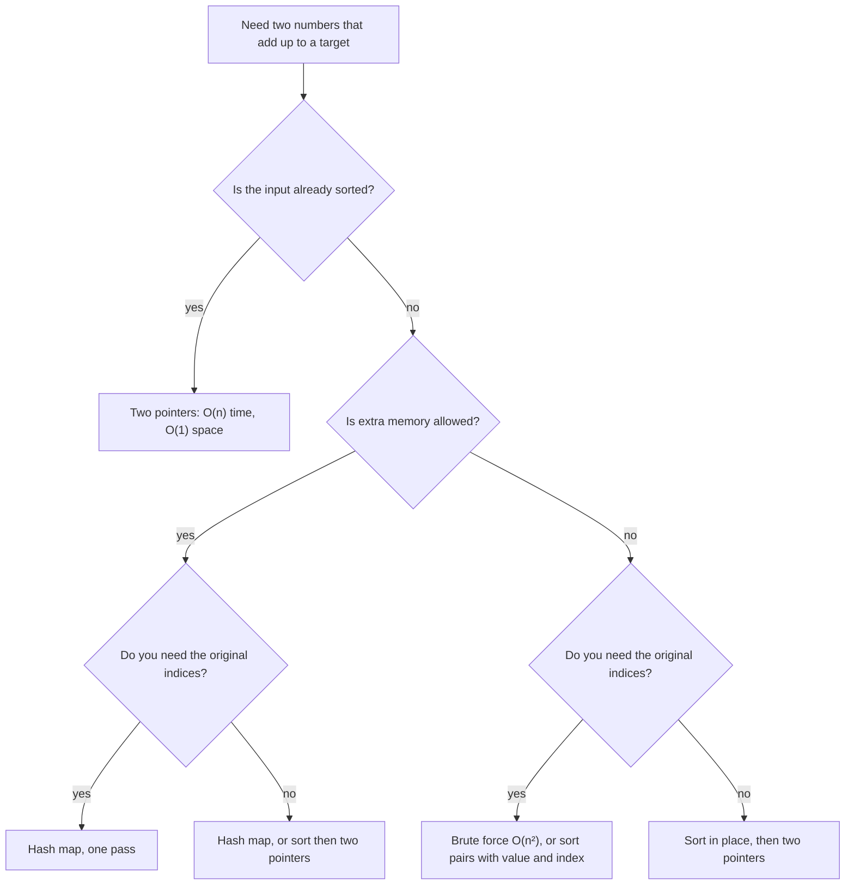
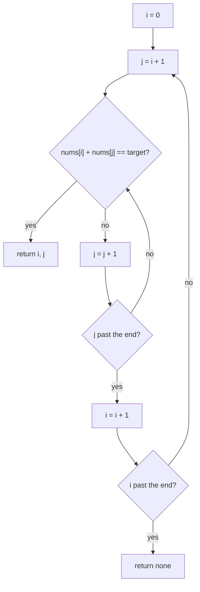
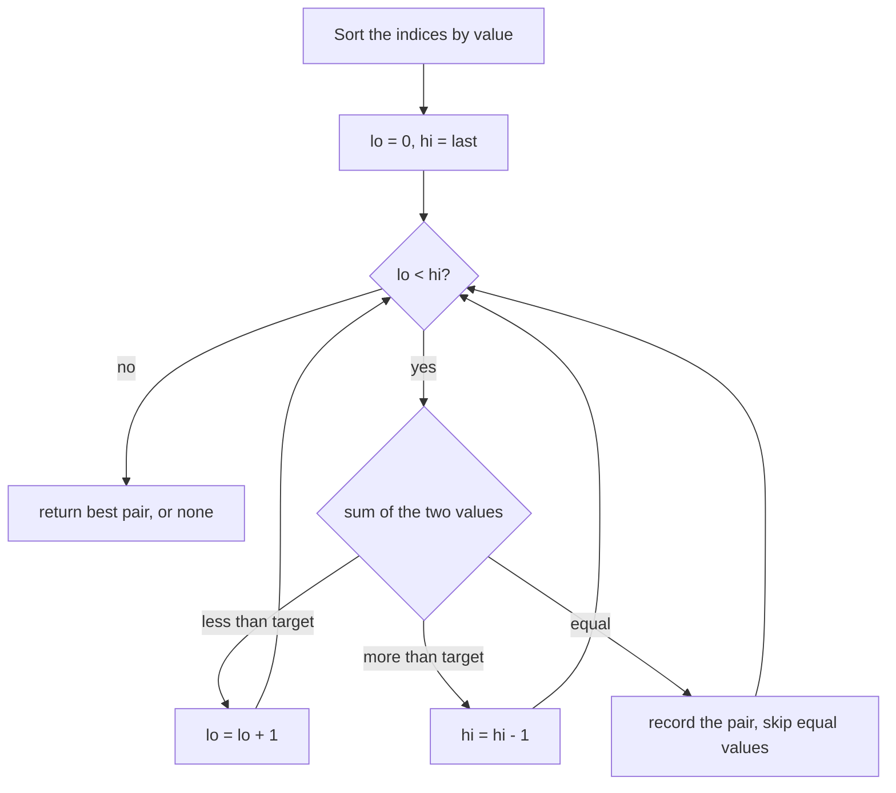
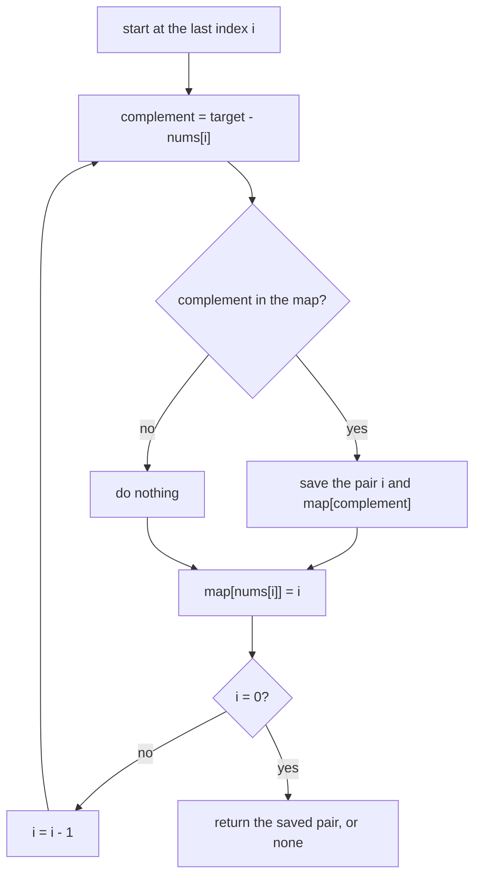

# Two sum

[← All problems](../README.md)

> Find two numbers that add up to a target: the classic way to learn why a hash map turns a slow search into a fast lookup.

**Level:** basic · **Tags:** hashing, hash-map, two-pointers, arrays, complexity

**Related interview questions:**

- [Golang: What are arrays and slices? Why are slices used almost everywhere?](../../questions/golang.md)
- [Golang: How do maps work in Go, and what are the common mistakes?](../../questions/golang.md)
- [Golang: How are slices, maps and strings implemented internally?](../../questions/golang.md)
- [JavaScript: Which array methods should you know, and which ones mutate the array?](../../questions/javascript.md)
- [JavaScript: What are `Map`, `Set`, `WeakMap` and `WeakSet`, and when do you use them?](../../questions/javascript.md)
- [Golang: How do generic constraints work, and what do `slices` and `maps` packages offer (Go 1.21+)?](../../questions/golang.md)

## How interviewers ask it

**The classic wording.** "Given an array of integers `nums` and an integer `target`, return the indices of the two numbers that add up to `target`. Each input has exactly one solution, and you may not use the same element twice." It is often the first question in an interview, so it is a warm-up with traps.

**Common variations:**

- *Sorted input.* "The array is already sorted. Can you use less memory?" (two pointers, O(1) space)
- *Values instead of indices.* "Return the numbers, not the positions." (sorting is now allowed, because positions do not matter)
- *All pairs.* "Return every pair that adds up to the target." (watch out for duplicates in the output)
- *Count pairs.* "How many pairs add up to the target?" (a hash map of counts)
- *Three sum and k-sum.* "Find three numbers that add up to zero."
- *No solution.* "What do you return if there is no pair?"

**What to clarify before you code:**

| Question to ask | Why it matters |
| --- | --- |
| Can the same element be used twice? | Decides whether `[3]` with target 6 has an answer. |
| Is there always exactly one answer? | Decides what to return when none or many exist. |
| Indices or values? | Sorting loses indices. |
| Can there be duplicates and negative numbers? | Duplicates break naive maps; negatives break "skip numbers bigger than the target". |
| How big is the array and how big are the numbers? | Chooses the approach and tells you if the sum can overflow. |
| Is it sorted? Can I use extra memory? | Chooses between the hash map and two pointers. |

A good answer states the brute-force idea and its cost, improves it to a hash map, handles duplicates and the "same element" trap, and gives the time and space cost out loud.

In this repo the programs print the two zero-based indices in ascending order, or `none`. When several pairs exist, they print the one with the smallest first index, then the smallest second index.

## Real-life scenarios

| Scenario | What is actually used | Why |
| --- | --- | --- |
| Matching payments with refunds that cancel out | A hash map from amount to the open transactions | For each new refund, one lookup finds a payment of the opposite amount. |
| Finding two items that together fit a gift budget | Sort by price and use two pointers | Prices are sorted anyway for display, and it needs no extra memory. |
| Joining two datasets by a key (orders and customers) | A hash join in the database, or a `Map` in code | Build a hash table from the smaller side, then look up each row of the other side. |
| De-duplication of events or emails | A `Set` of ids seen so far | "Have I seen this before?" is the same lookup as "have I seen the complement?". |
| Checking membership quickly (is this user banned?) | A hash set loaded into memory | One lookup instead of scanning a list. |
| Caches and lookup tables | `Map`, `dict`, `HashMap`, Redis | Key to value in about one step. |
| Reconciling bank statements | Sorting both lists, then walking them together | Same idea as two pointers; works on files that do not fit in memory. |

The two ideas behind the problem, "look it up in a hash table" and "sort and walk from both ends", are both used all the time in real systems.

## Approaches compared

| Approach | Time | Extra space | Needs sorted input | Keeps original indices | Use when |
| --- | --- | --- | --- | --- | --- |
| Brute force (two loops) | O(n²) | O(1) | no | yes | Tiny arrays; as a test reference. |
| Sort and two pointers | O(n log n), or O(n) if already sorted | O(n) for the indices, O(1) if already sorted | no (it sorts) | only if you sort indices | Sorted input, tight memory, or you need pairs by value and closest sums. |
| Hash map, one pass | O(n) average, O(n²) worst | O(n) | no | yes | Default for unsorted data when memory is fine. |

The hash map is the best on time for unsorted data. Two pointers is the best on space for sorted data. Brute force is only the starting point.

## How to choose



Start at the top and answer each question. In an interview, the hash map is the safe default.

## Built-ins and the standard library

A **hash map** (also called a dictionary or associative array) stores key-value pairs and finds a key in about O(1) on average. A **hash function** turns a key into a number that picks a slot. A **collision** happens when two keys land in the same slot; the map then has to compare keys to find the right one, so heavy collisions slow it down.

| Language | Map / set to use | Iteration order | Pitfall |
| --- | --- | --- | --- |
| JavaScript | `Map`, `Set` | Insertion order is guaranteed. | `Map` uses the "same value" rule (`NaN` equals `NaN`, objects compare by reference). Plain objects `{}` turn keys into strings. |
| Python | `dict`, `set` | `dict` keeps insertion order (guaranteed since 3.7). `set` order is not defined. | `d[k]` raises `KeyError` when missing; use `d.get(k)`. Keys must be hashable. Integer hashes are predictable. |
| Go | `map[K]V` (a set is `map[K]struct{}`) | Deliberately random, so never depend on it. | A missing key gives the zero value, so use `v, ok := m[k]`. Maps are not safe for concurrent writes. |
| Java | `HashMap`, `HashSet` (`LinkedHashMap` keeps insertion order) | `HashMap` has no guaranteed order. | `Map<Integer,Integer>` boxes numbers, which costs memory. If many keys land in one bucket, Java 8 and later turns that bucket into a balanced tree, so the worst case per lookup is O(log n) for comparable keys such as `Integer` and `Long`. |
| C# | `Dictionary<TKey,TValue>`, `HashSet<T>` | Not guaranteed, do not rely on it. | The indexer throws `KeyNotFoundException`; use `TryGetValue`. |
| C++ | `std::unordered_map`, `std::unordered_set` (`std::map` is a sorted tree, O(log n)) | Unspecified. | `m[k]` inserts the key if it is missing. `std::hash<int>` is often the identity, so a crafted input can force collisions. |

**Collisions and attacks.** A hash map is fast on average, but an attacker who knows the hash function can send keys that all collide and turn every lookup into a slow search. This is called hash flooding. Many runtimes randomise the hash seed to prevent it (Go does it per map, Python does it for strings and bytes). In competitive programming, anti-hash tests are a real thing for `unordered_map`. If the input is untrusted, prefer a structure with a worst-case guarantee or use the standard library defaults.

## Common mistakes

- **Using the same element twice.** `[3, 2, 4]` with target 6 must not answer `0 0`. Start the inner loop at `i + 1`, and look up the complement before storing the current number.
- **Overwriting duplicates in the map.** With `[3, 3]` and target 6, storing first and checking second fails or loses information. Check first, then store. If you must keep every index, store a list of indices per value.
- **Checking in the wrong order.** In the one-pass version, storing `nums[i]` before looking up `target - nums[i]` makes a number match itself.
- **Testing a missing key with a falsy check.** `if (map.get(x))` is false for index `0`. Compare with `undefined`, `None` or use `has`, `ok`, `TryGetValue`.
- **Integer overflow.** `1_500_000_000 + 1_500_000_000` is 3,000,000,000, which is larger than the 32-bit `int` limit of 2,147,483,647 in Java, C# and C++ (in C++ signed overflow is undefined behaviour). Use 64-bit types (`long`, `long long`) when values can be large. This repo assumes every value fits in 32 bits and uses 64-bit sums.
- **Sorting loses original indices.** If you sort the array and return positions from the sorted array, they are wrong. Sort pairs of (value, index), or sort the indices.
- **Assuming a unique answer.** Real data can have several pairs or none. Decide a rule (here: smallest first index, then smallest second index) and handle `none`.
- **Skipping numbers larger than the target.** That only works for non-negative numbers; with negatives a big number can be fixed by a negative one.

## How to answer in an interview

1. **Clarify.** "Can I use the same element twice? Is there always exactly one answer? Do you want indices or values? Can there be duplicates or negatives? How large is the input?"
2. **Give an example and edge cases.** "For `[2,7,11,15]` and target 9 the answer is `0 1`. I will also test an empty array, two elements, duplicates like `[3,3]`, and no solution."
3. **Say the simple approach and its cost.** "Two nested loops, O(n²) time, O(1) space."
4. **Improve it.** "For each number I need its complement, `target - x`. A hash map answers 'have I seen this value?' in O(1) on average, so one pass is enough: O(n) time, O(n) space."
5. **Code it.** Look up before you store. Name the variables well (`seen`, `complement`).
6. **Test aloud.** Walk through the classic example, then `[3,3]` and the empty array.
7. **State complexity and trade-offs.** "O(n) time and O(n) space on average; the hash map's worst case is O(n) per operation. If the array were sorted, two pointers would give O(1) space."
8. **Offer follow-ups.** "I can also do three sum with sorting and two pointers in O(n²)."

## Follow-up questions

- **The array is sorted. What changes?** Use two pointers: one at each end, move the left up if the sum is too small and the right down if it is too big. O(n) time, O(1) space.
- **Can you do it in O(1) extra space for an unsorted array?** Only by trading time: brute force is O(n²) time, or sort in place (O(n log n)) if you do not need the indices.
- **What about three sum?** Sort the array, fix one number, run two pointers on the rest. O(n²) time. Skip duplicates to avoid repeated triples.
- **And k-sum?** Recursively reduce to (k−1)-sum until two sum is left; the time is O(n^(k−1)). A hash map of pair sums can speed up four sum to about O(n²).
- **What if the numbers arrive as a stream?** Keep a hash set or map of what you have seen. For each new number, look up its complement before inserting it.
- **What if the data does not fit in memory?** Split the data by hash of the value, so a number and its complement land in the same part (the complement is a function of the value, so you can hash `min(x, target - x)`). Or sort externally and use two pointers over the sorted files.
- **What if there are many answers?** Return all pairs, and keep a set of values already used to avoid duplicates. Or count with a map from value to how often it appears.
- **What is the worst case of the hash map?** O(n) per operation when everything collides. Java treeifies long buckets, so it is O(log n) there.

## Practice

- Two sum II: the input array is sorted (two pointers).
- Three sum: all unique triples that add up to zero (sort plus two pointers).
- Four sum, or k-sum (recursion on top of two sum).
- Subarray sum equals k (prefix sums and a hash map, the same "seen before" idea).
- Contains duplicate and valid anagram (hash set and hash map counts).
- Two sum with a data stream: `add(number)` and `find(value)`.

## Approaches

| Approach | Best | Average | Worst | Space | Stable | In place | Languages |
| --- | --- | --- | --- | --- | --- | --- | --- |
| [Brute force (two nested loops)](#brute-force-two-nested-loops) | O(1) | O(n²) | O(n²) | O(1) | – | – | JavaScript, TypeScript, Python, Go, Java, C#, C++ |
| [Sort and two pointers](#sort-and-two-pointers) | O(n log n) | O(n log n) | O(n log n) | O(n) | – | – | JavaScript, TypeScript, Python, Go, Java, C#, C++ |
| [Hash map, one pass](#hash-map-one-pass) | O(n) | O(n) | O(n²) | O(n) | – | – | JavaScript, TypeScript, Python, Go, Java, C#, C++ |

## Brute force (two nested loops)

> Try every pair of positions. Simple, needs no extra memory, but slow for big arrays.

### Intuition

Imagine a table with a few cards. Your friend says "find two cards that add up to 9". The most natural way is to pick the first card and try it with every other card, then pick the second card and try it with the rest, and so on. You check every pair once. That is brute force: simple, obvious and hard to get wrong.

**The rule used in this repo.** When more than one pair works, we return the pair with the smallest first index, and then the smallest second index. Indices are zero-based and printed in ascending order. If no pair exists we print `none`. The loop order of brute force gives this rule for free, so it is the reference for the other two approaches.

### Walkthrough

Input: `nums = [2, 7, 11, 15]`, `target = 9`.

| Step | i | j | nums[i] + nums[j] | Equal to 9? |
| --- | --- | --- | --- | --- |
| 1 | 0 | 1 | 2 + 7 = 9 | yes, return `0 1` |

It stops at once here. For `[1, 2, 3]` with target 7 it has to try every pair and give up:

| Step | i | j | Sum | Equal to 7? |
| --- | --- | --- | --- | --- |
| 1 | 0 | 1 | 3 | no |
| 2 | 0 | 2 | 4 | no |
| 3 | 1 | 2 | 5 | no |

All three pairs fail, so the answer is `none`.



Read it as two loops: the inner loop (`j`) runs fully for each step of the outer loop (`i`).

### Complexity

| | Value | Why |
| --- | --- | --- |
| Time, best | O(1) | The first pair we try already works, for example `[2, 7, ...]` with target 9. |
| Time, average and worst | O(n²) | With n items there are n × (n − 1) / 2 pairs. The worst input has no valid pair, or only the last pair works, so every pair is tested. |
| Space | O(1) | We only keep two loop counters. Nothing grows with the input. |

For 1,000 numbers that is about 500,000 checks, which is fine. For 1,000,000 numbers it is about 500 billion checks, which takes minutes or hours. That jump is why this approach does not scale.

### Code explanation

Numbers in the code comments match the numbers below.

1. **Pick the first number** with the outer loop `i`.
2. **Pick a partner** with the inner loop `j`, starting at `i + 1`. Starting after `i` means we never use the same element twice and never test the same pair in two orders.
3. **Check the sum.** Because we go through `i` in increasing order, and `j` in increasing order for each `i`, the first match is the pair with the smallest first index, then the smallest second index. That is exactly our rule.
4. **Give up** after all loops end: return "no pair" in the way the language does it.

| Language | How "no pair" is returned | Note on numbers |
| --- | --- | --- |
| JavaScript / TypeScript | `null` | Numbers are 64-bit floats and exact for integers up to 2^53, so sums of two 32-bit-sized values are safe. |
| Python | `None` | Integers never overflow. |
| Go | a third `bool` result | `int` is 64-bit on 64-bit systems. |
| Java | `null` array | We use `long`, because `1_500_000_000 + 1_500_000_000` overflows a 32-bit `int` (maximum 2,147,483,647). |
| C# | nullable tuple `(int, int)?` | We use `long` for the same reason. |
| C++ | `std::optional<std::pair<int,int>>` | We use `long long`. Overflow of signed `int` is undefined behaviour in C++. |

We assume every value fits in a 32-bit integer (about ±2.1 billion), so the sum of two of them always fits in a 64-bit integer.

### Edge cases and tests

All three approaches run the same 19 cases. This approach is the reference, so it has the final say on what counts as correct.

| Input | Output | What it checks |
| --- | --- | --- |
| `[2,7,11,15]`, 9 | `0 1` | The classic example. |
| `[3,2,4]`, 6 | `1 2` | The element `3` must not be used twice (3 + 3 = 6). |
| `[3,3]`, 6 | `0 1` | Duplicates that form a pair. |
| `[1,2]`, 3 | `0 1` | The smallest array that can have an answer. |
| `[4,1,9,6,2,5]`, 9 | `0 5` | The pair sits at both ends. |
| `[-3,4,3,90]`, 0 | `0 2` | Negative numbers and a target of zero. |
| `[0,4,3,0]`, 0 | `0 3` | Two zeros. |
| `[2,5,5,11]`, 10 | `1 2` | Duplicates in the middle. |
| `[1,2,3]`, 7 | `none` | No solution. |
| `[]`, 5 | `none` | Empty array. |
| `[5]`, 5 | `none` | One element cannot be used twice. |
| `[1,2,3,4,5]`, 6 | `0 4` | Two pairs exist, (0,4) and (1,3). The rule picks the smaller first index. |
| `[1,4,6,9]`, 10 | `0 3` | Two pairs exist, (0,3) and (1,2). |
| `[2,2,2,2]`, 4 | `0 1` | Many equal pairs. |
| `[1,1,3,3]`, 4 | `0 2` | Duplicates on both sides of the sum. |
| `[1.5e9,1.5e9]`, 3e9 | `0 1` | The sum is larger than the 32-bit limit. |
| `[-2e9,3,2e9]`, 0 | `0 2` | Large negative and positive numbers. |
| a 12-number array, 17 | `0 6` | A longer array with several valid pairs. |
| the same array, 100 | `none` | A longer array with no pair. |

### When to use it (and when not)

**Use it** when the array is tiny (say under a few thousand items), when memory is extremely tight, or when you want a quick correct answer to compare against in a test. It is also a good first step in an interview, because it proves you understand the problem.

**Do not use it** on large inputs or in code that runs often. If you can afford O(n) extra memory, the hash-map approach is far faster.

### Interview notes

- Start with this approach out loud: "The simplest way is two loops, O(n²) time and O(1) space. Let me see if I can do better."
- Say why `j` starts at `i + 1`: no reusing the same element, no duplicate pairs.
- The likely follow-up is "can you make it faster?" The answer is a hash map (O(n) time) or sorting with two pointers (O(n log n)).
- Mistake to avoid: starting `j` at `0` or at `i`. That pairs an element with itself.

### Real-life usage

Pure brute force over pairs is common when the data is small: matching a handful of refunds against a handful of payments in a script, or an admin tool that checks a short list. For large data, real systems build an index first (a hash map or a sorted structure), so this exact approach rarely appears in production. It is still useful as a "reference answer" in tests: you run a fast algorithm and the brute-force version on random small inputs and check that they agree.

### Code

Every example prints the same output and is tested (`npm run problems:test`).

<details><summary>JavaScript</summary>

```js
// Two sum, approach 1: brute force. Try every pair, first index first.
// Rule when several pairs work: smallest first index, then smallest second index.
function twoSum(nums, target) {
  // 1. pick the first number
  for (let i = 0; i < nums.length; i++) {
    // 2. pick a partner that comes after it, so one element is never used twice
    for (let j = i + 1; j < nums.length; j++) {
      // 3. found the pair? The loop order already gives the required answer
      if (nums[i] + nums[j] === target) return [i, j];
    }
  }
  return null; // 4. no pair
}

const cases = [
  [[2, 7, 11, 15], 9],
  [[3, 2, 4], 6],
  [[3, 3], 6],
  [[1, 2], 3],
  [[4, 1, 9, 6, 2, 5], 9],
  [[-3, 4, 3, 90], 0],
  [[0, 4, 3, 0], 0],
  [[2, 5, 5, 11], 10],
  [[1, 2, 3], 7],
  [[], 5],
  [[5], 5],
  [[1, 2, 3, 4, 5], 6],
  [[1, 4, 6, 9], 10],
  [[2, 2, 2, 2], 4],
  [[1, 1, 3, 3], 4],
  [[1500000000, 1500000000], 3000000000],
  [[-2000000000, 3, 2000000000], 0],
  [[8, 3, -2, 15, 7, 1, 9, 4, 12, 6, 10, 5], 17],
  [[8, 3, -2, 15, 7, 1, 9, 4, 12, 6, 10, 5], 100],
];

for (const [nums, target] of cases) {
  const r = twoSum(nums, target);
  console.log(r ? `${r[0]} ${r[1]}` : 'none');
}
```

</details>

<details><summary>TypeScript</summary>

```ts
// Two sum, approach 1: brute force. Try every pair, first index first.
// Rule when several pairs work: smallest first index, then smallest second index.
function twoSum(nums: number[], target: number): [number, number] | null {
  // 1. pick the first number
  for (let i = 0; i < nums.length; i++) {
    // 2. pick a partner that comes after it, so one element is never used twice
    for (let j = i + 1; j < nums.length; j++) {
      // 3. found the pair? The loop order already gives the required answer
      if (nums[i] + nums[j] === target) return [i, j];
    }
  }
  return null; // 4. no pair
}

const cases: [number[], number][] = [
  [[2, 7, 11, 15], 9],
  [[3, 2, 4], 6],
  [[3, 3], 6],
  [[1, 2], 3],
  [[4, 1, 9, 6, 2, 5], 9],
  [[-3, 4, 3, 90], 0],
  [[0, 4, 3, 0], 0],
  [[2, 5, 5, 11], 10],
  [[1, 2, 3], 7],
  [[], 5],
  [[5], 5],
  [[1, 2, 3, 4, 5], 6],
  [[1, 4, 6, 9], 10],
  [[2, 2, 2, 2], 4],
  [[1, 1, 3, 3], 4],
  [[1500000000, 1500000000], 3000000000],
  [[-2000000000, 3, 2000000000], 0],
  [[8, 3, -2, 15, 7, 1, 9, 4, 12, 6, 10, 5], 17],
  [[8, 3, -2, 15, 7, 1, 9, 4, 12, 6, 10, 5], 100],
];

for (const [nums, target] of cases) {
  const r = twoSum(nums, target);
  console.log(r ? `${r[0]} ${r[1]}` : 'none');
}
```

</details>

<details><summary>Python</summary>

```python
"""Two sum, approach 1: brute force. Try every pair, first index first.

Rule when several pairs work: smallest first index, then smallest second index.
"""


def two_sum(nums, target):
    # 1. pick the first number
    for i in range(len(nums)):
        # 2. pick a partner that comes after it, so one element is never used twice
        for j in range(i + 1, len(nums)):
            # 3. the loop order already gives the required answer
            if nums[i] + nums[j] == target:
                return i, j
    return None  # 4. no pair


CASES = [
    ([2, 7, 11, 15], 9),
    ([3, 2, 4], 6),
    ([3, 3], 6),
    ([1, 2], 3),
    ([4, 1, 9, 6, 2, 5], 9),
    ([-3, 4, 3, 90], 0),
    ([0, 4, 3, 0], 0),
    ([2, 5, 5, 11], 10),
    ([1, 2, 3], 7),
    ([], 5),
    ([5], 5),
    ([1, 2, 3, 4, 5], 6),
    ([1, 4, 6, 9], 10),
    ([2, 2, 2, 2], 4),
    ([1, 1, 3, 3], 4),
    ([1500000000, 1500000000], 3000000000),
    ([-2000000000, 3, 2000000000], 0),
    ([8, 3, -2, 15, 7, 1, 9, 4, 12, 6, 10, 5], 17),
    ([8, 3, -2, 15, 7, 1, 9, 4, 12, 6, 10, 5], 100),
]

for nums, target in CASES:
    pair = two_sum(nums, target)
    print(f"{pair[0]} {pair[1]}" if pair else "none")
```

</details>

<details><summary>Go</summary>

```go
// Two sum, approach 1: brute force. Try every pair, first index first.
// Rule when several pairs work: smallest first index, then smallest second index.
package main

import "fmt"

func twoSum(nums []int, target int) (int, int, bool) {
	// 1. pick the first number
	for i := 0; i < len(nums); i++ {
		// 2. pick a partner that comes after it, so one element is never used twice
		for j := i + 1; j < len(nums); j++ {
			// 3. the loop order already gives the required answer
			if nums[i]+nums[j] == target {
				return i, j, true
			}
		}
	}
	return 0, 0, false // 4. no pair
}

func main() {
	cases := []struct {
		nums   []int
		target int
	}{
		{[]int{2, 7, 11, 15}, 9},
		{[]int{3, 2, 4}, 6},
		{[]int{3, 3}, 6},
		{[]int{1, 2}, 3},
		{[]int{4, 1, 9, 6, 2, 5}, 9},
		{[]int{-3, 4, 3, 90}, 0},
		{[]int{0, 4, 3, 0}, 0},
		{[]int{2, 5, 5, 11}, 10},
		{[]int{1, 2, 3}, 7},
		{[]int{}, 5},
		{[]int{5}, 5},
		{[]int{1, 2, 3, 4, 5}, 6},
		{[]int{1, 4, 6, 9}, 10},
		{[]int{2, 2, 2, 2}, 4},
		{[]int{1, 1, 3, 3}, 4},
		{[]int{1500000000, 1500000000}, 3000000000},
		{[]int{-2000000000, 3, 2000000000}, 0},
		{[]int{8, 3, -2, 15, 7, 1, 9, 4, 12, 6, 10, 5}, 17},
		{[]int{8, 3, -2, 15, 7, 1, 9, 4, 12, 6, 10, 5}, 100},
	}
	for _, c := range cases {
		if i, j, ok := twoSum(c.nums, c.target); ok {
			fmt.Println(i, j)
		} else {
			fmt.Println("none")
		}
	}
}
```

</details>

<details><summary>Java</summary>

```java
// Two sum, approach 1: brute force. Try every pair, first index first.
// Rule when several pairs work: smallest first index, then smallest second index.
// Values are long so that the sum of two 32-bit-sized numbers cannot overflow.
public class Main {
    static int[] twoSum(long[] nums, long target) {
        // 1. pick the first number
        for (int i = 0; i < nums.length; i++) {
            // 2. pick a partner that comes after it, so one element is never used twice
            for (int j = i + 1; j < nums.length; j++) {
                // 3. the loop order already gives the required answer
                if (nums[i] + nums[j] == target) return new int[] {i, j};
            }
        }
        return null; // 4. no pair
    }

    record Case(long[] nums, long target) {}

    public static void main(String[] args) {
        Case[] cases = {
            new Case(new long[]{2, 7, 11, 15}, 9L),
            new Case(new long[]{3, 2, 4}, 6L),
            new Case(new long[]{3, 3}, 6L),
            new Case(new long[]{1, 2}, 3L),
            new Case(new long[]{4, 1, 9, 6, 2, 5}, 9L),
            new Case(new long[]{-3, 4, 3, 90}, 0L),
            new Case(new long[]{0, 4, 3, 0}, 0L),
            new Case(new long[]{2, 5, 5, 11}, 10L),
            new Case(new long[]{1, 2, 3}, 7L),
            new Case(new long[]{}, 5L),
            new Case(new long[]{5}, 5L),
            new Case(new long[]{1, 2, 3, 4, 5}, 6L),
            new Case(new long[]{1, 4, 6, 9}, 10L),
            new Case(new long[]{2, 2, 2, 2}, 4L),
            new Case(new long[]{1, 1, 3, 3}, 4L),
            new Case(new long[]{1500000000, 1500000000}, 3000000000L),
            new Case(new long[]{-2000000000, 3, 2000000000}, 0L),
            new Case(new long[]{8, 3, -2, 15, 7, 1, 9, 4, 12, 6, 10, 5}, 17L),
            new Case(new long[]{8, 3, -2, 15, 7, 1, 9, 4, 12, 6, 10, 5}, 100L),
        };
        for (Case c : cases) {
            int[] r = twoSum(c.nums(), c.target());
            System.out.println(r == null ? "none" : r[0] + " " + r[1]);
        }
    }
}
```

</details>

<details><summary>C#</summary>

```csharp
// Two sum, approach 1: brute force. Try every pair, first index first.
// Rule when several pairs work: smallest first index, then smallest second index.
// Values are long so that the sum of two 32-bit-sized numbers cannot overflow.
static (int, int)? TwoSum(long[] nums, long target)
{
    // 1. pick the first number
    for (int i = 0; i < nums.Length; i++)
    {
        // 2. pick a partner that comes after it, so one element is never used twice
        for (int j = i + 1; j < nums.Length; j++)
        {
            // 3. the loop order already gives the required answer
            if (nums[i] + nums[j] == target) return (i, j);
        }
    }
    return null; // 4. no pair
}

(long[] Nums, long Target)[] cases =
{
    (new long[] { 2, 7, 11, 15 }, 9L),
    (new long[] { 3, 2, 4 }, 6L),
    (new long[] { 3, 3 }, 6L),
    (new long[] { 1, 2 }, 3L),
    (new long[] { 4, 1, 9, 6, 2, 5 }, 9L),
    (new long[] { -3, 4, 3, 90 }, 0L),
    (new long[] { 0, 4, 3, 0 }, 0L),
    (new long[] { 2, 5, 5, 11 }, 10L),
    (new long[] { 1, 2, 3 }, 7L),
    (new long[] {  }, 5L),
    (new long[] { 5 }, 5L),
    (new long[] { 1, 2, 3, 4, 5 }, 6L),
    (new long[] { 1, 4, 6, 9 }, 10L),
    (new long[] { 2, 2, 2, 2 }, 4L),
    (new long[] { 1, 1, 3, 3 }, 4L),
    (new long[] { 1500000000, 1500000000 }, 3000000000L),
    (new long[] { -2000000000, 3, 2000000000 }, 0L),
    (new long[] { 8, 3, -2, 15, 7, 1, 9, 4, 12, 6, 10, 5 }, 17L),
    (new long[] { 8, 3, -2, 15, 7, 1, 9, 4, 12, 6, 10, 5 }, 100L),
};

foreach (var (nums, target) in cases)
{
    var r = TwoSum(nums, target);
    Console.WriteLine(r is { } p ? $"{p.Item1} {p.Item2}" : "none");
}
```

</details>

<details><summary>C++</summary>

```cpp
// Two sum, approach 1: brute force. Try every pair, first index first.
// Rule when several pairs work: smallest first index, then smallest second index.
// Values are long long so that the sum of two 32-bit-sized numbers cannot overflow.
#include <iostream>
#include <optional>
#include <utility>
#include <vector>

std::optional<std::pair<int, int>> twoSum(const std::vector<long long>& nums, long long target) {
    int n = static_cast<int>(nums.size());
    // 1. pick the first number
    for (int i = 0; i < n; i++) {
        // 2. pick a partner that comes after it, so one element is never used twice
        for (int j = i + 1; j < n; j++) {
            // 3. the loop order already gives the required answer
            if (nums[i] + nums[j] == target) return std::make_pair(i, j);
        }
    }
    return std::nullopt; // 4. no pair
}

struct Case {
    std::vector<long long> nums;
    long long target;
};

int main() {
    std::vector<Case> cases = {
        {{2, 7, 11, 15}, 9},
        {{3, 2, 4}, 6},
        {{3, 3}, 6},
        {{1, 2}, 3},
        {{4, 1, 9, 6, 2, 5}, 9},
        {{-3, 4, 3, 90}, 0},
        {{0, 4, 3, 0}, 0},
        {{2, 5, 5, 11}, 10},
        {{1, 2, 3}, 7},
        {{}, 5},
        {{5}, 5},
        {{1, 2, 3, 4, 5}, 6},
        {{1, 4, 6, 9}, 10},
        {{2, 2, 2, 2}, 4},
        {{1, 1, 3, 3}, 4},
        {{1500000000, 1500000000}, 3000000000},
        {{-2000000000, 3, 2000000000}, 0},
        {{8, 3, -2, 15, 7, 1, 9, 4, 12, 6, 10, 5}, 17},
        {{8, 3, -2, 15, 7, 1, 9, 4, 12, 6, 10, 5}, 100},
    };
    for (const auto& c : cases) {
        auto r = twoSum(c.nums, c.target);
        if (r) std::cout << r->first << " " << r->second << "\n";
        else std::cout << "none\n";
    }
}
```

</details>

### Expected output

```text
0 1
1 2
0 1
0 1
0 5
0 2
0 3
1 2
none
none
none
0 4
0 3
0 1
0 2
0 1
0 2
0 6
none
```

## Sort and two pointers

> Sort the positions by value, then walk one pointer from each end towards the middle.

### Intuition

Think of a row of price tags sorted from cheapest to most expensive. You want two tags that add up to your budget. Put one finger on the cheapest and one on the most expensive:

- If the two together cost **too much**, the right finger is too high: even the cheapest partner is too expensive. Move the right finger one step to the left.
- If they cost **too little**, the left finger is too low: even the most expensive partner is not enough. Move the left finger one step to the right.
- If they are **equal to the budget**, you found a pair.

Each step throws away one value that can never be part of the answer, so you only walk through the row once.

**The catch: sorting moves things.** The question asks for the original positions (indices). After sorting the values, the positions are lost. So we do not sort the numbers; we sort the **list of indices**, ordering them by the number each one points to (ties broken by the smaller index). This is the same as sorting pairs of (value, index). The input array stays untouched.

**Keeping the shared rule.** The expected answer is the pair with the smallest first index, then the smallest second index. When values repeat, many pairs of indices can have the same two values. The code handles this: for a match of two different values it takes the smallest index from each group of equal values, and it compares all matches found. For a group of equal values (like `[2,2,2,2]`) it takes the two smallest indices.

### Walkthrough

Input: `nums = [3, 2, 4]`, `target = 6`.

Sorted indices (by value): `[1, 0, 2]`, which point at the values `2, 3, 4`.

| Step | lo | hi | Values (lo, hi) | Sum | Action |
| --- | --- | --- | --- | --- | --- |
| 1 | 0 | 2 | 2 and 4 | 6 | Match. Indices 1 and 2, so the best pair is (1, 2). Then skip the left group and move `hi` left. |
| 2 | 1 | 1 | | | `lo` is no longer smaller than `hi`: stop. |

Answer: `1 2`. Notice that `3 + 3 = 6` never happens, because there is only one `3` and the pointers never sit on the same position.

A second example with duplicates: `nums = [1, 1, 3, 3]`, `target = 4`. Sorted indices: `[0, 1, 2, 3]`.

| Step | lo | hi | Values | Sum | Action |
| --- | --- | --- | --- | --- | --- |
| 1 | 0 | 3 | 1 and 3 | 4 | Match. The group of `3`s starts at position 2, so we take index 0 with index 2: best = (0, 2). Skip both groups. |
| 2 | 2 | 1 | | | The pointers crossed: stop. |

Answer: `0 2`.



Read it as: sort once, then each loop step moves one pointer inwards.

### Complexity

| | Value | Why |
| --- | --- | --- |
| Time | O(n log n) | Sorting is O(n log n). The two-pointer walk is O(n) because each step moves a pointer and the pointers never go back. Sorting is the larger part. |
| Space | O(n) | We build an array of n indices. (If you were allowed to destroy the order of the input, and you only needed the values, you could sort in place with O(1) or O(log n) extra space, but then you lose the indices.) |

The best and worst cases are the same, because sorting always happens.

### Code explanation

1. **Sort the indices**, not the values, by `(value, index)`. The original array is not changed.
2. **Sum too small:** move `lo` to the right to get a bigger left value.
3. **Sum too big:** move `hi` to the left to get a smaller right value.
4. **Match.**
   - 4a. Both pointers see the same value. Everything between them is equal, so the best pair is the two smallest indices in that group, which are neighbours in the sorted order because ties are sorted by index.
   - 4b. The values differ. Find the start of the group of equal right values, pair it with the first index of the left group, save the pair if it is smaller than the best one so far, then skip both groups.
5. **Return the best pair**, or "no pair" if nothing matched.

The helper `smaller` puts the two indices in ascending order and keeps the pair that is smaller by first index, then second index.

| Language | How the indices are sorted | Note |
| --- | --- | --- |
| JavaScript / TypeScript | `sort` with a comparator `nums[a] - nums[b] \|\| a - b` | Always pass a comparator for numbers; the default sort compares strings. |
| Python | `sorted(range(n), key=lambda i: (nums[i], i))` | Tuples compare element by element. |
| Go | `sort.Slice` with a `less` function | `sort.Slice` is not stable, so the index tie-break is needed. `min` and `max` are built in from Go 1.21. |
| Java | `Arrays.sort` on `Integer[]` with `Comparator.comparingLong(...).thenComparingInt(...)` | Needs boxed `Integer`; a primitive `int[]` cannot take a comparator. |
| C# | LINQ `OrderBy(...).ThenBy(...)` | Needs `System.Linq`. |
| C++ | `std::sort` with a lambda over an index vector filled by `std::iota` | `long long` for values avoids overflow. |

We assume every value fits in a 32-bit integer, so sums fit into 64-bit integers.

### Edge cases and tests

The same 19 cases as the other approaches (see the brute-force notes for the full table). The ones that stress this approach most:

| Input | Output | What it checks |
| --- | --- | --- |
| `[3,2,4]`, 6 | `1 2` | Original positions survive the sort. |
| `[3,3]`, 6 | `0 1` | A group of equal values, the 4a branch. |
| `[2,2,2,2]`, 4 | `0 1` | Many equal values: we must pick the two smallest indices. |
| `[1,1,3,3]`, 4 | `0 2` | Two groups of duplicates, the 4b branch. |
| `[1,2,3,4,5]`, 6 | `0 4` | Two value pairs match, we keep the better one. |
| `[]`, 5 and `[5]`, 5 | `none` | Fewer than two elements: the loop never runs. |
| `[1.5e9,1.5e9]`, 3e9 | `0 1` | No overflow with 64-bit sums. |

### When to use it (and when not)

**Use it** when the input is already sorted (then skip the sort and you get O(n) time and O(1) space), when you want to avoid a hash map (for example because of memory or because hashing is not available), or when you want all pairs or the closest sum to the target. It is also the stepping stone to three sum and k-sum.

**Do not use it** when you need the original indices and the array is not sorted, and a hash map is allowed: the hash map is O(n) and simpler. Sorting costs more than it saves.

### Interview notes

- Say: "If the array is sorted, two pointers solve it in O(n) time and O(1) space."
- If the array is not sorted and indices are needed, say: "Sorting loses the positions, so I sort the indices or (value, index) pairs."
- Likely follow-up: "What if the input is already sorted?" Answer: skip the sort.
- Mistake to avoid: sorting the array in place and then returning positions from the sorted array.

### Real-life usage

Two pointers over sorted data is everywhere: merging two sorted lists, finding pairs of prices that fit a gift budget, matching two sorted files by key (a merge join in a database), and range queries on sorted arrays. For the plain "two sum on unsorted data" question, production code almost always picks a hash map instead.

### Code

Every example prints the same output and is tested (`npm run problems:test`).

<details><summary>JavaScript</summary>

```js
// Two sum, approach 2: sort, then two pointers. Sort the INDICES so original positions survive.
// Rule when several pairs work: smallest first index, then smallest second index.
// Smaller of the current best pair and the pair (i, j), compared index by index.
function smaller(best, i, j) {
  const a = Math.min(i, j);
  const b = Math.max(i, j);
  if (best === null || a < best[0] || (a === best[0] && b < best[1])) return [a, b];
  return best;
}

function twoSum(nums, target) {
  // 1. sort the indices by value (ties by index); nums itself stays untouched
  const order = nums.map((_, i) => i).sort((a, b) => nums[a] - nums[b] || a - b);
  let lo = 0;
  let hi = order.length - 1;
  let best = null;
  while (lo < hi) {
    const sum = nums[order[lo]] + nums[order[hi]];
    if (sum < target) lo++; // 2. too small: move the left pointer up
    else if (sum > target) hi--; // 3. too big: move the right pointer down
    else if (nums[order[lo]] === nums[order[hi]]) {
      // 4a. everything between lo and hi is equal: take its two smallest indices
      return smaller(best, order[lo], order[lo + 1]);
    } else {
      // 4b. different values: find where the run of equal right values starts
      let h = hi;
      while (nums[order[h - 1]] === nums[order[hi]]) h--;
      best = smaller(best, order[lo], order[h]); // first index of each run is the best pair
      const left = nums[order[lo]];
      while (nums[order[lo]] === left) lo++; // skip the whole left run
      hi = h - 1;
    }
  }
  return best; // 5. null when nothing matched
}

const cases = [
  [[2, 7, 11, 15], 9],
  [[3, 2, 4], 6],
  [[3, 3], 6],
  [[1, 2], 3],
  [[4, 1, 9, 6, 2, 5], 9],
  [[-3, 4, 3, 90], 0],
  [[0, 4, 3, 0], 0],
  [[2, 5, 5, 11], 10],
  [[1, 2, 3], 7],
  [[], 5],
  [[5], 5],
  [[1, 2, 3, 4, 5], 6],
  [[1, 4, 6, 9], 10],
  [[2, 2, 2, 2], 4],
  [[1, 1, 3, 3], 4],
  [[1500000000, 1500000000], 3000000000],
  [[-2000000000, 3, 2000000000], 0],
  [[8, 3, -2, 15, 7, 1, 9, 4, 12, 6, 10, 5], 17],
  [[8, 3, -2, 15, 7, 1, 9, 4, 12, 6, 10, 5], 100],
];

for (const [nums, target] of cases) {
  const r = twoSum(nums, target);
  console.log(r ? `${r[0]} ${r[1]}` : 'none');
}
```

</details>

<details><summary>TypeScript</summary>

```ts
// Two sum, approach 2: sort, then two pointers. Sort the INDICES so original positions survive.
// Rule when several pairs work: smallest first index, then smallest second index.
// Smaller of the current best pair and the pair (i, j), compared index by index.
function smaller(best: [number, number] | null, i: number, j: number): [number, number] | null {
  const a = Math.min(i, j);
  const b = Math.max(i, j);
  if (best === null || a < best[0] || (a === best[0] && b < best[1])) return [a, b];
  return best;
}

function twoSum(nums: number[], target: number): [number, number] | null {
  // 1. sort the indices by value (ties by index); nums itself stays untouched
  const order = nums.map((_, i) => i).sort((a, b) => nums[a] - nums[b] || a - b);
  let lo = 0;
  let hi = order.length - 1;
  let best: [number, number] | null = null;
  while (lo < hi) {
    const sum = nums[order[lo]] + nums[order[hi]];
    if (sum < target) lo++; // 2. too small: move the left pointer up
    else if (sum > target) hi--; // 3. too big: move the right pointer down
    else if (nums[order[lo]] === nums[order[hi]]) {
      // 4a. everything between lo and hi is equal: take its two smallest indices
      return smaller(best, order[lo], order[lo + 1]);
    } else {
      // 4b. different values: find where the run of equal right values starts
      let h = hi;
      while (nums[order[h - 1]] === nums[order[hi]]) h--;
      best = smaller(best, order[lo], order[h]); // first index of each run is the best pair
      const left = nums[order[lo]];
      while (nums[order[lo]] === left) lo++; // skip the whole left run
      hi = h - 1;
    }
  }
  return best; // 5. null when nothing matched
}

const cases: [number[], number][] = [
  [[2, 7, 11, 15], 9],
  [[3, 2, 4], 6],
  [[3, 3], 6],
  [[1, 2], 3],
  [[4, 1, 9, 6, 2, 5], 9],
  [[-3, 4, 3, 90], 0],
  [[0, 4, 3, 0], 0],
  [[2, 5, 5, 11], 10],
  [[1, 2, 3], 7],
  [[], 5],
  [[5], 5],
  [[1, 2, 3, 4, 5], 6],
  [[1, 4, 6, 9], 10],
  [[2, 2, 2, 2], 4],
  [[1, 1, 3, 3], 4],
  [[1500000000, 1500000000], 3000000000],
  [[-2000000000, 3, 2000000000], 0],
  [[8, 3, -2, 15, 7, 1, 9, 4, 12, 6, 10, 5], 17],
  [[8, 3, -2, 15, 7, 1, 9, 4, 12, 6, 10, 5], 100],
];

for (const [nums, target] of cases) {
  const r = twoSum(nums, target);
  console.log(r ? `${r[0]} ${r[1]}` : 'none');
}
```

</details>

<details><summary>Python</summary>

```python
"""Two sum, approach 2: sort, then two pointers. Sort the INDICES so original positions survive.

Rule when several pairs work: smallest first index, then smallest second index.
"""


def smaller(best, i, j):
    """The smaller of the current best pair and the pair (i, j), compared index by index."""
    pair = (min(i, j), max(i, j))
    return pair if best is None or pair < best else best


def two_sum(nums, target):
    # 1. sort the indices by value (ties by index); nums itself stays untouched
    order = sorted(range(len(nums)), key=lambda i: (nums[i], i))
    lo, hi = 0, len(order) - 1
    best = None
    while lo < hi:
        total = nums[order[lo]] + nums[order[hi]]
        if total < target:  # 2. too small: move the left pointer up
            lo += 1
        elif total > target:  # 3. too big: move the right pointer down
            hi -= 1
        elif nums[order[lo]] == nums[order[hi]]:
            # 4a. everything between lo and hi is equal: take its two smallest indices
            return smaller(best, order[lo], order[lo + 1])
        else:
            # 4b. different values: find where the run of equal right values starts
            h = hi
            while nums[order[h - 1]] == nums[order[hi]]:
                h -= 1
            best = smaller(best, order[lo], order[h])  # first index of each run is the best pair
            left = nums[order[lo]]
            while nums[order[lo]] == left:  # skip the whole left run
                lo += 1
            hi = h - 1
    return best  # 5. None when nothing matched


CASES = [
    ([2, 7, 11, 15], 9),
    ([3, 2, 4], 6),
    ([3, 3], 6),
    ([1, 2], 3),
    ([4, 1, 9, 6, 2, 5], 9),
    ([-3, 4, 3, 90], 0),
    ([0, 4, 3, 0], 0),
    ([2, 5, 5, 11], 10),
    ([1, 2, 3], 7),
    ([], 5),
    ([5], 5),
    ([1, 2, 3, 4, 5], 6),
    ([1, 4, 6, 9], 10),
    ([2, 2, 2, 2], 4),
    ([1, 1, 3, 3], 4),
    ([1500000000, 1500000000], 3000000000),
    ([-2000000000, 3, 2000000000], 0),
    ([8, 3, -2, 15, 7, 1, 9, 4, 12, 6, 10, 5], 17),
    ([8, 3, -2, 15, 7, 1, 9, 4, 12, 6, 10, 5], 100),
]

for nums, target in CASES:
    pair = two_sum(nums, target)
    print(f"{pair[0]} {pair[1]}" if pair else "none")
```

</details>

<details><summary>Go</summary>

```go
// Two sum, approach 2: sort, then two pointers. Sort the INDICES so original positions survive.
// Rule when several pairs work: smallest first index, then smallest second index.
package main

import (
	"fmt"
	"sort"
)

type pair struct{ a, b int }

// smaller returns the better of the current best pair and the pair (i, j).
func smaller(best *pair, i, j int) *pair {
	p := pair{min(i, j), max(i, j)}
	if best == nil || p.a < best.a || (p.a == best.a && p.b < best.b) {
		return &p
	}
	return best
}

func twoSum(nums []int, target int) (int, int, bool) {
	// 1. sort the indices by value (ties by index); nums itself stays untouched
	order := make([]int, len(nums))
	for i := range order {
		order[i] = i
	}
	sort.Slice(order, func(x, y int) bool {
		a, b := order[x], order[y]
		return nums[a] < nums[b] || (nums[a] == nums[b] && a < b)
	})
	lo, hi := 0, len(order)-1
	var best *pair
	for lo < hi {
		sum := nums[order[lo]] + nums[order[hi]]
		switch {
		case sum < target: // 2. too small: move the left pointer up
			lo++
		case sum > target: // 3. too big: move the right pointer down
			hi--
		case nums[order[lo]] == nums[order[hi]]:
			// 4a. everything between lo and hi is equal: take its two smallest indices
			best = smaller(best, order[lo], order[lo+1])
			lo = hi
		default:
			// 4b. different values: find where the run of equal right values starts
			h := hi
			for nums[order[h-1]] == nums[order[hi]] {
				h--
			}
			best = smaller(best, order[lo], order[h]) // first index of each run is the best pair
			left := nums[order[lo]]
			for nums[order[lo]] == left {
				lo++ // skip the whole left run
			}
			hi = h - 1
		}
	}
	if best == nil { // 5. nothing matched
		return 0, 0, false
	}
	return best.a, best.b, true
}

func main() {
	cases := []struct {
		nums   []int
		target int
	}{
		{[]int{2, 7, 11, 15}, 9},
		{[]int{3, 2, 4}, 6},
		{[]int{3, 3}, 6},
		{[]int{1, 2}, 3},
		{[]int{4, 1, 9, 6, 2, 5}, 9},
		{[]int{-3, 4, 3, 90}, 0},
		{[]int{0, 4, 3, 0}, 0},
		{[]int{2, 5, 5, 11}, 10},
		{[]int{1, 2, 3}, 7},
		{[]int{}, 5},
		{[]int{5}, 5},
		{[]int{1, 2, 3, 4, 5}, 6},
		{[]int{1, 4, 6, 9}, 10},
		{[]int{2, 2, 2, 2}, 4},
		{[]int{1, 1, 3, 3}, 4},
		{[]int{1500000000, 1500000000}, 3000000000},
		{[]int{-2000000000, 3, 2000000000}, 0},
		{[]int{8, 3, -2, 15, 7, 1, 9, 4, 12, 6, 10, 5}, 17},
		{[]int{8, 3, -2, 15, 7, 1, 9, 4, 12, 6, 10, 5}, 100},
	}
	for _, c := range cases {
		if i, j, ok := twoSum(c.nums, c.target); ok {
			fmt.Println(i, j)
		} else {
			fmt.Println("none")
		}
	}
}
```

</details>

<details><summary>Java</summary>

```java
// Two sum, approach 2: sort, then two pointers. Sort the INDICES so original positions survive.
// Rule when several pairs work: smallest first index, then smallest second index.
// Values are long so that the sum of two 32-bit-sized numbers cannot overflow.
import java.util.Arrays;
import java.util.Comparator;

public class Main {
    // The smaller of the current best pair and the pair (i, j), compared index by index.
    static int[] smaller(int[] best, int i, int j) {
        int a = Math.min(i, j), b = Math.max(i, j);
        if (best == null || a < best[0] || (a == best[0] && b < best[1])) return new int[] {a, b};
        return best;
    }

    static int[] twoSum(long[] nums, long target) {
        // 1. sort the indices by value (ties by index); nums itself stays untouched
        Integer[] order = new Integer[nums.length];
        for (int i = 0; i < order.length; i++) order[i] = i;
        Arrays.sort(order, Comparator.comparingLong((Integer i) -> nums[i]).thenComparingInt(i -> i));
        int lo = 0, hi = order.length - 1;
        int[] best = null;
        while (lo < hi) {
            long sum = nums[order[lo]] + nums[order[hi]];
            if (sum < target) {
                lo++; // 2. too small: move the left pointer up
            } else if (sum > target) {
                hi--; // 3. too big: move the right pointer down
            } else if (nums[order[lo]] == nums[order[hi]]) {
                // 4a. everything between lo and hi is equal: take its two smallest indices
                return smaller(best, order[lo], order[lo + 1]);
            } else {
                // 4b. different values: find where the run of equal right values starts
                int h = hi;
                while (nums[order[h - 1]] == nums[order[hi]]) h--;
                best = smaller(best, order[lo], order[h]); // first index of each run is the best pair
                long left = nums[order[lo]];
                while (nums[order[lo]] == left) lo++; // skip the whole left run
                hi = h - 1;
            }
        }
        return best; // 5. null when nothing matched
    }

    record Case(long[] nums, long target) {}

    public static void main(String[] args) {
        Case[] cases = {
            new Case(new long[]{2, 7, 11, 15}, 9L),
            new Case(new long[]{3, 2, 4}, 6L),
            new Case(new long[]{3, 3}, 6L),
            new Case(new long[]{1, 2}, 3L),
            new Case(new long[]{4, 1, 9, 6, 2, 5}, 9L),
            new Case(new long[]{-3, 4, 3, 90}, 0L),
            new Case(new long[]{0, 4, 3, 0}, 0L),
            new Case(new long[]{2, 5, 5, 11}, 10L),
            new Case(new long[]{1, 2, 3}, 7L),
            new Case(new long[]{}, 5L),
            new Case(new long[]{5}, 5L),
            new Case(new long[]{1, 2, 3, 4, 5}, 6L),
            new Case(new long[]{1, 4, 6, 9}, 10L),
            new Case(new long[]{2, 2, 2, 2}, 4L),
            new Case(new long[]{1, 1, 3, 3}, 4L),
            new Case(new long[]{1500000000, 1500000000}, 3000000000L),
            new Case(new long[]{-2000000000, 3, 2000000000}, 0L),
            new Case(new long[]{8, 3, -2, 15, 7, 1, 9, 4, 12, 6, 10, 5}, 17L),
            new Case(new long[]{8, 3, -2, 15, 7, 1, 9, 4, 12, 6, 10, 5}, 100L),
        };
        for (Case c : cases) {
            int[] r = twoSum(c.nums(), c.target());
            System.out.println(r == null ? "none" : r[0] + " " + r[1]);
        }
    }
}
```

</details>

<details><summary>C#</summary>

```csharp
// Two sum, approach 2: sort, then two pointers. Sort the INDICES so original positions survive.
// Rule when several pairs work: smallest first index, then smallest second index.
// Values are long so that the sum of two 32-bit-sized numbers cannot overflow.
using System.Linq;

// The smaller of the current best pair and the pair (i, j), compared index by index.
static (int, int)? Smaller((int, int)? best, int i, int j)
{
    var pair = (Math.Min(i, j), Math.Max(i, j));
    return best is null || pair.CompareTo(best.Value) < 0 ? pair : best;
}

static (int, int)? TwoSum(long[] nums, long target)
{
    // 1. sort the indices by value (ties by index); nums itself stays untouched
    int[] order = Enumerable.Range(0, nums.Length).OrderBy(i => nums[i]).ThenBy(i => i).ToArray();
    int lo = 0, hi = order.Length - 1;
    (int, int)? best = null;
    while (lo < hi)
    {
        long sum = nums[order[lo]] + nums[order[hi]];
        if (sum < target) lo++; // 2. too small: move the left pointer up
        else if (sum > target) hi--; // 3. too big: move the right pointer down
        else if (nums[order[lo]] == nums[order[hi]])
        {
            // 4a. everything between lo and hi is equal: take its two smallest indices
            return Smaller(best, order[lo], order[lo + 1]);
        }
        else
        {
            // 4b. different values: find where the run of equal right values starts
            int h = hi;
            while (nums[order[h - 1]] == nums[order[hi]]) h--;
            best = Smaller(best, order[lo], order[h]); // first index of each run is the best pair
            long left = nums[order[lo]];
            while (nums[order[lo]] == left) lo++; // skip the whole left run
            hi = h - 1;
        }
    }
    return best; // 5. null when nothing matched
}

(long[] Nums, long Target)[] cases =
{
    (new long[] { 2, 7, 11, 15 }, 9L),
    (new long[] { 3, 2, 4 }, 6L),
    (new long[] { 3, 3 }, 6L),
    (new long[] { 1, 2 }, 3L),
    (new long[] { 4, 1, 9, 6, 2, 5 }, 9L),
    (new long[] { -3, 4, 3, 90 }, 0L),
    (new long[] { 0, 4, 3, 0 }, 0L),
    (new long[] { 2, 5, 5, 11 }, 10L),
    (new long[] { 1, 2, 3 }, 7L),
    (new long[] {  }, 5L),
    (new long[] { 5 }, 5L),
    (new long[] { 1, 2, 3, 4, 5 }, 6L),
    (new long[] { 1, 4, 6, 9 }, 10L),
    (new long[] { 2, 2, 2, 2 }, 4L),
    (new long[] { 1, 1, 3, 3 }, 4L),
    (new long[] { 1500000000, 1500000000 }, 3000000000L),
    (new long[] { -2000000000, 3, 2000000000 }, 0L),
    (new long[] { 8, 3, -2, 15, 7, 1, 9, 4, 12, 6, 10, 5 }, 17L),
    (new long[] { 8, 3, -2, 15, 7, 1, 9, 4, 12, 6, 10, 5 }, 100L),
};

foreach (var (nums, target) in cases)
{
    var r = TwoSum(nums, target);
    Console.WriteLine(r is { } p ? $"{p.Item1} {p.Item2}" : "none");
}
```

</details>

<details><summary>C++</summary>

```cpp
// Two sum, approach 2: sort, then two pointers. Sort the INDICES so original positions survive.
// Rule when several pairs work: smallest first index, then smallest second index.
// Values are long long so that the sum of two 32-bit-sized numbers cannot overflow.
#include <algorithm>
#include <iostream>
#include <numeric>
#include <optional>
#include <utility>
#include <vector>

using Pair = std::optional<std::pair<int, int>>;

// The smaller of the current best pair and the pair (i, j), compared index by index.
Pair smaller(const Pair& best, int i, int j) {
    std::pair<int, int> p{std::min(i, j), std::max(i, j)};
    return (!best || p < *best) ? Pair(p) : best;
}

Pair twoSum(const std::vector<long long>& nums, long long target) {
    // 1. sort the indices by value (ties by index); nums itself stays untouched
    std::vector<int> order(nums.size());
    std::iota(order.begin(), order.end(), 0);
    std::sort(order.begin(), order.end(), [&](int a, int b) {
        return nums[a] != nums[b] ? nums[a] < nums[b] : a < b;
    });
    int lo = 0, hi = static_cast<int>(order.size()) - 1;
    Pair best;
    while (lo < hi) {
        long long sum = nums[order[lo]] + nums[order[hi]];
        if (sum < target) {
            lo++; // 2. too small: move the left pointer up
        } else if (sum > target) {
            hi--; // 3. too big: move the right pointer down
        } else if (nums[order[lo]] == nums[order[hi]]) {
            // 4a. everything between lo and hi is equal: take its two smallest indices
            return smaller(best, order[lo], order[lo + 1]);
        } else {
            // 4b. different values: find where the run of equal right values starts
            int h = hi;
            while (nums[order[h - 1]] == nums[order[hi]]) h--;
            best = smaller(best, order[lo], order[h]); // first index of each run is the best pair
            long long left = nums[order[lo]];
            while (nums[order[lo]] == left) lo++; // skip the whole left run
            hi = h - 1;
        }
    }
    return best; // 5. empty when nothing matched
}

struct Case {
    std::vector<long long> nums;
    long long target;
};

int main() {
    std::vector<Case> cases = {
        {{2, 7, 11, 15}, 9},
        {{3, 2, 4}, 6},
        {{3, 3}, 6},
        {{1, 2}, 3},
        {{4, 1, 9, 6, 2, 5}, 9},
        {{-3, 4, 3, 90}, 0},
        {{0, 4, 3, 0}, 0},
        {{2, 5, 5, 11}, 10},
        {{1, 2, 3}, 7},
        {{}, 5},
        {{5}, 5},
        {{1, 2, 3, 4, 5}, 6},
        {{1, 4, 6, 9}, 10},
        {{2, 2, 2, 2}, 4},
        {{1, 1, 3, 3}, 4},
        {{1500000000, 1500000000}, 3000000000},
        {{-2000000000, 3, 2000000000}, 0},
        {{8, 3, -2, 15, 7, 1, 9, 4, 12, 6, 10, 5}, 17},
        {{8, 3, -2, 15, 7, 1, 9, 4, 12, 6, 10, 5}, 100},
    };
    for (const auto& c : cases) {
        auto r = twoSum(c.nums, c.target);
        if (r) std::cout << r->first << " " << r->second << "\n";
        else std::cout << "none\n";
    }
}
```

</details>

### Expected output

```text
0 1
1 2
0 1
0 1
0 5
0 2
0 3
1 2
none
none
none
0 4
0 3
0 1
0 2
0 1
0 2
0 6
none
```

## Hash map, one pass

> Remember each value you have seen in a hash map, so finding the partner takes one lookup.

### Intuition

A **hash map** is a collection that stores key-value pairs and finds a key in about one step, no matter how many keys it holds. Think of a coat-check: you hand over a ticket (the key) and the attendant goes straight to your coat (the value) without searching the whole room.

Two sum asks: "for this number, is its partner already somewhere?" The partner is called the **complement**: `target - number`. If we keep every number we have already seen in a hash map (value as key, index as value), then "is the complement there?" is one lookup instead of a whole loop.

The textbook version walks left to right and returns as soon as it finds a match. That is correct, but it returns the pair that *finishes* first, which is not always the pair with the smallest first index. For `[1,2,3,4,5]` with target 6 it returns `1 3`, while the shared rule of this repo (smallest first index, then smallest second index) wants `0 4`.

So this version walks **from right to left** instead. At position `i` the map holds the nearest index of every value to the right of `i`. Each time we find a partner we save the pair. Since `i` only gets smaller, the last pair saved has the smallest first index, and since we overwrite a value with its newer (smaller) index, the partner index is the smallest possible. It is still one pass.

If you only need *any* pair, the textbook left-to-right version with an early return is fine and is what you should write in most interviews. Both are O(n).

### Walkthrough

Input: `nums = [1, 4, 6, 9]`, `target = 10`. Two pairs exist: (1, 2) with 4 + 6, and (0, 3) with 1 + 9. The rule wants `0 3`.

| Step | i | nums[i] | Complement | Map before | Found? | Best | Map after |
| --- | --- | --- | --- | --- | --- | --- | --- |
| 1 | 3 | 9 | 1 | empty | no | none | {9: 3} |
| 2 | 2 | 6 | 4 | {9: 3} | no | none | {9: 3, 6: 2} |
| 3 | 1 | 4 | 6 | {9: 3, 6: 2} | yes, index 2 | (1, 2) | {9: 3, 6: 2, 4: 1} |
| 4 | 0 | 1 | 9 | {9: 3, 6: 2, 4: 1} | yes, index 3 | (0, 3) | {..., 1: 0} |

The last saved pair is `0 3`. A duplicate example: `[3, 3]` with target 6. At `i = 1` the map is empty, so we store `{3: 1}`. At `i = 0` the complement 3 is in the map with index 1, so the answer is `0 1`. The lookup happens before the store, so a value is never matched with itself.



Read it as: look first, store second, then step left.

### Complexity

| | Value | Why |
| --- | --- | --- |
| Time, average | O(n) | One pass. Each lookup and each insert in a hash map takes O(1) on average. |
| Time, worst | O(n²) | If many keys collide in the same bucket, one lookup can take O(n). Good hash functions make this very rare. Java's `HashMap` turns long buckets into balanced trees (since Java 8), so its worst case is O(log n) per lookup. An attacker who knows the hash function can craft keys that collide on purpose. |
| Space | O(n) | In the worst case, all values are stored in the map. |

This is the classic trade: we spend O(n) memory to save a lot of time.

### Code explanation

1. **Find the complement** `target - nums[i]` and look it up in the map.
2. **Look before you store.** If we stored `nums[i]` first, a number like `3` with target `6` could match itself.
3. **Save the pair** when the lookup succeeds. Because `i` goes down, a later find has a smaller first index, so it replaces the older one.
4. **Store the current value** with its index. If the value is already in the map we overwrite it: the new index is smaller, and we want the smallest partner index.
5. **Return** the saved pair, or "no pair".

| Language | Map type | Lookup | Note |
| --- | --- | --- | --- |
| JavaScript / TypeScript | `Map` | `map.get(k)` returns `undefined` when missing | Check `!== undefined`, not truthiness, because index `0` is falsy. |
| Python | `dict` | `d.get(k)` returns `None` when missing | Check `is not None`, for the same reason. |
| Go | `map[int]int` | `v, ok := m[k]` | Always use the `ok` form; a missing key returns `0`, which is a valid index. |
| Java | `HashMap<Long, Integer>` | `get` returns `null` when missing | Keys are boxed `Long`; `target - nums[i]` is a `long` that is boxed automatically. |
| C# | `Dictionary<long, int>` | `TryGetValue` | The indexer `d[k]` throws when the key is missing. |
| C++ | `std::unordered_map<long long, int>` | `find` returns `end()` when missing | Do not use `m[k]` to test for a key: it inserts the key. |

We assume every value fits in a 32-bit integer so that `target - nums[i]` and sums fit into 64-bit integers.

### Edge cases and tests

The same 19 cases as the other approaches (see the brute-force notes for the full table). The ones that stress this approach most:

| Input | Output | What it checks |
| --- | --- | --- |
| `[3,2,4]`, 6 | `1 2` | Look-before-store: `3` must not pair with itself. |
| `[3,3]`, 6 | `0 1` | Duplicates: the complement of the second `3` is the first `3`. |
| `[2,5,5,11]`, 10 | `1 2` | Two equal values form the pair. |
| `[2,2,2,2]`, 4 | `0 1` | The map keeps the smallest index of the duplicate value. |
| `[1,2,3,4,5]`, 6 | `0 4` | The textbook left-to-right version would return `1 3`; the shared rule wants `0 4`. |
| `[5]`, 5 | `none` | A single element cannot pair with itself. |
| `[]`, 5 | `none` | An empty array. |
| `[1.5e9,1.5e9]`, 3e9 | `0 1` | 64-bit arithmetic. |

### When to use it (and when not)

**Use it** as the default answer for unsorted data when you need indices and memory is not a problem. It is simple and linear.

**Do not use it** when memory is tight (then sort and use two pointers, or brute force), when the input is already sorted (two pointers need O(1) space), or when the data is too large for memory (then use external sorting or partition by hash). Also be careful with untrusted input in languages with predictable hashing.

### Interview notes

- Say: "I trade O(n) memory for O(n) time. For each number I check whether its complement was already seen."
- Mention the order: "I look up before I insert so an element can never pair with itself."
- Mention duplicates: "If values repeat, `[3,3]` with target 6 still works because the lookup happens before the insert."
- Likely follow-up: "What is the worst case of a hash map?" Answer: O(n) per operation if everything collides; usually very rare.
- If the interviewer does not care which pair you return, write the classic left-to-right version with an early return.

### Real-life usage

The same idea, "keep what you have seen in a map and look up the partner", is used in hash joins in databases (build a hash table from the smaller table, probe it with the other), in de-duplication, in matching payments with refunds, and in caches and lookup tables. Code written with `Map`, `dict`, `map`, `HashMap` or `unordered_map` is the normal production answer for this problem.

### Code

Every example prints the same output and is tested (`npm run problems:test`).

<details><summary>JavaScript</summary>

```js
// Two sum, approach 3: hash map, one pass. Walk from the right and remember the nearest index of each value.
// Rule when several pairs work: smallest first index, then smallest second index.
function twoSum(nums, target) {
  const seen = new Map(); // value -> smallest index to the right of i
  let best = null;
  for (let i = nums.length - 1; i >= 0; i--) {
    // 1. which value would complete nums[i]?
    const j = seen.get(target - nums[i]);
    // 2. look BEFORE storing nums[i], so an element is never paired with itself
    if (j !== undefined) best = [i, j]; // 3. i only gets smaller, so a later find is always better
    seen.set(nums[i], i); // 4. overwrite: the newer index is the smaller one
  }
  return best; // 5. null when nothing matched
}

const cases = [
  [[2, 7, 11, 15], 9],
  [[3, 2, 4], 6],
  [[3, 3], 6],
  [[1, 2], 3],
  [[4, 1, 9, 6, 2, 5], 9],
  [[-3, 4, 3, 90], 0],
  [[0, 4, 3, 0], 0],
  [[2, 5, 5, 11], 10],
  [[1, 2, 3], 7],
  [[], 5],
  [[5], 5],
  [[1, 2, 3, 4, 5], 6],
  [[1, 4, 6, 9], 10],
  [[2, 2, 2, 2], 4],
  [[1, 1, 3, 3], 4],
  [[1500000000, 1500000000], 3000000000],
  [[-2000000000, 3, 2000000000], 0],
  [[8, 3, -2, 15, 7, 1, 9, 4, 12, 6, 10, 5], 17],
  [[8, 3, -2, 15, 7, 1, 9, 4, 12, 6, 10, 5], 100],
];

for (const [nums, target] of cases) {
  const r = twoSum(nums, target);
  console.log(r ? `${r[0]} ${r[1]}` : 'none');
}
```

</details>

<details><summary>TypeScript</summary>

```ts
// Two sum, approach 3: hash map, one pass. Walk from the right and remember the nearest index of each value.
// Rule when several pairs work: smallest first index, then smallest second index.
function twoSum(nums: number[], target: number): [number, number] | null {
  const seen = new Map<number, number>(); // value -> smallest index to the right of i
  let best: [number, number] | null = null;
  for (let i = nums.length - 1; i >= 0; i--) {
    // 1. which value would complete nums[i]?
    const j = seen.get(target - nums[i]);
    // 2. look BEFORE storing nums[i], so an element is never paired with itself
    if (j !== undefined) best = [i, j]; // 3. i only gets smaller, so a later find is always better
    seen.set(nums[i], i); // 4. overwrite: the newer index is the smaller one
  }
  return best; // 5. null when nothing matched
}

const cases: [number[], number][] = [
  [[2, 7, 11, 15], 9],
  [[3, 2, 4], 6],
  [[3, 3], 6],
  [[1, 2], 3],
  [[4, 1, 9, 6, 2, 5], 9],
  [[-3, 4, 3, 90], 0],
  [[0, 4, 3, 0], 0],
  [[2, 5, 5, 11], 10],
  [[1, 2, 3], 7],
  [[], 5],
  [[5], 5],
  [[1, 2, 3, 4, 5], 6],
  [[1, 4, 6, 9], 10],
  [[2, 2, 2, 2], 4],
  [[1, 1, 3, 3], 4],
  [[1500000000, 1500000000], 3000000000],
  [[-2000000000, 3, 2000000000], 0],
  [[8, 3, -2, 15, 7, 1, 9, 4, 12, 6, 10, 5], 17],
  [[8, 3, -2, 15, 7, 1, 9, 4, 12, 6, 10, 5], 100],
];

for (const [nums, target] of cases) {
  const r = twoSum(nums, target);
  console.log(r ? `${r[0]} ${r[1]}` : 'none');
}
```

</details>

<details><summary>Python</summary>

```python
"""Two sum, approach 3: hash map, one pass. Walk from the right and remember the nearest index of each value.

Rule when several pairs work: smallest first index, then smallest second index.
"""


def two_sum(nums, target):
    seen = {}  # value -> smallest index to the right of i
    best = None
    for i in range(len(nums) - 1, -1, -1):
        # 1. which value would complete nums[i]?
        j = seen.get(target - nums[i])
        # 2. look BEFORE storing nums[i], so an element is never paired with itself
        if j is not None:
            best = (i, j)  # 3. i only gets smaller, so a later find is always better
        seen[nums[i]] = i  # 4. overwrite: the newer index is the smaller one
    return best  # 5. None when nothing matched


CASES = [
    ([2, 7, 11, 15], 9),
    ([3, 2, 4], 6),
    ([3, 3], 6),
    ([1, 2], 3),
    ([4, 1, 9, 6, 2, 5], 9),
    ([-3, 4, 3, 90], 0),
    ([0, 4, 3, 0], 0),
    ([2, 5, 5, 11], 10),
    ([1, 2, 3], 7),
    ([], 5),
    ([5], 5),
    ([1, 2, 3, 4, 5], 6),
    ([1, 4, 6, 9], 10),
    ([2, 2, 2, 2], 4),
    ([1, 1, 3, 3], 4),
    ([1500000000, 1500000000], 3000000000),
    ([-2000000000, 3, 2000000000], 0),
    ([8, 3, -2, 15, 7, 1, 9, 4, 12, 6, 10, 5], 17),
    ([8, 3, -2, 15, 7, 1, 9, 4, 12, 6, 10, 5], 100),
]

for nums, target in CASES:
    pair = two_sum(nums, target)
    print(f"{pair[0]} {pair[1]}" if pair else "none")
```

</details>

<details><summary>Go</summary>

```go
// Two sum, approach 3: hash map, one pass. Walk from the right and remember the nearest index of each value.
// Rule when several pairs work: smallest first index, then smallest second index.
package main

import "fmt"

func twoSum(nums []int, target int) (int, int, bool) {
	seen := make(map[int]int) // value -> smallest index to the right of i
	bi, bj, found := 0, 0, false
	for i := len(nums) - 1; i >= 0; i-- {
		// 1. which value would complete nums[i]?
		// 2. look BEFORE storing nums[i], so an element is never paired with itself
		if j, ok := seen[target-nums[i]]; ok {
			bi, bj, found = i, j, true // 3. i only gets smaller, so a later find is always better
		}
		seen[nums[i]] = i // 4. overwrite: the newer index is the smaller one
	}
	return bi, bj, found // 5. found is false when nothing matched
}

func main() {
	cases := []struct {
		nums   []int
		target int
	}{
		{[]int{2, 7, 11, 15}, 9},
		{[]int{3, 2, 4}, 6},
		{[]int{3, 3}, 6},
		{[]int{1, 2}, 3},
		{[]int{4, 1, 9, 6, 2, 5}, 9},
		{[]int{-3, 4, 3, 90}, 0},
		{[]int{0, 4, 3, 0}, 0},
		{[]int{2, 5, 5, 11}, 10},
		{[]int{1, 2, 3}, 7},
		{[]int{}, 5},
		{[]int{5}, 5},
		{[]int{1, 2, 3, 4, 5}, 6},
		{[]int{1, 4, 6, 9}, 10},
		{[]int{2, 2, 2, 2}, 4},
		{[]int{1, 1, 3, 3}, 4},
		{[]int{1500000000, 1500000000}, 3000000000},
		{[]int{-2000000000, 3, 2000000000}, 0},
		{[]int{8, 3, -2, 15, 7, 1, 9, 4, 12, 6, 10, 5}, 17},
		{[]int{8, 3, -2, 15, 7, 1, 9, 4, 12, 6, 10, 5}, 100},
	}
	for _, c := range cases {
		if i, j, ok := twoSum(c.nums, c.target); ok {
			fmt.Println(i, j)
		} else {
			fmt.Println("none")
		}
	}
}
```

</details>

<details><summary>Java</summary>

```java
// Two sum, approach 3: hash map, one pass. Walk from the right and remember the nearest index of each value.
// Rule when several pairs work: smallest first index, then smallest second index.
// Values are long so that the sum of two 32-bit-sized numbers cannot overflow.
import java.util.HashMap;
import java.util.Map;

public class Main {
    static int[] twoSum(long[] nums, long target) {
        Map<Long, Integer> seen = new HashMap<>(); // value -> smallest index to the right of i
        int[] best = null;
        for (int i = nums.length - 1; i >= 0; i--) {
            // 1. which value would complete nums[i]?
            Integer j = seen.get(target - nums[i]);
            // 2. look BEFORE storing nums[i], so an element is never paired with itself
            if (j != null) best = new int[] {i, j}; // 3. i only gets smaller, so a later find is always better
            seen.put(nums[i], i); // 4. overwrite: the newer index is the smaller one
        }
        return best; // 5. null when nothing matched
    }

    record Case(long[] nums, long target) {}

    public static void main(String[] args) {
        Case[] cases = {
            new Case(new long[]{2, 7, 11, 15}, 9L),
            new Case(new long[]{3, 2, 4}, 6L),
            new Case(new long[]{3, 3}, 6L),
            new Case(new long[]{1, 2}, 3L),
            new Case(new long[]{4, 1, 9, 6, 2, 5}, 9L),
            new Case(new long[]{-3, 4, 3, 90}, 0L),
            new Case(new long[]{0, 4, 3, 0}, 0L),
            new Case(new long[]{2, 5, 5, 11}, 10L),
            new Case(new long[]{1, 2, 3}, 7L),
            new Case(new long[]{}, 5L),
            new Case(new long[]{5}, 5L),
            new Case(new long[]{1, 2, 3, 4, 5}, 6L),
            new Case(new long[]{1, 4, 6, 9}, 10L),
            new Case(new long[]{2, 2, 2, 2}, 4L),
            new Case(new long[]{1, 1, 3, 3}, 4L),
            new Case(new long[]{1500000000, 1500000000}, 3000000000L),
            new Case(new long[]{-2000000000, 3, 2000000000}, 0L),
            new Case(new long[]{8, 3, -2, 15, 7, 1, 9, 4, 12, 6, 10, 5}, 17L),
            new Case(new long[]{8, 3, -2, 15, 7, 1, 9, 4, 12, 6, 10, 5}, 100L),
        };
        for (Case c : cases) {
            int[] r = twoSum(c.nums(), c.target());
            System.out.println(r == null ? "none" : r[0] + " " + r[1]);
        }
    }
}
```

</details>

<details><summary>C#</summary>

```csharp
// Two sum, approach 3: hash map, one pass. Walk from the right and remember the nearest index of each value.
// Rule when several pairs work: smallest first index, then smallest second index.
// Values are long so that the sum of two 32-bit-sized numbers cannot overflow.
static (int, int)? TwoSum(long[] nums, long target)
{
    var seen = new Dictionary<long, int>(); // value -> smallest index to the right of i
    (int, int)? best = null;
    for (int i = nums.Length - 1; i >= 0; i--)
    {
        // 1. which value would complete nums[i]?
        // 2. look BEFORE storing nums[i], so an element is never paired with itself
        if (seen.TryGetValue(target - nums[i], out int j))
            best = (i, j); // 3. i only gets smaller, so a later find is always better
        seen[nums[i]] = i; // 4. overwrite: the newer index is the smaller one
    }
    return best; // 5. null when nothing matched
}

(long[] Nums, long Target)[] cases =
{
    (new long[] { 2, 7, 11, 15 }, 9L),
    (new long[] { 3, 2, 4 }, 6L),
    (new long[] { 3, 3 }, 6L),
    (new long[] { 1, 2 }, 3L),
    (new long[] { 4, 1, 9, 6, 2, 5 }, 9L),
    (new long[] { -3, 4, 3, 90 }, 0L),
    (new long[] { 0, 4, 3, 0 }, 0L),
    (new long[] { 2, 5, 5, 11 }, 10L),
    (new long[] { 1, 2, 3 }, 7L),
    (new long[] {  }, 5L),
    (new long[] { 5 }, 5L),
    (new long[] { 1, 2, 3, 4, 5 }, 6L),
    (new long[] { 1, 4, 6, 9 }, 10L),
    (new long[] { 2, 2, 2, 2 }, 4L),
    (new long[] { 1, 1, 3, 3 }, 4L),
    (new long[] { 1500000000, 1500000000 }, 3000000000L),
    (new long[] { -2000000000, 3, 2000000000 }, 0L),
    (new long[] { 8, 3, -2, 15, 7, 1, 9, 4, 12, 6, 10, 5 }, 17L),
    (new long[] { 8, 3, -2, 15, 7, 1, 9, 4, 12, 6, 10, 5 }, 100L),
};

foreach (var (nums, target) in cases)
{
    var r = TwoSum(nums, target);
    Console.WriteLine(r is { } p ? $"{p.Item1} {p.Item2}" : "none");
}
```

</details>

<details><summary>C++</summary>

```cpp
// Two sum, approach 3: hash map, one pass. Walk from the right and remember the nearest index of each value.
// Rule when several pairs work: smallest first index, then smallest second index.
// Values are long long so that the sum of two 32-bit-sized numbers cannot overflow.
#include <iostream>
#include <optional>
#include <unordered_map>
#include <utility>
#include <vector>

std::optional<std::pair<int, int>> twoSum(const std::vector<long long>& nums, long long target) {
    std::unordered_map<long long, int> seen; // value -> smallest index to the right of i
    std::optional<std::pair<int, int>> best;
    for (int i = static_cast<int>(nums.size()) - 1; i >= 0; i--) {
        // 1. which value would complete nums[i]?
        auto it = seen.find(target - nums[i]);
        // 2. look BEFORE storing nums[i], so an element is never paired with itself
        if (it != seen.end()) best = std::make_pair(i, it->second); // 3. a later find has a smaller i
        seen[nums[i]] = i; // 4. overwrite: the newer index is the smaller one
    }
    return best; // 5. empty when nothing matched
}

struct Case {
    std::vector<long long> nums;
    long long target;
};

int main() {
    std::vector<Case> cases = {
        {{2, 7, 11, 15}, 9},
        {{3, 2, 4}, 6},
        {{3, 3}, 6},
        {{1, 2}, 3},
        {{4, 1, 9, 6, 2, 5}, 9},
        {{-3, 4, 3, 90}, 0},
        {{0, 4, 3, 0}, 0},
        {{2, 5, 5, 11}, 10},
        {{1, 2, 3}, 7},
        {{}, 5},
        {{5}, 5},
        {{1, 2, 3, 4, 5}, 6},
        {{1, 4, 6, 9}, 10},
        {{2, 2, 2, 2}, 4},
        {{1, 1, 3, 3}, 4},
        {{1500000000, 1500000000}, 3000000000},
        {{-2000000000, 3, 2000000000}, 0},
        {{8, 3, -2, 15, 7, 1, 9, 4, 12, 6, 10, 5}, 17},
        {{8, 3, -2, 15, 7, 1, 9, 4, 12, 6, 10, 5}, 100},
    };
    for (const auto& c : cases) {
        auto r = twoSum(c.nums, c.target);
        if (r) std::cout << r->first << " " << r->second << "\n";
        else std::cout << "none\n";
    }
}
```

</details>

### Expected output

```text
0 1
1 2
0 1
0 1
0 5
0 2
0 3
1 2
none
none
none
0 4
0 3
0 1
0 2
0 1
0 2
0 6
none
```
